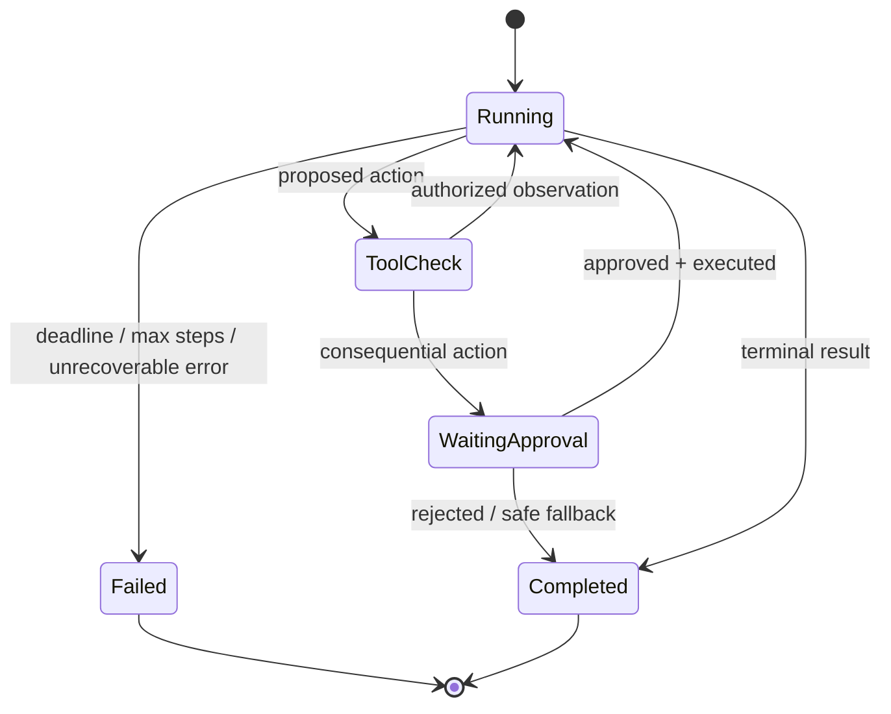

# User Feedback and Continuous Improvement

## 1. Title and Learning Position
- **Category:** Human-in-the-Loop and Responsible Autonomy
- **Prerequisites:** [Shadow Mode to Progressive Autonomy](100-progressive-autonomy.md)
- **Why it matters:** User Feedback and Continuous Improvement contributes to engineering controlled agents whose autonomy is explicit, bounded, evaluable and recoverable.
- **Learning objectives:** understand the control/state pattern; implement typed agent behavior; secure tools; evaluate trajectories; design observability/recovery; justify autonomy level.
- **Difficulty:** Intermediate
- **Estimated study time:** 4-8 hours plus practical exercises.
- **Practical competency:** implement and review User Feedback and Continuous Improvement as a production software component rather than an unconstrained prompt loop.

## 2. Concept
**Beginner.** An agent combines a model with state, tools and a control loop so it can observe results and decide a next bounded step. A chatbot mainly produces responses; a workflow follows a predefined path; an agent introduces runtime decisions.

**Intermediate.** Separate model decisions from deterministic controls. The model may propose an action, but code validates schemas, policy, identity, budgets and terminal conditions. Persist state/checkpoints so runs can resume and be audited.

**Advanced.** Analyze state consistency, idempotency, concurrency, tool failures, model/provider drift, memory contamination, prompt injection, delegated identity, human oversight, multi-agent coordination, tail latency and cost. Use the minimum sufficient autonomy.

**Design anchor.** Human oversight is a first-class state transition, not an afterthought. Risk-tier actions require reviewable evidence, proposed action, editable parameters, explicit approval and an idempotent commit phase.

**Control flow:** Trigger -> load/create typed state -> construct policy/context -> model/router decision -> validate next action -> authorize tool -> execute idempotently -> record observation/checkpoint -> evaluate terminal/budget conditions -> continue, wait for approval, complete or fail safely.

**Agent vs deterministic responsibilities:** models interpret ambiguous language and choose among bounded options; deterministic software owns permissions, side effects, invariants, money/access/deployment commits, retry semantics, state transitions and hard limits.

**Failure modes:** infinite/repeated loops, malformed tool args, duplicate actions, stale checkpoints, tool timeout, hidden partial failure, memory pollution, conflicting agents, data leakage, excessive agency, queue overload, cost runaway and inability to reproduce a trajectory.



## 3. Intermediate and Advanced Use Cases
### Intermediate bounded agent
**Problem:** Implement User Feedback and Continuous Improvement inside a bounded assistant that cannot perform unapproved side effects. **Why agentic:** use adaptive model choice only where the next action cannot be reliably expressed as deterministic logic; otherwise keep the step deterministic. **Tools/data:** typed least-privilege tools, governed retrieval and explicit state. **Planning/state:** checkpoint before/after side effects; enforce terminal states, max steps, deadline and budget. **Approval:** human authorization for consequential or high-risk changes. **Evaluation:** task success, tool/argument accuracy, policy compliance, trajectory length, recovery, latency and cost. **Risks:** loops, duplicate actions, privilege confusion, injection, stale state, memory contamination and cost escalation. **Fallback:** clarify, abstain, switch to deterministic workflow or escalate. **Non-agentic alternative:** fixed state machine/workflow with only selected LLM transformation nodes.
### Intermediate enterprise workflow
**Problem:** Apply User Feedback and Continuous Improvement to an ERP, procurement, IT service or document workflow. **Why agentic:** use adaptive model choice only where the next action cannot be reliably expressed as deterministic logic; otherwise keep the step deterministic. **Tools/data:** typed least-privilege tools, governed retrieval and explicit state. **Planning/state:** checkpoint before/after side effects; enforce terminal states, max steps, deadline and budget. **Approval:** human authorization for consequential or high-risk changes. **Evaluation:** task success, tool/argument accuracy, policy compliance, trajectory length, recovery, latency and cost. **Risks:** loops, duplicate actions, privilege confusion, injection, stale state, memory contamination and cost escalation. **Fallback:** clarify, abstain, switch to deterministic workflow or escalate. **Non-agentic alternative:** fixed state machine/workflow with only selected LLM transformation nodes.
### Advanced resilience
**Problem:** Operate User Feedback and Continuous Improvement under tool failures, retries, stale state and model/provider degradation. **Why agentic:** use adaptive model choice only where the next action cannot be reliably expressed as deterministic logic; otherwise keep the step deterministic. **Tools/data:** typed least-privilege tools, governed retrieval and explicit state. **Planning/state:** checkpoint before/after side effects; enforce terminal states, max steps, deadline and budget. **Approval:** human authorization for consequential or high-risk changes. **Evaluation:** task success, tool/argument accuracy, policy compliance, trajectory length, recovery, latency and cost. **Risks:** loops, duplicate actions, privilege confusion, injection, stale state, memory contamination and cost escalation. **Fallback:** clarify, abstain, switch to deterministic workflow or escalate. **Non-agentic alternative:** fixed state machine/workflow with only selected LLM transformation nodes.
### Advanced evaluation
**Problem:** Evaluate User Feedback and Continuous Improvement with golden tasks, trajectory analysis, simulations and failure injection. **Why agentic:** use adaptive model choice only where the next action cannot be reliably expressed as deterministic logic; otherwise keep the step deterministic. **Tools/data:** typed least-privilege tools, governed retrieval and explicit state. **Planning/state:** checkpoint before/after side effects; enforce terminal states, max steps, deadline and budget. **Approval:** human authorization for consequential or high-risk changes. **Evaluation:** task success, tool/argument accuracy, policy compliance, trajectory length, recovery, latency and cost. **Risks:** loops, duplicate actions, privilege confusion, injection, stale state, memory contamination and cost escalation. **Fallback:** clarify, abstain, switch to deterministic workflow or escalate. **Non-agentic alternative:** fixed state machine/workflow with only selected LLM transformation nodes.
### Enterprise governed automation
**Problem:** Deploy User Feedback and Continuous Improvement with delegated identity, tool gateway, checkpoints, human approval, audit, SLOs and rollback. **Why agentic:** use adaptive model choice only where the next action cannot be reliably expressed as deterministic logic; otherwise keep the step deterministic. **Tools/data:** typed least-privilege tools, governed retrieval and explicit state. **Planning/state:** checkpoint before/after side effects; enforce terminal states, max steps, deadline and budget. **Approval:** human authorization for consequential or high-risk changes. **Evaluation:** task success, tool/argument accuracy, policy compliance, trajectory length, recovery, latency and cost. **Risks:** loops, duplicate actions, privilege confusion, injection, stale state, memory contamination and cost escalation. **Fallback:** clarify, abstain, switch to deterministic workflow or escalate. **Non-agentic alternative:** fixed state machine/workflow with only selected LLM transformation nodes.

## 4. Python Implementation
**Implementation discipline.** Use typed configuration/state/tool schemas; provider-neutral model interface; explicit graph/control states; durable checkpoint writes; async I/O for independent external calls; deadlines, bounded retries, circuit breaking, max steps and budgets; idempotency for side effects; approval interrupts; and full tracing.

```python
from pydantic import BaseModel, Field
from typing import Literal, Any

class AgentState(BaseModel):
    run_id: str
    task: str
    step: int = 0
    max_steps: int = 8
    budget_remaining: float = Field(default=5.0, ge=0)
    status: Literal["running", "waiting_approval", "completed", "failed"] = "running"

def may_continue(s: AgentState) -> bool:
    return s.status == "running" and s.step < s.max_steps and s.budget_remaining > 0
```

```python
class ToolRequest(BaseModel):
    tool_name: str
    arguments: dict[str, Any]
    idempotency_key: str

def authorize_and_validate(req: ToolRequest, principal, policy):
    parsed = policy.schemas[req.tool_name].model_validate(req.arguments)
    if not policy.is_allowed(principal, req.tool_name, parsed):
        raise PermissionError("tool action not authorized")
    return parsed
# Side effects execute only after validation, authorization, risk checks and approval when required.
```

**Recovery:** persist enough state to distinguish not-started, in-progress, committed and failed side effects. Resume from checkpoints only after reconciling external system state. Never blindly replay a possibly committed action.

**Testing:** mock model/tool responses; unit-test transitions/policies; simulate timeout, malformed output, duplicate retry, denied permission, stale checkpoint and provider failure; evaluate representative end-to-end trajectories.

**Common mistake:** letting the LLM decide whether it is authorized to call a tool. **Correction:** model output is only a proposal; authorization belongs to deterministic policy enforcement using authenticated identity.

## 5. Architectural Considerations
- **Control boundary:** prefer ordinary workflow code for known paths; add agent decisions only at ambiguity/adaptation points.
- **State/checkpoints:** PostgreSQL fits durable transactional state; Redis may support ephemeral/fast state; object/event stores fit large artifacts/history. Choose using consistency, replay, retention and scale needs.
- **Workflow orchestration:** LangGraph-style graphs are useful for explicit stateful LLM workflows; durable workflow engines are useful for hours/days-long processes and retries. Treat framework APIs as mutable and verify current documentation.
- **Tools:** central tool gateway can apply schemas, authentication/delegated identity, RBAC/ABAC, quotas, timeouts, idempotency, audit and versioning.
- **MCP:** useful for interoperable discovery of tools/resources, but still requires server trust, identity, authorization, allowlists and monitoring.
- **RAG:** authorize retrieval before exposing evidence; preserve source/version/chunk/ACL data and cited evidence.
- **Human oversight:** place approval immediately before irreversible/consequential commit and surface proposed change plus evidence. Support edit/reject/cancel.
- **Concurrency:** use queues/back pressure/admission control; guard shared state with version checks/optimistic concurrency and dedupe keys.
- **Multi-agent:** only introduce when specialization/isolation measurably improves results; cap delegation and define ownership/arbitration to prevent loops/deadlocks.
- **Security:** threat-model prompt injection, confused deputy, excessive agency, credential theft, sandbox escape, exfiltration and tool/MCP supply chain. Keep secrets out of prompts.
- **Observability:** trace run/thread ID, state version, model/prompt version, retrieval, tool args/results (redacted), approvals, transitions, errors, token/tool cost and final task outcome.
- **Evaluation/CI:** golden tasks plus simulated tools/failures should gate graph/prompt/model/tool/policy releases. Measure outcome and trajectory, not just final prose.
- **Release/recovery:** shadow mode before autonomy; progressive rollout; feature flag/kill switch; prior graph/prompt release; checkpoint migration and disaster recovery.
- **Cost:** enforce per-run token/tool/time budgets and measure cost per successful task rather than average tokens only.

## 6. Interview Questions
### Q1. Beginner: What is a critical engineering decision for **User Feedback and Continuous Improvement**, and how would you validate it?
**Model answer:** Start from the task/risk boundary, prefer deterministic control when possible, define typed state and tool contracts, bound autonomy with steps/time/budgets, enforce authorization outside the model, then evaluate outcome plus trajectory, latency, cost and failure recovery using representative scenarios.

**Evaluates:** agent-control understanding, software/distributed-systems judgment, evaluation discipline and security awareness.

**Weak answer:** describing an LLM loop or framework without state, termination, authorization, idempotency, approval, observability or regression tests.

**Follow-up:** How would the design behave after a timeout, duplicate retry, stale checkpoint, prompt injection, provider outage or denied tool permission?

### Q2. Beginner: What is a critical engineering decision for **User Feedback and Continuous Improvement**, and how would you validate it?
**Model answer:** Start from the task/risk boundary, prefer deterministic control when possible, define typed state and tool contracts, bound autonomy with steps/time/budgets, enforce authorization outside the model, then evaluate outcome plus trajectory, latency, cost and failure recovery using representative scenarios.

**Evaluates:** agent-control understanding, software/distributed-systems judgment, evaluation discipline and security awareness.

**Weak answer:** describing an LLM loop or framework without state, termination, authorization, idempotency, approval, observability or regression tests.

**Follow-up:** How would the design behave after a timeout, duplicate retry, stale checkpoint, prompt injection, provider outage or denied tool permission?

### Q3. Beginner: What is a critical engineering decision for **User Feedback and Continuous Improvement**, and how would you validate it?
**Model answer:** Start from the task/risk boundary, prefer deterministic control when possible, define typed state and tool contracts, bound autonomy with steps/time/budgets, enforce authorization outside the model, then evaluate outcome plus trajectory, latency, cost and failure recovery using representative scenarios.

**Evaluates:** agent-control understanding, software/distributed-systems judgment, evaluation discipline and security awareness.

**Weak answer:** describing an LLM loop or framework without state, termination, authorization, idempotency, approval, observability or regression tests.

**Follow-up:** How would the design behave after a timeout, duplicate retry, stale checkpoint, prompt injection, provider outage or denied tool permission?

### Q4. Beginner: What is a critical engineering decision for **User Feedback and Continuous Improvement**, and how would you validate it?
**Model answer:** Start from the task/risk boundary, prefer deterministic control when possible, define typed state and tool contracts, bound autonomy with steps/time/budgets, enforce authorization outside the model, then evaluate outcome plus trajectory, latency, cost and failure recovery using representative scenarios.

**Evaluates:** agent-control understanding, software/distributed-systems judgment, evaluation discipline and security awareness.

**Weak answer:** describing an LLM loop or framework without state, termination, authorization, idempotency, approval, observability or regression tests.

**Follow-up:** How would the design behave after a timeout, duplicate retry, stale checkpoint, prompt injection, provider outage or denied tool permission?

### Q5. Beginner: What is a critical engineering decision for **User Feedback and Continuous Improvement**, and how would you validate it?
**Model answer:** Start from the task/risk boundary, prefer deterministic control when possible, define typed state and tool contracts, bound autonomy with steps/time/budgets, enforce authorization outside the model, then evaluate outcome plus trajectory, latency, cost and failure recovery using representative scenarios.

**Evaluates:** agent-control understanding, software/distributed-systems judgment, evaluation discipline and security awareness.

**Weak answer:** describing an LLM loop or framework without state, termination, authorization, idempotency, approval, observability or regression tests.

**Follow-up:** How would the design behave after a timeout, duplicate retry, stale checkpoint, prompt injection, provider outage or denied tool permission?

### Q6. Intermediate: What is a critical engineering decision for **User Feedback and Continuous Improvement**, and how would you validate it?
**Model answer:** Start from the task/risk boundary, prefer deterministic control when possible, define typed state and tool contracts, bound autonomy with steps/time/budgets, enforce authorization outside the model, then evaluate outcome plus trajectory, latency, cost and failure recovery using representative scenarios.

**Evaluates:** agent-control understanding, software/distributed-systems judgment, evaluation discipline and security awareness.

**Weak answer:** describing an LLM loop or framework without state, termination, authorization, idempotency, approval, observability or regression tests.

**Follow-up:** How would the design behave after a timeout, duplicate retry, stale checkpoint, prompt injection, provider outage or denied tool permission?

### Q7. Intermediate: What is a critical engineering decision for **User Feedback and Continuous Improvement**, and how would you validate it?
**Model answer:** Start from the task/risk boundary, prefer deterministic control when possible, define typed state and tool contracts, bound autonomy with steps/time/budgets, enforce authorization outside the model, then evaluate outcome plus trajectory, latency, cost and failure recovery using representative scenarios.

**Evaluates:** agent-control understanding, software/distributed-systems judgment, evaluation discipline and security awareness.

**Weak answer:** describing an LLM loop or framework without state, termination, authorization, idempotency, approval, observability or regression tests.

**Follow-up:** How would the design behave after a timeout, duplicate retry, stale checkpoint, prompt injection, provider outage or denied tool permission?

### Q8. Intermediate: What is a critical engineering decision for **User Feedback and Continuous Improvement**, and how would you validate it?
**Model answer:** Start from the task/risk boundary, prefer deterministic control when possible, define typed state and tool contracts, bound autonomy with steps/time/budgets, enforce authorization outside the model, then evaluate outcome plus trajectory, latency, cost and failure recovery using representative scenarios.

**Evaluates:** agent-control understanding, software/distributed-systems judgment, evaluation discipline and security awareness.

**Weak answer:** describing an LLM loop or framework without state, termination, authorization, idempotency, approval, observability or regression tests.

**Follow-up:** How would the design behave after a timeout, duplicate retry, stale checkpoint, prompt injection, provider outage or denied tool permission?

### Q9. Intermediate: What is a critical engineering decision for **User Feedback and Continuous Improvement**, and how would you validate it?
**Model answer:** Start from the task/risk boundary, prefer deterministic control when possible, define typed state and tool contracts, bound autonomy with steps/time/budgets, enforce authorization outside the model, then evaluate outcome plus trajectory, latency, cost and failure recovery using representative scenarios.

**Evaluates:** agent-control understanding, software/distributed-systems judgment, evaluation discipline and security awareness.

**Weak answer:** describing an LLM loop or framework without state, termination, authorization, idempotency, approval, observability or regression tests.

**Follow-up:** How would the design behave after a timeout, duplicate retry, stale checkpoint, prompt injection, provider outage or denied tool permission?

### Q10. Intermediate: What is a critical engineering decision for **User Feedback and Continuous Improvement**, and how would you validate it?
**Model answer:** Start from the task/risk boundary, prefer deterministic control when possible, define typed state and tool contracts, bound autonomy with steps/time/budgets, enforce authorization outside the model, then evaluate outcome plus trajectory, latency, cost and failure recovery using representative scenarios.

**Evaluates:** agent-control understanding, software/distributed-systems judgment, evaluation discipline and security awareness.

**Weak answer:** describing an LLM loop or framework without state, termination, authorization, idempotency, approval, observability or regression tests.

**Follow-up:** How would the design behave after a timeout, duplicate retry, stale checkpoint, prompt injection, provider outage or denied tool permission?

### Q11. Advanced: What is a critical engineering decision for **User Feedback and Continuous Improvement**, and how would you validate it?
**Model answer:** Start from the task/risk boundary, prefer deterministic control when possible, define typed state and tool contracts, bound autonomy with steps/time/budgets, enforce authorization outside the model, then evaluate outcome plus trajectory, latency, cost and failure recovery using representative scenarios.

**Evaluates:** agent-control understanding, software/distributed-systems judgment, evaluation discipline and security awareness.

**Weak answer:** describing an LLM loop or framework without state, termination, authorization, idempotency, approval, observability or regression tests.

**Follow-up:** How would the design behave after a timeout, duplicate retry, stale checkpoint, prompt injection, provider outage or denied tool permission?

### Q12. Advanced: What is a critical engineering decision for **User Feedback and Continuous Improvement**, and how would you validate it?
**Model answer:** Start from the task/risk boundary, prefer deterministic control when possible, define typed state and tool contracts, bound autonomy with steps/time/budgets, enforce authorization outside the model, then evaluate outcome plus trajectory, latency, cost and failure recovery using representative scenarios.

**Evaluates:** agent-control understanding, software/distributed-systems judgment, evaluation discipline and security awareness.

**Weak answer:** describing an LLM loop or framework without state, termination, authorization, idempotency, approval, observability or regression tests.

**Follow-up:** How would the design behave after a timeout, duplicate retry, stale checkpoint, prompt injection, provider outage or denied tool permission?

### Q13. Advanced: What is a critical engineering decision for **User Feedback and Continuous Improvement**, and how would you validate it?
**Model answer:** Start from the task/risk boundary, prefer deterministic control when possible, define typed state and tool contracts, bound autonomy with steps/time/budgets, enforce authorization outside the model, then evaluate outcome plus trajectory, latency, cost and failure recovery using representative scenarios.

**Evaluates:** agent-control understanding, software/distributed-systems judgment, evaluation discipline and security awareness.

**Weak answer:** describing an LLM loop or framework without state, termination, authorization, idempotency, approval, observability or regression tests.

**Follow-up:** How would the design behave after a timeout, duplicate retry, stale checkpoint, prompt injection, provider outage or denied tool permission?

### Q14. Advanced: What is a critical engineering decision for **User Feedback and Continuous Improvement**, and how would you validate it?
**Model answer:** Start from the task/risk boundary, prefer deterministic control when possible, define typed state and tool contracts, bound autonomy with steps/time/budgets, enforce authorization outside the model, then evaluate outcome plus trajectory, latency, cost and failure recovery using representative scenarios.

**Evaluates:** agent-control understanding, software/distributed-systems judgment, evaluation discipline and security awareness.

**Weak answer:** describing an LLM loop or framework without state, termination, authorization, idempotency, approval, observability or regression tests.

**Follow-up:** How would the design behave after a timeout, duplicate retry, stale checkpoint, prompt injection, provider outage or denied tool permission?

### Q15. Advanced: What is a critical engineering decision for **User Feedback and Continuous Improvement**, and how would you validate it?
**Model answer:** Start from the task/risk boundary, prefer deterministic control when possible, define typed state and tool contracts, bound autonomy with steps/time/budgets, enforce authorization outside the model, then evaluate outcome plus trajectory, latency, cost and failure recovery using representative scenarios.

**Evaluates:** agent-control understanding, software/distributed-systems judgment, evaluation discipline and security awareness.

**Weak answer:** describing an LLM loop or framework without state, termination, authorization, idempotency, approval, observability or regression tests.

**Follow-up:** How would the design behave after a timeout, duplicate retry, stale checkpoint, prompt injection, provider outage or denied tool permission?

### Q16. Architecture: What is a critical engineering decision for **User Feedback and Continuous Improvement**, and how would you validate it?
**Model answer:** Start from the task/risk boundary, prefer deterministic control when possible, define typed state and tool contracts, bound autonomy with steps/time/budgets, enforce authorization outside the model, then evaluate outcome plus trajectory, latency, cost and failure recovery using representative scenarios.

**Evaluates:** agent-control understanding, software/distributed-systems judgment, evaluation discipline and security awareness.

**Weak answer:** describing an LLM loop or framework without state, termination, authorization, idempotency, approval, observability or regression tests.

**Follow-up:** How would the design behave after a timeout, duplicate retry, stale checkpoint, prompt injection, provider outage or denied tool permission?

### Q17. Architecture: What is a critical engineering decision for **User Feedback and Continuous Improvement**, and how would you validate it?
**Model answer:** Start from the task/risk boundary, prefer deterministic control when possible, define typed state and tool contracts, bound autonomy with steps/time/budgets, enforce authorization outside the model, then evaluate outcome plus trajectory, latency, cost and failure recovery using representative scenarios.

**Evaluates:** agent-control understanding, software/distributed-systems judgment, evaluation discipline and security awareness.

**Weak answer:** describing an LLM loop or framework without state, termination, authorization, idempotency, approval, observability or regression tests.

**Follow-up:** How would the design behave after a timeout, duplicate retry, stale checkpoint, prompt injection, provider outage or denied tool permission?

### Q18. Architecture: What is a critical engineering decision for **User Feedback and Continuous Improvement**, and how would you validate it?
**Model answer:** Start from the task/risk boundary, prefer deterministic control when possible, define typed state and tool contracts, bound autonomy with steps/time/budgets, enforce authorization outside the model, then evaluate outcome plus trajectory, latency, cost and failure recovery using representative scenarios.

**Evaluates:** agent-control understanding, software/distributed-systems judgment, evaluation discipline and security awareness.

**Weak answer:** describing an LLM loop or framework without state, termination, authorization, idempotency, approval, observability or regression tests.

**Follow-up:** How would the design behave after a timeout, duplicate retry, stale checkpoint, prompt injection, provider outage or denied tool permission?

### Q19. Debugging: What is a critical engineering decision for **User Feedback and Continuous Improvement**, and how would you validate it?
**Model answer:** Start from the task/risk boundary, prefer deterministic control when possible, define typed state and tool contracts, bound autonomy with steps/time/budgets, enforce authorization outside the model, then evaluate outcome plus trajectory, latency, cost and failure recovery using representative scenarios.

**Evaluates:** agent-control understanding, software/distributed-systems judgment, evaluation discipline and security awareness.

**Weak answer:** describing an LLM loop or framework without state, termination, authorization, idempotency, approval, observability or regression tests.

**Follow-up:** How would the design behave after a timeout, duplicate retry, stale checkpoint, prompt injection, provider outage or denied tool permission?

### Q20. Debugging: What is a critical engineering decision for **User Feedback and Continuous Improvement**, and how would you validate it?
**Model answer:** Start from the task/risk boundary, prefer deterministic control when possible, define typed state and tool contracts, bound autonomy with steps/time/budgets, enforce authorization outside the model, then evaluate outcome plus trajectory, latency, cost and failure recovery using representative scenarios.

**Evaluates:** agent-control understanding, software/distributed-systems judgment, evaluation discipline and security awareness.

**Weak answer:** describing an LLM loop or framework without state, termination, authorization, idempotency, approval, observability or regression tests.

**Follow-up:** How would the design behave after a timeout, duplicate retry, stale checkpoint, prompt injection, provider outage or denied tool permission?

### Q21. Coding: What is a critical engineering decision for **User Feedback and Continuous Improvement**, and how would you validate it?
**Model answer:** Start from the task/risk boundary, prefer deterministic control when possible, define typed state and tool contracts, bound autonomy with steps/time/budgets, enforce authorization outside the model, then evaluate outcome plus trajectory, latency, cost and failure recovery using representative scenarios.

**Evaluates:** agent-control understanding, software/distributed-systems judgment, evaluation discipline and security awareness.

**Weak answer:** describing an LLM loop or framework without state, termination, authorization, idempotency, approval, observability or regression tests.

**Follow-up:** How would the design behave after a timeout, duplicate retry, stale checkpoint, prompt injection, provider outage or denied tool permission?

### Q22. Coding: What is a critical engineering decision for **User Feedback and Continuous Improvement**, and how would you validate it?
**Model answer:** Start from the task/risk boundary, prefer deterministic control when possible, define typed state and tool contracts, bound autonomy with steps/time/budgets, enforce authorization outside the model, then evaluate outcome plus trajectory, latency, cost and failure recovery using representative scenarios.

**Evaluates:** agent-control understanding, software/distributed-systems judgment, evaluation discipline and security awareness.

**Weak answer:** describing an LLM loop or framework without state, termination, authorization, idempotency, approval, observability or regression tests.

**Follow-up:** How would the design behave after a timeout, duplicate retry, stale checkpoint, prompt injection, provider outage or denied tool permission?

## 7. Practical Exercises
### Foundational
Implement User Feedback and Continuous Improvement in a small typed state machine with mocked model/tools and a hard maximum of six steps. **Expected:** deterministic tests and traceable state transitions. **Evaluate:** state correctness, validation and termination. **Failure modes:** loop, malformed action, missing terminal state. **Stretch:** add checkpoint/resume.

### Intermediate
Add two real read-only tools, retrieval, timeouts/retries, idempotency metadata and a golden task suite. **Expected:** bounded agent with trajectory report. **Evaluate:** task/tool accuracy, recovery, latency and cost. **Stretch:** add approval interrupt.

### Advanced production
Design an enterprise workflow with delegated identity, tool gateway, durable state, human approval, observability, CI evaluation, security tests, SLOs and DR. **Expected:** architecture/runbook/threat model. **Evaluate:** failure containment, auditability, least privilege, operability and cost. **Stretch:** run chaos tests against tool/provider failure and duplicate delivery.

## 8. Summary and Revision Checklist
### Key takeaways
- Use the minimum sufficient autonomy.
- Treat model decisions as proposals inside deterministic controls.
- State, termination, permissions, retries and budgets must be explicit.
- Evaluate outcomes and trajectories before increasing autonomy.

### Important design rules
Every agent run needs identity, typed state, terminal states, max steps, deadline/cancellation, cost/tool budgets, authorized tools, idempotency policy, checkpoint strategy and observable outcome.

### State/tool/security parameters
State schema/version, max steps, timeout, retry count/backoff, per-run budget, allowed tools, approval threshold, checkpoint interval, retention, concurrency policy and model/prompt/tool versions.

### Architecture checklist
- [ ] Deterministic workflow considered first
- [ ] Typed state and terminal conditions defined
- [ ] Checkpoint/resume/replay behavior tested
- [ ] Tools versioned, validated and observable
- [ ] SLOs/evaluation/fallback/kill switch defined

### Safety checklist
- [ ] Identity/authorization outside model
- [ ] Least-privilege tools
- [ ] Consequential actions approved appropriately
- [ ] Injection/exfiltration/excessive-agency tests
- [ ] Sandbox untrusted code/files/browser activity

### Common pitfalls
Agent for a deterministic problem, unbounded loop, prompt-only safety, repeated non-idempotent actions, implicit state, ungoverned long-term memory, tool credentials in context, multi-agent complexity without measurable benefit and evaluation based only on final text.

### Five flashcards
1. **Q:** When should you not use an agent? **A:** When a deterministic workflow can reliably encode the path.
2. **Q:** Who authorizes a tool? **A:** Deterministic policy code acting on authenticated identity, not the LLM.
3. **Q:** What bounds an agent? **A:** Terminal states, max steps, deadlines/cancellation, budgets, tool policy and approvals.
4. **Q:** Why checkpoints? **A:** Recovery, audit, resume, replay and diagnosis of long-running stateful tasks.
5. **Q:** Agent evaluation unit? **A:** Task outcome plus trajectory, tool use, policy compliance, latency/reliability and cost.

### Next recommended topics
- [Action Rationale, Evidence, Audit, and Reproducibility](102-explainability-audit.md)
- [Agent UX, Transparency, Progress, Interruptibility, and Trust](103-agent-ux.md)
