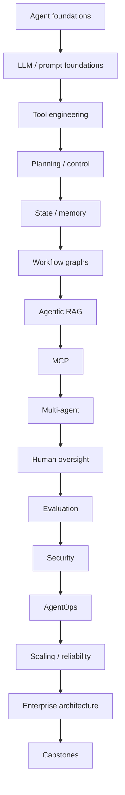
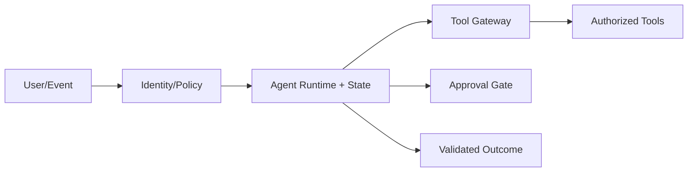

# Agentic AI Engineering Notes

## Repository Purpose

A production-oriented path for experienced Python/ML/LLM engineers moving toward Agentic AI Engineering and AI Solution Architecture. The repository emphasizes deterministic boundaries, typed state, least-privilege tools, evaluation, human oversight and operational recovery.

## Recommended Learning Path

## Category Summary

### Category 1: Agentic AI Foundations

**Purpose:** build competency in agentic ai foundations. **Prerequisites:** previous categories unless already proficient. **Estimated study time:** 54-90 hours. **Outcome:** implement, evaluate, secure and architect these agent capabilities.

1. **[Agentic AI: Definition, Capabilities, Boundaries, and Limitations](01-agentic-ai-overview.md)**  
   Foundational. Prerequisite: Python, APIs and LLM fundamentals. Study: 4-8 hours. Competency: implement/evaluate/review Agentic AI: Definition, Capabilities, Boundaries, and Limitations.
2. **[Agent vs Chatbot vs Copilot vs Deterministic Workflow](02-agent-vs-workflow.md)**  
   Foundational. Prerequisite: Agentic AI: Definition, Capabilities, Boundaries, and Limitations. Study: 4-8 hours. Competency: implement/evaluate/review Agent vs Chatbot vs Copilot vs Deterministic Workflow.
3. **[Model, Instructions, State, Tools, Memory, Environment, and Control Loop](03-agent-anatomy.md)**  
   Foundational. Prerequisite: Agent vs Chatbot vs Copilot vs Deterministic Workflow. Study: 4-8 hours. Competency: implement/evaluate/review Model, Instructions, State, Tools, Memory, Environment, and Control Loop.
4. **[Observe, Think/Decide, Act, Observe, and Terminate](04-agent-loop.md)**  
   Foundational. Prerequisite: Model, Instructions, State, Tools, Memory, Environment, and Control Loop. Study: 4-8 hours. Competency: implement/evaluate/review Observe, Think/Decide, Act, Observe, and Terminate.
5. **[Typed State, Messages, Events, Artifacts, and Context](05-agent-state.md)**  
   Foundational. Prerequisite: Observe, Think/Decide, Act, Observe, and Terminate. Study: 4-8 hours. Competency: implement/evaluate/review Typed State, Messages, Events, Artifacts, and Context.
6. **[Autonomy Levels and Choosing the Minimum Sufficient Autonomy](06-autonomy-spectrum.md)**  
   Foundational. Prerequisite: Typed State, Messages, Events, Artifacts, and Context. Study: 4-8 hours. Competency: implement/evaluate/review Autonomy Levels and Choosing the Minimum Sufficient Autonomy.
7. **[Feasibility, Risk, ROI, and Agentic Use-Case Selection](07-agent-use-case-selection.md)**  
   Foundational. Prerequisite: Autonomy Levels and Choosing the Minimum Sufficient Autonomy. Study: 4-8 hours. Competency: implement/evaluate/review Feasibility, Risk, ROI, and Agentic Use-Case Selection.
8. **[Design, Build, Evaluate, Deploy, Monitor, Improve](08-agent-lifecycle.md)**  
   Foundational. Prerequisite: Feasibility, Risk, ROI, and Agentic Use-Case Selection. Study: 4-8 hours. Competency: implement/evaluate/review Design, Build, Evaluate, Deploy, Monitor, Improve.
9. **[Baseline Production Agent Reference Architecture](09-agent-reference-architecture.md)**  
   Foundational. Prerequisite: Design, Build, Evaluate, Deploy, Monitor, Improve. Study: 4-8 hours. Competency: implement/evaluate/review Baseline Production Agent Reference Architecture.

### Category 2: LLM and Prompt Foundations for Agents

**Purpose:** build competency in llm and prompt foundations for agents. **Prerequisites:** previous categories unless already proficient. **Estimated study time:** 54-90 hours. **Outcome:** implement, evaluate, secure and architect these agent capabilities.

10. **[LLM Probabilistic Behavior, Context, and Failure Modes](10-llm-behavior-for-agents.md)**  
   Foundational. Prerequisite: Baseline Production Agent Reference Architecture. Study: 4-8 hours. Competency: implement/evaluate/review LLM Probabilistic Behavior, Context, and Failure Modes.
11. **[System Instructions, Policies, User Requests, and Tool Context](11-instruction-hierarchy.md)**  
   Foundational. Prerequisite: LLM Probabilistic Behavior, Context, and Failure Modes. Study: 4-8 hours. Competency: implement/evaluate/review System Instructions, Policies, User Requests, and Tool Context.
12. **[Typed Structured Outputs and Schema Validation](12-structured-outputs.md)**  
   Foundational. Prerequisite: System Instructions, Policies, User Requests, and Tool Context. Study: 4-8 hours. Competency: implement/evaluate/review Typed Structured Outputs and Schema Validation.
13. **[Function Calling and Tool Invocation Fundamentals](13-function-calling.md)**  
   Foundational. Prerequisite: Typed Structured Outputs and Schema Validation. Study: 4-8 hours. Competency: implement/evaluate/review Function Calling and Tool Invocation Fundamentals.
14. **[Context Selection, Ordering, Compression, and Budgets](14-context-engineering.md)**  
   Foundational. Prerequisite: Function Calling and Tool Invocation Fundamentals. Study: 4-8 hours. Competency: implement/evaluate/review Context Selection, Ordering, Compression, and Budgets.
15. **[Agent Prompts, Policies, Tool Descriptions, and Output Contracts](15-agent-prompt-design.md)**  
   Foundational. Prerequisite: Context Selection, Ordering, Compression, and Budgets. Study: 4-8 hours. Competency: implement/evaluate/review Agent Prompts, Policies, Tool Descriptions, and Output Contracts.
16. **[Decomposition, Verification, Critique, and Observable Reasoning Artifacts](16-reasoning-and-verification.md)**  
   Foundational. Prerequisite: Agent Prompts, Policies, Tool Descriptions, and Output Contracts. Study: 4-8 hours. Competency: implement/evaluate/review Decomposition, Verification, Critique, and Observable Reasoning Artifacts.
17. **[Model Selection, Routing, Cascades, and Fallback](17-model-selection-routing.md)**  
   Foundational. Prerequisite: Decomposition, Verification, Critique, and Observable Reasoning Artifacts. Study: 4-8 hours. Competency: implement/evaluate/review Model Selection, Routing, Cascades, and Fallback.
18. **[Token, Tool-Call, Latency, and Cost Budgets](18-agent-token-cost.md)**  
   Foundational. Prerequisite: Model Selection, Routing, Cascades, and Fallback. Study: 4-8 hours. Competency: implement/evaluate/review Token, Tool-Call, Latency, and Cost Budgets.

### Category 3: Tool Engineering

**Purpose:** build competency in tool engineering. **Prerequisites:** previous categories unless already proficient. **Estimated study time:** 66-110 hours. **Outcome:** implement, evaluate, secure and architect these agent capabilities.

19. **[Tool Boundaries, Names, Descriptions, Schemas, and Contracts](19-tool-design.md)**  
   Foundational. Prerequisite: Token, Tool-Call, Latency, and Cost Budgets. Study: 4-8 hours. Competency: implement/evaluate/review Tool Boundaries, Names, Descriptions, Schemas, and Contracts.
20. **[Tool Argument Validation and Canonicalization](20-tool-input-validation.md)**  
   Foundational. Prerequisite: Tool Boundaries, Names, Descriptions, Schemas, and Contracts. Study: 4-8 hours. Competency: implement/evaluate/review Tool Argument Validation and Canonicalization.
21. **[Result Schemas, Errors, Partial Results, and Trust Boundaries](21-tool-result-validation.md)**  
   Foundational. Prerequisite: Tool Argument Validation and Canonicalization. Study: 4-8 hours. Competency: implement/evaluate/review Result Schemas, Errors, Partial Results, and Trust Boundaries.
22. **[Tool Selection and Routing](22-tool-choice.md)**  
   Foundational. Prerequisite: Result Schemas, Errors, Partial Results, and Trust Boundaries. Study: 4-8 hours. Competency: implement/evaluate/review Tool Selection and Routing.
23. **[Idempotency, Dedupe Keys, and Safe Retries](23-idempotency.md)**  
   Foundational. Prerequisite: Tool Selection and Routing. Study: 4-8 hours. Competency: implement/evaluate/review Idempotency, Dedupe Keys, and Safe Retries.
24. **[Timeouts, Retry Policies, Backoff, and Circuit Breakers](24-timeouts-retries.md)**  
   Foundational. Prerequisite: Idempotency, Dedupe Keys, and Safe Retries. Study: 4-8 hours. Competency: implement/evaluate/review Timeouts, Retry Policies, Backoff, and Circuit Breakers.
25. **[REST, GraphQL, Search, Database, and Enterprise API Tools](25-api-tools.md)**  
   Foundational. Prerequisite: Timeouts, Retry Policies, Backoff, and Circuit Breakers. Study: 4-8 hours. Competency: implement/evaluate/review REST, GraphQL, Search, Database, and Enterprise API Tools.
26. **[Sandboxed Code Execution and Resource Isolation](26-code-execution.md)**  
   Foundational. Prerequisite: REST, GraphQL, Search, Database, and Enterprise API Tools. Study: 4-8 hours. Competency: implement/evaluate/review Sandboxed Code Execution and Resource Isolation.
27. **[Browser/Computer Use Agents and UI Automation Risks](27-browser-computer-use.md)**  
   Foundational. Prerequisite: Sandboxed Code Execution and Resource Isolation. Study: 4-8 hours. Competency: implement/evaluate/review Browser/Computer Use Agents and UI Automation Risks.
28. **[Email, Payments, Deployments, Access Changes, and Approval Controls](28-consequential-tools.md)**  
   Foundational. Prerequisite: Browser/Computer Use Agents and UI Automation Risks. Study: 4-8 hours. Competency: implement/evaluate/review Email, Payments, Deployments, Access Changes, and Approval Controls.
29. **[Central Tool Gateway, Policies, Credentials, Quotas, and Audit](29-tool-gateway.md)**  
   Foundational. Prerequisite: Email, Payments, Deployments, Access Changes, and Approval Controls. Study: 4-8 hours. Competency: implement/evaluate/review Central Tool Gateway, Policies, Credentials, Quotas, and Audit.

### Category 4: Planning, Reasoning, and Control

**Purpose:** build competency in planning, reasoning, and control. **Prerequisites:** previous categories unless already proficient. **Estimated study time:** 66-110 hours. **Outcome:** implement, evaluate, secure and architect these agent capabilities.

30. **[Task Decomposition and Subgoal Formation](30-task-decomposition.md)**  
   Intermediate. Prerequisite: Central Tool Gateway, Policies, Credentials, Quotas, and Audit. Study: 4-8 hours. Competency: implement/evaluate/review Task Decomposition and Subgoal Formation.
31. **[ReAct-Style Action/Observation Loops](31-react.md)**  
   Intermediate. Prerequisite: Task Decomposition and Subgoal Formation. Study: 4-8 hours. Competency: implement/evaluate/review ReAct-Style Action/Observation Loops.
32. **[Plan-and-Execute Architecture](32-plan-and-execute.md)**  
   Intermediate. Prerequisite: ReAct-Style Action/Observation Loops. Study: 4-8 hours. Competency: implement/evaluate/review Plan-and-Execute Architecture.
33. **[Planner, Executor, Verifier, and Controller Separation](33-planner-executor.md)**  
   Intermediate. Prerequisite: Plan-and-Execute Architecture. Study: 4-8 hours. Competency: implement/evaluate/review Planner, Executor, Verifier, and Controller Separation.
34. **[Reflection, Critique, and Correction Loops](34-reflection-critique.md)**  
   Intermediate. Prerequisite: Planner, Executor, Verifier, and Controller Separation. Study: 4-8 hours. Competency: implement/evaluate/review Reflection, Critique, and Correction Loops.
35. **[Replanning after Tool Results and Failures](35-dynamic-replanning.md)**  
   Intermediate. Prerequisite: Reflection, Critique, and Correction Loops. Study: 4-8 hours. Competency: implement/evaluate/review Replanning after Tool Results and Failures.
36. **[Tree/Graph Search Concepts for Agent Planning](36-search-planning.md)**  
   Intermediate. Prerequisite: Replanning after Tool Results and Failures. Study: 4-8 hours. Competency: implement/evaluate/review Tree/Graph Search Concepts for Agent Planning.
37. **[Intent Classification and Routing](37-routing-classification.md)**  
   Intermediate. Prerequisite: Tree/Graph Search Concepts for Agent Planning. Study: 4-8 hours. Competency: implement/evaluate/review Intent Classification and Routing.
38. **[Termination, Maximum Steps, Deadlines, and Budget Exhaustion](38-loop-termination.md)**  
   Intermediate. Prerequisite: Intent Classification and Routing. Study: 4-8 hours. Competency: implement/evaluate/review Termination, Maximum Steps, Deadlines, and Budget Exhaustion.
39. **[Clarification, Abstention, Escalation, and Deterministic Fallback](39-agent-fallback.md)**  
   Intermediate. Prerequisite: Termination, Maximum Steps, Deadlines, and Budget Exhaustion. Study: 4-8 hours. Competency: implement/evaluate/review Clarification, Abstention, Escalation, and Deterministic Fallback.
40. **[Evaluating Planning and Control Policies](40-control-policy-evaluation.md)**  
   Intermediate. Prerequisite: Clarification, Abstention, Escalation, and Deterministic Fallback. Study: 4-8 hours. Competency: implement/evaluate/review Evaluating Planning and Control Policies.

### Category 5: State, Memory, and Persistence

**Purpose:** build competency in state, memory, and persistence. **Prerequisites:** previous categories unless already proficient. **Estimated study time:** 66-110 hours. **Outcome:** implement, evaluate, secure and architect these agent capabilities.

41. **[Working Memory and Active Context](41-working-memory.md)**  
   Intermediate. Prerequisite: Evaluating Planning and Control Policies. Study: 4-8 hours. Competency: implement/evaluate/review Working Memory and Active Context.
42. **[Conversation State and Session Management](42-conversation-state.md)**  
   Intermediate. Prerequisite: Working Memory and Active Context. Study: 4-8 hours. Competency: implement/evaluate/review Conversation State and Session Management.
43. **[Durable Checkpoints, Resume, and Replay](43-checkpointing.md)**  
   Intermediate. Prerequisite: Conversation State and Session Management. Study: 4-8 hours. Competency: implement/evaluate/review Durable Checkpoints, Resume, and Replay.
44. **[Long-Term Memory: When It Helps and When It Hurts](44-long-term-memory.md)**  
   Intermediate. Prerequisite: Durable Checkpoints, Resume, and Replay. Study: 4-8 hours. Competency: implement/evaluate/review Long-Term Memory: When It Helps and When It Hurts.
45. **[Semantic Memory and Retrieval](45-semantic-memory.md)**  
   Intermediate. Prerequisite: Long-Term Memory: When It Helps and When It Hurts. Study: 4-8 hours. Competency: implement/evaluate/review Semantic Memory and Retrieval.
46. **[Episodic Memory and Experience Records](46-episodic-memory.md)**  
   Intermediate. Prerequisite: Semantic Memory and Retrieval. Study: 4-8 hours. Competency: implement/evaluate/review Episodic Memory and Experience Records.
47. **[Summarization and Context Compression](47-memory-summarization.md)**  
   Intermediate. Prerequisite: Episodic Memory and Experience Records. Study: 4-8 hours. Competency: implement/evaluate/review Summarization and Context Compression.
48. **[What, When, and How an Agent Should Remember](48-memory-write-policy.md)**  
   Intermediate. Prerequisite: Summarization and Context Compression. Study: 4-8 hours. Competency: implement/evaluate/review What, When, and How an Agent Should Remember.
49. **[Memory Retrieval, Ranking, and Relevance](49-memory-retrieval.md)**  
   Intermediate. Prerequisite: What, When, and How an Agent Should Remember. Study: 4-8 hours. Competency: implement/evaluate/review Memory Retrieval, Ranking, and Relevance.
50. **[Retention, Deletion, PII, Tenant Isolation, and User Control](50-memory-privacy.md)**  
   Intermediate. Prerequisite: Memory Retrieval, Ranking, and Relevance. Study: 4-8 hours. Competency: implement/evaluate/review Retention, Deletion, PII, Tenant Isolation, and User Control.
51. **[Redis, PostgreSQL, Object Stores, and State Persistence](51-state-store-architecture.md)**  
   Intermediate. Prerequisite: Retention, Deletion, PII, Tenant Isolation, and User Control. Study: 4-8 hours. Competency: implement/evaluate/review Redis, PostgreSQL, Object Stores, and State Persistence.

### Category 6: Workflow and Graph Orchestration

**Purpose:** build competency in workflow and graph orchestration. **Prerequisites:** previous categories unless already proficient. **Estimated study time:** 66-110 hours. **Outcome:** implement, evaluate, secure and architect these agent capabilities.

52. **[State Machines and Agent Workflows](52-state-machines.md)**  
   Intermediate. Prerequisite: Redis, PostgreSQL, Object Stores, and State Persistence. Study: 4-8 hours. Competency: implement/evaluate/review State Machines and Agent Workflows.
53. **[DAGs, Dependencies, Parallel Branches, and Joins](53-dag-workflows.md)**  
   Intermediate. Prerequisite: State Machines and Agent Workflows. Study: 4-8 hours. Competency: implement/evaluate/review DAGs, Dependencies, Parallel Branches, and Joins.
54. **[LangGraph State, Nodes, Edges, and Conditional Routing](54-langgraph-foundations.md)**  
   Intermediate. Prerequisite: DAGs, Dependencies, Parallel Branches, and Joins. Study: 4-8 hours. Competency: implement/evaluate/review LangGraph State, Nodes, Edges, and Conditional Routing.
55. **[Checkpoints, Persistence, Threads, and Resume](55-langgraph-checkpoints.md)**  
   Intermediate. Prerequisite: LangGraph State, Nodes, Edges, and Conditional Routing. Study: 4-8 hours. Competency: implement/evaluate/review Checkpoints, Persistence, Threads, and Resume.
56. **[Interrupts and Human-in-the-Loop Workflows](56-human-interrupts.md)**  
   Intermediate. Prerequisite: Checkpoints, Persistence, Threads, and Resume. Study: 4-8 hours. Competency: implement/evaluate/review Interrupts and Human-in-the-Loop Workflows.
57. **[Durable Execution and Long-Running Agent Workflows](57-durable-execution.md)**  
   Intermediate. Prerequisite: Interrupts and Human-in-the-Loop Workflows. Study: 4-8 hours. Competency: implement/evaluate/review Durable Execution and Long-Running Agent Workflows.
58. **[Events, Queues, Pub/Sub, and Agent Triggers](58-event-driven-agents.md)**  
   Intermediate. Prerequisite: Durable Execution and Long-Running Agent Workflows. Study: 4-8 hours. Competency: implement/evaluate/review Events, Queues, Pub/Sub, and Agent Triggers.
59. **[Scheduled, Periodic, and Background Agents](59-agent-scheduling.md)**  
   Intermediate. Prerequisite: Events, Queues, Pub/Sub, and Agent Triggers. Study: 4-8 hours. Competency: implement/evaluate/review Scheduled, Periodic, and Background Agents.
60. **[Safe Parallelism, Fan-Out/Fan-In, and Concurrency Limits](60-parallel-tool-execution.md)**  
   Intermediate. Prerequisite: Scheduled, Periodic, and Background Agents. Study: 4-8 hours. Competency: implement/evaluate/review Safe Parallelism, Fan-Out/Fan-In, and Concurrency Limits.
61. **[Compensation, Sagas, Rollback, and Partial Failure](61-workflow-compensation.md)**  
   Intermediate. Prerequisite: Safe Parallelism, Fan-Out/Fan-In, and Concurrency Limits. Study: 4-8 hours. Competency: implement/evaluate/review Compensation, Sagas, Rollback, and Partial Failure.
62. **[Deterministic Tests for Graphs and Workflows](62-workflow-testing.md)**  
   Intermediate. Prerequisite: Compensation, Sagas, Rollback, and Partial Failure. Study: 4-8 hours. Competency: implement/evaluate/review Deterministic Tests for Graphs and Workflows.

### Category 7: Agentic RAG and Knowledge

**Purpose:** build competency in agentic rag and knowledge. **Prerequisites:** previous categories unless already proficient. **Estimated study time:** 72-120 hours. **Outcome:** implement, evaluate, secure and architect these agent capabilities.

63. **[Retrieval as an Agent Capability](63-rag-for-agents.md)**  
   Intermediate. Prerequisite: Deterministic Tests for Graphs and Workflows. Study: 4-8 hours. Competency: implement/evaluate/review Retrieval as an Agent Capability.
64. **[Query Planning, Rewriting, and Decomposition](64-query-planning.md)**  
   Intermediate. Prerequisite: Retrieval as an Agent Capability. Study: 4-8 hours. Competency: implement/evaluate/review Query Planning, Rewriting, and Decomposition.
65. **[Routing Across Vector Search, Keyword Search, SQL, Graphs, and APIs](65-source-routing.md)**  
   Intermediate. Prerequisite: Query Planning, Rewriting, and Decomposition. Study: 4-8 hours. Competency: implement/evaluate/review Routing Across Vector Search, Keyword Search, SQL, Graphs, and APIs.
66. **[Sparse, Dense, Hybrid Retrieval, and Reranking](66-hybrid-rag.md)**  
   Intermediate. Prerequisite: Routing Across Vector Search, Keyword Search, SQL, Graphs, and APIs. Study: 4-8 hours. Competency: implement/evaluate/review Sparse, Dense, Hybrid Retrieval, and Reranking.
67. **[Adaptive Retrieval, Iterative Search, and Evidence Gathering](67-agentic-rag.md)**  
   Intermediate. Prerequisite: Sparse, Dense, Hybrid Retrieval, and Reranking. Study: 4-8 hours. Competency: implement/evaluate/review Adaptive Retrieval, Iterative Search, and Evidence Gathering.
68. **[Corrective Retrieval and Quality Feedback](68-corrective-rag.md)**  
   Intermediate. Prerequisite: Adaptive Retrieval, Iterative Search, and Evidence Gathering. Study: 4-8 hours. Competency: implement/evaluate/review Corrective Retrieval and Quality Feedback.
69. **[Multi-Hop Retrieval and Evidence Chaining](69-multi-hop-research.md)**  
   Intermediate. Prerequisite: Corrective Retrieval and Quality Feedback. Study: 4-8 hours. Competency: implement/evaluate/review Multi-Hop Retrieval and Evidence Chaining.
70. **[GraphRAG and Knowledge-Graph Tools for Agents](70-graphrag-agents.md)**  
   Intermediate. Prerequisite: Multi-Hop Retrieval and Evidence Chaining. Study: 4-8 hours. Competency: implement/evaluate/review GraphRAG and Knowledge-Graph Tools for Agents.
71. **[Text-to-SQL Agents with Read-Only Safety Controls](71-sql-agents.md)**  
   Intermediate. Prerequisite: GraphRAG and Knowledge-Graph Tools for Agents. Study: 4-8 hours. Competency: implement/evaluate/review Text-to-SQL Agents with Read-Only Safety Controls.
72. **[Citations, Provenance, Evidence, and Claim Verification](72-citation-grounding.md)**  
   Intermediate. Prerequisite: Text-to-SQL Agents with Read-Only Safety Controls. Study: 4-8 hours. Competency: implement/evaluate/review Citations, Provenance, Evidence, and Claim Verification.
73. **[Deep Research Agent Architecture](73-research-agent.md)**  
   Intermediate. Prerequisite: Citations, Provenance, Evidence, and Claim Verification. Study: 4-8 hours. Competency: implement/evaluate/review Deep Research Agent Architecture.
74. **[Retrieval, Evidence, Task, and Trajectory Evaluation](74-rag-agent-evaluation.md)**  
   Intermediate. Prerequisite: Deep Research Agent Architecture. Study: 4-8 hours. Competency: implement/evaluate/review Retrieval, Evidence, Task, and Trajectory Evaluation.

### Category 8: Model Context Protocol and Interoperability

**Purpose:** build competency in model context protocol and interoperability. **Prerequisites:** previous categories unless already proficient. **Estimated study time:** 54-90 hours. **Outcome:** implement, evaluate, secure and architect these agent capabilities.

75. **[MCP Architecture: Hosts, Clients, Servers, Tools, Resources, and Prompts](75-mcp-foundations.md)**  
   Intermediate. Prerequisite: Retrieval, Evidence, Task, and Trajectory Evaluation. Study: 4-8 hours. Competency: implement/evaluate/review MCP Architecture: Hosts, Clients, Servers, Tools, Resources, and Prompts.
76. **[Tool Discovery, Schemas, Invocation, and Results](76-mcp-tools.md)**  
   Intermediate. Prerequisite: MCP Architecture: Hosts, Clients, Servers, Tools, Resources, and Prompts. Study: 4-8 hours. Competency: implement/evaluate/review Tool Discovery, Schemas, Invocation, and Results.
77. **[Resources, Context Acquisition, and Data Boundaries](77-mcp-resources.md)**  
   Intermediate. Prerequisite: Tool Discovery, Schemas, Invocation, and Results. Study: 4-8 hours. Competency: implement/evaluate/review Resources, Context Acquisition, and Data Boundaries.
78. **[Authentication, Authorization, Trust, and Least Privilege](78-mcp-security.md)**  
   Intermediate. Prerequisite: Resources, Context Acquisition, and Data Boundaries. Study: 4-8 hours. Competency: implement/evaluate/review Authentication, Authorization, Trust, and Least Privilege.
79. **[Designing Production MCP Servers](79-mcp-server-design.md)**  
   Intermediate. Prerequisite: Authentication, Authorization, Trust, and Least Privilege. Study: 4-8 hours. Competency: implement/evaluate/review Designing Production MCP Servers.
80. **[Designing Robust MCP Clients and Hosts](80-mcp-client-design.md)**  
   Intermediate. Prerequisite: Designing Production MCP Servers. Study: 4-8 hours. Competency: implement/evaluate/review Designing Robust MCP Clients and Hosts.
81. **[MCP with Enterprise APIs, Data, SaaS, and Internal Platforms](81-mcp-enterprise-integration.md)**  
   Intermediate. Prerequisite: Designing Robust MCP Clients and Hosts. Study: 4-8 hours. Competency: implement/evaluate/review MCP with Enterprise APIs, Data, SaaS, and Internal Platforms.
82. **[MCP Logging, Tracing, Auditing, and Policy Enforcement](82-mcp-observability.md)**  
   Intermediate. Prerequisite: MCP with Enterprise APIs, Data, SaaS, and Internal Platforms. Study: 4-8 hours. Competency: implement/evaluate/review MCP Logging, Tracing, Auditing, and Policy Enforcement.
83. **[MCP vs Direct Function Calling and API Gateways](83-mcp-vs-function-calling.md)**  
   Intermediate. Prerequisite: MCP Logging, Tracing, Auditing, and Policy Enforcement. Study: 4-8 hours. Competency: implement/evaluate/review MCP vs Direct Function Calling and API Gateways.

### Category 9: Multi-Agent Systems

**Purpose:** build competency in multi-agent systems. **Prerequisites:** previous categories unless already proficient. **Estimated study time:** 72-120 hours. **Outcome:** implement, evaluate, secure and architect these agent capabilities.

84. **[Multi-Agent Systems and When Not to Use Them](84-multi-agent-foundations.md)**  
   Intermediate. Prerequisite: MCP vs Direct Function Calling and API Gateways. Study: 4-8 hours. Competency: implement/evaluate/review Multi-Agent Systems and When Not to Use Them.
85. **[Supervisor/Worker Architecture](85-supervisor-worker.md)**  
   Intermediate. Prerequisite: Multi-Agent Systems and When Not to Use Them. Study: 4-8 hours. Competency: implement/evaluate/review Supervisor/Worker Architecture.
86. **[Router and Specialist Agents](86-router-specialists.md)**  
   Intermediate. Prerequisite: Supervisor/Worker Architecture. Study: 4-8 hours. Competency: implement/evaluate/review Router and Specialist Agents.
87. **[Agent Handoffs and Context Transfer](87-handoffs.md)**  
   Intermediate. Prerequisite: Router and Specialist Agents. Study: 4-8 hours. Competency: implement/evaluate/review Agent Handoffs and Context Transfer.
88. **[Debate, Critic, and Verifier Patterns](88-debate-critique.md)**  
   Intermediate. Prerequisite: Agent Handoffs and Context Transfer. Study: 4-8 hours. Competency: implement/evaluate/review Debate, Critic, and Verifier Patterns.
89. **[Blackboard and Shared-State Architectures](89-blackboard-shared-state.md)**  
   Intermediate. Prerequisite: Debate, Critic, and Verifier Patterns. Study: 4-8 hours. Competency: implement/evaluate/review Blackboard and Shared-State Architectures.
90. **[Messages, Protocols, Contracts, and Coordination](90-agent-communication.md)**  
   Intermediate. Prerequisite: Blackboard and Shared-State Architectures. Study: 4-8 hours. Competency: implement/evaluate/review Messages, Protocols, Contracts, and Coordination.
91. **[Collaborative Planning and Task Allocation](91-multi-agent-planning.md)**  
   Intermediate. Prerequisite: Messages, Protocols, Contracts, and Coordination. Study: 4-8 hours. Competency: implement/evaluate/review Collaborative Planning and Task Allocation.
92. **[Conflicts, Deadlocks, Duplicate Work, and Arbitration](92-conflict-resolution.md)**  
   Intermediate. Prerequisite: Collaborative Planning and Task Allocation. Study: 4-8 hours. Competency: implement/evaluate/review Conflicts, Deadlocks, Duplicate Work, and Arbitration.
93. **[Shared and Private Memory](93-multi-agent-memory.md)**  
   Intermediate. Prerequisite: Conflicts, Deadlocks, Duplicate Work, and Arbitration. Study: 4-8 hours. Competency: implement/evaluate/review Shared and Private Memory.
94. **[Team Success, Communication Cost, and Coordination Quality](94-multi-agent-evaluation.md)**  
   Intermediate. Prerequisite: Shared and Private Memory. Study: 4-8 hours. Competency: implement/evaluate/review Team Success, Communication Cost, and Coordination Quality.
95. **[Production Risks, Scaling, Cost, and Failure Containment](95-multi-agent-production.md)**  
   Intermediate. Prerequisite: Team Success, Communication Cost, and Coordination Quality. Study: 4-8 hours. Competency: implement/evaluate/review Production Risks, Scaling, Cost, and Failure Containment.

### Category 10: Human-in-the-Loop and Responsible Autonomy

**Purpose:** build competency in human-in-the-loop and responsible autonomy. **Prerequisites:** previous categories unless already proficient. **Estimated study time:** 54-90 hours. **Outcome:** implement, evaluate, secure and architect these agent capabilities.

96. **[Human Oversight and Control Points](96-human-in-loop-foundations.md)**  
   Intermediate. Prerequisite: Production Risks, Scaling, Cost, and Failure Containment. Study: 4-8 hours. Competency: implement/evaluate/review Human Oversight and Control Points.
97. **[Pre-Action Approval and Risk-Based Gates](97-approval-gates.md)**  
   Intermediate. Prerequisite: Human Oversight and Control Points. Study: 4-8 hours. Competency: implement/evaluate/review Pre-Action Approval and Risk-Based Gates.
98. **[Review, Edit, Confirm, and Commit Patterns](98-review-edit-confirm.md)**  
   Intermediate. Prerequisite: Pre-Action Approval and Risk-Based Gates. Study: 4-8 hours. Competency: implement/evaluate/review Review, Edit, Confirm, and Commit Patterns.
99. **[Escalation, Ambiguity, Low Confidence, and Policy Exceptions](99-escalation.md)**  
   Intermediate. Prerequisite: Review, Edit, Confirm, and Commit Patterns. Study: 4-8 hours. Competency: implement/evaluate/review Escalation, Ambiguity, Low Confidence, and Policy Exceptions.
100. **[Shadow Mode to Progressive Autonomy](100-progressive-autonomy.md)**  
   Intermediate. Prerequisite: Escalation, Ambiguity, Low Confidence, and Policy Exceptions. Study: 4-8 hours. Competency: implement/evaluate/review Shadow Mode to Progressive Autonomy.
101. **[User Feedback and Continuous Improvement](101-feedback-learning.md)**  
   Intermediate. Prerequisite: Shadow Mode to Progressive Autonomy. Study: 4-8 hours. Competency: implement/evaluate/review User Feedback and Continuous Improvement.
102. **[Action Rationale, Evidence, Audit, and Reproducibility](102-explainability-audit.md)**  
   Intermediate. Prerequisite: User Feedback and Continuous Improvement. Study: 4-8 hours. Competency: implement/evaluate/review Action Rationale, Evidence, Audit, and Reproducibility.
103. **[Agent UX, Transparency, Progress, Interruptibility, and Trust](103-agent-ux.md)**  
   Intermediate. Prerequisite: Action Rationale, Evidence, Audit, and Reproducibility. Study: 4-8 hours. Competency: implement/evaluate/review Agent UX, Transparency, Progress, Interruptibility, and Trust.
104. **[Responsible AI Principles for Autonomous Systems](104-responsible-autonomy.md)**  
   Intermediate. Prerequisite: Agent UX, Transparency, Progress, Interruptibility, and Trust. Study: 4-8 hours. Competency: implement/evaluate/review Responsible AI Principles for Autonomous Systems.

### Category 11: Agent Evaluation and Testing

**Purpose:** build competency in agent evaluation and testing. **Prerequisites:** previous categories unless already proficient. **Estimated study time:** 84-140 hours. **Outcome:** implement, evaluate, secure and architect these agent capabilities.

105. **[Agent Evaluation Taxonomy and Test Strategy](105-agent-evaluation-strategy.md)**  
   Advanced. Prerequisite: Responsible AI Principles for Autonomous Systems. Study: 4-8 hours. Competency: implement/evaluate/review Agent Evaluation Taxonomy and Test Strategy.
106. **[Golden Tasks, Fixtures, Simulators, and Evaluation Datasets](106-golden-tasks.md)**  
   Advanced. Prerequisite: Agent Evaluation Taxonomy and Test Strategy. Study: 4-8 hours. Competency: implement/evaluate/review Golden Tasks, Fixtures, Simulators, and Evaluation Datasets.
107. **[Task Success, Completion, Accuracy, and Business Outcomes](107-task-success.md)**  
   Advanced. Prerequisite: Golden Tasks, Fixtures, Simulators, and Evaluation Datasets. Study: 4-8 hours. Competency: implement/evaluate/review Task Success, Completion, Accuracy, and Business Outcomes.
108. **[Tool Selection, Argument, Result, and Error-Recovery Accuracy](108-tool-evaluation.md)**  
   Advanced. Prerequisite: Task Success, Completion, Accuracy, and Business Outcomes. Study: 4-8 hours. Competency: implement/evaluate/review Tool Selection, Argument, Result, and Error-Recovery Accuracy.
109. **[Trajectory Quality, Steps, Redundancy, and Path Analysis](109-trajectory-evaluation.md)**  
   Advanced. Prerequisite: Tool Selection, Argument, Result, and Error-Recovery Accuracy. Study: 4-8 hours. Competency: implement/evaluate/review Trajectory Quality, Steps, Redundancy, and Path Analysis.
110. **[Plan Quality, Completeness, and Adaptation](110-planning-evaluation.md)**  
   Advanced. Prerequisite: Trajectory Quality, Steps, Redundancy, and Path Analysis. Study: 4-8 hours. Competency: implement/evaluate/review Plan Quality, Completeness, and Adaptation.
111. **[Memory Precision, Recall, Contamination, and Privacy](111-memory-evaluation.md)**  
   Advanced. Prerequisite: Plan Quality, Completeness, and Adaptation. Study: 4-8 hours. Competency: implement/evaluate/review Memory Precision, Recall, Contamination, and Privacy.
112. **[LLM-as-Judge for Agent Trajectories](112-llm-as-judge-agents.md)**  
   Advanced. Prerequisite: Memory Precision, Recall, Contamination, and Privacy. Study: 4-8 hours. Competency: implement/evaluate/review LLM-as-Judge for Agent Trajectories.
113. **[Human Evaluation and Annotation Rubrics](113-human-evaluation.md)**  
   Advanced. Prerequisite: LLM-as-Judge for Agent Trajectories. Study: 4-8 hours. Competency: implement/evaluate/review Human Evaluation and Annotation Rubrics.
114. **[Simulated Users, Tools, Failures, and Environments](114-simulations.md)**  
   Advanced. Prerequisite: Human Evaluation and Annotation Rubrics. Study: 4-8 hours. Competency: implement/evaluate/review Simulated Users, Tools, Failures, and Environments.
115. **[Agent Regression Suites and CI Quality Gates](115-regression-testing.md)**  
   Advanced. Prerequisite: Simulated Users, Tools, Failures, and Environments. Study: 4-8 hours. Competency: implement/evaluate/review Agent Regression Suites and CI Quality Gates.
116. **[Shadowing, A/B Testing, Feedback, and Business Metrics](116-online-evaluation.md)**  
   Advanced. Prerequisite: Agent Regression Suites and CI Quality Gates. Study: 4-8 hours. Competency: implement/evaluate/review Shadowing, A/B Testing, Feedback, and Business Metrics.
117. **[LangSmith/Phoenix/DeepEval/promptfoo-Style Evaluation Harnesses](117-agent-evaluation-tools.md)**  
   Advanced. Prerequisite: Shadowing, A/B Testing, Feedback, and Business Metrics. Study: 4-8 hours. Competency: implement/evaluate/review LangSmith/Phoenix/DeepEval/promptfoo-Style Evaluation Harnesses.
118. **[Variance, Confidence, Significance, and Sample Size](118-evaluation-statistics.md)**  
   Advanced. Prerequisite: LangSmith/Phoenix/DeepEval/promptfoo-Style Evaluation Harnesses. Study: 4-8 hours. Competency: implement/evaluate/review Variance, Confidence, Significance, and Sample Size.

### Category 12: Agent Security and Safety

**Purpose:** build competency in agent security and safety. **Prerequisites:** previous categories unless already proficient. **Estimated study time:** 72-120 hours. **Outcome:** implement, evaluate, secure and architect these agent capabilities.

119. **[Agent Threat Modeling and Trust Boundaries](119-agent-threat-modeling.md)**  
   Advanced. Prerequisite: Variance, Confidence, Significance, and Sample Size. Study: 4-8 hours. Competency: implement/evaluate/review Agent Threat Modeling and Trust Boundaries.
120. **[Direct/Indirect Prompt Injection in Tool-Using Agents](120-prompt-injection.md)**  
   Advanced. Prerequisite: Agent Threat Modeling and Trust Boundaries. Study: 4-8 hours. Competency: implement/evaluate/review Direct/Indirect Prompt Injection in Tool-Using Agents.
121. **[Tool Misuse, Confused Deputy, and Excessive Agency](121-tool-abuse.md)**  
   Advanced. Prerequisite: Direct/Indirect Prompt Injection in Tool-Using Agents. Study: 4-8 hours. Competency: implement/evaluate/review Tool Misuse, Confused Deputy, and Excessive Agency.
122. **[Data Exfiltration and Cross-Tenant Leakage](122-data-exfiltration.md)**  
   Advanced. Prerequisite: Tool Misuse, Confused Deputy, and Excessive Agency. Study: 4-8 hours. Competency: implement/evaluate/review Data Exfiltration and Cross-Tenant Leakage.
123. **[User Identity, Delegated Access, RBAC, and ABAC](123-identity-delegation.md)**  
   Advanced. Prerequisite: Data Exfiltration and Cross-Tenant Leakage. Study: 4-8 hours. Competency: implement/evaluate/review User Identity, Delegated Access, RBAC, and ABAC.
124. **[Credential Brokering, Managed Identity, and Secret Isolation](124-secrets-credentials.md)**  
   Advanced. Prerequisite: User Identity, Delegated Access, RBAC, and ABAC. Study: 4-8 hours. Competency: implement/evaluate/review Credential Brokering, Managed Identity, and Secret Isolation.
125. **[Code, Browser, File, and Network Sandboxing](125-sandboxing.md)**  
   Advanced. Prerequisite: Credential Brokering, Managed Identity, and Secret Isolation. Study: 4-8 hours. Competency: implement/evaluate/review Code, Browser, File, and Network Sandboxing.
126. **[Transaction Safety, Confirmation, and Irreversible Operations](126-unsafe-actions.md)**  
   Advanced. Prerequisite: Code, Browser, File, and Network Sandboxing. Study: 4-8 hours. Competency: implement/evaluate/review Transaction Safety, Confirmation, and Irreversible Operations.
127. **[Models, Tools, MCP Servers, Dependencies, and Supply Chain](127-agent-supply-chain.md)**  
   Advanced. Prerequisite: Transaction Safety, Confirmation, and Irreversible Operations. Study: 4-8 hours. Competency: implement/evaluate/review Models, Tools, MCP Servers, Dependencies, and Supply Chain.
128. **[Adversarial Testing and Abuse Cases](128-agent-red-teaming.md)**  
   Advanced. Prerequisite: Models, Tools, MCP Servers, Dependencies, and Supply Chain. Study: 4-8 hours. Competency: implement/evaluate/review Adversarial Testing and Abuse Cases.
129. **[Audit Trails, Retention, Policy Evidence, and Compliance](129-audit-compliance.md)**  
   Advanced. Prerequisite: Adversarial Testing and Abuse Cases. Study: 4-8 hours. Competency: implement/evaluate/review Audit Trails, Retention, Policy Evidence, and Compliance.
130. **[Containment, Credential Revocation, Disablement, and Recovery](130-agent-incident-response.md)**  
   Advanced. Prerequisite: Audit Trails, Retention, Policy Evidence, and Compliance. Study: 4-8 hours. Competency: implement/evaluate/review Containment, Credential Revocation, Disablement, and Recovery.

### Category 13: Observability and AgentOps

**Purpose:** build competency in observability and agentops. **Prerequisites:** previous categories unless already proficient. **Estimated study time:** 66-110 hours. **Outcome:** implement, evaluate, secure and architect these agent capabilities.

131. **[Logs, Metrics, Traces, State, and Outcome Telemetry](131-agent-observability.md)**  
   Advanced. Prerequisite: Containment, Credential Revocation, Disablement, and Recovery. Study: 4-8 hours. Competency: implement/evaluate/review Logs, Metrics, Traces, State, and Outcome Telemetry.
132. **[Distributed Tracing and OpenTelemetry for Agents](132-opentelemetry.md)**  
   Advanced. Prerequisite: Logs, Metrics, Traces, State, and Outcome Telemetry. Study: 4-8 hours. Competency: implement/evaluate/review Distributed Tracing and OpenTelemetry for Agents.
133. **[Tracing Models, Prompts, Tools, Retrieval, State, and Humans](133-trace-model.md)**  
   Advanced. Prerequisite: Distributed Tracing and OpenTelemetry for Agents. Study: 4-8 hours. Competency: implement/evaluate/review Tracing Models, Prompts, Tools, Retrieval, State, and Humans.
134. **[Replay, State Inspection, Deterministic Reproduction, and Diagnosis](134-agent-debugging.md)**  
   Advanced. Prerequisite: Tracing Models, Prompts, Tools, Retrieval, State, and Humans. Study: 4-8 hours. Competency: implement/evaluate/review Replay, State Inspection, Deterministic Reproduction, and Diagnosis.
135. **[Token, Tool, API, Infrastructure, and Cost-per-Success Tracking](135-cost-observability.md)**  
   Advanced. Prerequisite: Replay, State Inspection, Deterministic Reproduction, and Diagnosis. Study: 4-8 hours. Competency: implement/evaluate/review Token, Tool, API, Infrastructure, and Cost-per-Success Tracking.
136. **[Task SLOs, Latency, Success, Reliability, and Quality Budgets](136-agent-slos.md)**  
   Advanced. Prerequisite: Token, Tool, API, Infrastructure, and Cost-per-Success Tracking. Study: 4-8 hours. Competency: implement/evaluate/review Task SLOs, Latency, Success, Reliability, and Quality Budgets.
137. **[Versioning Prompts, Models, Graphs, Tools, Policies, and Evaluations](137-agent-versioning.md)**  
   Advanced. Prerequisite: Task SLOs, Latency, Success, Reliability, and Quality Budgets. Study: 4-8 hours. Competency: implement/evaluate/review Versioning Prompts, Models, Graphs, Tools, Policies, and Evaluations.
138. **[CI/CD with Simulation and Evaluation Gates](138-agent-ci-cd.md)**  
   Advanced. Prerequisite: Versioning Prompts, Models, Graphs, Tools, Policies, and Evaluations. Study: 4-8 hours. Competency: implement/evaluate/review CI/CD with Simulation and Evaluation Gates.
139. **[Shadow, Canary, A/B, Feature Flags, and Rollback](139-deployment-strategies.md)**  
   Advanced. Prerequisite: CI/CD with Simulation and Evaluation Gates. Study: 4-8 hours. Competency: implement/evaluate/review Shadow, Canary, A/B, Feature Flags, and Rollback.
140. **[Model, Prompt, Tool, Retrieval, and Behavior Drift](140-behavior-drift.md)**  
   Advanced. Prerequisite: Shadow, Canary, A/B, Feature Flags, and Rollback. Study: 4-8 hours. Competency: implement/evaluate/review Model, Prompt, Tool, Retrieval, and Behavior Drift.
141. **[Detection, Triage, Mitigation, Postmortem, and Recovery](141-agent-incident-operations.md)**  
   Advanced. Prerequisite: Model, Prompt, Tool, Retrieval, and Behavior Drift. Study: 4-8 hours. Competency: implement/evaluate/review Detection, Triage, Mitigation, Postmortem, and Recovery.

### Category 14: Production Scaling and Reliability

**Purpose:** build competency in production scaling and reliability. **Prerequisites:** previous categories unless already proficient. **Estimated study time:** 66-110 hours. **Outcome:** implement, evaluate, secure and architect these agent capabilities.

142. **[Concurrency, Async Execution, and Resource Limits](142-concurrency.md)**  
   Advanced. Prerequisite: Detection, Triage, Mitigation, Postmortem, and Recovery. Study: 4-8 hours. Competency: implement/evaluate/review Concurrency, Async Execution, and Resource Limits.
143. **[Queues, Back Pressure, Admission Control, and Load Shedding](143-queues-backpressure.md)**  
   Advanced. Prerequisite: Concurrency, Async Execution, and Resource Limits. Study: 4-8 hours. Competency: implement/evaluate/review Queues, Back Pressure, Admission Control, and Load Shedding.
144. **[Distributed Agent Workers and Orchestration](144-distributed-agents.md)**  
   Advanced. Prerequisite: Queues, Back Pressure, Admission Control, and Load Shedding. Study: 4-8 hours. Competency: implement/evaluate/review Distributed Agent Workers and Orchestration.
145. **[State Consistency, Locks, Optimistic Concurrency, and Idempotency](145-state-consistency.md)**  
   Advanced. Prerequisite: Distributed Agent Workers and Orchestration. Study: 4-8 hours. Competency: implement/evaluate/review State Consistency, Locks, Optimistic Concurrency, and Idempotency.
146. **[Prompt, Retrieval, Tool, Result, and Semantic Caching](146-caching.md)**  
   Advanced. Prerequisite: State Consistency, Locks, Optimistic Concurrency, and Idempotency. Study: 4-8 hours. Competency: implement/evaluate/review Prompt, Retrieval, Tool, Result, and Semantic Caching.
147. **[Cost-Aware Model and Tool Routing](147-model-tool-routing.md)**  
   Advanced. Prerequisite: Prompt, Retrieval, Tool, Result, and Semantic Caching. Study: 4-8 hours. Competency: implement/evaluate/review Cost-Aware Model and Tool Routing.
148. **[QPS, Concurrency, Tokens, Tool Limits, and Capacity Planning](148-capacity-planning.md)**  
   Advanced. Prerequisite: Cost-Aware Model and Tool Routing. Study: 4-8 hours. Competency: implement/evaluate/review QPS, Concurrency, Tokens, Tool Limits, and Capacity Planning.
149. **[Cost per Task, Cascades, Caching, Batching, and Budget Enforcement](149-cost-optimization.md)**  
   Advanced. Prerequisite: QPS, Concurrency, Tokens, Tool Limits, and Capacity Planning. Study: 4-8 hours. Competency: implement/evaluate/review Cost per Task, Cascades, Caching, Batching, and Budget Enforcement.
150. **[Provider/Tool Failure, Bulkheads, Circuit Breakers, and Fallback](150-resilience.md)**  
   Advanced. Prerequisite: Cost per Task, Cascades, Caching, Batching, and Budget Enforcement. Study: 4-8 hours. Competency: implement/evaluate/review Provider/Tool Failure, Bulkheads, Circuit Breakers, and Fallback.
151. **[State Backup, Replay, Regional Failure, and Disaster Recovery](151-disaster-recovery.md)**  
   Advanced. Prerequisite: Provider/Tool Failure, Bulkheads, Circuit Breakers, and Fallback. Study: 4-8 hours. Competency: implement/evaluate/review State Backup, Replay, Regional Failure, and Disaster Recovery.
152. **[Durable Days/Hours-Long Agent Tasks and Progress Tracking](152-long-running-agents.md)**  
   Advanced. Prerequisite: State Backup, Replay, Regional Failure, and Disaster Recovery. Study: 4-8 hours. Competency: implement/evaluate/review Durable Days/Hours-Long Agent Tasks and Progress Tracking.

### Category 15: Enterprise Agentic AI Architecture

**Purpose:** build competency in enterprise agentic ai architecture. **Prerequisites:** previous categories unless already proficient. **Estimated study time:** 72-120 hours. **Outcome:** implement, evaluate, secure and architect these agent capabilities.

153. **[Enterprise Agent Use Cases, Risk, Feasibility, and ROI](153-enterprise-use-case-selection.md)**  
   Architecture. Prerequisite: Durable Days/Hours-Long Agent Tasks and Progress Tracking. Study: 4-8 hours. Competency: implement/evaluate/review Enterprise Agent Use Cases, Risk, Feasibility, and ROI.
154. **[Enterprise Agentic AI Reference Architecture](154-enterprise-agent-reference-architecture.md)**  
   Architecture. Prerequisite: Enterprise Agent Use Cases, Risk, Feasibility, and ROI. Study: 4-8 hours. Competency: implement/evaluate/review Enterprise Agentic AI Reference Architecture.
155. **[Agent Gateway, Policies, Identity, Quotas, and Routing](155-agent-gateway.md)**  
   Architecture. Prerequisite: Enterprise Agentic AI Reference Architecture. Study: 4-8 hours. Competency: implement/evaluate/review Agent Gateway, Policies, Identity, Quotas, and Routing.
156. **[ERP, SaaS, Databases, APIs, Events, and Legacy Integration](156-enterprise-tool-integration.md)**  
   Architecture. Prerequisite: Agent Gateway, Policies, Identity, Quotas, and Routing. Study: 4-8 hours. Competency: implement/evaluate/review ERP, SaaS, Databases, APIs, Events, and Legacy Integration.
157. **[Identity-Aware Agents, Delegation, Authorization, and Audit](157-enterprise-identity.md)**  
   Architecture. Prerequisite: ERP, SaaS, Databases, APIs, Events, and Legacy Integration. Study: 4-8 hours. Competency: implement/evaluate/review Identity-Aware Agents, Delegation, Authorization, and Audit.
158. **[Multi-Tenant Isolation, State, Tools, Data, and Cost](158-multi-tenant-agents.md)**  
   Architecture. Prerequisite: Identity-Aware Agents, Delegation, Authorization, and Audit. Study: 4-8 hours. Competency: implement/evaluate/review Multi-Tenant Isolation, State, Tools, Data, and Cost.
159. **[Cloud, Hybrid, On-Premises, and Sovereign Agent Platforms](159-cloud-hybrid-onprem.md)**  
   Architecture. Prerequisite: Multi-Tenant Isolation, State, Tools, Data, and Cost. Study: 4-8 hours. Competency: implement/evaluate/review Cloud, Hybrid, On-Premises, and Sovereign Agent Platforms.
160. **[Shared Agent Platform, SDKs, Tool Registry, Evaluation, and Governance](160-agent-platform.md)**  
   Architecture. Prerequisite: Cloud, Hybrid, On-Premises, and Sovereign Agent Platforms. Study: 4-8 hours. Competency: implement/evaluate/review Shared Agent Platform, SDKs, Tool Registry, Evaluation, and Governance.
161. **[Platform Teams, Product Teams, Security, Governance, and Support](161-operating-model.md)**  
   Architecture. Prerequisite: Shared Agent Platform, SDKs, Tool Registry, Evaluation, and Governance. Study: 4-8 hours. Competency: implement/evaluate/review Platform Teams, Product Teams, Security, Governance, and Support.
162. **[Framework/Provider Selection, Lock-In, Portability, and Exit Strategy](162-vendor-selection.md)**  
   Architecture. Prerequisite: Platform Teams, Product Teams, Security, Governance, and Support. Study: 4-8 hours. Competency: implement/evaluate/review Framework/Provider Selection, Lock-In, Portability, and Exit Strategy.
163. **[Budgets, Showback, Chargeback, and Cost Governance](163-agent-finops.md)**  
   Architecture. Prerequisite: Framework/Provider Selection, Lock-In, Portability, and Exit Strategy. Study: 4-8 hours. Competency: implement/evaluate/review Budgets, Showback, Chargeback, and Cost Governance.
164. **[End-to-End Agentic AI System Design](164-enterprise-agent-system-design.md)**  
   Architecture. Prerequisite: Budgets, Showback, Chargeback, and Cost Governance. Study: 4-8 hours. Competency: implement/evaluate/review End-to-End Agentic AI System Design.

### Category 16: Enterprise Patterns and Capstones

**Purpose:** build competency in enterprise patterns and capstones. **Prerequisites:** previous categories unless already proficient. **Estimated study time:** 78-130 hours. **Outcome:** implement, evaluate, secure and architect these agent capabilities.

165. **[Enterprise Research Agent Pattern](165-enterprise-research-agent.md)**  
   Architecture. Prerequisite: End-to-End Agentic AI System Design. Study: 4-8 hours. Competency: implement/evaluate/review Enterprise Research Agent Pattern.
166. **[IT Service Desk Diagnosis and Human-Approved Remediation Agent](166-service-desk-agent.md)**  
   Architecture. Prerequisite: Enterprise Research Agent Pattern. Study: 4-8 hours. Competency: implement/evaluate/review IT Service Desk Diagnosis and Human-Approved Remediation Agent.
167. **[Repository, Build, Test, Review, and Coding Agent Pattern](167-software-engineering-agent.md)**  
   Architecture. Prerequisite: IT Service Desk Diagnosis and Human-Approved Remediation Agent. Study: 4-8 hours. Competency: implement/evaluate/review Repository, Build, Test, Review, and Coding Agent Pattern.
168. **[Procurement/Requisition Assistant with ERP Tools and Approval Gates](168-procurement-agent.md)**  
   Architecture. Prerequisite: Repository, Build, Test, Review, and Coding Agent Pattern. Study: 4-8 hours. Competency: implement/evaluate/review Procurement/Requisition Assistant with ERP Tools and Approval Gates.
169. **[Incident Investigation, Evidence Collection, and Remediation Workflow](169-incident-response-agent.md)**  
   Architecture. Prerequisite: Procurement/Requisition Assistant with ERP Tools and Approval Gates. Study: 4-8 hours. Competency: implement/evaluate/review Incident Investigation, Evidence Collection, and Remediation Workflow.
170. **[Document Intake, Extraction, Validation, and Workflow Agent](170-document-workflow-agent.md)**  
   Architecture. Prerequisite: Incident Investigation, Evidence Collection, and Remediation Workflow. Study: 4-8 hours. Competency: implement/evaluate/review Document Intake, Extraction, Validation, and Workflow Agent.
171. **[Production Agentic RAG Capstone](171-agentic-rag-capstone.md)**  
   Architecture. Prerequisite: Document Intake, Extraction, Validation, and Workflow Agent. Study: 4-8 hours. Competency: implement/evaluate/review Production Agentic RAG Capstone.
172. **[Governed Multi-Agent System Capstone](172-multi-agent-capstone.md)**  
   Architecture. Prerequisite: Production Agentic RAG Capstone. Study: 4-8 hours. Competency: implement/evaluate/review Governed Multi-Agent System Capstone.
173. **[Secure Enterprise MCP Ecosystem Capstone](173-mcp-capstone.md)**  
   Architecture. Prerequisite: Governed Multi-Agent System Capstone. Study: 4-8 hours. Competency: implement/evaluate/review Secure Enterprise MCP Ecosystem Capstone.
174. **[Human-Approved Enterprise Automation Capstone](174-human-approved-automation-capstone.md)**  
   Architecture. Prerequisite: Secure Enterprise MCP Ecosystem Capstone. Study: 4-8 hours. Competency: implement/evaluate/review Human-Approved Enterprise Automation Capstone.
175. **[Secure, Observable, Governed Agent Architecture Capstone](175-secure-agent-capstone.md)**  
   Architecture. Prerequisite: Human-Approved Enterprise Automation Capstone. Study: 4-8 hours. Competency: implement/evaluate/review Secure, Observable, Governed Agent Architecture Capstone.
176. **[Agentic AI System-Design Interview Framework](176-agent-system-design-interviews.md)**  
   Architecture. Prerequisite: Secure, Observable, Governed Agent Architecture Capstone. Study: 4-8 hours. Competency: implement/evaluate/review Agentic AI System-Design Interview Framework.
177. **[Comprehensive Agentic AI Interview Bank](177-agentic-ai-interview-bank.md)**  
   Architecture. Prerequisite: Agentic AI System-Design Interview Framework. Study: 4-8 hours. Competency: implement/evaluate/review Comprehensive Agentic AI Interview Bank.

## Agent Pattern Selection Guide

| Decision | Prefer first when | Prefer alternative when | Key trade-off |
|---|---|---|---|
| Deterministic vs assisted vs agent | path known | language transformation / adaptive action needed | predictability vs flexibility |
| Single vs multi-agent | most tasks | specialization/isolation proves measurable value | simplicity vs coordination |
| ReAct vs plan-execute vs planner/executor/verifier | short adaptive loops | longer plan / stronger role separation | agility vs control/cost |
| Stateless vs stateful | one-turn task | multi-step/resumable workflow | simplicity vs durability |
| Short vs long-term memory | immediate context | persistent personalization/knowledge justified | relevance/privacy/contamination |
| Direct function call vs MCP | app-local fixed integration | interoperable tool/resource ecosystem | directness vs protocol/ops |
| Workflow graph vs open loop | known states/bounds | truly open-ended bounded search | control vs exploration |
| RAG vs Agentic RAG | one retrieval pass works | iterative evidence gathering is measurably necessary | latency/cost/reliability |
| Supervisor vs router vs handoff | centralized control | routing specialists / ownership transfer | coordination model |
| Sync vs async/event | interactive short work | long/bursty/background tasks | simplicity vs durability |
| Managed framework vs custom | speed/standard capability | special control/performance needs | convenience vs ownership |

## Reference Architectures

### 1. Bounded single-agent tool workflow

### 2. Durable graph agent
Trigger -> versioned state -> graph nodes/conditional edges -> checkpoint store -> resume/replay -> terminal outcome.
### 3. Agentic RAG research assistant
Planner -> authorized search/vector/graph tools -> evidence store -> verifier -> cited synthesis.
### 4. MCP enterprise agent
Host/runtime -> MCP clients -> trusted/approved MCP servers -> enterprise tools/resources, with identity/policy gateway and audit.
### 5. Supervisor/worker
Supervisor owns task/state/budget -> specialist workers -> validated results -> supervisor completion; bounded delegation depth.
### 6. Event-driven long-running agent
Event bus -> durable orchestrator -> agent decision nodes -> queued tool workers -> checkpoints -> human interrupts -> completion event.
### 7. Human-approved consequential action
Agent proposes -> policy validates -> human reviews/edits -> idempotent commit service -> audit record.
### 8. Secure enterprise platform
API/identity gateway -> model/agent gateway -> isolated runtimes -> tool gateway/RAG -> state stores -> eval/security/observability plane.
### 9. Multi-tenant platform
Tenant identity/policy -> isolated state/memory/tool credentials/retrieval namespaces -> quota/cost allocation -> shared governed control plane.
### 10. Hybrid cloud/on-premises
Central policy/registry/evaluation -> workload router -> cloud models and on-prem/private data/tool runtimes -> unified audit/telemetry.

## Agent State and Control Guide

Use immutable run/thread identity. Define typed state schema/version, legal transitions and terminal states. Before side effects, checkpoint intent and idempotency key; after execution record external transaction/reference and result. Bound max steps, wall-clock deadline, model/tool/token/cost budgets. Support cancellation. Retries distinguish read-only calls from uncertain side effects. Use compensation only when the downstream operation has a safe compensating action. Human interrupts persist state and wait without holding compute. Resume reconciles external state before retry. Replay should support dry-run with side effects disabled.

## Tool Engineering Playbook

1. Define narrow capability and typed input/output/error contracts. 2. Use authenticated/delegated identity. 3. Authorize each requested action independent of model text. 4. Set timeout/retry/circuit breaker. 5. Make side effects idempotent or non-retriable without reconciliation. 6. Apply quotas/rate limits. 7. Sandbox code/browser/file/network activity. 8. Classify consequence/risk and attach approval policy. 9. Trace version, args/result status with sensitive-data redaction. 10. Contract-test and deprecate versions explicitly.

## Agent Evaluation Playbook

Build golden tasks and simulators for deterministic external dependencies. Measure task success, tool selection, argument correctness, recovery, trajectory steps/redundancy, plan quality, memory relevance/privacy, retrieval evidence, policy compliance, latency and cost. Repeat stochastic scenarios where needed. Calibrate LLM judges against humans. Add adversarial/security tasks. Use paired release comparisons and CI gates, then monitor shadow/A-B outcomes online.

## Security and Autonomy Checklist

- [ ] Prompt injection/direct and indirect tests
- [ ] Excessive agency and confused-deputy tests
- [ ] Tool allowlists + least privilege
- [ ] Identity/delegation propagated end to end
- [ ] Secrets brokered outside prompt/context
- [ ] Sandboxing and egress restrictions for untrusted execution
- [ ] Consequential actions approval/idempotency/dry-run
- [ ] Memory privacy/deletion/tenant isolation
- [ ] MCP/tool/model supply chain governed
- [ ] Audit, red-team, kill switch and incident response tested

## Production Debugging Playbook

- Loop/repeated tool: inspect state transition, tool observation, max-step/terminal logic.
- Incorrect arguments: inspect schema/tool description/model version and validation failures.
- Stale state/checkpoint: compare state version and external transaction references.
- Memory contamination: inspect write policy/source/tenant/retention and retrieval ranks.
- Retrieval failure: inspect query, authorization, chunks/index/rerank/citations.
- Deadlock/multi-agent conflict: inspect ownership, waiting conditions, leases/timeouts and arbitration.
- Partial/duplicate action: reconcile external state using idempotency/transaction key before retry.
- Provider/tool outage: circuit-break, queue where safe, fallback/degrade.
- Latency/cost spike: segment by step/model/tool/retrieval/cache and iteration depth.
- Privilege/injection/leakage: fail closed, disable affected tools, revoke credentials if needed and audit impacted runs.

## Cost, Latency, and Capacity Guide

Model per-task cost from model tokens/calls + retrieval + tool/API + compute/state/observability. Capacity depends on arrival QPS, average/p95 steps, concurrency, tool latency, model quotas and queueing. Parallelize only independent safe operations. Set per-run max tokens/tool calls/time/cost and admission control for overload. Cache immutable/read-heavy results with explicit freshness. Optimize cost per successful task, not average model call price. All worked cost examples should label assumptions and use current official pricing only when supplied/verified.

## Suggested Study Schedules

### 20-week intensive
Weeks 1-2 foundations; 3 tools; 4 planning; 5 state/memory; 6 workflow graphs; 7-8 Agentic RAG; 9 MCP; 10 multi-agent; 11 human oversight; 12-13 evaluation; 14-15 security; 16 AgentOps; 17 scaling/reliability; 18 enterprise architecture; 19-20 capstones/interviews.

### 36-week balanced
Allocate ~2 weeks per major cluster, with at least four weeks each for tools/workflows, evaluation/security and enterprise production architecture.

### 52-week part-time
Study 6-10 hours weekly, alternating concept/design, implementation, simulation/evaluation and architecture. Reserve 12+ weeks for evaluation/security/AgentOps and eight for enterprise/capstones.

## Cross-Cutting Skills

- Python and async programming
- APIs, distributed systems, state machines and messaging
- LLM engineering, RAG and MCP
- Databases/state/event stores
- Identity/security/threat modeling
- Evaluation/statistics/simulation
- Cloud, observability/SRE and cost engineering
- Responsible AI, UX and architecture communication

## Repository File Map

### Agentic AI Foundations
- [Agentic AI: Definition, Capabilities, Boundaries, and Limitations](01-agentic-ai-overview.md)
- [Agent vs Chatbot vs Copilot vs Deterministic Workflow](02-agent-vs-workflow.md)
- [Model, Instructions, State, Tools, Memory, Environment, and Control Loop](03-agent-anatomy.md)
- [Observe, Think/Decide, Act, Observe, and Terminate](04-agent-loop.md)
- [Typed State, Messages, Events, Artifacts, and Context](05-agent-state.md)
- [Autonomy Levels and Choosing the Minimum Sufficient Autonomy](06-autonomy-spectrum.md)
- [Feasibility, Risk, ROI, and Agentic Use-Case Selection](07-agent-use-case-selection.md)
- [Design, Build, Evaluate, Deploy, Monitor, Improve](08-agent-lifecycle.md)
- [Baseline Production Agent Reference Architecture](09-agent-reference-architecture.md)

### LLM and Prompt Foundations for Agents
- [LLM Probabilistic Behavior, Context, and Failure Modes](10-llm-behavior-for-agents.md)
- [System Instructions, Policies, User Requests, and Tool Context](11-instruction-hierarchy.md)
- [Typed Structured Outputs and Schema Validation](12-structured-outputs.md)
- [Function Calling and Tool Invocation Fundamentals](13-function-calling.md)
- [Context Selection, Ordering, Compression, and Budgets](14-context-engineering.md)
- [Agent Prompts, Policies, Tool Descriptions, and Output Contracts](15-agent-prompt-design.md)
- [Decomposition, Verification, Critique, and Observable Reasoning Artifacts](16-reasoning-and-verification.md)
- [Model Selection, Routing, Cascades, and Fallback](17-model-selection-routing.md)
- [Token, Tool-Call, Latency, and Cost Budgets](18-agent-token-cost.md)

### Tool Engineering
- [Tool Boundaries, Names, Descriptions, Schemas, and Contracts](19-tool-design.md)
- [Tool Argument Validation and Canonicalization](20-tool-input-validation.md)
- [Result Schemas, Errors, Partial Results, and Trust Boundaries](21-tool-result-validation.md)
- [Tool Selection and Routing](22-tool-choice.md)
- [Idempotency, Dedupe Keys, and Safe Retries](23-idempotency.md)
- [Timeouts, Retry Policies, Backoff, and Circuit Breakers](24-timeouts-retries.md)
- [REST, GraphQL, Search, Database, and Enterprise API Tools](25-api-tools.md)
- [Sandboxed Code Execution and Resource Isolation](26-code-execution.md)
- [Browser/Computer Use Agents and UI Automation Risks](27-browser-computer-use.md)
- [Email, Payments, Deployments, Access Changes, and Approval Controls](28-consequential-tools.md)
- [Central Tool Gateway, Policies, Credentials, Quotas, and Audit](29-tool-gateway.md)

### Planning, Reasoning, and Control
- [Task Decomposition and Subgoal Formation](30-task-decomposition.md)
- [ReAct-Style Action/Observation Loops](31-react.md)
- [Plan-and-Execute Architecture](32-plan-and-execute.md)
- [Planner, Executor, Verifier, and Controller Separation](33-planner-executor.md)
- [Reflection, Critique, and Correction Loops](34-reflection-critique.md)
- [Replanning after Tool Results and Failures](35-dynamic-replanning.md)
- [Tree/Graph Search Concepts for Agent Planning](36-search-planning.md)
- [Intent Classification and Routing](37-routing-classification.md)
- [Termination, Maximum Steps, Deadlines, and Budget Exhaustion](38-loop-termination.md)
- [Clarification, Abstention, Escalation, and Deterministic Fallback](39-agent-fallback.md)
- [Evaluating Planning and Control Policies](40-control-policy-evaluation.md)

### State, Memory, and Persistence
- [Working Memory and Active Context](41-working-memory.md)
- [Conversation State and Session Management](42-conversation-state.md)
- [Durable Checkpoints, Resume, and Replay](43-checkpointing.md)
- [Long-Term Memory: When It Helps and When It Hurts](44-long-term-memory.md)
- [Semantic Memory and Retrieval](45-semantic-memory.md)
- [Episodic Memory and Experience Records](46-episodic-memory.md)
- [Summarization and Context Compression](47-memory-summarization.md)
- [What, When, and How an Agent Should Remember](48-memory-write-policy.md)
- [Memory Retrieval, Ranking, and Relevance](49-memory-retrieval.md)
- [Retention, Deletion, PII, Tenant Isolation, and User Control](50-memory-privacy.md)
- [Redis, PostgreSQL, Object Stores, and State Persistence](51-state-store-architecture.md)

### Workflow and Graph Orchestration
- [State Machines and Agent Workflows](52-state-machines.md)
- [DAGs, Dependencies, Parallel Branches, and Joins](53-dag-workflows.md)
- [LangGraph State, Nodes, Edges, and Conditional Routing](54-langgraph-foundations.md)
- [Checkpoints, Persistence, Threads, and Resume](55-langgraph-checkpoints.md)
- [Interrupts and Human-in-the-Loop Workflows](56-human-interrupts.md)
- [Durable Execution and Long-Running Agent Workflows](57-durable-execution.md)
- [Events, Queues, Pub/Sub, and Agent Triggers](58-event-driven-agents.md)
- [Scheduled, Periodic, and Background Agents](59-agent-scheduling.md)
- [Safe Parallelism, Fan-Out/Fan-In, and Concurrency Limits](60-parallel-tool-execution.md)
- [Compensation, Sagas, Rollback, and Partial Failure](61-workflow-compensation.md)
- [Deterministic Tests for Graphs and Workflows](62-workflow-testing.md)

### Agentic RAG and Knowledge
- [Retrieval as an Agent Capability](63-rag-for-agents.md)
- [Query Planning, Rewriting, and Decomposition](64-query-planning.md)
- [Routing Across Vector Search, Keyword Search, SQL, Graphs, and APIs](65-source-routing.md)
- [Sparse, Dense, Hybrid Retrieval, and Reranking](66-hybrid-rag.md)
- [Adaptive Retrieval, Iterative Search, and Evidence Gathering](67-agentic-rag.md)
- [Corrective Retrieval and Quality Feedback](68-corrective-rag.md)
- [Multi-Hop Retrieval and Evidence Chaining](69-multi-hop-research.md)
- [GraphRAG and Knowledge-Graph Tools for Agents](70-graphrag-agents.md)
- [Text-to-SQL Agents with Read-Only Safety Controls](71-sql-agents.md)
- [Citations, Provenance, Evidence, and Claim Verification](72-citation-grounding.md)
- [Deep Research Agent Architecture](73-research-agent.md)
- [Retrieval, Evidence, Task, and Trajectory Evaluation](74-rag-agent-evaluation.md)

### Model Context Protocol and Interoperability
- [MCP Architecture: Hosts, Clients, Servers, Tools, Resources, and Prompts](75-mcp-foundations.md)
- [Tool Discovery, Schemas, Invocation, and Results](76-mcp-tools.md)
- [Resources, Context Acquisition, and Data Boundaries](77-mcp-resources.md)
- [Authentication, Authorization, Trust, and Least Privilege](78-mcp-security.md)
- [Designing Production MCP Servers](79-mcp-server-design.md)
- [Designing Robust MCP Clients and Hosts](80-mcp-client-design.md)
- [MCP with Enterprise APIs, Data, SaaS, and Internal Platforms](81-mcp-enterprise-integration.md)
- [MCP Logging, Tracing, Auditing, and Policy Enforcement](82-mcp-observability.md)
- [MCP vs Direct Function Calling and API Gateways](83-mcp-vs-function-calling.md)

### Multi-Agent Systems
- [Multi-Agent Systems and When Not to Use Them](84-multi-agent-foundations.md)
- [Supervisor/Worker Architecture](85-supervisor-worker.md)
- [Router and Specialist Agents](86-router-specialists.md)
- [Agent Handoffs and Context Transfer](87-handoffs.md)
- [Debate, Critic, and Verifier Patterns](88-debate-critique.md)
- [Blackboard and Shared-State Architectures](89-blackboard-shared-state.md)
- [Messages, Protocols, Contracts, and Coordination](90-agent-communication.md)
- [Collaborative Planning and Task Allocation](91-multi-agent-planning.md)
- [Conflicts, Deadlocks, Duplicate Work, and Arbitration](92-conflict-resolution.md)
- [Shared and Private Memory](93-multi-agent-memory.md)
- [Team Success, Communication Cost, and Coordination Quality](94-multi-agent-evaluation.md)
- [Production Risks, Scaling, Cost, and Failure Containment](95-multi-agent-production.md)

### Human-in-the-Loop and Responsible Autonomy
- [Human Oversight and Control Points](96-human-in-loop-foundations.md)
- [Pre-Action Approval and Risk-Based Gates](97-approval-gates.md)
- [Review, Edit, Confirm, and Commit Patterns](98-review-edit-confirm.md)
- [Escalation, Ambiguity, Low Confidence, and Policy Exceptions](99-escalation.md)
- [Shadow Mode to Progressive Autonomy](100-progressive-autonomy.md)
- [User Feedback and Continuous Improvement](101-feedback-learning.md)
- [Action Rationale, Evidence, Audit, and Reproducibility](102-explainability-audit.md)
- [Agent UX, Transparency, Progress, Interruptibility, and Trust](103-agent-ux.md)
- [Responsible AI Principles for Autonomous Systems](104-responsible-autonomy.md)

### Agent Evaluation and Testing
- [Agent Evaluation Taxonomy and Test Strategy](105-agent-evaluation-strategy.md)
- [Golden Tasks, Fixtures, Simulators, and Evaluation Datasets](106-golden-tasks.md)
- [Task Success, Completion, Accuracy, and Business Outcomes](107-task-success.md)
- [Tool Selection, Argument, Result, and Error-Recovery Accuracy](108-tool-evaluation.md)
- [Trajectory Quality, Steps, Redundancy, and Path Analysis](109-trajectory-evaluation.md)
- [Plan Quality, Completeness, and Adaptation](110-planning-evaluation.md)
- [Memory Precision, Recall, Contamination, and Privacy](111-memory-evaluation.md)
- [LLM-as-Judge for Agent Trajectories](112-llm-as-judge-agents.md)
- [Human Evaluation and Annotation Rubrics](113-human-evaluation.md)
- [Simulated Users, Tools, Failures, and Environments](114-simulations.md)
- [Agent Regression Suites and CI Quality Gates](115-regression-testing.md)
- [Shadowing, A/B Testing, Feedback, and Business Metrics](116-online-evaluation.md)
- [LangSmith/Phoenix/DeepEval/promptfoo-Style Evaluation Harnesses](117-agent-evaluation-tools.md)
- [Variance, Confidence, Significance, and Sample Size](118-evaluation-statistics.md)

### Agent Security and Safety
- [Agent Threat Modeling and Trust Boundaries](119-agent-threat-modeling.md)
- [Direct/Indirect Prompt Injection in Tool-Using Agents](120-prompt-injection.md)
- [Tool Misuse, Confused Deputy, and Excessive Agency](121-tool-abuse.md)
- [Data Exfiltration and Cross-Tenant Leakage](122-data-exfiltration.md)
- [User Identity, Delegated Access, RBAC, and ABAC](123-identity-delegation.md)
- [Credential Brokering, Managed Identity, and Secret Isolation](124-secrets-credentials.md)
- [Code, Browser, File, and Network Sandboxing](125-sandboxing.md)
- [Transaction Safety, Confirmation, and Irreversible Operations](126-unsafe-actions.md)
- [Models, Tools, MCP Servers, Dependencies, and Supply Chain](127-agent-supply-chain.md)
- [Adversarial Testing and Abuse Cases](128-agent-red-teaming.md)
- [Audit Trails, Retention, Policy Evidence, and Compliance](129-audit-compliance.md)
- [Containment, Credential Revocation, Disablement, and Recovery](130-agent-incident-response.md)

### Observability and AgentOps
- [Logs, Metrics, Traces, State, and Outcome Telemetry](131-agent-observability.md)
- [Distributed Tracing and OpenTelemetry for Agents](132-opentelemetry.md)
- [Tracing Models, Prompts, Tools, Retrieval, State, and Humans](133-trace-model.md)
- [Replay, State Inspection, Deterministic Reproduction, and Diagnosis](134-agent-debugging.md)
- [Token, Tool, API, Infrastructure, and Cost-per-Success Tracking](135-cost-observability.md)
- [Task SLOs, Latency, Success, Reliability, and Quality Budgets](136-agent-slos.md)
- [Versioning Prompts, Models, Graphs, Tools, Policies, and Evaluations](137-agent-versioning.md)
- [CI/CD with Simulation and Evaluation Gates](138-agent-ci-cd.md)
- [Shadow, Canary, A/B, Feature Flags, and Rollback](139-deployment-strategies.md)
- [Model, Prompt, Tool, Retrieval, and Behavior Drift](140-behavior-drift.md)
- [Detection, Triage, Mitigation, Postmortem, and Recovery](141-agent-incident-operations.md)

### Production Scaling and Reliability
- [Concurrency, Async Execution, and Resource Limits](142-concurrency.md)
- [Queues, Back Pressure, Admission Control, and Load Shedding](143-queues-backpressure.md)
- [Distributed Agent Workers and Orchestration](144-distributed-agents.md)
- [State Consistency, Locks, Optimistic Concurrency, and Idempotency](145-state-consistency.md)
- [Prompt, Retrieval, Tool, Result, and Semantic Caching](146-caching.md)
- [Cost-Aware Model and Tool Routing](147-model-tool-routing.md)
- [QPS, Concurrency, Tokens, Tool Limits, and Capacity Planning](148-capacity-planning.md)
- [Cost per Task, Cascades, Caching, Batching, and Budget Enforcement](149-cost-optimization.md)
- [Provider/Tool Failure, Bulkheads, Circuit Breakers, and Fallback](150-resilience.md)
- [State Backup, Replay, Regional Failure, and Disaster Recovery](151-disaster-recovery.md)
- [Durable Days/Hours-Long Agent Tasks and Progress Tracking](152-long-running-agents.md)

### Enterprise Agentic AI Architecture
- [Enterprise Agent Use Cases, Risk, Feasibility, and ROI](153-enterprise-use-case-selection.md)
- [Enterprise Agentic AI Reference Architecture](154-enterprise-agent-reference-architecture.md)
- [Agent Gateway, Policies, Identity, Quotas, and Routing](155-agent-gateway.md)
- [ERP, SaaS, Databases, APIs, Events, and Legacy Integration](156-enterprise-tool-integration.md)
- [Identity-Aware Agents, Delegation, Authorization, and Audit](157-enterprise-identity.md)
- [Multi-Tenant Isolation, State, Tools, Data, and Cost](158-multi-tenant-agents.md)
- [Cloud, Hybrid, On-Premises, and Sovereign Agent Platforms](159-cloud-hybrid-onprem.md)
- [Shared Agent Platform, SDKs, Tool Registry, Evaluation, and Governance](160-agent-platform.md)
- [Platform Teams, Product Teams, Security, Governance, and Support](161-operating-model.md)
- [Framework/Provider Selection, Lock-In, Portability, and Exit Strategy](162-vendor-selection.md)
- [Budgets, Showback, Chargeback, and Cost Governance](163-agent-finops.md)
- [End-to-End Agentic AI System Design](164-enterprise-agent-system-design.md)

### Enterprise Patterns and Capstones
- [Enterprise Research Agent Pattern](165-enterprise-research-agent.md)
- [IT Service Desk Diagnosis and Human-Approved Remediation Agent](166-service-desk-agent.md)
- [Repository, Build, Test, Review, and Coding Agent Pattern](167-software-engineering-agent.md)
- [Procurement/Requisition Assistant with ERP Tools and Approval Gates](168-procurement-agent.md)
- [Incident Investigation, Evidence Collection, and Remediation Workflow](169-incident-response-agent.md)
- [Document Intake, Extraction, Validation, and Workflow Agent](170-document-workflow-agent.md)
- [Production Agentic RAG Capstone](171-agentic-rag-capstone.md)
- [Governed Multi-Agent System Capstone](172-multi-agent-capstone.md)
- [Secure Enterprise MCP Ecosystem Capstone](173-mcp-capstone.md)
- [Human-Approved Enterprise Automation Capstone](174-human-approved-automation-capstone.md)
- [Secure, Observable, Governed Agent Architecture Capstone](175-secure-agent-capstone.md)
- [Agentic AI System-Design Interview Framework](176-agent-system-design-interviews.md)
- [Comprehensive Agentic AI Interview Bank](177-agentic-ai-interview-bank.md)

## Completion Checklist

- [ ] Read topics in mandatory order
- [ ] Build typed state-machine examples
- [ ] Define/test tool contracts
- [ ] Build golden tasks and simulators
- [ ] Complete threat models and approval controls
- [ ] Produce traces/SLOs/runbooks
- [ ] Practice system-design/interview questions
- [ ] Complete all capstones