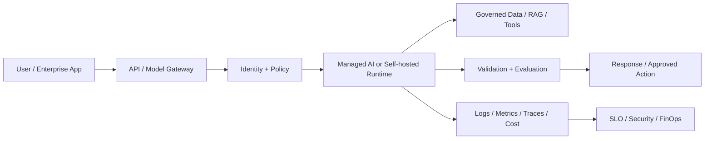

# Bedrock Guardrails and Generative AI Safety Controls

## 1. Title and Learning Position
- **Category:** AWS AI and Machine Learning Foundations
- **Prerequisites:** [Bedrock Knowledge Bases and Managed RAG](26-bedrock-knowledge-bases.md)
- **Why it matters:** Bedrock Guardrails and Generative AI Safety Controls builds the ability to select and operate cloud AI capability from architecture, security, reliability and economic requirements rather than from a console catalog.
- **Learning objectives:** understand the durable capability; map provider services; design identity/network/data controls; implement a portable contract; evaluate quality/SLOs/cost; plan recovery and exit.
- **Difficulty:** Foundational
- **Estimated study time:** 4-8 hours plus cloud labs.
- **Practical competency:** implement/review Bedrock Guardrails and Generative AI Safety Controls across Microsoft Azure, AWS and Google Cloud with current-documentation verification.
- **Cloud/provider scope:** multi-cloud; exact provider capabilities, regions, APIs, quotas, pricing and launch stages must be verified before implementation.

## 2. Concept
**Beginner.** Cloud AI packages model or AI capability behind managed infrastructure and APIs. The provider manages some infrastructure/platform responsibilities, while the customer still owns use-case correctness, data handling, identities, application controls, evaluation and governance.

**Intermediate.** Distinguish management/control-plane operations such as creating resources/policies from runtime/data-plane inference or retrieval. Design with accounts/subscriptions/projects, regions, workload identities, network boundaries, quotas and resource lifecycle in mind.

**Advanced.** Analyze provider/model deprecation, capacity reservations, private connectivity, cross-region replication, residency, managed-vs-self-hosted trade-offs, operational lock-in, abstraction leakage, unit economics and organizational operating model.

**Architecture anchor.** Current AWS guidance separates Amazon Bedrock as a managed generative-AI/agent platform from Amazon SageMaker AI as the broader custom model build/train/deploy ML service. Exact model availability, quotas and features are region- and time-sensitive.

**Provider capability map:**
| Durable capability | Microsoft | AWS | Google Cloud |
|---|---|---|---|
| Managed GenAI/models | Microsoft Foundry / Azure OpenAI-related Foundry model capabilities | Amazon Bedrock | Gemini/Model Garden on current Google Cloud AI platform |
| ML lifecycle | Azure Machine Learning | Amazon SageMaker AI | Vertex AI/current Google Cloud ML platform |
| Agent capability | Foundry Agent Service | Bedrock Agents / AgentCore concepts | Gemini Enterprise Agent Platform/current agent capabilities |
| RAG/search | Azure AI Search + Foundry grounding patterns | Bedrock Knowledge Bases + search/vector integrations | RAG Engine / Vector Search patterns |

Mappings are approximate. Verify current official documentation because names, integration surfaces, launch stages, regions and limits change.

**Managed vs self-managed:** managed services trade infrastructure control for faster operations and integrated governance; self-hosted containers/Kubernetes/VMs add portability/control but require capacity, patching, security and SRE ownership.

**Failure modes:** wrong region/service eligibility, quota exhaustion, public egress where private connectivity was intended, identity misconfiguration, model retirement, SDK/API version change, cross-region data violation, underprovisioned endpoints, missing audit telemetry and unexpected egress/token/GPU costs.



## 3. Intermediate and Advanced Use Cases
### Intermediate application
**Problem:** Implement Bedrock Guardrails and Generative AI Safety Controls for a bounded cloud AI workload. **Provider mapping:** identify the durable capability first, then map to Microsoft Azure/Microsoft Foundry, AWS and Google Cloud services where equivalent; mark functional differences. **Architecture:** enterprise identity -> API/model gateway -> managed/self-hosted AI capability -> governed data/RAG/tools -> validation -> telemetry. **Data/model dependencies:** classify sensitive data, model/provider versions and residency. **Networking/IAM:** prefer private connectivity and workload identity when required/supported. **Deployment/evaluation:** IaC + CI gates + shadow/canary; evaluate task quality and operational metrics. **Scale/DR:** quotas, concurrency, region/service failure and rebuild/failover. **Security/compliance:** least privilege, secret isolation, audit and policy evidence. **Latency/cost:** benchmark p95/p99 and cost per successful task. **Ownership:** platform, application, security/SRE and data teams have explicit responsibilities. **Portability:** isolate contracts that provide value but preserve provider-specific capabilities behind adapters. **Alternative:** simpler managed API, custom model/cluster or deterministic service depending on task.
### Intermediate enterprise
**Problem:** Apply Bedrock Guardrails and Generative AI Safety Controls to ERP/procurement, IT operations, document intelligence or enterprise knowledge. **Provider mapping:** identify the durable capability first, then map to Microsoft Azure/Microsoft Foundry, AWS and Google Cloud services where equivalent; mark functional differences. **Architecture:** enterprise identity -> API/model gateway -> managed/self-hosted AI capability -> governed data/RAG/tools -> validation -> telemetry. **Data/model dependencies:** classify sensitive data, model/provider versions and residency. **Networking/IAM:** prefer private connectivity and workload identity when required/supported. **Deployment/evaluation:** IaC + CI gates + shadow/canary; evaluate task quality and operational metrics. **Scale/DR:** quotas, concurrency, region/service failure and rebuild/failover. **Security/compliance:** least privilege, secret isolation, audit and policy evidence. **Latency/cost:** benchmark p95/p99 and cost per successful task. **Ownership:** platform, application, security/SRE and data teams have explicit responsibilities. **Portability:** isolate contracts that provide value but preserve provider-specific capabilities behind adapters. **Alternative:** simpler managed API, custom model/cluster or deterministic service depending on task.
### Advanced resilient
**Problem:** Operate Bedrock Guardrails and Generative AI Safety Controls under private networking, quota pressure, regional/provider degradation and strict SLOs. **Provider mapping:** identify the durable capability first, then map to Microsoft Azure/Microsoft Foundry, AWS and Google Cloud services where equivalent; mark functional differences. **Architecture:** enterprise identity -> API/model gateway -> managed/self-hosted AI capability -> governed data/RAG/tools -> validation -> telemetry. **Data/model dependencies:** classify sensitive data, model/provider versions and residency. **Networking/IAM:** prefer private connectivity and workload identity when required/supported. **Deployment/evaluation:** IaC + CI gates + shadow/canary; evaluate task quality and operational metrics. **Scale/DR:** quotas, concurrency, region/service failure and rebuild/failover. **Security/compliance:** least privilege, secret isolation, audit and policy evidence. **Latency/cost:** benchmark p95/p99 and cost per successful task. **Ownership:** platform, application, security/SRE and data teams have explicit responsibilities. **Portability:** isolate contracts that provide value but preserve provider-specific capabilities behind adapters. **Alternative:** simpler managed API, custom model/cluster or deterministic service depending on task.
### Advanced portable
**Problem:** Compare provider-native and portable implementations of Bedrock Guardrails and Generative AI Safety Controls using the same evaluation and unit-cost model. **Provider mapping:** identify the durable capability first, then map to Microsoft Azure/Microsoft Foundry, AWS and Google Cloud services where equivalent; mark functional differences. **Architecture:** enterprise identity -> API/model gateway -> managed/self-hosted AI capability -> governed data/RAG/tools -> validation -> telemetry. **Data/model dependencies:** classify sensitive data, model/provider versions and residency. **Networking/IAM:** prefer private connectivity and workload identity when required/supported. **Deployment/evaluation:** IaC + CI gates + shadow/canary; evaluate task quality and operational metrics. **Scale/DR:** quotas, concurrency, region/service failure and rebuild/failover. **Security/compliance:** least privilege, secret isolation, audit and policy evidence. **Latency/cost:** benchmark p95/p99 and cost per successful task. **Ownership:** platform, application, security/SRE and data teams have explicit responsibilities. **Portability:** isolate contracts that provide value but preserve provider-specific capabilities behind adapters. **Alternative:** simpler managed API, custom model/cluster or deterministic service depending on task.
### Enterprise platform
**Problem:** Deliver Bedrock Guardrails and Generative AI Safety Controls as a governed capability with landing-zone controls, identity, policy, observability, FinOps, DR and exit strategy. **Provider mapping:** identify the durable capability first, then map to Microsoft Azure/Microsoft Foundry, AWS and Google Cloud services where equivalent; mark functional differences. **Architecture:** enterprise identity -> API/model gateway -> managed/self-hosted AI capability -> governed data/RAG/tools -> validation -> telemetry. **Data/model dependencies:** classify sensitive data, model/provider versions and residency. **Networking/IAM:** prefer private connectivity and workload identity when required/supported. **Deployment/evaluation:** IaC + CI gates + shadow/canary; evaluate task quality and operational metrics. **Scale/DR:** quotas, concurrency, region/service failure and rebuild/failover. **Security/compliance:** least privilege, secret isolation, audit and policy evidence. **Latency/cost:** benchmark p95/p99 and cost per successful task. **Ownership:** platform, application, security/SRE and data teams have explicit responsibilities. **Portability:** isolate contracts that provide value but preserve provider-specific capabilities behind adapters. **Alternative:** simpler managed API, custom model/cluster or deterministic service depending on task.

## 4. Implementation
**Principle:** keep the application contract provider-neutral only where it creates material portability. Provider adapters own API/version-specific behavior. Authentication should use workload/managed identity where available rather than static keys.

```python
from typing import Protocol, Any
from pydantic import BaseModel, Field

class AIRequest(BaseModel):
    task: str
    tenant_id: str
    correlation_id: str

class AIResponse(BaseModel):
    output: str
    provider: str
    model_or_service: str

class CloudAIProvider(Protocol):
    async def invoke(self, request: AIRequest) -> AIResponse: ...

# Provider adapters should use workload/managed identity where supported,
# typed config, timeout/retry/backoff, quota handling and OpenTelemetry spans.
```

```bash
# Conceptual CLI patterns only. Verify current official commands/options before use.
az <service-command> --subscription <SUBSCRIPTION_ID> --resource-group <RESOURCE_GROUP>
aws <service-command> --region <REGION> --profile <APPROVED_PROFILE_OR_ROLE>
gcloud <service-command> --project <PROJECT_ID> --region <REGION>
```

```hcl
# Terraform concept. Pin reviewed provider/module versions in production.
variable "environment" { type = string }
variable "region" { type = string }
# Use workload identity / managed identity and secret-manager references, not static keys.
```

```yaml
stages:
  - lint_and_test
  - security_and_policy
  - ai_evaluation
  - package_and_iac_plan
  - deploy_shadow_or_canary
  - verify_slo_and_cost
  - promote_or_rollback
```

**Version-sensitive provider code:** before creating executable Azure/AWS/GCP examples, consult current SDK/API docs for package names, clients, auth flows, regions and supported models. Do not infer an API from a neighboring service.

**Networking:** parameterize endpoint/private DNS/VPC/VNet/project/subscription/account settings and verify name resolution/route/egress behavior in CI or environment validation.

**Retries/quotas:** apply bounded exponential backoff only to retryable operations; respect provider retry guidance; use admission control/queues for sustained quota pressure rather than retry storms.

**Promotion:** store IaC plan, application/model/prompt config, evaluation result, security policy and deployment metadata together; use shadow/canary and preserve a known-good release.

**Common mistake:** embedding permanent cloud access keys into AI notebooks or CI variables. **Correction:** use managed/workload identity or short-lived federation plus secret-manager references and least privilege.

## 5. Architectural Considerations
- **Service selection:** compare quality, supported modality, customization, latency, region/residency, identity/network integration, quotas, availability, team skills, operations and unit economics.
- **Provider verification:** provider service names, APIs, limits, models, regions, pricing and certifications are mutable. Verify with official Microsoft Learn/Azure, AWS Documentation and Google Cloud docs before implementation.
- **Topology:** keep latency-sensitive app/model/data paths region-local when practical; explicitly approve cross-region/cross-cloud data flow.
- **Networking:** private endpoints/private service access, DNS, NAT/egress and firewall policy need end-to-end testing; private endpoint creation alone does not prove traffic stays private.
- **Identity:** use Microsoft Entra/workload/managed identities, AWS IAM roles/federation, and Google service/workload identity patterns rather than embedded keys; authorize runtime actions independently of model output.
- **Encryption:** provider-managed or customer-managed keys may be required by policy; consider key availability and DR dependencies.
- **RAG:** propagate user/tenant permissions before retrieval, preserve document/chunk/index versions, evaluate retrieval/citations and define rebuild/freshness SLOs.
- **Agents:** explicit state, max steps, time/cost budgets, tool gateway authorization, checkpoints, approval gates and kill switches remain necessary in managed agent services.
- **Scaling:** quotas can be harder limits than compute; model queueing and downstream data/tool quotas together.
- **Observability:** combine provider-native telemetry with OpenTelemetry-compatible application traces to correlate model/RAG/tool calls with business outcomes and costs.
- **DR:** distinguish durable source/config backup from rebuildable indexes/models; define RPO/RTO and test region/provider fallback.
- **Governance:** centralize AI inventory/policy/evals while leaving domain teams accountable for data semantics and task quality.
- **FinOps:** track account/project/subscription, application, model, environment and cost center; optimize cost per successful task; include storage/search/network and engineering burden.
- **Portability/exit:** maintain export/rebuild paths for prompts/config/evaluation/data and app contracts. Do not expect managed services to be behaviorally identical across clouds.

## 6. Interview Questions
### Q1. Beginner: What is a critical cloud architecture decision for **Bedrock Guardrails and Generative AI Safety Controls**, and how would you validate it?
**Model answer:** Start from capability, data classification and SLOs; define the provider/customer responsibility boundary; evaluate managed and portable options; design identity/network/privacy controls; benchmark quality, latency, availability and unit cost; then deploy with observability, quotas and rollback. Verify mutable provider facts in current official documentation.

**Evaluates:** cloud AI selection judgment, provider literacy, security/networking depth, SRE/FinOps discipline and avoidance of cargo-cult multi-cloud.

**Weak answer:** choosing a provider based on product names alone, or quoting unverified limits/prices without workload evaluation.

**Follow-up:** How would the design change for strict residency, private-only networking, provider/model retirement, quota exhaustion, cross-cloud DR or a 30% cost-reduction target?

### Q2. Beginner: What is a critical cloud architecture decision for **Bedrock Guardrails and Generative AI Safety Controls**, and how would you validate it?
**Model answer:** Start from capability, data classification and SLOs; define the provider/customer responsibility boundary; evaluate managed and portable options; design identity/network/privacy controls; benchmark quality, latency, availability and unit cost; then deploy with observability, quotas and rollback. Verify mutable provider facts in current official documentation.

**Evaluates:** cloud AI selection judgment, provider literacy, security/networking depth, SRE/FinOps discipline and avoidance of cargo-cult multi-cloud.

**Weak answer:** choosing a provider based on product names alone, or quoting unverified limits/prices without workload evaluation.

**Follow-up:** How would the design change for strict residency, private-only networking, provider/model retirement, quota exhaustion, cross-cloud DR or a 30% cost-reduction target?

### Q3. Beginner: What is a critical cloud architecture decision for **Bedrock Guardrails and Generative AI Safety Controls**, and how would you validate it?
**Model answer:** Start from capability, data classification and SLOs; define the provider/customer responsibility boundary; evaluate managed and portable options; design identity/network/privacy controls; benchmark quality, latency, availability and unit cost; then deploy with observability, quotas and rollback. Verify mutable provider facts in current official documentation.

**Evaluates:** cloud AI selection judgment, provider literacy, security/networking depth, SRE/FinOps discipline and avoidance of cargo-cult multi-cloud.

**Weak answer:** choosing a provider based on product names alone, or quoting unverified limits/prices without workload evaluation.

**Follow-up:** How would the design change for strict residency, private-only networking, provider/model retirement, quota exhaustion, cross-cloud DR or a 30% cost-reduction target?

### Q4. Beginner: What is a critical cloud architecture decision for **Bedrock Guardrails and Generative AI Safety Controls**, and how would you validate it?
**Model answer:** Start from capability, data classification and SLOs; define the provider/customer responsibility boundary; evaluate managed and portable options; design identity/network/privacy controls; benchmark quality, latency, availability and unit cost; then deploy with observability, quotas and rollback. Verify mutable provider facts in current official documentation.

**Evaluates:** cloud AI selection judgment, provider literacy, security/networking depth, SRE/FinOps discipline and avoidance of cargo-cult multi-cloud.

**Weak answer:** choosing a provider based on product names alone, or quoting unverified limits/prices without workload evaluation.

**Follow-up:** How would the design change for strict residency, private-only networking, provider/model retirement, quota exhaustion, cross-cloud DR or a 30% cost-reduction target?

### Q5. Beginner: What is a critical cloud architecture decision for **Bedrock Guardrails and Generative AI Safety Controls**, and how would you validate it?
**Model answer:** Start from capability, data classification and SLOs; define the provider/customer responsibility boundary; evaluate managed and portable options; design identity/network/privacy controls; benchmark quality, latency, availability and unit cost; then deploy with observability, quotas and rollback. Verify mutable provider facts in current official documentation.

**Evaluates:** cloud AI selection judgment, provider literacy, security/networking depth, SRE/FinOps discipline and avoidance of cargo-cult multi-cloud.

**Weak answer:** choosing a provider based on product names alone, or quoting unverified limits/prices without workload evaluation.

**Follow-up:** How would the design change for strict residency, private-only networking, provider/model retirement, quota exhaustion, cross-cloud DR or a 30% cost-reduction target?

### Q6. Intermediate: What is a critical cloud architecture decision for **Bedrock Guardrails and Generative AI Safety Controls**, and how would you validate it?
**Model answer:** Start from capability, data classification and SLOs; define the provider/customer responsibility boundary; evaluate managed and portable options; design identity/network/privacy controls; benchmark quality, latency, availability and unit cost; then deploy with observability, quotas and rollback. Verify mutable provider facts in current official documentation.

**Evaluates:** cloud AI selection judgment, provider literacy, security/networking depth, SRE/FinOps discipline and avoidance of cargo-cult multi-cloud.

**Weak answer:** choosing a provider based on product names alone, or quoting unverified limits/prices without workload evaluation.

**Follow-up:** How would the design change for strict residency, private-only networking, provider/model retirement, quota exhaustion, cross-cloud DR or a 30% cost-reduction target?

### Q7. Intermediate: What is a critical cloud architecture decision for **Bedrock Guardrails and Generative AI Safety Controls**, and how would you validate it?
**Model answer:** Start from capability, data classification and SLOs; define the provider/customer responsibility boundary; evaluate managed and portable options; design identity/network/privacy controls; benchmark quality, latency, availability and unit cost; then deploy with observability, quotas and rollback. Verify mutable provider facts in current official documentation.

**Evaluates:** cloud AI selection judgment, provider literacy, security/networking depth, SRE/FinOps discipline and avoidance of cargo-cult multi-cloud.

**Weak answer:** choosing a provider based on product names alone, or quoting unverified limits/prices without workload evaluation.

**Follow-up:** How would the design change for strict residency, private-only networking, provider/model retirement, quota exhaustion, cross-cloud DR or a 30% cost-reduction target?

### Q8. Intermediate: What is a critical cloud architecture decision for **Bedrock Guardrails and Generative AI Safety Controls**, and how would you validate it?
**Model answer:** Start from capability, data classification and SLOs; define the provider/customer responsibility boundary; evaluate managed and portable options; design identity/network/privacy controls; benchmark quality, latency, availability and unit cost; then deploy with observability, quotas and rollback. Verify mutable provider facts in current official documentation.

**Evaluates:** cloud AI selection judgment, provider literacy, security/networking depth, SRE/FinOps discipline and avoidance of cargo-cult multi-cloud.

**Weak answer:** choosing a provider based on product names alone, or quoting unverified limits/prices without workload evaluation.

**Follow-up:** How would the design change for strict residency, private-only networking, provider/model retirement, quota exhaustion, cross-cloud DR or a 30% cost-reduction target?

### Q9. Intermediate: What is a critical cloud architecture decision for **Bedrock Guardrails and Generative AI Safety Controls**, and how would you validate it?
**Model answer:** Start from capability, data classification and SLOs; define the provider/customer responsibility boundary; evaluate managed and portable options; design identity/network/privacy controls; benchmark quality, latency, availability and unit cost; then deploy with observability, quotas and rollback. Verify mutable provider facts in current official documentation.

**Evaluates:** cloud AI selection judgment, provider literacy, security/networking depth, SRE/FinOps discipline and avoidance of cargo-cult multi-cloud.

**Weak answer:** choosing a provider based on product names alone, or quoting unverified limits/prices without workload evaluation.

**Follow-up:** How would the design change for strict residency, private-only networking, provider/model retirement, quota exhaustion, cross-cloud DR or a 30% cost-reduction target?

### Q10. Intermediate: What is a critical cloud architecture decision for **Bedrock Guardrails and Generative AI Safety Controls**, and how would you validate it?
**Model answer:** Start from capability, data classification and SLOs; define the provider/customer responsibility boundary; evaluate managed and portable options; design identity/network/privacy controls; benchmark quality, latency, availability and unit cost; then deploy with observability, quotas and rollback. Verify mutable provider facts in current official documentation.

**Evaluates:** cloud AI selection judgment, provider literacy, security/networking depth, SRE/FinOps discipline and avoidance of cargo-cult multi-cloud.

**Weak answer:** choosing a provider based on product names alone, or quoting unverified limits/prices without workload evaluation.

**Follow-up:** How would the design change for strict residency, private-only networking, provider/model retirement, quota exhaustion, cross-cloud DR or a 30% cost-reduction target?

### Q11. Advanced: What is a critical cloud architecture decision for **Bedrock Guardrails and Generative AI Safety Controls**, and how would you validate it?
**Model answer:** Start from capability, data classification and SLOs; define the provider/customer responsibility boundary; evaluate managed and portable options; design identity/network/privacy controls; benchmark quality, latency, availability and unit cost; then deploy with observability, quotas and rollback. Verify mutable provider facts in current official documentation.

**Evaluates:** cloud AI selection judgment, provider literacy, security/networking depth, SRE/FinOps discipline and avoidance of cargo-cult multi-cloud.

**Weak answer:** choosing a provider based on product names alone, or quoting unverified limits/prices without workload evaluation.

**Follow-up:** How would the design change for strict residency, private-only networking, provider/model retirement, quota exhaustion, cross-cloud DR or a 30% cost-reduction target?

### Q12. Advanced: What is a critical cloud architecture decision for **Bedrock Guardrails and Generative AI Safety Controls**, and how would you validate it?
**Model answer:** Start from capability, data classification and SLOs; define the provider/customer responsibility boundary; evaluate managed and portable options; design identity/network/privacy controls; benchmark quality, latency, availability and unit cost; then deploy with observability, quotas and rollback. Verify mutable provider facts in current official documentation.

**Evaluates:** cloud AI selection judgment, provider literacy, security/networking depth, SRE/FinOps discipline and avoidance of cargo-cult multi-cloud.

**Weak answer:** choosing a provider based on product names alone, or quoting unverified limits/prices without workload evaluation.

**Follow-up:** How would the design change for strict residency, private-only networking, provider/model retirement, quota exhaustion, cross-cloud DR or a 30% cost-reduction target?

### Q13. Advanced: What is a critical cloud architecture decision for **Bedrock Guardrails and Generative AI Safety Controls**, and how would you validate it?
**Model answer:** Start from capability, data classification and SLOs; define the provider/customer responsibility boundary; evaluate managed and portable options; design identity/network/privacy controls; benchmark quality, latency, availability and unit cost; then deploy with observability, quotas and rollback. Verify mutable provider facts in current official documentation.

**Evaluates:** cloud AI selection judgment, provider literacy, security/networking depth, SRE/FinOps discipline and avoidance of cargo-cult multi-cloud.

**Weak answer:** choosing a provider based on product names alone, or quoting unverified limits/prices without workload evaluation.

**Follow-up:** How would the design change for strict residency, private-only networking, provider/model retirement, quota exhaustion, cross-cloud DR or a 30% cost-reduction target?

### Q14. Advanced: What is a critical cloud architecture decision for **Bedrock Guardrails and Generative AI Safety Controls**, and how would you validate it?
**Model answer:** Start from capability, data classification and SLOs; define the provider/customer responsibility boundary; evaluate managed and portable options; design identity/network/privacy controls; benchmark quality, latency, availability and unit cost; then deploy with observability, quotas and rollback. Verify mutable provider facts in current official documentation.

**Evaluates:** cloud AI selection judgment, provider literacy, security/networking depth, SRE/FinOps discipline and avoidance of cargo-cult multi-cloud.

**Weak answer:** choosing a provider based on product names alone, or quoting unverified limits/prices without workload evaluation.

**Follow-up:** How would the design change for strict residency, private-only networking, provider/model retirement, quota exhaustion, cross-cloud DR or a 30% cost-reduction target?

### Q15. Advanced: What is a critical cloud architecture decision for **Bedrock Guardrails and Generative AI Safety Controls**, and how would you validate it?
**Model answer:** Start from capability, data classification and SLOs; define the provider/customer responsibility boundary; evaluate managed and portable options; design identity/network/privacy controls; benchmark quality, latency, availability and unit cost; then deploy with observability, quotas and rollback. Verify mutable provider facts in current official documentation.

**Evaluates:** cloud AI selection judgment, provider literacy, security/networking depth, SRE/FinOps discipline and avoidance of cargo-cult multi-cloud.

**Weak answer:** choosing a provider based on product names alone, or quoting unverified limits/prices without workload evaluation.

**Follow-up:** How would the design change for strict residency, private-only networking, provider/model retirement, quota exhaustion, cross-cloud DR or a 30% cost-reduction target?

### Q16. Cloud architecture: What is a critical cloud architecture decision for **Bedrock Guardrails and Generative AI Safety Controls**, and how would you validate it?
**Model answer:** Start from capability, data classification and SLOs; define the provider/customer responsibility boundary; evaluate managed and portable options; design identity/network/privacy controls; benchmark quality, latency, availability and unit cost; then deploy with observability, quotas and rollback. Verify mutable provider facts in current official documentation.

**Evaluates:** cloud AI selection judgment, provider literacy, security/networking depth, SRE/FinOps discipline and avoidance of cargo-cult multi-cloud.

**Weak answer:** choosing a provider based on product names alone, or quoting unverified limits/prices without workload evaluation.

**Follow-up:** How would the design change for strict residency, private-only networking, provider/model retirement, quota exhaustion, cross-cloud DR or a 30% cost-reduction target?

### Q17. Cloud architecture: What is a critical cloud architecture decision for **Bedrock Guardrails and Generative AI Safety Controls**, and how would you validate it?
**Model answer:** Start from capability, data classification and SLOs; define the provider/customer responsibility boundary; evaluate managed and portable options; design identity/network/privacy controls; benchmark quality, latency, availability and unit cost; then deploy with observability, quotas and rollback. Verify mutable provider facts in current official documentation.

**Evaluates:** cloud AI selection judgment, provider literacy, security/networking depth, SRE/FinOps discipline and avoidance of cargo-cult multi-cloud.

**Weak answer:** choosing a provider based on product names alone, or quoting unverified limits/prices without workload evaluation.

**Follow-up:** How would the design change for strict residency, private-only networking, provider/model retirement, quota exhaustion, cross-cloud DR or a 30% cost-reduction target?

### Q18. Cloud architecture: What is a critical cloud architecture decision for **Bedrock Guardrails and Generative AI Safety Controls**, and how would you validate it?
**Model answer:** Start from capability, data classification and SLOs; define the provider/customer responsibility boundary; evaluate managed and portable options; design identity/network/privacy controls; benchmark quality, latency, availability and unit cost; then deploy with observability, quotas and rollback. Verify mutable provider facts in current official documentation.

**Evaluates:** cloud AI selection judgment, provider literacy, security/networking depth, SRE/FinOps discipline and avoidance of cargo-cult multi-cloud.

**Weak answer:** choosing a provider based on product names alone, or quoting unverified limits/prices without workload evaluation.

**Follow-up:** How would the design change for strict residency, private-only networking, provider/model retirement, quota exhaustion, cross-cloud DR or a 30% cost-reduction target?

### Q19. Debugging: What is a critical cloud architecture decision for **Bedrock Guardrails and Generative AI Safety Controls**, and how would you validate it?
**Model answer:** Start from capability, data classification and SLOs; define the provider/customer responsibility boundary; evaluate managed and portable options; design identity/network/privacy controls; benchmark quality, latency, availability and unit cost; then deploy with observability, quotas and rollback. Verify mutable provider facts in current official documentation.

**Evaluates:** cloud AI selection judgment, provider literacy, security/networking depth, SRE/FinOps discipline and avoidance of cargo-cult multi-cloud.

**Weak answer:** choosing a provider based on product names alone, or quoting unverified limits/prices without workload evaluation.

**Follow-up:** How would the design change for strict residency, private-only networking, provider/model retirement, quota exhaustion, cross-cloud DR or a 30% cost-reduction target?

### Q20. Debugging: What is a critical cloud architecture decision for **Bedrock Guardrails and Generative AI Safety Controls**, and how would you validate it?
**Model answer:** Start from capability, data classification and SLOs; define the provider/customer responsibility boundary; evaluate managed and portable options; design identity/network/privacy controls; benchmark quality, latency, availability and unit cost; then deploy with observability, quotas and rollback. Verify mutable provider facts in current official documentation.

**Evaluates:** cloud AI selection judgment, provider literacy, security/networking depth, SRE/FinOps discipline and avoidance of cargo-cult multi-cloud.

**Weak answer:** choosing a provider based on product names alone, or quoting unverified limits/prices without workload evaluation.

**Follow-up:** How would the design change for strict residency, private-only networking, provider/model retirement, quota exhaustion, cross-cloud DR or a 30% cost-reduction target?

### Q21. Coding/IaC: What is a critical cloud architecture decision for **Bedrock Guardrails and Generative AI Safety Controls**, and how would you validate it?
**Model answer:** Start from capability, data classification and SLOs; define the provider/customer responsibility boundary; evaluate managed and portable options; design identity/network/privacy controls; benchmark quality, latency, availability and unit cost; then deploy with observability, quotas and rollback. Verify mutable provider facts in current official documentation.

**Evaluates:** cloud AI selection judgment, provider literacy, security/networking depth, SRE/FinOps discipline and avoidance of cargo-cult multi-cloud.

**Weak answer:** choosing a provider based on product names alone, or quoting unverified limits/prices without workload evaluation.

**Follow-up:** How would the design change for strict residency, private-only networking, provider/model retirement, quota exhaustion, cross-cloud DR or a 30% cost-reduction target?

### Q22. Coding/IaC: What is a critical cloud architecture decision for **Bedrock Guardrails and Generative AI Safety Controls**, and how would you validate it?
**Model answer:** Start from capability, data classification and SLOs; define the provider/customer responsibility boundary; evaluate managed and portable options; design identity/network/privacy controls; benchmark quality, latency, availability and unit cost; then deploy with observability, quotas and rollback. Verify mutable provider facts in current official documentation.

**Evaluates:** cloud AI selection judgment, provider literacy, security/networking depth, SRE/FinOps discipline and avoidance of cargo-cult multi-cloud.

**Weak answer:** choosing a provider based on product names alone, or quoting unverified limits/prices without workload evaluation.

**Follow-up:** How would the design change for strict residency, private-only networking, provider/model retirement, quota exhaustion, cross-cloud DR or a 30% cost-reduction target?

## 7. Practical Exercises
### Foundational
Draw the provider-neutral architecture for Bedrock Guardrails and Generative AI Safety Controls, then map it to Azure, AWS and Google Cloud using current official documentation. **Expected:** architecture + provider comparison table. **Evaluate:** responsibility boundaries and accurate mappings. **Likely failure:** false equivalence. **Cost safety:** do not provision chargeable resources for a design-only lab. **Cleanup:** none. **Stretch:** identify portability boundaries.

### Intermediate implementation
Deploy or mock a small service through one cloud using workload identity, IaC, timeout/retry, telemetry and an evaluation test. **Expected:** tested repo and deployment notes. **Evaluate:** security, reproducibility and operability. **Cost safety:** set budget alerts/quotas and use the smallest suitable resources. **Cleanup:** destroy IaC-created resources and confirm no persistent endpoint/index/storage remains. **Stretch:** implement a second provider adapter.

### Advanced production
Design the enterprise architecture for Bedrock Guardrails and Generative AI Safety Controls across primary region plus DR, private networking, central gateway/policy, evaluation, observability, FinOps and exit strategy. **Expected:** diagrams, SLOs, threat model, capacity/cost assumptions, RTO/RPO and runbook. **Evaluate:** quality, security, resilience, portability and economics. **Cost safety:** use symbolic current-price variables until official rates are verified. **Cleanup:** include decommission steps. **Stretch:** chaos-test provider or quota failure.

## 8. Summary and Revision Checklist
### Key takeaways
- Start with durable capability and workload requirements, then choose a provider service.
- Managed cloud AI changes responsibility boundaries but does not remove customer responsibility for identity, data, evaluation or governance.
- Provider-specific features create value and lock-in simultaneously.
- Architecture must include quotas, observability, recovery and unit economics.

### Provider-equivalence table
| Need | Microsoft | AWS | Google Cloud |
|---|---|---|---|
| ML lifecycle | Azure Machine Learning | SageMaker AI | Vertex AI/current ML capabilities |
| Managed GenAI | Microsoft Foundry models / Azure OpenAI capabilities | Bedrock | Gemini / current Google Cloud AI model services |
| Agents | Foundry Agent Service | Bedrock Agents/AgentCore | Gemini Enterprise Agent Platform/current agent platform |
| Containers | AKS | EKS | GKE |
| Secrets | Key Vault | Secrets Manager | Secret Manager |
Mappings are approximate and must be verified for the exact workload.

### Critical settings
Region/location, model/service version, endpoint/deployment type, identity, network access, quota/concurrency, timeout/retry, logging/evaluation, retention, encryption keys, autoscaling/capacity and budget alerts.

### Architecture checklist
- [ ] Provider/service selection backed by evaluation
- [ ] Account/subscription/project hierarchy defined
- [ ] Region/residency/topology approved
- [ ] Quota and DR plan tested
- [ ] IaC, release, rollback and exit path defined

### Security checklist
- [ ] Workload identity and least privilege
- [ ] Private network/egress controls as required
- [ ] Secrets outside source/prompt
- [ ] RAG/tool authorization enforced outside model
- [ ] Audit/retention/encryption policies implemented

### FinOps checklist
- [ ] Cost attribution tags/labels/naming
- [ ] Budget/alerts and quota controls
- [ ] Unit cost per successful task measured
- [ ] Network/storage/search/model costs included
- [ ] Managed vs self-hosted TCO reviewed

### Common pitfalls
Service-first architecture, assuming region/model availability, hard-coded keys, private endpoint without DNS/egress validation, untested quotas, cloud-specific logic scattered through business code, multi-cloud without business justification, comparing only token price, and no model/provider retirement plan.

### Five flashcards
1. **Q:** First cloud AI selection step? **A:** Define capability, data/security, quality, SLO and cost requirements before choosing service.
2. **Q:** Managed means fully outsourced risk? **A:** No. Customer still owns application, identity, data use, evaluation and organizational governance.
3. **Q:** Main portability trap? **A:** Assuming similarly named managed services have identical semantics and lifecycle behavior.
4. **Q:** Why plan quotas? **A:** Provider/service limits can constrain throughput before infrastructure scaling does.
5. **Q:** Best cost metric? **A:** Total attributable cost per successful task under required quality/reliability.

### Next recommended topics
- [Bedrock Agents and AgentCore Concepts](28-bedrock-agents-agentcore.md)
- [Bedrock Flows and Prompt Management](29-bedrock-flows-prompts.md)

> **Provider verification reminder:** Before implementation, verify current service names, SDK/API versions, model availability, regions, quotas, pricing, launch stage and compliance requirements in official provider documentation.
