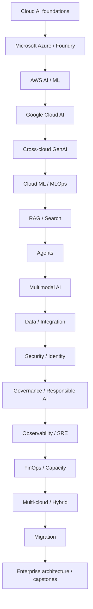
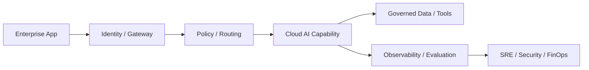

# Cloud AI Services Engineering Notes

## Repository Purpose

A multi-cloud, architecture-first path for experienced Python/ML/GenAI engineers moving toward Cloud AI Engineering and enterprise AI architecture. Provider product names evolve, so durable capability models are taught first and mutable service facts must be verified from current official documentation.

## Recommended Learning Path

## Category Summary

### Category 1: Cloud AI Foundations

**Purpose:** build competency in cloud ai foundations. **Prerequisites:** preceding categories unless already proficient. **Estimated study time:** 54-90 hours. **Outcome:** select, implement, secure, operate and compare cloud AI capabilities.

1. **[Cloud AI Service Landscape and Shared Responsibility](01-cloud-ai-overview.md)**  
   Foundational. Prerequisite: Python, ML/GenAI and cloud fundamentals. Study: 4-8 hours. Competency: architect and evaluate Cloud AI Service Landscape and Shared Responsibility across provider capability boundaries.
2. **[Infrastructure, ML Platforms, Foundation Models, AI APIs, Search, Agents, and Apps](02-cloud-ai-stack.md)**  
   Foundational. Prerequisite: Cloud AI Service Landscape and Shared Responsibility. Study: 4-8 hours. Competency: architect and evaluate Infrastructure, ML Platforms, Foundation Models, AI APIs, Search, Agents, and Apps across provider capability boundaries.
3. **[Managed AI Services vs Self-Hosted Models and Platforms](03-managed-vs-self-hosted.md)**  
   Foundational. Prerequisite: Infrastructure, ML Platforms, Foundation Models, AI APIs, Search, Agents, and Apps. Study: 4-8 hours. Competency: architect and evaluate Managed AI Services vs Self-Hosted Models and Platforms across provider capability boundaries.
4. **[Control Plane, Data Plane, Runtime Endpoints, and Management APIs](04-control-data-planes.md)**  
   Foundational. Prerequisite: Managed AI Services vs Self-Hosted Models and Platforms. Study: 4-8 hours. Competency: architect and evaluate Control Plane, Data Plane, Runtime Endpoints, and Management APIs across provider capability boundaries.
5. **[Accounts, Subscriptions, Projects, Tenants, Organizations, and Identities](05-cloud-ai-identities.md)**  
   Foundational. Prerequisite: Control Plane, Data Plane, Runtime Endpoints, and Management APIs. Study: 4-8 hours. Competency: architect and evaluate Accounts, Subscriptions, Projects, Tenants, Organizations, and Identities across provider capability boundaries.
6. **[Regions, Availability Zones, Residency, Sovereignty, and Data Boundaries](06-regions-zones-residency.md)**  
   Foundational. Prerequisite: Accounts, Subscriptions, Projects, Tenants, Organizations, and Identities. Study: 4-8 hours. Competency: architect and evaluate Regions, Availability Zones, Residency, Sovereignty, and Data Boundaries across provider capability boundaries.
7. **[Capability, Quality, Security, Latency, Cost, Portability, and Team Skills](07-service-selection-framework.md)**  
   Foundational. Prerequisite: Regions, Availability Zones, Residency, Sovereignty, and Data Boundaries. Study: 4-8 hours. Competency: architect and evaluate Capability, Quality, Security, Latency, Cost, Portability, and Team Skills across provider capability boundaries.
8. **[Vendor-Neutral Cloud AI Reference Architecture](08-cloud-ai-reference-architecture.md)**  
   Foundational. Prerequisite: Capability, Quality, Security, Latency, Cost, Portability, and Team Skills. Study: 4-8 hours. Competency: architect and evaluate Vendor-Neutral Cloud AI Reference Architecture across provider capability boundaries.
9. **[Use-Case Feasibility, Risk, ROI, and Cloud Fit](09-cloud-ai-use-case-selection.md)**  
   Foundational. Prerequisite: Vendor-Neutral Cloud AI Reference Architecture. Study: 4-8 hours. Competency: architect and evaluate Use-Case Feasibility, Risk, ROI, and Cloud Fit across provider capability boundaries.

### Category 2: Microsoft Azure / Microsoft Foundry Foundations

**Purpose:** build competency in microsoft azure / microsoft foundry foundations. **Prerequisites:** preceding categories unless already proficient. **Estimated study time:** 78-130 hours. **Outcome:** select, implement, secure, operate and compare cloud AI capabilities.

10. **[Microsoft Foundry Platform, Projects, Models, Tools, Agents, and Governance](10-microsoft-foundry-overview.md)**  
   Foundational. Prerequisite: Use-Case Feasibility, Risk, ROI, and Cloud Fit. Study: 4-8 hours. Competency: architect and evaluate Microsoft Foundry Platform, Projects, Models, Tools, Agents, and Governance across provider capability boundaries.
11. **[Azure Machine Learning End-to-End ML Lifecycle](11-azure-machine-learning.md)**  
   Foundational. Prerequisite: Microsoft Foundry Platform, Projects, Models, Tools, Agents, and Governance. Study: 4-8 hours. Competency: architect and evaluate Azure Machine Learning End-to-End ML Lifecycle across provider capability boundaries.
12. **[Microsoft Foundry Models, Model Catalog, Deployment and Evaluation Concepts](12-foundry-models.md)**  
   Foundational. Prerequisite: Azure Machine Learning End-to-End ML Lifecycle. Study: 4-8 hours. Competency: architect and evaluate Microsoft Foundry Models, Model Catalog, Deployment and Evaluation Concepts across provider capability boundaries.
13. **[Azure OpenAI in Foundry Models and Enterprise Integration](13-azure-openai.md)**  
   Foundational. Prerequisite: Microsoft Foundry Models, Model Catalog, Deployment and Evaluation Concepts. Study: 4-8 hours. Competency: architect and evaluate Azure OpenAI in Foundry Models and Enterprise Integration across provider capability boundaries.
14. **[Foundry Agent Service and Agent Lifecycle](14-foundry-agent-service.md)**  
   Foundational. Prerequisite: Azure OpenAI in Foundry Models and Enterprise Integration. Study: 4-8 hours. Competency: architect and evaluate Foundry Agent Service and Agent Lifecycle across provider capability boundaries.
15. **[Foundry Observability, Tracing, Evaluation, and Operations](15-foundry-observability.md)**  
   Foundational. Prerequisite: Foundry Agent Service and Agent Lifecycle. Study: 4-8 hours. Competency: architect and evaluate Foundry Observability, Tracing, Evaluation, and Operations across provider capability boundaries.
16. **[Azure AI Search, Hybrid/Vector Search, Semantic Ranking, and RAG](16-azure-ai-search.md)**  
   Foundational. Prerequisite: Foundry Observability, Tracing, Evaluation, and Operations. Study: 4-8 hours. Competency: architect and evaluate Azure AI Search, Hybrid/Vector Search, Semantic Ranking, and RAG across provider capability boundaries.
17. **[Azure Document Intelligence and Content Extraction](17-azure-document-intelligence.md)**  
   Foundational. Prerequisite: Azure AI Search, Hybrid/Vector Search, Semantic Ranking, and RAG. Study: 4-8 hours. Competency: architect and evaluate Azure Document Intelligence and Content Extraction across provider capability boundaries.
18. **[Azure Language and Translator Capabilities](18-azure-ai-language-translator.md)**  
   Foundational. Prerequisite: Azure Document Intelligence and Content Extraction. Study: 4-8 hours. Competency: architect and evaluate Azure Language and Translator Capabilities across provider capability boundaries.
19. **[Azure Speech: STT, TTS, Translation, and Voice Workloads](19-azure-speech.md)**  
   Foundational. Prerequisite: Azure Language and Translator Capabilities. Study: 4-8 hours. Competency: architect and evaluate Azure Speech: STT, TTS, Translation, and Voice Workloads across provider capability boundaries.
20. **[Azure Vision and Content Safety](20-azure-vision-content-safety.md)**  
   Foundational. Prerequisite: Azure Speech: STT, TTS, Translation, and Voice Workloads. Study: 4-8 hours. Competency: architect and evaluate Azure Vision and Content Safety across provider capability boundaries.
21. **[Content Understanding and Multimodal Extraction Concepts](21-azure-content-understanding.md)**  
   Foundational. Prerequisite: Azure Vision and Content Safety. Study: 4-8 hours. Competency: architect and evaluate Content Understanding and Multimodal Extraction Concepts across provider capability boundaries.
22. **[Functions, Logic Apps, Event Grid, Service Bus, API Management, and AI Integration](22-azure-ai-integration.md)**  
   Foundational. Prerequisite: Content Understanding and Multimodal Extraction Concepts. Study: 4-8 hours. Competency: architect and evaluate Functions, Logic Apps, Event Grid, Service Bus, API Management, and AI Integration across provider capability boundaries.

### Category 3: AWS AI and Machine Learning Foundations

**Purpose:** build competency in aws ai and machine learning foundations. **Prerequisites:** preceding categories unless already proficient. **Estimated study time:** 78-130 hours. **Outcome:** select, implement, secure, operate and compare cloud AI capabilities.

23. **[AWS AI/ML Service Landscape](23-aws-ai-overview.md)**  
   Foundational. Prerequisite: Functions, Logic Apps, Event Grid, Service Bus, API Management, and AI Integration. Study: 4-8 hours. Competency: architect and evaluate AWS AI/ML Service Landscape across provider capability boundaries.
24. **[Amazon Bedrock Foundation Models and Generative AI Platform](24-amazon-bedrock.md)**  
   Foundational. Prerequisite: AWS AI/ML Service Landscape. Study: 4-8 hours. Competency: architect and evaluate Amazon Bedrock Foundation Models and Generative AI Platform across provider capability boundaries.
25. **[Bedrock Model Choice, Inference, Provisioning, and Evaluation Concepts](25-bedrock-model-access.md)**  
   Foundational. Prerequisite: Amazon Bedrock Foundation Models and Generative AI Platform. Study: 4-8 hours. Competency: architect and evaluate Bedrock Model Choice, Inference, Provisioning, and Evaluation Concepts across provider capability boundaries.
26. **[Bedrock Knowledge Bases and Managed RAG](26-bedrock-knowledge-bases.md)**  
   Foundational. Prerequisite: Bedrock Model Choice, Inference, Provisioning, and Evaluation Concepts. Study: 4-8 hours. Competency: architect and evaluate Bedrock Knowledge Bases and Managed RAG across provider capability boundaries.
27. **[Bedrock Guardrails and Generative AI Safety Controls](27-bedrock-guardrails.md)**  
   Foundational. Prerequisite: Bedrock Knowledge Bases and Managed RAG. Study: 4-8 hours. Competency: architect and evaluate Bedrock Guardrails and Generative AI Safety Controls across provider capability boundaries.
28. **[Bedrock Agents and AgentCore Concepts](28-bedrock-agents-agentcore.md)**  
   Foundational. Prerequisite: Bedrock Guardrails and Generative AI Safety Controls. Study: 4-8 hours. Competency: architect and evaluate Bedrock Agents and AgentCore Concepts across provider capability boundaries.
29. **[Bedrock Flows and Prompt Management](29-bedrock-flows-prompts.md)**  
   Foundational. Prerequisite: Bedrock Agents and AgentCore Concepts. Study: 4-8 hours. Competency: architect and evaluate Bedrock Flows and Prompt Management across provider capability boundaries.
30. **[Bedrock Data Automation and Unstructured Content Processing](30-bedrock-data-automation.md)**  
   Foundational. Prerequisite: Bedrock Flows and Prompt Management. Study: 4-8 hours. Competency: architect and evaluate Bedrock Data Automation and Unstructured Content Processing across provider capability boundaries.
31. **[Amazon SageMaker AI End-to-End ML Lifecycle](31-sagemaker-ai.md)**  
   Foundational. Prerequisite: Bedrock Data Automation and Unstructured Content Processing. Study: 4-8 hours. Competency: architect and evaluate Amazon SageMaker AI End-to-End ML Lifecycle across provider capability boundaries.
32. **[SageMaker AI Training, Customization, HyperPod, and Distributed Workloads](32-sagemaker-training.md)**  
   Foundational. Prerequisite: Amazon SageMaker AI End-to-End ML Lifecycle. Study: 4-8 hours. Competency: architect and evaluate SageMaker AI Training, Customization, HyperPod, and Distributed Workloads across provider capability boundaries.
33. **[SageMaker AI Inference and Deployment Patterns](33-sagemaker-inference.md)**  
   Foundational. Prerequisite: SageMaker AI Training, Customization, HyperPod, and Distributed Workloads. Study: 4-8 hours. Competency: architect and evaluate SageMaker AI Inference and Deployment Patterns across provider capability boundaries.
34. **[Textract, Rekognition, Transcribe, Polly, Translate, and Comprehend-Style AI APIs](34-aws-ai-apis.md)**  
   Foundational. Prerequisite: SageMaker AI Inference and Deployment Patterns. Study: 4-8 hours. Competency: architect and evaluate Textract, Rekognition, Transcribe, Polly, Translate, and Comprehend-Style AI APIs across provider capability boundaries.
35. **[Lambda, Step Functions, EventBridge, SQS/SNS, API Gateway, and AI Integration](35-aws-ai-integration.md)**  
   Foundational. Prerequisite: Textract, Rekognition, Transcribe, Polly, Translate, and Comprehend-Style AI APIs. Study: 4-8 hours. Competency: architect and evaluate Lambda, Step Functions, EventBridge, SQS/SNS, API Gateway, and AI Integration across provider capability boundaries.

### Category 4: Google Cloud AI Foundations

**Purpose:** build competency in google cloud ai foundations. **Prerequisites:** preceding categories unless already proficient. **Estimated study time:** 72-120 hours. **Outcome:** select, implement, secure, operate and compare cloud AI capabilities.

36. **[Google Cloud AI and Generative AI Landscape](36-google-cloud-ai-overview.md)**  
   Foundational. Prerequisite: Lambda, Step Functions, EventBridge, SQS/SNS, API Gateway, and AI Integration. Study: 4-8 hours. Competency: architect and evaluate Google Cloud AI and Generative AI Landscape across provider capability boundaries.
37. **[Vertex AI / Current Google Cloud AI Platform Concepts](37-vertex-ai.md)**  
   Foundational. Prerequisite: Google Cloud AI and Generative AI Landscape. Study: 4-8 hours. Competency: architect and evaluate Vertex AI / Current Google Cloud AI Platform Concepts across provider capability boundaries.
38. **[Gemini Models on Google Cloud](38-gemini-on-google-cloud.md)**  
   Foundational. Prerequisite: Vertex AI / Current Google Cloud AI Platform Concepts. Study: 4-8 hours. Competency: architect and evaluate Gemini Models on Google Cloud across provider capability boundaries.
39. **[Model Garden, Partner/Open Models, Discovery, and Deployment](39-model-garden.md)**  
   Foundational. Prerequisite: Gemini Models on Google Cloud. Study: 4-8 hours. Competency: architect and evaluate Model Garden, Partner/Open Models, Discovery, and Deployment across provider capability boundaries.
40. **[Model/Prompt Prototyping and Studio Workflows](40-vertex-ai-studio.md)**  
   Foundational. Prerequisite: Model Garden, Partner/Open Models, Discovery, and Deployment. Study: 4-8 hours. Competency: architect and evaluate Model/Prompt Prototyping and Studio Workflows across provider capability boundaries.
41. **[Vertex AI RAG Engine and Retrieval Concepts](41-vertex-ai-rag.md)**  
   Foundational. Prerequisite: Model/Prompt Prototyping and Studio Workflows. Study: 4-8 hours. Competency: architect and evaluate Vertex AI RAG Engine and Retrieval Concepts across provider capability boundaries.
42. **[Google Cloud Agent Platform / Agent Development Concepts](42-google-agent-platform.md)**  
   Foundational. Prerequisite: Vertex AI RAG Engine and Retrieval Concepts. Study: 4-8 hours. Competency: architect and evaluate Google Cloud Agent Platform / Agent Development Concepts across provider capability boundaries.
43. **[Custom Training, Tuning, Pipelines, and Experiments](43-vertex-ai-training.md)**  
   Foundational. Prerequisite: Google Cloud Agent Platform / Agent Development Concepts. Study: 4-8 hours. Competency: architect and evaluate Custom Training, Tuning, Pipelines, and Experiments across provider capability boundaries.
44. **[Online, Batch, Dedicated, and Managed Prediction Concepts](44-vertex-ai-predictions.md)**  
   Foundational. Prerequisite: Custom Training, Tuning, Pipelines, and Experiments. Study: 4-8 hours. Competency: architect and evaluate Online, Batch, Dedicated, and Managed Prediction Concepts across provider capability boundaries.
45. **[Google Cloud Document AI](45-google-document-ai.md)**  
   Foundational. Prerequisite: Online, Batch, Dedicated, and Managed Prediction Concepts. Study: 4-8 hours. Competency: architect and evaluate Google Cloud Document AI across provider capability boundaries.
46. **[Speech, Translation, Natural Language, Vision, and Media AI Services](46-google-speech-language-vision.md)**  
   Foundational. Prerequisite: Google Cloud Document AI. Study: 4-8 hours. Competency: architect and evaluate Speech, Translation, Natural Language, Vision, and Media AI Services across provider capability boundaries.
47. **[Cloud Run, Functions, Pub/Sub, Workflows, API Gateway/Apigee, and AI Integration](47-google-ai-integration.md)**  
   Foundational. Prerequisite: Speech, Translation, Natural Language, Vision, and Media AI Services. Study: 4-8 hours. Competency: architect and evaluate Cloud Run, Functions, Pub/Sub, Workflows, API Gateway/Apigee, and AI Integration across provider capability boundaries.

### Category 5: Cross-Cloud Foundation Models and GenAI

**Purpose:** build competency in cross-cloud foundation models and genai. **Prerequisites:** preceding categories unless already proficient. **Estimated study time:** 60-100 hours. **Outcome:** select, implement, secure, operate and compare cloud AI capabilities.

48. **[Managed Foundation Model Service Architecture](48-foundation-model-service-model.md)**  
   Intermediate. Prerequisite: Cloud Run, Functions, Pub/Sub, Workflows, API Gateway/Apigee, and AI Integration. Study: 4-8 hours. Competency: architect and evaluate Managed Foundation Model Service Architecture across provider capability boundaries.
49. **[Foundry Models, Bedrock Model Catalog/Marketplace, and Vertex AI Model Garden](49-model-catalogs.md)**  
   Intermediate. Prerequisite: Managed Foundation Model Service Architecture. Study: 4-8 hours. Competency: architect and evaluate Foundry Models, Bedrock Model Catalog/Marketplace, and Vertex AI Model Garden across provider capability boundaries.
50. **[Cross-Cloud Model Selection and Evaluation](50-model-selection-cross-cloud.md)**  
   Intermediate. Prerequisite: Foundry Models, Bedrock Model Catalog/Marketplace, and Vertex AI Model Garden. Study: 4-8 hours. Competency: architect and evaluate Cross-Cloud Model Selection and Evaluation across provider capability boundaries.
51. **[Serverless, Managed, Dedicated, and Provisioned Inference Concepts](51-model-endpoints.md)**  
   Intermediate. Prerequisite: Cross-Cloud Model Selection and Evaluation. Study: 4-8 hours. Competency: architect and evaluate Serverless, Managed, Dedicated, and Provisioned Inference Concepts across provider capability boundaries.
52. **[Prompt Lifecycle Across Cloud Platforms](52-prompt-management.md)**  
   Intermediate. Prerequisite: Serverless, Managed, Dedicated, and Provisioned Inference Concepts. Study: 4-8 hours. Competency: architect and evaluate Prompt Lifecycle Across Cloud Platforms across provider capability boundaries.
53. **[Structured Output, Function Calling, Tools, and Contracts](53-structured-outputs-tools.md)**  
   Intermediate. Prerequisite: Prompt Lifecycle Across Cloud Platforms. Study: 4-8 hours. Competency: architect and evaluate Structured Output, Function Calling, Tools, and Contracts across provider capability boundaries.
54. **[Model Gateways, Routing, Cascades, Quotas, and Fallback](54-model-routing-gateways.md)**  
   Intermediate. Prerequisite: Structured Output, Function Calling, Tools, and Contracts. Study: 4-8 hours. Competency: architect and evaluate Model Gateways, Routing, Cascades, Quotas, and Fallback across provider capability boundaries.
55. **[Cloud Fine-Tuning, Adapters, Customization, and Continued Training](55-fine-tuning-cloud.md)**  
   Intermediate. Prerequisite: Model Gateways, Routing, Cascades, Quotas, and Fallback. Study: 4-8 hours. Competency: architect and evaluate Cloud Fine-Tuning, Adapters, Customization, and Continued Training across provider capability boundaries.
56. **[Managed and Custom Model Evaluation](56-model-evaluation-cloud.md)**  
   Intermediate. Prerequisite: Cloud Fine-Tuning, Adapters, Customization, and Continued Training. Study: 4-8 hours. Competency: architect and evaluate Managed and Custom Model Evaluation across provider capability boundaries.
57. **[Managed Safety, Content Filters, Guardrails, and Policy Enforcement](57-responsible-genai-cloud.md)**  
   Intermediate. Prerequisite: Managed and Custom Model Evaluation. Study: 4-8 hours. Competency: architect and evaluate Managed Safety, Content Filters, Guardrails, and Policy Enforcement across provider capability boundaries.

### Category 6: Cloud ML Platforms and MLOps

**Purpose:** build competency in cloud ml platforms and mlops. **Prerequisites:** preceding categories unless already proficient. **Estimated study time:** 60-100 hours. **Outcome:** select, implement, secure, operate and compare cloud AI capabilities.

58. **[Cloud ML Workspaces, Experiments, Pipelines, Registries, and Endpoints](58-cloud-ml-lifecycle.md)**  
   Intermediate. Prerequisite: Managed Safety, Content Filters, Guardrails, and Policy Enforcement. Study: 4-8 hours. Competency: architect and evaluate Cloud ML Workspaces, Experiments, Pipelines, Registries, and Endpoints across provider capability boundaries.
59. **[CPU/GPU/Accelerator Training Architectures](59-cloud-training.md)**  
   Intermediate. Prerequisite: Cloud ML Workspaces, Experiments, Pipelines, Registries, and Endpoints. Study: 4-8 hours. Competency: architect and evaluate CPU/GPU/Accelerator Training Architectures across provider capability boundaries.
60. **[Distributed Training and Managed Cluster Concepts](60-distributed-training-cloud.md)**  
   Intermediate. Prerequisite: CPU/GPU/Accelerator Training Architectures. Study: 4-8 hours. Competency: architect and evaluate Distributed Training and Managed Cluster Concepts across provider capability boundaries.
61. **[Experiment Tracking, MLflow, Metadata, and Lineage](61-experiment-tracking-cloud.md)**  
   Intermediate. Prerequisite: Distributed Training and Managed Cluster Concepts. Study: 4-8 hours. Competency: architect and evaluate Experiment Tracking, MLflow, Metadata, and Lineage across provider capability boundaries.
62. **[Model Registry, Approval, Promotion, and Retirement](62-model-registry-cloud.md)**  
   Intermediate. Prerequisite: Experiment Tracking, MLflow, Metadata, and Lineage. Study: 4-8 hours. Competency: architect and evaluate Model Registry, Approval, Promotion, and Retirement across provider capability boundaries.
63. **[Managed ML Pipelines and Orchestration](63-ml-pipelines-cloud.md)**  
   Intermediate. Prerequisite: Model Registry, Approval, Promotion, and Retirement. Study: 4-8 hours. Competency: architect and evaluate Managed ML Pipelines and Orchestration across provider capability boundaries.
64. **[Feature Store and Online/Offline Feature Serving Concepts](64-feature-stores-cloud.md)**  
   Intermediate. Prerequisite: Managed ML Pipelines and Orchestration. Study: 4-8 hours. Competency: architect and evaluate Feature Store and Online/Offline Feature Serving Concepts across provider capability boundaries.
65. **[Batch, Online, Streaming, and Async Model Serving](65-cloud-model-serving.md)**  
   Intermediate. Prerequisite: Feature Store and Online/Offline Feature Serving Concepts. Study: 4-8 hours. Competency: architect and evaluate Batch, Online, Streaming, and Async Model Serving across provider capability boundaries.
66. **[Data/Model Drift, Performance, and Monitoring](66-cloud-ml-monitoring.md)**  
   Intermediate. Prerequisite: Batch, Online, Streaming, and Async Model Serving. Study: 4-8 hours. Competency: architect and evaluate Data/Model Drift, Performance, and Monitoring across provider capability boundaries.
67. **[CI/CD/CT for Managed Cloud ML](67-cloud-ml-cicd.md)**  
   Intermediate. Prerequisite: Data/Model Drift, Performance, and Monitoring. Study: 4-8 hours. Competency: architect and evaluate CI/CD/CT for Managed Cloud ML across provider capability boundaries.

### Category 7: Cloud RAG, Search, and Knowledge Services

**Purpose:** build competency in cloud rag, search, and knowledge services. **Prerequisites:** preceding categories unless already proficient. **Estimated study time:** 54-90 hours. **Outcome:** select, implement, secure, operate and compare cloud AI capabilities.

68. **[Vendor-Neutral Cloud RAG Architecture](68-cloud-rag-reference-architecture.md)**  
   Intermediate. Prerequisite: CI/CD/CT for Managed Cloud ML. Study: 4-8 hours. Competency: architect and evaluate Vendor-Neutral Cloud RAG Architecture across provider capability boundaries.
69. **[Managed Vector and Hybrid Search Options](69-managed-vector-search.md)**  
   Intermediate. Prerequisite: Vendor-Neutral Cloud RAG Architecture. Study: 4-8 hours. Competency: architect and evaluate Managed Vector and Hybrid Search Options across provider capability boundaries.
70. **[Object Storage, Document Parsing, OCR, and Ingestion Pipelines](70-cloud-document-ingestion.md)**  
   Intermediate. Prerequisite: Managed Vector and Hybrid Search Options. Study: 4-8 hours. Competency: architect and evaluate Object Storage, Document Parsing, OCR, and Ingestion Pipelines across provider capability boundaries.
71. **[Managed Embeddings, Batching, Versioning, and Cost](71-cloud-embedding-services.md)**  
   Intermediate. Prerequisite: Object Storage, Document Parsing, OCR, and Ingestion Pipelines. Study: 4-8 hours. Competency: architect and evaluate Managed Embeddings, Batching, Versioning, and Cost across provider capability boundaries.
72. **[Sparse/Dense/Hybrid Search and Reranking](72-cloud-hybrid-search.md)**  
   Intermediate. Prerequisite: Managed Embeddings, Batching, Versioning, and Cost. Study: 4-8 hours. Competency: architect and evaluate Sparse/Dense/Hybrid Search and Reranking across provider capability boundaries.
73. **[Identity-Aware Retrieval and Permission Propagation](73-identity-aware-rag.md)**  
   Intermediate. Prerequisite: Sparse/Dense/Hybrid Search and Reranking. Study: 4-8 hours. Competency: architect and evaluate Identity-Aware Retrieval and Permission Propagation across provider capability boundaries.
74. **[Foundry/Azure Search, Bedrock Knowledge Bases, Vertex RAG and Equivalent Patterns](74-managed-rag-services.md)**  
   Intermediate. Prerequisite: Identity-Aware Retrieval and Permission Propagation. Study: 4-8 hours. Competency: architect and evaluate Foundry/Azure Search, Bedrock Knowledge Bases, Vertex RAG and Equivalent Patterns across provider capability boundaries.
75. **[Retrieval, Grounding, Citation, and Answer Evaluation](75-cloud-rag-evaluation.md)**  
   Intermediate. Prerequisite: Foundry/Azure Search, Bedrock Knowledge Bases, Vertex RAG and Equivalent Patterns. Study: 4-8 hours. Competency: architect and evaluate Retrieval, Grounding, Citation, and Answer Evaluation across provider capability boundaries.
76. **[Index Freshness, Versioning, Observability, Capacity, and DR](76-cloud-ragops.md)**  
   Intermediate. Prerequisite: Retrieval, Grounding, Citation, and Answer Evaluation. Study: 4-8 hours. Competency: architect and evaluate Index Freshness, Versioning, Observability, Capacity, and DR across provider capability boundaries.

### Category 8: Cloud Agents and Agentic AI

**Purpose:** build competency in cloud agents and agentic ai. **Prerequisites:** preceding categories unless already proficient. **Estimated study time:** 60-100 hours. **Outcome:** select, implement, secure, operate and compare cloud AI capabilities.

77. **[Vendor-Neutral Managed Agent Architecture](77-cloud-agent-reference-architecture.md)**  
   Intermediate. Prerequisite: Index Freshness, Versioning, Observability, Capacity, and DR. Study: 4-8 hours. Competency: architect and evaluate Vendor-Neutral Managed Agent Architecture across provider capability boundaries.
78. **[Microsoft Foundry Agent Architecture and Enterprise Integration](78-azure-agents.md)**  
   Intermediate. Prerequisite: Vendor-Neutral Managed Agent Architecture. Study: 4-8 hours. Competency: architect and evaluate Microsoft Foundry Agent Architecture and Enterprise Integration across provider capability boundaries.
79. **[Amazon Bedrock Agents/AgentCore Architecture](79-aws-agents.md)**  
   Intermediate. Prerequisite: Microsoft Foundry Agent Architecture and Enterprise Integration. Study: 4-8 hours. Competency: architect and evaluate Amazon Bedrock Agents/AgentCore Architecture across provider capability boundaries.
80. **[Google Cloud Agent Platform Architecture](80-google-agents.md)**  
   Intermediate. Prerequisite: Amazon Bedrock Agents/AgentCore Architecture. Study: 4-8 hours. Competency: architect and evaluate Google Cloud Agent Platform Architecture across provider capability boundaries.
81. **[Tools, Functions, MCP, API Gateways, and Enterprise Actions](81-cloud-tool-gateways.md)**  
   Intermediate. Prerequisite: Google Cloud Agent Platform Architecture. Study: 4-8 hours. Competency: architect and evaluate Tools, Functions, MCP, API Gateways, and Enterprise Actions across provider capability boundaries.
82. **[Managed State, Memory, Checkpoints, and Persistence](82-agent-state-memory.md)**  
   Intermediate. Prerequisite: Tools, Functions, MCP, API Gateways, and Enterprise Actions. Study: 4-8 hours. Competency: architect and evaluate Managed State, Memory, Checkpoints, and Persistence across provider capability boundaries.
83. **[Human-in-the-Loop and Consequential Action Controls](83-human-approval-cloud.md)**  
   Intermediate. Prerequisite: Managed State, Memory, Checkpoints, and Persistence. Study: 4-8 hours. Competency: architect and evaluate Human-in-the-Loop and Consequential Action Controls across provider capability boundaries.
84. **[Task, Tool, Trajectory, Safety, Latency, and Cost Evaluation](84-agent-evaluation-cloud.md)**  
   Intermediate. Prerequisite: Human-in-the-Loop and Consequential Action Controls. Study: 4-8 hours. Competency: architect and evaluate Task, Tool, Trajectory, Safety, Latency, and Cost Evaluation across provider capability boundaries.
85. **[Identity, Prompt Injection, Tool Abuse, and Data Exfiltration](85-agent-security-cloud.md)**  
   Intermediate. Prerequisite: Task, Tool, Trajectory, Safety, Latency, and Cost Evaluation. Study: 4-8 hours. Competency: architect and evaluate Identity, Prompt Injection, Tool Abuse, and Data Exfiltration across provider capability boundaries.
86. **[Observability, Versioning, Release, Rollback, and Incident Management](86-agentops-cloud.md)**  
   Intermediate. Prerequisite: Identity, Prompt Injection, Tool Abuse, and Data Exfiltration. Study: 4-8 hours. Competency: architect and evaluate Observability, Versioning, Release, Rollback, and Incident Management across provider capability boundaries.

### Category 9: Cloud Multimodal and Specialized AI Services

**Purpose:** build competency in cloud multimodal and specialized ai services. **Prerequisites:** preceding categories unless already proficient. **Estimated study time:** 48-80 hours. **Outcome:** select, implement, secure, operate and compare cloud AI capabilities.

87. **[Azure Document Intelligence vs Amazon Textract vs Google Document AI](87-cloud-document-ai-comparison.md)**  
   Intermediate. Prerequisite: Observability, Versioning, Release, Rollback, and Incident Management. Study: 4-8 hours. Competency: architect and evaluate Azure Document Intelligence vs Amazon Textract vs Google Document AI across provider capability boundaries.
88. **[Azure Speech vs Amazon Transcribe/Polly vs Google Speech Services](88-cloud-speech-comparison.md)**  
   Intermediate. Prerequisite: Azure Document Intelligence vs Amazon Textract vs Google Document AI. Study: 4-8 hours. Competency: architect and evaluate Azure Speech vs Amazon Transcribe/Polly vs Google Speech Services across provider capability boundaries.
89. **[Azure Vision vs Amazon Rekognition vs Google Vision](89-cloud-vision-comparison.md)**  
   Intermediate. Prerequisite: Azure Speech vs Amazon Transcribe/Polly vs Google Speech Services. Study: 4-8 hours. Competency: architect and evaluate Azure Vision vs Amazon Rekognition vs Google Vision across provider capability boundaries.
90. **[Managed NLP, Translation, Entity, PII, and Language Services](90-cloud-language-translation.md)**  
   Intermediate. Prerequisite: Azure Vision vs Amazon Rekognition vs Google Vision. Study: 4-8 hours. Competency: architect and evaluate Managed NLP, Translation, Entity, PII, and Language Services across provider capability boundaries.
91. **[Content Safety, Guardrails, Moderation, and Responsible AI](91-cloud-content-safety.md)**  
   Intermediate. Prerequisite: Managed NLP, Translation, Entity, PII, and Language Services. Study: 4-8 hours. Competency: architect and evaluate Content Safety, Guardrails, Moderation, and Responsible AI across provider capability boundaries.
92. **[Multimodal Foundation Models Across Providers](92-cloud-multimodal-models.md)**  
   Intermediate. Prerequisite: Content Safety, Guardrails, Moderation, and Responsible AI. Study: 4-8 hours. Competency: architect and evaluate Multimodal Foundation Models Across Providers across provider capability boundaries.
93. **[Image, Audio, Video, and Media Generation/Understanding](93-cloud-media-ai.md)**  
   Intermediate. Prerequisite: Multimodal Foundation Models Across Providers. Study: 4-8 hours. Competency: architect and evaluate Image, Audio, Video, and Media Generation/Understanding across provider capability boundaries.
94. **[Prebuilt AI API vs Foundation Model vs Custom ML Model](94-specialized-ai-selection.md)**  
   Intermediate. Prerequisite: Image, Audio, Video, and Media Generation/Understanding. Study: 4-8 hours. Competency: architect and evaluate Prebuilt AI API vs Foundation Model vs Custom ML Model across provider capability boundaries.

### Category 10: Cloud Data, Integration, and Event Architecture for AI

**Purpose:** build competency in cloud data, integration, and event architecture for ai. **Prerequisites:** preceding categories unless already proficient. **Estimated study time:** 48-80 hours. **Outcome:** select, implement, secure, operate and compare cloud AI capabilities.

95. **[Object Stores, Warehouses, Lakehouses, Databases, and AI Data Flow](95-ai-data-architecture.md)**  
   Intermediate. Prerequisite: Prebuilt AI API vs Foundation Model vs Custom ML Model. Study: 4-8 hours. Competency: architect and evaluate Object Stores, Warehouses, Lakehouses, Databases, and AI Data Flow across provider capability boundaries.
96. **[Events, Queues, Streams, Functions, and AI Workflows](96-event-driven-ai.md)**  
   Intermediate. Prerequisite: Object Stores, Warehouses, Lakehouses, Databases, and AI Data Flow. Study: 4-8 hours. Competency: architect and evaluate Events, Queues, Streams, Functions, and AI Workflows across provider capability boundaries.
97. **[API Management, Auth, Quotas, Routing, and AI APIs](97-api-management-ai.md)**  
   Intermediate. Prerequisite: Events, Queues, Streams, Functions, and AI Workflows. Study: 4-8 hours. Competency: architect and evaluate API Management, Auth, Quotas, Routing, and AI APIs across provider capability boundaries.
98. **[Serverless AI Application Patterns](98-serverless-ai.md)**  
   Intermediate. Prerequisite: API Management, Auth, Quotas, Routing, and AI APIs. Study: 4-8 hours. Competency: architect and evaluate Serverless AI Application Patterns across provider capability boundaries.
99. **[AKS, EKS, GKE, and Kubernetes AI Workloads](99-kubernetes-ai.md)**  
   Intermediate. Prerequisite: Serverless AI Application Patterns. Study: 4-8 hours. Competency: architect and evaluate AKS, EKS, GKE, and Kubernetes AI Workloads across provider capability boundaries.
100. **[Durable Workflows and Long-Running AI Jobs](100-ai-workflow-orchestration.md)**  
   Intermediate. Prerequisite: AKS, EKS, GKE, and Kubernetes AI Workloads. Study: 4-8 hours. Competency: architect and evaluate Durable Workflows and Long-Running AI Jobs across provider capability boundaries.
101. **[ERP, CRM, ITSM, Collaboration, and SaaS Integration](101-enterprise-saas-integration.md)**  
   Intermediate. Prerequisite: Durable Workflows and Long-Running AI Jobs. Study: 4-8 hours. Competency: architect and evaluate ERP, CRM, ITSM, Collaboration, and SaaS Integration across provider capability boundaries.
102. **[Cross-Region/Cloud Data Movement, Residency, and Governance](102-data-movement-governance.md)**  
   Intermediate. Prerequisite: ERP, CRM, ITSM, Collaboration, and SaaS Integration. Study: 4-8 hours. Competency: architect and evaluate Cross-Region/Cloud Data Movement, Residency, and Governance across provider capability boundaries.

### Category 11: Cloud AI Security and Identity

**Purpose:** build competency in cloud ai security and identity. **Prerequisites:** preceding categories unless already proficient. **Estimated study time:** 60-100 hours. **Outcome:** select, implement, secure, operate and compare cloud AI capabilities.

103. **[Threat Modeling Cloud AI Systems](103-cloud-ai-threat-modeling.md)**  
   Advanced. Prerequisite: Cross-Region/Cloud Data Movement, Residency, and Governance. Study: 4-8 hours. Competency: architect and evaluate Threat Modeling Cloud AI Systems across provider capability boundaries.
104. **[Azure Managed Identity, AWS IAM Roles, Google Service Accounts/Workload Identity](104-managed-identities-cross-cloud.md)**  
   Advanced. Prerequisite: Threat Modeling Cloud AI Systems. Study: 4-8 hours. Competency: architect and evaluate Azure Managed Identity, AWS IAM Roles, Google Service Accounts/Workload Identity across provider capability boundaries.
105. **[Private Endpoints, VPC/VNet, Private Service Access, DNS, and Egress](105-private-networking-ai.md)**  
   Advanced. Prerequisite: Azure Managed Identity, AWS IAM Roles, Google Service Accounts/Workload Identity. Study: 4-8 hours. Competency: architect and evaluate Private Endpoints, VPC/VNet, Private Service Access, DNS, and Egress across provider capability boundaries.
106. **[Key Vault, Secrets Manager, Secret Manager, KMS and Rotation](106-secrets-key-management.md)**  
   Advanced. Prerequisite: Private Endpoints, VPC/VNet, Private Service Access, DNS, and Egress. Study: 4-8 hours. Competency: architect and evaluate Key Vault, Secrets Manager, Secret Manager, KMS and Rotation across provider capability boundaries.
107. **[Encryption, Customer-Managed Keys, and Data Protection](107-cloud-ai-encryption.md)**  
   Advanced. Prerequisite: Key Vault, Secrets Manager, Secret Manager, KMS and Rotation. Study: 4-8 hours. Competency: architect and evaluate Encryption, Customer-Managed Keys, and Data Protection across provider capability boundaries.
108. **[Containers, Models, Datasets, Dependencies, Signatures, and SBOMs](108-cloud-ai-supply-chain.md)**  
   Advanced. Prerequisite: Encryption, Customer-Managed Keys, and Data Protection. Study: 4-8 hours. Competency: architect and evaluate Containers, Models, Datasets, Dependencies, Signatures, and SBOMs across provider capability boundaries.
109. **[Prompt Injection, RAG Poisoning, Exfiltration, and Tool Security](109-cloud-ai-prompt-security.md)**  
   Advanced. Prerequisite: Containers, Models, Datasets, Dependencies, Signatures, and SBOMs. Study: 4-8 hours. Competency: architect and evaluate Prompt Injection, RAG Poisoning, Exfiltration, and Tool Security across provider capability boundaries.
110. **[Tenant Isolation, Quotas, Identities, Data, Models, and Cost](110-cloud-ai-multi-tenancy.md)**  
   Advanced. Prerequisite: Prompt Injection, RAG Poisoning, Exfiltration, and Tool Security. Study: 4-8 hours. Competency: architect and evaluate Tenant Isolation, Quotas, Identities, Data, Models, and Cost across provider capability boundaries.
111. **[Zero Trust Architecture for AI Workloads](111-zero-trust-ai.md)**  
   Advanced. Prerequisite: Tenant Isolation, Quotas, Identities, Data, Models, and Cost. Study: 4-8 hours. Competency: architect and evaluate Zero Trust Architecture for AI Workloads across provider capability boundaries.
112. **[Credential Revocation, Endpoint Isolation, Rollback, and Recovery](112-cloud-ai-incident-response.md)**  
   Advanced. Prerequisite: Zero Trust Architecture for AI Workloads. Study: 4-8 hours. Competency: architect and evaluate Credential Revocation, Endpoint Isolation, Rollback, and Recovery across provider capability boundaries.

### Category 12: Governance, Compliance, and Responsible AI

**Purpose:** build competency in governance, compliance, and responsible ai. **Prerequisites:** preceding categories unless already proficient. **Estimated study time:** 48-80 hours. **Outcome:** select, implement, secure, operate and compare cloud AI capabilities.

113. **[AI Inventory, Ownership, Risk Classification, and Approval](113-cloud-ai-governance.md)**  
   Advanced. Prerequisite: Credential Revocation, Endpoint Isolation, Rollback, and Recovery. Study: 4-8 hours. Competency: architect and evaluate AI Inventory, Ownership, Risk Classification, and Approval across provider capability boundaries.
114. **[Responsible AI Frameworks and Managed Safety Controls](114-responsible-ai-across-clouds.md)**  
   Advanced. Prerequisite: AI Inventory, Ownership, Risk Classification, and Approval. Study: 4-8 hours. Competency: architect and evaluate Responsible AI Frameworks and Managed Safety Controls across provider capability boundaries.
115. **[Residency, Sovereignty, Cross-Border Data, and Regional Architecture](115-data-residency-sovereignty.md)**  
   Advanced. Prerequisite: Responsible AI Frameworks and Managed Safety Controls. Study: 4-8 hours. Competency: architect and evaluate Residency, Sovereignty, Cross-Border Data, and Regional Architecture across provider capability boundaries.
116. **[Audit Logs, Model/Prompt/Data Lineage, and Evidence](116-audit-lineage.md)**  
   Advanced. Prerequisite: Residency, Sovereignty, Cross-Border Data, and Regional Architecture. Study: 4-8 hours. Competency: architect and evaluate Audit Logs, Model/Prompt/Data Lineage, and Evidence across provider capability boundaries.
117. **[Automated Guardrails, Resource Policies, and Deployment Gates](117-policy-as-code-cloud-ai.md)**  
   Advanced. Prerequisite: Audit Logs, Model/Prompt/Data Lineage, and Evidence. Study: 4-8 hours. Competency: architect and evaluate Automated Guardrails, Resource Policies, and Deployment Gates across provider capability boundaries.
118. **[Model Cards, Evaluations, Limitations, and Change Governance](118-model-risk-management.md)**  
   Advanced. Prerequisite: Automated Guardrails, Resource Policies, and Deployment Gates. Study: 4-8 hours. Competency: architect and evaluate Model Cards, Evaluations, Limitations, and Change Governance across provider capability boundaries.
119. **[Logging, Prompt/Response Retention, PII, and Data Lifecycle](119-cloud-ai-retention.md)**  
   Advanced. Prerequisite: Model Cards, Evaluations, Limitations, and Change Governance. Study: 4-8 hours. Competency: architect and evaluate Logging, Prompt/Response Retention, PII, and Data Lifecycle across provider capability boundaries.
120. **[Regulated Workload Architecture and Control Mapping](120-regulated-ai-architecture.md)**  
   Advanced. Prerequisite: Logging, Prompt/Response Retention, PII, and Data Lifecycle. Study: 4-8 hours. Competency: architect and evaluate Regulated Workload Architecture and Control Mapping across provider capability boundaries.

### Category 13: Observability, Reliability, and AI SRE

**Purpose:** build competency in observability, reliability, and ai sre. **Prerequisites:** preceding categories unless already proficient. **Estimated study time:** 66-110 hours. **Outcome:** select, implement, secure, operate and compare cloud AI capabilities.

121. **[Unified Logs, Metrics, Traces, Evaluations, and Cost Telemetry](121-cloud-ai-observability.md)**  
   Advanced. Prerequisite: Regulated Workload Architecture and Control Mapping. Study: 4-8 hours. Competency: architect and evaluate Unified Logs, Metrics, Traces, Evaluations, and Cost Telemetry across provider capability boundaries.
122. **[Azure Monitor/Application Insights, CloudWatch, and Google Cloud Observability Concepts](122-cloud-native-monitoring.md)**  
   Advanced. Prerequisite: Unified Logs, Metrics, Traces, Evaluations, and Cost Telemetry. Study: 4-8 hours. Competency: architect and evaluate Azure Monitor/Application Insights, CloudWatch, and Google Cloud Observability Concepts across provider capability boundaries.
123. **[OpenTelemetry and Cross-Cloud Distributed Tracing](123-opentelemetry-cloud-ai.md)**  
   Advanced. Prerequisite: Azure Monitor/Application Insights, CloudWatch, and Google Cloud Observability Concepts. Study: 4-8 hours. Competency: architect and evaluate OpenTelemetry and Cross-Cloud Distributed Tracing across provider capability boundaries.
124. **[Availability, Latency, Quality, Freshness, and Cost SLIs/SLOs](124-cloud-ai-sli-slo.md)**  
   Advanced. Prerequisite: OpenTelemetry and Cross-Cloud Distributed Tracing. Study: 4-8 hours. Competency: architect and evaluate Availability, Latency, Quality, Freshness, and Cost SLIs/SLOs across provider capability boundaries.
125. **[Burn Rates, Symptom Alerts, and AI Quality Alerts](125-cloud-ai-alerting.md)**  
   Advanced. Prerequisite: Availability, Latency, Quality, Freshness, and Cost SLIs/SLOs. Study: 4-8 hours. Competency: architect and evaluate Burn Rates, Symptom Alerts, and AI Quality Alerts across provider capability boundaries.
126. **[Retries, Backoff, Circuit Breakers, Bulkheads, and Graceful Degradation](126-cloud-ai-resilience.md)**  
   Advanced. Prerequisite: Burn Rates, Symptom Alerts, and AI Quality Alerts. Study: 4-8 hours. Competency: architect and evaluate Retries, Backoff, Circuit Breakers, Bulkheads, and Graceful Degradation across provider capability boundaries.
127. **[Multi-Region Availability and Data/Model Replication](127-multi-region-ai.md)**  
   Advanced. Prerequisite: Retries, Backoff, Circuit Breakers, Bulkheads, and Graceful Degradation. Study: 4-8 hours. Competency: architect and evaluate Multi-Region Availability and Data/Model Replication across provider capability boundaries.
128. **[Provider/Model Failure, Routing, and Fallback](128-provider-model-failover.md)**  
   Advanced. Prerequisite: Multi-Region Availability and Data/Model Replication. Study: 4-8 hours. Competency: architect and evaluate Provider/Model Failure, Routing, and Fallback across provider capability boundaries.
129. **[Backup, Rebuild, RPO, RTO, and Disaster Recovery](129-cloud-ai-dr.md)**  
   Advanced. Prerequisite: Provider/Model Failure, Routing, and Fallback. Study: 4-8 hours. Competency: architect and evaluate Backup, Rebuild, RPO, RTO, and Disaster Recovery across provider capability boundaries.
130. **[Failure Injection and AI Resilience Testing](130-cloud-ai-chaos-testing.md)**  
   Advanced. Prerequisite: Backup, Rebuild, RPO, RTO, and Disaster Recovery. Study: 4-8 hours. Competency: architect and evaluate Failure Injection and AI Resilience Testing across provider capability boundaries.
131. **[Runbooks, Incident Command, Postmortems, and Corrective Actions](131-cloud-ai-incident-management.md)**  
   Advanced. Prerequisite: Failure Injection and AI Resilience Testing. Study: 4-8 hours. Competency: architect and evaluate Runbooks, Incident Command, Postmortems, and Corrective Actions across provider capability boundaries.

### Category 14: FinOps, Cost, Quotas, and Capacity

**Purpose:** build competency in finops, cost, quotas, and capacity. **Prerequisites:** preceding categories unless already proficient. **Estimated study time:** 54-90 hours. **Outcome:** select, implement, secure, operate and compare cloud AI capabilities.

132. **[Token, Request, Compute, GPU, Storage, Search, and Data-Transfer Pricing Models](132-cloud-ai-pricing-models.md)**  
   Advanced. Prerequisite: Runbooks, Incident Command, Postmortems, and Corrective Actions. Study: 4-8 hours. Competency: architect and evaluate Token, Request, Compute, GPU, Storage, Search, and Data-Transfer Pricing Models across provider capability boundaries.
133. **[Tags/Labels, Projects, Cost Centers, Showback, and Chargeback](133-ai-cost-attribution.md)**  
   Advanced. Prerequisite: Token, Request, Compute, GPU, Storage, Search, and Data-Transfer Pricing Models. Study: 4-8 hours. Competency: architect and evaluate Tags/Labels, Projects, Cost Centers, Showback, and Chargeback across provider capability boundaries.
134. **[Prompt/Output Tokens, Caching, Routing, and Cost-per-Successful-Task](134-token-cost-management.md)**  
   Advanced. Prerequisite: Tags/Labels, Projects, Cost Centers, Showback, and Chargeback. Study: 4-8 hours. Competency: architect and evaluate Prompt/Output Tokens, Caching, Routing, and Cost-per-Successful-Task across provider capability boundaries.
135. **[GPU/Accelerator Capacity, Utilization, Reservations, and Right-Sizing](135-gpu-cost-capacity.md)**  
   Advanced. Prerequisite: Prompt/Output Tokens, Caching, Routing, and Cost-per-Successful-Task. Study: 4-8 hours. Competency: architect and evaluate GPU/Accelerator Capacity, Utilization, Reservations, and Right-Sizing across provider capability boundaries.
136. **[Embeddings, Vector Index, Search, Reranking, and Token Economics](136-rag-cost-capacity.md)**  
   Advanced. Prerequisite: GPU/Accelerator Capacity, Utilization, Reservations, and Right-Sizing. Study: 4-8 hours. Competency: architect and evaluate Embeddings, Vector Index, Search, Reranking, and Token Economics across provider capability boundaries.
137. **[Model/Tool Calls, Steps, Concurrency, Budgets, and Agent Economics](137-agent-cost-capacity.md)**  
   Advanced. Prerequisite: Embeddings, Vector Index, Search, Reranking, and Token Economics. Study: 4-8 hours. Competency: architect and evaluate Model/Tool Calls, Steps, Concurrency, Budgets, and Agent Economics across provider capability boundaries.
138. **[Quotas, Rate Limits, Capacity Reservations, and Admission Control](138-cloud-quotas-limits.md)**  
   Advanced. Prerequisite: Model/Tool Calls, Steps, Concurrency, Budgets, and Agent Economics. Study: 4-8 hours. Competency: architect and evaluate Quotas, Rate Limits, Capacity Reservations, and Admission Control across provider capability boundaries.
139. **[Egress, Cross-Region, Cross-Cloud, and Data-Gravity Costs](139-data-transfer-cost.md)**  
   Advanced. Prerequisite: Quotas, Rate Limits, Capacity Reservations, and Admission Control. Study: 4-8 hours. Competency: architect and evaluate Egress, Cross-Region, Cross-Cloud, and Data-Gravity Costs across provider capability boundaries.
140. **[Budgets, Alerts, Optimization, Forecasting, and FinOps Governance](140-cloud-ai-finops.md)**  
   Advanced. Prerequisite: Egress, Cross-Region, Cross-Cloud, and Data-Gravity Costs. Study: 4-8 hours. Competency: architect and evaluate Budgets, Alerts, Optimization, Forecasting, and FinOps Governance across provider capability boundaries.

### Category 15: Multi-Cloud and Hybrid AI Architecture

**Purpose:** build competency in multi-cloud and hybrid ai architecture. **Prerequisites:** preceding categories unless already proficient. **Estimated study time:** 60-100 hours. **Outcome:** select, implement, secure, operate and compare cloud AI capabilities.

141. **[When Multi-Cloud AI Is and Is Not Justified](141-multicloud-ai-principles.md)**  
   Advanced. Prerequisite: Budgets, Alerts, Optimization, Forecasting, and FinOps Governance. Study: 4-8 hours. Competency: architect and evaluate When Multi-Cloud AI Is and Is Not Justified across provider capability boundaries.
142. **[Portability Layers, Provider Abstraction, Open Standards, and Lock-In](142-cloud-portability.md)**  
   Advanced. Prerequisite: When Multi-Cloud AI Is and Is Not Justified. Study: 4-8 hours. Competency: architect and evaluate Portability Layers, Provider Abstraction, Open Standards, and Lock-In across provider capability boundaries.
143. **[Cross-Cloud Model Gateway and Routing Architecture](143-multicloud-model-gateway.md)**  
   Advanced. Prerequisite: Portability Layers, Provider Abstraction, Open Standards, and Lock-In. Study: 4-8 hours. Competency: architect and evaluate Cross-Cloud Model Gateway and Routing Architecture across provider capability boundaries.
144. **[Distributed Data, Search, Vector, Residency, and RAG Across Clouds](144-multicloud-rag.md)**  
   Advanced. Prerequisite: Cross-Cloud Model Gateway and Routing Architecture. Study: 4-8 hours. Competency: architect and evaluate Distributed Data, Search, Vector, Residency, and RAG Across Clouds across provider capability boundaries.
145. **[Hybrid/On-Premises AI with Cloud Control and Managed Models](145-hybrid-onprem-ai.md)**  
   Advanced. Prerequisite: Distributed Data, Search, Vector, Residency, and RAG Across Clouds. Study: 4-8 hours. Competency: architect and evaluate Hybrid/On-Premises AI with Cloud Control and Managed Models across provider capability boundaries.
146. **[AKS/EKS/GKE Portability and Its Limits](146-kubernetes-portability.md)**  
   Advanced. Prerequisite: Hybrid/On-Premises AI with Cloud Control and Managed Models. Study: 4-8 hours. Competency: architect and evaluate AKS/EKS/GKE Portability and Its Limits across provider capability boundaries.
147. **[Federation, Workload Identity, and Cross-Cloud Trust](147-multicloud-identity.md)**  
   Advanced. Prerequisite: AKS/EKS/GKE Portability and Its Limits. Study: 4-8 hours. Competency: architect and evaluate Federation, Workload Identity, and Cross-Cloud Trust across provider capability boundaries.
148. **[Unified OpenTelemetry, Logs, Metrics, and Cost Across Clouds](148-multicloud-observability.md)**  
   Advanced. Prerequisite: Federation, Workload Identity, and Cross-Cloud Trust. Study: 4-8 hours. Competency: architect and evaluate Unified OpenTelemetry, Logs, Metrics, and Cost Across Clouds across provider capability boundaries.
149. **[Cross-Cloud Failover, Recovery, and Data Consistency](149-multicloud-dr.md)**  
   Advanced. Prerequisite: Unified OpenTelemetry, Logs, Metrics, and Cost Across Clouds. Study: 4-8 hours. Competency: architect and evaluate Cross-Cloud Failover, Recovery, and Data Consistency across provider capability boundaries.
150. **[Vendor Exit, Model/Data Export, Rebuild, and Contractual Considerations](150-cloud-exit-strategy.md)**  
   Advanced. Prerequisite: Cross-Cloud Failover, Recovery, and Data Consistency. Study: 4-8 hours. Competency: architect and evaluate Vendor Exit, Model/Data Export, Rebuild, and Contractual Considerations across provider capability boundaries.

### Category 16: Cloud AI Migration and Modernization

**Purpose:** build competency in cloud ai migration and modernization. **Prerequisites:** preceding categories unless already proficient. **Estimated study time:** 54-90 hours. **Outcome:** select, implement, secure, operate and compare cloud AI capabilities.

151. **[AI Cloud Readiness Assessment](151-ai-cloud-readiness.md)**  
   Advanced. Prerequisite: Vendor Exit, Model/Data Export, Rebuild, and Contractual Considerations. Study: 4-8 hours. Competency: architect and evaluate AI Cloud Readiness Assessment across provider capability boundaries.
152. **[Migrating On-Prem ML Platforms to Managed Cloud ML](152-onprem-ml-to-cloud.md)**  
   Advanced. Prerequisite: AI Cloud Readiness Assessment. Study: 4-8 hours. Competency: architect and evaluate Migrating On-Prem ML Platforms to Managed Cloud ML across provider capability boundaries.
153. **[Moving from Custom/Legacy NLP, Vision, Speech to Managed AI Services](153-legacy-ai-api-modernization.md)**  
   Advanced. Prerequisite: Migrating On-Prem ML Platforms to Managed Cloud ML. Study: 4-8 hours. Competency: architect and evaluate Moving from Custom/Legacy NLP, Vision, Speech to Managed AI Services across provider capability boundaries.
154. **[Introducing Foundation Models into Existing Enterprise Architecture](154-genai-cloud-adoption.md)**  
   Advanced. Prerequisite: Moving from Custom/Legacy NLP, Vision, Speech to Managed AI Services. Study: 4-8 hours. Competency: architect and evaluate Introducing Foundation Models into Existing Enterprise Architecture across provider capability boundaries.
155. **[Migrating Enterprise Search/RAG to Cloud](155-rag-cloud-migration.md)**  
   Advanced. Prerequisite: Introducing Foundation Models into Existing Enterprise Architecture. Study: 4-8 hours. Competency: architect and evaluate Migrating Enterprise Search/RAG to Cloud across provider capability boundaries.
156. **[Data, Feature, Model, Vector, and Metadata Migration](156-ai-data-migration.md)**  
   Advanced. Prerequisite: Migrating Enterprise Search/RAG to Cloud. Study: 4-8 hours. Competency: architect and evaluate Data, Feature, Model, Vector, and Metadata Migration across provider capability boundaries.
157. **[Identity, Network, Secrets, and Governance Migration](157-ai-security-migration.md)**  
   Advanced. Prerequisite: Data, Feature, Model, Vector, and Metadata Migration. Study: 4-8 hours. Competency: architect and evaluate Identity, Network, Secrets, and Governance Migration across provider capability boundaries.
158. **[Accuracy, Performance, Security, Cost, and Regression Testing](158-cloud-ai-migration-testing.md)**  
   Advanced. Prerequisite: Identity, Network, Secrets, and Governance Migration. Study: 4-8 hours. Competency: architect and evaluate Accuracy, Performance, Security, Cost, and Regression Testing across provider capability boundaries.
159. **[Shadow, Canary, Parallel Run, Cutover, and Rollback](159-cloud-ai-cutover.md)**  
   Advanced. Prerequisite: Accuracy, Performance, Security, Cost, and Regression Testing. Study: 4-8 hours. Competency: architect and evaluate Shadow, Canary, Parallel Run, Cutover, and Rollback across provider capability boundaries.

### Category 17: Enterprise Architecture and Capstones

**Purpose:** build competency in enterprise architecture and capstones. **Prerequisites:** preceding categories unless already proficient. **Estimated study time:** 78-130 hours. **Outcome:** select, implement, secure, operate and compare cloud AI capabilities.

160. **[Enterprise Cloud AI Platform Reference Architecture](160-enterprise-cloud-ai-platform.md)**  
   Architecture. Prerequisite: Shadow, Canary, Parallel Run, Cutover, and Rollback. Study: 4-8 hours. Competency: architect and evaluate Enterprise Cloud AI Platform Reference Architecture across provider capability boundaries.
161. **[Central Model Gateway, Policy, Quotas, Routing, and Telemetry](161-enterprise-model-gateway.md)**  
   Architecture. Prerequisite: Enterprise Cloud AI Platform Reference Architecture. Study: 4-8 hours. Competency: architect and evaluate Central Model Gateway, Policy, Quotas, Routing, and Telemetry across provider capability boundaries.
162. **[Enterprise RAG and Knowledge Platform Across Cloud Services](162-enterprise-knowledge-platform.md)**  
   Architecture. Prerequisite: Central Model Gateway, Policy, Quotas, Routing, and Telemetry. Study: 4-8 hours. Competency: architect and evaluate Enterprise RAG and Knowledge Platform Across Cloud Services across provider capability boundaries.
163. **[Governed Enterprise Agent Platform](163-enterprise-agent-platform.md)**  
   Architecture. Prerequisite: Enterprise RAG and Knowledge Platform Across Cloud Services. Study: 4-8 hours. Competency: architect and evaluate Governed Enterprise Agent Platform across provider capability boundaries.
164. **[Multi-Cloud Document Intelligence Architecture](164-enterprise-document-ai.md)**  
   Architecture. Prerequisite: Governed Enterprise Agent Platform. Study: 4-8 hours. Competency: architect and evaluate Multi-Cloud Document Intelligence Architecture across provider capability boundaries.
165. **[Central Platform, Product Teams, SRE, Security, FinOps, and Governance](165-enterprise-ai-operating-model.md)**  
   Architecture. Prerequisite: Multi-Cloud Document Intelligence Architecture. Study: 4-8 hours. Competency: architect and evaluate Central Platform, Product Teams, SRE, Security, FinOps, and Governance across provider capability boundaries.
166. **[Managed Service vs SaaS vs Open Source vs Custom Platform](166-cloud-ai-build-vs-buy.md)**  
   Architecture. Prerequisite: Central Platform, Product Teams, SRE, Security, FinOps, and Governance. Study: 4-8 hours. Competency: architect and evaluate Managed Service vs SaaS vs Open Source vs Custom Platform across provider capability boundaries.
167. **[Microsoft Azure / Foundry Enterprise AI Capstone](167-azure-ai-capstone.md)**  
   Architecture. Prerequisite: Managed Service vs SaaS vs Open Source vs Custom Platform. Study: 4-8 hours. Competency: architect and evaluate Microsoft Azure / Foundry Enterprise AI Capstone across provider capability boundaries.
168. **[AWS Bedrock / SageMaker Enterprise AI Capstone](168-aws-ai-capstone.md)**  
   Architecture. Prerequisite: Microsoft Azure / Foundry Enterprise AI Capstone. Study: 4-8 hours. Competency: architect and evaluate AWS Bedrock / SageMaker Enterprise AI Capstone across provider capability boundaries.
169. **[Google Cloud AI / Vertex AI Enterprise Capstone](169-google-cloud-ai-capstone.md)**  
   Architecture. Prerequisite: AWS Bedrock / SageMaker Enterprise AI Capstone. Study: 4-8 hours. Competency: architect and evaluate Google Cloud AI / Vertex AI Enterprise Capstone across provider capability boundaries.
170. **[Multi-Cloud AI Platform Capstone](170-multicloud-ai-capstone.md)**  
   Architecture. Prerequisite: Google Cloud AI / Vertex AI Enterprise Capstone. Study: 4-8 hours. Competency: architect and evaluate Multi-Cloud AI Platform Capstone across provider capability boundaries.
171. **[Cloud AI System-Design Interview Framework](171-cloud-ai-system-design-interviews.md)**  
   Architecture. Prerequisite: Multi-Cloud AI Platform Capstone. Study: 4-8 hours. Competency: architect and evaluate Cloud AI System-Design Interview Framework across provider capability boundaries.
172. **[Comprehensive Cloud AI Services Interview Bank](172-cloud-ai-interview-bank.md)**  
   Architecture. Prerequisite: Cloud AI System-Design Interview Framework. Study: 4-8 hours. Competency: architect and evaluate Comprehensive Cloud AI Services Interview Bank across provider capability boundaries.

## Provider Capability Map

| Capability | Microsoft Azure / Foundry | AWS | Google Cloud | Notes |
|---|---|---|---|---|
| Model catalog / managed GenAI | Microsoft Foundry Models / Azure OpenAI capabilities | Amazon Bedrock / Marketplace concepts | Gemini + Model Garden | Catalogs and model availability differ |
| ML lifecycle | Azure Machine Learning | SageMaker AI | Vertex AI/current ML platform | Approximate lifecycle mapping |
| Agents | Foundry Agent Service | Bedrock Agents / AgentCore | Gemini Enterprise Agent Platform/current agent platform | Runtime/tool/memory models differ |
| RAG/search | Azure AI Search + Foundry grounding | Bedrock Knowledge Bases + search integrations | RAG Engine + Vector Search patterns | Evaluate ACL/filter/freshness differences |
| Document AI | Azure Document Intelligence / Content Understanding | Textract / Bedrock Data Automation patterns | Document AI | Capability granularity differs |
| Speech | Azure Speech | Transcribe / Polly | Google Cloud speech services | Languages/features vary |
| Vision | Azure Vision / multimodal models | Rekognition / multimodal models | Vision API / multimodal models | Task-specific vs foundation-model paths |
| Language/translation | Azure Language / Translator | Comprehend / Translate | Natural Language / Translation | Verify exact supported tasks |
| Safety | Content Safety / Foundry controls | Bedrock Guardrails | Provider safety controls | Policies are not equivalent |
| Monitoring | Azure Monitor / Application Insights | CloudWatch | Google Cloud Observability | OpenTelemetry can complement native tools |
| Secrets | Key Vault | Secrets Manager | Secret Manager | KMS/key services are separate/related capabilities |
| Workload identity | Managed identity / Entra federation | IAM roles/federation | Service accounts / Workload Identity | Prefer short-lived credentials |
| Eventing | Event Grid / Service Bus / Event Hubs | EventBridge / SQS/SNS / Kinesis | Pub/Sub / Eventarc | Semantics differ |
| Serverless | Functions / Container Apps | Lambda / Fargate patterns | Cloud Run / Functions | Workload limits differ |
| Kubernetes | AKS | EKS | GKE | Portability is partial, not complete |
| API management | API Management | API Gateway | Apigee / API Gateway | Policy depth differs |
| Object storage | Blob Storage | S3 | Cloud Storage | Lifecycle/security integrations differ |
| Warehouse/lakehouse | Fabric/Synapse/Databricks patterns | Redshift/Athena/lake patterns | BigQuery/lake patterns | Select based on data platform |
| Pipelines/registries | Azure ML/MLOps tooling | SageMaker AI tooling | Vertex AI tooling | Exact lifecycle semantics differ |
| Cost management | Azure Cost Management | AWS Cost Explorer/Budgets | Cloud Billing/Budgets | Add AI-specific unit economics |

## Cloud AI Service Selection Guide

| Decision | Selection method |
|---|---|
| Prebuilt AI API vs foundation model vs custom ML | Use prebuilt when task fits; FM for flexible semantic/generative workloads; custom ML when data/target/latency requires specialized prediction |
| Azure vs AWS vs Google ML platform | Evaluate landing-zone fit, data gravity, team skill, model needs, governance, GPU capacity, ecosystem and unit economics |
| Managed RAG vs custom stack | Managed for speed/ops reduction; custom for special ranking, ACL, portability or data-control requirements |
| Managed agent vs workflow framework | Managed when platform integration/ops fits; explicit workflows when control/portability is more valuable |
| Managed model vs self-hosted open model | Managed for speed and provider ops; self-host when privacy/control/economics justify GPU/SRE ownership |
| Serverless vs dedicated/provisioned inference | serverless for variable/low ops; dedicated for predictable capacity/latency/throughput economics |
| Cloud-native vs Kubernetes | native for integrated managed capabilities; Kubernetes for portable/custom runtimes when team can operate it |
| Single vs multi-cloud | default single-cloud unless sovereignty, resilience, commercial or capability requirements justify complexity |

## Reference Architectures

### 1. Azure enterprise GenAI

Adapt this logical pattern for **Azure enterprise GenAI** by mapping managed services, identities, network boundaries, data stores and recovery paths to the selected provider. Keep provider-specific behavior explicit rather than hidden behind false equivalence.

### 2. AWS enterprise GenAI

Adapt this logical pattern for **AWS enterprise GenAI** by mapping managed services, identities, network boundaries, data stores and recovery paths to the selected provider. Keep provider-specific behavior explicit rather than hidden behind false equivalence.

### 3. Google Cloud enterprise GenAI

Adapt this logical pattern for **Google Cloud enterprise GenAI** by mapping managed services, identities, network boundaries, data stores and recovery paths to the selected provider. Keep provider-specific behavior explicit rather than hidden behind false equivalence.

### 4. Classical cloud ML

Adapt this logical pattern for **Classical cloud ML** by mapping managed services, identities, network boundaries, data stores and recovery paths to the selected provider. Keep provider-specific behavior explicit rather than hidden behind false equivalence.

### 5. Cloud RAG

Adapt this logical pattern for **Cloud RAG** by mapping managed services, identities, network boundaries, data stores and recovery paths to the selected provider. Keep provider-specific behavior explicit rather than hidden behind false equivalence.

### 6. Secure identity-aware RAG

Adapt this logical pattern for **Secure identity-aware RAG** by mapping managed services, identities, network boundaries, data stores and recovery paths to the selected provider. Keep provider-specific behavior explicit rather than hidden behind false equivalence.

### 7. Managed agent platform

Adapt this logical pattern for **Managed agent platform** by mapping managed services, identities, network boundaries, data stores and recovery paths to the selected provider. Keep provider-specific behavior explicit rather than hidden behind false equivalence.

### 8. Document intelligence

Adapt this logical pattern for **Document intelligence** by mapping managed services, identities, network boundaries, data stores and recovery paths to the selected provider. Keep provider-specific behavior explicit rather than hidden behind false equivalence.

### 9. Multimodal AI

Adapt this logical pattern for **Multimodal AI** by mapping managed services, identities, network boundaries, data stores and recovery paths to the selected provider. Keep provider-specific behavior explicit rather than hidden behind false equivalence.

### 10. Model gateway

Adapt this logical pattern for **Model gateway** by mapping managed services, identities, network boundaries, data stores and recovery paths to the selected provider. Keep provider-specific behavior explicit rather than hidden behind false equivalence.

### 11. Cloud ML/MLOps

Adapt this logical pattern for **Cloud ML/MLOps** by mapping managed services, identities, network boundaries, data stores and recovery paths to the selected provider. Keep provider-specific behavior explicit rather than hidden behind false equivalence.

### 12. Multi-region resilient AI

Adapt this logical pattern for **Multi-region resilient AI** by mapping managed services, identities, network boundaries, data stores and recovery paths to the selected provider. Keep provider-specific behavior explicit rather than hidden behind false equivalence.

### 13. Hybrid/on-prem AI

Adapt this logical pattern for **Hybrid/on-prem AI** by mapping managed services, identities, network boundaries, data stores and recovery paths to the selected provider. Keep provider-specific behavior explicit rather than hidden behind false equivalence.

### 14. Multi-cloud enterprise AI

Adapt this logical pattern for **Multi-cloud enterprise AI** by mapping managed services, identities, network boundaries, data stores and recovery paths to the selected provider. Keep provider-specific behavior explicit rather than hidden behind false equivalence.

## Networking and Identity Playbook

Start with tenant/account/project hierarchy and workload identities. Prefer private/provider backbone connectivity where required, then validate DNS, route, firewall/security-group, service-policy and egress behavior end to end. Federation should issue short-lived workload/user credentials. Keep secret managers for secrets that cannot be eliminated. Model delegated enterprise identity separately from service identity. Debug connection failures layer by layer: name resolution -> route -> firewall/security policy -> private endpoint/service attachment -> IAM/resource policy -> application auth -> service quota.

## Security and Responsible AI Playbook

Threat-model identities, ingress/egress, data stores, model/provider boundaries, RAG corpora and tools. Apply zero trust, least privilege, encryption/KMS, retention/residency, source/model trust, prompt-injection/exfiltration tests, ACL-filtered RAG, tool authorization, content safety, artifact signing/SBOM, policy-as-code and audit. Red-team before higher autonomy. Incident response should support endpoint isolation, credential revoke, model/prompt/index rollback and evidence preservation.

## Cloud AI Observability and SRE Playbook

Correlate provider-native metrics/logs with application OpenTelemetry traces. Observe infrastructure, quota/capacity, request errors/latency, model quality, RAG retrieval/citations/freshness, agent tool/trajectory outcomes and unit cost. Define SLOs and quality/freshness budgets, burn-rate alerts, provider/model retirement watch, runbooks, regional/model fallback, DR and resilience tests. Postmortems should produce owners and tested corrective actions.

## FinOps and Capacity Guide

Model unit economics across tokens/requests, managed API units, CPUs/GPUs, search/vector capacity, storage, network/egress, observability and shared engineering. Capacity planning considers QPS, concurrency, service time, context/output size, downstream quotas and regional availability. Use tags/labels/projects/subscriptions/accounts for showback/chargeback. Caching/routing/batching can reduce cost but change freshness/latency. Cross-cloud traffic can add egress and latency. Insert current official provider prices only after verification; otherwise keep symbolic variables.

## Migration Decision Playbook

1. Inventory applications, models, data, tools, identities, networks, SLOs and spend. 2. Classify data/residency/risk. 3. Assess landing-zone IAM/network/logging/budget readiness. 4. Map durable capabilities to candidate cloud services. 5. PoC with fixed evaluation data. 6. Benchmark quality, p95/p99, availability assumptions and unit cost. 7. Threat-model/security/governance review. 8. Build IaC/pipelines/observability. 9. Shadow/parallel run. 10. Canary/cutover with rollback criteria. 11. Validate billing/SLOs. 12. Decommission old assets only after retention and recovery obligations are met.

## Suggested Study Schedules

### 20-week intensive
Weeks 1-2 foundations; 3-4 Microsoft; 5-6 AWS; 7-8 Google; 9 cross-cloud models/ML; 10 RAG; 11 agents; 12 multimodal/integration; 13 security; 14 governance; 15 SRE; 16 FinOps; 17 multi-cloud; 18 migration; 19-20 enterprise architecture/capstones.

### 36-week balanced
Allocate ~2 weeks per major provider and architecture cluster, with at least six weeks for hands-on IaC/network/security work and six collectively for RAG/agents/SRE/FinOps.

### 52-week part-time
Study 6-10 hours weekly, rotating provider labs. Reserve 12+ weeks for Azure/AWS/GCP hands-on, 12 for RAG/agents/security/SRE/FinOps, and eight for multi-cloud/migration/capstones.

## Cross-Cutting Skills

- Python, REST APIs and provider SDKs
- Azure/AWS/gcloud CLI concepts
- IAM/workload identity and cloud networking
- Terraform/IaC and CI/CD
- Docker/Kubernetes
- Data engineering and event-driven systems
- ML/LLM/RAG/agent evaluation
- Security/Responsible AI/governance
- OpenTelemetry/SRE and incident response
- FinOps/capacity and enterprise architecture communication

## Repository File Map

### Cloud AI Foundations
- [Cloud AI Service Landscape and Shared Responsibility](01-cloud-ai-overview.md)
- [Infrastructure, ML Platforms, Foundation Models, AI APIs, Search, Agents, and Apps](02-cloud-ai-stack.md)
- [Managed AI Services vs Self-Hosted Models and Platforms](03-managed-vs-self-hosted.md)
- [Control Plane, Data Plane, Runtime Endpoints, and Management APIs](04-control-data-planes.md)
- [Accounts, Subscriptions, Projects, Tenants, Organizations, and Identities](05-cloud-ai-identities.md)
- [Regions, Availability Zones, Residency, Sovereignty, and Data Boundaries](06-regions-zones-residency.md)
- [Capability, Quality, Security, Latency, Cost, Portability, and Team Skills](07-service-selection-framework.md)
- [Vendor-Neutral Cloud AI Reference Architecture](08-cloud-ai-reference-architecture.md)
- [Use-Case Feasibility, Risk, ROI, and Cloud Fit](09-cloud-ai-use-case-selection.md)

### Microsoft Azure / Microsoft Foundry Foundations
- [Microsoft Foundry Platform, Projects, Models, Tools, Agents, and Governance](10-microsoft-foundry-overview.md)
- [Azure Machine Learning End-to-End ML Lifecycle](11-azure-machine-learning.md)
- [Microsoft Foundry Models, Model Catalog, Deployment and Evaluation Concepts](12-foundry-models.md)
- [Azure OpenAI in Foundry Models and Enterprise Integration](13-azure-openai.md)
- [Foundry Agent Service and Agent Lifecycle](14-foundry-agent-service.md)
- [Foundry Observability, Tracing, Evaluation, and Operations](15-foundry-observability.md)
- [Azure AI Search, Hybrid/Vector Search, Semantic Ranking, and RAG](16-azure-ai-search.md)
- [Azure Document Intelligence and Content Extraction](17-azure-document-intelligence.md)
- [Azure Language and Translator Capabilities](18-azure-ai-language-translator.md)
- [Azure Speech: STT, TTS, Translation, and Voice Workloads](19-azure-speech.md)
- [Azure Vision and Content Safety](20-azure-vision-content-safety.md)
- [Content Understanding and Multimodal Extraction Concepts](21-azure-content-understanding.md)
- [Functions, Logic Apps, Event Grid, Service Bus, API Management, and AI Integration](22-azure-ai-integration.md)

### AWS AI and Machine Learning Foundations
- [AWS AI/ML Service Landscape](23-aws-ai-overview.md)
- [Amazon Bedrock Foundation Models and Generative AI Platform](24-amazon-bedrock.md)
- [Bedrock Model Choice, Inference, Provisioning, and Evaluation Concepts](25-bedrock-model-access.md)
- [Bedrock Knowledge Bases and Managed RAG](26-bedrock-knowledge-bases.md)
- [Bedrock Guardrails and Generative AI Safety Controls](27-bedrock-guardrails.md)
- [Bedrock Agents and AgentCore Concepts](28-bedrock-agents-agentcore.md)
- [Bedrock Flows and Prompt Management](29-bedrock-flows-prompts.md)
- [Bedrock Data Automation and Unstructured Content Processing](30-bedrock-data-automation.md)
- [Amazon SageMaker AI End-to-End ML Lifecycle](31-sagemaker-ai.md)
- [SageMaker AI Training, Customization, HyperPod, and Distributed Workloads](32-sagemaker-training.md)
- [SageMaker AI Inference and Deployment Patterns](33-sagemaker-inference.md)
- [Textract, Rekognition, Transcribe, Polly, Translate, and Comprehend-Style AI APIs](34-aws-ai-apis.md)
- [Lambda, Step Functions, EventBridge, SQS/SNS, API Gateway, and AI Integration](35-aws-ai-integration.md)

### Google Cloud AI Foundations
- [Google Cloud AI and Generative AI Landscape](36-google-cloud-ai-overview.md)
- [Vertex AI / Current Google Cloud AI Platform Concepts](37-vertex-ai.md)
- [Gemini Models on Google Cloud](38-gemini-on-google-cloud.md)
- [Model Garden, Partner/Open Models, Discovery, and Deployment](39-model-garden.md)
- [Model/Prompt Prototyping and Studio Workflows](40-vertex-ai-studio.md)
- [Vertex AI RAG Engine and Retrieval Concepts](41-vertex-ai-rag.md)
- [Google Cloud Agent Platform / Agent Development Concepts](42-google-agent-platform.md)
- [Custom Training, Tuning, Pipelines, and Experiments](43-vertex-ai-training.md)
- [Online, Batch, Dedicated, and Managed Prediction Concepts](44-vertex-ai-predictions.md)
- [Google Cloud Document AI](45-google-document-ai.md)
- [Speech, Translation, Natural Language, Vision, and Media AI Services](46-google-speech-language-vision.md)
- [Cloud Run, Functions, Pub/Sub, Workflows, API Gateway/Apigee, and AI Integration](47-google-ai-integration.md)

### Cross-Cloud Foundation Models and GenAI
- [Managed Foundation Model Service Architecture](48-foundation-model-service-model.md)
- [Foundry Models, Bedrock Model Catalog/Marketplace, and Vertex AI Model Garden](49-model-catalogs.md)
- [Cross-Cloud Model Selection and Evaluation](50-model-selection-cross-cloud.md)
- [Serverless, Managed, Dedicated, and Provisioned Inference Concepts](51-model-endpoints.md)
- [Prompt Lifecycle Across Cloud Platforms](52-prompt-management.md)
- [Structured Output, Function Calling, Tools, and Contracts](53-structured-outputs-tools.md)
- [Model Gateways, Routing, Cascades, Quotas, and Fallback](54-model-routing-gateways.md)
- [Cloud Fine-Tuning, Adapters, Customization, and Continued Training](55-fine-tuning-cloud.md)
- [Managed and Custom Model Evaluation](56-model-evaluation-cloud.md)
- [Managed Safety, Content Filters, Guardrails, and Policy Enforcement](57-responsible-genai-cloud.md)

### Cloud ML Platforms and MLOps
- [Cloud ML Workspaces, Experiments, Pipelines, Registries, and Endpoints](58-cloud-ml-lifecycle.md)
- [CPU/GPU/Accelerator Training Architectures](59-cloud-training.md)
- [Distributed Training and Managed Cluster Concepts](60-distributed-training-cloud.md)
- [Experiment Tracking, MLflow, Metadata, and Lineage](61-experiment-tracking-cloud.md)
- [Model Registry, Approval, Promotion, and Retirement](62-model-registry-cloud.md)
- [Managed ML Pipelines and Orchestration](63-ml-pipelines-cloud.md)
- [Feature Store and Online/Offline Feature Serving Concepts](64-feature-stores-cloud.md)
- [Batch, Online, Streaming, and Async Model Serving](65-cloud-model-serving.md)
- [Data/Model Drift, Performance, and Monitoring](66-cloud-ml-monitoring.md)
- [CI/CD/CT for Managed Cloud ML](67-cloud-ml-cicd.md)

### Cloud RAG, Search, and Knowledge Services
- [Vendor-Neutral Cloud RAG Architecture](68-cloud-rag-reference-architecture.md)
- [Managed Vector and Hybrid Search Options](69-managed-vector-search.md)
- [Object Storage, Document Parsing, OCR, and Ingestion Pipelines](70-cloud-document-ingestion.md)
- [Managed Embeddings, Batching, Versioning, and Cost](71-cloud-embedding-services.md)
- [Sparse/Dense/Hybrid Search and Reranking](72-cloud-hybrid-search.md)
- [Identity-Aware Retrieval and Permission Propagation](73-identity-aware-rag.md)
- [Foundry/Azure Search, Bedrock Knowledge Bases, Vertex RAG and Equivalent Patterns](74-managed-rag-services.md)
- [Retrieval, Grounding, Citation, and Answer Evaluation](75-cloud-rag-evaluation.md)
- [Index Freshness, Versioning, Observability, Capacity, and DR](76-cloud-ragops.md)

### Cloud Agents and Agentic AI
- [Vendor-Neutral Managed Agent Architecture](77-cloud-agent-reference-architecture.md)
- [Microsoft Foundry Agent Architecture and Enterprise Integration](78-azure-agents.md)
- [Amazon Bedrock Agents/AgentCore Architecture](79-aws-agents.md)
- [Google Cloud Agent Platform Architecture](80-google-agents.md)
- [Tools, Functions, MCP, API Gateways, and Enterprise Actions](81-cloud-tool-gateways.md)
- [Managed State, Memory, Checkpoints, and Persistence](82-agent-state-memory.md)
- [Human-in-the-Loop and Consequential Action Controls](83-human-approval-cloud.md)
- [Task, Tool, Trajectory, Safety, Latency, and Cost Evaluation](84-agent-evaluation-cloud.md)
- [Identity, Prompt Injection, Tool Abuse, and Data Exfiltration](85-agent-security-cloud.md)
- [Observability, Versioning, Release, Rollback, and Incident Management](86-agentops-cloud.md)

### Cloud Multimodal and Specialized AI Services
- [Azure Document Intelligence vs Amazon Textract vs Google Document AI](87-cloud-document-ai-comparison.md)
- [Azure Speech vs Amazon Transcribe/Polly vs Google Speech Services](88-cloud-speech-comparison.md)
- [Azure Vision vs Amazon Rekognition vs Google Vision](89-cloud-vision-comparison.md)
- [Managed NLP, Translation, Entity, PII, and Language Services](90-cloud-language-translation.md)
- [Content Safety, Guardrails, Moderation, and Responsible AI](91-cloud-content-safety.md)
- [Multimodal Foundation Models Across Providers](92-cloud-multimodal-models.md)
- [Image, Audio, Video, and Media Generation/Understanding](93-cloud-media-ai.md)
- [Prebuilt AI API vs Foundation Model vs Custom ML Model](94-specialized-ai-selection.md)

### Cloud Data, Integration, and Event Architecture for AI
- [Object Stores, Warehouses, Lakehouses, Databases, and AI Data Flow](95-ai-data-architecture.md)
- [Events, Queues, Streams, Functions, and AI Workflows](96-event-driven-ai.md)
- [API Management, Auth, Quotas, Routing, and AI APIs](97-api-management-ai.md)
- [Serverless AI Application Patterns](98-serverless-ai.md)
- [AKS, EKS, GKE, and Kubernetes AI Workloads](99-kubernetes-ai.md)
- [Durable Workflows and Long-Running AI Jobs](100-ai-workflow-orchestration.md)
- [ERP, CRM, ITSM, Collaboration, and SaaS Integration](101-enterprise-saas-integration.md)
- [Cross-Region/Cloud Data Movement, Residency, and Governance](102-data-movement-governance.md)

### Cloud AI Security and Identity
- [Threat Modeling Cloud AI Systems](103-cloud-ai-threat-modeling.md)
- [Azure Managed Identity, AWS IAM Roles, Google Service Accounts/Workload Identity](104-managed-identities-cross-cloud.md)
- [Private Endpoints, VPC/VNet, Private Service Access, DNS, and Egress](105-private-networking-ai.md)
- [Key Vault, Secrets Manager, Secret Manager, KMS and Rotation](106-secrets-key-management.md)
- [Encryption, Customer-Managed Keys, and Data Protection](107-cloud-ai-encryption.md)
- [Containers, Models, Datasets, Dependencies, Signatures, and SBOMs](108-cloud-ai-supply-chain.md)
- [Prompt Injection, RAG Poisoning, Exfiltration, and Tool Security](109-cloud-ai-prompt-security.md)
- [Tenant Isolation, Quotas, Identities, Data, Models, and Cost](110-cloud-ai-multi-tenancy.md)
- [Zero Trust Architecture for AI Workloads](111-zero-trust-ai.md)
- [Credential Revocation, Endpoint Isolation, Rollback, and Recovery](112-cloud-ai-incident-response.md)

### Governance, Compliance, and Responsible AI
- [AI Inventory, Ownership, Risk Classification, and Approval](113-cloud-ai-governance.md)
- [Responsible AI Frameworks and Managed Safety Controls](114-responsible-ai-across-clouds.md)
- [Residency, Sovereignty, Cross-Border Data, and Regional Architecture](115-data-residency-sovereignty.md)
- [Audit Logs, Model/Prompt/Data Lineage, and Evidence](116-audit-lineage.md)
- [Automated Guardrails, Resource Policies, and Deployment Gates](117-policy-as-code-cloud-ai.md)
- [Model Cards, Evaluations, Limitations, and Change Governance](118-model-risk-management.md)
- [Logging, Prompt/Response Retention, PII, and Data Lifecycle](119-cloud-ai-retention.md)
- [Regulated Workload Architecture and Control Mapping](120-regulated-ai-architecture.md)

### Observability, Reliability, and AI SRE
- [Unified Logs, Metrics, Traces, Evaluations, and Cost Telemetry](121-cloud-ai-observability.md)
- [Azure Monitor/Application Insights, CloudWatch, and Google Cloud Observability Concepts](122-cloud-native-monitoring.md)
- [OpenTelemetry and Cross-Cloud Distributed Tracing](123-opentelemetry-cloud-ai.md)
- [Availability, Latency, Quality, Freshness, and Cost SLIs/SLOs](124-cloud-ai-sli-slo.md)
- [Burn Rates, Symptom Alerts, and AI Quality Alerts](125-cloud-ai-alerting.md)
- [Retries, Backoff, Circuit Breakers, Bulkheads, and Graceful Degradation](126-cloud-ai-resilience.md)
- [Multi-Region Availability and Data/Model Replication](127-multi-region-ai.md)
- [Provider/Model Failure, Routing, and Fallback](128-provider-model-failover.md)
- [Backup, Rebuild, RPO, RTO, and Disaster Recovery](129-cloud-ai-dr.md)
- [Failure Injection and AI Resilience Testing](130-cloud-ai-chaos-testing.md)
- [Runbooks, Incident Command, Postmortems, and Corrective Actions](131-cloud-ai-incident-management.md)

### FinOps, Cost, Quotas, and Capacity
- [Token, Request, Compute, GPU, Storage, Search, and Data-Transfer Pricing Models](132-cloud-ai-pricing-models.md)
- [Tags/Labels, Projects, Cost Centers, Showback, and Chargeback](133-ai-cost-attribution.md)
- [Prompt/Output Tokens, Caching, Routing, and Cost-per-Successful-Task](134-token-cost-management.md)
- [GPU/Accelerator Capacity, Utilization, Reservations, and Right-Sizing](135-gpu-cost-capacity.md)
- [Embeddings, Vector Index, Search, Reranking, and Token Economics](136-rag-cost-capacity.md)
- [Model/Tool Calls, Steps, Concurrency, Budgets, and Agent Economics](137-agent-cost-capacity.md)
- [Quotas, Rate Limits, Capacity Reservations, and Admission Control](138-cloud-quotas-limits.md)
- [Egress, Cross-Region, Cross-Cloud, and Data-Gravity Costs](139-data-transfer-cost.md)
- [Budgets, Alerts, Optimization, Forecasting, and FinOps Governance](140-cloud-ai-finops.md)

### Multi-Cloud and Hybrid AI Architecture
- [When Multi-Cloud AI Is and Is Not Justified](141-multicloud-ai-principles.md)
- [Portability Layers, Provider Abstraction, Open Standards, and Lock-In](142-cloud-portability.md)
- [Cross-Cloud Model Gateway and Routing Architecture](143-multicloud-model-gateway.md)
- [Distributed Data, Search, Vector, Residency, and RAG Across Clouds](144-multicloud-rag.md)
- [Hybrid/On-Premises AI with Cloud Control and Managed Models](145-hybrid-onprem-ai.md)
- [AKS/EKS/GKE Portability and Its Limits](146-kubernetes-portability.md)
- [Federation, Workload Identity, and Cross-Cloud Trust](147-multicloud-identity.md)
- [Unified OpenTelemetry, Logs, Metrics, and Cost Across Clouds](148-multicloud-observability.md)
- [Cross-Cloud Failover, Recovery, and Data Consistency](149-multicloud-dr.md)
- [Vendor Exit, Model/Data Export, Rebuild, and Contractual Considerations](150-cloud-exit-strategy.md)

### Cloud AI Migration and Modernization
- [AI Cloud Readiness Assessment](151-ai-cloud-readiness.md)
- [Migrating On-Prem ML Platforms to Managed Cloud ML](152-onprem-ml-to-cloud.md)
- [Moving from Custom/Legacy NLP, Vision, Speech to Managed AI Services](153-legacy-ai-api-modernization.md)
- [Introducing Foundation Models into Existing Enterprise Architecture](154-genai-cloud-adoption.md)
- [Migrating Enterprise Search/RAG to Cloud](155-rag-cloud-migration.md)
- [Data, Feature, Model, Vector, and Metadata Migration](156-ai-data-migration.md)
- [Identity, Network, Secrets, and Governance Migration](157-ai-security-migration.md)
- [Accuracy, Performance, Security, Cost, and Regression Testing](158-cloud-ai-migration-testing.md)
- [Shadow, Canary, Parallel Run, Cutover, and Rollback](159-cloud-ai-cutover.md)

### Enterprise Architecture and Capstones
- [Enterprise Cloud AI Platform Reference Architecture](160-enterprise-cloud-ai-platform.md)
- [Central Model Gateway, Policy, Quotas, Routing, and Telemetry](161-enterprise-model-gateway.md)
- [Enterprise RAG and Knowledge Platform Across Cloud Services](162-enterprise-knowledge-platform.md)
- [Governed Enterprise Agent Platform](163-enterprise-agent-platform.md)
- [Multi-Cloud Document Intelligence Architecture](164-enterprise-document-ai.md)
- [Central Platform, Product Teams, SRE, Security, FinOps, and Governance](165-enterprise-ai-operating-model.md)
- [Managed Service vs SaaS vs Open Source vs Custom Platform](166-cloud-ai-build-vs-buy.md)
- [Microsoft Azure / Foundry Enterprise AI Capstone](167-azure-ai-capstone.md)
- [AWS Bedrock / SageMaker Enterprise AI Capstone](168-aws-ai-capstone.md)
- [Google Cloud AI / Vertex AI Enterprise Capstone](169-google-cloud-ai-capstone.md)
- [Multi-Cloud AI Platform Capstone](170-multicloud-ai-capstone.md)
- [Cloud AI System-Design Interview Framework](171-cloud-ai-system-design-interviews.md)
- [Comprehensive Cloud AI Services Interview Bank](172-cloud-ai-interview-bank.md)

## Completion Checklist

- [ ] Read topics in mandatory order
- [ ] Complete hands-on work across Azure, AWS and Google Cloud
- [ ] Implement provider-neutral adapter plus provider-specific integrations
- [ ] Build Terraform/IaC and CI/CD examples
- [ ] Draw identity/network/data-flow diagrams
- [ ] Maintain provider comparison/evaluation matrices
- [ ] Build dashboards/SLOs/runbooks
- [ ] Produce FinOps unit-cost analyses
- [ ] Practice system-design/interview questions
- [ ] Complete all cloud and multi-cloud capstones