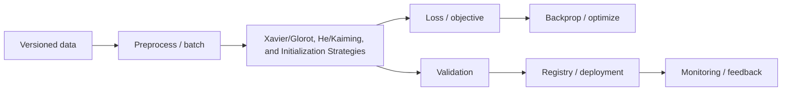

# Xavier/Glorot, He/Kaiming, and Initialization Strategies

## 1. Title and Learning Position
- **Category:** Neural Network Foundations
- **Prerequisites:** [Backpropagation and Automatic Differentiation](10-backpropagation-and-autograd.md)
- **Why it matters:** Xavier/Glorot, He/Kaiming, and Initialization Strategies is part of the conceptual and engineering chain needed to design, debug and operate modern deep-learning systems rather than only call framework APIs.
- **Objectives:** explain intuition and mathematics; reason about tensor/data flow; implement and validate an example; identify failure modes; select production architecture; discuss system-design trade-offs.
- **Difficulty:** Foundational
- **Estimated study time:** 4-8 hours plus 2-4 hours of exercises.

## 2. Concept
**Beginner view.** Xavier/Glorot, He/Kaiming, and Initialization Strategies should first be understood as a transformation or design pattern: define the input, desired output, learned or configured mechanism, and loss/evaluation signal. Draw the tensor or control flow before writing code.

**Intermediate view.** Connect the method to optimization, regularization, data preparation and validation. Ask what information the architecture can represent efficiently, what assumptions it makes, and which hyperparameters control capacity, stability or compute.

**Advanced view.** Study scaling, numerical precision, data distribution, initialization/optimization interactions, calibration, memory pressure, communication, serving behavior, security and operational failure. Separate training metrics, validation/model-selection metrics, and final held-out/production metrics.

**Mathematical anchor.** For a parameterized model $f_\theta(x)$, training minimizes $J(\theta)=\frac{1}{N}\sum_i L(f_\theta(x_i),y_i)$ using gradients $\theta\leftarrow\theta-\eta\nabla_\theta J$. Here $\theta$ are parameters, $L$ the loss, $N$ sample count, and $\eta$ learning rate.

**Tensor/shape reasoning.** Record shapes at every boundary using symbols such as batch $B$, sequence/time $T$, channels/features $C$, hidden dimension $D$, height $H$ and width $W$. Confirm broadcasting, reductions, masks and output dimensions explicitly.

**Training vs inference.** Training retains activations required for gradients and may enable stochastic regularizers; inference disables gradients and training-only behavior and is optimized for stable latency/throughput. Never select a checkpoint using the final test set.

**Strengths/limitations.** Use this technique when its representation and compute trade-off fits the data and objective. Avoid unnecessary architectural complexity when a simpler baseline achieves comparable validated utility. Common failure modes include leakage, unstable optimization, poor initialization, imbalance, distribution shift, OOM, nonrepresentative evaluation and training-serving mismatch.



## 3. Intermediate and Advanced Use Cases
### Intermediate: controlled experiment
**Problem:** Compare a baseline with Xavier/Glorot, He/Kaiming, and Initialization Strategies on a versioned dataset and analyze error slices. **Data:** versioned, representative data split by an appropriate random, grouped or temporal strategy. **Why suitable:** the method's inductive bias matches the target modality/problem. **Design:** baseline -> leakage-safe preprocessing -> training/selection -> held-out evaluation -> packaged inference -> monitored release. **Metrics:** task metric plus calibration/robustness where applicable and service p95/p99 latency, throughput and resource use. **Risks:** leakage, dataset shift, overfitting, unreliable labels, OOM, cost and production skew. **Alternatives:** simpler classical model, smaller neural model, transfer learning, managed model/API, or a deterministic workflow when comparable utility can be achieved.
### Intermediate: transfer to enterprise data
**Problem:** Apply Xavier/Glorot, He/Kaiming, and Initialization Strategies to a document, ERP, manufacturing, forecasting, vision or NLP workload. **Data:** versioned, representative data split by an appropriate random, grouped or temporal strategy. **Why suitable:** the method's inductive bias matches the target modality/problem. **Design:** baseline -> leakage-safe preprocessing -> training/selection -> held-out evaluation -> packaged inference -> monitored release. **Metrics:** task metric plus calibration/robustness where applicable and service p95/p99 latency, throughput and resource use. **Risks:** leakage, dataset shift, overfitting, unreliable labels, OOM, cost and production skew. **Alternatives:** simpler classical model, smaller neural model, transfer learning, managed model/API, or a deterministic workflow when comparable utility can be achieved.
### Advanced: scale/performance
**Problem:** Scale Xavier/Glorot, He/Kaiming, and Initialization Strategies while preserving quality and measuring memory, throughput and latency. **Data:** versioned, representative data split by an appropriate random, grouped or temporal strategy. **Why suitable:** the method's inductive bias matches the target modality/problem. **Design:** baseline -> leakage-safe preprocessing -> training/selection -> held-out evaluation -> packaged inference -> monitored release. **Metrics:** task metric plus calibration/robustness where applicable and service p95/p99 latency, throughput and resource use. **Risks:** leakage, dataset shift, overfitting, unreliable labels, OOM, cost and production skew. **Alternatives:** simpler classical model, smaller neural model, transfer learning, managed model/API, or a deterministic workflow when comparable utility can be achieved.
### Advanced: robustness
**Problem:** Test Xavier/Glorot, He/Kaiming, and Initialization Strategies under data shift, corrupted inputs, capacity constraints or degraded dependencies. **Data:** versioned, representative data split by an appropriate random, grouped or temporal strategy. **Why suitable:** the method's inductive bias matches the target modality/problem. **Design:** baseline -> leakage-safe preprocessing -> training/selection -> held-out evaluation -> packaged inference -> monitored release. **Metrics:** task metric plus calibration/robustness where applicable and service p95/p99 latency, throughput and resource use. **Risks:** leakage, dataset shift, overfitting, unreliable labels, OOM, cost and production skew. **Alternatives:** simpler classical model, smaller neural model, transfer learning, managed model/API, or a deterministic workflow when comparable utility can be achieved.
### Enterprise
**Problem:** Design a governed deployment of Xavier/Glorot, He/Kaiming, and Initialization Strategies with model registry, auditability, monitoring and rollback. **Data:** versioned, representative data split by an appropriate random, grouped or temporal strategy. **Why suitable:** the method's inductive bias matches the target modality/problem. **Design:** baseline -> leakage-safe preprocessing -> training/selection -> held-out evaluation -> packaged inference -> monitored release. **Metrics:** task metric plus calibration/robustness where applicable and service p95/p99 latency, throughput and resource use. **Risks:** leakage, dataset shift, overfitting, unreliable labels, OOM, cost and production skew. **Alternatives:** simpler classical model, smaller neural model, transfer learning, managed model/API, or a deterministic workflow when comparable utility can be achieved.

## 4. Python / PyTorch Implementation
**Implementation discipline.** Set seeds, split data before learned preprocessing, use Dataset/DataLoader where applicable, track tensor shapes, move data/model to one device, run validation outside gradient tracking, checkpoint model plus optimizer/scheduler/scaler/configuration, and preserve model/data/code versions.

```python
import random, numpy as np, torch
from torch import nn
from torch.utils.data import DataLoader, TensorDataset

SEED = 42
random.seed(SEED); np.random.seed(SEED); torch.manual_seed(SEED)
if torch.cuda.is_available(): torch.cuda.manual_seed_all(SEED)
device = torch.device("cuda" if torch.cuda.is_available() else "cpu")

# Synthetic example: replace with a task-appropriate Dataset and preprocessing pipeline.
X = torch.randn(1024, 20)
y = (X[:, :3].sum(1) > 0).long()
train = TensorDataset(X[:800], y[:800]); val = TensorDataset(X[800:], y[800:])
train_loader = DataLoader(train, batch_size=64, shuffle=True)
val_loader = DataLoader(val, batch_size=128)
model = nn.Sequential(nn.Linear(20, 64), nn.ReLU(), nn.Dropout(0.2), nn.Linear(64, 2)).to(device)
opt = torch.optim.AdamW(model.parameters(), lr=3e-4, weight_decay=1e-2)
loss_fn = nn.CrossEntropyLoss()

best = float("inf")
for epoch in range(5):
    model.train()
    for xb, yb in train_loader:
        xb, yb = xb.to(device), yb.to(device)
        opt.zero_grad(set_to_none=True)
        loss = loss_fn(model(xb), yb)
        loss.backward()
        torch.nn.utils.clip_grad_norm_(model.parameters(), 1.0)
        opt.step()
    model.eval(); total = 0.0
    with torch.inference_mode():
        for xb, yb in val_loader:
            total += loss_fn(model(xb.to(device)), yb.to(device)).item() * len(xb)
    val_loss = total / len(val)
    if val_loss < best:
        best = val_loss
        torch.save({"model": model.state_dict(), "optimizer": opt.state_dict(), "epoch": epoch}, "checkpoint.pt")
```

**Hyperparameter strategy:** tune a small set of high-impact parameters first: learning rate, batch size, regularization, capacity, scheduler/warmup and modality-specific parameters. Use an explicit validation objective and bounded search budget.

**Error analysis:** inspect per-class/slice metrics, hard examples, calibration where probabilities matter, training/validation curves, gradient norms, activation statistics and system telemetry.

**Common mistake:** reporting the best test-set trial after repeatedly tuning on test data. **Correction:** tune on train/validation; lock configuration; evaluate the test set once for final reporting.

## 5. Architectural Considerations
- **Lineage:** version dataset snapshot, preprocessing/tokenizer/augmentation, code commit, configuration, model artifact and evaluation result. MLflow or an equivalent managed registry can capture this chain.
- **Compute:** profile CPU/GPU utilization, accelerator memory, precision, input/sequence size, batch size and data-loader stalls. Choose FP32, BF16 or FP16 based on hardware and numerical behavior, not fashion.
- **Scale:** start single-device; move to DDP when data-parallel scaling is justified; use FSDP/ZeRO/tensor/pipeline techniques when model/optimizer state no longer fits or communication-efficient scale requires it.
- **Serving:** choose batch for scheduled high-throughput inference; synchronous REST/gRPC for interactive decisions; event-driven/Kafka patterns for decoupled workflows. Profile cold/warm p50/p95/p99 latency and throughput.
- **Optimization:** quantization, distillation, pruning, ONNX/TensorRT-style compilation, batching and caching change quality/portability/latency trade-offs; validate the optimized artifact separately.
- **Operations:** monitor schema/data quality, drift, model quality, latency, errors, saturation, GPU memory/utilization and business outcomes. Retrain using explicit evidence-based triggers.
- **Security:** enforce least privilege, encrypted storage/transport, secret isolation, supply-chain controls and access auditing. Sensitive modalities require additional privacy review.
- **Release:** use shadow evaluation for material changes and canary rollout with automatic rollback thresholds. Keep a prior known-good model and deterministic/manual fallback.
- **Cost:** compare incremental quality with training GPU-hours, inference accelerators, storage, network and operational complexity.
- **Platforms:** Docker/Kubernetes, Kubeflow, Azure Machine Learning, SageMaker, Vertex AI, Ray, Airflow, Triton, ONNX Runtime, TensorRT, DeepSpeed, Accelerate or vLLM are choices when their orchestration, acceleration or governance capabilities solve an actual requirement.

## 6. Interview Questions
### Q1. Beginner: What is a critical design decision in **Xavier/Glorot, He/Kaiming, and Initialization Strategies** and how would you validate it?
**Model answer:** State the objective and assumptions, identify the controlling mathematical/architectural mechanism, establish a baseline, measure on unseen data or representative load, inspect failure slices, then connect the result to production latency, memory, reliability and cost.

**Evaluates:** whether the candidate can connect theory, implementation and systems trade-offs.

**Weak answer:** naming a framework or hyperparameter without explaining why, measurement design, or failure modes.

**Follow-up:** How would the answer change for limited GPU memory, distribution shift, strict p99 latency, or a regulated workload?

### Q2. Beginner: What is a critical design decision in **Xavier/Glorot, He/Kaiming, and Initialization Strategies** and how would you validate it?
**Model answer:** State the objective and assumptions, identify the controlling mathematical/architectural mechanism, establish a baseline, measure on unseen data or representative load, inspect failure slices, then connect the result to production latency, memory, reliability and cost.

**Evaluates:** whether the candidate can connect theory, implementation and systems trade-offs.

**Weak answer:** naming a framework or hyperparameter without explaining why, measurement design, or failure modes.

**Follow-up:** How would the answer change for limited GPU memory, distribution shift, strict p99 latency, or a regulated workload?

### Q3. Beginner: What is a critical design decision in **Xavier/Glorot, He/Kaiming, and Initialization Strategies** and how would you validate it?
**Model answer:** State the objective and assumptions, identify the controlling mathematical/architectural mechanism, establish a baseline, measure on unseen data or representative load, inspect failure slices, then connect the result to production latency, memory, reliability and cost.

**Evaluates:** whether the candidate can connect theory, implementation and systems trade-offs.

**Weak answer:** naming a framework or hyperparameter without explaining why, measurement design, or failure modes.

**Follow-up:** How would the answer change for limited GPU memory, distribution shift, strict p99 latency, or a regulated workload?

### Q4. Beginner: What is a critical design decision in **Xavier/Glorot, He/Kaiming, and Initialization Strategies** and how would you validate it?
**Model answer:** State the objective and assumptions, identify the controlling mathematical/architectural mechanism, establish a baseline, measure on unseen data or representative load, inspect failure slices, then connect the result to production latency, memory, reliability and cost.

**Evaluates:** whether the candidate can connect theory, implementation and systems trade-offs.

**Weak answer:** naming a framework or hyperparameter without explaining why, measurement design, or failure modes.

**Follow-up:** How would the answer change for limited GPU memory, distribution shift, strict p99 latency, or a regulated workload?

### Q5. Beginner: What is a critical design decision in **Xavier/Glorot, He/Kaiming, and Initialization Strategies** and how would you validate it?
**Model answer:** State the objective and assumptions, identify the controlling mathematical/architectural mechanism, establish a baseline, measure on unseen data or representative load, inspect failure slices, then connect the result to production latency, memory, reliability and cost.

**Evaluates:** whether the candidate can connect theory, implementation and systems trade-offs.

**Weak answer:** naming a framework or hyperparameter without explaining why, measurement design, or failure modes.

**Follow-up:** How would the answer change for limited GPU memory, distribution shift, strict p99 latency, or a regulated workload?

### Q6. Intermediate: What is a critical design decision in **Xavier/Glorot, He/Kaiming, and Initialization Strategies** and how would you validate it?
**Model answer:** State the objective and assumptions, identify the controlling mathematical/architectural mechanism, establish a baseline, measure on unseen data or representative load, inspect failure slices, then connect the result to production latency, memory, reliability and cost.

**Evaluates:** whether the candidate can connect theory, implementation and systems trade-offs.

**Weak answer:** naming a framework or hyperparameter without explaining why, measurement design, or failure modes.

**Follow-up:** How would the answer change for limited GPU memory, distribution shift, strict p99 latency, or a regulated workload?

### Q7. Intermediate: What is a critical design decision in **Xavier/Glorot, He/Kaiming, and Initialization Strategies** and how would you validate it?
**Model answer:** State the objective and assumptions, identify the controlling mathematical/architectural mechanism, establish a baseline, measure on unseen data or representative load, inspect failure slices, then connect the result to production latency, memory, reliability and cost.

**Evaluates:** whether the candidate can connect theory, implementation and systems trade-offs.

**Weak answer:** naming a framework or hyperparameter without explaining why, measurement design, or failure modes.

**Follow-up:** How would the answer change for limited GPU memory, distribution shift, strict p99 latency, or a regulated workload?

### Q8. Intermediate: What is a critical design decision in **Xavier/Glorot, He/Kaiming, and Initialization Strategies** and how would you validate it?
**Model answer:** State the objective and assumptions, identify the controlling mathematical/architectural mechanism, establish a baseline, measure on unseen data or representative load, inspect failure slices, then connect the result to production latency, memory, reliability and cost.

**Evaluates:** whether the candidate can connect theory, implementation and systems trade-offs.

**Weak answer:** naming a framework or hyperparameter without explaining why, measurement design, or failure modes.

**Follow-up:** How would the answer change for limited GPU memory, distribution shift, strict p99 latency, or a regulated workload?

### Q9. Intermediate: What is a critical design decision in **Xavier/Glorot, He/Kaiming, and Initialization Strategies** and how would you validate it?
**Model answer:** State the objective and assumptions, identify the controlling mathematical/architectural mechanism, establish a baseline, measure on unseen data or representative load, inspect failure slices, then connect the result to production latency, memory, reliability and cost.

**Evaluates:** whether the candidate can connect theory, implementation and systems trade-offs.

**Weak answer:** naming a framework or hyperparameter without explaining why, measurement design, or failure modes.

**Follow-up:** How would the answer change for limited GPU memory, distribution shift, strict p99 latency, or a regulated workload?

### Q10. Intermediate: What is a critical design decision in **Xavier/Glorot, He/Kaiming, and Initialization Strategies** and how would you validate it?
**Model answer:** State the objective and assumptions, identify the controlling mathematical/architectural mechanism, establish a baseline, measure on unseen data or representative load, inspect failure slices, then connect the result to production latency, memory, reliability and cost.

**Evaluates:** whether the candidate can connect theory, implementation and systems trade-offs.

**Weak answer:** naming a framework or hyperparameter without explaining why, measurement design, or failure modes.

**Follow-up:** How would the answer change for limited GPU memory, distribution shift, strict p99 latency, or a regulated workload?

### Q11. Advanced: What is a critical design decision in **Xavier/Glorot, He/Kaiming, and Initialization Strategies** and how would you validate it?
**Model answer:** State the objective and assumptions, identify the controlling mathematical/architectural mechanism, establish a baseline, measure on unseen data or representative load, inspect failure slices, then connect the result to production latency, memory, reliability and cost.

**Evaluates:** whether the candidate can connect theory, implementation and systems trade-offs.

**Weak answer:** naming a framework or hyperparameter without explaining why, measurement design, or failure modes.

**Follow-up:** How would the answer change for limited GPU memory, distribution shift, strict p99 latency, or a regulated workload?

### Q12. Advanced: What is a critical design decision in **Xavier/Glorot, He/Kaiming, and Initialization Strategies** and how would you validate it?
**Model answer:** State the objective and assumptions, identify the controlling mathematical/architectural mechanism, establish a baseline, measure on unseen data or representative load, inspect failure slices, then connect the result to production latency, memory, reliability and cost.

**Evaluates:** whether the candidate can connect theory, implementation and systems trade-offs.

**Weak answer:** naming a framework or hyperparameter without explaining why, measurement design, or failure modes.

**Follow-up:** How would the answer change for limited GPU memory, distribution shift, strict p99 latency, or a regulated workload?

### Q13. Advanced: What is a critical design decision in **Xavier/Glorot, He/Kaiming, and Initialization Strategies** and how would you validate it?
**Model answer:** State the objective and assumptions, identify the controlling mathematical/architectural mechanism, establish a baseline, measure on unseen data or representative load, inspect failure slices, then connect the result to production latency, memory, reliability and cost.

**Evaluates:** whether the candidate can connect theory, implementation and systems trade-offs.

**Weak answer:** naming a framework or hyperparameter without explaining why, measurement design, or failure modes.

**Follow-up:** How would the answer change for limited GPU memory, distribution shift, strict p99 latency, or a regulated workload?

### Q14. Advanced: What is a critical design decision in **Xavier/Glorot, He/Kaiming, and Initialization Strategies** and how would you validate it?
**Model answer:** State the objective and assumptions, identify the controlling mathematical/architectural mechanism, establish a baseline, measure on unseen data or representative load, inspect failure slices, then connect the result to production latency, memory, reliability and cost.

**Evaluates:** whether the candidate can connect theory, implementation and systems trade-offs.

**Weak answer:** naming a framework or hyperparameter without explaining why, measurement design, or failure modes.

**Follow-up:** How would the answer change for limited GPU memory, distribution shift, strict p99 latency, or a regulated workload?

### Q15. Advanced: What is a critical design decision in **Xavier/Glorot, He/Kaiming, and Initialization Strategies** and how would you validate it?
**Model answer:** State the objective and assumptions, identify the controlling mathematical/architectural mechanism, establish a baseline, measure on unseen data or representative load, inspect failure slices, then connect the result to production latency, memory, reliability and cost.

**Evaluates:** whether the candidate can connect theory, implementation and systems trade-offs.

**Weak answer:** naming a framework or hyperparameter without explaining why, measurement design, or failure modes.

**Follow-up:** How would the answer change for limited GPU memory, distribution shift, strict p99 latency, or a regulated workload?

### Q16. Architecture: What is a critical design decision in **Xavier/Glorot, He/Kaiming, and Initialization Strategies** and how would you validate it?
**Model answer:** State the objective and assumptions, identify the controlling mathematical/architectural mechanism, establish a baseline, measure on unseen data or representative load, inspect failure slices, then connect the result to production latency, memory, reliability and cost.

**Evaluates:** whether the candidate can connect theory, implementation and systems trade-offs.

**Weak answer:** naming a framework or hyperparameter without explaining why, measurement design, or failure modes.

**Follow-up:** How would the answer change for limited GPU memory, distribution shift, strict p99 latency, or a regulated workload?

### Q17. Architecture: What is a critical design decision in **Xavier/Glorot, He/Kaiming, and Initialization Strategies** and how would you validate it?
**Model answer:** State the objective and assumptions, identify the controlling mathematical/architectural mechanism, establish a baseline, measure on unseen data or representative load, inspect failure slices, then connect the result to production latency, memory, reliability and cost.

**Evaluates:** whether the candidate can connect theory, implementation and systems trade-offs.

**Weak answer:** naming a framework or hyperparameter without explaining why, measurement design, or failure modes.

**Follow-up:** How would the answer change for limited GPU memory, distribution shift, strict p99 latency, or a regulated workload?

### Q18. Architecture: What is a critical design decision in **Xavier/Glorot, He/Kaiming, and Initialization Strategies** and how would you validate it?
**Model answer:** State the objective and assumptions, identify the controlling mathematical/architectural mechanism, establish a baseline, measure on unseen data or representative load, inspect failure slices, then connect the result to production latency, memory, reliability and cost.

**Evaluates:** whether the candidate can connect theory, implementation and systems trade-offs.

**Weak answer:** naming a framework or hyperparameter without explaining why, measurement design, or failure modes.

**Follow-up:** How would the answer change for limited GPU memory, distribution shift, strict p99 latency, or a regulated workload?

### Q19. Debugging: What is a critical design decision in **Xavier/Glorot, He/Kaiming, and Initialization Strategies** and how would you validate it?
**Model answer:** State the objective and assumptions, identify the controlling mathematical/architectural mechanism, establish a baseline, measure on unseen data or representative load, inspect failure slices, then connect the result to production latency, memory, reliability and cost.

**Evaluates:** whether the candidate can connect theory, implementation and systems trade-offs.

**Weak answer:** naming a framework or hyperparameter without explaining why, measurement design, or failure modes.

**Follow-up:** How would the answer change for limited GPU memory, distribution shift, strict p99 latency, or a regulated workload?

### Q20. Debugging: What is a critical design decision in **Xavier/Glorot, He/Kaiming, and Initialization Strategies** and how would you validate it?
**Model answer:** State the objective and assumptions, identify the controlling mathematical/architectural mechanism, establish a baseline, measure on unseen data or representative load, inspect failure slices, then connect the result to production latency, memory, reliability and cost.

**Evaluates:** whether the candidate can connect theory, implementation and systems trade-offs.

**Weak answer:** naming a framework or hyperparameter without explaining why, measurement design, or failure modes.

**Follow-up:** How would the answer change for limited GPU memory, distribution shift, strict p99 latency, or a regulated workload?

### Q21. Coding: What is a critical design decision in **Xavier/Glorot, He/Kaiming, and Initialization Strategies** and how would you validate it?
**Model answer:** State the objective and assumptions, identify the controlling mathematical/architectural mechanism, establish a baseline, measure on unseen data or representative load, inspect failure slices, then connect the result to production latency, memory, reliability and cost.

**Evaluates:** whether the candidate can connect theory, implementation and systems trade-offs.

**Weak answer:** naming a framework or hyperparameter without explaining why, measurement design, or failure modes.

**Follow-up:** How would the answer change for limited GPU memory, distribution shift, strict p99 latency, or a regulated workload?

### Q22. Coding: What is a critical design decision in **Xavier/Glorot, He/Kaiming, and Initialization Strategies** and how would you validate it?
**Model answer:** State the objective and assumptions, identify the controlling mathematical/architectural mechanism, establish a baseline, measure on unseen data or representative load, inspect failure slices, then connect the result to production latency, memory, reliability and cost.

**Evaluates:** whether the candidate can connect theory, implementation and systems trade-offs.

**Weak answer:** naming a framework or hyperparameter without explaining why, measurement design, or failure modes.

**Follow-up:** How would the answer change for limited GPU memory, distribution shift, strict p99 latency, or a regulated workload?

## 7. Practical Exercises
### Foundational
Explain and implement a minimal Xavier/Glorot, He/Kaiming, and Initialization Strategies example; annotate tensor dimensions and derive the central objective. **Expected:** reproducible script/notebook. **Evaluate:** math, shapes, correctness and interpretation. **Failure modes:** leakage, wrong shapes, poor metric choice. **Stretch:** implement a key primitive without a high-level helper.

### Intermediate
Establish a baseline, tune Xavier/Glorot, He/Kaiming, and Initialization Strategies on train/validation data, save the best checkpoint, and analyze at least three error slices. **Expected:** experiment report. **Evaluate:** reproducibility, metric rationale, error analysis and evidence for selection. **Stretch:** add mixed precision or transfer learning where relevant.

### Advanced production
Design and prototype a service or pipeline for an enterprise workload. Include lineage, registry, deployment, SLOs, capacity, security, monitoring, rollback and cost assumptions. **Expected:** architecture plus operational test plan. **Evaluate:** quality, reliability, observability, security and cost. **Stretch:** load test or distributed training/inference where relevant.

## 8. Summary and Revision Checklist
### Key takeaways
- Understand the mechanism and assumptions before framework syntax.
- Track tensor shapes, loss behavior and gradients during development.
- Separate train, validation and test responsibilities.
- Production success requires quality plus latency, reliability, observability, security and cost control.

### Formulas and shape rules
Re-derive the mathematical anchor above; write the expected input/output shapes and complexity in terms of $B,T,C,D,H,W$ where relevant.

### Critical hyperparameters
Learning rate, batch size, capacity, regularization, scheduler/warmup, precision, gradient clipping, and topic-specific architecture parameters.

### Selection checklist
- [ ] Strong baseline exists
- [ ] Data split and leakage controls are correct
- [ ] Shapes/objective verified
- [ ] Validation metric matches the task
- [ ] Resource/latency limits measured
- [ ] Failure slices and robustness tested
- [ ] Deployment, monitoring and rollback defined

### Common pitfalls
Test-set tuning, silent broadcasting bugs, incorrect masks, unstable learning rate, OOM from excessive batch/sequence size, missing eval mode, checkpoint incompatibility, non-reproducible preprocessing and unmeasured serving cost.

### Five flashcards
1. **Q:** Why draw tensor shapes first? **A:** It exposes incompatible operations and makes architecture behavior concrete.
2. **Q:** What is the validation set for? **A:** Model/hyperparameter selection, never final unbiased reporting.
3. **Q:** Why can training and inference differ? **A:** Gradients and training-only stochastic/stateful layers change compute and behavior.
4. **Q:** When should architecture complexity increase? **A:** Only when validated utility justifies compute and operational cost.
5. **Q:** What makes a model production-ready? **A:** Versioning, reproducibility, measured quality/performance, security, monitoring, rollback and ownership.

### Next recommended topics
- [Batch GD, SGD, and Mini-Batch Training](12-gradient-descent-sgd-minibatch.md)
- [Momentum, RMSProp, Adam, and AdamW](13-momentum-rmsprop-adam-adamw.md)
