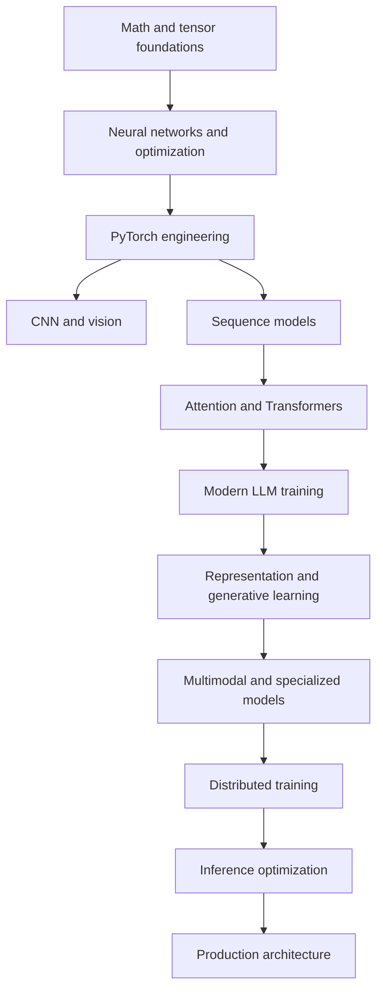

# Deep Learning Engineering Notes

## Repository Purpose

This repository is a practitioner-oriented deep-learning path for experienced Python/ML engineers moving toward AI Engineering and AI Solution Architecture. Prerequisites are Python, NumPy, algebra, calculus, probability/statistics and basic ML. Work in sequence, run the code, complete lab exercises, then rehearse interview/system-design sections.

## Recommended Learning Path

## Category Summary

### Category 1: Deep Learning Mathematical Foundations

**Purpose:** build capability in deep learning mathematical foundations. **Prerequisite:** previous categories unless already proficient. **Outcome:** explain, implement, debug, evaluate and architect the techniques. **Estimated time:** 30-50 hours.

1. **[Deep Learning Problem Framing and End-to-End Workflow](01-deep-learning-workflow.md)**  
   Foundational. Prerequisite: Python, algebra, calculus and probability. Estimated study: 4-8 hours. Outcome: conceptual, implementation, debugging, and system-design competency in Deep Learning Problem Framing and End-to-End Workflow.
2. **[Tensors, Linear Algebra, Broadcasting, and Shape Reasoning](02-tensors-linear-algebra-and-shapes.md)**  
   Foundational. Prerequisite: Deep Learning Problem Framing and End-to-End Workflow. Estimated study: 4-8 hours. Outcome: conceptual, implementation, debugging, and system-design competency in Tensors, Linear Algebra, Broadcasting, and Shape Reasoning.
3. **[Calculus, Partial Derivatives, Gradients, and Chain Rule](03-calculus-gradients-and-chain-rule.md)**  
   Foundational. Prerequisite: Tensors, Linear Algebra, Broadcasting, and Shape Reasoning. Estimated study: 4-8 hours. Outcome: conceptual, implementation, debugging, and system-design competency in Calculus, Partial Derivatives, Gradients, and Chain Rule.
4. **[Probability, Maximum Likelihood, Entropy, Cross-Entropy, and KL Divergence](04-probability-information-theory.md)**  
   Foundational. Prerequisite: Calculus, Partial Derivatives, Gradients, and Chain Rule. Estimated study: 4-8 hours. Outcome: conceptual, implementation, debugging, and system-design competency in Probability, Maximum Likelihood, Entropy, Cross-Entropy, and KL Divergence.
5. **[Deep Learning Loss Functions and Objective Design](05-loss-functions.md)**  
   Foundational. Prerequisite: Probability, Maximum Likelihood, Entropy, Cross-Entropy, and KL Divergence. Estimated study: 4-8 hours. Outcome: conceptual, implementation, debugging, and system-design competency in Deep Learning Loss Functions and Objective Design.

### Category 2: Neural Network Foundations

**Purpose:** build capability in neural network foundations. **Prerequisite:** previous categories unless already proficient. **Outcome:** explain, implement, debug, evaluate and architect the techniques. **Estimated time:** 36-60 hours.

6. **[Perceptron, Artificial Neuron, Weights, and Bias](06-perceptron-and-neuron.md)**  
   Foundational. Prerequisite: Deep Learning Loss Functions and Objective Design. Estimated study: 4-8 hours. Outcome: conceptual, implementation, debugging, and system-design competency in Perceptron, Artificial Neuron, Weights, and Bias.
7. **[Multi-Layer Perceptrons and Dense Networks](07-mlp-and-dense-networks.md)**  
   Foundational. Prerequisite: Perceptron, Artificial Neuron, Weights, and Bias. Estimated study: 4-8 hours. Outcome: conceptual, implementation, debugging, and system-design competency in Multi-Layer Perceptrons and Dense Networks.
8. **[Sigmoid, Tanh, ReLU, Leaky ReLU, GELU, SiLU/Swish, and Softmax](08-activation-functions.md)**  
   Foundational. Prerequisite: Multi-Layer Perceptrons and Dense Networks. Estimated study: 4-8 hours. Outcome: conceptual, implementation, debugging, and system-design competency in Sigmoid, Tanh, ReLU, Leaky ReLU, GELU, SiLU/Swish, and Softmax.
9. **[Forward Propagation and Computational Graphs](09-forward-propagation.md)**  
   Foundational. Prerequisite: Sigmoid, Tanh, ReLU, Leaky ReLU, GELU, SiLU/Swish, and Softmax. Estimated study: 4-8 hours. Outcome: conceptual, implementation, debugging, and system-design competency in Forward Propagation and Computational Graphs.
10. **[Backpropagation and Automatic Differentiation](10-backpropagation-and-autograd.md)**  
   Foundational. Prerequisite: Forward Propagation and Computational Graphs. Estimated study: 4-8 hours. Outcome: conceptual, implementation, debugging, and system-design competency in Backpropagation and Automatic Differentiation.
11. **[Xavier/Glorot, He/Kaiming, and Initialization Strategies](11-weight-initialization.md)**  
   Foundational. Prerequisite: Backpropagation and Automatic Differentiation. Estimated study: 4-8 hours. Outcome: conceptual, implementation, debugging, and system-design competency in Xavier/Glorot, He/Kaiming, and Initialization Strategies.

### Category 3: Optimization and Generalization

**Purpose:** build capability in optimization and generalization. **Prerequisite:** previous categories unless already proficient. **Outcome:** explain, implement, debug, evaluate and architect the techniques. **Estimated time:** 48-80 hours.

12. **[Batch GD, SGD, and Mini-Batch Training](12-gradient-descent-sgd-minibatch.md)**  
   Foundational. Prerequisite: Xavier/Glorot, He/Kaiming, and Initialization Strategies. Estimated study: 4-8 hours. Outcome: conceptual, implementation, debugging, and system-design competency in Batch GD, SGD, and Mini-Batch Training.
13. **[Momentum, RMSProp, Adam, and AdamW](13-momentum-rmsprop-adam-adamw.md)**  
   Foundational. Prerequisite: Batch GD, SGD, and Mini-Batch Training. Estimated study: 4-8 hours. Outcome: conceptual, implementation, debugging, and system-design competency in Momentum, RMSProp, Adam, and AdamW.
14. **[Learning Rate, Warmup, Decay, Cosine, and One-Cycle Scheduling](14-learning-rate-and-schedulers.md)**  
   Foundational. Prerequisite: Momentum, RMSProp, Adam, and AdamW. Estimated study: 4-8 hours. Outcome: conceptual, implementation, debugging, and system-design competency in Learning Rate, Warmup, Decay, Cosine, and One-Cycle Scheduling.
15. **[L1/L2, Weight Decay, Early Stopping, and Capacity Control](15-regularization-weight-decay.md)**  
   Foundational. Prerequisite: Learning Rate, Warmup, Decay, Cosine, and One-Cycle Scheduling. Estimated study: 4-8 hours. Outcome: conceptual, implementation, debugging, and system-design competency in L1/L2, Weight Decay, Early Stopping, and Capacity Control.
16. **[Dropout and Stochastic Regularization](16-dropout.md)**  
   Foundational. Prerequisite: L1/L2, Weight Decay, Early Stopping, and Capacity Control. Estimated study: 4-8 hours. Outcome: conceptual, implementation, debugging, and system-design competency in Dropout and Stochastic Regularization.
17. **[BatchNorm, LayerNorm, GroupNorm, and RMSNorm](17-normalization.md)**  
   Foundational. Prerequisite: Dropout and Stochastic Regularization. Estimated study: 4-8 hours. Outcome: conceptual, implementation, debugging, and system-design competency in BatchNorm, LayerNorm, GroupNorm, and RMSNorm.
18. **[Gradient Clipping, Accumulation, and Stability](18-gradient-clipping-accumulation.md)**  
   Foundational. Prerequisite: BatchNorm, LayerNorm, GroupNorm, and RMSNorm. Estimated study: 4-8 hours. Outcome: conceptual, implementation, debugging, and system-design competency in Gradient Clipping, Accumulation, and Stability.
19. **[Deep Learning Hyperparameter Optimization](19-hyperparameter-tuning.md)**  
   Foundational. Prerequisite: Gradient Clipping, Accumulation, and Stability. Estimated study: 4-8 hours. Outcome: conceptual, implementation, debugging, and system-design competency in Deep Learning Hyperparameter Optimization.

### Category 4: PyTorch Engineering Fundamentals

**Purpose:** build capability in pytorch engineering fundamentals. **Prerequisite:** previous categories unless already proficient. **Outcome:** explain, implement, debug, evaluate and architect the techniques. **Estimated time:** 36-60 hours.

20. **[PyTorch Tensors, Autograd, Modules, and Parameters](20-pytorch-tensors-autograd.md)**  
   Intermediate. Prerequisite: Deep Learning Hyperparameter Optimization. Estimated study: 4-8 hours. Outcome: conceptual, implementation, debugging, and system-design competency in PyTorch Tensors, Autograd, Modules, and Parameters.
21. **[Dataset, DataLoader, Sampling, Batching, and Collation](21-dataset-dataloader.md)**  
   Intermediate. Prerequisite: PyTorch Tensors, Autograd, Modules, and Parameters. Estimated study: 4-8 hours. Outcome: conceptual, implementation, debugging, and system-design competency in Dataset, DataLoader, Sampling, Batching, and Collation.
22. **[Production-Quality Training and Validation Loops](22-training-validation-loops.md)**  
   Intermediate. Prerequisite: Dataset, DataLoader, Sampling, Batching, and Collation. Estimated study: 4-8 hours. Outcome: conceptual, implementation, debugging, and system-design competency in Production-Quality Training and Validation Loops.
23. **[Checkpointing, Resume, Seeds, and Reproducibility](23-checkpointing-reproducibility.md)**  
   Intermediate. Prerequisite: Production-Quality Training and Validation Loops. Estimated study: 4-8 hours. Outcome: conceptual, implementation, debugging, and system-design competency in Checkpointing, Resume, Seeds, and Reproducibility.
24. **[FP32, FP16, BF16, Automatic Mixed Precision, and Loss Scaling](24-mixed-precision-training.md)**  
   Intermediate. Prerequisite: Checkpointing, Resume, Seeds, and Reproducibility. Estimated study: 4-8 hours. Outcome: conceptual, implementation, debugging, and system-design competency in FP32, FP16, BF16, Automatic Mixed Precision, and Loss Scaling.
25. **[Debugging Gradients, NaNs, Overfitting, Underfitting, and Data Pipelines](25-debugging-deep-neural-networks.md)**  
   Intermediate. Prerequisite: FP32, FP16, BF16, Automatic Mixed Precision, and Loss Scaling. Estimated study: 4-8 hours. Outcome: conceptual, implementation, debugging, and system-design competency in Debugging Gradients, NaNs, Overfitting, Underfitting, and Data Pipelines.

### Category 5: Convolutional Neural Networks and Vision

**Purpose:** build capability in convolutional neural networks and vision. **Prerequisite:** previous categories unless already proficient. **Outcome:** explain, implement, debug, evaluate and architect the techniques. **Estimated time:** 66-110 hours.

26. **[Convolution, Kernels, Stride, Padding, Dilation, and Receptive Fields](26-convolution-fundamentals.md)**  
   Intermediate. Prerequisite: Debugging Gradients, NaNs, Overfitting, Underfitting, and Data Pipelines. Estimated study: 4-8 hours. Outcome: conceptual, implementation, debugging, and system-design competency in Convolution, Kernels, Stride, Padding, Dilation, and Receptive Fields.
27. **[CNNs, Pooling, Channels, and Feature Hierarchies](27-cnn-pooling-feature-maps.md)**  
   Intermediate. Prerequisite: Convolution, Kernels, Stride, Padding, Dilation, and Receptive Fields. Estimated study: 4-8 hours. Outcome: conceptual, implementation, debugging, and system-design competency in CNNs, Pooling, Channels, and Feature Hierarchies.
28. **[LeNet, AlexNet, and VGG](28-lenet-alexnet-vgg.md)**  
   Intermediate. Prerequisite: CNNs, Pooling, Channels, and Feature Hierarchies. Estimated study: 4-8 hours. Outcome: conceptual, implementation, debugging, and system-design competency in LeNet, AlexNet, and VGG.
29. **[ResNet and Residual Connections](29-resnet.md)**  
   Intermediate. Prerequisite: LeNet, AlexNet, and VGG. Estimated study: 4-8 hours. Outcome: conceptual, implementation, debugging, and system-design competency in ResNet and Residual Connections.
30. **[Inception and DenseNet](30-inception-densenet.md)**  
   Intermediate. Prerequisite: ResNet and Residual Connections. Estimated study: 4-8 hours. Outcome: conceptual, implementation, debugging, and system-design competency in Inception and DenseNet.
31. **[EfficientNet and Compound Scaling](31-efficientnet.md)**  
   Intermediate. Prerequisite: Inception and DenseNet. Estimated study: 4-8 hours. Outcome: conceptual, implementation, debugging, and system-design competency in EfficientNet and Compound Scaling.
32. **[Transfer Learning and Fine-Tuning for Vision](32-transfer-learning-vision.md)**  
   Intermediate. Prerequisite: EfficientNet and Compound Scaling. Estimated study: 4-8 hours. Outcome: conceptual, implementation, debugging, and system-design competency in Transfer Learning and Fine-Tuning for Vision.
33. **[Image Augmentation, Mixup, CutMix, and Regularization](33-data-augmentation-vision.md)**  
   Intermediate. Prerequisite: Transfer Learning and Fine-Tuning for Vision. Estimated study: 4-8 hours. Outcome: conceptual, implementation, debugging, and system-design competency in Image Augmentation, Mixup, CutMix, and Regularization.
34. **[Object Detection: R-CNN Family, SSD, and YOLO Concepts](34-object-detection.md)**  
   Intermediate. Prerequisite: Image Augmentation, Mixup, CutMix, and Regularization. Estimated study: 4-8 hours. Outcome: conceptual, implementation, debugging, and system-design competency in Object Detection: R-CNN Family, SSD, and YOLO Concepts.
35. **[Semantic/Instance Segmentation, U-Net, and Mask R-CNN Concepts](35-image-segmentation.md)**  
   Intermediate. Prerequisite: Object Detection: R-CNN Family, SSD, and YOLO Concepts. Estimated study: 4-8 hours. Outcome: conceptual, implementation, debugging, and system-design competency in Semantic/Instance Segmentation, U-Net, and Mask R-CNN Concepts.
36. **[Vision Transformer, Patch Embeddings, and Hybrid Vision Architectures](36-vision-transformers.md)**  
   Intermediate. Prerequisite: Semantic/Instance Segmentation, U-Net, and Mask R-CNN Concepts. Estimated study: 4-8 hours. Outcome: conceptual, implementation, debugging, and system-design competency in Vision Transformer, Patch Embeddings, and Hybrid Vision Architectures.

### Category 6: Sequence Modeling

**Purpose:** build capability in sequence modeling. **Prerequisite:** previous categories unless already proficient. **Outcome:** explain, implement, debug, evaluate and architect the techniques. **Estimated time:** 42-70 hours.

37. **[Recurrent Neural Networks and Backpropagation Through Time](37-rnn.md)**  
   Intermediate. Prerequisite: Vision Transformer, Patch Embeddings, and Hybrid Vision Architectures. Estimated study: 4-8 hours. Outcome: conceptual, implementation, debugging, and system-design competency in Recurrent Neural Networks and Backpropagation Through Time.
38. **[Vanishing/Exploding Gradients in Sequence Models](38-vanishing-exploding-gradients.md)**  
   Intermediate. Prerequisite: Recurrent Neural Networks and Backpropagation Through Time. Estimated study: 4-8 hours. Outcome: conceptual, implementation, debugging, and system-design competency in Vanishing/Exploding Gradients in Sequence Models.
39. **[LSTM Architecture and Gates](39-lstm.md)**  
   Intermediate. Prerequisite: Vanishing/Exploding Gradients in Sequence Models. Estimated study: 4-8 hours. Outcome: conceptual, implementation, debugging, and system-design competency in LSTM Architecture and Gates.
40. **[GRU Architecture](40-gru.md)**  
   Intermediate. Prerequisite: LSTM Architecture and Gates. Estimated study: 4-8 hours. Outcome: conceptual, implementation, debugging, and system-design competency in GRU Architecture.
41. **[Bidirectional Sequence Models](41-bidirectional-rnn.md)**  
   Intermediate. Prerequisite: GRU Architecture. Estimated study: 4-8 hours. Outcome: conceptual, implementation, debugging, and system-design competency in Bidirectional Sequence Models.
42. **[Sequence-to-Sequence Encoder-Decoder Models](42-seq2seq-encoder-decoder.md)**  
   Intermediate. Prerequisite: Bidirectional Sequence Models. Estimated study: 4-8 hours. Outcome: conceptual, implementation, debugging, and system-design competency in Sequence-to-Sequence Encoder-Decoder Models.
43. **[Teacher Forcing, Autoregressive Decoding, Greedy and Beam Search](43-teacher-forcing-beam-search.md)**  
   Intermediate. Prerequisite: Sequence-to-Sequence Encoder-Decoder Models. Estimated study: 4-8 hours. Outcome: conceptual, implementation, debugging, and system-design competency in Teacher Forcing, Autoregressive Decoding, Greedy and Beam Search.

### Category 7: Attention and Transformer Foundations

**Purpose:** build capability in attention and transformer foundations. **Prerequisite:** previous categories unless already proficient. **Outcome:** explain, implement, debug, evaluate and architect the techniques. **Estimated time:** 60-100 hours.

44. **[Attention Mechanisms](44-attention.md)**  
   Intermediate. Prerequisite: Teacher Forcing, Autoregressive Decoding, Greedy and Beam Search. Estimated study: 4-8 hours. Outcome: conceptual, implementation, debugging, and system-design competency in Attention Mechanisms.
45. **[Queries, Keys, Values, and Scaled Dot-Product Attention](45-query-key-value.md)**  
   Intermediate. Prerequisite: Attention Mechanisms. Estimated study: 4-8 hours. Outcome: conceptual, implementation, debugging, and system-design competency in Queries, Keys, Values, and Scaled Dot-Product Attention.
46. **[Self-Attention and Causal Masking](46-self-attention.md)**  
   Intermediate. Prerequisite: Queries, Keys, Values, and Scaled Dot-Product Attention. Estimated study: 4-8 hours. Outcome: conceptual, implementation, debugging, and system-design competency in Self-Attention and Causal Masking.
47. **[Multi-Head Attention](47-multi-head-attention.md)**  
   Intermediate. Prerequisite: Self-Attention and Causal Masking. Estimated study: 4-8 hours. Outcome: conceptual, implementation, debugging, and system-design competency in Multi-Head Attention.
48. **[Sinusoidal, Learned, Relative, and Rotary Positional Encodings](48-positional-encoding.md)**  
   Intermediate. Prerequisite: Multi-Head Attention. Estimated study: 4-8 hours. Outcome: conceptual, implementation, debugging, and system-design competency in Sinusoidal, Learned, Relative, and Rotary Positional Encodings.
49. **[Transformer Block: Attention, MLP, Residuals, and Normalization](49-transformer-block.md)**  
   Intermediate. Prerequisite: Sinusoidal, Learned, Relative, and Rotary Positional Encodings. Estimated study: 4-8 hours. Outcome: conceptual, implementation, debugging, and system-design competency in Transformer Block: Attention, MLP, Residuals, and Normalization.
50. **[Transformer Encoder and BERT-Style Models](50-transformer-encoder.md)**  
   Intermediate. Prerequisite: Transformer Block: Attention, MLP, Residuals, and Normalization. Estimated study: 4-8 hours. Outcome: conceptual, implementation, debugging, and system-design competency in Transformer Encoder and BERT-Style Models.
51. **[Transformer Decoder and GPT-Style Models](51-transformer-decoder.md)**  
   Intermediate. Prerequisite: Transformer Encoder and BERT-Style Models. Estimated study: 4-8 hours. Outcome: conceptual, implementation, debugging, and system-design competency in Transformer Decoder and GPT-Style Models.
52. **[Encoder-Decoder Transformers and T5-Style Models](52-encoder-decoder-transformers.md)**  
   Intermediate. Prerequisite: Transformer Decoder and GPT-Style Models. Estimated study: 4-8 hours. Outcome: conceptual, implementation, debugging, and system-design competency in Encoder-Decoder Transformers and T5-Style Models.
53. **[BPE, WordPiece, SentencePiece, and Tokenization Engineering](53-tokenization.md)**  
   Intermediate. Prerequisite: Encoder-Decoder Transformers and T5-Style Models. Estimated study: 4-8 hours. Outcome: conceptual, implementation, debugging, and system-design competency in BPE, WordPiece, SentencePiece, and Tokenization Engineering.

### Category 8: Modern LLM Deep Learning

**Purpose:** build capability in modern llm deep learning. **Prerequisite:** previous categories unless already proficient. **Outcome:** explain, implement, debug, evaluate and architect the techniques. **Estimated time:** 54-90 hours.

54. **[Causal LM, Masked LM, and Sequence-to-Sequence Objectives](54-language-modeling-objectives.md)**  
   Advanced. Prerequisite: BPE, WordPiece, SentencePiece, and Tokenization Engineering. Estimated study: 4-8 hours. Outcome: conceptual, implementation, debugging, and system-design competency in Causal LM, Masked LM, and Sequence-to-Sequence Objectives.
55. **[LLM Pretraining Data, Objectives, and Training Pipeline](55-pretraining.md)**  
   Advanced. Prerequisite: Causal LM, Masked LM, and Sequence-to-Sequence Objectives. Estimated study: 4-8 hours. Outcome: conceptual, implementation, debugging, and system-design competency in LLM Pretraining Data, Objectives, and Training Pipeline.
56. **[Scaling Laws, Parameter Count, Data, Compute, and Tokens](56-scaling-laws-and-compute.md)**  
   Advanced. Prerequisite: LLM Pretraining Data, Objectives, and Training Pipeline. Estimated study: 4-8 hours. Outcome: conceptual, implementation, debugging, and system-design competency in Scaling Laws, Parameter Count, Data, Compute, and Tokens.
57. **[Supervised Fine-Tuning and Instruction Tuning](57-supervised-fine-tuning.md)**  
   Advanced. Prerequisite: Scaling Laws, Parameter Count, Data, Compute, and Tokens. Estimated study: 4-8 hours. Outcome: conceptual, implementation, debugging, and system-design competency in Supervised Fine-Tuning and Instruction Tuning.
58. **[PEFT, Adapters, LoRA, and QLoRA](58-peft-lora-qlora.md)**  
   Advanced. Prerequisite: Supervised Fine-Tuning and Instruction Tuning. Estimated study: 4-8 hours. Outcome: conceptual, implementation, debugging, and system-design competency in PEFT, Adapters, LoRA, and QLoRA.
59. **[RLHF and Reward Models](59-rlhf.md)**  
   Advanced. Prerequisite: PEFT, Adapters, LoRA, and QLoRA. Estimated study: 4-8 hours. Outcome: conceptual, implementation, debugging, and system-design competency in RLHF and Reward Models.
60. **[DPO and Preference Optimization](60-dpo-preference-optimization.md)**  
   Advanced. Prerequisite: RLHF and Reward Models. Estimated study: 4-8 hours. Outcome: conceptual, implementation, debugging, and system-design competency in DPO and Preference Optimization.
61. **[Context Windows, KV Cache, and Long-Context Engineering](61-context-windows-and-kv-cache.md)**  
   Advanced. Prerequisite: DPO and Preference Optimization. Estimated study: 4-8 hours. Outcome: conceptual, implementation, debugging, and system-design competency in Context Windows, KV Cache, and Long-Context Engineering.
62. **[LLM Evaluation, Benchmarks, Human Evaluation, and Task-Specific Metrics](62-llm-evaluation.md)**  
   Advanced. Prerequisite: Context Windows, KV Cache, and Long-Context Engineering. Estimated study: 4-8 hours. Outcome: conceptual, implementation, debugging, and system-design competency in LLM Evaluation, Benchmarks, Human Evaluation, and Task-Specific Metrics.

### Category 9: Representation and Self-Supervised Learning

**Purpose:** build capability in representation and self-supervised learning. **Prerequisite:** previous categories unless already proficient. **Outcome:** explain, implement, debug, evaluate and architect the techniques. **Estimated time:** 36-60 hours.

63. **[Autoencoders](63-autoencoders.md)**  
   Advanced. Prerequisite: LLM Evaluation, Benchmarks, Human Evaluation, and Task-Specific Metrics. Estimated study: 4-8 hours. Outcome: conceptual, implementation, debugging, and system-design competency in Autoencoders.
64. **[Variational Autoencoders](64-variational-autoencoders.md)**  
   Advanced. Prerequisite: Autoencoders. Estimated study: 4-8 hours. Outcome: conceptual, implementation, debugging, and system-design competency in Variational Autoencoders.
65. **[Contrastive Learning and InfoNCE](65-contrastive-learning.md)**  
   Advanced. Prerequisite: Variational Autoencoders. Estimated study: 4-8 hours. Outcome: conceptual, implementation, debugging, and system-design competency in Contrastive Learning and InfoNCE.
66. **[Siamese and Metric-Learning Networks](66-siamese-networks.md)**  
   Advanced. Prerequisite: Contrastive Learning and InfoNCE. Estimated study: 4-8 hours. Outcome: conceptual, implementation, debugging, and system-design competency in Siamese and Metric-Learning Networks.
67. **[Self-Supervised Representation Learning](67-self-supervised-learning.md)**  
   Advanced. Prerequisite: Siamese and Metric-Learning Networks. Estimated study: 4-8 hours. Outcome: conceptual, implementation, debugging, and system-design competency in Self-Supervised Representation Learning.
68. **[Deep Embeddings and Representation Spaces](68-deep-embeddings.md)**  
   Advanced. Prerequisite: Self-Supervised Representation Learning. Estimated study: 4-8 hours. Outcome: conceptual, implementation, debugging, and system-design competency in Deep Embeddings and Representation Spaces.

### Category 10: Generative Deep Learning

**Purpose:** build capability in generative deep learning. **Prerequisite:** previous categories unless already proficient. **Outcome:** explain, implement, debug, evaluate and architect the techniques. **Estimated time:** 36-60 hours.

69. **[Generative Modeling Foundations](69-generative-modeling-foundations.md)**  
   Advanced. Prerequisite: Deep Embeddings and Representation Spaces. Estimated study: 4-8 hours. Outcome: conceptual, implementation, debugging, and system-design competency in Generative Modeling Foundations.
70. **[Generative Adversarial Networks](70-gans.md)**  
   Advanced. Prerequisite: Generative Modeling Foundations. Estimated study: 4-8 hours. Outcome: conceptual, implementation, debugging, and system-design competency in Generative Adversarial Networks.
71. **[GAN Losses, Mode Collapse, and Training Stability](71-gan-training-stability.md)**  
   Advanced. Prerequisite: Generative Adversarial Networks. Estimated study: 4-8 hours. Outcome: conceptual, implementation, debugging, and system-design competency in GAN Losses, Mode Collapse, and Training Stability.
72. **[Diffusion Models and Denoising](72-diffusion-models.md)**  
   Advanced. Prerequisite: GAN Losses, Mode Collapse, and Training Stability. Estimated study: 4-8 hours. Outcome: conceptual, implementation, debugging, and system-design competency in Diffusion Models and Denoising.
73. **[Latent Diffusion and Text-to-Image Architecture](73-latent-diffusion.md)**  
   Advanced. Prerequisite: Diffusion Models and Denoising. Estimated study: 4-8 hours. Outcome: conceptual, implementation, debugging, and system-design competency in Latent Diffusion and Text-to-Image Architecture.
74. **[Evaluation of Generative Models](74-generative-model-evaluation.md)**  
   Advanced. Prerequisite: Latent Diffusion and Text-to-Image Architecture. Estimated study: 4-8 hours. Outcome: conceptual, implementation, debugging, and system-design competency in Evaluation of Generative Models.

### Category 11: Multimodal Deep Learning

**Purpose:** build capability in multimodal deep learning. **Prerequisite:** previous categories unless already proficient. **Outcome:** explain, implement, debug, evaluate and architect the techniques. **Estimated time:** 36-60 hours.

75. **[Multimodal Representation Learning](75-multimodal-representations.md)**  
   Advanced. Prerequisite: Evaluation of Generative Models. Estimated study: 4-8 hours. Outcome: conceptual, implementation, debugging, and system-design competency in Multimodal Representation Learning.
76. **[CLIP and Vision-Language Contrastive Learning](76-clip.md)**  
   Advanced. Prerequisite: Multimodal Representation Learning. Estimated study: 4-8 hours. Outcome: conceptual, implementation, debugging, and system-design competency in CLIP and Vision-Language Contrastive Learning.
77. **[Vision-Language Models](77-vision-language-models.md)**  
   Advanced. Prerequisite: CLIP and Vision-Language Contrastive Learning. Estimated study: 4-8 hours. Outcome: conceptual, implementation, debugging, and system-design competency in Vision-Language Models.
78. **[Multimodal Transformer Architectures](78-multimodal-transformers.md)**  
   Advanced. Prerequisite: Vision-Language Models. Estimated study: 4-8 hours. Outcome: conceptual, implementation, debugging, and system-design competency in Multimodal Transformer Architectures.
79. **[Document AI: Layout, OCR, Vision, and Language Fusion](79-document-ai.md)**  
   Advanced. Prerequisite: Multimodal Transformer Architectures. Estimated study: 4-8 hours. Outcome: conceptual, implementation, debugging, and system-design competency in Document AI: Layout, OCR, Vision, and Language Fusion.
80. **[Enterprise Multimodal Assistants and Retrieval Architectures](80-multimodal-enterprise-systems.md)**  
   Advanced. Prerequisite: Document AI: Layout, OCR, Vision, and Language Fusion. Estimated study: 4-8 hours. Outcome: conceptual, implementation, debugging, and system-design competency in Enterprise Multimodal Assistants and Retrieval Architectures.

### Category 12: Graph Neural Networks and Specialized Architectures

**Purpose:** build capability in graph neural networks and specialized architectures. **Prerequisite:** previous categories unless already proficient. **Outcome:** explain, implement, debug, evaluate and architect the techniques. **Estimated time:** 36-60 hours.

81. **[Graph Neural Network Foundations](81-graph-neural-networks.md)**  
   Advanced. Prerequisite: Enterprise Multimodal Assistants and Retrieval Architectures. Estimated study: 4-8 hours. Outcome: conceptual, implementation, debugging, and system-design competency in Graph Neural Network Foundations.
82. **[Graph Convolutional Networks](82-graph-convolutional-networks.md)**  
   Advanced. Prerequisite: Graph Neural Network Foundations. Estimated study: 4-8 hours. Outcome: conceptual, implementation, debugging, and system-design competency in Graph Convolutional Networks.
83. **[Graph Attention Networks](83-graph-attention-networks.md)**  
   Advanced. Prerequisite: Graph Convolutional Networks. Estimated study: 4-8 hours. Outcome: conceptual, implementation, debugging, and system-design competency in Graph Attention Networks.
84. **[Deep Learning for Time Series and Temporal Data](84-temporal-and-time-series-dl.md)**  
   Advanced. Prerequisite: Graph Attention Networks. Estimated study: 4-8 hours. Outcome: conceptual, implementation, debugging, and system-design competency in Deep Learning for Time Series and Temporal Data.
85. **[Transformer-Based Time-Series Models](85-transformers-for-time-series.md)**  
   Advanced. Prerequisite: Deep Learning for Time Series and Temporal Data. Estimated study: 4-8 hours. Outcome: conceptual, implementation, debugging, and system-design competency in Transformer-Based Time-Series Models.
86. **[Mixture-of-Experts Architectures and Routing](86-mixture-of-experts.md)**  
   Advanced. Prerequisite: Transformer-Based Time-Series Models. Estimated study: 4-8 hours. Outcome: conceptual, implementation, debugging, and system-design competency in Mixture-of-Experts Architectures and Routing.

### Category 13: Distributed and Large-Scale Training

**Purpose:** build capability in distributed and large-scale training. **Prerequisite:** previous categories unless already proficient. **Outcome:** explain, implement, debug, evaluate and architect the techniques. **Estimated time:** 36-60 hours.

87. **[Data Parallelism and Distributed Data Parallel](87-data-parallelism.md)**  
   Advanced. Prerequisite: Mixture-of-Experts Architectures and Routing. Estimated study: 4-8 hours. Outcome: conceptual, implementation, debugging, and system-design competency in Data Parallelism and Distributed Data Parallel.
88. **[Model and Tensor Parallelism](88-model-tensor-parallelism.md)**  
   Advanced. Prerequisite: Data Parallelism and Distributed Data Parallel. Estimated study: 4-8 hours. Outcome: conceptual, implementation, debugging, and system-design competency in Model and Tensor Parallelism.
89. **[Pipeline Parallelism and Micro-Batching](89-pipeline-parallelism.md)**  
   Advanced. Prerequisite: Model and Tensor Parallelism. Estimated study: 4-8 hours. Outcome: conceptual, implementation, debugging, and system-design competency in Pipeline Parallelism and Micro-Batching.
90. **[ZeRO, FSDP, and Sharded Training](90-zero-and-sharded-training.md)**  
   Advanced. Prerequisite: Pipeline Parallelism and Micro-Batching. Estimated study: 4-8 hours. Outcome: conceptual, implementation, debugging, and system-design competency in ZeRO, FSDP, and Sharded Training.
91. **[PyTorch Distributed, Accelerate, DeepSpeed, and Distributed Training Platforms](91-distributed-training-frameworks.md)**  
   Advanced. Prerequisite: ZeRO, FSDP, and Sharded Training. Estimated study: 4-8 hours. Outcome: conceptual, implementation, debugging, and system-design competency in PyTorch Distributed, Accelerate, DeepSpeed, and Distributed Training Platforms.
92. **[Profiling, GPU Utilization, Memory, Communication, and Training Performance](92-training-performance-engineering.md)**  
   Advanced. Prerequisite: PyTorch Distributed, Accelerate, DeepSpeed, and Distributed Training Platforms. Estimated study: 4-8 hours. Outcome: conceptual, implementation, debugging, and system-design competency in Profiling, GPU Utilization, Memory, Communication, and Training Performance.

### Category 14: Inference and Model Optimization

**Purpose:** build capability in inference and model optimization. **Prerequisite:** previous categories unless already proficient. **Outcome:** explain, implement, debug, evaluate and architect the techniques. **Estimated time:** 42-70 hours.

93. **[INT8/INT4 Quantization, PTQ, and QAT](93-model-quantization.md)**  
   Architecture/Production. Prerequisite: Profiling, GPU Utilization, Memory, Communication, and Training Performance. Estimated study: 4-8 hours. Outcome: conceptual, implementation, debugging, and system-design competency in INT8/INT4 Quantization, PTQ, and QAT.
94. **[Structured and Unstructured Pruning](94-pruning.md)**  
   Architecture/Production. Prerequisite: INT8/INT4 Quantization, PTQ, and QAT. Estimated study: 4-8 hours. Outcome: conceptual, implementation, debugging, and system-design competency in Structured and Unstructured Pruning.
95. **[Knowledge Distillation](95-knowledge-distillation.md)**  
   Architecture/Production. Prerequisite: Structured and Unstructured Pruning. Estimated study: 4-8 hours. Outcome: conceptual, implementation, debugging, and system-design competency in Knowledge Distillation.
96. **[ONNX, TensorRT, Graph Compilation, and Kernel Optimization](96-onnx-tensorrt-compilation.md)**  
   Architecture/Production. Prerequisite: Knowledge Distillation. Estimated study: 4-8 hours. Outcome: conceptual, implementation, debugging, and system-design competency in ONNX, TensorRT, Graph Compilation, and Kernel Optimization.
97. **[Dynamic Batching, KV Caching, and Throughput Optimization](97-inference-batching-caching.md)**  
   Architecture/Production. Prerequisite: ONNX, TensorRT, Graph Compilation, and Kernel Optimization. Estimated study: 4-8 hours. Outcome: conceptual, implementation, debugging, and system-design competency in Dynamic Batching, KV Caching, and Throughput Optimization.
98. **[LLM Serving with vLLM/Triton-Style Architectures](98-llm-serving.md)**  
   Architecture/Production. Prerequisite: Dynamic Batching, KV Caching, and Throughput Optimization. Estimated study: 4-8 hours. Outcome: conceptual, implementation, debugging, and system-design competency in LLM Serving with vLLM/Triton-Style Architectures.
99. **[Edge and Resource-Constrained Deep Learning](99-edge-deep-learning.md)**  
   Architecture/Production. Prerequisite: LLM Serving with vLLM/Triton-Style Architectures. Estimated study: 4-8 hours. Outcome: conceptual, implementation, debugging, and system-design competency in Edge and Resource-Constrained Deep Learning.

### Category 15: Production Deep Learning and Architecture

**Purpose:** build capability in production deep learning and architecture. **Prerequisite:** previous categories unless already proficient. **Outcome:** explain, implement, debug, evaluate and architect the techniques. **Estimated time:** 48-80 hours.

100. **[Experiment Tracking and Model Registry](100-experiment-tracking-model-registry.md)**  
   Architecture/Production. Prerequisite: Edge and Resource-Constrained Deep Learning. Estimated study: 4-8 hours. Outcome: conceptual, implementation, debugging, and system-design competency in Experiment Tracking and Model Registry.
101. **[Data Drift, Concept Drift, and Model Monitoring](101-data-model-drift.md)**  
   Architecture/Production. Prerequisite: Experiment Tracking and Model Registry. Estimated study: 4-8 hours. Outcome: conceptual, implementation, debugging, and system-design competency in Data Drift, Concept Drift, and Model Monitoring.
102. **[GPU, Training, Inference, and Model Observability](102-deep-learning-observability.md)**  
   Architecture/Production. Prerequisite: Data Drift, Concept Drift, and Model Monitoring. Estimated study: 4-8 hours. Outcome: conceptual, implementation, debugging, and system-design competency in GPU, Training, Inference, and Model Observability.
103. **[Batch, Online, Streaming, Canary, Shadow, and A/B Deployment](103-deployment-patterns.md)**  
   Architecture/Production. Prerequisite: GPU, Training, Inference, and Model Observability. Estimated study: 4-8 hours. Outcome: conceptual, implementation, debugging, and system-design competency in Batch, Online, Streaming, Canary, Shadow, and A/B Deployment.
104. **[Security, Privacy, Responsible AI, and Model Risk](104-security-privacy-responsible-ai.md)**  
   Architecture/Production. Prerequisite: Batch, Online, Streaming, Canary, Shadow, and A/B Deployment. Estimated study: 4-8 hours. Outcome: conceptual, implementation, debugging, and system-design competency in Security, Privacy, Responsible AI, and Model Risk.
105. **[GPU Cost, Capacity Planning, and Performance Economics](105-cost-capacity-planning.md)**  
   Architecture/Production. Prerequisite: Security, Privacy, Responsible AI, and Model Risk. Estimated study: 4-8 hours. Outcome: conceptual, implementation, debugging, and system-design competency in GPU Cost, Capacity Planning, and Performance Economics.
106. **[End-to-End Deep Learning System Design](106-deep-learning-system-design.md)**  
   Architecture/Production. Prerequisite: GPU Cost, Capacity Planning, and Performance Economics. Estimated study: 4-8 hours. Outcome: conceptual, implementation, debugging, and system-design competency in End-to-End Deep Learning System Design.
107. **[Enterprise Deep Learning and AI Solution Architecture](107-enterprise-ai-architecture.md)**  
   Architecture/Production. Prerequisite: End-to-End Deep Learning System Design. Estimated study: 4-8 hours. Outcome: conceptual, implementation, debugging, and system-design competency in Enterprise Deep Learning and AI Solution Architecture.

## Deep Learning Architecture Selection Guide

| Decision | Prefer first option when | Prefer second option when | Key trade-off |
|---|---|---|---|
| MLP vs tree model | dense learned representations or neural stack integration | structured/tabular data with limited scale | representation learning vs tabular efficiency |
| CNN vs Vision Transformer | local inductive bias and efficient vision baseline matter | scale/pretraining and global attention justify compute | efficiency vs scaling |
| RNN/LSTM/GRU vs Transformer | small streaming or sequential state is important | parallel training and long-range interaction dominate | recurrent state vs attention compute |
| Encoder vs decoder vs encoder-decoder | representation/classification | autoregressive generation / conditional transform | objective and serving shape |
| Full FT vs LoRA/QLoRA | resources and full adaptation justify it | memory/cost constraints or many adapters | adaptation capacity vs efficiency |
| VAE/GAN/Diffusion | latent probabilistic modeling / adversarial sharpness / iterative high-quality generation | choose by objective and modality | stability, likelihood, latency, quality |
| Single GPU vs DDP/FSDP/ZeRO | model/training fits one device | data/model state requires scale | simplicity vs communication |
| FP32 vs FP16/BF16 | maximum numeric margin | accelerator throughput/memory matter; BF16 often has better range | precision vs performance |
| PyTorch vs ONNX/TensorRT | research/flexibility | stable optimized inference target | portability/flexibility vs optimized runtime |
| Self-hosted vs managed | control, privacy or economics justify operations | speed-to-market/managed reliability dominate | control vs operational burden |

## GPU and Memory Engineering Guide

Parameter memory is approximately `parameter_count × bytes_per_parameter`; training additionally needs gradients, optimizer states and activations. Adam-style optimization commonly adds multiple parameter-sized state tensors. Activations grow with batch size and layer dimensions; Transformer attention can grow approximately quadratically with sequence length for dense attention. Activation checkpointing trades recomputation for memory. KV cache grows with concurrent sequences, sequence length, layers and key/value dimensions. Quantization reduces model/KV memory depending on what is quantized. Distributed techniques shard or replicate different states and add communication overhead.

**Worked sizing method:** for 1 billion parameters, FP16/BF16 parameter weights alone are about 2 GB in decimal units (1e9 × 2 bytes), before gradients, optimizer state, activations, allocator overhead and runtime workspaces. Treat this only as a lower-bound estimate; profile the actual model, optimizer and framework on target hardware.

## Debugging Playbook

1. **Loss not decreasing:** verify labels, tiny-batch overfit, learning rate, gradient flow and preprocessing.
2. **Exploding/vanishing gradients:** inspect gradient norms; adjust initialization, normalization, residuals, clipping or architecture.
3. **NaN/Inf:** find first non-finite tensor; inspect learning rate, unstable operations, AMP scaling and input ranges.
4. **GPU OOM:** lower batch/sequence/image size; use mixed precision, accumulation, checkpointing, sharding or a smaller model.
5. **Low GPU utilization:** profile data loading, CPU transforms, synchronization, communication and undersized batches.
6. **Train/validation divergence:** check leakage/split mismatch, overfitting, regularization and augmentation.
7. **Data leakage:** enforce prediction-time feature availability and fit learned preprocessing on training data only.
8. **Checkpoint incompatibility:** version architecture/tokenizer/config and inspect missing/unexpected keys.
9. **Poor inference latency:** separate queue, preprocess, model, postprocess and network time; warm up before benchmarking.
10. **Nondeterminism:** fix seeds and versions; document nondeterministic accelerator kernels and distributed effects.

## Suggested Study Schedules

### 16-week intensive
- Weeks 1-3: Categories 1-4
- Weeks 4-6: Categories 5-7
- Weeks 7-9: Categories 8-10
- Weeks 10-11: Categories 11-12
- Weeks 12-13: Category 13 distributed training
- Week 14: Category 14 inference optimization
- Weeks 15-16: Category 15 production architecture and capstone

### 28-week balanced
Use roughly one week per foundational cluster, two weeks for CNN/sequence/Transformer blocks, three weeks for modern LLM/generative/multimodal topics, three weeks for distributed/inference, and three weeks for production architecture plus a capstone.

### 40-week part-time
Study 6-10 hours weekly: concepts/math first, implementation second, then debugging/interview practice. Reserve at least eight weeks collectively for Transformers/LLMs and six weeks for distributed training, inference engineering and production architecture.

## Cross-Cutting Skills

- Tensor/shape reasoning and linear algebra
- Calculus, probability and optimization
- PyTorch engineering and reproducibility
- Data pipelines, experiments and evaluation
- Debugging and profiling
- GPU/memory/performance engineering
- Distributed systems and serving
- MLOps, registries, deployment and observability
- Security, privacy and Responsible AI
- Cost/capacity engineering and architecture communication

## Repository File Map

### Deep Learning Mathematical Foundations
- [Deep Learning Problem Framing and End-to-End Workflow](01-deep-learning-workflow.md)
- [Tensors, Linear Algebra, Broadcasting, and Shape Reasoning](02-tensors-linear-algebra-and-shapes.md)
- [Calculus, Partial Derivatives, Gradients, and Chain Rule](03-calculus-gradients-and-chain-rule.md)
- [Probability, Maximum Likelihood, Entropy, Cross-Entropy, and KL Divergence](04-probability-information-theory.md)
- [Deep Learning Loss Functions and Objective Design](05-loss-functions.md)

### Neural Network Foundations
- [Perceptron, Artificial Neuron, Weights, and Bias](06-perceptron-and-neuron.md)
- [Multi-Layer Perceptrons and Dense Networks](07-mlp-and-dense-networks.md)
- [Sigmoid, Tanh, ReLU, Leaky ReLU, GELU, SiLU/Swish, and Softmax](08-activation-functions.md)
- [Forward Propagation and Computational Graphs](09-forward-propagation.md)
- [Backpropagation and Automatic Differentiation](10-backpropagation-and-autograd.md)
- [Xavier/Glorot, He/Kaiming, and Initialization Strategies](11-weight-initialization.md)

### Optimization and Generalization
- [Batch GD, SGD, and Mini-Batch Training](12-gradient-descent-sgd-minibatch.md)
- [Momentum, RMSProp, Adam, and AdamW](13-momentum-rmsprop-adam-adamw.md)
- [Learning Rate, Warmup, Decay, Cosine, and One-Cycle Scheduling](14-learning-rate-and-schedulers.md)
- [L1/L2, Weight Decay, Early Stopping, and Capacity Control](15-regularization-weight-decay.md)
- [Dropout and Stochastic Regularization](16-dropout.md)
- [BatchNorm, LayerNorm, GroupNorm, and RMSNorm](17-normalization.md)
- [Gradient Clipping, Accumulation, and Stability](18-gradient-clipping-accumulation.md)
- [Deep Learning Hyperparameter Optimization](19-hyperparameter-tuning.md)

### PyTorch Engineering Fundamentals
- [PyTorch Tensors, Autograd, Modules, and Parameters](20-pytorch-tensors-autograd.md)
- [Dataset, DataLoader, Sampling, Batching, and Collation](21-dataset-dataloader.md)
- [Production-Quality Training and Validation Loops](22-training-validation-loops.md)
- [Checkpointing, Resume, Seeds, and Reproducibility](23-checkpointing-reproducibility.md)
- [FP32, FP16, BF16, Automatic Mixed Precision, and Loss Scaling](24-mixed-precision-training.md)
- [Debugging Gradients, NaNs, Overfitting, Underfitting, and Data Pipelines](25-debugging-deep-neural-networks.md)

### Convolutional Neural Networks and Vision
- [Convolution, Kernels, Stride, Padding, Dilation, and Receptive Fields](26-convolution-fundamentals.md)
- [CNNs, Pooling, Channels, and Feature Hierarchies](27-cnn-pooling-feature-maps.md)
- [LeNet, AlexNet, and VGG](28-lenet-alexnet-vgg.md)
- [ResNet and Residual Connections](29-resnet.md)
- [Inception and DenseNet](30-inception-densenet.md)
- [EfficientNet and Compound Scaling](31-efficientnet.md)
- [Transfer Learning and Fine-Tuning for Vision](32-transfer-learning-vision.md)
- [Image Augmentation, Mixup, CutMix, and Regularization](33-data-augmentation-vision.md)
- [Object Detection: R-CNN Family, SSD, and YOLO Concepts](34-object-detection.md)
- [Semantic/Instance Segmentation, U-Net, and Mask R-CNN Concepts](35-image-segmentation.md)
- [Vision Transformer, Patch Embeddings, and Hybrid Vision Architectures](36-vision-transformers.md)

### Sequence Modeling
- [Recurrent Neural Networks and Backpropagation Through Time](37-rnn.md)
- [Vanishing/Exploding Gradients in Sequence Models](38-vanishing-exploding-gradients.md)
- [LSTM Architecture and Gates](39-lstm.md)
- [GRU Architecture](40-gru.md)
- [Bidirectional Sequence Models](41-bidirectional-rnn.md)
- [Sequence-to-Sequence Encoder-Decoder Models](42-seq2seq-encoder-decoder.md)
- [Teacher Forcing, Autoregressive Decoding, Greedy and Beam Search](43-teacher-forcing-beam-search.md)

### Attention and Transformer Foundations
- [Attention Mechanisms](44-attention.md)
- [Queries, Keys, Values, and Scaled Dot-Product Attention](45-query-key-value.md)
- [Self-Attention and Causal Masking](46-self-attention.md)
- [Multi-Head Attention](47-multi-head-attention.md)
- [Sinusoidal, Learned, Relative, and Rotary Positional Encodings](48-positional-encoding.md)
- [Transformer Block: Attention, MLP, Residuals, and Normalization](49-transformer-block.md)
- [Transformer Encoder and BERT-Style Models](50-transformer-encoder.md)
- [Transformer Decoder and GPT-Style Models](51-transformer-decoder.md)
- [Encoder-Decoder Transformers and T5-Style Models](52-encoder-decoder-transformers.md)
- [BPE, WordPiece, SentencePiece, and Tokenization Engineering](53-tokenization.md)

### Modern LLM Deep Learning
- [Causal LM, Masked LM, and Sequence-to-Sequence Objectives](54-language-modeling-objectives.md)
- [LLM Pretraining Data, Objectives, and Training Pipeline](55-pretraining.md)
- [Scaling Laws, Parameter Count, Data, Compute, and Tokens](56-scaling-laws-and-compute.md)
- [Supervised Fine-Tuning and Instruction Tuning](57-supervised-fine-tuning.md)
- [PEFT, Adapters, LoRA, and QLoRA](58-peft-lora-qlora.md)
- [RLHF and Reward Models](59-rlhf.md)
- [DPO and Preference Optimization](60-dpo-preference-optimization.md)
- [Context Windows, KV Cache, and Long-Context Engineering](61-context-windows-and-kv-cache.md)
- [LLM Evaluation, Benchmarks, Human Evaluation, and Task-Specific Metrics](62-llm-evaluation.md)

### Representation and Self-Supervised Learning
- [Autoencoders](63-autoencoders.md)
- [Variational Autoencoders](64-variational-autoencoders.md)
- [Contrastive Learning and InfoNCE](65-contrastive-learning.md)
- [Siamese and Metric-Learning Networks](66-siamese-networks.md)
- [Self-Supervised Representation Learning](67-self-supervised-learning.md)
- [Deep Embeddings and Representation Spaces](68-deep-embeddings.md)

### Generative Deep Learning
- [Generative Modeling Foundations](69-generative-modeling-foundations.md)
- [Generative Adversarial Networks](70-gans.md)
- [GAN Losses, Mode Collapse, and Training Stability](71-gan-training-stability.md)
- [Diffusion Models and Denoising](72-diffusion-models.md)
- [Latent Diffusion and Text-to-Image Architecture](73-latent-diffusion.md)
- [Evaluation of Generative Models](74-generative-model-evaluation.md)

### Multimodal Deep Learning
- [Multimodal Representation Learning](75-multimodal-representations.md)
- [CLIP and Vision-Language Contrastive Learning](76-clip.md)
- [Vision-Language Models](77-vision-language-models.md)
- [Multimodal Transformer Architectures](78-multimodal-transformers.md)
- [Document AI: Layout, OCR, Vision, and Language Fusion](79-document-ai.md)
- [Enterprise Multimodal Assistants and Retrieval Architectures](80-multimodal-enterprise-systems.md)

### Graph Neural Networks and Specialized Architectures
- [Graph Neural Network Foundations](81-graph-neural-networks.md)
- [Graph Convolutional Networks](82-graph-convolutional-networks.md)
- [Graph Attention Networks](83-graph-attention-networks.md)
- [Deep Learning for Time Series and Temporal Data](84-temporal-and-time-series-dl.md)
- [Transformer-Based Time-Series Models](85-transformers-for-time-series.md)
- [Mixture-of-Experts Architectures and Routing](86-mixture-of-experts.md)

### Distributed and Large-Scale Training
- [Data Parallelism and Distributed Data Parallel](87-data-parallelism.md)
- [Model and Tensor Parallelism](88-model-tensor-parallelism.md)
- [Pipeline Parallelism and Micro-Batching](89-pipeline-parallelism.md)
- [ZeRO, FSDP, and Sharded Training](90-zero-and-sharded-training.md)
- [PyTorch Distributed, Accelerate, DeepSpeed, and Distributed Training Platforms](91-distributed-training-frameworks.md)
- [Profiling, GPU Utilization, Memory, Communication, and Training Performance](92-training-performance-engineering.md)

### Inference and Model Optimization
- [INT8/INT4 Quantization, PTQ, and QAT](93-model-quantization.md)
- [Structured and Unstructured Pruning](94-pruning.md)
- [Knowledge Distillation](95-knowledge-distillation.md)
- [ONNX, TensorRT, Graph Compilation, and Kernel Optimization](96-onnx-tensorrt-compilation.md)
- [Dynamic Batching, KV Caching, and Throughput Optimization](97-inference-batching-caching.md)
- [LLM Serving with vLLM/Triton-Style Architectures](98-llm-serving.md)
- [Edge and Resource-Constrained Deep Learning](99-edge-deep-learning.md)

### Production Deep Learning and Architecture
- [Experiment Tracking and Model Registry](100-experiment-tracking-model-registry.md)
- [Data Drift, Concept Drift, and Model Monitoring](101-data-model-drift.md)
- [GPU, Training, Inference, and Model Observability](102-deep-learning-observability.md)
- [Batch, Online, Streaming, Canary, Shadow, and A/B Deployment](103-deployment-patterns.md)
- [Security, Privacy, Responsible AI, and Model Risk](104-security-privacy-responsible-ai.md)
- [GPU Cost, Capacity Planning, and Performance Economics](105-cost-capacity-planning.md)
- [End-to-End Deep Learning System Design](106-deep-learning-system-design.md)
- [Enterprise Deep Learning and AI Solution Architecture](107-enterprise-ai-architecture.md)

## Completion Checklist

- [ ] Read concepts in mandatory order
- [ ] Re-derive central equations and tensor shapes
- [ ] Run and modify the PyTorch examples
- [ ] Complete all three exercise levels
- [ ] Profile GPU/memory behavior on selected topics
- [ ] Practice interview/debugging questions without notes
- [ ] Produce architecture diagrams and operational plans
- [ ] Complete a production-oriented capstone