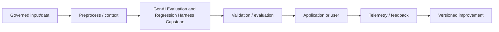

# GenAI Evaluation and Regression Harness Capstone

## 1. Title and Learning Position
- **Category:** Capstones and Interview Preparation
- **Prerequisites:** [Human-Approved Generative AI Workflow Capstone](150-genai-workflow-capstone.md)
- **Why it matters:** GenAI Evaluation and Regression Harness Capstone contributes to understanding and building useful, measurable and governable Generative AI systems rather than treating a foundation model as a black box.
- **Learning objectives:** explain intuition and mathematics; implement a reproducible example; choose evaluation; diagnose failure modes; design production controls.
- **Difficulty:** Architecture
- **Estimated study time:** 4-8 hours plus hands-on exercises.
- **Practical competency:** implement and review GenAI Evaluation and Regression Harness Capstone in an enterprise GenAI design.

## 2. Concept
**Beginner view.** Start with the input, the distribution/transformation being learned or invoked, and the desired output. Generative AI produces new content or structured predictions by sampling/decoding from learned representations and distributions.

**Intermediate view.** Connect the method to data quality, representation, objective, context, model capacity and evaluation. Separate deterministic application code from probabilistic model behavior.

**Advanced view.** Analyze distribution shift, calibration, safety, memory/compute, model/provider version changes, multimodal provenance, tail latency, throughput, cost and governance.

**Mathematical/design anchor.** Quality estimates require representative examples and per-example records. Use deterministic checks when possible, calibrated model-based rubrics for semantic judgments, human adjudication for high-risk ambiguity, and paired statistical comparisons for releases.

**Data/tensor/token reasoning.** Explicitly document batch, sequence, hidden/embedding, image/channel or modality dimensions where relevant; for APIs document message roles, context sources, model/config and structured output schema.

**Training vs inference.** Training estimates/updates parameters using objectives and validation; inference uses fixed released parameters plus runtime context, decoding/configuration and application logic. Do not tune repeatedly on the final test set.

**Strengths and limitations.** Use GenAI where generation, semantic transformation, open-ended language/multimodal understanding or representation learning offers measurable value. Avoid it where exact deterministic rules or traditional predictive models are safer, cheaper and equally useful.

**Common failures:** hallucination, mode collapse or unstable training depending on family, data leakage, prompt/context failure, malformed output, unsafe actions, unavailable evidence, bias, provider failure, drift and unmeasured cost.



## 3. Intermediate and Advanced Use Cases
### Intermediate experiment
**Problem:** Apply GenAI Evaluation and Regression Harness Capstone to a bounded GenAI task and compare against a baseline. **Data/context:** versioned, governed and representative inputs. **Suitability:** use the method only when it closes a measured capability gap better than a simpler approach. **Architecture:** typed input -> preprocessing/context -> model/component -> deterministic validation -> output/action -> telemetry. **Selection:** compare capability, modality, privacy, quality, latency, compute and cost. **Evaluation:** task metric plus safety and service metrics. **Risks:** hallucination, leakage, bias, distribution shift, malformed output, provider/resource failure and cost growth. **Fallback:** clarify/abstain, deterministic workflow, smaller model, prior release or human review. **Alternatives:** classical ML, search, rules, RAG, fine-tuning or another generative family.
### Intermediate integration
**Problem:** Integrate GenAI Evaluation and Regression Harness Capstone with an enterprise API, document, search or workflow. **Data/context:** versioned, governed and representative inputs. **Suitability:** use the method only when it closes a measured capability gap better than a simpler approach. **Architecture:** typed input -> preprocessing/context -> model/component -> deterministic validation -> output/action -> telemetry. **Selection:** compare capability, modality, privacy, quality, latency, compute and cost. **Evaluation:** task metric plus safety and service metrics. **Risks:** hallucination, leakage, bias, distribution shift, malformed output, provider/resource failure and cost growth. **Fallback:** clarify/abstain, deterministic workflow, smaller model, prior release or human review. **Alternatives:** classical ML, search, rules, RAG, fine-tuning or another generative family.
### Advanced quality
**Problem:** Improve GenAI Evaluation and Regression Harness Capstone using a golden evaluation set, error slices and regression tests. **Data/context:** versioned, governed and representative inputs. **Suitability:** use the method only when it closes a measured capability gap better than a simpler approach. **Architecture:** typed input -> preprocessing/context -> model/component -> deterministic validation -> output/action -> telemetry. **Selection:** compare capability, modality, privacy, quality, latency, compute and cost. **Evaluation:** task metric plus safety and service metrics. **Risks:** hallucination, leakage, bias, distribution shift, malformed output, provider/resource failure and cost growth. **Fallback:** clarify/abstain, deterministic workflow, smaller model, prior release or human review. **Alternatives:** classical ML, search, rules, RAG, fine-tuning or another generative family.
### Advanced production
**Problem:** Operate GenAI Evaluation and Regression Harness Capstone under latency, concurrency, resource and dependency-failure constraints. **Data/context:** versioned, governed and representative inputs. **Suitability:** use the method only when it closes a measured capability gap better than a simpler approach. **Architecture:** typed input -> preprocessing/context -> model/component -> deterministic validation -> output/action -> telemetry. **Selection:** compare capability, modality, privacy, quality, latency, compute and cost. **Evaluation:** task metric plus safety and service metrics. **Risks:** hallucination, leakage, bias, distribution shift, malformed output, provider/resource failure and cost growth. **Fallback:** clarify/abstain, deterministic workflow, smaller model, prior release or human review. **Alternatives:** classical ML, search, rules, RAG, fine-tuning or another generative family.
### Enterprise
**Problem:** Deploy GenAI Evaluation and Regression Harness Capstone with identity, governance, audit, monitoring, fallback and rollback. **Data/context:** versioned, governed and representative inputs. **Suitability:** use the method only when it closes a measured capability gap better than a simpler approach. **Architecture:** typed input -> preprocessing/context -> model/component -> deterministic validation -> output/action -> telemetry. **Selection:** compare capability, modality, privacy, quality, latency, compute and cost. **Evaluation:** task metric plus safety and service metrics. **Risks:** hallucination, leakage, bias, distribution shift, malformed output, provider/resource failure and cost growth. **Fallback:** clarify/abstain, deterministic workflow, smaller model, prior release or human review. **Alternatives:** classical ML, search, rules, RAG, fine-tuning or another generative family.

## 4. Python / PyTorch Implementation
**Implementation discipline.** Pin versions where reproducibility matters; configure through environment/managed identity; use typed request/output models; explicitly select device/precision for local models; batch appropriately; validate outputs; bound retries/timeouts; record evaluation and tracing metadata.

```python
import os
from pydantic import BaseModel, Field
class GenAIResult(BaseModel):
    answer: str = Field(min_length=1)
    evidence_ids: list[str] = []

def validate_model_output(raw: dict) -> GenAIResult:
    return GenAIResult.model_validate(raw)
# Load credentials from environment/managed identity, never source code.
api_key = os.getenv("GENAI_API_KEY")
```

**Testing and evaluation:** use deterministic unit tests with mocked model/API behavior plus a versioned golden set for semantic behavior. For training topics, preserve train/validation/test separation and checkpoint lineage.

**Error handling:** classify timeout/rate-limit/provider errors separately from model-quality failures. Consequential tool actions additionally require independent authorization, allowlists/idempotency and human approval where risk warrants it.

**Common mistake:** assuming fluent output is correct. **Correction:** define external evidence, schemas, task metrics and failure-directed tests before deployment.

## 5. Architectural Considerations
- **Model choice:** managed models reduce serving burden; open-weight/self-hosted models add control/privacy options but require GPU capacity, patching, scaling, evaluation and safety operations.
- **Versioning:** record model/provider, prompt/config, code, dataset/evaluation set and retrieval/tool dependencies together.
- **Compute:** profile CPU/GPU memory, precision, batch/context size, latency and throughput. Use quantization/caching/batching only after quality validation.
- **Integration:** REST/gRPC fits synchronous services; queues/events fit long or bursty workloads; batch is efficient for high-volume offline transformation.
- **RAG:** preserve document/chunk/version/ACL provenance and evaluate retrieval independently from generated answers.
- **Tools/agents:** deterministic code must enforce identity, authorization, state, max steps, time/cost budgets, idempotency and approval.
- **Security:** treat user/retrieved/model output as untrusted; isolate secrets, enforce least privilege, validate output, sandbox untrusted code/files and audit consequential operations.
- **Evaluation/CI:** gate releases with golden tasks, deterministic validators, calibrated semantic judges/human review when needed and adversarial/security tests.
- **Observability:** trace application, model, retrieval/tool calls, validation, quality and cost while minimizing sensitive telemetry.
- **Release:** shadow/canary high-risk changes, keep a prior known-good release and verify rollback.
- **Cost:** optimize cost per successful task under quality/reliability constraints, not raw token or GPU price alone.
- **Portability:** isolate provider-specific functionality behind explicit adapters; do not pretend all providers/models have identical semantics. Verify current official documentation for mutable capabilities and limits.

## 6. Interview Questions
### Q1. Beginner: What is a key design decision for **GenAI Evaluation and Regression Harness Capstone**, and how would you validate it?
**Model answer:** Define the objective/data/constraints, select the simplest adequate method, identify assumptions and trust boundaries, compare to a baseline on representative data, examine failure slices, then measure production quality, latency, resource use and cost.

**Evaluates:** theory, applied judgment, evaluation discipline and production awareness.

**Weak answer:** naming a model, library or prompt technique without providing selection evidence, metrics or failure handling.

**Follow-up:** How does the design change under limited GPU memory, sensitive enterprise data, model/provider drift, or a consequential action?

### Q2. Beginner: What is a key design decision for **GenAI Evaluation and Regression Harness Capstone**, and how would you validate it?
**Model answer:** Define the objective/data/constraints, select the simplest adequate method, identify assumptions and trust boundaries, compare to a baseline on representative data, examine failure slices, then measure production quality, latency, resource use and cost.

**Evaluates:** theory, applied judgment, evaluation discipline and production awareness.

**Weak answer:** naming a model, library or prompt technique without providing selection evidence, metrics or failure handling.

**Follow-up:** How does the design change under limited GPU memory, sensitive enterprise data, model/provider drift, or a consequential action?

### Q3. Beginner: What is a key design decision for **GenAI Evaluation and Regression Harness Capstone**, and how would you validate it?
**Model answer:** Define the objective/data/constraints, select the simplest adequate method, identify assumptions and trust boundaries, compare to a baseline on representative data, examine failure slices, then measure production quality, latency, resource use and cost.

**Evaluates:** theory, applied judgment, evaluation discipline and production awareness.

**Weak answer:** naming a model, library or prompt technique without providing selection evidence, metrics or failure handling.

**Follow-up:** How does the design change under limited GPU memory, sensitive enterprise data, model/provider drift, or a consequential action?

### Q4. Beginner: What is a key design decision for **GenAI Evaluation and Regression Harness Capstone**, and how would you validate it?
**Model answer:** Define the objective/data/constraints, select the simplest adequate method, identify assumptions and trust boundaries, compare to a baseline on representative data, examine failure slices, then measure production quality, latency, resource use and cost.

**Evaluates:** theory, applied judgment, evaluation discipline and production awareness.

**Weak answer:** naming a model, library or prompt technique without providing selection evidence, metrics or failure handling.

**Follow-up:** How does the design change under limited GPU memory, sensitive enterprise data, model/provider drift, or a consequential action?

### Q5. Beginner: What is a key design decision for **GenAI Evaluation and Regression Harness Capstone**, and how would you validate it?
**Model answer:** Define the objective/data/constraints, select the simplest adequate method, identify assumptions and trust boundaries, compare to a baseline on representative data, examine failure slices, then measure production quality, latency, resource use and cost.

**Evaluates:** theory, applied judgment, evaluation discipline and production awareness.

**Weak answer:** naming a model, library or prompt technique without providing selection evidence, metrics or failure handling.

**Follow-up:** How does the design change under limited GPU memory, sensitive enterprise data, model/provider drift, or a consequential action?

### Q6. Intermediate: What is a key design decision for **GenAI Evaluation and Regression Harness Capstone**, and how would you validate it?
**Model answer:** Define the objective/data/constraints, select the simplest adequate method, identify assumptions and trust boundaries, compare to a baseline on representative data, examine failure slices, then measure production quality, latency, resource use and cost.

**Evaluates:** theory, applied judgment, evaluation discipline and production awareness.

**Weak answer:** naming a model, library or prompt technique without providing selection evidence, metrics or failure handling.

**Follow-up:** How does the design change under limited GPU memory, sensitive enterprise data, model/provider drift, or a consequential action?

### Q7. Intermediate: What is a key design decision for **GenAI Evaluation and Regression Harness Capstone**, and how would you validate it?
**Model answer:** Define the objective/data/constraints, select the simplest adequate method, identify assumptions and trust boundaries, compare to a baseline on representative data, examine failure slices, then measure production quality, latency, resource use and cost.

**Evaluates:** theory, applied judgment, evaluation discipline and production awareness.

**Weak answer:** naming a model, library or prompt technique without providing selection evidence, metrics or failure handling.

**Follow-up:** How does the design change under limited GPU memory, sensitive enterprise data, model/provider drift, or a consequential action?

### Q8. Intermediate: What is a key design decision for **GenAI Evaluation and Regression Harness Capstone**, and how would you validate it?
**Model answer:** Define the objective/data/constraints, select the simplest adequate method, identify assumptions and trust boundaries, compare to a baseline on representative data, examine failure slices, then measure production quality, latency, resource use and cost.

**Evaluates:** theory, applied judgment, evaluation discipline and production awareness.

**Weak answer:** naming a model, library or prompt technique without providing selection evidence, metrics or failure handling.

**Follow-up:** How does the design change under limited GPU memory, sensitive enterprise data, model/provider drift, or a consequential action?

### Q9. Intermediate: What is a key design decision for **GenAI Evaluation and Regression Harness Capstone**, and how would you validate it?
**Model answer:** Define the objective/data/constraints, select the simplest adequate method, identify assumptions and trust boundaries, compare to a baseline on representative data, examine failure slices, then measure production quality, latency, resource use and cost.

**Evaluates:** theory, applied judgment, evaluation discipline and production awareness.

**Weak answer:** naming a model, library or prompt technique without providing selection evidence, metrics or failure handling.

**Follow-up:** How does the design change under limited GPU memory, sensitive enterprise data, model/provider drift, or a consequential action?

### Q10. Intermediate: What is a key design decision for **GenAI Evaluation and Regression Harness Capstone**, and how would you validate it?
**Model answer:** Define the objective/data/constraints, select the simplest adequate method, identify assumptions and trust boundaries, compare to a baseline on representative data, examine failure slices, then measure production quality, latency, resource use and cost.

**Evaluates:** theory, applied judgment, evaluation discipline and production awareness.

**Weak answer:** naming a model, library or prompt technique without providing selection evidence, metrics or failure handling.

**Follow-up:** How does the design change under limited GPU memory, sensitive enterprise data, model/provider drift, or a consequential action?

### Q11. Advanced: What is a key design decision for **GenAI Evaluation and Regression Harness Capstone**, and how would you validate it?
**Model answer:** Define the objective/data/constraints, select the simplest adequate method, identify assumptions and trust boundaries, compare to a baseline on representative data, examine failure slices, then measure production quality, latency, resource use and cost.

**Evaluates:** theory, applied judgment, evaluation discipline and production awareness.

**Weak answer:** naming a model, library or prompt technique without providing selection evidence, metrics or failure handling.

**Follow-up:** How does the design change under limited GPU memory, sensitive enterprise data, model/provider drift, or a consequential action?

### Q12. Advanced: What is a key design decision for **GenAI Evaluation and Regression Harness Capstone**, and how would you validate it?
**Model answer:** Define the objective/data/constraints, select the simplest adequate method, identify assumptions and trust boundaries, compare to a baseline on representative data, examine failure slices, then measure production quality, latency, resource use and cost.

**Evaluates:** theory, applied judgment, evaluation discipline and production awareness.

**Weak answer:** naming a model, library or prompt technique without providing selection evidence, metrics or failure handling.

**Follow-up:** How does the design change under limited GPU memory, sensitive enterprise data, model/provider drift, or a consequential action?

### Q13. Advanced: What is a key design decision for **GenAI Evaluation and Regression Harness Capstone**, and how would you validate it?
**Model answer:** Define the objective/data/constraints, select the simplest adequate method, identify assumptions and trust boundaries, compare to a baseline on representative data, examine failure slices, then measure production quality, latency, resource use and cost.

**Evaluates:** theory, applied judgment, evaluation discipline and production awareness.

**Weak answer:** naming a model, library or prompt technique without providing selection evidence, metrics or failure handling.

**Follow-up:** How does the design change under limited GPU memory, sensitive enterprise data, model/provider drift, or a consequential action?

### Q14. Advanced: What is a key design decision for **GenAI Evaluation and Regression Harness Capstone**, and how would you validate it?
**Model answer:** Define the objective/data/constraints, select the simplest adequate method, identify assumptions and trust boundaries, compare to a baseline on representative data, examine failure slices, then measure production quality, latency, resource use and cost.

**Evaluates:** theory, applied judgment, evaluation discipline and production awareness.

**Weak answer:** naming a model, library or prompt technique without providing selection evidence, metrics or failure handling.

**Follow-up:** How does the design change under limited GPU memory, sensitive enterprise data, model/provider drift, or a consequential action?

### Q15. Advanced: What is a key design decision for **GenAI Evaluation and Regression Harness Capstone**, and how would you validate it?
**Model answer:** Define the objective/data/constraints, select the simplest adequate method, identify assumptions and trust boundaries, compare to a baseline on representative data, examine failure slices, then measure production quality, latency, resource use and cost.

**Evaluates:** theory, applied judgment, evaluation discipline and production awareness.

**Weak answer:** naming a model, library or prompt technique without providing selection evidence, metrics or failure handling.

**Follow-up:** How does the design change under limited GPU memory, sensitive enterprise data, model/provider drift, or a consequential action?

### Q16. Architecture: What is a key design decision for **GenAI Evaluation and Regression Harness Capstone**, and how would you validate it?
**Model answer:** Define the objective/data/constraints, select the simplest adequate method, identify assumptions and trust boundaries, compare to a baseline on representative data, examine failure slices, then measure production quality, latency, resource use and cost.

**Evaluates:** theory, applied judgment, evaluation discipline and production awareness.

**Weak answer:** naming a model, library or prompt technique without providing selection evidence, metrics or failure handling.

**Follow-up:** How does the design change under limited GPU memory, sensitive enterprise data, model/provider drift, or a consequential action?

### Q17. Architecture: What is a key design decision for **GenAI Evaluation and Regression Harness Capstone**, and how would you validate it?
**Model answer:** Define the objective/data/constraints, select the simplest adequate method, identify assumptions and trust boundaries, compare to a baseline on representative data, examine failure slices, then measure production quality, latency, resource use and cost.

**Evaluates:** theory, applied judgment, evaluation discipline and production awareness.

**Weak answer:** naming a model, library or prompt technique without providing selection evidence, metrics or failure handling.

**Follow-up:** How does the design change under limited GPU memory, sensitive enterprise data, model/provider drift, or a consequential action?

### Q18. Architecture: What is a key design decision for **GenAI Evaluation and Regression Harness Capstone**, and how would you validate it?
**Model answer:** Define the objective/data/constraints, select the simplest adequate method, identify assumptions and trust boundaries, compare to a baseline on representative data, examine failure slices, then measure production quality, latency, resource use and cost.

**Evaluates:** theory, applied judgment, evaluation discipline and production awareness.

**Weak answer:** naming a model, library or prompt technique without providing selection evidence, metrics or failure handling.

**Follow-up:** How does the design change under limited GPU memory, sensitive enterprise data, model/provider drift, or a consequential action?

### Q19. Debugging: What is a key design decision for **GenAI Evaluation and Regression Harness Capstone**, and how would you validate it?
**Model answer:** Define the objective/data/constraints, select the simplest adequate method, identify assumptions and trust boundaries, compare to a baseline on representative data, examine failure slices, then measure production quality, latency, resource use and cost.

**Evaluates:** theory, applied judgment, evaluation discipline and production awareness.

**Weak answer:** naming a model, library or prompt technique without providing selection evidence, metrics or failure handling.

**Follow-up:** How does the design change under limited GPU memory, sensitive enterprise data, model/provider drift, or a consequential action?

### Q20. Debugging: What is a key design decision for **GenAI Evaluation and Regression Harness Capstone**, and how would you validate it?
**Model answer:** Define the objective/data/constraints, select the simplest adequate method, identify assumptions and trust boundaries, compare to a baseline on representative data, examine failure slices, then measure production quality, latency, resource use and cost.

**Evaluates:** theory, applied judgment, evaluation discipline and production awareness.

**Weak answer:** naming a model, library or prompt technique without providing selection evidence, metrics or failure handling.

**Follow-up:** How does the design change under limited GPU memory, sensitive enterprise data, model/provider drift, or a consequential action?

### Q21. Coding: What is a key design decision for **GenAI Evaluation and Regression Harness Capstone**, and how would you validate it?
**Model answer:** Define the objective/data/constraints, select the simplest adequate method, identify assumptions and trust boundaries, compare to a baseline on representative data, examine failure slices, then measure production quality, latency, resource use and cost.

**Evaluates:** theory, applied judgment, evaluation discipline and production awareness.

**Weak answer:** naming a model, library or prompt technique without providing selection evidence, metrics or failure handling.

**Follow-up:** How does the design change under limited GPU memory, sensitive enterprise data, model/provider drift, or a consequential action?

### Q22. Coding: What is a key design decision for **GenAI Evaluation and Regression Harness Capstone**, and how would you validate it?
**Model answer:** Define the objective/data/constraints, select the simplest adequate method, identify assumptions and trust boundaries, compare to a baseline on representative data, examine failure slices, then measure production quality, latency, resource use and cost.

**Evaluates:** theory, applied judgment, evaluation discipline and production awareness.

**Weak answer:** naming a model, library or prompt technique without providing selection evidence, metrics or failure handling.

**Follow-up:** How does the design change under limited GPU memory, sensitive enterprise data, model/provider drift, or a consequential action?

## 7. Practical Exercises
### Foundational
Explain and implement a minimal GenAI Evaluation and Regression Harness Capstone example and annotate the central data/tensor/message flow. **Expected:** reproducible script/notebook. **Evaluate:** correctness, intuition and assumptions. **Failures:** wrong dimensions/data leakage/invalid output. **Stretch:** implement a lower-level primitive.

### Intermediate
Build a baseline and an improved approach, evaluate on a golden/validation set, and analyze at least three failure slices. **Expected:** evidence-based comparison. **Evaluate:** metric rationale, reproducibility and analysis. **Stretch:** add async batching or a retrieval/tool dependency where relevant.

### Advanced production
Design an enterprise workload using GenAI Evaluation and Regression Harness Capstone; include identity, model/data versions, SLOs, evaluation, security, observability, capacity/cost, fallback and rollback. **Expected:** architecture and runbook. **Evaluate:** usefulness, operability, safety and economics. **Stretch:** load/failure test it.

## 8. Summary and Revision Checklist
### Key takeaways
- Understand the objective/representation before framework syntax.
- Prefer the simplest technique that meets measurable task needs.
- Treat generative output as probabilistic and validate it.
- Production GenAI requires evaluation, security, observability, rollback and cost control.

### Formulas/design rules
Re-derive the Concept anchor and connect it to the model/system behavior; write expected tensor/token/message dimensions where applicable.

### Critical parameters
Model/version, objective, learning rate/batch/capacity for training; sampling/output/context limits for inference; retrieval/tool/security parameters for application systems.

### Selection checklist
- [ ] Non-GenAI baseline considered
- [ ] Data/context and trust boundaries defined
- [ ] Representative evaluation set exists
- [ ] Quality/safety/latency/cost measured
- [ ] Security, fallback and rollback tested

### Security checklist
- [ ] Secrets never embedded in prompts/code
- [ ] Identity/authorization enforced outside model
- [ ] Untrusted content separated from trusted policy
- [ ] Consequential actions validated/approved appropriately
- [ ] Sensitive telemetry minimized and governed

### Common pitfalls
Novelty-driven model choice, no baseline, test-set tuning, unvalidated output, prompt-only authorization, stale retrieval data, uncontrolled context, provider lock-in without an exit plan, and missing production evaluation.

### Five flashcards
1. **Q:** What makes a model generative? **A:** It models a data/conditional distribution sufficiently to produce new samples/content.
2. **Q:** Why is fluent output insufficient? **A:** Fluency is not evidence of correctness, grounding or authorization.
3. **Q:** Prompt, RAG or fine-tune? **A:** Prompt for behavior/instructions first, RAG for changing evidence, fine-tune for validated adaptation needs.
4. **Q:** What should a GenAI release version? **A:** Model/provider, prompt/config, code, eval data/results and relevant retrieval/tool dependencies.
5. **Q:** What is the production optimization target? **A:** Successful task utility under quality, safety, latency, reliability and cost constraints.

### Next recommended topics
- [Secure and Governed GenAI Architecture Capstone](152-secure-genai-capstone.md)
- [Generative AI System-Design Interview Framework](153-genai-system-design-interviews.md)
