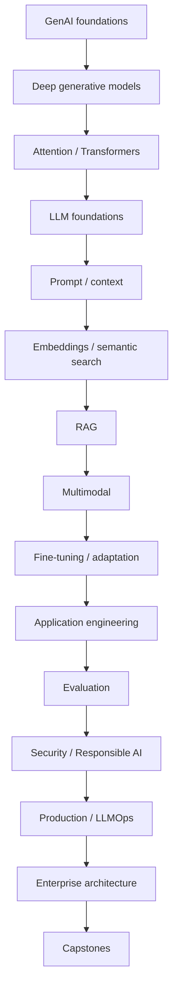
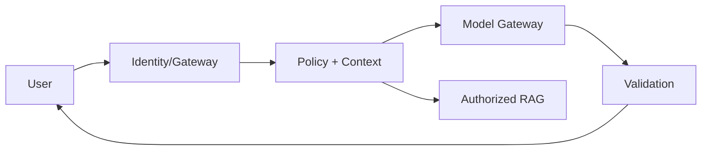

# Generative AI Foundations Notes

## Repository Purpose

A structured path for experienced Python/ML engineers moving into GenAI Engineering and AI Solution Architecture. Study in sequence and combine concepts with implementations, evaluations, threat models and production architecture exercises.

## Recommended Learning Path

## Category Summary

### Category 1: Generative AI Foundations

**Purpose:** build competency in generative ai foundations. **Prerequisites:** earlier categories unless already proficient. **Estimated time:** 54-90 hours. **Outcome:** conceptual, implementation, evaluation and architecture fluency.

1. **[Generative AI: Definition, Landscape, Capabilities, and Limitations](01-generative-ai-overview.md)**  
   Foundational. Prerequisite: Python and ML fundamentals. Study 4-8 hours. Practical outcome: implement/evaluate/review Generative AI: Definition, Landscape, Capabilities, and Limitations.
2. **[Generative vs Discriminative Modeling](02-generative-vs-discriminative.md)**  
   Foundational. Prerequisite: Generative AI: Definition, Landscape, Capabilities, and Limitations. Study 4-8 hours. Practical outcome: implement/evaluate/review Generative vs Discriminative Modeling.
3. **[Probability, Likelihood, Sampling, and Generative Modeling](03-probability-generative-modeling.md)**  
   Foundational. Prerequisite: Generative vs Discriminative Modeling. Study 4-8 hours. Practical outcome: implement/evaluate/review Probability, Likelihood, Sampling, and Generative Modeling.
4. **[Entropy, Cross-Entropy, KL Divergence, and Information Theory](04-information-theory.md)**  
   Foundational. Prerequisite: Probability, Likelihood, Sampling, and Generative Modeling. Study 4-8 hours. Practical outcome: implement/evaluate/review Entropy, Cross-Entropy, KL Divergence, and Information Theory.
5. **[Representation Learning, Latent Spaces, and Embeddings](05-representation-learning.md)**  
   Foundational. Prerequisite: Entropy, Cross-Entropy, KL Divergence, and Information Theory. Study 4-8 hours. Practical outcome: implement/evaluate/review Representation Learning, Latent Spaces, and Embeddings.
6. **[Self-Supervised Learning and Pretraining Objectives](06-self-supervised-learning.md)**  
   Foundational. Prerequisite: Representation Learning, Latent Spaces, and Embeddings. Study 4-8 hours. Practical outcome: implement/evaluate/review Self-Supervised Learning and Pretraining Objectives.
7. **[Foundation Models and Transfer Learning](07-foundation-models.md)**  
   Foundational. Prerequisite: Self-Supervised Learning and Pretraining Objectives. Study 4-8 hours. Practical outcome: implement/evaluate/review Foundation Models and Transfer Learning.
8. **[End-to-End Generative AI Solution Lifecycle](08-genai-lifecycle.md)**  
   Foundational. Prerequisite: Foundation Models and Transfer Learning. Study 4-8 hours. Practical outcome: implement/evaluate/review End-to-End Generative AI Solution Lifecycle.
9. **[GenAI Use-Case Selection, Feasibility, Risk, and ROI](09-genai-use-case-selection.md)**  
   Foundational. Prerequisite: End-to-End Generative AI Solution Lifecycle. Study 4-8 hours. Practical outcome: implement/evaluate/review GenAI Use-Case Selection, Feasibility, Risk, and ROI.

### Category 2: Neural and Deep Generative Foundations

**Purpose:** build competency in neural and deep generative foundations. **Prerequisites:** earlier categories unless already proficient. **Estimated time:** 60-100 hours. **Outcome:** conceptual, implementation, evaluation and architecture fluency.

10. **[Neural Networks, Activations, Losses, and Backpropagation](10-neural-network-refresh.md)**  
   Foundational. Prerequisite: GenAI Use-Case Selection, Feasibility, Risk, and ROI. Study 4-8 hours. Practical outcome: implement/evaluate/review Neural Networks, Activations, Losses, and Backpropagation.
11. **[SGD, Adam/AdamW, Learning Rates, Regularization, and Generalization](11-optimization-refresh.md)**  
   Foundational. Prerequisite: Neural Networks, Activations, Losses, and Backpropagation. Study 4-8 hours. Practical outcome: implement/evaluate/review SGD, Adam/AdamW, Learning Rates, Regularization, and Generalization.
12. **[Autoencoders and Latent Representations](12-autoencoders.md)**  
   Foundational. Prerequisite: SGD, Adam/AdamW, Learning Rates, Regularization, and Generalization. Study 4-8 hours. Practical outcome: implement/evaluate/review Autoencoders and Latent Representations.
13. **[Variational Autoencoders and the Reparameterization Trick](13-variational-autoencoders.md)**  
   Foundational. Prerequisite: Autoencoders and Latent Representations. Study 4-8 hours. Practical outcome: implement/evaluate/review Variational Autoencoders and the Reparameterization Trick.
14. **[Generative Adversarial Networks](14-gans.md)**  
   Foundational. Prerequisite: Variational Autoencoders and the Reparameterization Trick. Study 4-8 hours. Practical outcome: implement/evaluate/review Generative Adversarial Networks.
15. **[GAN Objectives, Training Stability, and Mode Collapse](15-gan-training.md)**  
   Foundational. Prerequisite: Generative Adversarial Networks. Study 4-8 hours. Practical outcome: implement/evaluate/review GAN Objectives, Training Stability, and Mode Collapse.
16. **[Autoregressive Generative Models](16-autoregressive-models.md)**  
   Foundational. Prerequisite: GAN Objectives, Training Stability, and Mode Collapse. Study 4-8 hours. Practical outcome: implement/evaluate/review Autoregressive Generative Models.
17. **[Diffusion Models, Noise Schedules, and Denoising](17-diffusion-foundations.md)**  
   Foundational. Prerequisite: Autoregressive Generative Models. Study 4-8 hours. Practical outcome: implement/evaluate/review Diffusion Models, Noise Schedules, and Denoising.
18. **[Latent Diffusion and Text-to-Image Architecture](18-latent-diffusion.md)**  
   Foundational. Prerequisite: Diffusion Models, Noise Schedules, and Denoising. Study 4-8 hours. Practical outcome: implement/evaluate/review Latent Diffusion and Text-to-Image Architecture.
19. **[Autoregressive vs VAE vs GAN vs Diffusion](19-generative-model-comparison.md)**  
   Foundational. Prerequisite: Latent Diffusion and Text-to-Image Architecture. Study 4-8 hours. Practical outcome: implement/evaluate/review Autoregressive vs VAE vs GAN vs Diffusion.

### Category 3: NLP, Attention, and Transformer Foundations

**Purpose:** build competency in nlp, attention, and transformer foundations. **Prerequisites:** earlier categories unless already proficient. **Estimated time:** 72-120 hours. **Outcome:** conceptual, implementation, evaluation and architecture fluency.

20. **[Tokens, One-Hot, Word2Vec, GloVe, and Contextual Representations](20-nlp-representations.md)**  
   Foundational. Prerequisite: Autoregressive vs VAE vs GAN vs Diffusion. Study 4-8 hours. Practical outcome: implement/evaluate/review Tokens, One-Hot, Word2Vec, GloVe, and Contextual Representations.
21. **[RNN, LSTM, GRU, and Sequence Modeling](21-sequence-models.md)**  
   Foundational. Prerequisite: Tokens, One-Hot, Word2Vec, GloVe, and Contextual Representations. Study 4-8 hours. Practical outcome: implement/evaluate/review RNN, LSTM, GRU, and Sequence Modeling.
22. **[Attention Mechanisms](22-attention.md)**  
   Foundational. Prerequisite: RNN, LSTM, GRU, and Sequence Modeling. Study 4-8 hours. Practical outcome: implement/evaluate/review Attention Mechanisms.
23. **[Queries, Keys, Values, and Scaled Dot-Product Attention](23-query-key-value.md)**  
   Foundational. Prerequisite: Attention Mechanisms. Study 4-8 hours. Practical outcome: implement/evaluate/review Queries, Keys, Values, and Scaled Dot-Product Attention.
24. **[Self-Attention and Masking](24-self-attention.md)**  
   Foundational. Prerequisite: Queries, Keys, Values, and Scaled Dot-Product Attention. Study 4-8 hours. Practical outcome: implement/evaluate/review Self-Attention and Masking.
25. **[Multi-Head Attention](25-multi-head-attention.md)**  
   Foundational. Prerequisite: Self-Attention and Masking. Study 4-8 hours. Practical outcome: implement/evaluate/review Multi-Head Attention.
26. **[Positional Encoding, Relative Position, and RoPE Concepts](26-positional-encoding.md)**  
   Foundational. Prerequisite: Multi-Head Attention. Study 4-8 hours. Practical outcome: implement/evaluate/review Positional Encoding, Relative Position, and RoPE Concepts.
27. **[Transformer Blocks, MLPs, Residuals, and Normalization](27-transformer-block.md)**  
   Foundational. Prerequisite: Positional Encoding, Relative Position, and RoPE Concepts. Study 4-8 hours. Practical outcome: implement/evaluate/review Transformer Blocks, MLPs, Residuals, and Normalization.
28. **[Encoder-Only Transformers](28-transformer-encoder.md)**  
   Foundational. Prerequisite: Transformer Blocks, MLPs, Residuals, and Normalization. Study 4-8 hours. Practical outcome: implement/evaluate/review Encoder-Only Transformers.
29. **[Decoder-Only Transformers](29-transformer-decoder.md)**  
   Foundational. Prerequisite: Encoder-Only Transformers. Study 4-8 hours. Practical outcome: implement/evaluate/review Decoder-Only Transformers.
30. **[Encoder-Decoder Transformers](30-encoder-decoder-transformers.md)**  
   Foundational. Prerequisite: Decoder-Only Transformers. Study 4-8 hours. Practical outcome: implement/evaluate/review Encoder-Decoder Transformers.
31. **[Attention Complexity, Memory, and Scaling Considerations](31-transformer-complexity.md)**  
   Foundational. Prerequisite: Encoder-Decoder Transformers. Study 4-8 hours. Practical outcome: implement/evaluate/review Attention Complexity, Memory, and Scaling Considerations.

### Category 4: LLM Foundations

**Purpose:** build competency in llm foundations. **Prerequisites:** earlier categories unless already proficient. **Estimated time:** 66-110 hours. **Outcome:** conceptual, implementation, evaluation and architecture fluency.

32. **[BPE, WordPiece, SentencePiece, Tokens, and Vocabulary](32-tokenization.md)**  
   Foundational. Prerequisite: Attention Complexity, Memory, and Scaling Considerations. Study 4-8 hours. Practical outcome: implement/evaluate/review BPE, WordPiece, SentencePiece, Tokens, and Vocabulary.
33. **[Next-Token Prediction, Logits, Softmax, and Language Modeling](33-next-token-prediction.md)**  
   Foundational. Prerequisite: BPE, WordPiece, SentencePiece, Tokens, and Vocabulary. Study 4-8 hours. Practical outcome: implement/evaluate/review Next-Token Prediction, Logits, Softmax, and Language Modeling.
34. **[Causal LM, Masked LM, and Seq2Seq Objectives](34-pretraining-objectives.md)**  
   Foundational. Prerequisite: Next-Token Prediction, Logits, Softmax, and Language Modeling. Study 4-8 hours. Practical outcome: implement/evaluate/review Causal LM, Masked LM, and Seq2Seq Objectives.
35. **[LLM Pretraining Data and Training Pipeline](35-llm-pretraining.md)**  
   Foundational. Prerequisite: Causal LM, Masked LM, and Seq2Seq Objectives. Study 4-8 hours. Practical outcome: implement/evaluate/review LLM Pretraining Data and Training Pipeline.
36. **[Parameters, Data, Compute, and Scaling Laws](36-scaling-laws.md)**  
   Foundational. Prerequisite: LLM Pretraining Data and Training Pipeline. Study 4-8 hours. Practical outcome: implement/evaluate/review Parameters, Data, Compute, and Scaling Laws.
37. **[Context Windows and Long-Context Constraints](37-context-windows.md)**  
   Foundational. Prerequisite: Parameters, Data, Compute, and Scaling Laws. Study 4-8 hours. Practical outcome: implement/evaluate/review Context Windows and Long-Context Constraints.
38. **[Greedy, Beam, Temperature, Top-k, Top-p, and Sampling](38-generation-decoding.md)**  
   Foundational. Prerequisite: Context Windows and Long-Context Constraints. Study 4-8 hours. Practical outcome: implement/evaluate/review Greedy, Beam, Temperature, Top-k, Top-p, and Sampling.
39. **[Prefill, Decode, KV Cache, and Inference Fundamentals](39-kv-cache.md)**  
   Foundational. Prerequisite: Greedy, Beam, Temperature, Top-k, Top-p, and Sampling. Study 4-8 hours. Practical outcome: implement/evaluate/review Prefill, Decode, KV Cache, and Inference Fundamentals.
40. **[Encoder, Decoder, Encoder-Decoder, and Modern LLM Families](40-llm-model-families.md)**  
   Foundational. Prerequisite: Prefill, Decode, KV Cache, and Inference Fundamentals. Study 4-8 hours. Practical outcome: implement/evaluate/review Encoder, Decoder, Encoder-Decoder, and Modern LLM Families.
41. **[Managed APIs vs Open-Weight/Self-Hosted Models](41-managed-vs-open-models.md)**  
   Foundational. Prerequisite: Encoder, Decoder, Encoder-Decoder, and Modern LLM Families. Study 4-8 hours. Practical outcome: implement/evaluate/review Managed APIs vs Open-Weight/Self-Hosted Models.
42. **[Hallucination, Knowledge Cutoffs, Reasoning Limits, Bias, and Non-Determinism](42-llm-limitations.md)**  
   Foundational. Prerequisite: Managed APIs vs Open-Weight/Self-Hosted Models. Study 4-8 hours. Practical outcome: implement/evaluate/review Hallucination, Knowledge Cutoffs, Reasoning Limits, Bias, and Non-Determinism.

### Category 5: Prompt and Context Engineering Foundations

**Purpose:** build competency in prompt and context engineering foundations. **Prerequisites:** earlier categories unless already proficient. **Estimated time:** 60-100 hours. **Outcome:** conceptual, implementation, evaluation and architecture fluency.

43. **[System/User Instructions, Context, Delimiters, and Output Contracts](43-prompt-anatomy.md)**  
   Intermediate. Prerequisite: Hallucination, Knowledge Cutoffs, Reasoning Limits, Bias, and Non-Determinism. Study 4-8 hours. Practical outcome: implement/evaluate/review System/User Instructions, Context, Delimiters, and Output Contracts.
44. **[Zero-Shot and Few-Shot Prompting](44-zero-shot-few-shot.md)**  
   Intermediate. Prerequisite: System/User Instructions, Context, Delimiters, and Output Contracts. Study 4-8 hours. Practical outcome: implement/evaluate/review Zero-Shot and Few-Shot Prompting.
45. **[Extraction, Classification, Summarization, Transformation, and Generation](45-prompt-patterns.md)**  
   Intermediate. Prerequisite: Zero-Shot and Few-Shot Prompting. Study 4-8 hours. Practical outcome: implement/evaluate/review Extraction, Classification, Summarization, Transformation, and Generation.
46. **[Decomposition, Planning, Critique, and Verification Patterns](46-reasoning-patterns.md)**  
   Intermediate. Prerequisite: Extraction, Classification, Summarization, Transformation, and Generation. Study 4-8 hours. Practical outcome: implement/evaluate/review Decomposition, Planning, Critique, and Verification Patterns.
47. **[JSON Schema, Typed Structured Outputs, and Validation](47-structured-outputs.md)**  
   Intermediate. Prerequisite: Decomposition, Planning, Critique, and Verification Patterns. Study 4-8 hours. Practical outcome: implement/evaluate/review JSON Schema, Typed Structured Outputs, and Validation.
48. **[Function Calling and Tool Schemas](48-function-calling.md)**  
   Intermediate. Prerequisite: JSON Schema, Typed Structured Outputs, and Validation. Study 4-8 hours. Practical outcome: implement/evaluate/review Function Calling and Tool Schemas.
49. **[Context Selection, Ordering, Compression, and Token Budgeting](49-context-engineering.md)**  
   Intermediate. Prerequisite: Function Calling and Tool Schemas. Study 4-8 hours. Practical outcome: implement/evaluate/review Context Selection, Ordering, Compression, and Token Budgeting.
50. **[Prompt Templates, Versioning, Testing, and Change Control](50-prompt-versioning.md)**  
   Intermediate. Prerequisite: Context Selection, Ordering, Compression, and Token Budgeting. Study 4-8 hours. Practical outcome: implement/evaluate/review Prompt Templates, Versioning, Testing, and Change Control.
51. **[Prompt Evaluation and Regression Testing](51-prompt-evaluation.md)**  
   Intermediate. Prerequisite: Prompt Templates, Versioning, Testing, and Change Control. Study 4-8 hours. Practical outcome: implement/evaluate/review Prompt Evaluation and Regression Testing.
52. **[Prompt Injection and Defensive Context Design](52-prompt-injection-foundations.md)**  
   Intermediate. Prerequisite: Prompt Evaluation and Regression Testing. Study 4-8 hours. Practical outcome: implement/evaluate/review Prompt Injection and Defensive Context Design.

### Category 6: Embeddings and Semantic Search Foundations

**Purpose:** build competency in embeddings and semantic search foundations. **Prerequisites:** earlier categories unless already proficient. **Estimated time:** 60-100 hours. **Outcome:** conceptual, implementation, evaluation and architecture fluency.

53. **[Embeddings and Semantic Representation Spaces](53-embedding-foundations.md)**  
   Intermediate. Prerequisite: Prompt Injection and Defensive Context Design. Study 4-8 hours. Practical outcome: implement/evaluate/review Embeddings and Semantic Representation Spaces.
54. **[Embedding Model Selection and Domain Fit](54-embedding-models.md)**  
   Intermediate. Prerequisite: Embeddings and Semantic Representation Spaces. Study 4-8 hours. Practical outcome: implement/evaluate/review Embedding Model Selection and Domain Fit.
55. **[Cosine, Dot Product, Euclidean Distance, and Normalization](55-similarity-distance.md)**  
   Intermediate. Prerequisite: Embedding Model Selection and Domain Fit. Study 4-8 hours. Practical outcome: implement/evaluate/review Cosine, Dot Product, Euclidean Distance, and Normalization.
56. **[Fixed, Recursive, Structural, Semantic, and Parent-Child Chunking](56-chunking-foundations.md)**  
   Intermediate. Prerequisite: Cosine, Dot Product, Euclidean Distance, and Normalization. Study 4-8 hours. Practical outcome: implement/evaluate/review Fixed, Recursive, Structural, Semantic, and Parent-Child Chunking.
57. **[Exact and Approximate Nearest-Neighbor Search](57-vector-search.md)**  
   Intermediate. Prerequisite: Fixed, Recursive, Structural, Semantic, and Parent-Child Chunking. Study 4-8 hours. Practical outcome: implement/evaluate/review Exact and Approximate Nearest-Neighbor Search.
58. **[HNSW, IVF, Product Quantization, and Index Trade-offs](58-hnsw-ivf.md)**  
   Intermediate. Prerequisite: Exact and Approximate Nearest-Neighbor Search. Study 4-8 hours. Practical outcome: implement/evaluate/review HNSW, IVF, Product Quantization, and Index Trade-offs.
59. **[Vector Database Foundations and Selection](59-vector-databases.md)**  
   Intermediate. Prerequisite: HNSW, IVF, Product Quantization, and Index Trade-offs. Study 4-8 hours. Practical outcome: implement/evaluate/review Vector Database Foundations and Selection.
60. **[Sparse, Dense, and Hybrid Retrieval](60-sparse-dense-hybrid.md)**  
   Intermediate. Prerequisite: Vector Database Foundations and Selection. Study 4-8 hours. Practical outcome: implement/evaluate/review Sparse, Dense, and Hybrid Retrieval.
61. **[Cross-Encoder and LLM Reranking Foundations](61-reranking.md)**  
   Intermediate. Prerequisite: Sparse, Dense, and Hybrid Retrieval. Study 4-8 hours. Practical outcome: implement/evaluate/review Cross-Encoder and LLM Reranking Foundations.
62. **[Recall@k, Precision@k, MRR, MAP, and NDCG](62-retrieval-metrics.md)**  
   Intermediate. Prerequisite: Cross-Encoder and LLM Reranking Foundations. Study 4-8 hours. Practical outcome: implement/evaluate/review Recall@k, Precision@k, MRR, MAP, and NDCG.

### Category 7: RAG Foundations

**Purpose:** build competency in rag foundations. **Prerequisites:** earlier categories unless already proficient. **Estimated time:** 60-100 hours. **Outcome:** conceptual, implementation, evaluation and architecture fluency.

63. **[Retrieval-Augmented Generation and Why It Exists](63-rag-overview.md)**  
   Intermediate. Prerequisite: Recall@k, Precision@k, MRR, MAP, and NDCG. Study 4-8 hours. Practical outcome: implement/evaluate/review Retrieval-Augmented Generation and Why It Exists.
64. **[Connect, Parse, Clean, Chunk, Embed, and Index](64-rag-ingestion.md)**  
   Intermediate. Prerequisite: Retrieval-Augmented Generation and Why It Exists. Study 4-8 hours. Practical outcome: implement/evaluate/review Connect, Parse, Clean, Chunk, Embed, and Index.
65. **[Query, Retrieve, Filter, Rerank, Assemble Context, and Generate](65-rag-query-pipeline.md)**  
   Intermediate. Prerequisite: Connect, Parse, Clean, Chunk, Embed, and Index. Study 4-8 hours. Practical outcome: implement/evaluate/review Query, Retrieve, Filter, Rerank, Assemble Context, and Generate.
66. **[Metadata, Scoping, Filters, and Authorization](66-metadata-filtering.md)**  
   Intermediate. Prerequisite: Query, Retrieve, Filter, Rerank, Assemble Context, and Generate. Study 4-8 hours. Practical outcome: implement/evaluate/review Metadata, Scoping, Filters, and Authorization.
67. **[Grounded Generation and Evidence-Only Answers](67-grounded-prompting.md)**  
   Intermediate. Prerequisite: Metadata, Scoping, Filters, and Authorization. Study 4-8 hours. Practical outcome: implement/evaluate/review Grounded Generation and Evidence-Only Answers.
68. **[Citations, Provenance, and Source Attribution](68-citations-provenance.md)**  
   Intermediate. Prerequisite: Grounded Generation and Evidence-Only Answers. Study 4-8 hours. Practical outcome: implement/evaluate/review Citations, Provenance, and Source Attribution.
69. **[Answerability, Abstention, Confidence, and Clarification](69-answerability.md)**  
   Intermediate. Prerequisite: Citations, Provenance, and Source Attribution. Study 4-8 hours. Practical outcome: implement/evaluate/review Answerability, Abstention, Confidence, and Clarification.
70. **[Retrieval and Generation Evaluation](70-rag-evaluation.md)**  
   Intermediate. Prerequisite: Answerability, Abstention, Confidence, and Clarification. Study 4-8 hours. Practical outcome: implement/evaluate/review Retrieval and Generation Evaluation.
71. **[Query Rewriting, HyDE, Multi-Query, Parent-Child, Hybrid, and Corrective Patterns](71-advanced-rag-overview.md)**  
   Intermediate. Prerequisite: Retrieval and Generation Evaluation. Study 4-8 hours. Practical outcome: implement/evaluate/review Query Rewriting, HyDE, Multi-Query, Parent-Child, Hybrid, and Corrective Patterns.
72. **[Injection, Poisoning, Authorization, and Data Leakage in RAG](72-rag-security.md)**  
   Intermediate. Prerequisite: Query Rewriting, HyDE, Multi-Query, Parent-Child, Hybrid, and Corrective Patterns. Study 4-8 hours. Practical outcome: implement/evaluate/review Injection, Poisoning, Authorization, and Data Leakage in RAG.

### Category 8: Multimodal Generative AI

**Purpose:** build competency in multimodal generative ai. **Prerequisites:** earlier categories unless already proficient. **Estimated time:** 60-100 hours. **Outcome:** conceptual, implementation, evaluation and architecture fluency.

73. **[Multimodal Representations and Fusion](73-multimodal-foundations.md)**  
   Intermediate. Prerequisite: Injection, Poisoning, Authorization, and Data Leakage in RAG. Study 4-8 hours. Practical outcome: implement/evaluate/review Multimodal Representations and Fusion.
74. **[Vision-Language Models and Image Understanding](74-vision-language-models.md)**  
   Intermediate. Prerequisite: Multimodal Representations and Fusion. Study 4-8 hours. Practical outcome: implement/evaluate/review Vision-Language Models and Image Understanding.
75. **[Text-to-Image and Image-to-Image Generation](75-image-generation.md)**  
   Intermediate. Prerequisite: Vision-Language Models and Image Understanding. Study 4-8 hours. Practical outcome: implement/evaluate/review Text-to-Image and Image-to-Image Generation.
76. **[OCR, Layout, Tables, Charts, and Document Understanding](76-document-ai.md)**  
   Intermediate. Prerequisite: Text-to-Image and Image-to-Image Generation. Study 4-8 hours. Practical outcome: implement/evaluate/review OCR, Layout, Tables, Charts, and Document Understanding.
77. **[Speech Recognition, Speech Generation, and Audio Understanding](77-speech-audio.md)**  
   Intermediate. Prerequisite: OCR, Layout, Tables, Charts, and Document Understanding. Study 4-8 hours. Practical outcome: implement/evaluate/review Speech Recognition, Speech Generation, and Audio Understanding.
78. **[Video Understanding and Generation Foundations](78-video-generative-ai.md)**  
   Intermediate. Prerequisite: Speech Recognition, Speech Generation, and Audio Understanding. Study 4-8 hours. Practical outcome: implement/evaluate/review Video Understanding and Generation Foundations.
79. **[Prompting with Text, Images, Documents, and Audio](79-multimodal-prompting.md)**  
   Intermediate. Prerequisite: Video Understanding and Generation Foundations. Study 4-8 hours. Practical outcome: implement/evaluate/review Prompting with Text, Images, Documents, and Audio.
80. **[Multimodal Retrieval and Grounded Generation](80-multimodal-rag.md)**  
   Intermediate. Prerequisite: Prompting with Text, Images, Documents, and Audio. Study 4-8 hours. Practical outcome: implement/evaluate/review Multimodal Retrieval and Grounded Generation.
81. **[Multimodal Evaluation and Failure Analysis](81-multimodal-evaluation.md)**  
   Intermediate. Prerequisite: Multimodal Retrieval and Grounded Generation. Study 4-8 hours. Practical outcome: implement/evaluate/review Multimodal Evaluation and Failure Analysis.
82. **[Privacy, Safety, Provenance, and Misuse Considerations](82-multimodal-safety.md)**  
   Intermediate. Prerequisite: Multimodal Evaluation and Failure Analysis. Study 4-8 hours. Practical outcome: implement/evaluate/review Privacy, Safety, Provenance, and Misuse Considerations.

### Category 9: Model Adaptation and Fine-Tuning Foundations

**Purpose:** build competency in model adaptation and fine-tuning foundations. **Prerequisites:** earlier categories unless already proficient. **Estimated time:** 54-90 hours. **Outcome:** conceptual, implementation, evaluation and architecture fluency.

83. **[Prompt vs RAG vs Fine-Tuning vs Continued Pretraining](83-adaptation-decision.md)**  
   Intermediate. Prerequisite: Privacy, Safety, Provenance, and Misuse Considerations. Study 4-8 hours. Practical outcome: implement/evaluate/review Prompt vs RAG vs Fine-Tuning vs Continued Pretraining.
84. **[Data Collection, Cleaning, Deduplication, Splits, and Formatting](84-training-data-preparation.md)**  
   Intermediate. Prerequisite: Prompt vs RAG vs Fine-Tuning vs Continued Pretraining. Study 4-8 hours. Practical outcome: implement/evaluate/review Data Collection, Cleaning, Deduplication, Splits, and Formatting.
85. **[Supervised Fine-Tuning and Instruction Tuning](85-supervised-fine-tuning.md)**  
   Intermediate. Prerequisite: Data Collection, Cleaning, Deduplication, Splits, and Formatting. Study 4-8 hours. Practical outcome: implement/evaluate/review Supervised Fine-Tuning and Instruction Tuning.
86. **[Parameter-Efficient Fine-Tuning and LoRA](86-peft-lora.md)**  
   Intermediate. Prerequisite: Supervised Fine-Tuning and Instruction Tuning. Study 4-8 hours. Practical outcome: implement/evaluate/review Parameter-Efficient Fine-Tuning and LoRA.
87. **[QLoRA and Quantized Fine-Tuning](87-qlora.md)**  
   Intermediate. Prerequisite: Parameter-Efficient Fine-Tuning and LoRA. Study 4-8 hours. Practical outcome: implement/evaluate/review QLoRA and Quantized Fine-Tuning.
88. **[RLHF, Reward Models, DPO, and Preference Alignment Foundations](88-preference-alignment.md)**  
   Intermediate. Prerequisite: QLoRA and Quantized Fine-Tuning. Study 4-8 hours. Practical outcome: implement/evaluate/review RLHF, Reward Models, DPO, and Preference Alignment Foundations.
89. **[Domain Adaptation and Continued Pretraining](89-domain-adaptation.md)**  
   Intermediate. Prerequisite: RLHF, Reward Models, DPO, and Preference Alignment Foundations. Study 4-8 hours. Practical outcome: implement/evaluate/review Domain Adaptation and Continued Pretraining.
90. **[Evaluation, Regression, Overfitting, and Catastrophic Forgetting](90-fine-tuning-evaluation.md)**  
   Intermediate. Prerequisite: Domain Adaptation and Continued Pretraining. Study 4-8 hours. Practical outcome: implement/evaluate/review Evaluation, Regression, Overfitting, and Catastrophic Forgetting.
91. **[GPU Memory, Checkpoints, Experiment Tracking, and Distributed Training](91-fine-tuning-infrastructure.md)**  
   Intermediate. Prerequisite: Evaluation, Regression, Overfitting, and Catastrophic Forgetting. Study 4-8 hours. Practical outcome: implement/evaluate/review GPU Memory, Checkpoints, Experiment Tracking, and Distributed Training.

### Category 10: GenAI Application Engineering

**Purpose:** build competency in genai application engineering. **Prerequisites:** earlier categories unless already proficient. **Estimated time:** 72-120 hours. **Outcome:** conceptual, implementation, evaluation and architecture fluency.

92. **[Model APIs, Messages, Roles, and Request Lifecycles](92-llm-api-engineering.md)**  
   Intermediate. Prerequisite: GPU Memory, Checkpoints, Experiment Tracking, and Distributed Training. Study 4-8 hours. Practical outcome: implement/evaluate/review Model APIs, Messages, Roles, and Request Lifecycles.
93. **[Async I/O, Concurrency, Rate Limits, and Back Pressure](93-async-concurrency.md)**  
   Intermediate. Prerequisite: Model APIs, Messages, Roles, and Request Lifecycles. Study 4-8 hours. Practical outcome: implement/evaluate/review Async I/O, Concurrency, Rate Limits, and Back Pressure.
94. **[Timeouts, Retries, Circuit Breakers, Idempotency, and Fallbacks](94-retries-resilience.md)**  
   Intermediate. Prerequisite: Async I/O, Concurrency, Rate Limits, and Back Pressure. Study 4-8 hours. Practical outcome: implement/evaluate/review Timeouts, Retries, Circuit Breakers, Idempotency, and Fallbacks.
95. **[Streaming Responses and Incremental UX](95-streaming.md)**  
   Intermediate. Prerequisite: Timeouts, Retries, Circuit Breakers, Idempotency, and Fallbacks. Study 4-8 hours. Practical outcome: implement/evaluate/review Streaming Responses and Incremental UX.
96. **[Tool Use, Tool Choice, and Result Contracts](96-tool-use.md)**  
   Intermediate. Prerequisite: Streaming Responses and Incremental UX. Study 4-8 hours. Practical outcome: implement/evaluate/review Tool Use, Tool Choice, and Result Contracts.
97. **[Deterministic Workflows with LLM Decision Points](97-workflow-orchestration.md)**  
   Intermediate. Prerequisite: Tool Use, Tool Choice, and Result Contracts. Study 4-8 hours. Practical outcome: implement/evaluate/review Deterministic Workflows with LLM Decision Points.
98. **[Model Context Protocol Foundations](98-mcp-foundations.md)**  
   Intermediate. Prerequisite: Deterministic Workflows with LLM Decision Points. Study 4-8 hours. Practical outcome: implement/evaluate/review Model Context Protocol Foundations.
99. **[Agents, State, Loops, Tools, Memory, and Termination](99-agent-foundations.md)**  
   Intermediate. Prerequisite: Model Context Protocol Foundations. Study 4-8 hours. Practical outcome: implement/evaluate/review Agents, State, Loops, Tools, Memory, and Termination.
100. **[Human Approval and Consequential Action Controls](100-human-in-the-loop.md)**  
   Intermediate. Prerequisite: Agents, State, Loops, Tools, Memory, and Termination. Study 4-8 hours. Practical outcome: implement/evaluate/review Human Approval and Consequential Action Controls.
101. **[FastAPI, Schemas, Versioning, and Service Boundaries](101-genai-api-design.md)**  
   Intermediate. Prerequisite: Human Approval and Consequential Action Controls. Study 4-8 hours. Practical outcome: implement/evaluate/review FastAPI, Schemas, Versioning, and Service Boundaries.
102. **[Prompt, Response, Prefix, and Semantic Caching](102-caching.md)**  
   Intermediate. Prerequisite: FastAPI, Schemas, Versioning, and Service Boundaries. Study 4-8 hours. Practical outcome: implement/evaluate/review Prompt, Response, Prefix, and Semantic Caching.
103. **[Model Routing, Cascades, and Provider Fallback](103-model-routing.md)**  
   Intermediate. Prerequisite: Prompt, Response, Prefix, and Semantic Caching. Study 4-8 hours. Practical outcome: implement/evaluate/review Model Routing, Cascades, and Provider Fallback.

### Category 11: Evaluation and Testing

**Purpose:** build competency in evaluation and testing. **Prerequisites:** earlier categories unless already proficient. **Estimated time:** 66-110 hours. **Outcome:** conceptual, implementation, evaluation and architecture fluency.

104. **[Evaluation Taxonomy and Test Strategy](104-genai-evaluation-strategy.md)**  
   Advanced. Prerequisite: Model Routing, Cascades, and Provider Fallback. Study 4-8 hours. Practical outcome: implement/evaluate/review Evaluation Taxonomy and Test Strategy.
105. **[Golden Datasets, Sampling, Annotation, and Governance](105-golden-datasets.md)**  
   Advanced. Prerequisite: Evaluation Taxonomy and Test Strategy. Study 4-8 hours. Practical outcome: implement/evaluate/review Golden Datasets, Sampling, Annotation, and Governance.
106. **[Exact, Schema, Rule, Code, and Task-Based Checks](106-deterministic-evaluation.md)**  
   Advanced. Prerequisite: Golden Datasets, Sampling, Annotation, and Governance. Study 4-8 hours. Practical outcome: implement/evaluate/review Exact, Schema, Rule, Code, and Task-Based Checks.
107. **[Semantic Similarity and Model-Based Metrics](107-semantic-evaluation.md)**  
   Advanced. Prerequisite: Exact, Schema, Rule, Code, and Task-Based Checks. Study 4-8 hours. Practical outcome: implement/evaluate/review Semantic Similarity and Model-Based Metrics.
108. **[LLM-as-Judge, Rubrics, Bias, and Calibration](108-llm-as-judge.md)**  
   Advanced. Prerequisite: Semantic Similarity and Model-Based Metrics. Study 4-8 hours. Practical outcome: implement/evaluate/review LLM-as-Judge, Rubrics, Bias, and Calibration.
109. **[Human Evaluation and Annotation Quality](109-human-evaluation.md)**  
   Advanced. Prerequisite: LLM-as-Judge, Rubrics, Bias, and Calibration. Study 4-8 hours. Practical outcome: implement/evaluate/review Human Evaluation and Annotation Quality.
110. **[Ragas, DeepEval, TruLens, Phoenix, and Evaluation Harnesses](110-rag-evaluation-tools.md)**  
   Advanced. Prerequisite: Human Evaluation and Annotation Quality. Study 4-8 hours. Practical outcome: implement/evaluate/review Ragas, DeepEval, TruLens, Phoenix, and Evaluation Harnesses.
111. **[A/B Testing, User Feedback, and Business Outcomes](111-online-evaluation.md)**  
   Advanced. Prerequisite: Ragas, DeepEval, TruLens, Phoenix, and Evaluation Harnesses. Study 4-8 hours. Practical outcome: implement/evaluate/review A/B Testing, User Feedback, and Business Outcomes.
112. **[Variance, Confidence Intervals, Significance, and Sample Size](112-statistical-confidence.md)**  
   Advanced. Prerequisite: A/B Testing, User Feedback, and Business Outcomes. Study 4-8 hours. Practical outcome: implement/evaluate/review Variance, Confidence Intervals, Significance, and Sample Size.
113. **[Model, Prompt, RAG, and Workflow Regression Gates](113-regression-testing.md)**  
   Advanced. Prerequisite: Variance, Confidence Intervals, Significance, and Sample Size. Study 4-8 hours. Practical outcome: implement/evaluate/review Model, Prompt, RAG, and Workflow Regression Gates.
114. **[Adversarial Evaluation and Abuse Testing](114-red-teaming.md)**  
   Advanced. Prerequisite: Model, Prompt, RAG, and Workflow Regression Gates. Study 4-8 hours. Practical outcome: implement/evaluate/review Adversarial Evaluation and Abuse Testing.

### Category 12: Safety, Security, Responsible AI, and Governance

**Purpose:** build competency in safety, security, responsible ai, and governance. **Prerequisites:** earlier categories unless already proficient. **Estimated time:** 66-110 hours. **Outcome:** conceptual, implementation, evaluation and architecture fluency.

115. **[Threat Modeling for Generative AI Systems](115-genai-threat-modeling.md)**  
   Advanced. Prerequisite: Adversarial Evaluation and Abuse Testing. Study 4-8 hours. Practical outcome: implement/evaluate/review Threat Modeling for Generative AI Systems.
116. **[Direct and Indirect Prompt Injection](116-prompt-injection.md)**  
   Advanced. Prerequisite: Threat Modeling for Generative AI Systems. Study 4-8 hours. Practical outcome: implement/evaluate/review Direct and Indirect Prompt Injection.
117. **[Sensitive Data Disclosure and Exfiltration](117-data-exfiltration.md)**  
   Advanced. Prerequisite: Direct and Indirect Prompt Injection. Study 4-8 hours. Practical outcome: implement/evaluate/review Sensitive Data Disclosure and Exfiltration.
118. **[Safe Output Handling, Encoding, and Validation](118-output-validation.md)**  
   Advanced. Prerequisite: Sensitive Data Disclosure and Exfiltration. Study 4-8 hours. Practical outcome: implement/evaluate/review Safe Output Handling, Encoding, and Validation.
119. **[Tool Permissions, Sandboxing, Least Privilege, and Action Safety](119-tool-security.md)**  
   Advanced. Prerequisite: Safe Output Handling, Encoding, and Validation. Study 4-8 hours. Practical outcome: implement/evaluate/review Tool Permissions, Sandboxing, Least Privilege, and Action Safety.
120. **[Moderation, Policy Enforcement, and Escalation](120-content-safety.md)**  
   Advanced. Prerequisite: Tool Permissions, Sandboxing, Least Privilege, and Action Safety. Study 4-8 hours. Practical outcome: implement/evaluate/review Moderation, Policy Enforcement, and Escalation.
121. **[PII, Data Minimization, Retention, and Residency](121-privacy.md)**  
   Advanced. Prerequisite: Moderation, Policy Enforcement, and Escalation. Study 4-8 hours. Practical outcome: implement/evaluate/review PII, Data Minimization, Retention, and Residency.
122. **[Model, Dataset, Dependency, and Artifact Supply Chain](122-model-data-supply-chain.md)**  
   Advanced. Prerequisite: PII, Data Minimization, Retention, and Residency. Study 4-8 hours. Practical outcome: implement/evaluate/review Model, Dataset, Dependency, and Artifact Supply Chain.
123. **[Fairness, Transparency, Human Oversight, and Responsible AI](123-responsible-ai.md)**  
   Advanced. Prerequisite: Model, Dataset, Dependency, and Artifact Supply Chain. Study 4-8 hours. Practical outcome: implement/evaluate/review Fairness, Transparency, Human Oversight, and Responsible AI.
124. **[Risk Classification, Documentation, Approval, and Audit](124-genai-governance.md)**  
   Advanced. Prerequisite: Fairness, Transparency, Human Oversight, and Responsible AI. Study 4-8 hours. Practical outcome: implement/evaluate/review Risk Classification, Documentation, Approval, and Audit.
125. **[Security Testing, Monitoring, Incident Response, and Recovery](125-security-testing-response.md)**  
   Advanced. Prerequisite: Risk Classification, Documentation, Approval, and Audit. Study 4-8 hours. Practical outcome: implement/evaluate/review Security Testing, Monitoring, Incident Response, and Recovery.

### Category 13: Production GenAI and LLMOps Foundations

**Purpose:** build competency in production genai and llmops foundations. **Prerequisites:** earlier categories unless already proficient. **Estimated time:** 72-120 hours. **Outcome:** conceptual, implementation, evaluation and architecture fluency.

126. **[Logs, Metrics, Traces, Quality, Token, and Cost Telemetry](126-genai-observability.md)**  
   Advanced. Prerequisite: Security Testing, Monitoring, Incident Response, and Recovery. Study 4-8 hours. Practical outcome: implement/evaluate/review Logs, Metrics, Traces, Quality, Token, and Cost Telemetry.
127. **[Distributed Tracing and OpenTelemetry](127-opentelemetry.md)**  
   Advanced. Prerequisite: Logs, Metrics, Traces, Quality, Token, and Cost Telemetry. Study 4-8 hours. Practical outcome: implement/evaluate/review Distributed Tracing and OpenTelemetry.
128. **[Prompt, Model, Dataset, and Evaluation Registries](128-prompt-model-registry.md)**  
   Advanced. Prerequisite: Distributed Tracing and OpenTelemetry. Study 4-8 hours. Practical outcome: implement/evaluate/review Prompt, Model, Dataset, and Evaluation Registries.
129. **[CI/CD for Prompts, Models, RAG, Agents, and Evaluations](129-genai-ci-cd.md)**  
   Advanced. Prerequisite: Prompt, Model, Dataset, and Evaluation Registries. Study 4-8 hours. Practical outcome: implement/evaluate/review CI/CD for Prompts, Models, RAG, Agents, and Evaluations.
130. **[Shadow, Canary, A/B, Feature Flags, and Rollback](130-deployment-strategies.md)**  
   Advanced. Prerequisite: CI/CD for Prompts, Models, RAG, Agents, and Evaluations. Study 4-8 hours. Practical outcome: implement/evaluate/review Shadow, Canary, A/B, Feature Flags, and Rollback.
131. **[Data, Prompt, Retrieval, Model, and Behavior Drift](131-drift-regression.md)**  
   Advanced. Prerequisite: Shadow, Canary, A/B, Feature Flags, and Rollback. Study 4-8 hours. Practical outcome: implement/evaluate/review Data, Prompt, Retrieval, Model, and Behavior Drift.
132. **[TTFT, Inter-Token Latency, Throughput, and Concurrency](132-inference-performance.md)**  
   Advanced. Prerequisite: Data, Prompt, Retrieval, Model, and Behavior Drift. Study 4-8 hours. Practical outcome: implement/evaluate/review TTFT, Inter-Token Latency, Throughput, and Concurrency.
133. **[Quantization and Efficient Model Serving Foundations](133-quantization-serving.md)**  
   Advanced. Prerequisite: TTFT, Inter-Token Latency, Throughput, and Concurrency. Study 4-8 hours. Practical outcome: implement/evaluate/review Quantization and Efficient Model Serving Foundations.
134. **[Capacity Planning, Token Economics, GPU Cost, and Cost-per-Task](134-capacity-cost.md)**  
   Advanced. Prerequisite: Quantization and Efficient Model Serving Foundations. Study 4-8 hours. Practical outcome: implement/evaluate/review Capacity Planning, Token Economics, GPU Cost, and Cost-per-Task.
135. **[Production Failure Diagnosis and Replay](135-production-debugging.md)**  
   Advanced. Prerequisite: Capacity Planning, Token Economics, GPU Cost, and Cost-per-Task. Study 4-8 hours. Practical outcome: implement/evaluate/review Production Failure Diagnosis and Replay.
136. **[SLOs, SLAs, Error Budgets, and Quality Budgets](136-slo-sla.md)**  
   Advanced. Prerequisite: Production Failure Diagnosis and Replay. Study 4-8 hours. Practical outcome: implement/evaluate/review SLOs, SLAs, Error Budgets, and Quality Budgets.
137. **[Provider Failure, Backup, Rollback, and Disaster Recovery](137-disaster-recovery.md)**  
   Advanced. Prerequisite: SLOs, SLAs, Error Budgets, and Quality Budgets. Study 4-8 hours. Practical outcome: implement/evaluate/review Provider Failure, Backup, Rollback, and Disaster Recovery.

### Category 14: Enterprise GenAI Architecture

**Purpose:** build competency in enterprise genai architecture. **Prerequisites:** earlier categories unless already proficient. **Estimated time:** 60-100 hours. **Outcome:** conceptual, implementation, evaluation and architecture fluency.

138. **[Enterprise Generative AI Reference Architecture](138-enterprise-genai-reference-architecture.md)**  
   Architecture. Prerequisite: Provider Failure, Backup, Rollback, and Disaster Recovery. Study 4-8 hours. Practical outcome: implement/evaluate/review Enterprise Generative AI Reference Architecture.
139. **[Model Gateway, Routing, Quotas, Policies, and Provider Abstraction](139-model-gateway.md)**  
   Architecture. Prerequisite: Enterprise Generative AI Reference Architecture. Study 4-8 hours. Practical outcome: implement/evaluate/review Model Gateway, Routing, Quotas, Policies, and Provider Abstraction.
140. **[ERP, SaaS, Databases, Search, Documents, APIs, and Events](140-enterprise-data-integration.md)**  
   Architecture. Prerequisite: Model Gateway, Routing, Quotas, Policies, and Provider Abstraction. Study 4-8 hours. Practical outcome: implement/evaluate/review ERP, SaaS, Databases, Search, Documents, APIs, and Events.
141. **[Identity, Authorization, Delegation, and Audit](141-identity-authorization.md)**  
   Architecture. Prerequisite: ERP, SaaS, Databases, Search, Documents, APIs, and Events. Study 4-8 hours. Practical outcome: implement/evaluate/review Identity, Authorization, Delegation, and Audit.
142. **[Multi-Tenant Isolation, Configuration, Data, and Cost](142-multi-tenant-genai.md)**  
   Architecture. Prerequisite: Identity, Authorization, Delegation, and Audit. Study 4-8 hours. Practical outcome: implement/evaluate/review Multi-Tenant Isolation, Configuration, Data, and Cost.
143. **[Cloud, Hybrid, On-Premises, and Sovereign GenAI](143-cloud-hybrid-onprem.md)**  
   Architecture. Prerequisite: Multi-Tenant Isolation, Configuration, Data, and Cost. Study 4-8 hours. Practical outcome: implement/evaluate/review Cloud, Hybrid, On-Premises, and Sovereign GenAI.
144. **[AI Platform Teams, Product Teams, Governance, and Operating Model](144-platform-operating-model.md)**  
   Architecture. Prerequisite: Cloud, Hybrid, On-Premises, and Sovereign GenAI. Study 4-8 hours. Practical outcome: implement/evaluate/review AI Platform Teams, Product Teams, Governance, and Operating Model.
145. **[Vendor Selection, Lock-In, Portability, and Exit Strategy](145-vendor-selection.md)**  
   Architecture. Prerequisite: AI Platform Teams, Product Teams, Governance, and Operating Model. Study 4-8 hours. Practical outcome: implement/evaluate/review Vendor Selection, Lock-In, Portability, and Exit Strategy.
146. **[FinOps, Budgets, Chargeback, and GenAI Cost Governance](146-enterprise-cost-governance.md)**  
   Architecture. Prerequisite: Vendor Selection, Lock-In, Portability, and Exit Strategy. Study 4-8 hours. Practical outcome: implement/evaluate/review FinOps, Budgets, Chargeback, and GenAI Cost Governance.
147. **[End-to-End Enterprise GenAI System Design](147-enterprise-genai-system-design.md)**  
   Architecture. Prerequisite: FinOps, Budgets, Chargeback, and GenAI Cost Governance. Study 4-8 hours. Practical outcome: implement/evaluate/review End-to-End Enterprise GenAI System Design.

### Category 15: Capstones and Interview Preparation

**Purpose:** build competency in capstones and interview preparation. **Prerequisites:** earlier categories unless already proficient. **Estimated time:** 42-70 hours. **Outcome:** conceptual, implementation, evaluation and architecture fluency.

148. **[Secure Enterprise Knowledge Assistant Capstone](148-enterprise-assistant-capstone.md)**  
   Architecture. Prerequisite: End-to-End Enterprise GenAI System Design. Study 4-8 hours. Practical outcome: implement/evaluate/review Secure Enterprise Knowledge Assistant Capstone.
149. **[Multimodal Document Intelligence Capstone](149-document-intelligence-capstone.md)**  
   Architecture. Prerequisite: Secure Enterprise Knowledge Assistant Capstone. Study 4-8 hours. Practical outcome: implement/evaluate/review Multimodal Document Intelligence Capstone.
150. **[Human-Approved Generative AI Workflow Capstone](150-genai-workflow-capstone.md)**  
   Architecture. Prerequisite: Multimodal Document Intelligence Capstone. Study 4-8 hours. Practical outcome: implement/evaluate/review Human-Approved Generative AI Workflow Capstone.
151. **[GenAI Evaluation and Regression Harness Capstone](151-evaluation-capstone.md)**  
   Architecture. Prerequisite: Human-Approved Generative AI Workflow Capstone. Study 4-8 hours. Practical outcome: implement/evaluate/review GenAI Evaluation and Regression Harness Capstone.
152. **[Secure and Governed GenAI Architecture Capstone](152-secure-genai-capstone.md)**  
   Architecture. Prerequisite: GenAI Evaluation and Regression Harness Capstone. Study 4-8 hours. Practical outcome: implement/evaluate/review Secure and Governed GenAI Architecture Capstone.
153. **[Generative AI System-Design Interview Framework](153-genai-system-design-interviews.md)**  
   Architecture. Prerequisite: Secure and Governed GenAI Architecture Capstone. Study 4-8 hours. Practical outcome: implement/evaluate/review Generative AI System-Design Interview Framework.
154. **[Comprehensive Generative AI Interview Bank](154-genai-interview-bank.md)**  
   Architecture. Prerequisite: Generative AI System-Design Interview Framework. Study 4-8 hours. Practical outcome: implement/evaluate/review Comprehensive Generative AI Interview Bank.

## Generative AI Technique Selection Guide

| Choice | Prefer when | Alternative when | Main trade-off |
|---|---|---|---|
| Traditional ML vs GenAI | generation/semantic transformation required | bounded prediction with structured data | flexibility vs determinism/cost |
| Discriminative vs generative | model target/decision boundary | model/generate data distribution | task focus vs generative breadth |
| Autoregressive/VAE/GAN/Diffusion | sequential generation / latent probabilistic / adversarial / iterative denoising | select by modality/objective | likelihood, stability, sample quality, latency |
| Managed vs self-hosted | managed reliability/time-to-market | control/privacy/economics justify operations | convenience vs control |
| Prompt/RAG/fine-tune | instruction gap / evidence gap / adaptation gap | use simplest measured solution | ops/data complexity |
| Long context vs retrieval | modest controllable context | large/changing corpus | simplicity vs retrieval quality/freshness |
| Structured vs free text | downstream automation | human-oriented creative response | predictability vs openness |
| Workflow vs agent | path known | action depends on observations | control vs flexibility |
| Single vs multimodal | one modality is sufficient | evidence spans modalities | simplicity vs capability/compute |
| Full FT vs LoRA/QLoRA | full adaptation/resources | efficient adapters | capacity vs compute/storage |
| Managed vs offline/self-hosted inference | cloud API allowed | privacy/offline/control | operations vs dependency |

## Reference Architectures

### Enterprise chat/copilot

### Production RAG assistant
Sources -> versioned ingestion -> parsing/chunking -> embeddings/index -> authorized hybrid retrieval -> rerank -> context -> model -> citation verification -> telemetry.
### Document intelligence
Document -> security/format check -> OCR/layout/table extraction -> multimodal model -> schema validation -> exception review -> business system.
### Multimodal assistant
Text/images/docs/audio -> modality processors -> multimodal model/retrieval -> grounded response -> provenance.
### Human-approved workflow
Request -> deterministic state machine -> model decision -> validation/authorization -> human approval -> idempotent executor -> audit.
### Managed multi-model API
App -> model gateway -> policy/router -> multiple providers -> telemetry/evaluation/cost controls.
### Self-hosted GenAI platform
Gateway -> scheduler -> GPU inference pool -> cache -> autoscaling -> observability -> model registry/rollback.
### Enterprise model gateway
Apps -> IAM/quotas/policy -> routing/fallback -> managed/self-hosted models -> unified traces/evals/cost.

## GenAI Mathematics Cheat Sheet

- **Likelihood:** choose parameters making observed data probable; negative log-likelihood is a standard training loss.
- **Softmax:** converts logits into a categorical probability distribution.
- **Cross-entropy:** penalizes low probability assigned to the target outcome.
- **KL divergence:** measures directional discrepancy between distributions; appears in VAEs and alignment/regularization settings.
- **Embeddings:** learned vectors representing semantic/structural relationships.
- **Cosine similarity:** angle-based vector similarity used frequently in retrieval.
- **Attention:** weighted interaction `softmax(QK^T/sqrt(d_k))V`.
- **Sampling:** temperature/top-k/top-p alter the decoding distribution, not factual knowledge.
Always define symbols, shape assumptions and the objective before manipulating formulas.

## Token, Context, Latency, and Cost Guide

Allocate explicit budgets for system instructions, user/history, retrieved evidence and output. Measure queue time, TTFT, inter-token latency, end-to-end p50/p95/p99 and throughput. KV cache grows with active sequences/context/model architecture. Batching improves utilization but may hurt tail latency; caching avoids repeat work; quantization reduces memory with possible quality trade-offs. For managed APIs track tokens and cost per successful task; for self-hosting include GPU utilization, replicas, storage/network and operations. Use current official pricing only when calculating provider costs.

## Evaluation Playbook

1. Define task taxonomy and golden examples. 2. Use deterministic validators when possible. 3. Evaluate model semantic quality with explicit rubrics. 4. Evaluate RAG retrieval separately from generation. 5. Calibrate LLM judges against human labels. 6. Slice failures by task/risk/data. 7. Add adversarial/red-team tests. 8. Use paired statistical comparisons for releases. 9. Gate CI on material regressions. 10. Monitor online task/business outcomes.

## Security and Responsible AI Checklist

- [ ] Identity and authorization outside model
- [ ] Prompt injection/data exfiltration tests
- [ ] Tool least privilege and human approval for consequential actions
- [ ] Secrets isolation and data minimization
- [ ] PII retention/residency controls
- [ ] Output validation/safe rendering
- [ ] Model/dataset/dependency supply-chain governance
- [ ] Audit, provenance and Responsible AI documentation
- [ ] Red-team and incident-response process

## Production Debugging Playbook

- Hallucination: check evidence/task framing before prompt tweaks.
- Malformed output: enforce constrained/structured output plus typed validation.
- Rate limits: bounded retry/backoff, queues, admission control and routing.
- Context overflow: budget, retrieve selectively, compress/summarize.
- Poor RAG: inspect query, filters, chunking, top-k, ranking and citations.
- Tool/agent failures: inspect typed state, tool arguments/results, max steps and idempotency.
- High latency/cost: decompose queue/model/retrieval/tool time; inspect tokens/cache/routing.
- Quality drift: compare versioned model/prompt/data/index/evaluator.
- Provider outage: circuit-break/fallback/degrade safely.
- Data leakage: fail closed and audit trust/authorization boundaries.

## Suggested Study Schedules

### 18-week intensive
Weeks 1-4 foundations/deep generative/Transformers; 5-6 LLMs; 7 prompt+embeddings; 8-9 RAG; 10 multimodal; 11 adaptation; 12 application engineering; 13 evaluation; 14 security; 15-16 production/LLMOps; 17 enterprise architecture; 18 capstones.

### 32-week balanced
Allocate 1-2 weeks per category, with four weeks collectively for LLM/RAG, three for multimodal/adaptation, three for evaluation/security and four for production/architecture/capstones.

### 48-week part-time
Study 6-10 hours weekly; alternate concept/math, implementation, evaluation and architecture. Reserve at least 12 weeks for LLM/RAG, six for multimodal/adaptation, eight for evaluation/security/production and four for capstones.

## Cross-Cutting Skills

- Python/PyTorch and ML/deep learning
- APIs, async programming and distributed systems
- Data engineering, search and retrieval
- Evaluation and statistics
- Security, identity and threat modeling
- Cloud/GPU, observability and LLMOps
- Cost/FinOps and capacity engineering
- Responsible AI, product thinking and architecture communication

## Repository File Map

### Generative AI Foundations
- [Generative AI: Definition, Landscape, Capabilities, and Limitations](01-generative-ai-overview.md)
- [Generative vs Discriminative Modeling](02-generative-vs-discriminative.md)
- [Probability, Likelihood, Sampling, and Generative Modeling](03-probability-generative-modeling.md)
- [Entropy, Cross-Entropy, KL Divergence, and Information Theory](04-information-theory.md)
- [Representation Learning, Latent Spaces, and Embeddings](05-representation-learning.md)
- [Self-Supervised Learning and Pretraining Objectives](06-self-supervised-learning.md)
- [Foundation Models and Transfer Learning](07-foundation-models.md)
- [End-to-End Generative AI Solution Lifecycle](08-genai-lifecycle.md)
- [GenAI Use-Case Selection, Feasibility, Risk, and ROI](09-genai-use-case-selection.md)

### Neural and Deep Generative Foundations
- [Neural Networks, Activations, Losses, and Backpropagation](10-neural-network-refresh.md)
- [SGD, Adam/AdamW, Learning Rates, Regularization, and Generalization](11-optimization-refresh.md)
- [Autoencoders and Latent Representations](12-autoencoders.md)
- [Variational Autoencoders and the Reparameterization Trick](13-variational-autoencoders.md)
- [Generative Adversarial Networks](14-gans.md)
- [GAN Objectives, Training Stability, and Mode Collapse](15-gan-training.md)
- [Autoregressive Generative Models](16-autoregressive-models.md)
- [Diffusion Models, Noise Schedules, and Denoising](17-diffusion-foundations.md)
- [Latent Diffusion and Text-to-Image Architecture](18-latent-diffusion.md)
- [Autoregressive vs VAE vs GAN vs Diffusion](19-generative-model-comparison.md)

### NLP, Attention, and Transformer Foundations
- [Tokens, One-Hot, Word2Vec, GloVe, and Contextual Representations](20-nlp-representations.md)
- [RNN, LSTM, GRU, and Sequence Modeling](21-sequence-models.md)
- [Attention Mechanisms](22-attention.md)
- [Queries, Keys, Values, and Scaled Dot-Product Attention](23-query-key-value.md)
- [Self-Attention and Masking](24-self-attention.md)
- [Multi-Head Attention](25-multi-head-attention.md)
- [Positional Encoding, Relative Position, and RoPE Concepts](26-positional-encoding.md)
- [Transformer Blocks, MLPs, Residuals, and Normalization](27-transformer-block.md)
- [Encoder-Only Transformers](28-transformer-encoder.md)
- [Decoder-Only Transformers](29-transformer-decoder.md)
- [Encoder-Decoder Transformers](30-encoder-decoder-transformers.md)
- [Attention Complexity, Memory, and Scaling Considerations](31-transformer-complexity.md)

### LLM Foundations
- [BPE, WordPiece, SentencePiece, Tokens, and Vocabulary](32-tokenization.md)
- [Next-Token Prediction, Logits, Softmax, and Language Modeling](33-next-token-prediction.md)
- [Causal LM, Masked LM, and Seq2Seq Objectives](34-pretraining-objectives.md)
- [LLM Pretraining Data and Training Pipeline](35-llm-pretraining.md)
- [Parameters, Data, Compute, and Scaling Laws](36-scaling-laws.md)
- [Context Windows and Long-Context Constraints](37-context-windows.md)
- [Greedy, Beam, Temperature, Top-k, Top-p, and Sampling](38-generation-decoding.md)
- [Prefill, Decode, KV Cache, and Inference Fundamentals](39-kv-cache.md)
- [Encoder, Decoder, Encoder-Decoder, and Modern LLM Families](40-llm-model-families.md)
- [Managed APIs vs Open-Weight/Self-Hosted Models](41-managed-vs-open-models.md)
- [Hallucination, Knowledge Cutoffs, Reasoning Limits, Bias, and Non-Determinism](42-llm-limitations.md)

### Prompt and Context Engineering Foundations
- [System/User Instructions, Context, Delimiters, and Output Contracts](43-prompt-anatomy.md)
- [Zero-Shot and Few-Shot Prompting](44-zero-shot-few-shot.md)
- [Extraction, Classification, Summarization, Transformation, and Generation](45-prompt-patterns.md)
- [Decomposition, Planning, Critique, and Verification Patterns](46-reasoning-patterns.md)
- [JSON Schema, Typed Structured Outputs, and Validation](47-structured-outputs.md)
- [Function Calling and Tool Schemas](48-function-calling.md)
- [Context Selection, Ordering, Compression, and Token Budgeting](49-context-engineering.md)
- [Prompt Templates, Versioning, Testing, and Change Control](50-prompt-versioning.md)
- [Prompt Evaluation and Regression Testing](51-prompt-evaluation.md)
- [Prompt Injection and Defensive Context Design](52-prompt-injection-foundations.md)

### Embeddings and Semantic Search Foundations
- [Embeddings and Semantic Representation Spaces](53-embedding-foundations.md)
- [Embedding Model Selection and Domain Fit](54-embedding-models.md)
- [Cosine, Dot Product, Euclidean Distance, and Normalization](55-similarity-distance.md)
- [Fixed, Recursive, Structural, Semantic, and Parent-Child Chunking](56-chunking-foundations.md)
- [Exact and Approximate Nearest-Neighbor Search](57-vector-search.md)
- [HNSW, IVF, Product Quantization, and Index Trade-offs](58-hnsw-ivf.md)
- [Vector Database Foundations and Selection](59-vector-databases.md)
- [Sparse, Dense, and Hybrid Retrieval](60-sparse-dense-hybrid.md)
- [Cross-Encoder and LLM Reranking Foundations](61-reranking.md)
- [Recall@k, Precision@k, MRR, MAP, and NDCG](62-retrieval-metrics.md)

### RAG Foundations
- [Retrieval-Augmented Generation and Why It Exists](63-rag-overview.md)
- [Connect, Parse, Clean, Chunk, Embed, and Index](64-rag-ingestion.md)
- [Query, Retrieve, Filter, Rerank, Assemble Context, and Generate](65-rag-query-pipeline.md)
- [Metadata, Scoping, Filters, and Authorization](66-metadata-filtering.md)
- [Grounded Generation and Evidence-Only Answers](67-grounded-prompting.md)
- [Citations, Provenance, and Source Attribution](68-citations-provenance.md)
- [Answerability, Abstention, Confidence, and Clarification](69-answerability.md)
- [Retrieval and Generation Evaluation](70-rag-evaluation.md)
- [Query Rewriting, HyDE, Multi-Query, Parent-Child, Hybrid, and Corrective Patterns](71-advanced-rag-overview.md)
- [Injection, Poisoning, Authorization, and Data Leakage in RAG](72-rag-security.md)

### Multimodal Generative AI
- [Multimodal Representations and Fusion](73-multimodal-foundations.md)
- [Vision-Language Models and Image Understanding](74-vision-language-models.md)
- [Text-to-Image and Image-to-Image Generation](75-image-generation.md)
- [OCR, Layout, Tables, Charts, and Document Understanding](76-document-ai.md)
- [Speech Recognition, Speech Generation, and Audio Understanding](77-speech-audio.md)
- [Video Understanding and Generation Foundations](78-video-generative-ai.md)
- [Prompting with Text, Images, Documents, and Audio](79-multimodal-prompting.md)
- [Multimodal Retrieval and Grounded Generation](80-multimodal-rag.md)
- [Multimodal Evaluation and Failure Analysis](81-multimodal-evaluation.md)
- [Privacy, Safety, Provenance, and Misuse Considerations](82-multimodal-safety.md)

### Model Adaptation and Fine-Tuning Foundations
- [Prompt vs RAG vs Fine-Tuning vs Continued Pretraining](83-adaptation-decision.md)
- [Data Collection, Cleaning, Deduplication, Splits, and Formatting](84-training-data-preparation.md)
- [Supervised Fine-Tuning and Instruction Tuning](85-supervised-fine-tuning.md)
- [Parameter-Efficient Fine-Tuning and LoRA](86-peft-lora.md)
- [QLoRA and Quantized Fine-Tuning](87-qlora.md)
- [RLHF, Reward Models, DPO, and Preference Alignment Foundations](88-preference-alignment.md)
- [Domain Adaptation and Continued Pretraining](89-domain-adaptation.md)
- [Evaluation, Regression, Overfitting, and Catastrophic Forgetting](90-fine-tuning-evaluation.md)
- [GPU Memory, Checkpoints, Experiment Tracking, and Distributed Training](91-fine-tuning-infrastructure.md)

### GenAI Application Engineering
- [Model APIs, Messages, Roles, and Request Lifecycles](92-llm-api-engineering.md)
- [Async I/O, Concurrency, Rate Limits, and Back Pressure](93-async-concurrency.md)
- [Timeouts, Retries, Circuit Breakers, Idempotency, and Fallbacks](94-retries-resilience.md)
- [Streaming Responses and Incremental UX](95-streaming.md)
- [Tool Use, Tool Choice, and Result Contracts](96-tool-use.md)
- [Deterministic Workflows with LLM Decision Points](97-workflow-orchestration.md)
- [Model Context Protocol Foundations](98-mcp-foundations.md)
- [Agents, State, Loops, Tools, Memory, and Termination](99-agent-foundations.md)
- [Human Approval and Consequential Action Controls](100-human-in-the-loop.md)
- [FastAPI, Schemas, Versioning, and Service Boundaries](101-genai-api-design.md)
- [Prompt, Response, Prefix, and Semantic Caching](102-caching.md)
- [Model Routing, Cascades, and Provider Fallback](103-model-routing.md)

### Evaluation and Testing
- [Evaluation Taxonomy and Test Strategy](104-genai-evaluation-strategy.md)
- [Golden Datasets, Sampling, Annotation, and Governance](105-golden-datasets.md)
- [Exact, Schema, Rule, Code, and Task-Based Checks](106-deterministic-evaluation.md)
- [Semantic Similarity and Model-Based Metrics](107-semantic-evaluation.md)
- [LLM-as-Judge, Rubrics, Bias, and Calibration](108-llm-as-judge.md)
- [Human Evaluation and Annotation Quality](109-human-evaluation.md)
- [Ragas, DeepEval, TruLens, Phoenix, and Evaluation Harnesses](110-rag-evaluation-tools.md)
- [A/B Testing, User Feedback, and Business Outcomes](111-online-evaluation.md)
- [Variance, Confidence Intervals, Significance, and Sample Size](112-statistical-confidence.md)
- [Model, Prompt, RAG, and Workflow Regression Gates](113-regression-testing.md)
- [Adversarial Evaluation and Abuse Testing](114-red-teaming.md)

### Safety, Security, Responsible AI, and Governance
- [Threat Modeling for Generative AI Systems](115-genai-threat-modeling.md)
- [Direct and Indirect Prompt Injection](116-prompt-injection.md)
- [Sensitive Data Disclosure and Exfiltration](117-data-exfiltration.md)
- [Safe Output Handling, Encoding, and Validation](118-output-validation.md)
- [Tool Permissions, Sandboxing, Least Privilege, and Action Safety](119-tool-security.md)
- [Moderation, Policy Enforcement, and Escalation](120-content-safety.md)
- [PII, Data Minimization, Retention, and Residency](121-privacy.md)
- [Model, Dataset, Dependency, and Artifact Supply Chain](122-model-data-supply-chain.md)
- [Fairness, Transparency, Human Oversight, and Responsible AI](123-responsible-ai.md)
- [Risk Classification, Documentation, Approval, and Audit](124-genai-governance.md)
- [Security Testing, Monitoring, Incident Response, and Recovery](125-security-testing-response.md)

### Production GenAI and LLMOps Foundations
- [Logs, Metrics, Traces, Quality, Token, and Cost Telemetry](126-genai-observability.md)
- [Distributed Tracing and OpenTelemetry](127-opentelemetry.md)
- [Prompt, Model, Dataset, and Evaluation Registries](128-prompt-model-registry.md)
- [CI/CD for Prompts, Models, RAG, Agents, and Evaluations](129-genai-ci-cd.md)
- [Shadow, Canary, A/B, Feature Flags, and Rollback](130-deployment-strategies.md)
- [Data, Prompt, Retrieval, Model, and Behavior Drift](131-drift-regression.md)
- [TTFT, Inter-Token Latency, Throughput, and Concurrency](132-inference-performance.md)
- [Quantization and Efficient Model Serving Foundations](133-quantization-serving.md)
- [Capacity Planning, Token Economics, GPU Cost, and Cost-per-Task](134-capacity-cost.md)
- [Production Failure Diagnosis and Replay](135-production-debugging.md)
- [SLOs, SLAs, Error Budgets, and Quality Budgets](136-slo-sla.md)
- [Provider Failure, Backup, Rollback, and Disaster Recovery](137-disaster-recovery.md)

### Enterprise GenAI Architecture
- [Enterprise Generative AI Reference Architecture](138-enterprise-genai-reference-architecture.md)
- [Model Gateway, Routing, Quotas, Policies, and Provider Abstraction](139-model-gateway.md)
- [ERP, SaaS, Databases, Search, Documents, APIs, and Events](140-enterprise-data-integration.md)
- [Identity, Authorization, Delegation, and Audit](141-identity-authorization.md)
- [Multi-Tenant Isolation, Configuration, Data, and Cost](142-multi-tenant-genai.md)
- [Cloud, Hybrid, On-Premises, and Sovereign GenAI](143-cloud-hybrid-onprem.md)
- [AI Platform Teams, Product Teams, Governance, and Operating Model](144-platform-operating-model.md)
- [Vendor Selection, Lock-In, Portability, and Exit Strategy](145-vendor-selection.md)
- [FinOps, Budgets, Chargeback, and GenAI Cost Governance](146-enterprise-cost-governance.md)
- [End-to-End Enterprise GenAI System Design](147-enterprise-genai-system-design.md)

### Capstones and Interview Preparation
- [Secure Enterprise Knowledge Assistant Capstone](148-enterprise-assistant-capstone.md)
- [Multimodal Document Intelligence Capstone](149-document-intelligence-capstone.md)
- [Human-Approved Generative AI Workflow Capstone](150-genai-workflow-capstone.md)
- [GenAI Evaluation and Regression Harness Capstone](151-evaluation-capstone.md)
- [Secure and Governed GenAI Architecture Capstone](152-secure-genai-capstone.md)
- [Generative AI System-Design Interview Framework](153-genai-system-design-interviews.md)
- [Comprehensive Generative AI Interview Bank](154-genai-interview-bank.md)

## Completion Checklist

- [ ] Read topics in mandatory order
- [ ] Re-derive relevant mathematics
- [ ] Run/modify implementations
- [ ] Maintain golden evaluation datasets
- [ ] Complete threat models/security tests
- [ ] Build architecture diagrams/runbooks
- [ ] Practice interview/system-design questions
- [ ] Complete all capstones