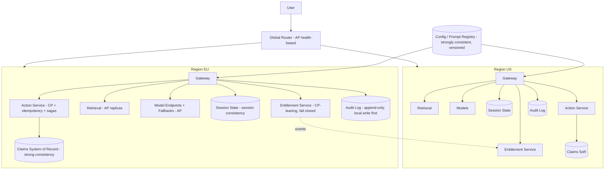

# Architecture trade-off methodology (CAP theorem in AI context)

> [← Back to Interview Preparation Home](interview-index.md)

## 1. Brief Summary

### Definition
**Architecture trade-off methodology** is a structured way to make, justify, and document design decisions when qualities conflict — for example consistency vs availability, quality vs latency vs cost, or safety vs usability. The **CAP theorem** (Brewer, formalized by Gilbert & Lynch) states that a distributed data store can guarantee at most two of three properties simultaneously **in the presence of a network partition**:
- **Consistency (C):** every read receives the most recent write (linearizability).
- **Availability (A):** every request to a non-failing node receives a (non-error) response.
- **Partition tolerance (P):** the system continues to operate despite network partitions/message loss.

Since partitions are unavoidable in distributed systems, the real choice during a partition is **CP vs AP**. **PACELC** extends it: *if Partition, choose Availability or Consistency; Else, choose Latency or Consistency*.

### Why it matters
AI systems are distributed: model endpoints across regions, vector indexes with replicas, feature stores, caches, conversation state, agent memory, and data pipelines. Architects must decide, per component, whether to serve possibly stale/incomplete results (availability) or fail/delay (consistency) — and communicate the business impact. The CAP mindset also generalizes to AI-specific trade-off triangles (quality–latency–cost, safety–helpfulness, freshness–cost).

### Core concepts and terminology
- **CP, AP, CA (only theoretical without partitions)**; **eventual, causal, session, bounded-staleness, strong consistency**; **quorum reads/writes (R+W>N)**; **replication lag**; **idempotency**; **CRDTs**; **sagas** for distributed transactions.
- **PACELC**; **BASE** (Basically Available, Soft state, Eventual consistency) vs **ACID**.
- **Quality attribute trade-offs:** latency, throughput, cost, accuracy/quality, freshness, safety, privacy, explainability, maintainability, vendor lock-in.
- **Trade-off methods:** **ATAM** (Architecture Tradeoff Analysis Method), **quality attribute scenarios**, **utility trees**, **weighted decision matrices**, **Architecture Decision Records (ADRs)**, **fitness functions**, **sensitivity and risk analysis**, **Pareto frontier**, **reversibility (one-way vs two-way doors)**, **spike/PoC experiments**.

### CAP/PACELC in AI systems (mapping)
| AI component | Typical choice | Rationale |
|---|---|---|
| **Vector index / search replicas** | AP / eventual consistency | Slightly stale index is acceptable for most RAG; availability and latency matter; but ACL/deletion updates may need stronger guarantees (security-critical metadata) |
| **ACL/permissions used for retrieval** | CP-leaning (fail closed) | Stale permissions can leak data; better to deny than risk exposure |
| **Conversation/session state** | Session or bounded-staleness consistency | User expects to see own messages (read-your-writes) |
| **Feature store (online)** | AP with freshness SLAs | Slightly stale features acceptable for many models; strict for fraud |
| **Model registry / prompt registry / config** | CP (strong) for rollout control | Avoid serving inconsistent prompt/model versions across regions |
| **Semantic/response cache** | AP | Stale or missing cache is tolerable; correctness constrained by TTL |
| **Agent long-term memory** | Eventual, with conflict resolution | Multi-region writes need merge strategy (CRDT/last-writer-wins caveats) |
| **Payments/financial tool side-effects triggered by agents** | CP + idempotency | Correctness over availability |
| **Model serving across regions** | AP (fallback models) | Prefer degraded answer to an outage unless safety-critical |

### AI-specific trade-off triangles
- **Quality–Latency–Cost:** bigger models/more retrieval/more reasoning improve quality but increase latency and cost.
- **Freshness–Cost–Complexity:** real-time indexing vs batch.
- **Safety–Utility–Latency:** more guardrails reduce risk and add delay/false refusals.
- **Privacy–Personalization–Quality:** more personal context improves answers but increases exposure.
- **Autonomy–Control–Risk:** more agent autonomy increases value and risk.

### How the methodology works (practical steps)
1. **Clarify business goals and constraints** (SLAs, compliance, budget, risk appetite).
2. **Identify architecturally significant requirements** as quality-attribute scenarios (stimulus → response → measure).
3. **Generate options** (2–4 viable architectures).
4. **Analyze trade-offs** (utility tree, scoring, prototypes, load tests/evals).
5. **Identify risks, sensitivity points, and non-risks** (ATAM).
6. **Decide and document** via ADR (context, options, decision, consequences, revisit triggers).
7. **Automate fitness functions** (e.g., p95 latency, groundedness, cost per request) to detect drift.
8. **Review** as context changes.

### Where it is used
System design interviews, platform architecture reviews, multi-region AI deployments, RAG/agent design, vendor/model selection, cost/performance tuning.

### Important tools and frameworks
ATAM, ADRs, C4 model, arc42, Wardley mapping, TOGAF, Azure Well-Architected Framework (reliability, security, cost, operational excellence, performance), AWS Well-Architected (Generative AI Lens), Jepsen (consistency testing), Cosmos DB consistency levels, Cassandra tunable consistency, Postgres replication, Kafka, Temporal.

### Common misconceptions
- "CAP means pick any two of three at design time" — partitions aren't optional; the choice is between C and A *during* partitions.
- "CAP is about everyday latency" — that's PACELC's "E" branch.
- "AI changes everything" — standard distributed systems trade-offs still apply, plus model-quality dimensions.
- "A single choice for the whole system" — choose per data type/operation.

### Key points to remember
- Choose **per component and per operation**, based on **business impact of being wrong vs being down**.
- For security-relevant state (ACLs, deletions, permissions) prefer **fail-closed/consistency**.
- For retrieval freshness, caches, and recommendations prefer **availability/eventual consistency** with explicit staleness bounds.
- Document trade-offs with **ADRs** and verify them with **measurements**.

---

## 2. Interview Questions

### Beginner Questions

**Q1. State the CAP theorem.**
- **Model answer:** In a distributed data system, during a network partition you can't have both consistency (all nodes see the same latest data) and availability (every request gets a response); you must choose, and partition tolerance is required in practice.
- **Key points expected:** C, A, P definitions; partition scenario.
- **Mistake to avoid:** Saying you can pick any two at will.

**Q2. What does "partition tolerance" mean?**
- **Model answer:** The system continues operating even if network failures split nodes into groups that can't communicate.
- **Key points expected:** Network failure resilience.
- **Mistake to avoid:** Equating with data partitioning/sharding.

**Q3. Give an example of a CP and an AP system.**
- **Model answer:** CP: ZooKeeper/etcd, HBase, strongly consistent Spanner config. AP: Cassandra (default), DynamoDB (eventually consistent reads), many caches.
- **Key points expected:** Correct examples with the reasoning.
- **Mistake to avoid:** Claiming relational DBs are "CA" in distributed deployments.

**Q4. What is eventual consistency?**
- **Model answer:** If no new updates occur, all replicas will eventually converge to the same value; reads may be stale in the meantime.
- **Key points expected:** Convergence, staleness.
- **Mistake to avoid:** Thinking it means data may be lost.

**Q5. Where might eventual consistency be acceptable in a RAG system?**
- **Model answer:** Replicated vector index content updates — a new document appearing a few minutes later is usually fine.
- **Key points expected:** Business tolerance for staleness.
- **Mistake to avoid:** Applying it to access-control changes without thought.

**Q6. Where would you not accept stale data in an AI system?**
- **Model answer:** Permissions/ACLs, deletions for legal reasons, financial balances used by agents, safety policy configurations.
- **Key points expected:** Security and correctness-critical data.
- **Mistake to avoid:** Treating all data equally.

**Q7. What is a trade-off in AI beyond CAP?**
- **Model answer:** Quality vs latency vs cost — larger models and more context improve answers but are slower and more expensive.
- **Key points expected:** AI-specific triangle.
- **Mistake to avoid:** Thinking more compute always wins.

**Q8. What is an Architecture Decision Record (ADR)?**
- **Model answer:** A short document capturing a decision: context, options considered, the decision, rationale, and consequences.
- **Key points expected:** Traceability.
- **Mistake to avoid:** Treating ADRs as lengthy design docs.

### Intermediate Questions

**Q1. Explain PACELC and why it's often more useful than CAP.**
- **Model answer:** PACELC says: if there's a Partition, choose A or C; Else (normal operation), choose Latency or Consistency. Most of the time there's no partition, and the real trade-off is latency vs consistency (e.g., synchronous cross-region replication adds latency). It helps reason about everyday performance.
- **Key technical considerations:** Replication modes, quorum settings, geo-distribution.
- **Follow-up:** "How would PACELC apply to a multi-region vector index?"

**Q2. How do you apply CAP thinking to a multi-region RAG deployment with document ACLs?**
- **Model answer:** Treat content index as AP (eventual) but ACL metadata and deletions as stronger: propagate ACL changes via ordered events, set staleness bound SLO (e.g., <60s), fail closed if ACL service is unreachable, and use query-time permission checks against the source of truth for sensitive repositories. Use region-local replicas for latency.
- **Key technical considerations:** Security vs availability trade-off; negative caching of denies.
- **Follow-up:** "What if the identity service is partitioned from the search tier?"

**Q3. Which consistency level would you pick for conversational state in a multi-region chat assistant?**
- **Model answer:** Session consistency (read-your-writes, monotonic reads) via sticky routing or session tokens — users see their own context correctly with lower latency than strong consistency. Cosmos DB's session level is a practical example. For cross-device continuity, use bounded staleness or route to a home region.
- **Key technical considerations:** Failover behavior, conflict resolution for multi-write.
- **Follow-up:** "What happens when a user switches regions mid-conversation?"

**Q4. Describe a quality-attribute scenario for an AI feature.**
- **Model answer:** Example: "When 5,000 concurrent users submit questions during peak, the assistant returns a grounded answer with p95 latency < 4 s and groundedness ≥ 0.9, at cost ≤ $0.02 per request." Include source, stimulus, environment, artifact, response, and measure.
- **Key technical considerations:** Measurable and testable.
- **Follow-up:** "How do you verify this scenario in CI?"

**Q5. How do you evaluate trade-offs among three architecture options?**
- **Model answer:** Build a utility tree of prioritized quality attributes, score options with weighted criteria backed by evidence (benchmarks, PoCs, cost models), identify risks and sensitivity points, run sensitivity analysis on weights/volumes, and document the decision with revisit triggers. Prefer reversible decisions when uncertainty is high.
- **Key technical considerations:** Avoid false precision; involve stakeholders in weighting.
- **Follow-up:** "How do you handle disagreement on weights?"

**Q6. What are fitness functions and how do they apply to AI architecture?**
- **Model answer:** Automated checks that verify architectural characteristics remain within bounds — e.g., p95 latency, cost per request, groundedness, replication lag, ACL propagation time, token usage. They run in CI/CD and production monitoring to detect architectural drift.
- **Key technical considerations:** Thresholds and alerting; ownership.
- **Follow-up:** "Give three fitness functions for a RAG system."

**Q7. How does idempotency relate to CAP-style trade-offs for agents?**
- **Model answer:** In AP-style systems with retries and possible duplicates, side effects (payments, emails) must be idempotent (idempotency keys) so retries after timeouts or failovers don't repeat actions. For CP operations, use transactions or sagas with compensation.
- **Key technical considerations:** Exactly-once is practically at-least-once + idempotency.
- **Follow-up:** "How would you design an idempotent 'create order' tool?"

**Q8. Compare strong consistency and eventual consistency in terms of user experience for AI features.**
- **Model answer:** Strong consistency ensures users immediately see the latest data (e.g., just-uploaded document is searchable) but adds latency and reduces availability under partitions. Eventual consistency yields faster, more available systems but occasional stale answers; mitigate with UX cues ("indexing in progress"), read-your-writes for the uploader, and freshness metadata.
- **Key technical considerations:** User expectations, SLAs.
- **Follow-up:** "How do you handle the 'I just uploaded it, why can't it find it' scenario?"

### Advanced Questions

**Q1. Design a multi-region AI assistant and explicitly state CAP/PACELC choices per component.**
- **Model answer:** Global routing (AP, health-based failover); model endpoints per region with fallbacks (AP; prefer degraded answer over outage); retrieval index regional replicas (AP/eventual with ≤5 min freshness SLO); ACL/entitlement service (CP-leaning, fail closed, short TTL cache, event-driven invalidation); conversation state (session consistency, home-region affinity, async replication; conflict-free append-only log); prompt/config registry (strongly consistent writes, versioned and cached; rollout controlled by feature flags); semantic cache (AP, region-local, TTL); audit logs (append-only, durable, eventual global aggregation but local immutable write first). Document in ADRs with failure behaviors.
- **Design considerations:** Staleness budgets, failure-mode behavior ("fail open vs closed"), data residency.
- **Trade-offs:** Latency vs consistency, cost of replication, complexity.
- **Follow-ups:** "What happens during a region partition for a user whose data lives in the isolated region?"

**Q2. During a partition, the ACL service is unreachable from the retrieval tier. What does the system do and why?**
- **Model answer:** Fail closed for restricted content: serve only content classified as public/low-risk using cached, short-TTL entitlements or deny; degrade to non-personalized answers; surface message to users; alert. Rationale: the cost of leaking data far exceeds the cost of reduced availability. For low-risk corpora, allow cached entitlements up to a bounded staleness window.
- **Design considerations:** Risk-tiered policy per repository; cache TTL; negative caching; circuit breakers.
- **Trade-offs:** Availability vs security; user frustration vs compliance.
- **Follow-ups:** "How would you test this behavior?" (chaos experiment partitioning identity service)

**Q3. Explain how quality–latency–cost trade-offs are managed with an adaptive architecture.**
- **Model answer:** Use routing/cascades: classify request criticality and complexity; use a small fast model for simple cases and escalate; dynamic retrieval depth; speculative or parallel calls with early exit; cache; budgets per tier; SLO-based degradation under load (shed optional steps such as reranking or reflection). Measure with a Pareto frontier of quality vs cost vs latency and choose operating points per use case.
- **Design considerations:** Observability of each step's marginal quality gain; feedback loops; user-visible controls ("fast" vs "thorough").
- **Trade-offs:** Complexity vs savings; consistency of user experience.
- **Follow-ups:** "How do you detect when the operating point is wrong?"

**Q4. How do you apply ATAM to an enterprise AI platform decision (e.g., centralized vs federated platform)?**
- **Model answer:** Present business drivers and architecture options; generate quality-attribute scenarios (security, time-to-market, cost, scalability, autonomy); build a utility tree and prioritize; analyze each option against scenarios; identify sensitivity points (e.g., central team capacity), trade-off points (control vs speed), risks, and non-risks; run stakeholder workshop; produce findings and a recommendation with mitigations and revisit triggers.
- **Design considerations:** Stakeholder participation, evidence-based analysis, documentation.
- **Trade-offs:** Time investment of ATAM vs lighter-weight reviews.
- **Follow-ups:** "When is ATAM overkill?"

**Q5. Explain consistency trade-offs for agent memory shared across multiple concurrent agents.**
- **Model answer:** Concurrent writes create conflicts (lost updates, contradictory facts). Options: single-writer per memory partition; optimistic concurrency with versions; append-only event log plus derived views (event sourcing); CRDTs for mergeable structures (sets, counters); LLM-based reconciliation with provenance and timestamps (careful with trust); strong consistency for critical state (task ownership, locks). Choose per memory type: scratchpad (local, ephemeral), shared task state (strongly consistent), long-term knowledge (eventual with review).
- **Design considerations:** Provenance, TTL, poisoning defenses.
- **Trade-offs:** Latency and complexity vs coherence.
- **Follow-ups:** "How do you prevent memory poisoning from propagating?"

**Q6. A stakeholder demands "100% availability and always-fresh data and lowest cost." How do you respond?**
- **Model answer:** Explain trade-offs using CAP/PACELC and cost: quantify what each additional nine, freshness increment, and cost reduction implies; propose tiered service levels by data/use case; present 2–3 options with costs and risks; ask for business impact of staleness and downtime (loss per minute) to guide choices; document decision.
- **Design considerations:** Business impact analysis, error budgets.
- **Trade-offs:** Each improvement dimension increases cost/complexity.
- **Follow-ups:** "How do you negotiate when requirements are unrealistic?"

**Q7. How would you test architectural trade-off claims empirically?**
- **Model answer:** Prototype critical paths; load test with realistic workloads; chaos-engineering partitions and failures; measure replication lag, failover time, stale read rates, latency distributions, cost per request, and quality metrics; use Jepsen-style tests for consistency claims; compare to SLOs; analyze results with sensitivity to load and data scale. Capture results in ADR evidence.
- **Design considerations:** Representative data and traffic, repeatability, environment parity.
- **Trade-offs:** Time/cost of testing vs decision confidence.
- **Follow-ups:** "What would you test first if time-limited?"

**Q8. Compare designing for AP with graceful degradation vs CP with fail-fast for a fraud-detection LLM assistant.**
- **Model answer:** The fraud scoring path (blocking transactions) should be CP-leaning/deterministic with strong guarantees and fail-safe defaults (e.g., step-up verification) — correctness over availability for decisions. The analyst copilot (summaries, investigation helper) can be AP with degraded modes (cached summaries, smaller model) since outages cause inconvenience, not financial loss. Separate the paths architecturally to avoid coupling.
- **Design considerations:** Blast radius isolation, fallback behaviors, decision logging.
- **Trade-offs:** Dual-path complexity vs risk containment.
- **Follow-ups:** "What's the safe default when the model is unavailable?"

---

## 3. Use Cases

### Simple Use Case — Choosing consistency for a document-upload assistant
- **Problem:** Users upload a document and immediately ask questions about it; sometimes the assistant says it can't find it.
- **Assumptions:** Single region; vector index eventually consistent with ~30 s indexing delay.
- **Steps:**
  1. Identify requirement: read-your-writes for the uploader.
  2. Option A: wait for indexing before enabling chat (strong, slower UX).
  3. Option B: temporarily include the uploaded document's text directly in the context for that session (bridging the eventual consistency gap).
  4. Choose B plus a progress indicator; document in an ADR.
- **Expected result:** Users get immediate answers without waiting; index catches up later.
- **Tools:** Azure AI Search, Blob Storage events, application session cache.

### Intermediate Use Case — Trade-off analysis for a customer-service copilot's retrieval and caching
- **Scenario:** A retailer's copilot must stay fast during sales events but show correct promotions and prices.
- **Requirements:** p95 < 3 s, price accuracy for promotions, cost cap, 99.9% availability.
- **Proposed solution:** Separate data classes: static policies (AP, cached 24h), promotions (bounded staleness 60 s with event-driven invalidation), prices (always retrieved from pricing API via tool, never cached in answers beyond 30 s, shown with timestamp).
- **Implementation steps:**
  1. Define quality-attribute scenarios for each data class.
  2. Design caching tiers with TTLs and invalidation events.
  3. Implement fallback: if pricing API unavailable, answer without price and offer follow-up.
  4. Add fitness functions: stale-price incident rate, cache hit rate, p95 latency.
  5. Record ADR with explicit consistency choices and revisit triggers.
- **Technical challenges:** Cache invalidation ordering, race conditions during price updates, multi-region replication.
- **Expected result:** Fast responses with bounded, visible staleness and zero incorrect-price commitments.
- **Testing approach:** Simulate price changes and measure staleness windows; chaos test with pricing API partition; load test at 3× peak.

### Difficult Use Case — Global regulated AI platform: explicit CAP/PACELC design across components
- **Scenario:** A multinational insurer deploys a claims copilot in three regions with strict data residency, high availability, and auditability requirements.
- **Functional requirements:** RAG over claims and policy data, agent actions in claims systems, human approvals, audit logs.
- **Non-functional requirements:** 99.95% availability, regional residency, ACL changes effective < 60 s, zero unauthorized access, RPO ≤ 5 min, p95 latency < 5 s, bounded cost.

**Proposed architecture**

**Components and responsibilities (with consistency stance)**
- **Global router (AP):** routes by residency and health; prefers degraded service over total outage.
- **Entitlement service (CP-leaning):** source of truth for ACL; fail closed; short-TTL caches; event invalidation.
- **Retrieval (AP):** replicated indexes with freshness SLO; ACL filter applied at query time.
- **Model endpoints (AP):** multiple deployments + fallbacks; degraded mode allowed for non-decision tasks.
- **Session state (session consistency):** read-your-writes with home-region affinity.
- **Action service (CP + idempotency):** transactional integration with claims system, saga compensation, human approval for high-value actions.
- **Audit log (append-only):** local durable write first, async aggregation; immutable.
- **Config/prompt registry (strong consistency):** versioned, signed, canary rollout.

**Processing flow:** request → residency routing → entitlement check (fail closed) → retrieval (eventual) → generation (fallback chain) → proposed action → policy/approval → idempotent execution against SoR → audit.

**Security considerations:** Fail-closed on authorization uncertainty; signed config; least-privilege action credentials; immutable audit; residency-aware replication (no cross-region content replication for restricted data); encryption and CMK per region.

**Performance and scalability considerations:** Region-local reads for low latency; async cross-region replication of metadata only; caching with TTL tiers; autoscaled retrieval/model tiers; prioritized queues; load shedding of optional steps (rerank, reflection) when saturated.

**Monitoring and observability:** Replication lag, ACL propagation time, stale-read rate, failover time, degraded-mode activation, fail-closed event counts, saga failure/compensation counts, cost per claim, SLO burn rates.

**Failure scenarios and recovery**
- **Inter-region partition:** each region continues independently with local data; no cross-region actions; reconcile metadata after healing; conflicts resolved using versioned, append-only events.
- **Entitlement service outage:** fail closed for restricted data; allow low-risk public content; alert and failover to replica.
- **Model provider outage:** switch to fallback deployments/models; disable non-critical features.
- **Action service timeout:** retry with idempotency key; reconcile via claims SoR query before re-execution.
- **Config rollout error:** automated rollback via registry version pointer.

**Trade-offs and alternatives**
- Fail-closed authorization sacrifices availability for security; alternative: allow stale-cache access for low-sensitivity data with strict TTL.
- Region-local autonomy increases resilience but complicates global analytics; alternative: central analytics on anonymized replicated data.
- Strong consistency for config reduces inconsistency risk but adds write latency; acceptable since config changes are rare.
