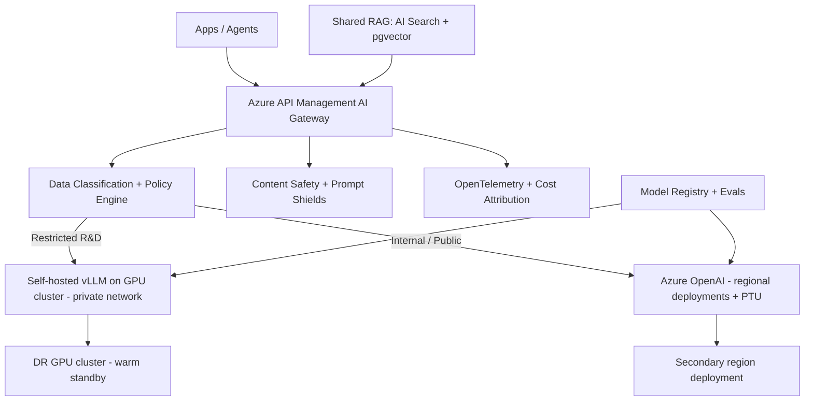

# Azure OpenAI vs self-hosted open-source model — selection criteria

> [← Back to Interview Preparation Home](interview-index.md)

## 1. Brief Summary

### Definition
- **Azure OpenAI Service** (part of Azure AI Foundry) is a managed offering that hosts OpenAI models (GPT-4o/4.1, o-series, embeddings, etc.) in Azure with enterprise security, networking, compliance, content filtering, and SLAs.
- **Self-hosted open-source (open-weight) models** such as Llama, Mistral, Qwen, Gemma, or Phi are run on infrastructure you control (on-prem GPUs, Azure VMs/AKS, or managed GPU endpoints) using serving engines such as vLLM, TGI, TensorRT-LLM, or Ollama.

Selection criteria are the dimensions used to choose between them — or to combine them.

### Why it matters
This decision shapes quality ceiling, data control, cost curve, latency, operational burden, compliance posture, and vendor dependence for years.

### Core concepts and terminology
- **Open-weight vs open-source** (license differences: Apache-2.0, MIT vs Llama Community License with usage restrictions).
- **Deployment types in Azure OpenAI:** Standard (pay-per-token, regional/global), **Provisioned (PTU)**, **Batch**, Data Zone deployments.
- **Content filtering, abuse monitoring, data retention, customer-managed keys (CMK), private endpoints, managed identity.**
- **Serving:** vLLM (PagedAttention, continuous batching), TGI, TensorRT-LLM, Triton, KServe, Ray Serve; **quantization** (AWQ, GPTQ, FP8), **tensor/pipeline parallelism**, **LoRA multi-adapter serving**.
- **Hardware:** NVIDIA A100/H100/H200/L40S, VRAM sizing (params × bytes + KV cache).
- **Evaluation parity** on your tasks; **TTFT**, **tokens/s**, **p95 latency**.

### How the comparison works
| Criterion | Azure OpenAI | Self-hosted open model |
|---|---|---|
| Capability | Frontier reasoning, multimodal, tools, structured outputs | Strong mid-tier; frontier gap narrowing; excellent for narrow tasks after tuning |
| Time to value | Hours/days | Weeks to months |
| Data control | Data stays in Azure tenant/region; no training on your data; some abuse-monitoring retention (can be exempted) | Full control, air-gap possible |
| Compliance | Inherits Azure certifications, regional options | You own certification evidence |
| Cost | Per token or PTU; predictable, no idle GPU | Fixed GPU cost; cheaper at high steady utilization; expensive when idle |
| Latency | Good; PTU for predictability | Tunable, can co-locate/edge; small models very fast |
| Customization | Fine-tuning (select models), prompts, RAG | Full fine-tuning, LoRA, architecture/quantization control |
| Operations | Managed; quotas/throttling to manage | Own patching, scaling, GPUs, upgrades, monitoring |
| Lock-in | Provider API & model lifecycle | Portable weights; hardware and tooling dependence |
| Safety | Built-in content filters | Build or integrate (Llama Guard, Azure AI Content Safety) |
| Availability | SLA, zonal/regional redundancy | You design HA/DR |

### Where it is used
- Azure OpenAI: enterprise copilots, RAG, agents, regulated workloads on Azure.
- Self-hosted: air-gapped/sovereign environments, high-volume narrow tasks, edge devices, research, cost-optimized pipelines, custom domain models.

### Important tools
Azure AI Foundry, Azure OpenAI, Azure API Management, Azure AI Content Safety, AKS with GPU node pools, Azure ML managed online endpoints, vLLM, Hugging Face, Ollama, llama.cpp, NVIDIA NIM, KServe, Triton.

### Common misconceptions
- "Open source is free and private by default" — GPUs, ops, and security are costly responsibilities.
- "Azure OpenAI shares our data with OpenAI" — it doesn't; Microsoft hosts the models, and prompts/completions aren't used to train models.
- "Open models can't match proprietary quality" — for narrow tasks, tuned open models often do.
- "You must choose one."

### Key points to remember
- Default to **Azure OpenAI** for speed, capability, and compliance on Azure; choose **self-hosted** for strict sovereignty, deep customization, or high-volume/low-complexity economics.
- **Hybrid via a gateway** is common.
- Decide using **your evaluation set**, TCO model, and compliance constraints — not benchmarks alone.

---

## 2. Interview Questions

### Beginner Questions

**Q1. What is Azure OpenAI Service?**
- **Model answer:** A managed Azure service providing access to OpenAI models through Azure-native APIs with enterprise features: private networking, RBAC/managed identity, content filtering, regional deployments, and compliance certifications.
- **Key points expected:** Managed, enterprise security, OpenAI models on Azure.
- **Mistake to avoid:** Describing it as just the public OpenAI API.

**Q2. What does "self-hosted open-source model" mean?**
- **Model answer:** Downloading open-weight models and running them yourself on your own infrastructure with a serving framework, taking responsibility for scaling, security, and updates.
- **Key points expected:** Own infrastructure and ops.
- **Mistake to avoid:** Confusing with using a hosted API for an open model.

**Q3. Give two reasons to choose Azure OpenAI.**
- **Model answer:** Fast time to market with frontier-quality models, and enterprise-grade security/compliance with minimal operational burden.
- **Key points expected:** Speed and managed compliance.
- **Mistake to avoid:** Overlooking cost considerations.

**Q4. Give two reasons to self-host.**
- **Model answer:** Complete data control (including air-gapped) and cost efficiency at high steady volume or deep customization (fine-tuning, quantization).
- **Key points expected:** Control and economics.
- **Mistake to avoid:** Claiming it's always cheaper.

**Q5. What hardware do self-hosted LLMs need?**
- **Model answer:** GPUs with enough VRAM for weights plus KV cache (e.g., a 70B model in FP16 needs ~140 GB; quantization reduces it), plus high-bandwidth interconnect for multi-GPU setups.
- **Key points expected:** VRAM sizing awareness.
- **Mistake to avoid:** Ignoring KV cache memory.

**Q6. What is PTU in Azure OpenAI?**
- **Model answer:** Provisioned Throughput Units: reserved model processing capacity giving predictable latency and throughput at a fixed hourly/monthly price.
- **Key points expected:** Predictability, steady workloads.
- **Mistake to avoid:** Assuming PTU is for low-volume experimentation.

**Q7. What is vLLM?**
- **Model answer:** A high-throughput LLM inference engine using PagedAttention and continuous batching, exposing an OpenAI-compatible API.
- **Key points expected:** Serving optimization.
- **Mistake to avoid:** Calling it a model.

**Q8. What is a license consideration for open models?**
- **Model answer:** Licenses vary: Apache-2.0/MIT are permissive; others (e.g., Llama community license) have usage and scale restrictions or attribution requirements. Legal review is required.
- **Key points expected:** "Open-weight" ≠ unrestricted.
- **Mistake to avoid:** Ignoring licenses.

### Intermediate Questions

**Q1. How do you decide using a structured approach?**
- **Model answer:** (1) Hard constraints: data sovereignty, air-gap, regulatory prohibitions. (2) Quality: evaluate candidate models on your golden set. (3) Latency/throughput needs. (4) TCO at forecast volumes. (5) Team skills and capacity. (6) Customization needs. (7) Lifecycle/lock-in. Score with weights, run PoC, record ADR, define revisit triggers.
- **Key technical considerations:** Evidence over assumptions; hybrid options.
- **Follow-up:** "Which constraint would eliminate Azure OpenAI outright?"

**Q2. How does data privacy work in Azure OpenAI?**
- **Model answer:** Prompts and completions aren't used to train foundation models or shared with OpenAI; data is processed in the chosen geography; abuse monitoring may retain data up to 30 days unless an approved exemption (modified abuse monitoring) is granted; fine-tuning data is stored in the resource and can be deleted; CMK, private endpoints, and disabling public access are available.
- **Key technical considerations:** Region vs global deployments, Data Zone options, logging in your own app.
- **Follow-up:** "How do you control where inference executes?"

**Q3. How would you estimate GPU needs for a self-hosted 70B model?**
- **Model answer:** Weights: 70B × 2 bytes ≈ 140 GB FP16 (≈ 70 GB INT8, ≈ 35–40 GB INT4). Add KV cache: depends on layers, heads, context length, batch size. Plan tensor parallelism across GPUs (e.g., 2–4× H100 80GB FP16/FP8). Benchmark throughput and p95 under concurrency, then add redundancy and headroom.
- **Key technical considerations:** Context length drives KV cache; quantization quality trade-off.
- **Follow-up:** "What changes if the context window doubles?"

**Q4. Compare the operational responsibilities.**
- **Model answer:** Azure OpenAI: quota management, retry/backoff, content filter configuration, monitoring, cost control. Self-hosted adds: GPU provisioning, driver/CUDA updates, container images, autoscaling, model updates, vulnerability management, HA/DR, safety layers, observability, capacity planning.
- **Key technical considerations:** Staffing required (SRE/MLOps).
- **Follow-up:** "How many FTEs would you budget for a production self-hosted cluster?"

**Q5. How do you handle safety/content moderation in each option?**
- **Model answer:** Azure OpenAI has default content filters and Prompt Shields integration; configurable severity. Self-hosted requires adding classifiers (Llama Guard, Azure AI Content Safety API) at input/output and your own policies.
- **Key technical considerations:** Latency overhead, coverage, tuning.
- **Follow-up:** "Can you reach parity in safety posture self-hosted?"

**Q6. When is fine-tuning a reason to self-host?**
- **Model answer:** If you need full control (custom architectures, continued pretraining, specific quantization, on-prem training with sensitive data) or want to host many LoRA adapters cheaply. Azure OpenAI supports fine-tuning for selected models but with fewer controls and per-hour hosting charges.
- **Key technical considerations:** Hosting fees for tuned deployments, regional availability.
- **Follow-up:** "Would distillation to an open model be an option?"

**Q7. How do you design for portability between the two?**
- **Model answer:** Use an OpenAI-compatible API interface (vLLM exposes it), a gateway (APIM, LiteLLM), prompt templates parameterized per model, abstracted tool calling/structured output, and an evaluation suite to validate any model swap.
- **Key technical considerations:** Differences in function-calling and JSON modes.
- **Follow-up:** "What breaks most often when swapping models?"

**Q8. How does latency compare?**
- **Model answer:** Azure Standard deployments have variable latency under shared load; PTU gives stable latency. Self-hosted small models can achieve very low latency near the app; large models need multi-GPU and batch tuning. Measure TTFT and tokens/s under your concurrency.
- **Key technical considerations:** Network distance, streaming, batching trade-offs.
- **Follow-up:** "How would you reduce time-to-first-token?"

### Advanced Questions

**Q1. A bank requires all inference on-prem but wants GPT-4-class quality. What do you propose?**
- **Model answer:** Evaluate the best open-weight models (e.g., large Llama/Qwen/DeepSeek class) on bank tasks; consider Azure Local/sovereign options if available; fine-tune on internal data; use RAG; ensemble with rules; plan GPU cluster (H100/H200) with vLLM/TensorRT-LLM; add safety layers; accept possible gap and mitigate via human review. Present quality evidence and risk acceptance to stakeholders.
- **Design considerations:** Air-gapped model supply chain, signed artifacts, capacity for peak, DR across data centers.
- **Trade-offs:** Compliance vs peak capability; capex and lead times.
- **Follow-ups:** "How would you demonstrate acceptable quality to the risk committee?"

**Q2. Design a hybrid architecture using both with data-classification-based routing.**
- **Model answer:** AI gateway classifies requests via source system labels/DLP: Restricted → self-hosted in private network; Internal/Public → Azure OpenAI via private endpoint. Common guardrails, logging, and evaluation. Fallback rules never route restricted data externally. Shared RAG service with ACL enforcement.
- **Design considerations:** Reliable classification (fail closed), consistent prompt behaviors across models, unified observability.
- **Trade-offs:** Added complexity vs optimal compliance and cost.
- **Follow-ups:** "What happens when classification is uncertain?"

**Q3. Cost model: at what volume does self-hosting beat Azure OpenAI?**
- **Model answer:** Compute monthly tokens (input/output split) × Azure price (consider PTU/batch/caching discounts) vs self-host: required GPUs for peak with N+1 redundancy × hourly (reserved) cost × 730 h + ops staffing + storage/network/tooling. Utilization is the key: break-even often requires sustained utilization above ~50–60% and a model that is "good enough". Run a sensitivity analysis; remember Azure prices have fallen rapidly, shifting break-even upward.
- **Design considerations:** Autoscaling to cut idle cost, spot GPUs for batch.
- **Trade-offs:** Predictability vs optionality.
- **Follow-ups:** "What if usage is highly bursty?"

**Q4. HA/DR design for each option.**
- **Model answer:** Azure OpenAI: multiple deployments across regions behind APIM with circuit breakers, PTU + PAYG spillover, health probes, quota monitoring. Self-hosted: multi-AZ GPU pools, multiple replicas, model weights in replicated storage, pre-warmed standby, rolling updates, capacity reservations; DR region with weights and images; runbooks tested.
- **Design considerations:** Cold-start times for large models (minutes), GPU availability during failover.
- **Trade-offs:** Standby GPU cost vs RTO.
- **Follow-ups:** "How do you verify failover meets RTO?"

**Q5. Evaluate security differences and your threat model.**
- **Model answer:** Azure OpenAI reduces attack surface (managed patching, private link, Entra ID auth, no model weights to steal) but introduces shared responsibility and third-party dependence. Self-hosted exposes risks: weights exfiltration, container supply chain, unpatched serving stack vulnerabilities, misconfigured endpoints, GPU multi-tenancy issues. Both need prompt-injection defense and data governance.
- **Design considerations:** Network isolation, secrets management, SBOM and image scanning, audit logging.
- **Trade-offs:** Control vs responsibility.
- **Follow-ups:** "Who is responsible for model vulnerabilities in each case?"

**Q6. How would you migrate from Azure OpenAI to self-hosted for one high-volume workload?**
- **Model answer:** Identify candidate workload (narrow, high volume); gather production prompts/outputs as training/eval data; select and tune an open model; benchmark; implement gateway routing with shadow traffic; compare quality/cost/latency; gradual canary ramp with fallback to Azure OpenAI; decommission after stability; keep regression suite.
- **Design considerations:** Prompt/format parity, monitoring, rollback.
- **Trade-offs:** Savings vs migration/ops effort.
- **Follow-ups:** "What would cause you to abort the migration?"

**Q7. Regulatory scenario: EU customer demands that no non-EU entity can access data. How do Azure OpenAI and self-hosting fare?**
- **Model answer:** Use EU data-zone/regional deployments (not global), EU Data Boundary commitments, CMK, restrict support access (Customer Lockbox); evaluate sovereign cloud variants. If jurisdictional access (e.g., foreign laws) is still a concern, self-host in an EU-owned data center or sovereign provider. Document legal analysis.
- **Design considerations:** Subprocessors, logging locations, telemetry.
- **Trade-offs:** Sovereignty strength vs model capability and effort.
- **Follow-ups:** "What residual risks would you flag to legal?"

**Q8. Model lifecycle: how do you manage upgrades and deprecations on both?**
- **Model answer:** Azure OpenAI retires models on published schedules; pin versions, monitor notices, canary new versions with regression suite, and use auto-upgrade settings carefully. Self-hosted: you choose upgrade timing, but must track new releases, vulnerabilities, and re-validate; maintain model registry, signed artifacts, and rollback.
- **Design considerations:** Behavior changes, prompt re-tuning, version pinning in IaC.
- **Trade-offs:** Control of timing vs maintenance burden.
- **Follow-ups:** "How do you stop a silent upgrade from changing production behavior?"

---

## 3. Use Cases

### Simple Use Case — Internal document assistant on Azure
- **Problem:** A 2,000-employee firm needs a secure document Q&A assistant quickly.
- **Assumptions:** Azure tenant in place; data classified internal; no GPU expertise.
- **Steps:**
  1. Deploy Azure OpenAI (chat + embeddings) in the EU region with private endpoint.
  2. Index documents in Azure AI Search with security trimming.
  3. Build the app with managed identity authentication.
  4. Enable content filters and logging.
- **Expected result:** Production-ready assistant in weeks with enterprise controls.
- **Tools:** Azure OpenAI, Azure AI Search, App Service, Entra ID.

### Intermediate Use Case — High-volume PII redaction and classification
- **Scenario:** A telecom processes 50M call transcripts/month for classification and PII tagging.
- **Requirements:** Cost-efficient, data stays in private network, F1 ≥ 0.92, throughput of 2,000 requests/s at peak.
- **Proposed solution:** Fine-tune an 8B open model with LoRA, serve with vLLM on AKS GPU nodes with autoscaling; escalate low-confidence items to Azure OpenAI via private endpoint (with redaction).
- **Implementation steps:**
  1. Create labeled dataset from existing outputs plus human review.
  2. Fine-tune and quantize (FP8/AWQ); evaluate against hosted baseline.
  3. Benchmark throughput; size GPU pool with N+1.
  4. Deploy with KServe/vLLM, gateway routing, and confidence thresholding.
  5. Add monitoring for GPU utilization and drift.
- **Technical challenges:** GPU procurement, tail latency under bursts, evaluation of PII recall.
- **Expected result:** ~70% lower per-document cost than a frontier API with comparable F1.
- **Testing approach:** Offline F1/recall on PII, load testing at 1.5× peak, chaos test removing a GPU node.

### Difficult Use Case — Regulated multinational hybrid AI platform
- **Scenario:** A pharmaceutical company runs R&D assistants (sensitive IP), customer-facing medical info bots, and internal productivity copilots across the EU, US, and APAC.
- **Functional requirements:** Multiple model tiers, strict routing by data class, auditability, fine-tuned domain models, agent tools.
- **Non-functional requirements:** 99.95% availability for customer-facing bots, regional residency, IP protection (no external exposure of R&D data), cost predictability, DR RTO < 1 hour.

**Proposed architecture**

**Components and responsibilities**
- **API gateway:** authentication, routing, quotas, failover, policy enforcement.
- **Policy engine:** determines allowable destinations per data class; fail-closed.
- **Azure OpenAI tier:** capability for non-restricted workloads, PTU for baseline.
- **Self-hosted tier:** domain-tuned open models for restricted data, served privately.
- **Safety & observability:** consistent guardrails, tracing, cost attribution.
- **Registry/evals:** version control, regression gating for both tiers.

**Processing flow:** request → identity + data class → policy decision → safety pre-check → model route → post-check → telemetry.

**Security:** Private endpoints/VNet isolation, CMK, no public network access, signed images and weights, secrets in Key Vault, least-privilege managed identities, network egress deny for restricted tier, audit logging into SIEM.

**Performance/scalability:** PTU for steady loads with PAYG spillover; GPU autoscaling and pre-warmed replicas; regional deployments close to users; caching; batch endpoints for offline jobs.

**Monitoring:** Latency (TTFT, p95), error and throttling rates, GPU utilization, token cost by tier, safety filter hits, drift in quality scores, failover events.

**Failure scenarios and recovery**
- Azure region degradation → APIM circuit-breaker routes to secondary region/deployment.
- GPU node failure → Kubernetes reschedules; capacity N+1; autoscaler adds nodes.
- Regional GPU shortage → degrade to smaller quantized model; queue low-priority jobs.
- Classification service failure → fail closed to the restricted (self-hosted) path or reject.

**Trade-offs and alternatives**
- Hybrid maximizes compliance and optimizes cost but doubles operational surface; alternative: all-in on Azure with strict controls if legal approves.
- Warm DR GPUs are costly; alternative: cold standby with longer RTO.
- Alternative for restricted tier: managed dedicated GPU endpoints (Azure ML/Foundry managed compute) to reduce ops while keeping private networking.
