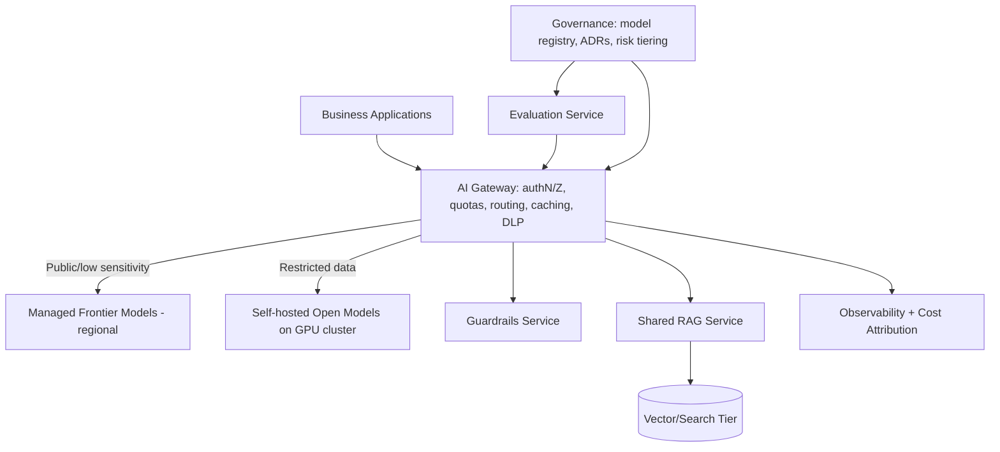

# Build vs buy for LLM infrastructure

> [← Back to Interview Preparation Home](interview-index.md)

## 1. Brief Summary

### Definition
**Build vs buy** is the decision to develop and operate LLM infrastructure components yourself (self-hosted models, serving stack, vector store, gateway, evaluation, guardrails, orchestration) versus consuming managed services or commercial products (Azure OpenAI, Bedrock, Vertex AI, SaaS observability, managed vector search). Most real decisions are **per-layer hybrids**, not all-or-nothing.

### Why it matters
LLM stacks are expensive, fast-changing, and talent-intensive. A wrong choice can cause vendor lock-in, runaway GPU or token spend, compliance gaps, or a custom platform that is obsolete within 12 months.

### Core concepts and terminology
- **Layers:** foundation model, inference/serving, orchestration, retrieval/data, gateway, guardrails, evaluation, observability, MLOps/LLMOps tooling, UI.
- **TCO (total cost of ownership):** licenses/tokens + infrastructure + engineering + operations + risk + opportunity cost.
- **Differentiation:** is the component a source of competitive advantage?
- **Lock-in, switching cost, exit strategy, portability** (OpenAI-compatible API, ONNX, MCP, OpenTelemetry).
- **Provisioned throughput (PTU) vs pay-as-you-go**, **GPU utilization**, **inference engines** (vLLM, TGI, TensorRT-LLM), **model gateways** (LiteLLM, Azure API Management AI Gateway).
- **Wardley mapping** (genesis → custom → product → commodity).

### How the decision is made
1. Decompose the stack into layers.
2. For each layer, assess differentiation, maturity of market offerings, data/compliance constraints, scale/economics, and team capability.
3. Score options (build, buy, open-source self-managed, hybrid) with weighted criteria.
4. Run a proof of concept; model TCO across 3 years at several volume scenarios.
5. Record the decision as an Architecture Decision Record (ADR) with revisit triggers.

### Where it is used
Platform and CTO-level strategy, enterprise AI platform design, regulated industries, startups choosing speed vs margin.

### Important tools and platforms
Azure OpenAI / AI Foundry, AWS Bedrock, Google Vertex AI, Anthropic and OpenAI APIs, Databricks Mosaic AI, Hugging Face Inference Endpoints, vLLM, Ollama, KServe, Ray Serve, Kubernetes + NVIDIA GPU operator, LiteLLM, Langfuse, LangSmith, Azure AI Search.

### Common misconceptions
- "Self-hosting is always cheaper at scale" — only with high, steady GPU utilization and strong ops skills.
- "Buying means no engineering needed."
- "Open-source = free."
- "We can decide once" — the market shifts quarterly; design for replaceability.

### Key points to remember
- **Buy commodity, build differentiation.**
- Data sensitivity, latency, and unit economics are the main drivers toward build.
- Always compute TCO including people and opportunity cost.
- Keep an abstraction (gateway/interface) to preserve optionality.

---

## 2. Interview Questions

### Beginner Questions

**Q1. What does build vs buy mean for LLM applications?**
- **Model answer:** Choosing whether to build and run components ourselves (e.g., host open-source models) or use managed services/vendors (e.g., a hosted model API) for each layer of the LLM stack.
- **Key points expected:** Layer-by-layer; trade-offs.
- **Mistake to avoid:** Treating it as one decision for the entire stack.

**Q2. Give three reasons to buy.**
- **Model answer:** Faster time to market, no GPU/ops burden, access to frontier models and built-in compliance/SLAs.
- **Key points expected:** Speed, reduced undifferentiated heavy lifting, vendor maintenance.
- **Mistake to avoid:** Ignoring vendor risks.

**Q3. Give three reasons to build or self-host.**
- **Model answer:** Strict data control/residency, predictable cost at high steady volume, customization (fine-tuning, latency tuning), or avoiding vendor lock-in.
- **Key points expected:** Control, economics, customization.
- **Mistake to avoid:** Saying "to save money" without caveats.

**Q4. What is vendor lock-in?**
- **Model answer:** Dependency on a vendor's proprietary APIs, formats, or services that makes switching costly. Mitigate with abstraction layers, open standards, and exportable data.
- **Key points expected:** Switching cost and mitigation.
- **Mistake to avoid:** Believing lock-in is always bad; sometimes worth it.

**Q5. What is TCO?**
- **Model answer:** Total cost of ownership: all costs over the lifecycle — usage fees, infrastructure, staff, support, training, compliance, and risk — not just sticker price.
- **Key points expected:** Includes people and operations.
- **Mistake to avoid:** Comparing token price to GPU hourly price only.

**Q6. What is an LLM gateway and why use one?**
- **Model answer:** A proxy layer that standardizes access to multiple models with auth, quotas, routing, caching, logging, and fallbacks, reducing lock-in and centralizing governance.
- **Key points expected:** Abstraction, control.
- **Mistake to avoid:** Confusing it with a vector DB.

**Q7. What is the difference between pay-as-you-go and provisioned throughput?**
- **Model answer:** Pay-as-you-go charges per token with shared capacity and variable latency; provisioned throughput reserves dedicated capacity at a fixed price for predictable performance, economical at steady high volume.
- **Key points expected:** Variability vs commitment.
- **Mistake to avoid:** Assuming provisioned is always cheaper.

**Q8. Which layers are usually "buy" for most enterprises?**
- **Model answer:** Frontier foundation models, managed vector/search, identity, and observability back-ends typically; custom orchestration, domain evaluation data, and business integrations are more likely "build".
- **Key points expected:** Commodity vs differentiation.
- **Mistake to avoid:** Building a foundation model.

### Intermediate Questions

**Q1. How would you model the break-even between a hosted API and self-hosting an open model?**
- **Model answer:** Compute API cost = tokens/month × price. Self-host cost = GPUs (on-demand/reserved) × utilization-adjusted capacity + ops staff + networking/storage + tooling + redundancy (min 2 replicas) + idle capacity. Estimate throughput per GPU via benchmarks (tokens/s with vLLM and batching) under realistic prompt/response lengths. Break-even typically occurs at high, steady utilization; include quality delta (open model may need more prompting/tuning) and scenario sensitivity.
- **Key technical considerations:** Peak vs average load, batching efficiency, quantization effects, model upgrade cadence.
- **Follow-up:** "How does the break-even shift if the provider drops prices 50%?"

**Q2. What criteria would you use to evaluate vendors?**
- **Model answer:** Model quality on our tasks, security/compliance certifications, data usage and retention terms, regional availability, SLAs/rate limits, pricing model, roadmap, support, ecosystem integration, portability/exit terms.
- **Key technical considerations:** Weighted scorecard and PoC with our data.
- **Follow-up:** "How would you validate vendor claims about data handling?"

**Q3. How do you reduce lock-in risk when buying?**
- **Model answer:** Use a gateway with a normalized API, keep prompts/configs versioned and model-agnostic, store canonical data outside the vendor, use open protocols (MCP, OpenTelemetry), and maintain a tested fallback model.
- **Key technical considerations:** Prompt portability isn't free—prompts need per-model tuning.
- **Follow-up:** "How often would you test the fallback?"

**Q4. What hidden costs exist in self-hosting LLMs?**
- **Model answer:** GPU scarcity/procurement, idle capacity, MLOps/SRE staffing, security patching, model updates and evaluation, scaling/autoscaling complexity, monitoring, disaster recovery, compliance audits, and learning-curve delays.
- **Key technical considerations:** Cold start, model weight storage, multi-GPU parallelism.
- **Follow-up:** "How would you handle GPU capacity shortages?"

**Q5. When is a hybrid approach best?**
- **Model answer:** Use frontier APIs for complex reasoning and low-volume tasks, and self-host smaller models for high-volume, simple, or sensitive tasks; route via gateway based on data classification and complexity.
- **Key technical considerations:** Routing logic, evaluation per route, consistent governance.
- **Follow-up:** "How do you test the router?"

**Q6. How do data residency and regulation influence the decision?**
- **Model answer:** If data cannot leave a jurisdiction or must stay in an air-gapped environment, options narrow to regional managed deployments with contractual guarantees or self-hosting. Evaluate sovereign cloud offerings and customer-managed keys.
- **Key technical considerations:** Abuse monitoring data retention, subprocessor lists, audit rights.
- **Follow-up:** "What if the regulator forbids third-party model providers?"

**Q7. Which components might you build even if everything is available to buy?**
- **Model answer:** Domain evaluation datasets and harness, business-specific orchestration/workflows, proprietary data pipelines, and domain guardrails — they embody differentiation and institutional knowledge.
- **Key technical considerations:** Maintainability, ownership.
- **Follow-up:** "How do you prevent building a platform nobody needs?"

**Q8. How do you handle model deprecation by vendors?**
- **Model answer:** Track vendor lifecycle notices, pin versions, keep regression suites to validate replacements, use gateway routing for phased migration, and budget for periodic re-evaluation.
- **Key technical considerations:** Behavior changes between versions; contractual notice periods.
- **Follow-up:** "How much notice do you require in contracts?"

### Advanced Questions

**Q1. A CFO asks why the LLM bill is $400k/month and proposes buying GPUs. How do you respond?**
- **Model answer:** Analyze spend by use case/team/model; find optimization opportunities first (prompt trimming, caching, routing to cheaper models, batch APIs, provisioned throughput for steady loads). Then model self-hosting TCO with realistic utilization, staffing, redundancy, and quality gaps; propose a phased approach — self-host only the highest-volume, simplest workloads after a PoC. Provide sensitivity analysis and decision triggers.
- **Design considerations:** Capacity planning, reserved instance commitments, depreciation vs cloud opex.
- **Trade-offs:** Savings vs agility and risk; GPU hardware obsolescence.
- **Follow-ups:** "What utilization is needed to justify owned GPUs?"

**Q2. Design a platform strategy for a conglomerate with 12 business units each building LLM apps.**
- **Model answer:** Central AI platform provides gateway (auth, quotas, chargeback), approved model catalog (managed + self-hosted), shared RAG components, evaluation and guardrail libraries, observability, and governance/review. BUs build use-case logic. Buy managed infrastructure primitives; build the thin integration and governance layer that creates consistency.
- **Design considerations:** Paved road vs guardrails, self-service onboarding, cost allocation, security baseline.
- **Trade-offs:** Central control vs BU autonomy; platform team capacity.
- **Follow-ups:** "How do you measure platform success?"

**Q3. Regulatory requirement: no customer data may leave the private data center. Options?**
- **Model answer:** Self-host open-weight models on on-prem GPUs (vLLM/KServe), on-prem vector DB (pgvector/Weaviate), local gateway and observability; or use vendor on-prem/sovereign offerings (e.g., Azure Local/Stack, private marketplace appliances). Evaluate model quality vs frontier, plan GPU capacity, patching, and offline update process for models.
- **Design considerations:** Air-gap supply chain for weights/containers, HA across racks, physical security, license terms of models.
- **Trade-offs:** Lower model quality vs compliance; long procurement cycles.
- **Follow-ups:** "How would you keep up with new model releases in an air-gapped environment?"

**Q4. How do you evaluate "buy" when the vendor wants to use your data to improve their models?**
- **Model answer:** Require contractual opt-out/zero data retention, verify technically (enterprise tiers, abuse-monitoring exemptions), review subprocessor chain, and consider customer-managed keys. If assurances are insufficient, pick self-hosted or an alternative provider.
- **Design considerations:** Data classification-based routing; DLP before sending.
- **Trade-offs:** Access to best models vs data control.
- **Follow-ups:** "What evidence would you ask the vendor for?"

**Q5. Compare build, buy, and open-source-managed approaches for the RAG retrieval layer.**
- **Model answer:** Build: maximum control, highest effort. Buy (Azure AI Search/Pinecone): fastest, rich features, lock-in/cost. Open-source managed (self-hosted Weaviate/Qdrant/pgvector): control and portability, ops burden. Decision depends on scale, hybrid search needs, ACL complexity, team skill, residency.
- **Design considerations:** Rebuildable derived index, canonical store separate.
- **Trade-offs:** Time-to-market vs control and unit economics.
- **Follow-ups:** "What would trigger migrating off the managed option?"

**Q6. How do you structure the decision record and governance for build/buy choices?**
- **Model answer:** ADR containing context, options, criteria, scores, PoC evidence, TCO model, risks, exit plan, and revisit triggers (price change, quality gap closure, volume thresholds). Approved by architecture board; reviewed annually or on triggers.
- **Design considerations:** Make assumptions explicit; track actuals vs forecast.
- **Trade-offs:** Rigor vs speed.
- **Follow-ups:** "Give an example of a trigger that would reverse your decision."

**Q7. Latency-critical application (<300 ms end-to-end) — does it change build vs buy?**
- **Model answer:** May favor smaller self-hosted/fine-tuned models near the application, speculative decoding, dedicated capacity, and edge caching; or provisioned throughput from a vendor with regional deployments. Benchmark time-to-first-token and tail latency under load.
- **Design considerations:** Network hops, streaming, KV-cache reuse, batching trade-offs.
- **Trade-offs:** Lower latency from small models vs reduced capability.
- **Follow-ups:** "What p99 SLO would you commit to?"

**Q8. How would you present a build-vs-buy recommendation to executives?**
- **Model answer:** Lead with business outcome and risk, show 3-year TCO scenarios, time-to-value, strategic differentiation, compliance posture, and a staged roadmap with decision gates; avoid jargon, quantify uncertainty.
- **Design considerations:** Reversibility, optionality, exit costs.
- **Trade-offs:** Speed now vs flexibility later.
- **Follow-ups:** "What's your recommendation if they ask for a single sentence?"

---

## 3. Use Cases

### Simple Use Case — Choosing how to host a first internal chatbot
- **Problem:** A 500-person company wants an internal knowledge chatbot in 6 weeks.
- **Assumptions:** Moderate data sensitivity, small platform team, Azure tenant exists.
- **Steps:**
  1. List layers: model, retrieval, UI, monitoring.
  2. Score options; choose Azure OpenAI + Azure AI Search (buy) and a thin custom app (build).
  3. Configure private endpoints and data-retention settings.
  4. Record the decision in an ADR with revisit triggers (volume > X tokens/month).
- **Expected result:** Production pilot in weeks; minimal ops overhead.
- **Tools:** Azure OpenAI, Azure AI Search, Azure App Service, App Insights.

### Intermediate Use Case — High-volume document classification
- **Scenario:** A logistics company classifies 20M documents/month using a hosted frontier model costing ~$90k/month.
- **Requirements:** Reduce cost by 60% while holding F1 within 2 points; maintain data privacy.
- **Proposed solution:** Hybrid — fine-tune/distill a small open model (e.g., 7–8B) served on vLLM for 85% of documents; escalate low-confidence cases to the hosted model.
- **Implementation steps:**
  1. Use existing hosted-model outputs plus human review as training labels.
  2. Fine-tune with LoRA; evaluate against hold-out.
  3. Benchmark throughput/GPU and size cluster with 2+ replicas.
  4. Deploy behind gateway with confidence-based routing.
  5. Monitor accuracy drift and escalation rate.
- **Technical challenges:** Label quality, GPU utilization, ops ownership, model update cycle.
- **Expected result:** ~60–70% cost reduction with similar accuracy; fallback preserved.
- **Testing approach:** Offline F1 comparison, shadow traffic for 2 weeks, load testing, failure-injection (GPU node loss).

### Difficult Use Case — Sovereign enterprise AI platform with mixed sourcing
- **Scenario:** A multinational bank needs an AI platform serving 40 use cases across regions, with some workloads restricted to on-prem due to regulation and others able to use cloud frontier models.
- **Functional requirements:** Unified API, model catalog, RAG services, guardrails, chargeback, evaluation.
- **Non-functional requirements:** 99.95% availability, regional residency, auditable controls, 3-year cost predictability, vendor exit plan.

**Proposed architecture**

**Components and responsibilities**
- **AI gateway:** single entry; classification-based routing; token quotas and chargeback.
- **Managed model tier:** frontier capability for non-restricted data via private connectivity.
- **Self-hosted tier:** open-weight models on Kubernetes + vLLM for restricted workloads.
- **Shared RAG service:** reusable ingestion, retrieval, ACL enforcement.
- **Guardrails/evaluation/governance:** common safety, quality gates, approval workflows.

**Processing flow:** request → authenticate → data classification → route → guardrails → model → post-process → log/attribute cost.

**Security:** Data classification enforced in gateway, private networking, CMK, secrets in vault, tenant isolation, signed model artifacts, SBOM for serving containers, DLP before external calls.

**Performance/scalability:** Autoscaled GPU pools with queue-based batching, reserved capacity for baseline load, burst to cloud for non-restricted traffic, semantic and prompt caching, regional replicas.

**Monitoring:** Per-route latency/errors, GPU utilization, token spend by BU, quality scores by model, routing mix, security events, vendor SLA tracking.

**Failure scenarios and recovery**
- Cloud provider outage → fail over to alternate provider/region for non-restricted traffic.
- GPU cluster failure → degrade to smaller model or queue; restricted traffic never routed externally.
- Vendor model deprecation → gateway-managed phased migration backed by regression suite.
- Cost overrun → quota enforcement and automated alerts.

**Trade-offs and alternatives**
- Hybrid raises platform complexity but meets compliance and optimizes cost.
- Single-vendor simplicity reduces overhead but increases lock-in and regulatory exposure.
- Alternative: buy a commercial AI platform (Databricks/Domino) covering many layers, trading flexibility for faster delivery.
