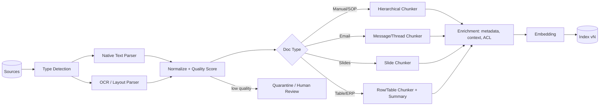

# Chunking strategy trade-offs for enterprise documents

> [← Back to Interview Preparation Home](interview-index.md)

## 1. Brief Summary

### Definition
**Chunking** is splitting source documents into smaller units (chunks) that are embedded, indexed, and retrieved for LLM context. A **chunking strategy** defines how boundaries, sizes, overlaps, and metadata are chosen.

### Why it matters
Chunking directly controls retrieval precision/recall, answer completeness, token cost, and citation quality. Poor chunking is among the top causes of weak RAG performance in enterprise settings with PDFs, tables, contracts, and slide decks.

### Core concepts and terminology
- **Fixed-size chunking** (characters/tokens) with **overlap**.
- **Recursive / structure-aware chunking** (headings, paragraphs, sentences).
- **Semantic chunking** (split where embedding similarity drops).
- **Hierarchical / parent-child (small-to-big)**: retrieve small chunks, return larger parent.
- **Sentence-window retrieval**, **late chunking**, **contextual retrieval** (prepend document/section context to each chunk).
- **Layout-aware parsing / OCR**, table extraction, **metadata enrichment** (title, section path, author, version, ACL).
- **Token budget**, **top-k**, **context stuffing**, **lost in the middle**.

### How it works
1. Parse the file into structured elements (title, headings, paragraphs, tables, lists, figures).
2. Normalize (remove headers/footers, fix hyphenation, preserve table structure).
3. Split according to the strategy while respecting structure.
4. Attach metadata and optional context headers.
5. Embed and index; evaluate retrieval; iterate.

### Where it is used
Policy and contract search, technical manuals, financial reports, support knowledge bases, code and ticket archives, email and chat corpora.

### Important tools
Azure AI Document Intelligence, Azure AI Search skillsets (Text Split), Unstructured, LlamaParse, LangChain text splitters, LlamaIndex node parsers, Docling, Apache Tika, spaCy/NLTK, tiktoken.

### Common misconceptions
- "One size (e.g., 512 tokens) fits all documents."
- "Larger chunks are always better because they provide more context" — they dilute embeddings and cost more tokens.
- "Overlap fixes everything" — it increases redundancy and index size.
- "Embedding quality alone drives retrieval" — parsing/chunking often matters more.

### Key points to remember
- Chunk by **meaning and structure first**, size second.
- Tune with **evaluation data**, not intuition.
- Tables, lists, and cross-references need special handling.
- Store enough metadata for filtering, citations, and ACLs.
- Treat chunking config as versioned; changes require reindexing.

---

## 2. Interview Questions

### Beginner Questions

**Q1. What is chunking and why is it needed?**
- **Model answer:** Splitting documents into smaller pieces so each can be embedded and retrieved independently. LLM context and embedding models have limits, and focused chunks improve retrieval precision and reduce token cost.
- **Key points expected:** Context limits, relevance, cost.
- **Mistake to avoid:** Saying chunking is only required because of token limits.

**Q2. What is chunk overlap?**
- **Model answer:** Repeating a portion (e.g., 10–20%) of text between adjacent chunks so ideas spanning a boundary are not lost.
- **Key points expected:** Prevents boundary loss; costs storage and duplicates.
- **Mistake to avoid:** Using large overlaps by default.

**Q3. Name three chunking strategies.**
- **Model answer:** Fixed-size, recursive/structure-based (by headings/paragraphs), semantic chunking; also parent-child and sentence-window.
- **Key points expected:** Awareness of options and basic differences.
- **Mistake to avoid:** Naming only fixed-size.

**Q4. What happens if chunks are too small?**
- **Model answer:** They lose context (pronouns, definitions), may retrieve fragments, and require higher top-k, which increases noise and cost.
- **Key points expected:** Context loss, fragmentation.
- **Mistake to avoid:** Only mentioning storage.

**Q5. What happens if chunks are too large?**
- **Model answer:** Embeddings average many topics, lowering precision; prompts consume more tokens; irrelevant text distracts the model.
- **Key points expected:** Dilution, cost, noise.
- **Mistake to avoid:** Assuming bigger always improves answer quality.

**Q6. Why is metadata important for chunks?**
- **Model answer:** Enables filtering (department, date, version), access control, citations (page, section), and boosting authoritative sources.
- **Key points expected:** ACLs, citations, filters.
- **Mistake to avoid:** Storing only raw text.

**Q7. Why are PDFs hard to chunk?**
- **Model answer:** They are layout-based, not semantic; multi-column text, headers/footers, tables, scanned images, and broken reading order create noisy extraction.
- **Key points expected:** Parsing quality, OCR, reading order.
- **Mistake to avoid:** Assuming text extraction is reliable.

**Q8. What is a token and why measure chunk size in tokens?**
- **Model answer:** Tokens are model-specific units of text; model limits and cost are token-based, so token-based sizing aligns chunks with embeddings and prompt budgets.
- **Key points expected:** Tokenizers differ; characters are only a proxy.
- **Mistake to avoid:** Equating tokens with words.

### Intermediate Questions

**Q1. Compare fixed-size vs structure-aware chunking.**
- **Model answer:** Fixed-size is simple, uniform, and fast but splits mid-idea. Structure-aware uses headings/sections/paragraphs for coherent units but yields variable sizes and requires good parsing. For enterprise documents with clear structure, structure-aware with a max token cap and small overlap generally performs better.
- **Key technical considerations:** Max size fallbacks, heading path metadata, table handling.
- **Follow-up:** "How do you handle a 40-page section with no sub-headings?"

**Q2. Explain parent-child (small-to-big) retrieval.**
- **Model answer:** Index small child chunks (e.g., 150 tokens) for precise matching, but return the parent section (e.g., 800 tokens) to the LLM for context. It balances retrieval precision and answer completeness.
- **Key technical considerations:** Parent ID mapping, deduplication when multiple children map to one parent, token budget.
- **Follow-up:** "How do you decide parent size?"

**Q3. How do you chunk tables?**
- **Model answer:** Extract with layout-aware tools, keep the table intact where feasible, repeat header rows in each chunk when split, serialize to Markdown/HTML/JSON, and add a natural-language summary for retrieval. Store table title and caption as metadata.
- **Key technical considerations:** Row-level chunking for large tables, numeric precision, units.
- **Follow-up:** "How would you answer questions requiring aggregation across a large table?" (Hint: route to SQL/tooling instead of RAG.)

**Q4. What is contextual chunk enrichment?**
- **Model answer:** Prepending document title, section path, or an LLM-generated 1–2 sentence context to each chunk before embedding so isolated chunks remain interpretable (e.g., "From 2023 Travel Policy, Section 4: International travel…").
- **Key technical considerations:** Ingestion cost, consistency, avoiding hallucinated context.
- **Follow-up:** "When does the cost of LLM-generated context pay off?"

**Q5. How do you choose chunk size empirically?**
- **Model answer:** Build a golden Q/A set with source passages; test sizes (e.g., 200/400/800 tokens) and overlaps; measure recall@k, MRR, answer faithfulness/correctness, latency, and tokens per answer. Choose the knee of the curve and segment by document type.
- **Key technical considerations:** Use the same embedding/reranker; separate retrieval vs generation metrics.
- **Follow-up:** "What if results differ by document type?"

**Q6. How do you handle cross-references and definitions in contracts?**
- **Model answer:** Preserve clause numbers and hierarchy, include defined-term glossary chunks, resolve references where possible, add metadata linking clause→definitions, and retrieve neighboring clauses/parents.
- **Key technical considerations:** Graph-style links, multi-hop retrieval.
- **Follow-up:** "Would GraphRAG help here?"

**Q7. How do you handle versioned documents?**
- **Model answer:** Store version, effective date, and supersedes metadata; index only current versions by default or filter by effective date; keep history for audits; use document IDs plus chunk hash for incremental updates.
- **Key technical considerations:** Avoiding stale chunk retrieval, deletions.
- **Follow-up:** "How do you answer 'what was the policy in March 2022'?"

**Q8. How does chunking interact with reranking and top-k?**
- **Model answer:** Smaller chunks need higher top-k for coverage, then a reranker narrows to the best few; larger chunks reduce k but risk dilution. Retrieve more (e.g., 50) and rerank to 5–8.
- **Key technical considerations:** Reranker latency, token budget.
- **Follow-up:** "How would you set k dynamically?"

### Advanced Questions

**Q1. Your RAG gives incomplete answers for multi-part policy questions. Diagnose and redesign chunking.**
- **Model answer:** Likely the answer spans multiple chunks, and top-k fetched only one. Move to hierarchical chunking with section parents, add neighbor expansion, use query decomposition for multi-part questions, and increase top-k before reranking. Validate with questions requiring multi-chunk evidence.
- **Design considerations:** Token budget, ordering by document position, deduplication.
- **Trade-offs:** More context improves completeness but increases cost and distraction risk.
- **Follow-ups:** "How do you evaluate multi-hop completeness?"

**Q2. Design an ingestion pipeline for 10M heterogeneous documents (PDF, DOCX, PPTX, scanned images, emails).**
- **Model answer:** Staged pipeline: type detection → parser routing (native text vs OCR/Document Intelligence) → element normalization → type-specific chunkers (slides by slide, emails by thread/message, contracts by clause, spreadsheets by sheet/table) → enrichment → embed → index with version/ACL metadata. Use queues, idempotency by content hash, DLQ, and quality scoring (e.g., OCR confidence).
- **Design considerations:** Throughput, cost of OCR/LLM enrichment, PII handling, reprocessing.
- **Trade-offs:** Type-specific chunkers increase maintenance vs quality.
- **Follow-ups:** "How do you detect and quarantine poorly parsed documents?"

**Q3. How do you manage reindexing when you change the chunking strategy?**
- **Model answer:** Version the pipeline config; build a new index in parallel; run offline evaluation against golden queries; shadow production traffic; swap via alias; keep rollback. Use content hashes to skip re-parsing and re-embedding unchanged chunks when only boundaries change partially.
- **Design considerations:** Cost, time, storage duplication, evaluation gates.
- **Trade-offs:** Safety vs temporary double cost.
- **Follow-ups:** "Can you do it incrementally by document type?"

**Q4. Security: how can chunking choices affect data leakage?**
- **Model answer:** Chunks must inherit the parent's ACL; merging content from different permission scopes (e.g., email threads, slide decks with mixed sections) can leak. Context enrichment with LLM summaries may copy sensitive data into metadata. Prevent by chunking within permission boundaries, propagating ACLs, and scanning for PII before indexing.
- **Design considerations:** Section-level permissions, redaction, audit.
- **Trade-offs:** Finer permission boundaries yield smaller chunks and less context.
- **Follow-ups:** "How would you handle a document with section-level classification?"

**Q5. Compare semantic chunking vs structure-aware chunking in cost and quality.**
- **Model answer:** Semantic chunking requires embedding sentences and computing similarity breakpoints—more compute and variable behavior—but helps for unstructured prose. Structure-aware is cheaper, deterministic, and aligns to author intent. Evidence in practice is mixed; choose semantic only when it beats structure-aware on your evaluation set.
- **Design considerations:** Determinism, reproducibility, ingestion cost.
- **Trade-offs:** Marginal quality vs complexity.
- **Follow-ups:** "What threshold would you use and how would you tune it?"

**Q6. How would you chunk and retrieve for a mixed corpus requiring both lookup questions and summarization questions?**
- **Model answer:** Maintain multiple representations: fine-grained chunks for lookup; section/document summaries (RAPTOR-style hierarchy) for broad questions. A router chooses representation based on query type; for summarization, retrieve summaries or use map-reduce.
- **Design considerations:** Storage multiplication, summary freshness, hallucination in summaries.
- **Trade-offs:** Index cost vs coverage of question types.
- **Follow-ups:** "How do you keep summaries in sync with updates?"

**Q7. Latency and cost: the prompt is 12k tokens with 10 chunks per query. How do you reduce it?**
- **Model answer:** Rerank and keep top 4–5, compress/extract relevant sentences, reduce chunk size or use child retrieval, deduplicate near-duplicates, cache, and use prompt caching for static instructions. Measure answer quality after each change.
- **Design considerations:** Eval gating, sentence-level extraction models.
- **Trade-offs:** Lower context may harm recall for complex questions.
- **Follow-ups:** "How do you know a chunk wasn't needed?" (ablation analysis)

**Q8. Multilingual corpora: what changes in chunking?**
- **Model answer:** Tokenization differs; chunk size in tokens varies by language; sentence boundaries differ (CJK); use multilingual embeddings; detect language per chunk and store as metadata; avoid mixing languages within chunks.
- **Design considerations:** Language-specific analyzers for BM25, translation vs native retrieval.
- **Trade-offs:** Translation normalization simplifies but loses nuance and adds cost.
- **Follow-ups:** "Would you translate at ingestion or at query time?"

---

## 3. Use Cases

### Simple Use Case — HR handbook assistant
- **Problem:** Employees need answers from a 120-page HR handbook (PDF).
- **Assumptions:** Digital PDF with clear headings; ~150 questions available for testing.
- **Steps:**
  1. Extract text with a layout-aware parser.
  2. Split by headings, cap at 500 tokens, 50-token overlap.
  3. Prefix each chunk with section path (e.g., "Leave Policy > Parental Leave").
  4. Embed and index with page number metadata.
  5. Test with the 150 questions; adjust size.
- **Expected result:** Cited answers with page references; recall@5 > 90%.
- **Tools:** Azure Document Intelligence, LangChain splitters, Azure AI Search or pgvector.

### Intermediate Use Case — Contract analysis assistant
- **Scenario:** Legal team queries 8,000 vendor contracts for clauses (termination, liability, renewal).
- **Requirements:** Clause-level citations, accurate cross-references, contract metadata filters (vendor, date, jurisdiction).
- **Proposed solution:** Clause-aware chunking using numbering and headings; parent-child retrieval (clause child, section parent); defined-terms glossary chunk per contract; hybrid search + reranker.
- **Implementation steps:**
  1. Parse with Document Intelligence; detect clause numbering patterns.
  2. Chunk per clause; attach contract metadata and clause path.
  3. Create glossary chunk for definitions.
  4. Index with hybrid search; add reranker.
  5. Prompt requires clause citations and "not found" when absent.
- **Technical challenges:** Scanned legacy contracts, inconsistent numbering, amendments overriding clauses.
- **Expected result:** Lawyers find relevant clauses in seconds with traceable citations.
- **Testing approach:** Lawyer-labeled set of 200 questions; measure clause recall, citation accuracy; review amendment handling cases.

### Difficult Use Case — Enterprise-wide knowledge ingestion platform
- **Scenario:** A manufacturer ingests manuals, SOPs, ERP exports, emails, and slides (15M files) for a plant-operations copilot.
- **Functional requirements:** Type-aware chunking, tables and diagrams handling, multilingual, incremental updates, ACL propagation.
- **Non-functional requirements:** Ingest 500k docs/day backlog clearing in 30 days; reprocess ability; auditability; cost controls; p95 query < 3 s.

**Proposed architecture**

**Components and responsibilities**
- **Type detection and parsers:** choose cheapest adequate parser.
- **Normalizer/quality scorer:** strip boilerplate; score OCR confidence.
- **Type-specific chunkers:** encode domain structure.
- **Enrichment:** metadata, section paths, optional LLM context (budgeted).
- **Index with versioning:** supports blue/green swaps.
- **Quarantine:** prevents bad content from polluting retrieval.

**Processing flow:** event → queue → parse → normalize → chunk → enrich → embed → upsert; deletions propagate via tombstone events.

**Security:** ACL inheritance at chunk level; PII scanning and redaction pre-embedding; encryption; least-privilege service identities; audit of ingestion changes.

**Performance/scalability:** Horizontal workers with autoscaling on queue depth; content-hash dedupe; batch embedding; OCR only for scanned pages; priority lanes for fresh content; backfill throttling to protect source systems.

**Monitoring:** Ingestion throughput and lag, parse failure rates, quality score distribution, chunk size histograms, retrieval canaries, cost per 1k documents.

**Failure scenarios and recovery**
- Parser crash on malformed file → retry then DLQ with file reference.
- Embedding rate limit → exponential backoff, multi-deployment pool.
- Bad chunker release → pipeline version rollback; reindex affected types only.
- Index corruption → rebuild from canonical chunk store.

**Trade-offs and alternatives**
- Type-specific chunkers maximize quality but increase maintenance; alternative is generic layout-aware chunker for 80% and custom for top document types.
- LLM contextualization improves retrieval but may add significant cost; apply to high-value corpora only.
- Alternative: skip chunking for small docs and index whole-document summaries plus sections.
