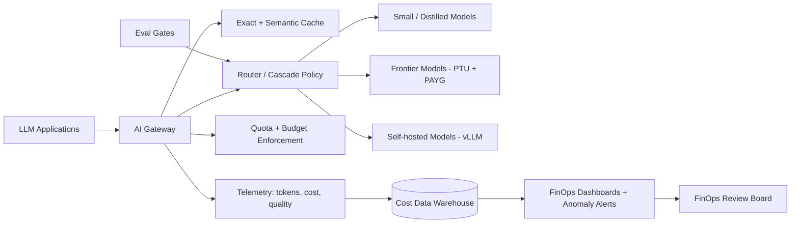

# Cost optimization for LLM applications at scale

> [← Back to Interview Preparation Home](interview-index.md)

## 1. Brief Summary

### Definition
**LLM cost optimization** is the discipline of reducing the total cost of running LLM-powered applications — tokens, compute, retrieval, storage, evaluation, and operations — while preserving required quality, latency, and safety. At scale (millions of requests/day), small per-request inefficiencies compound into six- or seven-figure annual costs.

### Why it matters
LLM costs scale linearly (or worse, with agent loops) with usage, unlike many traditional workloads. Unit economics (cost per conversation, per document, per resolved ticket) determine whether a product is viable. Cost is also a design constraint that shapes architecture.

### Core concepts and terminology
- **Tokens:** input (prompt) vs output (completion) tokens; output usually costs 2–5x more per token; **cached input tokens** are discounted.
- **Context window inflation:** long histories and many retrieved chunks.
- **Pricing models:** pay-as-you-go, **provisioned throughput units (PTU)**, batch API (~50% discount), reserved GPUs, spot instances.
- **Techniques:** prompt compression, **prompt caching**, **semantic caching**, **model routing/cascading**, **distillation**, **fine-tuning smaller models**, **quantization** (INT8/INT4/FP8), **speculative decoding**, **continuous batching**, **KV-cache** management, **output length limits**, **structured outputs**, **RAG top-k tuning**, **reranking** to reduce context, **batching** of offline tasks.
- **FinOps for AI:** tagging, showback/chargeback, budgets, anomaly alerts, unit economics.
- **Quality–cost Pareto frontier.**

### How it works
1. **Measure** cost per request/feature/tenant with traces (tokens × price + infra).
2. **Identify** top cost drivers (long prompts, expensive models for easy tasks, retries, agent loops, duplicate queries).
3. **Apply levers** in order of ROI and risk: caching → prompt trimming → routing → batch → smaller/distilled models → self-hosting/optimized serving.
4. **Validate** each change on the evaluation suite to avoid quality regression.
5. **Govern**: budgets, quotas, alerts, and periodic review.

### Where it is used
High-volume support bots, document processing pipelines, code assistants, search/RAG, agentic workflows, SaaS products embedding AI features.

### Important tools and platforms
Azure OpenAI (PTU, batch, prompt caching), OpenAI/Anthropic prompt caching and batch APIs, Azure API Management AI Gateway (token limits, semantic caching), LiteLLM, Helicone, Langfuse, Azure Cost Management, vLLM, TensorRT-LLM, LLMLingua (prompt compression), GPTCache/Redis semantic cache, RouteLLM.

### Common misconceptions
- "Switch to the cheapest model" — poor quality increases retries, escalations, and human cost.
- "Self-hosting is automatically cheaper."
- "Caching is risky and unnecessary" — safe exact/prompt caching is often the first, cheapest win.
- "Cost optimization is a one-time exercise."

### Key points to remember
- **Measure unit economics first**; optimize the biggest drivers.
- Biggest levers: **right-size the model per task, reduce tokens, cache, batch, and prevent runaway loops**.
- Always check quality with evaluation after each optimization.
- Include people and platform costs in TCO.

---

## 2. Interview Questions

### Beginner Questions

**Q1. What drives the cost of an LLM API call?**
- **Model answer:** Mostly the number of input and output tokens times model-specific prices; also model choice, context length, and extra calls (retries, tool loops, embeddings, reranking).
- **Key points expected:** Input vs output tokens, model tier.
- **Mistake to avoid:** Saying cost depends only on request count.

**Q2. Why are output tokens typically more expensive than input tokens?**
- **Model answer:** Output tokens are generated sequentially (autoregressive decode) and are compute/latency-intensive, whereas input tokens are processed in parallel during prefill.
- **Key points expected:** Prefill vs decode.
- **Mistake to avoid:** No explanation of why.

**Q3. Name three ways to reduce token usage.**
- **Model answer:** Shorten system prompts, retrieve fewer/more relevant chunks (rerank), summarize conversation history, limit max output tokens, and use concise output formats.
- **Key points expected:** Practical and varied.
- **Mistake to avoid:** Removing instructions without testing quality.

**Q4. What is prompt caching?**
- **Model answer:** Providers reuse computation for repeated prompt prefixes (e.g., long system prompts), charging less and reducing latency for cached tokens. Structure prompts with static content first.
- **Key points expected:** Prefix-based; static first.
- **Mistake to avoid:** Confusing with response caching.

**Q5. What is model routing?**
- **Model answer:** Directing each request to the cheapest model capable of handling it, e.g., a small model for simple queries and a large model for complex ones.
- **Key points expected:** Task-based selection.
- **Mistake to avoid:** Routing without evaluating quality per route.

**Q6. What is the batch API and when do you use it?**
- **Model answer:** An asynchronous interface that processes large numbers of requests within hours at a discount (often ~50%). Suitable for non-interactive jobs like classification, summarization of archives, or evaluation runs.
- **Key points expected:** Non-real-time, discount.
- **Mistake to avoid:** Using it for interactive chat.

**Q7. Why set max_tokens?**
- **Model answer:** To cap output length, controlling cost and latency and preventing runaway generations.
- **Key points expected:** Guardrail for cost.
- **Mistake to avoid:** Setting too low and truncating answers.

**Q8. What is FinOps in the AI context?**
- **Model answer:** Financial operations practices for cloud/AI spend: tagging, budgets, showback/chargeback, forecasting, and optimization with engineering and finance collaboration.
- **Key points expected:** Visibility, accountability.
- **Mistake to avoid:** Treating it as only cost cutting.

### Intermediate Questions

**Q1. How would you build a model cascade (routing) and prove it saves money without hurting quality?**
- **Model answer:** Define task categories and difficulty signals; start with a small model, evaluate with confidence signals (logprobs, validators, self-check, classifier); escalate uncertain/complex queries to a larger model. Measure on a labeled set: accuracy, escalation rate, cost per request, and latency vs the always-large baseline; then A/B online. Track router errors (false-easy) as a key metric.
- **Key technical considerations:** Router latency overhead, calibration, drift in query mix.
- **Follow-up:** "What would you do if the router misclassifies high-risk queries?"

**Q2. Explain semantic caching and its risks.**
- **Model answer:** Store responses keyed by query embedding; return cached answer if similarity exceeds a threshold. Saves cost for repeated/similar questions. Risks: serving wrong answers for subtly different queries, stale data, cross-user leakage of personalized content. Mitigate with high thresholds, scoping by tenant/user/permissions, TTLs, cache only deterministic FAQ-style content, and including key entities in the cache key.
- **Key technical considerations:** Hit-rate vs correctness, invalidation on content updates.
- **Follow-up:** "How would you measure false cache hits?"

**Q3. How can RAG be tuned to reduce cost?**
- **Model answer:** Tune chunk size and top-k, use reranking to send fewer but better chunks, compress or extract relevant sentences, deduplicate, use hybrid retrieval to improve precision, cache embeddings and retrieval results, and use small models for query rewriting.
- **Key technical considerations:** Recall vs token cost; evaluate answer quality at each k.
- **Follow-up:** "How do you find the knee in the cost-quality curve?"

**Q4. When does PTU/provisioned throughput make sense over pay-as-you-go?**
- **Model answer:** With steady high baseline traffic and latency SLO needs; the fixed capacity cost is lower than the equivalent token spend at high utilization. Not for spiky/low-volume workloads. A mixed approach: PTU for baseline, PAYG overflow via gateway spillover.
- **Key technical considerations:** Utilization monitoring, commitment term, regional capacity.
- **Follow-up:** "How do you size PTU?"

**Q5. What are cost implications of agents and how do you control them?**
- **Model answer:** Agents loop and accumulate context, multiplying tokens. Controls: step/token budgets, loop detection, summarizing memory, cheaper models for sub-steps, caching tool results, deterministic code for stable steps, and cost circuit breakers per task.
- **Key technical considerations:** Cost per task trace, anomaly alerts.
- **Follow-up:** "How do you decide whether an agent is worth its cost versus a workflow?"

**Q6. How would you implement cost attribution across teams?**
- **Model answer:** Route all calls through a gateway that attaches team/app/tenant tags from authenticated identity; record tokens and model per request; compute cost using price tables; store in a data warehouse; dashboards for showback/chargeback; budgets and alerts.
- **Key technical considerations:** Shared infra costs allocation, streaming token counting, price changes.
- **Follow-up:** "How do you handle calls that bypass the gateway?"

**Q7. How does fine-tuning or distillation reduce cost?**
- **Model answer:** A smaller model tuned on high-quality outputs from a larger model can achieve comparable task performance at lower per-token cost and latency, and allows shorter prompts (no long few-shot examples). Requires labeled data, training, and ongoing maintenance.
- **Key technical considerations:** Break-even volume, quality regression, retraining cadence.
- **Follow-up:** "How many requests/month justify the effort?"

**Q8. How do quantization and batching help for self-hosted inference?**
- **Model answer:** Quantization (INT8/INT4/FP8) reduces memory and increases throughput, allowing larger batches or cheaper GPUs; continuous batching raises GPU utilization by interleaving requests. Together they cut cost per token, with possible small quality loss.
- **Key technical considerations:** Evaluate accuracy after quantization; latency vs throughput trade-offs.
- **Follow-up:** "What metrics tell you the GPU is underutilized?"

### Advanced Questions

**Q1. Your LLM spend grew 5x in a quarter while usage grew 2x. Investigate.**
- **Model answer:** Compare cost per request over time; break down by app, model, prompt version, tenant. Look for prompt bloat, increased top-k, new agent loops, retries on timeouts/429s, model upgrades to pricier tiers, loss of caching (prompt prefix changed), larger output lengths, or abuse. Use traces to find outliers (p99 token counts), fix root causes, add budgets/alerts and regression tests for token counts.
- **Design considerations:** Token-count assertions in CI, anomaly detection.
- **Trade-offs:** Tighter limits may harm legitimate heavy users.
- **Follow-ups:** "What guardrails prevent recurrence?"

**Q2. Design a cost-aware architecture for a customer-support assistant handling 5M conversations/month.**
- **Model answer:** Gateway with auth, quotas, caching; intent classifier (small model) to route FAQ to cached/templated answers, RAG for knowledge questions with small/medium model, escalate complex to large model; summarize history after N turns; prompt caching for static policies; batch processing for after-call summaries; PTU for baseline and PAYG for spikes; cost dashboards per queue; evaluation gates for every optimization.
- **Design considerations:** Latency SLOs, quality metrics (resolution rate), compliance.
- **Trade-offs:** Complexity of routing vs savings; risk of wrong deflection.
- **Follow-ups:** "How would you model monthly cost under different mixes?"

**Q3. Self-hosting vs API: provide a rigorous cost comparison approach.**
- **Model answer:** Benchmark candidate open models on your prompts for quality; measure throughput (tokens/s/GPU) with vLLM at target latency; compute required GPUs at peak with redundancy; add utilization inefficiency, ops staff, storage/network, licensing; compare with API cost at forecast volumes including discounts (batch, caching, PTU). Perform sensitivity on volume, GPU price, and utilization; include opportunity cost and risk.
- **Design considerations:** Autoscaling granularity, GPU scarcity, upgrade path.
- **Trade-offs:** CapEx/commitment vs flexibility; control vs time-to-market.
- **Follow-ups:** "At what point would you revisit the decision?"

**Q4. Describe prompt-structure design for maximum cache hit rate.**
- **Model answer:** Place stable content (system instructions, tool definitions, static documents) at the start; variable content (user query, retrieved chunks) at the end; avoid timestamps/IDs in the prefix; keep ordering deterministic; meet minimum cache-length thresholds (e.g., 1024 tokens); monitor cached-token ratio; consider cache TTL behavior.
- **Design considerations:** Tool definition ordering changes break cache; multi-tenant prompts.
- **Trade-offs:** Prompt design constraints vs readability and flexibility.
- **Follow-ups:** "How do you detect cache invalidation regressions?"

**Q5. How do you balance cost reduction with quality in a regulated setting?**
- **Model answer:** Tier use cases by risk; for high-risk keep stronger models and human review but optimize around them (caching of retrieval, prompt trimming); for low-risk apply aggressive routing. Maintain evaluation gates and documented approvals for model changes. Track quality SLOs alongside cost SLOs.
- **Design considerations:** Change management evidence, rollback plans.
- **Trade-offs:** Savings potential limited by assurance requirements.
- **Follow-ups:** "How do you prove to auditors that a cheaper model is equivalent?"

**Q6. Design budget enforcement and abuse protection for a multi-tenant SaaS.**
- **Model answer:** Per-tenant token quotas and rate limits at the gateway; hard and soft budgets with alerts; per-request max tokens and context; detection of anomalous usage (spikes, repeated large prompts); graceful degradation (smaller model, queueing) before denial; usage-based billing or tiers; bot protection.
- **Design considerations:** Accurate real-time token accounting (streaming), fairness across tenants.
- **Trade-offs:** Strict limits harm UX; generous limits risk spend.
- **Follow-ups:** "How do you charge back cost for premium features?"

**Q7. How would you reduce latency and cost simultaneously for a long-document summarization pipeline?**
- **Model answer:** Map-reduce with small model for chunk summaries and larger model for final synthesis; parallelize chunks; batch API for non-urgent; skip unchanged sections via hashing; extractive pre-filtering; structured outputs to limit verbosity; caching summaries per document version.
- **Design considerations:** Information loss in map phase, consistent style.
- **Trade-offs:** Quality of hierarchical summaries vs single long-context call cost.
- **Follow-ups:** "When does long-context single-pass beat map-reduce?"

**Q8. What KPIs would you put on an executive cost dashboard for LLM operations?**
- **Model answer:** Cost per successful outcome (resolved ticket, processed document), tokens per request, cached-token ratio, model mix, cost by team/feature, GPU utilization, PTU utilization, retry/error rate, budget burn vs forecast, quality SLO adherence.
- **Design considerations:** Link cost to value metrics; leading indicators.
- **Trade-offs:** Too many metrics reduce clarity.
- **Follow-ups:** "Which KPI would trigger action first?"

---

## 3. Use Cases

### Simple Use Case — Trimming a bloated prompt
- **Problem:** An FAQ bot sends a 3,500-token system prompt with 10 few-shot examples for each request.
- **Assumptions:** 200k requests/month; static prompt; quality baseline measured on 150 test questions.
- **Steps:**
  1. Reorder prompt so static content is first for caching.
  2. Reduce few-shot examples to 3 after evaluating quality.
  3. Cap `max_tokens` and request concise answers.
  4. Re-run evaluation and compare cost/quality.
- **Expected result:** 40–60% token cost reduction with unchanged accuracy.
- **Tools:** Azure OpenAI prompt caching, promptfoo, Azure Cost Management.

### Intermediate Use Case — Model routing for support tickets
- **Scenario:** A SaaS company classifies and drafts replies to 1M tickets/month using a large model.
- **Requirements:** Cut cost 50%, keep CSAT stable, p95 < 4 s.
- **Proposed solution:** Cascade: small model handles classification and simple replies; large model handles low-confidence/complex tickets; semantic cache for common questions; batch API for nightly summaries.
- **Implementation steps:**
  1. Label 2,000 tickets with complexity and quality ratings.
  2. Train a lightweight complexity classifier; define confidence threshold.
  3. Evaluate both models per class; pick threshold at the cost-quality knee.
  4. Implement in gateway; A/B test.
  5. Add dashboards for cost per ticket and escalation rate.
- **Technical challenges:** Router mistakes on edge cases, stale cache, evaluation of draft quality.
- **Expected result:** ~50–65% savings with CSAT within ±1%.
- **Testing approach:** Offline comparison, shadow traffic, online A/B with CSAT and resolution time guardrails.

### Difficult Use Case — Enterprise AI cost governance and optimization program
- **Scenario:** A global retailer runs 30 LLM apps, spending $1.8M/month, forecast to double.
- **Functional requirements:** Cost visibility per app/team, automated optimizations, budgets and showback, safe routing across model providers.
- **Non-functional requirements:** No quality regressions on tier-1 apps, 99.9% availability, vendor flexibility, audit trail of changes.

**Proposed architecture**

**Components and responsibilities**
- **Gateway:** single control point for identity, tagging, quotas, caching, retries.
- **Cache:** exact and semantic with tenant scoping and TTL.
- **Router:** policy-driven model selection per app/tier, with evaluated fallbacks.
- **Capacity tiers:** PTU baseline, PAYG burst, self-hosted for steady high-volume simple tasks.
- **Telemetry & warehouse:** cost per request, joined with quality and business metrics.
- **Evaluation gates:** validate each optimization before rollout.

**Processing flow:** request → authenticate/tag → cache check → routing → model call → telemetry → budget update → response.

**Security:** Cache isolation by tenant and permissions, PII scrubbing before caching, signed price tables, least-privilege access to billing data, DLP at gateway.

**Performance/scalability:** Gateway horizontally scaled; async telemetry; spillover from PTU to PAYG; GPU autoscaling with queue-aware batching; cache in Redis cluster.

**Monitoring:** Cost per outcome, cached-token ratio, utilization of PTU/GPUs, router escalation rate, budget burn, anomaly detection on tokens per request, quality SLOs.

**Failure scenarios and recovery**
- Cache poisoning/incorrect hit → purge namespace, tighten threshold, add validation.
- PTU saturation → spillover to PAYG, shed low-priority traffic.
- Router outage → default to safe mid-tier model.
- Provider outage → fallback model route with prevalidated prompts.

**Trade-offs and alternatives**
- Aggressive caching/routing yields savings but risks quality incidents; use risk-tiered policies.
- Self-hosting for high-volume tasks saves unit cost but adds ops burden; alternative: negotiated enterprise discounts and PTU.
- Central gateway is a single point of failure; mitigate with multi-region HA and bypass-safe mode.
