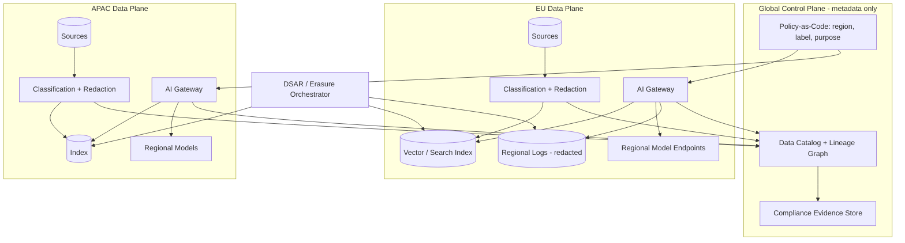

# Data governance for AI systems (PII, residency, lineage)

> [← Back to Interview Preparation Home](interview-index.md)

## 1. Brief Summary

### Definition
**Data governance for AI systems** is the set of policies, roles, processes, and technical controls that ensure data used to train, tune, ground, prompt, and evaluate AI is lawful, high quality, secure, traceable, and appropriately handled across its lifecycle. This topic centers on three pillars:
- **PII (personally identifiable information) protection:** identifying, minimizing, masking, and controlling personal and sensitive data.
- **Data residency / sovereignty:** controlling the geographic location and jurisdiction where data is stored and processed.
- **Lineage:** tracking where data came from, how it was transformed, and where it was used (datasets → features → embeddings → models → outputs).

### Why it matters
AI amplifies governance risk: prompts, logs, embeddings, vector indexes, fine-tuning sets, and caches all can contain personal data. Regulations (GDPR, CCPA/CPRA, HIPAA, EU AI Act, PIPL, data localization laws) impose strict obligations, and failures lead to fines, breaches, and loss of trust.

### Core concepts and terminology
- **PII categories:** direct identifiers, quasi-identifiers, sensitive personal data (health, biometric, financial), **PHI**.
- **Techniques:** data minimization, classification & labeling, **pseudonymization**, anonymization, tokenization, masking/redaction, differential privacy, synthetic data, encryption (at rest/in transit/in use), CMK/BYOK.
- **Residency vs sovereignty vs localization:** where data resides vs who has legal jurisdiction over it vs mandates to keep it in-country.
- **Lineage:** upstream/downstream tracing, provenance, data contracts, model/data cards, **OpenLineage**, **dataset/versioning**.
- **Controls:** RBAC/ABAC, row/column-level security, purpose limitation, consent management, retention and deletion, DSAR (data subject access requests), **right to erasure**, audit logging.
- **AI-specific data surfaces:** training/fine-tuning data, RAG corpora, embeddings (can leak info), prompts/completions, conversation memory, traces/logs, caches, evaluation sets.

### How it works
1. **Discover & classify** data (scanners, labels, sensitivity tiers).
2. **Define policy** by use case (allowed purposes, residency, retention, who/what may access).
3. **Enforce technically**: access control, DLP, redaction at ingestion and at prompt time, regional deployments, encryption keys, network isolation.
4. **Track lineage** across pipelines into AI artifacts (indexes, models, evaluations).
5. **Monitor & audit**: access logs, policy violations, data quality metrics.
6. **Handle lifecycle events**: retention expiry, deletion requests, incident response.

### Where it is used
Healthcare, finance, insurance, public sector, HR, retail personalization, any enterprise RAG/copilot.

### Important tools and frameworks
Microsoft Purview (classification, sensitivity labels, DLP, lineage, data map), Azure Policy, Defender for Cloud, Azure AI Language PII detection, Microsoft Presidio, Unity Catalog / Databricks lineage, OpenLineage/Marquez, Collibra, Alation, Immuta, BigID, Azure Key Vault/Managed HSM, Azure Confidential Computing; frameworks: GDPR, HIPAA, ISO 27001/27701/42001, NIST Privacy Framework, DAMA-DMBOK.

### Common misconceptions
- "Embeddings are anonymous" — they can be inverted or leak information.
- "If it's in a private tenant, governance is solved."
- "Deleting the source file deletes it from the AI system" — indexes, caches, logs, and trained weights may persist.
- "Residency only concerns storage" — processing, logging, backups, support access, and telemetry matter too.

### Key points to remember
- Govern **every AI data surface**, including logs, caches, and embeddings.
- **Minimize and redact early**; enforce least privilege at retrieval time.
- Design **deletion and lineage** into pipelines from day one.
- Residency must cover **storage + inference + telemetry + backups + admin access**.

---

## 2. Interview Questions

### Beginner Questions

**Q1. What is PII and give examples.**
- **Model answer:** Information that can identify a person directly (name, SSN, email, phone) or indirectly (combination of zip code, birth date, gender). Sensitive categories include health and biometric data.
- **Key points expected:** Direct vs quasi-identifiers.
- **Mistake to avoid:** Considering only names and emails.

**Q2. What is data residency?**
- **Model answer:** Requirement or choice that data be stored and processed in specific geographic locations or jurisdictions, often to meet legal, contractual, or sovereignty needs.
- **Key points expected:** Location + processing.
- **Mistake to avoid:** Limiting to storage location.

**Q3. What is data lineage?**
- **Model answer:** A record of data's origin, transformations, and destinations, enabling traceability, impact analysis, and auditability.
- **Key points expected:** Source-to-consumption tracking.
- **Mistake to avoid:** Confusing lineage with simple logging.

**Q4. Why is governance harder with generative AI?**
- **Model answer:** Unstructured data, prompts that may include arbitrary PII, embeddings and vector stores, third-party model providers, logs of conversations, and outputs that can reveal sensitive info.
- **Key points expected:** New data surfaces.
- **Mistake to avoid:** Treating GenAI governance as identical to database governance.

**Q5. What is data minimization?**
- **Model answer:** Collecting and using only the data necessary for a defined purpose, reducing exposure and compliance burden.
- **Key points expected:** Purpose limitation, GDPR principle.
- **Mistake to avoid:** Collecting everything "just in case."

**Q6. What is the difference between anonymization and pseudonymization?**
- **Model answer:** Anonymization irreversibly removes the ability to identify individuals (no longer personal data). Pseudonymization replaces identifiers with tokens, reversible with a separate key, and still counts as personal data under GDPR.
- **Key points expected:** Reversibility and legal status.
- **Mistake to avoid:** Treating hashed emails as anonymous.

**Q7. What is the right to erasure?**
- **Model answer:** A GDPR right allowing individuals to request deletion of their personal data when certain conditions apply. Systems must locate and delete data across stores, including derived copies.
- **Key points expected:** Applies to derived data too.
- **Mistake to avoid:** Forgetting indexes/backups.

**Q8. What is a data classification label?**
- **Model answer:** Metadata tag indicating data sensitivity (Public, Internal, Confidential, Restricted) that drives access and handling policies.
- **Key points expected:** Policy enforcement driver.
- **Mistake to avoid:** Seeing labels as documentation only.

### Intermediate Questions

**Q1. Where can PII appear in a RAG application and how do you control it?**
- **Model answer:** Source documents, chunks, embeddings, vector index metadata, user prompts, retrieved context, model outputs, conversation memory, caches, traces/logs, evaluation datasets. Controls: classify at ingestion; redact or exclude sensitive fields; apply ACL/security trimming at retrieval; PII detection on prompts/outputs; log redaction; retention limits; encryption; access controls on observability data.
- **Key technical considerations:** Redaction vs utility trade-off; re-identification risk via context.
- **Follow-up:** "How would you handle documents where PII is essential to the task?"

**Q2. How do you implement PII redaction in an LLM pipeline?**
- **Model answer:** Use detection (Presidio, Azure AI Language PII, regex + NER) before sending data to the model; replace with reversible tokens (e.g., `<PERSON_1>`) stored in a secure vault map; call the LLM; detokenize output only for authorized users. Evaluate precision/recall; combine rules with ML; handle multilingual text.
- **Key technical considerations:** False negatives are risky; consistent tokenization preserves coherence.
- **Follow-up:** "How would you measure PII detection recall?"

**Q3. How do you ensure data residency for an Azure OpenAI-based solution?**
- **Model answer:** Choose regional (not global) deployment types or Data Zone deployments in compliant regions; deploy Azure AI Search, storage, and databases in the same geography; keep logs/telemetry in-region (Log Analytics workspace region); verify backup/geo-replication pairs; control support access (Customer Lockbox); use Azure Policy to restrict allowed regions.
- **Key technical considerations:** Global deployments may process data anywhere; failover regions must also comply.
- **Follow-up:** "What residency gaps could remain even with regional deployment?"

**Q4. How do you implement lineage for AI artifacts?**
- **Model answer:** Capture dataset versions and transformations via a catalog (Purview/Unity Catalog/OpenLineage); record chunking/embedding config and source document IDs in index metadata; tag models/adapters with training dataset versions; log prompt/model/index versions in traces; maintain a registry linking artifacts. This enables impact analysis ("which models used this dataset?") and audit.
- **Key technical considerations:** Granularity (document vs chunk), automation, performance overhead.
- **Follow-up:** "How would you answer 'which answers used document X?'"

**Q5. How do you handle data subject deletion requests in a RAG system?**
- **Model answer:** Maintain mapping from person/document to chunk IDs; delete from source, vector index, caches, derived summaries, and logs within SLA; propagate through CDC tombstones; reindex if necessary; verify via audit queries; document exceptions (legal holds). For fine-tuned models, avoid training on personal data when possible or retrain/unlearn on schedule.
- **Key technical considerations:** Backups retention, eventual consistency, embeddings caches.
- **Follow-up:** "What do you do about data already in a trained model?"

**Q6. What is purpose limitation and how do you enforce it in AI?**
- **Model answer:** Data collected for one purpose can't be freely reused for another. Enforce with tagged datasets and policy engines (ABAC) that check intended use before granting access to training, RAG, or analytics pipelines; maintain records of processing activities; require approvals for new uses.
- **Key technical considerations:** Technical enforcement vs paper policy.
- **Follow-up:** "Can customer support transcripts be used to fine-tune a model?"

**Q7. How do access controls work for enterprise RAG?**
- **Model answer:** Propagate source ACLs to the index (group IDs per chunk), resolve user entitlements at query time, apply security filters before retrieval, and fail closed. Alternatively query source system with user token (on-behalf-of). Audit logs record what was retrieved.
- **Key technical considerations:** Group-overage, ACL sync lag, nested groups.
- **Follow-up:** "How would you test for ACL leakage?"

**Q8. What governance applies to evaluation and test datasets?**
- **Model answer:** They often contain real prompts/PII; apply minimization, anonymization, restricted access, retention limits, and consent considerations; label sensitivity; avoid copying production data to dev without masking.
- **Key technical considerations:** Synthetic data generation, secure sandboxes.
- **Follow-up:** "How would you create realistic but safe test data?"

### Advanced Questions

**Q1. Design a governance architecture for a global enterprise copilot with EU, US, and APAC data.**
- **Model answer:** Regional data planes (index, storage, model endpoints, logs) with a global control plane limited to metadata/policy; user routing to home region; classification via Purview; policy-as-code (Azure Policy/OPA) enforcing region and label rules; PII redaction at ingestion; CMK per region; cross-region queries disallowed or federated with strict policy; lineage via catalog; DSAR workflows per region.
- **Design considerations:** Telemetry location, support access, cross-border transfers (SCCs), failover pairing.
- **Trade-offs:** Duplicated infrastructure and operational cost vs compliance; global knowledge sharing limited.
- **Follow-ups:** "How do you handle a multinational user traveling between regions?"

**Q2. A regulator asks you to demonstrate that a customer's data was not used to train any model. How do you respond?**
- **Model answer:** Present lineage: dataset registry with source system, filters, consent/legal basis tags; model registry linking training datasets; immutable audit logs of data access for training jobs; contract/technical evidence that provider doesn't train on prompts; negative proof via inclusion queries on dataset hashes. Gaps highlight need for lineage-by-design.
- **Design considerations:** Immutable evidence, dataset hashing, access logs.
- **Trade-offs:** Overhead of lineage capture vs auditability.
- **Follow-ups:** "What if lineage is missing for legacy models?"

**Q3. How would you mitigate PII leakage through embeddings and vector databases?**
- **Model answer:** Treat vectors as sensitive derived data: encrypt, access-control, restrict export; avoid embedding raw PII where not needed (redact/tokenize first); segregate indexes by sensitivity/tenant; evaluate inversion risks; apply deletion procedures; limit direct vector API exposure; and retain mapping to source for erasure.
- **Design considerations:** Utility loss from redaction, performance of per-tenant indexes.
- **Trade-offs:** Isolation and cost vs shared-index efficiency.
- **Follow-ups:** "How realistic is embedding inversion and what does research say?"

**Q4. Conversation memory for an agent stores user facts. What governance do you apply?**
- **Model answer:** Consent and transparency (users know what's stored), purpose limitation, retention TTL, user-visible memory controls (view/delete), encryption, per-user isolation, PII classification, avoidance of sensitive categories, and audit. Include memory in DSAR and erasure workflows.
- **Design considerations:** Memory poisoning/injection risk, cross-session leakage.
- **Trade-offs:** Personalization benefit vs privacy risk.
- **Follow-ups:** "How do you prevent one user's memory from leaking to another?"

**Q5. Implement a policy that "restricted data never leaves region X nor reaches external model providers." How do you enforce and verify it?**
- **Model answer:** Layered controls: data labels propagate to requests; gateway policy engine blocks routing of restricted labels to external endpoints; network egress deny rules; Azure Policy denying resources outside allowed regions; private endpoints only; DLP scanning at egress; periodic automated tests with canary restricted data; audit logs reviewed; attestations from vendors.
- **Design considerations:** Label accuracy, fail-closed behavior, shadow IT bypass.
- **Trade-offs:** Reduced model options and capabilities.
- **Follow-ups:** "How do you detect label misclassification?"

**Q6. How do you build automated lineage for a multi-stage pipeline (ingest → chunk → embed → index → answer)?**
- **Model answer:** Emit OpenLineage events from each stage (Airflow/Spark/ADF), assign stable IDs (document ID, version hash, chunk ID), store in lineage service (Marquez/Purview); in query traces include retrieved chunk IDs, index version, prompt/model version; build reverse lookups to find affected answers when a source is corrected or removed.
- **Design considerations:** Volume (chunk-level lineage can be huge), retention, privacy of lineage metadata.
- **Trade-offs:** Granularity vs storage/cost.
- **Follow-ups:** "When is document-level lineage sufficient?"

**Q7. Cross-border transfers: how do GDPR transfer rules affect AI vendor selection?**
- **Model answer:** Need lawful transfer mechanisms (adequacy, SCCs, DPF), transfer impact assessments, vendor subprocessors list, encryption and key control, regional processing options, and contractual restrictions on training use. Prefer in-region processing or customer-managed keys to reduce risk; document in DPIA.
- **Design considerations:** Support access from other regions, telemetry exports.
- **Trade-offs:** Vendor capability vs compliance burden.
- **Follow-ups:** "What if the vendor only offers global processing?"

**Q8. Explain how you would prove ongoing compliance (continuous governance).**
- **Model answer:** Policy-as-code and continuous controls monitoring (Defender for Cloud, Purview compliance manager), automated scans for unclassified data, drift alerts (resource in wrong region), periodic access reviews, DPIA updates on change, audit-ready dashboards, red-team/privacy tests, and incident drills.
- **Design considerations:** Evidence automation, ownership, exception management.
- **Trade-offs:** Tooling cost vs audit effort and risk.
- **Follow-ups:** "Which controls would you automate first?"

---

## 3. Use Cases

### Simple Use Case — Redacting PII before sending support tickets to an LLM
- **Problem:** Support tickets contain names, emails, and phone numbers; the team wants LLM-generated summaries without exposing PII.
- **Assumptions:** English text; summaries only; Azure OpenAI in-region.
- **Steps:**
  1. Run Presidio/Azure AI Language PII detection on ticket text.
  2. Replace entities with consistent placeholders; store mapping in an encrypted store.
  3. Send redacted text to the LLM.
  4. Detokenize in the UI for authorized agents only.
  5. Redact logs and set retention to 30 days.
- **Expected result:** Summaries produced without raw PII in model prompts or logs.
- **Tools:** Presidio, Azure AI Language, Azure OpenAI, Key Vault.

### Intermediate Use Case — EU-resident HR knowledge assistant with erasure support
- **Scenario:** A company in the EU builds an HR assistant using employee handbooks and case documents.
- **Requirements:** EU residency, role-based access, deletion of employee-related content on request within 30 days, lineage for audits.
- **Proposed solution:** Azure OpenAI (EU regional deployment), Azure AI Search with security filters, Purview classification, document-to-chunk mapping, and a deletion workflow.
- **Implementation steps:**
  1. Classify documents in Purview; exclude highly sensitive case files or restrict by group.
  2. Ingest with metadata (docId, owner, sensitivity, ACL, version).
  3. Configure region-locked resources via Azure Policy.
  4. Implement erasure workflow: lookup docId → delete chunks → purge cache → log completion.
  5. Capture lineage and trace IDs per answer.
- **Technical challenges:** ACL sync, backups retention, personal data in free-text fields.
- **Expected result:** Compliant assistant with demonstrable residency and deletion capability.
- **Testing approach:** ACL leakage tests, deletion verification (query should return nothing), residency audit of resources and log locations, DPIA review.

### Difficult Use Case — Global financial services AI data governance platform
- **Scenario:** A bank operates AI use cases (fraud copilots, advisor assistants, customer chatbots) across 20 countries with differing localization laws.
- **Functional requirements:** Central policy management, automated classification, PII redaction services, lineage across data/AI artifacts, DSAR automation, auditor evidence.
- **Non-functional requirements:** In-country processing for specific jurisdictions, 99.9% availability, evidence retention 7 years, low latency overhead (<150 ms for redaction), scalable to 100M interactions/day.

**Proposed architecture**

**Components and responsibilities**
- **Policy-as-code:** declares allowed regions, labels, purposes, and model destinations.
- **Classification/redaction services:** inline PII detection with tokenization and secure maps.
- **Regional data planes:** isolated storage, indexes, inference, logs.
- **Catalog & lineage:** end-to-end graph of datasets, indexes, models, and answers' provenance.
- **DSAR orchestrator:** executes access and erasure across stores.
- **Evidence store:** automated control attestations for auditors.

**Processing flow:** ingest → classify/redact → index with labels/ACLs → query via regional gateway → policy check → retrieval/generation → trace with lineage IDs → evidence export.

**Security:** CMK per region and tenant, Managed HSM, private networking, ABAC, break-glass access with approval, immutable audit logs, tokenization vault with strict access, secrets rotation.

**Performance/scalability:** Stateless redaction workers with autoscaling, GPU/CPU NER optimization, caching of classification results, partitioned indexes by region/business unit, async lineage emission via event streams.

**Monitoring:** Policy violation attempts, unclassified data volume, redaction recall sampling, deletion SLA compliance, cross-region traffic alerts, lineage completeness, access anomalies.

**Failure scenarios and recovery**
- Redaction service outage → fail closed (block requests with sensitive labels) or degrade to non-PII-only flows.
- Misclassified data discovered → quarantine index segments, re-run classification, notify DPO if incident criteria met.
- Regional outage → in-region secondary zone/pair that satisfies residency; no cross-border failover for restricted data.
- Lineage pipeline lag → buffer events in durable queue; reconcile nightly.

**Trade-offs and alternatives**
- Regional duplication increases cost but meets localization; alternative: sovereign cloud partner per country.
- Inline redaction adds latency; alternative: pre-redact at ingestion and restrict free-text prompts.
- Chunk-level lineage gives precise audits but is heavy; alternative: document-level lineage plus trace-level chunk IDs for sampled/high-risk flows.
