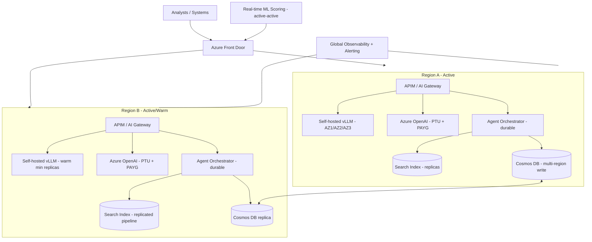

# High availability and DR for AI serving infrastructure

> [← Back to Interview Preparation Home](interview-index.md)

## 1. Brief Summary

### Definition
- **High availability (HA)** keeps AI services running despite component failures through redundancy, failover, and graceful degradation (minimizing downtime within a region/zone).
- **Disaster recovery (DR)** restores service after a major failure (regional outage, data corruption, cyberattack) according to defined **RTO** (recovery time objective) and **RPO** (recovery point objective).
- **AI serving infrastructure** includes model endpoints (managed APIs or self-hosted GPU clusters), gateways, retrieval layers (vector/search indexes), orchestration/agents, caches, queues, state stores, and supporting data pipelines.

### Why it matters
AI features increasingly sit on critical paths (customer support, operations, trading, clinical workflows). AI infrastructure has unique risks: GPU scarcity, quota/throttling limits, multi-minute model cold starts, large model artifacts, provider outages, and dependency chains (LLM + search + embedding + tools).

### Core concepts and terminology
- **SLA/SLO/SLI, error budget, RTO, RPO, MTTR.**
- **Redundancy patterns:** active-active, active-passive (hot/warm/cold standby), N+1, multi-AZ, multi-region.
- **Failover mechanics:** health probes, circuit breakers, retries with exponential backoff + jitter, load balancing (Front Door, Traffic Manager, APIM), bulkheads, rate limiting, load shedding, graceful degradation.
- **AI-specific:** model fallback chains (primary → secondary model/provider → smaller model → cached/static response), quota pooling across deployments/regions, **PTU spillover to PAYG**, GPU capacity reservations, model weight replication, warm pools, **cold start time**, KV-cache loss on failover, idempotency for generation requests, streaming reconnect.
- **State & data:** vector index replication/rebuild, conversation state stores, prompt/config registries, embeddings pipeline continuity.
- **Chaos engineering**, **game days**, **runbooks**.

### How it works
1. Define criticality tiers and RTO/RPO per service/use case.
2. Remove single points of failure at each layer (gateway, model, retrieval, state, identity, network).
3. Implement multi-AZ and multi-region patterns appropriate to tier.
4. Add health checks, automated failover, and degradation modes.
5. Replicate or rebuildable data (indexes, registries, weights).
6. Test regularly (failover drills, chaos tests), monitor, and refine.

### Where it is used
Customer-facing assistants, fraud/risk scoring, clinical decision support, contact-center AI, industrial and IoT inference, internal copilots with business-critical dependency.

### Important tools and platforms
Azure Front Door, Traffic Manager, Application Gateway, Azure API Management (backend pools, circuit breaker, load balancing across Azure OpenAI deployments), Azure OpenAI (regional/Data Zone/global deployments, PTU), AKS with GPU node pools & availability zones, Azure Site Recovery, Cosmos DB multi-region, Azure AI Search replicas/partitions, Azure Storage GRS/GZRS, Azure Chaos Studio, Kubernetes (PDBs, HPA/KEDA), KServe, vLLM, Ray Serve, Envoy/Istio.

### Common misconceptions
- "The provider's SLA means we're covered" — your composite availability is the product of dependencies, and quotas/throttling aren't outages but behave like them.
- "Multi-region = DR solved" — data, quotas, secrets, and runbooks must exist there too.
- "Models are stateless so DR is trivial" — weights, adapters, indexes, and configs must be present and warm.
- "Retry harder" — naive retries cause retry storms.

### Key points to remember
- Design for **graceful degradation**, not only failover.
- Count **quota and capacity** as availability concerns.
- **Rebuildable vs replicated** state decisions drive RPO/RTO and cost.
- **Test** failover; untested DR is a hypothesis.

---

## 2. Interview Questions

### Beginner Questions

**Q1. What is the difference between HA and DR?**
- **Model answer:** HA minimizes downtime from local failures (instance, zone) using redundancy; DR recovers from large-scale disasters (region loss) using backups/replicas in another location, measured by RTO and RPO.
- **Key points expected:** Scope, objectives.
- **Mistake to avoid:** Using the terms interchangeably.

**Q2. Define RTO and RPO.**
- **Model answer:** RTO: maximum acceptable time to restore service. RPO: maximum acceptable data loss measured in time.
- **Key points expected:** Business-driven targets.
- **Mistake to avoid:** Mixing them up.

**Q3. What is a single point of failure in an LLM application?**
- **Model answer:** Any component whose failure stops the service, e.g., a single model deployment, one region, a single vector DB node, or the gateway.
- **Key points expected:** Examples across layers.
- **Mistake to avoid:** Considering only the LLM.

**Q4. What is a circuit breaker?**
- **Model answer:** A pattern that stops calling a failing dependency after errors exceed a threshold, failing fast and periodically testing recovery to avoid cascading failures.
- **Key points expected:** Fail fast, protect resources.
- **Mistake to avoid:** Equating with simple retry.

**Q5. Why are rate limits (429) an availability concern?**
- **Model answer:** When quota is exhausted, requests fail even though the service is "up." Capacity planning, multiple deployments, and graceful throttling are needed.
- **Key points expected:** Quotas as capacity limits.
- **Mistake to avoid:** Treating 429s as client bugs only.

**Q6. What is graceful degradation?**
- **Model answer:** Reducing functionality while maintaining core service during failures, such as falling back to a smaller model, cached answers, or search-only results.
- **Key points expected:** Partial service better than none.
- **Mistake to avoid:** Binary up/down thinking.

**Q7. What is active-active vs active-passive?**
- **Model answer:** Active-active: multiple regions serve traffic simultaneously; faster failover, higher cost/complexity. Active-passive: standby is idle/warm until needed; cheaper, slower recovery.
- **Key points expected:** Trade-off awareness.
- **Mistake to avoid:** Claiming active-active is always best.

**Q8. Why is model cold start a DR concern?**
- **Model answer:** Large models take minutes to load into GPU memory; a failover target without warm replicas can't serve immediately.
- **Key points expected:** Warm capacity.
- **Mistake to avoid:** Ignoring weight transfer time.

### Intermediate Questions

**Q1. How do you build HA for Azure OpenAI usage?**
- **Model answer:** Deploy the same model in multiple regions/deployments; front with Azure API Management (backend pool with priority/weighting, circuit breaker on 429/5xx, retry-after handling); use PTU for baseline with PAYG spillover; use Data Zone/global deployment types where residency permits; monitor quotas; define model fallbacks.
- **Key technical considerations:** Region quota availability, data residency constraints, consistent content filter configs.
- **Follow-up:** "How do you handle a regional quota exhaustion during peak?"

**Q2. How do you architect HA for self-hosted LLM serving on Kubernetes?**
- **Model answer:** GPU node pools across availability zones, multiple replicas behind a service/mesh, pod disruption budgets, readiness probes that confirm model loaded, HPA/KEDA autoscaling on queue depth/GPU utilization, pre-pulled images and weights on fast storage (local NVMe cache), rolling updates with surge capacity, and capacity reservations for GPUs.
- **Key technical considerations:** Slow startup, tensor-parallel multi-GPU pods that must be co-scheduled, GPU quota.
- **Follow-up:** "How do you do a zero-downtime model update?"

**Q3. How do you design HA/DR for the RAG retrieval tier?**
- **Model answer:** Use replicas for query HA and partitions for scale; for DR either replicate (secondary service in paired region fed by same pipeline) or rebuild from canonical store with a known rebuild time. Keep the ingestion pipeline region-resilient; version indexes with aliases; backup config.
- **Key technical considerations:** Index rebuild time vs RTO, ACL sync in DR region.
- **Follow-up:** "How would you serve degraded results during rebuild?"

**Q4. Explain a model fallback strategy.**
- **Model answer:** Ordered chain: primary model → same model in another region → alternative provider/model → smaller model → cached/search-only response. Each fallback is pre-validated with the evaluation suite and prompt variants; gateway decides based on health/latency/error signals; flagged in telemetry.
- **Key technical considerations:** Output format compatibility, quality drop, cost differences.
- **Follow-up:** "How do you test fallbacks are actually usable?"

**Q5. How do you handle retries safely with LLMs?**
- **Model answer:** Exponential backoff with jitter, respect `Retry-After`, cap attempts, apply budgets, make operations idempotent, distinguish retriable (429/5xx/timeouts) from non-retriable (400/content filter), and avoid retrying non-idempotent tool actions blindly.
- **Key technical considerations:** Retry storms, duplicate charges, timeouts for long generations.
- **Follow-up:** "How would you prevent duplicate side effects in agents?"

**Q6. What state needs DR protection in an AI system?**
- **Model answer:** Conversation/session stores, user memory, prompt/config registry, model registry and weights/adapters, vector indexes (or their canonical sources), secrets/keys, evaluation datasets, observability configs, IaC. Define RPO per item.
- **Key technical considerations:** Cross-region replication consistency, key availability.
- **Follow-up:** "Which of these can be rebuilt instead of replicated?"

**Q7. How do you decide RTO/RPO for an AI feature?**
- **Model answer:** Assess business impact of downtime, fallback options (manual process, non-AI path), regulatory needs, and cost. Tiering: Tier 0 (revenue/safety critical) multi-region active-active; Tier 1 warm standby; Tier 2 backup/restore. Many AI features have non-AI fallbacks, relaxing targets.
- **Key technical considerations:** Business impact analysis, dependency mapping.
- **Follow-up:** "What's your approach when stakeholders demand zero downtime?"

**Q8. How do you test HA/DR?**
- **Model answer:** Failover drills in staging and production-like environments, chaos experiments (kill pods, block region endpoints, inject 429/latency), load tests during failure, backup restore tests, game days with runbooks, measure actual RTO/RPO, and track findings.
- **Key technical considerations:** Safe blast radius, observability during tests.
- **Follow-up:** "How often should you run full DR tests?"

### Advanced Questions

**Q1. Design a multi-region, active-active LLM gateway and serving tier with 99.99% availability.**
- **Model answer:** Global entry via Azure Front Door; regional API gateways (APIM) with stateless instances across AZs; backend pools of model deployments per region (PTU baseline + PAYG), self-hosted fallback; health probes including synthetic LLM calls; global rate limiting; state in multi-region store (Cosmos DB); retrieval indexes replicated per region; configuration via GitOps; secrets/keys replicated (Key Vault with geo-replication); observability across regions; automated failover with circuit breakers; load shedding priorities (protect critical tenants).
- **Design considerations:** Quota planning per region to absorb failover load (N-1 capacity), data residency, split-brain avoidance, consistent prompts/configs.
- **Trade-offs:** Active-active doubles baseline spend and complexity; stronger consistency may increase latency.
- **Follow-ups:** "How do you size capacity so one region can absorb another's traffic?"

**Q2. During a provider outage, the secondary model produces lower quality and your downstream parser breaks. How do you prepare?**
- **Model answer:** Pre-validate fallbacks with golden sets and schema checks; use structured outputs/constrained decoding where available; add resilient parsing with repair/retry; maintain fallback-specific prompts; run regular synthetic checks on secondary paths; use feature flags to disable features that can't degrade safely; communicate degraded mode to users.
- **Design considerations:** Contract testing between LLM output and consumers.
- **Trade-offs:** Maintaining multiple prompt variants increases ops effort.
- **Follow-ups:** "Which features would you turn off first?"

**Q3. GPU capacity is unavailable in your DR region when you fail over. Mitigations?**
- **Model answer:** Reserve capacity (on-demand capacity reservations/committed GPUs), keep minimum warm replicas, choose multiple GPU SKUs/quantized variants to widen availability, use managed endpoints with SLA, pre-agree provider capacity, degrade to smaller models, or route to API-based models. Document and test capacity acquisition.
- **Design considerations:** Cost of idle reservations vs RTO.
- **Trade-offs:** Reserved capacity expense vs failover assurance.
- **Follow-ups:** "How do you decide how many warm GPUs to keep?"

**Q4. Ransomware or data corruption affects the vector index and prompt registry. How does DR differ from regional failure?**
- **Model answer:** Replication copies corruption, so you need immutable/versioned backups, point-in-time restore, separate credentials and blast-radius isolation, and validation before cutover. Rebuild indexes from verified canonical sources; restore prompts from Git; keys protected by HSM; run integrity checks and security investigation before resuming.
- **Design considerations:** Immutable storage (WORM), backup isolation, recovery environment ("clean room").
- **Trade-offs:** Longer RTO for verification vs risk of reintroducing malware.
- **Follow-ups:** "How do you ensure poisoned content isn't restored into RAG?"

**Q5. Explain how to handle in-flight requests and streaming during failover.**
- **Model answer:** Make requests idempotent with request IDs; for streaming, client can reconnect and resubmit with resume token or restart generation; the gateway should detect upstream failures mid-stream and either retry transparently if no tokens have been emitted or surface a retryable error with partial content flagged. For agent workflows, use durable execution checkpoints.
- **Design considerations:** Duplicate side effects, UX for partial answers.
- **Trade-offs:** Complexity of resumable streams vs simple retry.
- **Follow-ups:** "How would you resume an agent run after a region failover?"

**Q6. How would you define and measure availability SLOs for a composite AI service?**
- **Model answer:** Composite availability = product of dependent availabilities along the critical path (e.g., 99.9% × 99.9% × 99.95% ≈ 99.75%). Define SLIs from the user's perspective (successful, in-time, valid response), include quota-throttling and content-filter errors appropriately, and use redundancy/fallbacks to raise effective availability. Track error budgets and burn rates.
- **Design considerations:** Non-AI fallback path counted as success if acceptable.
- **Trade-offs:** Stricter SLO increases cost; define tiered SLOs.
- **Follow-ups:** "Do model-quality failures count against availability?"

**Q7. Capacity and load shedding: describe how you protect critical traffic during a brownout.**
- **Model answer:** Classify traffic by priority; implement priority queues and token buckets at the gateway; shed low-priority/batch first; reduce max_tokens or switch to smaller models for non-critical; apply backpressure with 429 + Retry-After; reserve PTU for critical tenants; communicate status.
- **Design considerations:** Fairness, SLAs per tenant, transparent degradation.
- **Trade-offs:** Revenue vs fairness; complexity of policy.
- **Follow-ups:** "How do you prevent noisy tenants from consuming shared quota?"

**Q8. Present a DR strategy and cost model to leadership for three AI service tiers.**
- **Model answer:** Tier 0 (e.g., fraud scoring): active-active multi-region, RTO < 5 min, RPO ~0, highest cost. Tier 1 (customer chatbot): active-passive warm standby, RTO < 1 hr, RPO < 15 min. Tier 2 (internal tools): backup/restore, RTO 24 hrs, RPO 24 hrs. Show incremental cost vs expected loss avoided, plus non-AI fallback options.
- **Design considerations:** Business impact analysis, testing schedule, owner accountability.
- **Trade-offs:** Spend vs risk tolerance.
- **Follow-ups:** "How do you re-tier as usage grows?"

---

## 3. Use Cases

### Simple Use Case — Making an internal chatbot resilient to Azure OpenAI throttling
- **Problem:** The chatbot fails with 429 errors during peak hours.
- **Assumptions:** Single Azure OpenAI deployment; moderate traffic; internal users.
- **Steps:**
  1. Create a second deployment in another region (same model).
  2. Put Azure API Management in front with a backend pool and circuit breaker.
  3. Implement retry with exponential backoff honoring `Retry-After`.
  4. Add a friendly "high demand" message and queued retry.
  5. Monitor 429 rates and utilization.
- **Expected result:** Error rate reduced from ~5% to <0.5% during peaks.
- **Tools:** Azure OpenAI, Azure API Management, Azure Monitor.

### Intermediate Use Case — HA for a customer-support RAG assistant
- **Scenario:** An e-commerce company's assistant must be available 99.95% during business hours; the loss of the assistant increases call-center load.
- **Requirements:** Multi-AZ HA, DR RTO 30 min, RPO 15 min, graceful degradation to FAQ search.
- **Proposed solution:** Zone-redundant App Service/AKS, APIM with two regional Azure OpenAI backends, Azure AI Search with 3 replicas plus a secondary service in the paired region, Cosmos DB multi-region for sessions, degrade to keyword FAQ search when LLM is unavailable.
- **Implementation steps:**
  1. Map dependencies and compute composite availability.
  2. Deploy redundant components across zones/regions via IaC.
  3. Configure health probes (synthetic prompt) and circuit breakers.
  4. Implement degraded mode feature flag and UI messaging.
  5. Run quarterly failover drills and document runbooks.
- **Technical challenges:** Keeping secondary search index in sync, quota in secondary region, consistent configs.
- **Expected result:** Met availability target; measured failover within 20 minutes.
- **Testing approach:** Chaos tests (block primary endpoint), restore tests, load test during failover, verify degraded-mode UX.

### Difficult Use Case — Mission-critical AI decisioning platform with self-hosted and managed models
- **Scenario:** A payments company runs real-time fraud triage with an LLM-based case summarizer and agent for analysts, plus ML models for scoring. The platform must survive a full region loss.
- **Functional requirements:** Real-time scoring (non-LLM) plus LLM summarization and investigation agent; audit logs; analyst UI.
- **Non-functional requirements:** Scoring 99.99% availability, LLM features 99.9%; RTO ≤ 15 min, RPO ≤ 1 min for case data; PCI-DSS compliance; no data leaving approved regions.

**Proposed architecture**

**Components and responsibilities**
- **Front Door:** global routing, health-based failover.
- **AI gateways:** quota-aware routing, circuit breakers, fallback chains, priority/load shedding.
- **Model tiers:** managed (PTU baseline, PAYG burst) and self-hosted (warm replicas, quantized variants).
- **Agent orchestrator:** durable execution with checkpoints in Cosmos DB; idempotent tools.
- **Retrieval tier:** replicas for HA, independent index build pipelines in both regions.
- **State store:** multi-region database with defined consistency (session/bounded staleness).
- **Observability:** cross-region view, synthetic probes, SLO burn alerts.

**Processing flow:** request → global routing → gateway → priority check → model route (primary→secondary→degraded) → retrieval → generation → audit/log → response; agent steps checkpointed.

**Security:** Private endpoints, regional CMK, PCI-scoped network segmentation, secrets in geo-redundant Key Vault, immutable audit logs, restricted failover paths honoring residency.

**Performance/scalability:** Each region sized for 100% of critical load (N-1), autoscaling GPU pools with warm minimums, KEDA on queue depth, prompt/semantic caching, load shedding for non-critical summarization, async batch workloads deferred during incidents.

**Monitoring and observability:** Synthetic LLM probes per backend, 429/5xx rates, quota utilization, GPU utilization/cold-start timers, replication lag, SLO burn rate, failover event timeline, agent checkpoint backlog.

**Failure scenarios and recovery**
- **Region A outage:** Front Door shifts traffic; Region B warm replicas scale; agent runs resume from checkpoints; RTO measured against 15 min.
- **Azure OpenAI brownout:** gateway routes to self-hosted/secondary; non-critical features degraded.
- **Index corruption:** alias swap to last-known-good; rebuild from canonical store.
- **GPU shortage:** switch to smaller quantized model; reduce concurrency; escalate to managed API.
- **Cosmos replication lag:** alert; limit reliance on stale state for critical operations.

**Trade-offs and alternatives**
- Active-active sizing at N-1 doubles cost; alternative: warm standby with pre-negotiated capacity and longer RTO for LLM features (scoring remains active-active).
- Self-hosted tier adds resilience against provider outages but increases ops burden; alternative: multi-provider managed APIs via gateway.
- Strong consistency state improves correctness but increases latency; session consistency chosen with idempotent operations.
