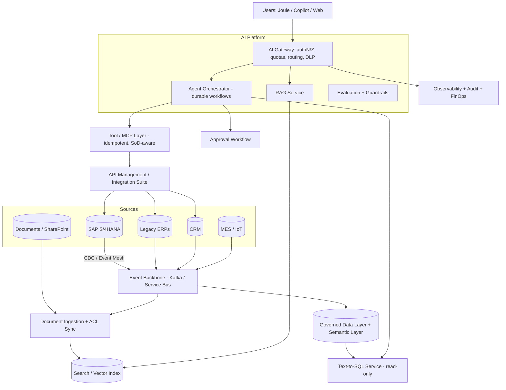

# How enterprise ERP/integration experience transfers to AI architecture

> [← Back to Interview Preparation Home](interview-index.md)

## 1. Brief Summary

### Definition
This topic is about **articulating how skills from enterprise ERP (SAP, Oracle, Microsoft Dynamics, etc.) and integration (middleware, ESB, iPaaS, APIs, EDI, event streaming) work map onto AI solution and architecture roles**. It is a career-transition and positioning topic: demonstrating that years spent on master data, business processes, interfaces, governance, security, reliability, and stakeholder management are directly applicable — and often *the missing ingredients* — when taking AI from prototype to production in enterprises.

### Why it matters
Most enterprise AI value comes from connecting models to **systems of record, workflows, and governed data**. Many AI prototypes fail at integration: poor data quality, unclear process ownership, brittle interfaces, security gaps, and change-management failures — exactly what ERP/integration professionals have solved for decades. Interviewers want to see (a) credible technical translation, (b) honest acknowledgement of gaps, and (c) a learning plan.

### Core concepts: the skills-transfer map
| ERP / integration experience | AI architecture equivalent |
|---|---|
| **Business process knowledge** (O2C, P2P, R2R, supply chain) | Identifying high-value AI use cases, workflow redesign, human-in-the-loop placement, success KPIs |
| **Master data & data quality** (MDM, governance) | Grounding data quality for RAG/training, entity resolution, data contracts, lineage |
| **System-of-record discipline** | AI as a *system of engagement/insight* that reads from and proposes to systems of record; transactional integrity for agent actions |
| **API design & management** (REST/OData, API gateways) | Tool/function design for agents, MCP servers, AI gateways, schema contracts |
| **Integration patterns** (EIP: request-reply, pub/sub, CDC, saga, idempotent receiver, dead-letter, retry) | Agent orchestration, RAG ingestion pipelines, event-driven AI, reliable tool execution |
| **Middleware / iPaaS** (SAP PI/PO/CPI, MuleSoft, Boomi, Azure Integration Services) | LLM gateways, orchestration layers, connectors, workflow engines |
| **Security & authorization** (roles, SoD, SSO, OAuth, certificates) | Document-level ACL trimming in RAG, least-privilege agent identities, OBO tokens, segregation of duties for AI actions |
| **Audit & compliance** (SOX, change control, traceability) | AI governance, audit trails, model/prompt change management, evidence collection |
| **Performance & batch/real-time design** | Token/latency/throughput capacity planning, batch inference, queueing/backpressure |
| **HA/DR, monitoring, SLAs, runbooks** | AI SRE, observability, fallbacks, incident response |
| **Testing (UAT, regression, integration test)** | LLM evaluation, golden datasets, regression suites, red-teaming |
| **Release management & transport/CI-CD** | Prompt/model/index versioning, progressive delivery |
| **Stakeholder management & requirements** | Executive communication, risk framing, adoption and change management |
| **Vendor/product evaluation, licensing** | Build vs buy, model/provider selection, TCO |
| **Data migration & cutover planning** | Index migrations, embedding model changes, phased rollouts |
| **Master data/reporting (BW, analytics)** | Feature stores, semantic layers, text-to-SQL grounded in governed models |

### How to build the narrative (a repeatable approach)
1. **Anchor in business outcomes:** "I've spent X years making critical processes run reliably across systems."
2. **Translate patterns:** pick 3–4 strongest mappings and give a concrete story for each (situation → what I did → how it applies to AI).
3. **Show AI learning evidence:** hands-on projects (RAG over SAP documentation, agent that drafts PO exception resolution with approvals), certifications, labs, architecture write-ups.
4. **Own the gaps honestly:** model internals, ML evaluation depth, GPU-level optimization — and the plan to close them.
5. **Position the differentiated value:** "I bring production integration discipline to AI: governed data, secure connectivity, reliable operations, and change management."

### Where it is used
Interviews for AI solution architect, enterprise architect, AI platform, integration architect pivoting to AI, consulting roles (SAP BTP AI, Joule, Copilot extensions, Azure AI + Dynamics/SAP), pre-sales.

### Important technologies at the intersection
SAP BTP (Integration Suite, AI Core, AI Launchpad, Joule, Generative AI Hub), SAP Business Data Cloud/Datasphere, Microsoft Dynamics 365 + Copilot, Power Platform, Azure Integration Services (APIM, Logic Apps, Service Bus, Event Grid, Functions), MuleSoft, Boomi, Kafka/Confluent, Debezium (CDC), OData/BAPI/IDoc/RFC, MCP servers for ERP, Semantic Kernel/LangGraph for orchestration, Azure AI Foundry, Document Intelligence (invoices), Azure AI Search.

### Common misconceptions
- "AI architecture is only about models" — most failures are data/integration/process/governance.
- "ERP experience is legacy and irrelevant" — it's the enterprise reality AI must plug into.
- "Integration = plumbing" — reliability, semantics, security, and governance are the hard parts.
- "Agents can directly call ERP APIs safely" — need transactional, authorization, and approval design.

### Key points to remember
- Lead with **business process + data + integration + governance** strengths; add **AI-specific literacy**.
- Use **concrete mappings** and **real stories with metrics**.
- Be explicit about **what's new**: probabilistic outputs, evaluation, prompt injection, non-determinism, token economics.
- Show a **credible learning path** and **hands-on proof**.

---

## 2. Interview Questions

### Beginner Questions

**Q1. How does your ERP background help in AI projects?**
- **Model answer:** AI delivers value when connected to business processes and data. I understand end-to-end processes, master data quality, system-of-record constraints, security/authorization, and reliable integration—the things that determine whether an AI solution works in production, not just in a demo.
- **Key points expected:** Business-process, data, integration, governance.
- **Mistake to avoid:** Generic claims without examples.

**Q2. Why is data quality in ERP relevant to RAG or AI?**
- **Model answer:** AI outputs reflect the data it's grounded in; poor master data, duplicates, and inconsistent definitions lead to wrong answers. MDM experience helps establish authoritative sources, canonical definitions, and cleansing before indexing or training.
- **Key points expected:** Garbage in, garbage out; authoritative source.
- **Mistake to avoid:** Ignoring data lineage.

**Q3. What integration pattern from ERP maps to RAG ingestion?**
- **Model answer:** Change data capture and event-driven pub/sub: capture changes from source systems, transform, and update downstream indexes reliably with retries, dead-letter queues, and idempotent processing.
- **Key points expected:** CDC, idempotency, DLQ.
- **Mistake to avoid:** Treating ingestion as one-time bulk load.

**Q4. What is a system of record and why does it matter for AI agents?**
- **Model answer:** The authoritative source for business data (e.g., SAP for orders). Agents must not bypass it; they should read from it and write via validated APIs with transactional integrity, authorization, and audit.
- **Key points expected:** Controlled writes.
- **Mistake to avoid:** Letting an LLM write directly via free-form SQL.

**Q5. How is role-based authorization in ERP relevant to AI?**
- **Model answer:** AI assistants must respect the same permissions: a user shouldn't get answers from data they can't access. Experience with roles, authorization objects, and segregation of duties informs ACL-aware retrieval and agent permission design.
- **Key points expected:** Security trimming, SoD.
- **Mistake to avoid:** Using one broad service account.

**Q6. Name two things that are new in AI compared to traditional integration.**
- **Model answer:** Non-deterministic outputs requiring evaluation, and new risks such as prompt injection and hallucination; also token-based cost economics.
- **Key points expected:** Awareness of differences.
- **Mistake to avoid:** Claiming "it's just another API".

**Q7. What's a good example of an AI use case in ERP?**
- **Model answer:** Invoice processing with document AI extracting fields, matching to POs, and routing exceptions with explanations; or a natural-language assistant for order status backed by APIs and policies.
- **Key points expected:** Concrete, valuable, controlled.
- **Mistake to avoid:** Vague "chatbot for ERP".

**Q8. How do you show you're serious about transitioning to AI?**
- **Model answer:** Build and share hands-on projects, obtain relevant certifications (e.g., Azure AI Engineer, SAP BTP AI), contribute architecture write-ups, and apply AI in my current role on a pilot.
- **Key points expected:** Evidence of learning.
- **Mistake to avoid:** Only claiming interest.

### Intermediate Questions

**Q1. Describe how you would design an agent that resolves purchase order exceptions in SAP, using your integration experience.**
- **Model answer:** Event-driven trigger (exception event via Event Mesh/Service Bus); agent reads context through read-only APIs (OData/BAPI wrappers) with scoped identity; retrieves policies via RAG; proposes resolution with confidence and evidence; policy engine validates tolerance/approval rules and segregation of duties; approvals routed via workflow; execution through idempotent API with correlation IDs and compensation (saga); full audit trail; monitoring and fallback to manual queue.
- **Key technical considerations:** Transaction integrity, locking, IDoc/API semantics, rate limits, error handling.
- **Follow-up:** "How would you prevent the agent from creating duplicate POs when retrying?"

**Q2. How do Enterprise Integration Patterns map to agentic AI patterns?**
- **Model answer:** Content-based router → intent router/model router; message translator → schema mapping/structured outputs; splitter/aggregator → map-reduce and parallel agents; process manager/saga → agent orchestrator with compensation; dead-letter channel → failed tool-call queue and human fallback; idempotent receiver → idempotency keys for tools; circuit breaker → model/tool failover; guaranteed delivery → durable execution.
- **Key technical considerations:** LLM non-determinism requires validation at boundaries.
- **Follow-up:** "Where do the analogies break down?"

**Q3. How do you apply master data governance to RAG for enterprise knowledge?**
- **Model answer:** Define authoritative sources, ownership, and metadata standards; harmonize terminology (glossary) for retrieval; version control and effective dating; deduplicate near-identical documents; enforce lifecycle (publish/retire); establish quality KPIs (coverage, freshness, duplication). Publish data contracts for indexed sources.
- **Key technical considerations:** Entity resolution for products/customers, multilingual labels.
- **Follow-up:** "How do you resolve conflicting versions of a policy?"

**Q4. How would you use your API management experience for AI?**
- **Model answer:** Establish an AI gateway: authentication, quotas, rate limiting, request/response policies, logging, caching, routing across models and versions, cost attribution, and developer portal with product-style onboarding. Also design tool APIs with clear schemas, versioning, idempotency, and pagination for agents.
- **Key technical considerations:** Streaming support, token-based limits, semantic caching.
- **Follow-up:** "What policies are AI-specific beyond classic API management?"

**Q5. What changes in testing when moving from integration testing to LLM application testing?**
- **Model answer:** Deterministic assertions give way to statistical evaluation: golden datasets, rubric/LLM-judge scoring, groundedness, safety/red-team tests, and regression thresholds. Keep classical tests for deterministic parts (schemas, authorization, idempotency). Add production monitoring and feedback loops.
- **Key technical considerations:** Non-determinism, judge calibration, dataset curation.
- **Follow-up:** "How would you structure UAT for an AI assistant?"

**Q6. How do you handle change management and adoption?**
- **Model answer:** Apply ERP rollout lessons: stakeholder analysis, process owners, training, super-users/champions, phased go-live, hypercare, feedback loops, and KPI tracking. For AI: set expectations about limitations, define when to trust/verify, update roles and SOPs, and measure adoption and outcomes.
- **Key technical considerations:** Trust calibration, workforce impact.
- **Follow-up:** "How do you handle resistance from process owners?"

**Q7. How does SAP/ERP security thinking apply to preventing agent misuse?**
- **Model answer:** Segregation of duties: agent can draft but not approve its own transactions; least privilege per role; critical actions require dual control; audit trails and review; emergency access (firefighter) analog is break-glass for AI actions. Add AI-specific controls: injection defenses and output validation.
- **Key technical considerations:** Identity propagation (user vs agent identity).
- **Follow-up:** "Whose identity is recorded when an agent posts a document?"

**Q8. Which AI skills do you need to deepen, and how would you do it?**
- **Model answer:** Evaluation methodology, retrieval engineering, prompt/agent design, LLMOps, and security (injection). Plan: build a RAG + agent reference project over ERP data with evaluation harness, study OWASP LLM Top 10, practice system design questions, and pursue hands-on labs/certifications.
- **Key technical considerations:** Depth where architecture decisions need it; avoid pretending expertise.
- **Follow-up:** "What project would best demonstrate readiness?"

### Advanced Questions

**Q1. Present an end-to-end reference architecture for a generative AI layer over a global SAP landscape and explain what you reuse from integration experience.**
- **Model answer:** Layers: (1) Data/knowledge: CDC and event streams from SAP (SLT/Event Mesh/Datasphere), documents; ingestion pipelines to curated stores and search index with ACL metadata. (2) AI services: AI gateway to models, RAG service, text-to-SQL/semantic layer over governed models, document intelligence. (3) Orchestration: agents/workflows with durable execution and approval services. (4) Integration/action layer: API/MCP tools wrapping BAPIs/OData with idempotency, SoD, throttling. (5) Security/governance: Entra/SAP IAS identity, OBO, DLP, audit. (6) Observability and operations: tracing, evaluation, FinOps. Reused: CDC patterns, API governance, security/authorization models, monitoring, release management, cutover planning.
- **Design considerations:** Latency to SAP, batch windows, locks, data residency, upgrade cycles (clean core principle).
- **Trade-offs:** Side-by-side extension on BTP vs in-app AI; build vs SAP Joule/Copilot; data replication vs virtualization.
- **Follow-ups:** "How do you preserve a 'clean core' while adding AI?"

**Q2. An agent proposed a correct fix, but execution caused duplicate postings after a timeout. How do you design to prevent and recover?**
- **Model answer:** Prevent: idempotency keys per business intent, check-before-act (query for existing document by external reference), transactional APIs with unique constraints, outbox pattern, and durable workflow with exactly-once effect semantics (at-least-once + idempotent consumers). Recover: reconciliation job comparing agent action log with ERP state, compensating transactions (reverse documents), alerting and manual review queue, post-incident test case.
- **Design considerations:** ERP-specific reversal processes, audit and period-close constraints.
- **Trade-offs:** Additional latency/complexity vs financial integrity.
- **Follow-ups:** "How would this differ in a period-end close window?"

**Q3. How would you convince a skeptical hiring panel that your integration background is enough for an AI architect role?**
- **Model answer:** Acknowledge what's new, then show evidence: (1) a portfolio project (e.g., RAG + agent for procurement with evaluation and observability); (2) mapping of accountabilities — production reliability, security, governance, vendor management; (3) examples where I led cross-functional delivery with measurable outcomes; (4) a plan for deepening ML/LLM expertise, partnering with data scientists; (5) emphasize that architects primarily make trade-off decisions, translate business to technology, and manage risk — areas where I've delivered.
- **Design considerations:** Specific metrics and artifacts (ADRs, diagrams).
- **Trade-offs:** Depth of model knowledge vs breadth of enterprise delivery; role fit (solution vs research).
- **Follow-ups:** "What would you do in your first 90 days?"

**Q4. Describe how you'd migrate from a point-to-point AI integration approach to a governed platform, using lessons from ESB/iPaaS consolidation.**
- **Model answer:** Inventory integrations/pilots; define target platform capabilities (gateway, shared RAG, tool registry, evaluation, observability); establish standards and reference architectures; migrate by value/risk; provide self-service onboarding; govern with architecture review and policy-as-code; avoid ESB mistakes (monolithic bottleneck, heavy central team) by favoring federated ownership and APIs/events, product-mindset platform team, and clear SLAs.
- **Design considerations:** Avoiding over-centralization, backwards compatibility, deprecation plan.
- **Trade-offs:** Standardization vs speed; central platform risk.
- **Follow-ups:** "What failure patterns from SOA/ESB do you see repeating in AI platforms?"

**Q5. How do you ensure auditability for AI-driven transactions in a SOX environment?**
- **Model answer:** Log proposal, evidence, prompt/model versions, approver identity, execution result, and linkage to ERP document numbers; enforce SoD (agent cannot approve); change control for prompts/models (versioned, reviewed, tested); periodic control testing; retention policies; access controls on logs; evidence automation. Provide auditors with traceability from business event to AI recommendation to posting.
- **Design considerations:** Immutable logs, time sync, reproducibility of decisions.
- **Trade-offs:** Storage/privacy vs auditability.
- **Follow-ups:** "How do you treat prompt changes — as code changes or configuration?"

**Q6. Text-to-SQL over ERP data: what risks and mitigations from your experience?**
- **Model answer:** Risks: wrong joins/semantics (ERP schemas are complex), performance-heavy queries, access violations, data leakage. Mitigations: query a governed semantic layer/views (not raw tables), provide business glossary and metadata to the model, read-only roles with row/column-level security, query validators/limits, cost guards, example queries, evaluation on a curated question set, and fall back to prebuilt reports for known critical questions.
- **Design considerations:** Caching, explainability (show SQL), lineage.
- **Trade-offs:** Flexibility vs control and accuracy.
- **Follow-ups:** "How do you evaluate correctness of generated SQL beyond syntax?"

**Q7. Where does ERP/integration experience *not* transfer, and how do you address it?**
- **Model answer:** Model behavior (probabilistic, context-dependent), evaluation science, prompt/context engineering, retrieval relevance tuning, GPU/inference economics, and novel security threats. Address via structured learning, hands-on experiments, pairing with ML engineers, and adopting evaluation-driven development; treat early projects as learning with strong guardrails.
- **Design considerations:** Decision frameworks for when to involve specialists.
- **Trade-offs:** Generalist breadth vs specialist depth.
- **Follow-ups:** "Which gap worries you most and what are you doing about it?"

**Q8. Craft a 90-second "tell me about yourself" that positions ERP/integration experience for an AI architect role.**
- **Model answer:** "I've spent N years architecting and delivering enterprise ERP and integration solutions—connecting SAP/Dynamics to dozens of systems with governed APIs, event-driven pipelines, strict security, and high availability. What I've seen is that AI projects succeed or fail on the same fundamentals: data quality, secure access, reliable integration, and change management. Over the last year I've built RAG and agent solutions on Azure—for example, an invoice-exception assistant with evaluation, tracing, and approval workflows that reduced handling time by X%—and I've deepened my knowledge of LLM evaluation, security, and cost. I'm looking to bring production-grade integration and governance discipline to AI architecture."
- **Design considerations:** Specific metrics, concise, credible.
- **Trade-offs:** Brevity vs detail.
- **Follow-ups:** "Tell me more about the evaluation approach in that project."

---

## 3. Use Cases

### Simple Use Case — Natural-language order status assistant over ERP APIs
- **Problem:** Customer service reps spend minutes navigating ERP screens to check order status.
- **Assumptions:** Read-only OData/REST APIs exist; users authenticated via SSO; low risk.
- **Steps:**
  1. Wrap order status API as a tool with a strict schema (order ID, customer).
  2. Use an LLM with function calling; enforce user-scoped authorization via OBO token.
  3. Return status, delivery date, and link to ERP record.
  4. Log calls with correlation IDs; add rate limiting.
- **Expected result:** Status answered in seconds with traceable ERP source data.
- **Tools:** Azure OpenAI, Azure API Management, SAP OData/Dynamics API, Entra ID.

### Intermediate Use Case — Invoice exception triage with human approval
- **Scenario:** A manufacturer receives 40,000 invoices monthly; 18% fail three-way match, requiring manual investigation.
- **Requirements:** Reduce handling time 40%, maintain SoD and audit, no incorrect postings.
- **Proposed solution:** Document Intelligence extracts invoice data; matching service flags exceptions; an agent retrieves PO/GR data (read-only), policy via RAG, and proposes resolution with explanation; AP clerk approves; posting via idempotent API.
- **Implementation steps:**
  1. Integrate document intake (email/EDI/OCR) via Service Bus queues.
  2. Build read tools for PO, GR, vendor master; restrict by role.
  3. Implement policy RAG over AP guidelines with citations.
  4. Add approval UI and policy engine (tolerances).
  5. Execute postings with idempotency; log to audit store.
  6. Monitor accuracy, handling time, override rate.
- **Technical challenges:** Vendor master quality, OCR errors, edge cases (partial deliveries), SoD.
- **Expected result:** 40–50% faster exception handling with improved auditability.
- **Testing approach:** Historical exceptions replay (golden set), shadow mode for 4 weeks, UAT with AP team, failure injection (ERP timeout) to verify idempotency.

### Difficult Use Case — Enterprise AI integration layer for a global SAP + non-SAP landscape
- **Scenario:** A global manufacturer with SAP S/4HANA, legacy ERPs, CRM, and MES wants a unified AI layer for assistants and agents across order-to-cash, procure-to-pay, and supply planning.
- **Functional requirements:** Cross-system insights, natural-language Q&A over documents and data, agentic workflows with approvals, text-to-SQL on governed semantic layer, integration with Joule/Copilot.
- **Non-functional requirements:** Clean core compliance, SOX controls, 99.9% availability, regional residency, <5 s p95 for Q&A, auditability, cost governance, phased rollout across 30 countries.

**Proposed architecture**

**Components and responsibilities**
- **Event backbone/CDC:** near-real-time propagation of business events and data changes; replay for rebuilds.
- **Governed data & semantic layer:** curated, business-friendly models with row/column security; basis for text-to-SQL and analytics.
- **Ingestion & index:** document parsing, ACL-aware indexing, metadata and lineage.
- **AI gateway:** unified access to models with identity, quotas, safety, and cost attribution.
- **RAG & text-to-SQL services:** retrieval and structured data Q&A with citations and SQL transparency.
- **Agent orchestrator:** workflows for exceptions, planning assistance; durable execution and compensation.
- **Tool/MCP layer:** thin, secure wrappers over APIs/BAPIs with schemas, idempotency, throttling, and SoD checks.
- **Approval workflow & audit:** human control and SOX evidence.
- **Observability/FinOps:** end-to-end tracing across AI and integration hops.

**Processing flow:** business event/doc update → ingestion → index/semantic layer; user query → gateway → identity propagation → retrieval/SQL/tools → LLM synthesis → guardrails → response; agent proposals → policy checks → approval → idempotent execution → audit.

**Security considerations:** End-to-end identity propagation (user→agent→API) with OBO; SoD enforced in policy engine; ACL-based retrieval; read-only analytic roles; secrets in vault; network isolation to ERP via integration layer only; prompt-injection defenses for document and email inputs; DLP and regional controls; break-glass procedures.

**Performance and scalability considerations:** Cache master data lookups; asynchronous long-running tasks; backpressure to protect ERP (rate limits, batch windows); regional deployments; model routing for cost; precomputed embeddings/summaries for heavy documents; avoid querying production OLTP directly (use replicas/semantic layer).

**Monitoring and observability:** Correlation IDs spanning AI and ERP calls; metrics for tool success, approval/override rates, ERP latency/error rates, retrieval quality, groundedness, token costs, SoD violation attempts, reconciliation mismatches.

**Failure scenarios and recovery**
- **ERP API outage/timeouts:** circuit breaker, queued retries with idempotency, user messaging; fallback to cached read-only data.
- **Duplicate/partial postings:** reconciliation job, compensating transactions, alerts.
- **Bad document injection or poisoned content:** quarantine pipeline, source trust levels, content scanning.
- **Model provider outage:** gateway failover to secondary model; disable agentic writes (read-only mode).
- **CDC lag/index staleness:** freshness SLO alerts; show data timestamps in answers.

**Trade-offs and alternatives**
- Side-by-side AI on BTP/Azure preserves clean core but adds integration surface; alternative: embedded vendor AI (Joule/Copilot) for faster delivery with less customization.
- Data replication enables performance and governance but increases cost/latency of freshness; alternative: federated/virtualized queries with performance risk.
- Centralized AI platform gives consistency; federated BU delivery gives speed — adopt a hybrid with shared guardrails and gateway.
