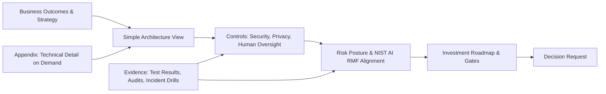

# How to explain an AI architecture to a non-technical executive

> [← Back to Interview Preparation Home](interview-index.md)

## 1. Brief Summary

### Definition
Explaining an AI architecture to a non-technical executive is the skill of translating technical design — models, data flows, infrastructure, risks, and costs — into a **business narrative** that supports a decision: approve funding, accept risk, choose a direction, or sponsor change. The goal is not to teach AI; it is to enable a confident, informed decision.

### Why it matters
Architects fail not because designs are wrong but because stakeholders don't understand, trust, or fund them. In interviews (especially for architect and leadership roles), this tests communication, business acumen, risk framing, and influence. Executives care about **outcomes, risk, cost, timeline, and accountability**, not model internals.

### Core concepts and techniques
- **Audience analysis:** What decision is needed? What does this executive care about (revenue, cost, risk, compliance, customer experience, reputation)? How much time do they have? What do they already believe?
- **Answer-first / pyramid principle (BLUF):** Start with the recommendation and the ask, then supporting reasons.
- **Business-outcome framing:** Tie the architecture to KPIs (resolution time, revenue per user, cost to serve, risk reduction).
- **Analogies and metaphors:** e.g., RAG = "an open-book exam, where the AI looks up your company's documents before answering"; guardrails = "compliance controls and approval limits on a bank teller"; vector database = "a library catalog organized by meaning"; fine-tuning = "specialist training for a new hire"; hallucination = "confident but unverified statement from a new employee."
- **Layered explanation (progressive disclosure):** one-sentence → one-slide diagram → detail on demand.
- **Visuals:** simple 3–5 box diagrams (Users → Application → AI → Company Data → Controls), no acronyms, color-coded for risk/controls.
- **Risk communication:** likelihood, impact, mitigations, residual risk, and decision needed; avoid fear-mongering and false assurance.
- **Cost and value framing:** TCO, unit economics (cost per conversation), ROI/payback, scenarios with ranges, key assumptions.
- **Options and trade-offs:** present 2–3 options with a recommendation (build/buy/hybrid; speed vs control).
- **Roadmap and milestones:** phased delivery with value at each stage and decision gates.
- **Governance and accountability:** who owns what, how issues are escalated.

### How it works (a repeatable structure)
1. **The headline:** "We recommend X, which will deliver Y by Z at cost C, with risks R managed by controls K. We need your decision on D."
2. **Context & problem (1–2 sentences):** why now, what's at stake.
3. **The solution in plain language:** simple diagram and analogy.
4. **How it creates value:** KPIs, benefits, evidence/pilot results.
5. **How we keep it safe and compliant:** controls, human oversight, data protection.
6. **What it costs and how it scales:** ranges, drivers, levers.
7. **Options considered:** why not alternatives.
8. **Risks and mitigations:** top 3–5, honest about uncertainty.
9. **Roadmap, milestones, and success measures.**
10. **The ask / decision and next steps.**

### Where it is used
Board and steering committee updates, investment approvals, vendor selection, risk acceptance, change management, customer executive briefings, interviews for architect/lead roles.

### Important tools and artifacts
One-page architecture diagram (C4 level 1 / context view), executive summary memo (1 page), slide decks (3–7 slides), decision records (ADR/executive decision memo), RACI, risk heat map, benefits/cost model, demo or prototype, FAQs.

### Common misconceptions
- "Executives need less detail so keep it vague" — they need the **right** detail: numbers, risks, decisions.
- "Show the technical diagram to prove credibility."
- "Avoid mentioning risk to maintain confidence" — undisclosed risk destroys trust later.
- "Analogies are patronizing" — good analogies respect time and cognitive load.

### Key points to remember
- **Lead with the decision and business outcome**, not technology.
- **Plain language, no jargon**; define any necessary term once.
- Quantify: **value, cost, risk, timeline** (with ranges and assumptions).
- Be explicit about **what could go wrong and how it's controlled**.
- End with a **clear ask**; be ready for the "so what / how much / how long / what if it fails" questions.

---

## 2. Interview Questions

### Beginner Questions

**Q1. How would you explain a large language model to a non-technical executive in two sentences?**
- **Model answer:** "An LLM is software trained on vast amounts of text that can read, summarize, and draft language the way a very well-read assistant would. It doesn't 'know' facts like a database; it predicts likely responses, so we pair it with our own trusted data and controls to make it reliable."
- **Key points expected:** Plain language, capability + limitation.
- **Mistake to avoid:** Mentioning transformers, tokens, or parameters.

**Q2. What is the first thing you do before preparing an executive briefing?**
- **Model answer:** Clarify the decision needed, the audience's priorities, time available, and what they already know or fear. Tailor content to that.
- **Key points expected:** Audience-first.
- **Mistake to avoid:** Starting by building slides from the technical design.

**Q3. What is the "bottom line up front" approach?**
- **Model answer:** State the recommendation and ask at the beginning, then provide supporting rationale — respecting executives' limited time.
- **Key points expected:** Answer first.
- **Mistake to avoid:** Building a long narrative before the conclusion.

**Q4. Give an analogy for RAG.**
- **Model answer:** "It's like an open-book exam: before answering, the AI looks up the relevant pages from our company's documents and answers based on them, with references."
- **Key points expected:** Accurate, relatable.
- **Mistake to avoid:** Analogies that imply the AI memorizes company data.

**Q5. How do you explain "hallucination" to an executive?**
- **Model answer:** "The AI can sometimes state something confidently that isn't true—like a new hire who guesses rather than admits uncertainty. We reduce this by grounding answers in approved documents, requiring citations, and having humans review high-risk outputs."
- **Key points expected:** Risk + mitigation.
- **Mistake to avoid:** Dismissing it as rare or solved.

**Q6. Why avoid jargon?**
- **Model answer:** It hides the business message, creates confusion, and erodes trust; clarity enables decisions.
- **Key points expected:** Communication effectiveness.
- **Mistake to avoid:** Using acronyms like RAG, PTU, or HNSW without translation.

**Q7. What should a simple architecture diagram for executives contain?**
- **Model answer:** Users, the business application, the AI service, company data sources, and the controls (security/governance), with arrows showing flow—maybe 5–7 boxes.
- **Key points expected:** Simplicity, controls visible.
- **Mistake to avoid:** Showing network or component-level detail.

**Q8. How do you handle a question you can't answer in the meeting?**
- **Model answer:** Acknowledge it, avoid guessing, commit to a specific follow-up with an owner and date.
- **Key points expected:** Honesty and accountability.
- **Mistake to avoid:** Bluffing.

### Intermediate Questions

**Q1. Explain a RAG-based customer-support assistant to a COO in a way that supports a funding decision.**
- **Model answer:** Headline: "Approve $X to launch an AI assistant that answers customer questions using our approved knowledge base, targeting a 30% reduction in contact volume and $Y annual savings, live in 4 months." Explain how it works (open-book exam), value (deflection, faster resolution, 24/7), controls (cited answers, escalation to humans, privacy protections), risks (incorrect answers → mitigations, pilot with 10% traffic), cost range (build + run per conversation), milestones and gates. Ask: approve phase 1 budget and nominate a business owner.
- **Key technical considerations:** Link metrics to business KPIs; show pilot evidence; state assumptions.
- **Follow-up:** "What happens if the AI gives a wrong answer to a customer?"

**Q2. How do you communicate uncertainty and risk without scaring or misleading?**
- **Model answer:** Use a structured format: risk, likelihood (qualitative/quantified), impact, mitigation, residual risk, and whether it's within appetite. Compare with existing human error rates when possible. Provide leading indicators and triggers, and describe phased rollout to limit exposure.
- **Key technical considerations:** Avoid absolutes; use ranges and scenarios.
- **Follow-up:** "How would you present a risk you can't fully quantify?"

**Q3. How do you explain cost drivers of an AI system?**
- **Model answer:** Break into build (one-time), run (usage-based: volume × cost per interaction), and people/governance costs. Show cost per conversation, scenarios at 1x/3x/10x usage, and levers to reduce costs (caching, smaller models, batch). Compare to the cost of the current process.
- **Key technical considerations:** Be explicit about assumptions; show sensitivity.
- **Follow-up:** "Why is the cost unpredictable and how do we cap it?"

**Q4. An executive asks, "Why can't we just use ChatGPT?" How do you respond?**
- **Model answer:** Acknowledge value; explain that consumer tools lack enterprise controls — data protection, access permissions, integration with our systems, audit trails, and answers grounded in our approved content. Our approach uses enterprise-grade versions with our data and security. Offer a comparison table on data, control, cost, and risk.
- **Key technical considerations:** Don't disparage; base on requirements.
- **Follow-up:** "Could we start with a licensed product and move later?"

**Q5. How do you present build vs buy to executives?**
- **Model answer:** Frame as a strategic choice: what differentiates us? Present options (buy, build, hybrid) with criteria (time-to-value, cost over 3 years, control, risk, talent), a recommendation, exit options, and decision triggers. Visualize with a simple scoring matrix.
- **Key technical considerations:** TCO, lock-in, compliance.
- **Follow-up:** "What would change your recommendation?"

**Q6. How do you adapt the same architecture explanation for a CFO, CISO, and CMO?**
- **Model answer:** CFO: cost, ROI, predictability, budget controls. CISO: data flows, access controls, threat model, compliance evidence, incident response. CMO: customer experience, brand risk, personalization, time-to-market. Same core story, different emphasis and metrics.
- **Key technical considerations:** Maintain consistency across audiences.
- **Follow-up:** "What if the CFO and CISO want conflicting things?"

**Q7. What visuals would you use and why?**
- **Model answer:** A one-slide context diagram, a before/after process flow showing where AI helps and where humans remain, a roadmap timeline, a risk heat map with controls, and a simple cost/value chart. Visuals reduce cognitive load and focus discussion.
- **Key technical considerations:** Consistent iconography, accessibility.
- **Follow-up:** "How many slides is too many?"

**Q8. How do you demonstrate that the AI is under control?**
- **Model answer:** Show governance: ownership, human oversight points, testing results, monitoring dashboards, incident response, and audit capability. Use a demo showing a citation and an escalation example, plus a metrics snapshot.
- **Key technical considerations:** Evidence over assurances.
- **Follow-up:** "Who gets called at 2 AM if it misbehaves?"

### Advanced Questions

**Q1. You must secure a $5M budget for an enterprise AI platform from a skeptical board in a 15-minute session. How do you structure it?**
- **Model answer:** Minutes 0–2: headline, ask, and strategic rationale (competitive pressure, quantified opportunity). 2–5: what the platform is (shared foundation enabling many use cases) with a simple "platform + use cases" diagram and an analogy (shared utilities vs one-off builds). 5–8: value case — top 3 use cases with KPIs, payback period, scenario ranges. 8–11: risk and governance — top risks and controls, NIST/ISO alignment, accountability. 11–13: phased roadmap with gates tied to funding release. 13–15: decision and Q&A. Prepare appendix and pre-wire key board members beforehand.
- **Design considerations:** Pre-meeting alignment, pilot evidence, benchmarks, honest uncertainty.
- **Trade-offs:** Ambition vs credibility; platform vs quick wins; stage-gating reduces risk but slows scale.
- **Follow-ups:** "What if the board asks for guaranteed ROI?"

**Q2. An incident occurred: the AI assistant exposed internal pricing to a customer. How do you brief the executive team?**
- **Model answer:** Lead with facts: what happened, impact (who/what/when), current status (contained?), root cause hypothesis, immediate actions taken, customer/regulatory obligations, and next steps with owners and timelines. Avoid speculation and blame, own accountability, explain how controls failed, and present a remediation plan plus lessons learned. Offer options for decisions (pause service, notify customers).
- **Design considerations:** Clear timeline, single spokesperson, legal/PR coordination, regular updates.
- **Trade-offs:** Speed vs accuracy of information; transparency vs legal exposure.
- **Follow-ups:** "When do you recommend shutting the system down?"

**Q3. How do you make the case for investing in "invisible" foundations like evaluation, observability, and governance?**
- **Model answer:** Translate into risk and speed: without them, incidents, rework, and compliance failures; with them, faster, safer releases. Use analogies (quality assurance and financial controls). Quantify avoided costs (incident costs, regulatory fines, rework), show industry incidents, and propose minimal viable foundations scaled to risk tier. Show metrics like release frequency and defect escape rate improvement.
- **Design considerations:** Tie to enterprise risk management and board priorities.
- **Trade-offs:** Up-front cost and slower first release vs sustainable scale.
- **Follow-ups:** "Can we defer this until after launch?"

**Q4. Explain a multi-agent architecture to executives and recommend whether to adopt it.**
- **Model answer:** Analogy: a team of specialists with a coordinator — one reads contracts, one checks finance, one drafts responses — each with limited authority; a manager (orchestrator) assembles results, and critical actions need human sign-off. Recommend starting with simpler automation (a single assistant or workflow) and moving to multi-agent only where specialization, security separation, or parallelism clearly adds value, because complexity raises cost, risk, and testing burden. Provide criteria and pilot plan.
- **Design considerations:** Controls on authority, audit trail, cost.
- **Trade-offs:** Capability vs complexity/risk.
- **Follow-ups:** "How is this different from RPA we already own?"

**Q5. The CEO says: "Competitor X launched an AI agent. Why aren't we?" How do you respond?**
- **Model answer:** Validate concern; present where we stand (readiness assessment), what the competitor actually delivers (verify claims), our prioritized plan for fast, safe wins (e.g., 90-day pilot), differentiated opportunities from our data/process advantages, and risk of rushing (brand/compliance). Offer a decision: fast-follow pilot with defined guardrails and metrics. Show a timeline with early customer-visible milestones.
- **Design considerations:** Competitive intelligence, quick wins vs foundations.
- **Trade-offs:** Speed to market vs risk and quality.
- **Follow-ups:** "What's the minimum we can ship in 60 days responsibly?"

**Q6. How do you convey architecture trade-offs such as CAP-like consistency/availability or cost/latency/quality to executives?**
- **Model answer:** Use "pick two of three" style frames with business consequences: e.g., "Fast, cheap, accurate — we can optimize two; for customer-facing financial answers we choose accuracy and safety, which costs more and adds a few seconds." Provide a simple table of options with impact on customer experience, cost, risk, and recommendation; ask for risk-appetite guidance.
- **Design considerations:** Translate technical dimensions to business outcomes.
- **Trade-offs:** Simplicity vs nuance.
- **Follow-ups:** "Can we get all three with more budget?"

**Q7. How do you handle executives who overestimate what AI can do ("AI will fix everything")?**
- **Model answer:** Reset expectations respectfully with evidence: show a demo of strengths and a known failure example; define suitable vs unsuitable tasks; use a capability/risk matrix; propose a pilot with measurable targets; communicate that value comes from process redesign plus data quality, not just a model. Provide references from peers or benchmarks.
- **Design considerations:** Build trust through quick, honest wins.
- **Trade-offs:** Maintaining enthusiasm vs realism.
- **Follow-ups:** "How do you handle pressure to promise unrealistic dates?"

**Q8. Design a one-page executive summary for an AI architecture decision. What goes on it?**
- **Model answer:** Title and decision requested; recommendation in one sentence; business problem and outcome metrics; simple solution diagram; options considered with pros/cons; cost (build/run) and ROI range; top risks with mitigations and residual risk; governance/ownership; timeline with milestones and gates; assumptions and dependencies; next steps.
- **Design considerations:** Single page, scannable, consistent with detailed ADR/appendix.
- **Trade-offs:** Completeness vs readability.
- **Follow-ups:** "What do you cut if you have to fit half a page?"

---

## 3. Use Cases

### Simple Use Case — Two-minute pitch for an internal knowledge assistant
- **Problem:** The COO has two minutes in an elevator-style update; you need approval to start a pilot.
- **Assumptions:** COO is non-technical and cares about productivity and risk.
- **Steps:**
  1. Headline: "A 90-day pilot of an AI assistant that answers employees' policy questions, saving ~20,000 hours/year at ~$150k run cost."
  2. Analogy: "open-book exam on our own documents, with references."
  3. Controls: "Only approved documents; it cites sources; HR handles sensitive cases."
  4. Ask: "Approve $200k and a business owner from HR."
- **Expected result:** A clear yes/no decision and named sponsor.
- **Tools:** One-page summary, single diagram.

### Intermediate Use Case — Steering committee presentation for a RAG assistant rollout
- **Scenario:** A telecom's steering committee (COO, CFO, CISO, Head of Customer Care) must decide whether to scale a pilot to all customers.
- **Requirements:** Show value, safety, cost, and operational readiness in 20 minutes.
- **Proposed solution:** A 6-slide deck: (1) decision & recommendation, (2) pilot results (containment +28%, CSAT neutral, 0 critical incidents), (3) how it works and where humans intervene, (4) risk and control view for CISO/Compliance, (5) cost/scale model with scenarios, (6) roadmap and gates.
- **Implementation steps:**
  1. Pre-brief the CISO and CFO separately to surface objections.
  2. Build a live demo showing citations and escalation.
  3. Prepare appendix on architecture, evaluation method, and security.
  4. Rehearse likely questions (wrong answers, cost growth, regulators).
  5. Follow up with a decision memo within 24 hours.
- **Technical challenges:** Translating evaluation metrics (groundedness) to business terms (accurate answers rate); explaining cost variability.
- **Expected result:** Approval to expand to 50% traffic with defined gates.
- **Testing approach:** Dry-run with a non-technical colleague; measure comprehension by asking them to restate the ask and top risks.

### Difficult Use Case — Board-level briefing on enterprise AI strategy and risk after a high-profile industry incident
- **Scenario:** After a competitor's AI incident hits the news, the board asks management to explain the company's AI architecture, exposure, and safeguards, and to approve a multi-year AI platform investment.
- **Functional requirements:** Clear communication of architecture, risk posture, governance, and investment case; consistent messaging across board, regulators, and employees.
- **Non-functional requirements:** Accuracy, defensibility, consistency with legal positions, readiness for hard questions; briefing within 10 days.

**Proposed communication architecture**

**Components and responsibilities**
- **Executive narrative:** one-page storyline owned by the CTO/CAIO.
- **Architecture view:** single diagram with trust boundaries and data flows in plain language.
- **Risk & controls view:** heat map linking top risks to controls and residual risk; alignment to NIST AI RMF.
- **Evidence pack:** evaluation results, red-team summary, audit/assurance reports, incident response drill outcomes.
- **Investment case:** phased roadmap, TCO, benefits, decision gates.
- **Q&A preparation:** FAQ with answers from legal, security, and engineering.

**Processing flow:** align with CEO/GC/CISO → draft narrative → validate facts with engineering → red-team the presentation → pre-wire board members → present → record decisions and actions.

**Security considerations:** Share sensitive details (vulnerabilities, test specifics) only in appropriate forums; mark and control distribution; avoid revealing exploit specifics in broadly circulated slides; coordinate with legal privilege.

**Performance/scalability considerations (of the message):** Create reusable modules (one-pager, diagram, FAQ) to adapt for regulators, customers, and employees; maintain a single source of truth to prevent inconsistent statements.

**Monitoring and observability:** Define leading indicators the board will see quarterly (incident counts, model performance, control coverage, spend vs plan, adoption), with a standard dashboard.

**Failure scenarios and recovery**
- Executive disengages from complexity → pivot to a decision-centric one-pager and analogies; schedule deep-dive for interested members.
- Hard question without data → commit to follow-up with owner/date; avoid speculation.
- Contradicting statements from different teams → pre-brief alignment, single spokesperson.
- Loss of trust after an incident → transparency, concrete remediation, independent review.

**Trade-offs and alternatives**
- Transparency about weaknesses builds credibility but may alarm; mitigate with context and plans.
- A detailed technical appendix adds credibility but risks distraction; keep it for on-demand.
- Alternative format: interactive workshop or live demo instead of slides for deeper understanding, at the cost of time.
