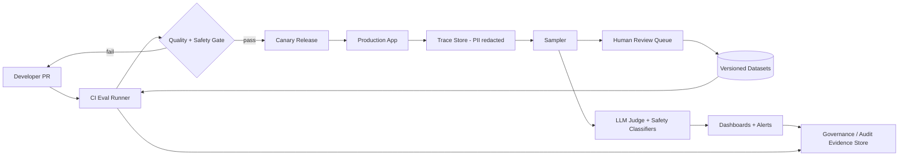

# LLM evaluation methodology (offline vs online)

> [← Back to Interview Preparation Home](interview-index.md)

## 1. Brief Summary

### Definition
**LLM evaluation** is the systematic measurement of how well an LLM-based system performs on quality, safety, cost, and latency dimensions.
- **Offline evaluation** runs before release on fixed datasets ("golden sets"), using automated metrics, LLM-as-judge, and human review.
- **Online evaluation** measures behavior on live traffic: A/B tests, user feedback, implicit signals, production sampling, and guardrail monitoring.

### Why it matters
LLM outputs are non-deterministic and open-ended, so traditional unit tests are insufficient. Without evaluation you cannot compare prompts/models/retrievers, detect regressions, justify costs, or satisfy governance requirements.

### Core concepts and terminology
- **Golden / reference dataset**, **test set contamination**, **regression suite**.
- **Metrics:** exact match, F1, BLEU/ROUGE (limited), semantic similarity (BERTScore), **faithfulness/groundedness**, **answer relevance**, **context precision/recall**, **toxicity**, **format validity**, **task success rate**.
- **LLM-as-judge**, **pairwise comparison**, **rubrics**, **judge bias** (position, verbosity, self-preference).
- **Human evaluation**, **inter-annotator agreement** (Cohen's kappa).
- **Online:** A/B test, canary, shadow mode, interleaving, implicit feedback (copy, retry, abandon), explicit feedback (thumbs).
- **Component vs end-to-end evaluation**, **trajectory evaluation** for agents.
- **Red teaming**, **adversarial sets**.

### How it works
1. Define success criteria tied to business outcomes.
2. Build datasets from real queries (sampled, anonymized), expert-written cases, and synthetic cases.
3. Choose metrics for each component (retrieval, generation, tool use, safety).
4. Run automatically in CI on every prompt/model/index change; gate releases.
5. Release gradually; monitor online metrics and sample traces for human/LLM review.
6. Feed production failures back into the golden set.

### Where it is used
RAG assistants, agents, summarization, classification/extraction, code assistants, customer support bots, and regulated decision-support.

### Important tools
Ragas, DeepEval, promptfoo, TruLens, LangSmith, Langfuse, Arize Phoenix, Azure AI Foundry Evaluation, MLflow, OpenAI Evals, Weights & Biases Weave, lm-evaluation-harness (model-level).

### Common misconceptions
- "Public benchmarks (MMLU etc.) tell us how our application performs."
- "LLM-as-judge is objective" — it needs calibration against humans.
- "Offline pass means safe to ship" — distribution shift and unseen inputs appear online.
- "Thumbs-up rate is a sufficient metric" — feedback is sparse and biased.

### Key points to remember
- Evaluate **components and end-to-end** separately.
- **Offline for speed and gating; online for truth.**
- Calibrate LLM judges with human labels and track agreement.
- Keep the evaluation set versioned, representative, and uncontaminated.
- Include safety, cost, and latency — not just quality.

---

## 2. Interview Questions

### Beginner Questions

**Q1. Why is evaluating LLM applications harder than evaluating traditional software?**
- **Model answer:** Outputs are open-ended and probabilistic; many answers can be correct; there is no single assertion to check. We need metrics for quality, groundedness, and safety, plus statistical comparison rather than pass/fail unit tests.
- **Key points expected:** Non-determinism, subjective quality, multi-dimensional metrics.
- **Mistake to avoid:** Suggesting only exact-match testing.

**Q2. What is the difference between offline and online evaluation?**
- **Model answer:** Offline uses fixed datasets before deployment, repeatable and cheap. Online observes real usage after or during deployment (A/B tests, feedback, monitoring) and reflects real distribution.
- **Key points expected:** Pre-release vs production; complementary.
- **Mistake to avoid:** Treating one as a replacement for the other.

**Q3. What is a golden dataset?**
- **Model answer:** A curated set of inputs with expected outputs or reference criteria used as a stable benchmark to compare versions and detect regressions.
- **Key points expected:** Representative, versioned, reviewed by SMEs.
- **Mistake to avoid:** Building it only from easy, synthetic examples.

**Q4. What is faithfulness (groundedness) in RAG evaluation?**
- **Model answer:** Whether claims in the answer are supported by the retrieved context. A faithful answer doesn't add unsupported facts.
- **Key points expected:** Separate from correctness; context-based.
- **Mistake to avoid:** Equating faithfulness with factual truth in the world.

**Q5. What is LLM-as-a-judge?**
- **Model answer:** Using a (usually stronger) LLM with a rubric to score or compare outputs. It scales evaluation but needs calibration for bias and consistency.
- **Key points expected:** Rubric, scale, bias.
- **Mistake to avoid:** Trusting judge scores without human validation.

**Q6. Name some metrics for a RAG system.**
- **Model answer:** Retrieval: recall@k, precision@k, MRR, nDCG, context relevance. Generation: faithfulness, answer relevance, correctness, citation accuracy. System: latency, cost per query, refusal correctness.
- **Key points expected:** Split retrieval vs generation.
- **Mistake to avoid:** Listing only BLEU/ROUGE.

**Q7. What is an A/B test in this context?**
- **Model answer:** Randomly splitting users between two variants (e.g., prompt A vs B) and comparing outcome metrics with statistical significance.
- **Key points expected:** Randomization, success metric, sample size.
- **Mistake to avoid:** Comparing before/after without a control.

**Q8. Why should evaluation include safety tests?**
- **Model answer:** To verify the system resists jailbreaks, avoids harmful or biased outputs, and doesn't leak sensitive data; quality gains can accidentally weaken safety.
- **Key points expected:** Red-team sets, regression for safety.
- **Mistake to avoid:** Only measuring helpfulness.

### Intermediate Questions

**Q1. How do you build a good evaluation dataset when you have no labeled data?**
- **Model answer:** Sample real or pilot queries, have SMEs write expected answers/criteria for a core set (100–300), supplement with synthetic questions generated from documents (and reviewed), add edge cases (ambiguity, out-of-scope, adversarial), and stratify by intent, difficulty, and user segment.
- **Key technical considerations:** Coverage, leakage, annotator guidelines, version control.
- **Follow-up:** "How do you keep synthetic data from being too easy?"

**Q2. How do you calibrate and validate an LLM judge?**
- **Model answer:** Collect human labels on a sample, compare judge vs human with agreement metrics (kappa, correlation), analyze systematic bias (verbosity, position), use pairwise with randomized order, rubric with anchored examples, and possibly multiple judges. Re-check when models change.
- **Key technical considerations:** Judge model versioning, cost, self-preference bias.
- **Follow-up:** "What agreement level is acceptable?"

**Q3. Describe how to evaluate retrieval separately from generation.**
- **Model answer:** Label relevant chunks/documents for each golden query and compute recall@k, nDCG; then evaluate generation with fixed, gold context to isolate generator quality. Combine for end-to-end.
- **Key technical considerations:** Chunk-level labels expensive; document-level approximations.
- **Follow-up:** "What if the gold chunk is split across two chunks?"

**Q4. How would you set up CI/CD gating for prompts?**
- **Model answer:** Store prompts in version control; on PR run the regression suite (cheap deterministic checks, then LLM-judge metrics); compare against baseline with thresholds and confidence intervals; block merges on critical regressions (safety, format) and report cost/latency deltas.
- **Key technical considerations:** Non-determinism (temperature 0, multiple runs), runtime cost, caching.
- **Follow-up:** "How do you handle flaky tests?"

**Q5. What online signals would you capture?**
- **Model answer:** Explicit (thumbs, ratings, comments), implicit (copy/paste, follow-up rephrase, abandonment, escalation to human, task completion), operational (latency, token usage, errors, refusals), and guardrail triggers. Sample traces for review.
- **Key technical considerations:** Feedback bias, privacy, joining feedback to traces.
- **Follow-up:** "How do you detect silent failures with no feedback?"

**Q6. Explain shadow mode and canary release for LLM changes.**
- **Model answer:** Shadow: run the new version in parallel on live traffic without exposing output, then compare offline. Canary: expose to a small user percentage with monitoring and automatic rollback.
- **Key technical considerations:** Cost doubling in shadow, privacy of logged data.
- **Follow-up:** "What rollback triggers would you set?"

**Q7. How do you evaluate an agent differently from a single-turn LLM?**
- **Model answer:** Evaluate trajectories: tool selection correctness, argument validity, step efficiency, recovery from errors, goal completion, and side effects. Use scripted environments or simulators and check final state, not just final text.
- **Key technical considerations:** Non-determinism over multi-step, cost of runs, sandboxing.
- **Follow-up:** "How would you evaluate a destructive tool safely?"

**Q8. What is evaluation set contamination and how do you avoid it?**
- **Model answer:** When test items leak into prompts, few-shot examples, fine-tuning data, or the model's pretraining, inflating scores. Keep holdout sets separate, track provenance, refresh with new items, and use private sets.
- **Key technical considerations:** Governance of dataset access, rotating test sets.
- **Follow-up:** "How can you detect that the model memorized your test set?"

### Advanced Questions

**Q1. Offline metrics improved by 8% but online user satisfaction dropped. Investigate.**
- **Model answer:** Look for distribution mismatch (golden set not representative), metric misalignment (judge rewards verbosity while users want brevity), latency increase, changed refusal behavior, UI effects, novelty effects, or sample ratio mismatch in the experiment. Segment by intent/user type, review traces, run human eval on disagreeing cases, and update the golden set and metrics.
- **Design considerations:** Metric hierarchy (guardrail metrics + north-star), experiment validity checks.
- **Trade-offs:** Faster iteration with proxies vs risk of Goodhart effects.
- **Follow-ups:** "How would you redesign the evaluation to prevent this?"

**Q2. Design an evaluation platform for 40 teams building LLM apps.**
- **Model answer:** Central service offering dataset management, versioned prompts/configs, evaluator library (deterministic, LLM-judge, safety), run orchestration, dashboards, and CI integration; trace store linking production samples to dataset curation; RBAC and data-classification handling; cost controls on judge calls.
- **Design considerations:** Multi-tenancy, PII in datasets, standardized schemas (OpenTelemetry GenAI conventions), extensibility.
- **Trade-offs:** Central standards vs team autonomy; build vs buy (Langfuse/LangSmith/Foundry).
- **Follow-ups:** "How do you drive adoption?"

**Q3. How do you evaluate a high-stakes domain (medical/legal) where wrong answers are costly?**
- **Model answer:** Expert-annotated sets, strict rubrics with severity levels, zero-tolerance categories (hallucinated citations, unsafe advice), human-in-the-loop review in production, calibrated confidence/abstention, post-deployment audit sampling, and documented validation for regulators.
- **Design considerations:** Risk-weighted metrics, abstention accuracy, audit trail.
- **Trade-offs:** Expert cost and time vs coverage.
- **Follow-ups:** "How do you measure the quality of abstention?"

**Q4. Statistical rigor: how many examples do you need to detect a 3-point improvement?**
- **Model answer:** Depends on baseline variance and desired power; use paired comparisons on the same items, bootstrap confidence intervals, McNemar's test for binary outcomes, and power analysis. Often hundreds to thousands of items; for online A/B, calculate sample size from baseline rate and minimum detectable effect, and avoid peeking without sequential testing corrections.
- **Design considerations:** Stratified sampling, multiple comparisons, non-determinism variance.
- **Trade-offs:** Larger sets cost more; smaller sets can mislead.
- **Follow-ups:** "How do you handle running 20 experiments simultaneously?"

**Q5. How would you detect quality drift in production without labels?**
- **Model answer:** Track proxy metrics (refusal rate, response length, retrieval score distributions, embedding drift on queries, guardrail triggers, judge scores on sampled traces), canary queries run on a schedule, and alerts on deviations from baseline. Investigate upstream changes: model version updates by provider, index changes, new content.
- **Design considerations:** Sampling rate, judge cost, privacy, seasonality.
- **Trade-offs:** Sensitivity vs false alarms.
- **Follow-ups:** "How do you guard against silent provider model updates?"

**Q6. Design the evaluation for a prompt-injection-resistant agent.**
- **Model answer:** Build adversarial corpora (direct, indirect via documents/web/tools), measure attack success rate, data exfiltration attempts, unauthorized tool calls; run automated red-team generators; track utility under defense; integrate into CI and periodic manual red teaming.
- **Design considerations:** Attack taxonomy coverage, sandboxed tools, severity scoring.
- **Trade-offs:** Defense strength vs usability.
- **Follow-ups:** "How do you keep the attack set current?"

**Q7. Cost control: judge calls on every CI run are expensive. What do you do?**
- **Model answer:** Tiered evaluation: cheap deterministic checks first, small judge or sample subset on PRs, full suite nightly/pre-release; cache results for unchanged items; use smaller calibrated judges or distilled evaluators; stratified sampling.
- **Design considerations:** Risk-based test selection, determinism.
- **Trade-offs:** Speed/cost vs detection power.
- **Follow-ups:** "What changes require a full run?"

**Q8. How do you align evaluation metrics with business KPIs?**
- **Model answer:** Map quality metrics to outcomes (deflection rate, handle time, conversion, compliance incidents) through experiments, establish leading indicators, define guardrails (safety, cost), and review correlation regularly. Present trade-offs to stakeholders.
- **Design considerations:** Causal attribution, time lag, segmentation.
- **Trade-offs:** Proxy metrics speed vs true KPI fidelity.
- **Follow-ups:** "What if the KPI moves but quality metrics don't?"

---

## 3. Use Cases

### Simple Use Case — Evaluating a support FAQ bot prompt change
- **Problem:** Decide whether prompt v2 improves answers over v1.
- **Assumptions:** 100 historical questions with approved answers; model at temperature 0.
- **Steps:**
  1. Run both prompts on 100 questions.
  2. Score with an LLM judge using a 1–5 correctness rubric plus a format check.
  3. Human-review 20 disagreements.
  4. Compare mean scores with a paired bootstrap.
- **Expected result:** Evidence-based decision on promoting v2.
- **Tools:** promptfoo or Ragas, Python, spreadsheet for human review.

### Intermediate Use Case — RAG assistant release pipeline
- **Scenario:** A legal-ops RAG assistant is updated weekly (new documents, prompt tweaks).
- **Requirements:** Detect retrieval and generation regressions, gate releases, track cost.
- **Proposed solution:** CI pipeline with golden set (300 Qs), retrieval metrics, faithfulness/answer-relevance judge, citation accuracy checks, and online canary with feedback capture.
- **Implementation steps:**
  1. Build dataset with SME-labeled sources.
  2. Implement metrics in Ragas/DeepEval; calibrate judge on 100 human labels.
  3. Add CI job comparing candidate vs baseline with thresholds.
  4. Deploy canary at 5% traffic; log traces with Langfuse.
  5. Review weekly sample of low-scoring traces; add to golden set.
- **Technical challenges:** Judge drift, index version differences between runs, flaky outputs.
- **Expected result:** Regressions caught pre-release; improvement trend visible.
- **Testing approach:** Inject known-bad changes (e.g., degrade retriever) to verify the pipeline fails the build.

### Difficult Use Case — Enterprise evaluation and monitoring program
- **Scenario:** A financial institution runs 25 LLM applications, some customer-facing and regulated.
- **Functional requirements:** Standard evaluation harness, safety/red-team suites, human review workflows, online A/B, audit evidence.
- **Non-functional requirements:** Scalable to 10M interactions/day, PII-safe, evidence retained 7 years, minimal added latency.

**Proposed architecture**

**Components and responsibilities**
- **Dataset service:** versioning, access control, lineage, contamination tracking.
- **Eval runner:** executes evaluators, caches, parallelizes.
- **Gates:** policy-as-code thresholds per risk tier.
- **Trace store + sampler:** privacy-preserving production sampling.
- **Human review:** rubric-driven annotation, agreement tracking.
- **Governance store:** immutable evidence of validation per release.

**Processing flow:** change → offline suite → gate → canary → online metrics → sampling → human/judge review → dataset enrichment.

**Security:** PII redaction before storage, RBAC on datasets/traces, encryption, segregation of customer data, secure handling of red-team attack payloads.

**Performance/scalability:** Asynchronous trace export, risk-tiered sampling (100% for high-risk, 1% for low-risk), batch judge calls with cheaper models, caching by input+version.

**Monitoring:** Quality/safety score trends, judge-human agreement, sample ratio mismatch checks, alert on drift, cost of evaluation vs application.

**Failure scenarios and recovery**
- Judge model deprecation → versioned judges and re-baselining procedure.
- Evaluation pipeline outage → block high-risk releases, allow low-risk with manual approval.
- Trace ingestion backlog → drop low-risk samples first; never block serving.
- Dataset leak → rotate test set, invalidate affected results.

**Trade-offs and alternatives**
- Central platform ensures consistency but can slow teams; alternative: federated with shared libraries.
- 100% sampling for high-risk is costly; alternative: stratified sampling with trigger-based escalation.
- Buying a managed observability/eval product accelerates delivery but may limit data-residency control.
