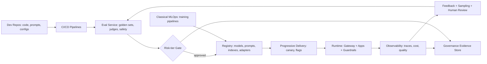

# MLOps vs LLMOps — key differences

> [← Back to Interview Preparation Home](interview-index.md)

## 1. Brief Summary

### Definition
- **MLOps** applies DevOps principles to the lifecycle of traditional machine-learning models: data preparation, training, validation, deployment, monitoring, and retraining.
- **LLMOps** extends and adapts these practices for large language model applications: prompt and context management, retrieval pipelines, model/provider selection, evaluation of open-ended outputs, guardrails, token-cost management, and agent/tool orchestration. In many cases the team *consumes* a pre-trained foundation model rather than training one.

### Why it matters
Teams that apply classic MLOps unchanged to LLM apps miss critical needs: prompt versioning, non-deterministic evaluation, safety controls, token economics, and rapid provider model changes. Conversely, dropping MLOps discipline (versioning, CI/CD, monitoring) leads to fragile LLM prototypes.

### Core concepts and terminology
- **MLOps:** feature store, training pipelines, experiment tracking, model registry, CI/CD/CT (continuous training), data/concept drift, batch/online inference, AUC/F1/RMSE.
- **LLMOps:** prompt registry, prompt templates, RAG pipeline versioning, embeddings and vector index lifecycle, LLM gateway, guardrails, LLM-as-judge, token usage/cost, hallucination and groundedness metrics, fine-tuning/PEFT, agent traces, human feedback (RLHF/DPO data).
- **FMOps / GenAIOps / AgentOps:** related terms emphasizing foundation models and agents.
- **Artifacts:** in MLOps — model weights + features; in LLMOps — prompts, retrieval configs, indexes, tool schemas, evaluation sets, plus (optionally) adapters.

### How they differ
| Dimension | MLOps | LLMOps |
|---|---|---|
| Main asset | Trained model + features | Prompt + context pipeline + model choice |
| Development loop | Data → train → evaluate → deploy | Prompt/retrieval iteration → evaluate → deploy; training is optional |
| Evaluation | Deterministic metrics on labeled data | Open-ended; LLM-judge, human review, groundedness, safety |
| Drift | Data/concept drift | Prompt/model-version drift, knowledge staleness, user behavior shifts, provider silent updates |
| Cost drivers | Training compute, serving | Tokens, context length, GPU inference, retrieval, evaluation calls |
| Latency | Usually ms | Seconds; streaming, TTFT matters |
| Risk | Bias, accuracy | Hallucination, prompt injection, data leakage, toxicity, IP |
| Versioning | Data, code, model | Prompt, retrieval config, index, model/provider version, tools |
| Monitoring | Prediction distribution, accuracy | Traces, token cost, quality scores, guardrail hits, feedback |
| Release | Retrain & redeploy | Prompt change can ship in minutes; needs gating |

### Where it is used
Any organization operationalizing AI: banks (fraud ML + support copilots), retail (forecasting + product assistants), healthcare, manufacturing.

### Important tools
- MLOps: MLflow, Kubeflow, SageMaker, Azure ML, Vertex AI, Feast, DVC, Airflow, Seldon/KServe, Evidently.
- LLMOps: Azure AI Foundry (prompt flow, evaluation), LangSmith, Langfuse, Arize Phoenix, W&B Weave, promptfoo, LiteLLM, Helicone, Guardrails AI, vLLM, Databricks Mosaic AI, MLflow (LLM tracking/evaluate).

### Common misconceptions
- "LLMOps replaces MLOps" — it builds on it; many enterprises need both.
- "No training means no ops" — prompts and retrieval need CI/CD, monitoring, and governance.
- "Evaluation is optional because the model is pre-trained."

### Key points to remember
- The **unit of change** shifts from model weights to prompts/context/config.
- **Evaluation and observability** are the hardest and most important LLMOps capabilities.
- **Cost and safety** are first-class operational concerns.
- Reuse MLOps foundations: CI/CD, registries, IaC, monitoring, governance.

---

## 2. Interview Questions

### Beginner Questions

**Q1. What is MLOps?**
- **Model answer:** A set of practices to reliably build, deploy, monitor, and maintain ML models in production, combining ML, DevOps, and data engineering.
- **Key points expected:** Lifecycle, automation, reproducibility, monitoring.
- **Mistake to avoid:** Defining it as only model deployment.

**Q2. What is LLMOps?**
- **Model answer:** MLOps practices adapted for LLM-based applications, covering prompt/version management, retrieval pipelines, evaluation of generated text, guardrails, cost, and observability.
- **Key points expected:** Prompts, evaluation, safety, tokens.
- **Mistake to avoid:** Saying it's just hosting an LLM.

**Q3. Name two key differences between MLOps and LLMOps.**
- **Model answer:** (1) Evaluation: LLM outputs are open-ended and need judge/human evaluation versus numeric metrics. (2) Primary artifacts: prompts and retrieval configs versus trained weights; plus token-based cost.
- **Key points expected:** Specific and accurate contrasts.
- **Mistake to avoid:** Vague answers like "LLMs are bigger".

**Q4. What is a prompt registry?**
- **Model answer:** A versioned store for prompts/templates with metadata and release status, enabling review, rollback, and A/B testing, similar to code or model registries.
- **Key points expected:** Versioning, governance.
- **Mistake to avoid:** Keeping prompts hardcoded and unversioned.

**Q5. What is data drift and does it apply to LLMs?**
- **Model answer:** Change in input data distribution over time. For LLM apps, it appears as changes in user queries, new topics, or stale knowledge in the retrieval corpus.
- **Key points expected:** Drift concept adapted to queries and content.
- **Mistake to avoid:** Thinking drift only applies to tabular models.

**Q6. Why is token usage monitored?**
- **Model answer:** Tokens drive cost and latency; monitoring reveals inefficient prompts, runaway agent loops, and abuse, enabling budgets and optimization.
- **Key points expected:** Cost control, quotas.
- **Mistake to avoid:** Monitoring only request counts.

**Q7. What is CI/CD for an LLM application?**
- **Model answer:** Automated pipelines that test, evaluate, and deploy prompt/code/config changes, including regression evaluation on golden datasets and safety checks before release.
- **Key points expected:** Evaluation gates.
- **Mistake to avoid:** Limiting CI to unit tests of code.

**Q8. Is fine-tuning required in LLMOps?**
- **Model answer:** No. Many applications use prompting and RAG with a hosted model; fine-tuning is optional and adds data, training, and lifecycle management.
- **Key points expected:** Optional nature.
- **Mistake to avoid:** Assuming every LLM project trains a model.

### Intermediate Questions

**Q1. How does evaluation differ and what does an LLMOps evaluation pipeline contain?**
- **Model answer:** Traditional ML compares predictions with labels using deterministic metrics. LLMOps adds golden datasets, LLM-as-judge with rubrics, retrieval metrics, groundedness, safety/red-team sets, format validity, latency and cost, and human review sampling—run in CI and on production samples.
- **Key technical considerations:** Judge calibration, non-determinism, dataset versioning.
- **Follow-up:** "How do you gate a release on LLM-judge scores?"

**Q2. What is versioned in an LLM application, and how do you ensure reproducibility?**
- **Model answer:** Prompts, system messages, model name/version and parameters (temperature), retrieval config (chunking, embedding model, index version, top-k), tool schemas, guardrail policies, evaluation datasets. Capture these in a release manifest and trace metadata to reproduce results.
- **Key technical considerations:** Provider silent updates, index snapshots, seed handling.
- **Follow-up:** "How do you reproduce a bad answer from three weeks ago?"

**Q3. How is monitoring different?**
- **Model answer:** Beyond latency/errors: trace each request across retrieval, LLM, and tool calls; monitor token cost, groundedness/quality scores on samples, guardrail triggers, refusal rates, user feedback, and retrieval metrics. Drift detection focuses on query distribution, embeddings, and quality proxies.
- **Key technical considerations:** PII in logs, sampling cost, OpenTelemetry GenAI conventions.
- **Follow-up:** "Which three alerts would you set first?"

**Q4. How do you handle provider model updates or deprecations?**
- **Model answer:** Pin model versions, subscribe to deprecation notices, test candidate models via the regression suite, canary rollout through the gateway, and maintain rollback. Prompts may need re-tuning per model.
- **Key technical considerations:** Behavior changes, cost differences, structured output compatibility.
- **Follow-up:** "How do you decide whether to upgrade proactively?"

**Q5. What does "continuous training" become in LLMOps?**
- **Model answer:** Often "continuous improvement": refreshing the retrieval index, updating prompts and golden sets from production failures, periodic fine-tuning or adapter updates if used, and embedding re-indexing—driven by feedback loops rather than scheduled retraining alone.
- **Key technical considerations:** Data curation, labeling workflows, approval gates.
- **Follow-up:** "What triggers a fine-tuning run?"

**Q6. How does cost management differ?**
- **Model answer:** MLOps cost centers are training and serving compute; LLMOps adds per-token variable cost, context-length inflation, agent loops, evaluation judge calls, and embeddings. Controls: quotas, caching, routing to cheaper models, prompt compression, budgets per tenant.
- **Key technical considerations:** Chargeback, anomaly alerts.
- **Follow-up:** "How would you attribute cost to a feature or team?"

**Q7. Where do guardrails fit in the lifecycle?**
- **Model answer:** Design-time (policy definition, red-team), build-time (tests), runtime (input/output filters, PII redaction, tool authorization), and post-hoc (monitoring, incident response). They're part of release gates and runtime architecture.
- **Key technical considerations:** Latency, false positives, versioned policies.
- **Follow-up:** "How do you test guardrails don't degrade utility?"

**Q8. How do you structure teams and responsibilities?**
- **Model answer:** Platform team provides gateway, observability, evaluation tooling, and CI templates; product teams own prompts, retrieval, and domain evaluation; data engineering owns ingestion; security/governance sets policies. Align with existing MLOps team where possible.
- **Key technical considerations:** Shared standards, paved roads.
- **Follow-up:** "What skills gap is most common?"

### Advanced Questions

**Q1. Design an LLMOps platform for a company that already has mature MLOps (MLflow, Kubeflow, Feast).**
- **Model answer:** Reuse: CI/CD, MLflow tracking/registry (extend to prompts and evaluation runs), IaC, monitoring stack. Add: LLM gateway, prompt registry, RAG pipeline orchestration and index lifecycle, evaluation service (LLM-judge, safety), tracing (OpenTelemetry + Langfuse/Phoenix), guardrails service, cost attribution, feedback capture. Integrate feature store for structured context where useful.
- **Design considerations:** Identity and data governance unification; avoiding duplicate tooling.
- **Trade-offs:** Extend existing vs adopt specialized tools; integration effort vs capability.
- **Follow-ups:** "What do you not reuse from MLOps and why?"

**Q2. A prompt change passes offline tests but causes a spike in escalations. Describe your operational response.**
- **Model answer:** Detect via monitoring (escalation rate), halt rollout via feature flag, roll back to previous prompt version, analyze traces for failing segments, add the cases to the golden set, find why the offline set missed it (coverage), and update gating criteria. Post-incident review.
- **Design considerations:** Progressive delivery, kill switches, automated rollback triggers.
- **Trade-offs:** Slower rollout vs earlier detection.
- **Follow-ups:** "How would you automate the rollback decision?"

**Q3. How would you govern and audit LLM applications for a regulated enterprise?**
- **Model answer:** Maintain inventory (model cards, use-case cards), risk tiering, approval workflows, immutable release manifests, evaluation evidence, monitoring reports, access controls, data lineage, and incident logs; align with NIST AI RMF / EU AI Act / ISO 42001.
- **Design considerations:** Evidence generated automatically by pipelines.
- **Trade-offs:** Governance overhead vs velocity; tier by risk.
- **Follow-ups:** "What evidence would an auditor request first?"

**Q4. How do you manage the embedding and vector index lifecycle operationally?**
- **Model answer:** Version embedding model and chunking config; blue/green index builds; incremental ingestion with CDC; backfill and parity checks; evaluation before cutover; rollback by alias; monitor freshness and recall canaries; manage deletions and ACL sync.
- **Design considerations:** Cost of re-embedding, downtime avoidance, lineage.
- **Trade-offs:** Storage duplication vs safe migration.
- **Follow-ups:** "What's your plan when the embedding provider deprecates the model?"

**Q5. Compare monitoring approaches: sampling production traces with LLM-judges vs relying on user feedback.**
- **Model answer:** Feedback is sparse and biased but reflects real satisfaction; judges scale and detect specific failure types but have bias and cost. Combine: judge scoring on stratified samples, targeted human review on low-score and high-risk segments, and implicit signals; calibrate the judge against human labels periodically.
- **Design considerations:** Sampling design, privacy, cost.
- **Trade-offs:** Coverage vs cost vs reliability.
- **Follow-ups:** "How do you detect judge drift?"

**Q6. How do you operationalize fine-tuned models/adapters within LLMOps?**
- **Model answer:** Dataset versioning and lineage, training pipelines with reproducible configs, evaluation against base model and regression suites, registry with adapter versions, canary deployment, multi-adapter serving (vLLM LoRA), rollback, and safety re-evaluation after tuning.
- **Design considerations:** GPU scheduling, retraining triggers, data privacy.
- **Trade-offs:** Maintenance burden vs performance/cost gain.
- **Follow-ups:** "How do you decide when to retire an adapter?"

**Q7. Multi-tenant SaaS: how do you do LLMOps with per-tenant customization?**
- **Model answer:** Tenant-scoped configs (prompts, retrieval filters, guardrails), per-tenant quotas and cost tracking, data isolation in indexes, evaluation per tenant segment, and feature flags for rollout. Avoid per-tenant fine-tunes unless justified; use adapters when needed.
- **Design considerations:** Noisy neighbors, config sprawl, compliance isolation.
- **Trade-offs:** Customization vs operational complexity.
- **Follow-ups:** "How do you test a global prompt change across tenant-specific overrides?"

**Q8. What are the failure modes unique to LLMOps and how do you mitigate them?**
- **Model answer:** Silent provider changes (pin versions, canaries), prompt regressions (gated CI), retrieval staleness (freshness SLOs), cost explosions (budgets, loop limits), safety incidents (guardrails, red-team), eval drift (judge calibration), PII leakage in logs (redaction), and rate-limit outages (multi-deployment fallback).
- **Design considerations:** Runbooks per failure type; SLOs for quality, not only uptime.
- **Trade-offs:** Control vs agility.
- **Follow-ups:** "What SLOs would you define for a customer-facing assistant?"

---

## 3. Use Cases

### Simple Use Case — Versioning prompts for a summarization feature
- **Problem:** Prompt edits are made directly in code and cause unexplained quality changes.
- **Assumptions:** One summarization endpoint, small dev team.
- **Steps:**
  1. Move prompts to versioned files/registry with semantic versions.
  2. Create a 50-example regression set.
  3. Add CI step running the set and comparing scores to the baseline.
  4. Log prompt version in every trace.
- **Expected result:** Traceable changes and no unreviewed prompt regressions.
- **Tools:** Git, promptfoo or MLflow Evaluate, Langfuse.

### Intermediate Use Case — Extending MLOps to a RAG assistant
- **Scenario:** A retailer has MLOps for demand forecasting and is launching a product-support RAG assistant.
- **Requirements:** Reuse existing CI/CD and registry; add evaluation, cost tracking, and index lifecycle.
- **Proposed solution:** Keep GitHub Actions + MLflow; add Langfuse tracing, Ragas-based evaluations, a gateway for quotas, and blue/green index pipeline in Airflow.
- **Implementation steps:**
  1. Define release manifest (prompt, model, index version, retrieval config).
  2. Build evaluation job with golden queries; publish metrics in MLflow.
  3. Implement index builds with versioned aliases.
  4. Add dashboards for cost per conversation and groundedness.
  5. Create rollback runbook.
- **Technical challenges:** Linking traces to index versions, judge cost, team ownership.
- **Expected result:** Repeatable releases, visible quality/cost trends.
- **Testing approach:** Inject a bad index build to verify gates block cutover; load test gateway quotas.

### Difficult Use Case — Enterprise LLMOps for regulated multi-region operations
- **Scenario:** An insurer runs 15 production LLM apps plus 30 classical ML models across EU and US.
- **Functional requirements:** Unified lifecycle management, approvals by risk tier, automated evaluation, observability, incident response.
- **Non-functional requirements:** Regional residency, audit evidence for 7 years, 99.9% availability, cost transparency.

**Proposed architecture**

**Components and responsibilities**
- **CI/CD:** builds, tests, and promotes artifacts.
- **Evaluation service:** shared metrics, datasets, and judges.
- **Registry:** single catalog of models, prompts, adapters, index versions with lineage.
- **Progressive delivery:** canary, feature flags, auto rollback.
- **Runtime gateway & guardrails:** quotas, routing, safety.
- **Observability and feedback:** traces, cost, sampling and review.
- **Governance store:** immutable evidence, approvals, risk classification.

**Processing flow:** change → CI → evaluation → risk gate → registry → canary → monitor → feedback → dataset updates.

**Security:** RBAC per risk tier, secrets management, segregated EU/US data planes, PII redaction in traces, signed artifacts, approvals recorded.

**Performance/scalability:** Async tracing pipeline, tiered sampling, shared evaluation workers with queue, regional gateways, caching.

**Monitoring:** Quality/safety SLOs, token spend, drift in queries, index freshness, judge-human agreement, deployment frequency and rollback rate.

**Failure scenarios and recovery**
- Evaluation outage → block high-risk deployments; allow documented emergency path.
- Provider outage → gateway failover to secondary deployment/model.
- Corrupt index release → alias rollback to previous snapshot.
- Regression after canary → automated rollback on guardrail metric breach.

**Trade-offs and alternatives**
- Unified platform improves consistency but needs a funded platform team; alternative: federated tooling with shared standards.
- Heavy governance slows low-risk apps; use risk-tiered controls.
- Managed LLMOps suites (Azure AI Foundry, Databricks) speed adoption but limit customization and increase lock-in.
