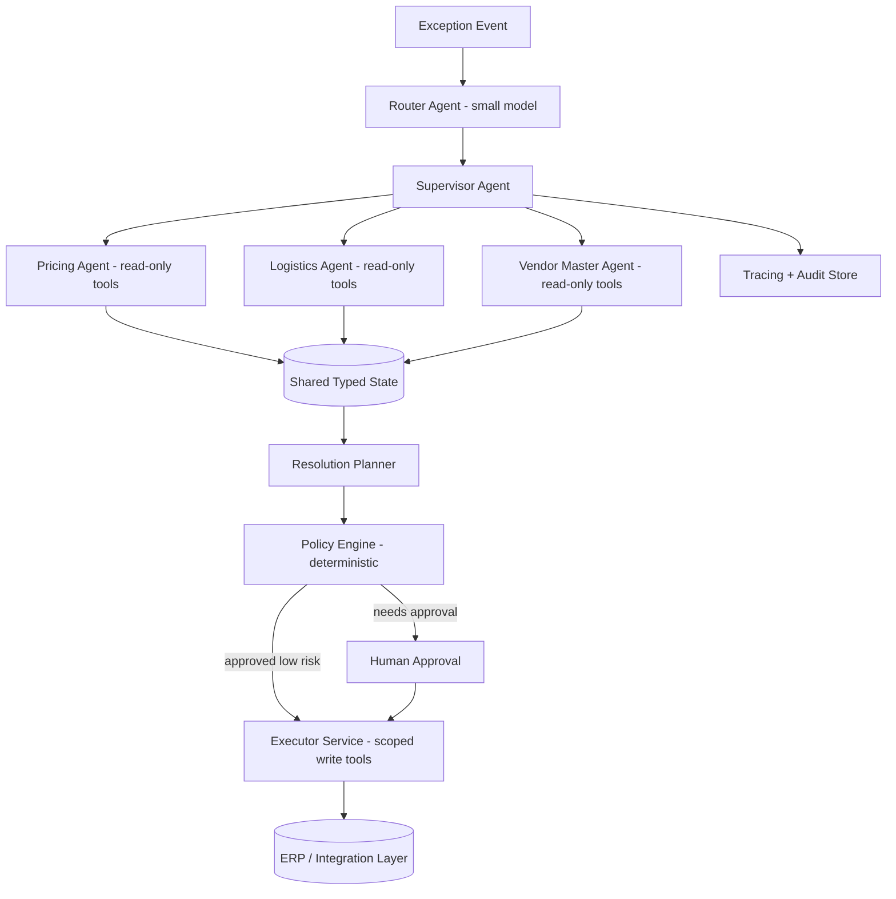

# Multi-agent vs single-agent design — decision criteria

> [← Back to Interview Preparation Home](interview-index.md)

## 1. Brief Summary

### Definition
- A **single-agent** system uses one LLM-driven loop (reason → act with tools → observe) with one prompt/context to accomplish a task.
- A **multi-agent** system uses several specialized agents (each with its own prompt, tools, memory, possibly model) that collaborate through an orchestrator, hand-offs, or peer messaging.

### Why it matters
Agent architecture drives reliability, cost, latency, debuggability, and security. Over-engineering with many agents is a frequent and costly mistake; under-engineering causes overloaded prompts and tool confusion.

### Core concepts and terminology
- **Agent loop (ReAct)**, **tool/function calling**, **planner-executor**, **supervisor/worker (orchestrator)**, **handoff**, **swarm**, **group chat**, **hierarchical agents**, **critic/reviewer (reflection)**.
- **Workflow vs agent**: deterministic orchestrated steps (prompt chaining, routing, parallelization) versus model-driven control flow.
- **Shared state / blackboard**, **context isolation**, **memory** (short/long-term), **agent-to-agent protocols (A2A)**, **MCP** for tools.
- **Termination conditions**, **budget (tokens/steps)**, **human-in-the-loop (HITL)**.

### How it works
- **Single agent:** one system prompt lists tools; model decides next action until done.
- **Multi-agent:** orchestrator decomposes the goal; specialist agents (research, SQL, code, compliance review) run with narrower prompts/tools; results are merged; a critic may validate.

### Where it is used
Customer service with escalations, research/analysis, software engineering assistants, data analysis, IT operations (AIOps), procurement/ERP automation, document-processing pipelines.

### Important tools
Microsoft Agent Framework / Semantic Kernel / AutoGen, LangGraph, CrewAI, OpenAI Agents SDK, Azure AI Foundry Agent Service, LlamaIndex Workflows, Google ADK, A2A and MCP protocols.

### Common misconceptions
- "More agents = smarter system." Often it multiplies cost, latency, and error compounding.
- "Multi-agent is required for complex tasks." Many are solved with a single agent with good tools or a deterministic workflow.
- "Agents can be left fully autonomous."

### Key points to remember
- **Start with the simplest thing**: single LLM call → workflow → single agent → multi-agent.
- Use multi-agent when there is **tool/context overload, need for specialization, parallelism, independent security boundaries, or separation of duties.**
- Budget steps and tokens; instrument everything; keep humans in the loop for risky actions.

---

## 2. Interview Questions

### Beginner Questions

**Q1. What is an AI agent?**
- **Model answer:** An LLM-driven system that decides on actions, calls tools (APIs, search, code), observes results, and iterates toward a goal, as opposed to a single prompt-response.
- **Key points expected:** Loop, tools, autonomy, state.
- **Mistake to avoid:** Calling any chatbot an agent.

**Q2. What is the difference between a workflow and an agent?**
- **Model answer:** A workflow follows predefined code paths with LLM calls at steps; an agent lets the model dynamically choose steps and tools. Workflows are more predictable; agents more flexible.
- **Key points expected:** Control flow location, predictability trade-off.
- **Mistake to avoid:** Treating them as the same.

**Q3. What is a multi-agent system?**
- **Model answer:** Multiple LLM agents with distinct roles/tools collaborating, typically coordinated by a supervisor, to solve a task.
- **Key points expected:** Roles, coordination.
- **Mistake to avoid:** Describing just multiple LLM calls in sequence.

**Q4. Give one advantage of multi-agent design.**
- **Model answer:** Specialization: each agent has a focused prompt and small toolset, improving tool selection accuracy and enabling different models per role; also parallelism and isolation.
- **Key points expected:** Focus, modularity.
- **Mistake to avoid:** Claiming it is always more accurate.

**Q5. Give one disadvantage of multi-agent design.**
- **Model answer:** Higher cost and latency, harder debugging, error propagation between agents, and context loss in hand-offs.
- **Key points expected:** Complexity and cost.
- **Mistake to avoid:** Not mentioning observability difficulty.

**Q6. What is tool/function calling?**
- **Model answer:** The model outputs a structured request (name + JSON arguments) for a function defined by the developer; the runtime executes it and returns results to the model.
- **Key points expected:** Schema, execution by runtime not model.
- **Mistake to avoid:** Saying the model executes code itself.

**Q7. What is human-in-the-loop in agents?**
- **Model answer:** Inserting human approval or input at checkpoints, especially before irreversible or high-risk actions.
- **Key points expected:** Approval gates, risk-based.
- **Mistake to avoid:** Assuming HITL is only for training.

**Q8. Why limit the number of steps an agent can take?**
- **Model answer:** To prevent infinite loops, runaway costs, and unintended actions; use max iterations, token budgets, and timeouts.
- **Key points expected:** Cost and safety controls.
- **Mistake to avoid:** Relying on the model to stop itself.

### Intermediate Questions

**Q1. List decision criteria for choosing multi-agent over single-agent.**
- **Model answer:** (1) Tool count/ambiguity: >10–20 tools degrade selection. (2) Context size: independent subtasks needing separate contexts. (3) Specialization: different prompts/models per domain. (4) Parallelizable subtasks. (5) Security/permission boundaries (an agent with only read-only access vs one with write). (6) Separation of duties (maker–checker). (7) Team ownership boundaries. If none apply, keep a single agent.
- **Key technical considerations:** Measure with evaluation before and after splitting.
- **Follow-up:** "How would you prove the split improved results?"

**Q2. Explain supervisor/worker vs peer-to-peer (swarm/group chat) patterns.**
- **Model answer:** Supervisor pattern centralizes routing and aggregation, giving control and traceability. Peer/swarm patterns let agents hand off dynamically, flexible but harder to bound and debug. Enterprise systems usually prefer supervisor or graph-defined flows.
- **Key technical considerations:** Termination, loops, accountability.
- **Follow-up:** "How would you prevent two agents from ping-ponging?"

**Q3. How do you manage state and context between agents?**
- **Model answer:** Pass minimal structured artifacts (JSON summaries, IDs) rather than whole transcripts; use a shared state store (graph state) with typed schema; keep per-agent private scratchpads; summarize long histories; persist checkpoints for resume.
- **Key technical considerations:** Context bloat, information loss, PII in shared state.
- **Follow-up:** "What gets lost in a summary handoff and how do you mitigate?"

**Q4. How does error compounding affect multi-agent systems?**
- **Model answer:** If each step is 95% reliable, a 6-step chain is ~74% reliable. Mitigate with validation at boundaries, schema enforcement, retries, critics, deterministic code for deterministic parts, and fewer hops.
- **Key technical considerations:** Per-step evaluation, circuit breakers.
- **Follow-up:** "Where would you insert deterministic validation?"

**Q5. When would you use a deterministic workflow instead of agents?**
- **Model answer:** When steps are known, ordering stable, and compliance requires predictability, e.g., invoice processing: extract → validate → match PO → route. Use LLM only for fuzzy steps.
- **Key technical considerations:** Auditability, cost, latency.
- **Follow-up:** "How do you handle exceptions that the workflow didn't foresee?"

**Q6. How do you secure tools used by agents?**
- **Model answer:** Least privilege per agent (scoped credentials, read-only where possible), allow-lists, parameter validation, sandboxed code execution, approval gates for destructive actions, and audit logs. Don't let an agent with untrusted-input exposure also hold powerful write tools.
- **Key technical considerations:** Confused deputy, prompt injection via tool outputs.
- **Follow-up:** "How does splitting agents help with the 'lethal trifecta'?"

**Q7. How do you choose models for different agents?**
- **Model answer:** Use stronger models for planning/supervision and hard reasoning; smaller/faster models for routing, extraction, formatting. Evaluate each role independently and total system cost/latency.
- **Key technical considerations:** Model diversity increases integration/maintenance.
- **Follow-up:** "How do you test swapping a model for one role?"

**Q8. How do you observe and debug multi-agent runs?**
- **Model answer:** Distributed tracing with a trace ID across agents; span per LLM/tool call capturing prompts, outputs, tokens, latency, and decisions; replay capability; visual graph of runs; alert on loops and cost spikes.
- **Key technical considerations:** PII in traces, sampling, OpenTelemetry GenAI semantic conventions.
- **Follow-up:** "How do you reproduce a non-deterministic failure?"

### Advanced Questions

**Q1. Design an agentic system for procurement exception handling in an ERP. Single or multi-agent?**
- **Model answer:** Start with workflow + single agent per exception class. Use a router (cheap model) to classify the exception; specialized agents for price mismatch, missing goods receipt, and vendor master issues—each with read-only ERP tools and a proposal tool; a deterministic policy engine validates; write actions require approval above a threshold. Multi-agent is justified here by separate tool domains and permission boundaries.
- **Design considerations:** Idempotent ERP APIs, audit trail, transactional integrity, rollback.
- **Trade-offs:** More agents give least privilege but increase orchestration complexity.
- **Follow-ups:** "How do you handle partial failure after a write?"

**Q2. Your multi-agent system costs 6x more than expected. How do you reduce it?**
- **Model answer:** Trace token usage per agent; remove redundant context passing; summarize handoffs; use smaller models for simple roles; cache tool results and prompts; limit reflection loops; merge agents that don't need separation; convert stable sub-flows into deterministic code; set budgets and early exits.
- **Design considerations:** Cost attribution per agent/run, quality regression checks.
- **Trade-offs:** Cost reduction vs quality; measure Pareto frontier.
- **Follow-ups:** "How would you set per-request cost ceilings?"

**Q3. Two agents produce conflicting outputs. How does the system resolve this?**
- **Model answer:** Define arbitration: a judge/critic with explicit criteria, evidence-based verification (re-query sources), deterministic rules for known conflicts, voting for independent samples, or escalate to a human. Log the disagreement for evaluation.
- **Design considerations:** Independence of agents (avoid correlated errors), grounding in sources.
- **Trade-offs:** Extra calls vs reliability.
- **Follow-ups:** "When is majority voting harmful?"

**Q4. How would you make an agent system resilient to prompt injection from retrieved documents or tool outputs?**
- **Model answer:** Treat all tool/document content as untrusted data; separate privileged planner from untrusted-content processors (dual-LLM/quarantine pattern); restrict tool permissions; require explicit user approval for sensitive actions; strip/mark untrusted content; output validation; monitor for anomalous tool-call patterns.
- **Design considerations:** Information-flow control, capability scoping.
- **Trade-offs:** Isolation reduces flexibility and may reduce capability.
- **Follow-ups:** "How would you test it?"

**Q5. Compare frameworks (LangGraph, Semantic Kernel/Agent Framework, AutoGen, CrewAI) for enterprise use.**
- **Model answer:** Evaluate on explicit state/graph control, persistence/checkpointing, observability, human-in-the-loop support, language/runtime fit (.NET/Python), maturity, security, community, and Azure integration. Graph-based explicit orchestration (LangGraph, Agent Framework workflows) suits controlled enterprise flows; conversation-driven frameworks are flexible but less predictable.
- **Design considerations:** Avoid lock-in via thin abstractions, standard protocols (MCP, A2A, OpenTelemetry).
- **Trade-offs:** Speed of prototyping vs production controls.
- **Follow-ups:** "How would you migrate between frameworks?"

**Q6. Design long-running agent tasks (hours/days) with reliability.**
- **Model answer:** Durable execution (Temporal, Durable Functions, LangGraph checkpoints), persisted state, idempotent tools, retries with backoff, timeouts, human approvals as signals, and resumability after crashes. Separate the agent "brain" from the executor.
- **Design considerations:** State versioning when prompts change mid-run, compensation (saga) logic.
- **Trade-offs:** Added infrastructure vs reliability.
- **Follow-ups:** "What happens to in-flight runs when you deploy a new prompt?"

**Q7. How do you evaluate whether adding a critic agent is worth it?**
- **Model answer:** A/B on a golden set: measure error catch rate, false rejections, quality delta, added latency/cost; analyze whether critic shares blind spots with the generator (same model); consider using verification via tools/rules instead.
- **Design considerations:** Independent verification signals, severity-weighted errors.
- **Trade-offs:** Quality gain vs cost; self-critique has limited efficacy.
- **Follow-ups:** "When would you prefer programmatic checks?"

**Q8. Explain how you would explain the agent's decision for audit.**
- **Model answer:** Persist full trace: inputs, retrieved evidence, tool calls with arguments and results, intermediate reasoning summaries (not necessarily raw chain-of-thought), policy checks, approvals, and final action, tied to user identity and version of prompts/models.
- **Design considerations:** Immutable storage, retention, redaction.
- **Trade-offs:** Storage/privacy vs auditability.
- **Follow-ups:** "How do you handle right-to-erasure in audit logs?"

---

## 3. Use Cases

### Simple Use Case — Single agent with tools for IT helpdesk
- **Problem:** Answer employee questions and perform simple actions (reset password link, check ticket status).
- **Assumptions:** 5 tools, low-risk actions, ~1k requests/day.
- **Steps:**
  1. Define tool schemas (KB search, ticket lookup, create ticket).
  2. Write a system prompt with policies and refusal rules.
  3. Cap max steps to 6; log traces.
  4. Require confirmation before creating tickets.
- **Expected result:** Majority of simple requests resolved; clear audit logs.
- **Tools:** Azure OpenAI function calling, Semantic Kernel or OpenAI Agents SDK, ITSM API.

### Intermediate Use Case — Financial research assistant (supervisor + specialists)
- **Scenario:** Analysts request company briefings combining filings, market data, and news.
- **Requirements:** Cited output, parallel data gathering, <60 s response, analyst review.
- **Proposed solution:** Supervisor agent delegates to Filings RAG agent, Market Data (SQL/API) agent, and News agent in parallel; a Writer agent composes; a deterministic citation checker validates references.
- **Implementation steps:**
  1. Define typed state schema (company, findings[], citations[]).
  2. Implement each specialist with limited tools.
  3. Implement parallel fan-out/fan-in in LangGraph.
  4. Add validator to ensure each claim has a source.
  5. HITL review before distribution.
- **Technical challenges:** Conflicting data sources, rate limits, summarization loss, cost.
- **Expected result:** Briefings produced in under a minute with traceable sources.
- **Testing approach:** Golden set of 50 companies with analyst-written benchmarks; evaluate each agent independently and end-to-end; failure injection for API timeouts.

### Difficult Use Case — Enterprise ERP operations agent platform
- **Scenario:** A global manufacturer automates order-to-cash and procure-to-pay exception handling across SAP and other systems.
- **Functional requirements:** Classify exceptions, gather context across systems, propose and (with approval) execute fixes, maintain audit.
- **Non-functional requirements:** Zero unauthorized writes, 99.9% availability, p95 proposal in 30 s, full audit for SOX, multi-region.

**Proposed architecture**

**Components and responsibilities**
- **Router:** cheap classification of exception type.
- **Specialist agents:** read-only retrieval/analysis within their domain.
- **Planner:** produces structured resolution proposals.
- **Policy engine:** deterministic rules (limits, segregation of duties).
- **Executor:** the only component with write credentials; idempotent, transactional.
- **Audit store:** immutable trace of decisions and approvals.

**Processing flow:** event → classify → parallel context gathering → proposal → policy check → approval → execution → verification → close.

**Security:** Separation of read and write identities, managed identities with scoped roles, input sanitization against injection from free-text fields (e.g., vendor notes), approvals bound to proposal hash, network isolation via integration gateway.

**Performance/scalability:** Event-driven queue, autoscaled workers, durable execution engine for long approvals, caching of master data lookups, model tiering.

**Monitoring:** Per-agent success rate, loop count, cost per case, approval override rate, policy violations blocked, ERP error rates, drift in exception mix.

**Failure scenarios and recovery**
- LLM outage → fall back to rule-based routing and human queue.
- ERP write fails midway → saga compensation, idempotency keys, alert.
- Agent loop → step budget triggers escalation.
- Bad prompt release → feature-flagged rollback, shadow mode before enablement.

**Trade-offs and alternatives**
- Multi-agent with narrow tools boosts safety but increases orchestration; alternative: a single agent with a strictly gated tool proxy.
- Fully autonomous execution reduces cost but raises risk; start with recommend-only mode.
- Alternative: classic BPM/RPA with LLM only for classification and extraction—less flexible but easier to certify.
