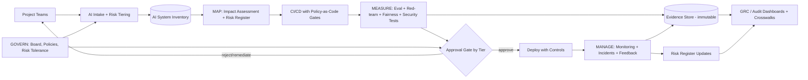

# NIST AI RMF — how you would apply it to a new project

> [← Back to Interview Preparation Home](interview-index.md)

## 1. Brief Summary

### Definition
The **NIST AI Risk Management Framework (AI RMF 1.0)**, published January 2023 by the U.S. National Institute of Standards and Technology, is a voluntary, sector-agnostic framework to help organizations **manage risks to individuals, organizations, and society** associated with AI, and to promote **trustworthy AI**. A companion **Generative AI Profile (NIST AI 600-1, July 2024)** adds risks and suggested actions specific to generative AI. "Applying it to a new project" means translating the framework's functions into concrete activities across the project lifecycle.

### Why it matters
It gives organizations a common language and structure for AI governance, aligns with regulations (EU AI Act, state laws, sector rules), supports procurement and audit expectations, and prevents ad hoc risk handling. It is frequently referenced in enterprise architecture interviews as the backbone of responsible AI programs.

### Core concepts and terminology
- **Four core functions:**
  1. **GOVERN** – cross-cutting culture, policies, accountability, roles, risk tolerance, third-party management, legal/regulatory compliance. Applies across all stages.
  2. **MAP** – establish context: intended purpose, stakeholders, deployment environment, data, capabilities, limitations, potential impacts/benefits, and risk identification.
  3. **MEASURE** – analyze, assess, benchmark, and monitor AI risks and trustworthiness using quantitative/qualitative methods and testing (TEVV: test, evaluation, verification, validation).
  4. **MANAGE** – prioritize and treat risks: mitigation, transfer, avoidance, acceptance; incident response; monitoring and continuous improvement.
- **Trustworthiness characteristics:** valid and reliable; safe; secure and resilient; accountable and transparent; explainable and interpretable; privacy-enhanced; fair with harmful bias managed.
- **Categories/subcategories** (e.g., GOVERN 1.x, MAP 1.x) with suggested outcomes; **Profiles** (use-case, temporal "current vs target"); **Playbook** with suggested actions.
- **AI actors:** developers, deployers, operators, impacted communities, TEVV experts, domain experts.
- **Generative AI risks (600-1):** confabulation, data privacy, information security, CBRN information, dangerous/violent content, harmful bias/homogenization, human-AI configuration, information integrity, intellectual property, obscene content, value chain and component integration, environmental impacts.

### How to apply it to a new project (practical sequence)
1. **GOVERN setup:** assign an accountable owner and RACI; adopt/confirm AI policy and risk tolerance; classify project risk tier; plan documentation; include third-party/vendor model due diligence; define escalation and decommission criteria.
2. **MAP:** document use case, users, affected stakeholders, intended and foreseeable misuse, legal context, data sources and provenance, model/system architecture, assumptions, benefits vs harms; identify risks by trustworthiness characteristic (and 600-1 risk categories for GenAI); decide go/no-go thresholds.
3. **MEASURE:** define metrics and test plan (accuracy, groundedness, robustness, bias, security/red-team, privacy leakage, human factors); establish baselines and acceptance criteria; run TEVV pre-deployment; plan production monitoring metrics and independent review.
4. **MANAGE:** prioritize risks; implement controls (guardrails, human oversight, access control, content filters, fallback); document residual risk and approval; define incident response, change management, and re-assessment triggers; monitor and report; update risk register.
5. **Iterate:** continuous loop; re-map when context, model, data, or regulations change.

### Where it is used
Federal agencies, regulated industries (finance, healthcare), enterprises building governance programs, vendors answering customer AI due-diligence questionnaires, alignment with ISO/IEC 42001 and EU AI Act compliance efforts.

### Important tools and related frameworks
NIST AI RMF Playbook & Generative AI Profile (AI 600-1), NIST AI 100-2 (adversarial ML taxonomy), NIST SP 800-53/CSF 2.0, ISO/IEC 42001 & 23894, EU AI Act, OECD AI Principles, MITRE ATLAS, OWASP LLM Top 10, Microsoft Responsible AI Standard, model/system cards, risk registers, GRC tools (ServiceNow, OneTrust, Archer), Azure AI Foundry evaluations & safety tools.

### Common misconceptions
- "It's a certification or compliance checklist" — it's voluntary and outcome-oriented.
- "The four functions are sequential phases" — GOVERN is continuous; others iterate.
- "It only applies to developers" — deployers/procurers also apply it.
- "It replaces security frameworks" — it complements them.

### Key points to remember
- **Govern (culture/policy) → Map (context/risk) → Measure (test/monitor) → Manage (treat/respond).**
- Tie each function to **concrete artifacts**: risk register, impact assessment, test report, monitoring plan, incident playbook.
- Scale effort to **risk tier**; use the **GenAI Profile** for LLM projects.
- Document **residual risk acceptance** by an accountable owner.

---

## 2. Interview Questions

### Beginner Questions

**Q1. What is the NIST AI RMF?**
- **Model answer:** A voluntary framework from NIST to help organizations identify, assess, and manage AI risks and build trustworthy AI, organized around four functions: Govern, Map, Measure, Manage.
- **Key points expected:** Voluntary, four functions, trustworthy AI.
- **Mistake to avoid:** Calling it a law or certification.

**Q2. Name the four core functions.**
- **Model answer:** Govern, Map, Measure, Manage.
- **Key points expected:** One-line meaning each.
- **Mistake to avoid:** Listing "Identify, Protect, Detect, Respond" (that's CSF).

**Q3. What are the characteristics of trustworthy AI in the framework?**
- **Model answer:** Valid and reliable; safe; secure and resilient; accountable and transparent; explainable and interpretable; privacy-enhanced; fair with harmful bias managed.
- **Key points expected:** Most of the seven.
- **Mistake to avoid:** Mentioning only accuracy and fairness.

**Q4. Which function is cross-cutting?**
- **Model answer:** Govern; it infuses the other three and covers policies, roles, culture, and accountability throughout the lifecycle.
- **Key points expected:** Continuous nature.
- **Mistake to avoid:** Treating Govern as a one-time kickoff.

**Q5. What is the Generative AI Profile?**
- **Model answer:** NIST AI 600-1, a companion resource identifying risks unique to or amplified by generative AI (e.g., confabulation, information integrity, IP) and suggested actions aligned to the RMF functions.
- **Key points expected:** GenAI-specific supplement.
- **Mistake to avoid:** Believing it's a separate framework.

**Q6. Is NIST AI RMF mandatory?**
- **Model answer:** No, it's voluntary, though it influences regulation, procurement, and best practice, and some laws reference it as a safe harbor or baseline.
- **Key points expected:** Voluntary but influential.
- **Mistake to avoid:** Overstating legal force.

**Q7. What does "Map" involve?**
- **Model answer:** Understanding context: purpose, users, stakeholders, data, environment, benefits, potential harms, and risks, before building or deploying.
- **Key points expected:** Context before controls.
- **Mistake to avoid:** Jumping to metrics without context.

**Q8. Who should be involved in applying the RMF?**
- **Model answer:** Cross-functional stakeholders: product, engineering, data science, security, legal/compliance, privacy, domain experts, and representatives of impacted groups; executive sponsor for accountability.
- **Key points expected:** Multi-disciplinary.
- **Mistake to avoid:** Leaving it to the data science team alone.

### Intermediate Questions

**Q1. You're starting a new GenAI customer-support project. Walk through applying the RMF.**
- **Model answer:** Govern: name owner, classify risk (customer-facing, moderate), confirm policies (data use, vendor), define approval gates. Map: document users, intended use, out-of-scope (legal/medical advice), data sources, harms (confabulation, privacy leakage, harmful content, bias), regulatory context. Measure: define metrics (groundedness, resolution accuracy, toxicity, injection attack success rate, PII leakage), build golden and red-team sets, run TEVV pre-launch, set production monitoring. Manage: implement guardrails, human escalation, fallback, incident process, residual-risk sign-off, re-assessment triggers (model change, new data source).
- **Key technical considerations:** Evidence artifacts at each step; map risks to 600-1 categories.
- **Follow-up:** "What would be a go/no-go criterion?"

**Q2. How do you build a risk register for an AI project?**
- **Model answer:** Identify risks per trustworthiness characteristic and lifecycle stage; for each: description, source, impact (severity), likelihood, affected stakeholders, existing controls, mitigation actions, owner, residual risk, review date. Prioritize via a matrix; link to metrics and tests.
- **Key technical considerations:** Include third-party/model supply-chain risks, emergent behaviors.
- **Follow-up:** "How do you quantify likelihood for novel risks?"

**Q3. How does MEASURE differ from simple model evaluation?**
- **Model answer:** It's broader: includes performance but also robustness, safety, security, privacy, fairness, explainability, human-AI interaction, and real-world monitoring. It uses independent TEVV, documents methods and uncertainty, and covers both pre-deployment and operational measurement.
- **Key technical considerations:** Metrics tied to risks identified in MAP; independence of evaluators.
- **Follow-up:** "How do you measure risks that have no good metric?"

**Q4. How do you handle third-party/foundation models under the RMF?**
- **Model answer:** GOVERN includes vendor due diligence: model/system cards, data practices, security attestations, SLAs, incident notification, change/deprecation notice. MAP identifies dependency risks; MEASURE tests the integrated system with your data/use case; MANAGE includes fallback providers, contractual controls, and monitoring of silent model updates.
- **Key technical considerations:** Limited transparency into training data, shared responsibility.
- **Follow-up:** "What if the vendor refuses to share evaluation details?"

**Q5. How does NIST AI RMF relate to ISO/IEC 42001 and the EU AI Act?**
- **Model answer:** AI RMF is a voluntary risk framework; ISO 42001 is a certifiable AI management system standard; the EU AI Act is binding regulation with risk tiers and obligations. They complement: RMF informs risk practices, ISO 42001 provides management system structure/audit, and the Act defines legal requirements. Maintain a crosswalk to reuse evidence.
- **Key technical considerations:** Mapping controls, avoiding duplicate documentation.
- **Follow-up:** "Which would you adopt first for a US company selling to the EU?"

**Q6. What does MANAGE include post-deployment?**
- **Model answer:** Risk response decisions, implementing mitigations, monitoring for drift/incidents, feedback channels, incident response and disclosure, change management, periodic re-assessment, and decommissioning planning.
- **Key technical considerations:** Triggers for re-review; metrics thresholds.
- **Follow-up:** "What's your rollback criterion?"

**Q7. How would you tier AI projects by risk to scale RMF effort?**
- **Model answer:** Use criteria: impact on people (rights, safety, finances), autonomy level, data sensitivity, scale, reversibility, regulatory status. Define tiers (low/medium/high) each with required artifacts (e.g., high: full impact assessment, independent testing, board approval).
- **Key technical considerations:** Avoid over-burdening low-risk projects.
- **Follow-up:** "How do you handle a project that changes tier mid-flight?"

**Q8. How do you apply the RMF to an agentic system?**
- **Model answer:** MAP extra risks: excessive agency, tool misuse, injection, cascading errors; MEASURE includes trajectory evaluation, red-teaming tools, permission tests; MANAGE adds approval gates, scoped credentials, kill switches, step/cost budgets, audit logs. GOVERN defines accountability for agent actions.
- **Key technical considerations:** Human oversight design.
- **Follow-up:** "Who is accountable when an agent causes harm?"

### Advanced Questions

**Q1. Build an AI governance program based on the RMF for a 10,000-employee enterprise starting from scratch.**
- **Model answer:** GOVERN: executive sponsor, AI governance board, policy suite (acceptable use, data, vendor, model risk), RACI, inventory of AI systems, risk tiering, training. MAP: standardized intake and impact assessment templates. MEASURE: shared evaluation platform, red-team capability, metrics catalog, independent validation for high-risk. MANAGE: risk register tooling, approval workflow, incident response, monitoring dashboards, periodic audits. Roadmap in phases: quick wins (inventory, policy), foundations (tiering, templates), scale (automation, evidence as code), maturity (continuous assurance, external audit/ISO 42001).
- **Design considerations:** Policy-as-code, integration with SDLC/CI, federated champions.
- **Trade-offs:** Central control vs speed; depth vs adoption.
- **Follow-ups:** "How do you measure program maturity and effectiveness?"

**Q2. How do you define risk tolerance and acceptance for generative AI?**
- **Model answer:** Executive-level statements by impact category (safety, financial, legal, reputational), with quantified thresholds where possible (e.g., hallucination rate in customer-facing contexts, severity-1 incidents), differentiating by use case tier. Acceptance requires named owner sign-off with documented rationale and compensating controls; reviewed regularly.
- **Design considerations:** Aligning with enterprise risk management (ERM), escalation paths.
- **Trade-offs:** Zero-risk unrealistic; excessively lax tolerance invites incidents.
- **Follow-ups:** "Give an example of a risk you would refuse to accept."

**Q3. A pre-launch test shows 3% confabulation in a financial-advice assistant. What does the RMF process dictate?**
- **Model answer:** Revisit MAP (harm severity: financial advice is high-impact), compare to risk tolerance, and MANAGE: mitigate (grounding, restrict scope to informational, citations, deterministic calculators, human review, disclaimers, abstention), re-MEASURE, and require sign-off for residual risk; consider no-go or phased pilot with monitoring; document decision and triggers for re-assessment.
- **Design considerations:** Severity-weighted metrics; regulatory constraints (suitability rules).
- **Trade-offs:** Utility vs risk; time-to-market.
- **Follow-ups:** "What level would you consider acceptable and why?"

**Q4. How do you generate audit-ready evidence continuously instead of manual documents?**
- **Model answer:** Embed controls in CI/CD: evaluation runs produce signed reports stored in an evidence repository; model/prompt registry records versions and approvals; policy-as-code gates; monitoring exports to GRC; automated lineage; risk register links to tests and incidents. This yields "evidence as code" aligned to RMF subcategories.
- **Design considerations:** Immutable storage, mapping controls to RMF/ISO/EU AI Act.
- **Trade-offs:** Upfront engineering vs ongoing manual effort.
- **Follow-ups:** "Which artifacts would an external auditor examine first?"

**Q5. Compare applying the RMF to a built-in-house model vs a purchased SaaS AI feature.**
- **Model answer:** In-house: full lifecycle responsibility (data, training, TEVV). SaaS: focus on GOVERN (vendor risk, contracts), MAP (use context, data flows, dependency), MEASURE (acceptance testing on your data, monitoring outputs), MANAGE (configurations, fallback, incident coordination). Limited transparency requires compensating controls: human review, restricted data, contractual commitments, and exit plan.
- **Design considerations:** Shared responsibility matrices.
- **Trade-offs:** Control vs speed.
- **Follow-ups:** "How do you assess a vendor's AI claims?"

**Q6. How would you integrate adversarial/security testing (NIST AI 100-2, MITRE ATLAS) into MEASURE?**
- **Model answer:** Build threat models for the system (evasion, poisoning, extraction, prompt injection); design tests and red-team exercises mapped to ATLAS techniques; measure attack success rates and defenses; include supply-chain checks; feed findings into MANAGE controls; repeat per release and on threat changes.
- **Design considerations:** Test environments, responsible disclosure, tool selection (PyRIT, garak, Counterfit).
- **Trade-offs:** Depth vs coverage; cost.
- **Follow-ups:** "How do you decide red-team frequency?"

**Q7. How do you treat societal and environmental impacts under the RMF?**
- **Model answer:** MAP includes broader impacts: worker displacement, misinformation, accessibility, energy and carbon (GenAI profile lists environmental impacts). MEASURE uses available metrics (energy per inference, carbon estimates), stakeholder feedback; MANAGE mitigates (efficient models, caching, regional carbon-aware scheduling) and reports.
- **Design considerations:** Stakeholder engagement, proportionality.
- **Trade-offs:** Business value vs externalities.
- **Follow-ups:** "How would you include affected communities?"

**Q8. How would you use RMF Profiles (current vs target)?**
- **Model answer:** Create a current profile by assessing existing practices against RMF subcategories, define a target profile based on risk appetite, regulations, and context, perform gap analysis, prioritize roadmap items, and track progress. Use cross-sector or use-case profiles (GenAI) as starting points.
- **Design considerations:** Maturity scoring scheme, ownership, timelines.
- **Trade-offs:** Assessment overhead vs targeted improvements.
- **Follow-ups:** "How often do you refresh profiles?"

---

## 3. Use Cases

### Simple Use Case — Lightweight RMF for an internal summarization tool
- **Problem:** A team wants to launch a meeting-notes summarizer for internal use.
- **Assumptions:** Low risk tier; no decisions about individuals; internal data.
- **Steps:**
  1. GOVERN: name an owner; confirm data-handling policy.
  2. MAP: write a one-page context sheet (purpose, users, data, risks like confabulation/privacy).
  3. MEASURE: test on 50 meetings for factual consistency and sensitive info leakage.
  4. MANAGE: add disclaimer, opt-out, retention limit, feedback button; record residual risk acceptance.
- **Expected result:** Documented, proportionate risk management completed in days.
- **Tools:** Risk register template, Azure OpenAI, evaluation scripts.

### Intermediate Use Case — RMF applied to a customer-facing RAG assistant at a bank
- **Scenario:** A bank launches a chatbot answering product and fee questions using policy documents.
- **Requirements:** No misleading statements, fair treatment, privacy compliance, auditability, regulator readiness.
- **Proposed solution:** Risk-tier as high-medium; implement RMF artifacts: AI impact assessment, risk register, test plan, monitoring plan, incident playbook, sign-off.
- **Implementation steps:**
  1. GOVERN: assign accountable executive; map to model risk management policy; vendor due diligence on LLM provider.
  2. MAP: stakeholders (customers, compliance, support), misuse scenarios, harm analysis (misstatement of fees).
  3. MEASURE: groundedness ≥ 95% on golden set, 0 critical hallucinations on regulated topics, injection ASR < 2%, bias tests across language variants; independent validation by model risk team.
  4. MANAGE: restrict scope, cite sources, escalate to human, monitoring dashboards, quarterly re-validation, incident reporting SLAs.
- **Technical challenges:** Defining thresholds, keeping documents current, multilingual coverage.
- **Expected result:** Launch with documented, defensible risk posture and continuing oversight.
- **Testing approach:** Red-team exercises, shadow mode on live queries, compliance review of sample responses, rollback drill.

### Difficult Use Case — Enterprise AI governance platform operationalizing the RMF
- **Scenario:** A global healthcare company with 60 AI systems (ML + GenAI) wants a continuous, auditable RMF implementation integrated with engineering workflows.
- **Functional requirements:** AI inventory, risk tiering, automated evidence collection, approval workflows, monitoring, incident management, regulatory crosswalks (RMF, ISO 42001, EU AI Act, HIPAA).
- **Non-functional requirements:** Scalable to hundreds of systems, auditable immutable records, integration with CI/CD and GRC, low friction for teams, regional data controls.

**Proposed architecture**

**Components and responsibilities**
- **Intake & inventory:** register every AI system with owner, purpose, data, vendor, tier.
- **Impact assessment & risk register:** structured MAP artifacts linked to systems.
- **Policy-as-code gates in CI/CD:** require tests/approvals per tier before deploy.
- **Measurement suite:** standardized evaluation, red-team, fairness, privacy, security tests.
- **Evidence store:** immutable, signed artifacts mapped to RMF subcategories.
- **Monitoring & incident management:** production metrics, alerts, incident workflow.
- **GRC integration:** dashboards, crosswalks, audit exports.

**Processing flow:** intake → tier → impact assessment → build/test with gates → approval → deployment → monitoring → incidents/feedback → risk register update → periodic review.

**Security:** RBAC on assessments and evidence, segregation of duties (developers cannot approve their own high-risk systems), encryption, regional data controls, tamper-evident logs, vendor risk integration.

**Performance/scalability:** Templated assessments, automation of evidence capture from pipelines, API-driven integration, tiered review capacity (fast lane for low risk), federated champions.

**Monitoring and observability:** Coverage metrics (systems inventoried/assessed), overdue reviews, incident counts/MTTR, drift/quality metrics, control effectiveness, audit findings, training completion.

**Failure scenarios and recovery**
- Shadow AI (uninventoried systems) → discovery scans (network, SaaS usage, procurement data), amnesty and onboarding process.
- Evidence gaps at audit → backfill via reconstruction, tighten gates, root-cause.
- Incident from an approved system → incident playbook, rollback/kill switch, post-incident review feeding MAP/MEASURE updates.
- Overly slow governance → fast-lane policy, SLA tracking, continuous improvement.

**Trade-offs and alternatives**
- Heavy automation requires upfront investment; alternative: start with templates/spreadsheets and phase automation.
- Central governance ensures consistency but risks bottlenecks; federated model with central standards balances speed.
- Pursuing ISO 42001 certification adds assurance but cost; may start with RMF-aligned internal assessment.
