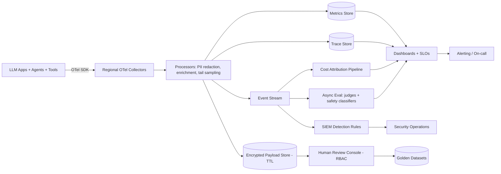

# Observability design for LLM applications (what to instrument)

> [← Back to Interview Preparation Home](interview-index.md)

## 1. Brief Summary

### Definition
**Observability for LLM applications** is the ability to understand the internal behavior and quality of an LLM-powered system from the telemetry it emits: traces, metrics, logs, events, evaluations, and feedback. Unlike traditional services, you must observe not only *availability and latency* but also *output quality, safety, grounding, cost, and non-deterministic multi-step behavior* (retrieval, prompts, tool calls, agent loops).

### Why it matters
LLM failures are often "silent": the service returns HTTP 200 with a wrong, unsafe, or expensive answer. Without deep instrumentation you can't debug hallucinations, regressions, cost spikes, or injection attempts, nor prove compliance.

### Core concepts and terminology
- **Three pillars:** traces, metrics, logs (+ events, profiles). For LLMs add **evaluations** and **feedback** as fourth/fifth signals.
- **Trace / span:** one request = a trace; each retrieval, LLM call, tool call, guardrail check = a span.
- **OpenTelemetry (OTel) GenAI semantic conventions:** standard attributes such as `gen_ai.system`, `gen_ai.request.model`, `gen_ai.usage.input_tokens`, `gen_ai.usage.output_tokens`, `gen_ai.response.finish_reasons`.
- **Golden signals adapted:** latency (incl. **TTFT** and inter-token latency), traffic, errors (incl. content-filter blocks, 429s), saturation (quota/PTU/GPU utilization).
- **Quality signals:** groundedness, relevance, user feedback, LLM-judge scores, refusal rate.
- **Cost signals:** tokens, cached tokens, cost per request/tenant.
- **Sampling, redaction, cardinality control, retention.**

### What to instrument (the checklist)
1. **Request context:** trace ID, session/conversation ID, user/tenant (hashed), app/feature, environment, version identifiers (prompt version, model+version, index version, config hash).
2. **Retrieval spans:** query text (redacted), rewritten query, filters, top-k, chunk IDs, scores, latency, reranker scores, empty-result flag.
3. **LLM spans:** model/deployment, parameters (temperature, max_tokens), input/output token counts, cached tokens, time-to-first-token, total latency, finish reason, retries, status codes, content-filter results.
4. **Prompt/response payloads:** stored with redaction, sampling, and access control.
5. **Tool/agent spans:** tool name, arguments (sanitized), result status, duration, step count, loop detection, cost per task.
6. **Guardrail events:** prompt-injection detections, PII hits, safety category scores, blocks/overrides.
7. **Quality/evaluation:** online judge scores on samples, citation validity, schema validity rate, user feedback (thumbs, edits, escalations).
8. **System metrics:** rate-limit/429 counts, queue depth, GPU/PTU utilization, cache hit rates, vector DB latency.
9. **Business outcomes:** resolution, conversion, deflection, task completion.

### Where it is used
All production LLM apps: RAG assistants, agents, copilots, batch pipelines; also for governance and incident response.

### Important tools
OpenTelemetry, Azure Monitor / Application Insights, Azure AI Foundry tracing/evaluation, Langfuse, LangSmith, Arize Phoenix, Datadog LLM Observability, Weights & Biases Weave, Helicone, OpenLLMetry (Traceloop), Grafana/Prometheus/Tempo/Loki, MLflow Tracing.

### Common misconceptions
- "APM dashboards (latency, errors) are enough."
- "Logging full prompts everywhere is fine" — privacy and cost risks.
- "Observability = evaluation" — they're complementary.
- "We can add it after launch."

### Key points to remember
- Instrument the **whole chain** (retrieval → prompt → model → tools → guardrails → response).
- Capture **version identifiers** to explain behavior changes.
- Balance **debuggability with privacy** via redaction, sampling, and access control.
- Tie telemetry to **quality and cost**, not only uptime.

---

## 2. Interview Questions

### Beginner Questions

**Q1. Why is observability for LLM apps different from traditional apps?**
- **Model answer:** Outputs are non-deterministic and quality matters beyond uptime; multi-step chains (retrieval, tools) hide failures; cost is token-based; safety and grounding need monitoring.
- **Key points expected:** Quality, cost, multi-step.
- **Mistake to avoid:** Saying only latency and errors matter.

**Q2. What is a trace and a span in an LLM app?**
- **Model answer:** A trace is the end-to-end record of one request; spans are timed steps within it, such as retrieval, LLM call, tool call, and guardrail check.
- **Key points expected:** Hierarchy and causality.
- **Mistake to avoid:** Confusing traces with logs.

**Q3. Name five things to capture for each LLM call.**
- **Model answer:** Model/version, input/output tokens, latency (TTFT and total), parameters, finish reason/errors, and content-filter outcomes.
- **Key points expected:** Practical specifics.
- **Mistake to avoid:** Listing only latency.

**Q4. What is TTFT and why does it matter?**
- **Model answer:** Time to first token; it determines perceived responsiveness for streaming UIs.
- **Key points expected:** User experience metric.
- **Mistake to avoid:** Only tracking total latency.

**Q5. Why track token usage?**
- **Model answer:** It drives cost and latency, reveals prompt bloat and runaway loops, and enables chargeback.
- **Key points expected:** Cost visibility.
- **Mistake to avoid:** Ignoring cached vs uncached tokens.

**Q6. What is OpenTelemetry and why use it for LLMs?**
- **Model answer:** A vendor-neutral standard for telemetry. Its GenAI semantic conventions standardize LLM attributes, preventing lock-in and enabling common tooling.
- **Key points expected:** Standardization, portability.
- **Mistake to avoid:** Thinking OTel is a backend product.

**Q7. Why record prompt and model versions in telemetry?**
- **Model answer:** To correlate behavior changes with deployments and reproduce issues.
- **Key points expected:** Reproducibility.
- **Mistake to avoid:** Relying on deployment timestamps.

**Q8. What privacy concern arises when logging prompts?**
- **Model answer:** Prompts and outputs may contain PII or secrets; logging them creates new sensitive data stores. Need redaction, access control, retention limits.
- **Key points expected:** Governance.
- **Mistake to avoid:** Logging everything indefinitely.

### Intermediate Questions

**Q1. How would you instrument a RAG pipeline to debug a wrong answer?**
- **Model answer:** Trace spans for query rewrite, retrieval (chunk IDs, scores, filters), rerank, prompt assembly (token count, prompt version), generation (model, tokens), and post-processing/guardrails. Store retrieved chunk text or references so you can tell whether the right context was retrieved and whether the model used it. Add groundedness score on sample.
- **Key technical considerations:** Linking chunk IDs to index version, storage cost of payloads.
- **Follow-up:** "How do you distinguish a retrieval failure from a generation failure from the trace?"

**Q2. How do you capture quality in production without labels?**
- **Model answer:** Sampled LLM-judge scoring (groundedness, relevance, toxicity), implicit signals (rephrase, abandon, copy, escalation), explicit feedback, citation validity checks, schema validity rates, and canary queries run on schedule.
- **Key technical considerations:** Judge cost and bias; correlate with human review.
- **Follow-up:** "What sampling strategy would you use?"

**Q3. What alerts would you configure?**
- **Model answer:** Error/429/timeouts rate, p95 TTFT/total latency, token or cost per request anomalies, cost burn vs budget, guardrail-block spikes, empty retrieval rate, groundedness score drop, feedback score drop, PTU/GPU saturation, agent step count anomalies, and canary failures.
- **Key technical considerations:** Thresholds based on baselines; avoid alert fatigue.
- **Follow-up:** "Which alerts page on-call vs create tickets?"

**Q4. How do you manage telemetry volume and cost?**
- **Model answer:** Tail-based sampling (keep errors, slow, low-score, high-cost traces), head sampling for normal traffic, store payloads separately with shorter retention, aggregate metrics for dashboards, drop low-value attributes, and compress.
- **Key technical considerations:** Don't sample out rare high-risk events.
- **Follow-up:** "How do you ensure security incidents' traces are retained?"

**Q5. How do you handle PII in traces?**
- **Model answer:** Redact at the source (SDK processors) using PII detectors, hash user IDs, separate payload store with RBAC, configurable payload capture (metadata-only in prod for sensitive apps), encryption, retention TTL, and audit of access.
- **Key technical considerations:** Redaction latency, false negatives.
- **Follow-up:** "How would you debug issues if payload capture is disabled?"

**Q6. How do you trace across agents and tools?**
- **Model answer:** Propagate trace context (W3C traceparent) through every call including tool/HTTP/MCP calls and message queues; create spans for each agent step; record step index and parent-child relationships; visualize as a graph/timeline.
- **Key technical considerations:** Async hops, third-party tools without OTel.
- **Follow-up:** "How do you detect infinite loops from traces?"

**Q7. What dashboards would you build?**
- **Model answer:** Service health (latency, errors), cost (tokens/cost by app, model, tenant), quality (groundedness, feedback, refusal), safety (guardrail hits), retrieval (recall proxies, empty results), capacity (quota/PTU/GPU utilization), and agent behavior (steps, tool success).
- **Key technical considerations:** Audience-specific views (SRE, product, finance).
- **Follow-up:** "What's on the executive dashboard?"

**Q8. How do you monitor streaming responses?**
- **Model answer:** Measure TTFT, inter-token latency, tokens/sec, stream interruptions, client disconnects; account for partial outputs and content filter mid-stream; count tokens at completion for cost.
- **Key technical considerations:** Span lifetime management, proxies buffering streams.
- **Follow-up:** "How do you attribute cost for aborted streams?"

### Advanced Questions

**Q1. Design observability for a multi-tenant agent platform serving 5M requests/day.**
- **Model answer:** OTel SDK instrumentation with GenAI conventions; collector tier with processors for PII redaction, tail-sampling, and enrichment (tenant, versions); traces to Tempo/App Insights/Langfuse; metrics to Prometheus/Azure Monitor; payloads in encrypted blob store with per-tenant keys and TTL; evaluation pipeline sampling and scoring traces asynchronously; cost attribution pipeline to warehouse; tenant-scoped dashboards and quotas; SLOs for latency and quality.
- **Design considerations:** Cardinality control (don't use raw user IDs/prompts as metric labels), backpressure, multi-region collectors.
- **Trade-offs:** Fidelity vs cost vs privacy; vendor-managed vs self-hosted observability.
- **Follow-ups:** "How do you provide tenants their own trace access securely?"

**Q2. A quality regression occurred but no code changed. How does your observability help you find the cause?**
- **Model answer:** Compare version attributes over time: model deployment version (provider silent update?), index version/ingestion changes, retrieval score distributions, query distribution drift, prompt/config hash. Slice quality metrics by those attributes; examine traces before/after; check upstream data freshness; replay sample queries against pinned configurations.
- **Design considerations:** Record model fingerprints (`system_fingerprint`) and resolved model version; keep golden canary suite.
- **Trade-offs:** Storage of before/after traces vs retention cost.
- **Follow-ups:** "How would you auto-detect such regressions?"

**Q3. How would you define SLOs for an LLM assistant?**
- **Model answer:** Availability (successful non-error responses), latency (p95 TTFT < X, total < Y), quality (groundedness ≥ target on sampled traffic, citation validity), safety (violation rate < threshold), cost (cost per resolved task ≤ budget). Use error budgets; separate SLOs by tier/use case; measure via SLIs from traces and evaluations.
- **Design considerations:** Measurement validity, judge reliability, user-perceived quality.
- **Trade-offs:** Quality SLOs are noisy and costly to measure.
- **Follow-ups:** "What happens when the quality error budget is exhausted?"

**Q4. How would you detect prompt injection or data exfiltration attempts through telemetry?**
- **Model answer:** Capture guardrail classifier results, anomalous tool-call sequences, outbound URLs/domains in outputs, unusual token spikes, canary tokens appearing in outputs, requests for system prompts; stream to SIEM (Sentinel) with detection rules; correlate user/session; alert and auto-throttle.
- **Design considerations:** Low false positive rates, retention of evidence, privacy.
- **Trade-offs:** Deep inspection adds latency and storage.
- **Follow-ups:** "How do you verify that detection works?" (red-team injection)

**Q5. Compare buy (Langfuse Cloud/LangSmith/Datadog) vs build (OTel + Grafana stack) for LLM observability.**
- **Model answer:** Buy: faster, LLM-specific UI (prompt playgrounds, eval, datasets); risk: data residency, cost at scale, lock-in. Build/self-host: control, integration with existing stack, data stays in tenant; cost is engineering. Use OTel as the neutral layer so backend can change; many choose OSS self-hosted Langfuse/Phoenix + existing APM.
- **Design considerations:** Data classification, retention, integration with SSO, scale.
- **Trade-offs:** Time-to-value vs control.
- **Follow-ups:** "What would force you to self-host?"

**Q6. Design the feedback loop from observability to improvement.**
- **Model answer:** Production traces → sampling/triage (low scores, negative feedback, escalations) → human annotation → add to golden dataset → run regression/eval → fix prompt/retrieval/model → canary → monitor. Provide tooling for annotators and link to trace context.
- **Design considerations:** Privacy of annotator access, labeling guidelines, prioritization by impact.
- **Trade-offs:** Annotation cost vs improvement speed.
- **Follow-ups:** "How do you measure the loop's effectiveness?"

**Q7. How do you instrument and control cost in agent loops?**
- **Model answer:** Add per-run budget counters (tokens, steps, tool calls, wall time), emit them as span attributes/metrics, alert on outliers (p99 steps), enforce circuit breakers in the orchestrator, and compute cost per task by summing spans. Dashboard top-N expensive runs with trace links.
- **Design considerations:** Real-time budget enforcement vs after-the-fact analysis.
- **Trade-offs:** Hard limits may truncate valid complex tasks.
- **Follow-ups:** "How do you tune budgets without harming success rate?"

**Q8. What are the pitfalls of using LLM-as-judge for online monitoring and how do you mitigate them?**
- **Model answer:** Cost, latency, bias, drift when the judge model changes, and false confidence. Mitigate with sampling, calibration against human labels, pinned judge versions, multiple judges for critical metrics, cheaper heuristic checks first, and tracking judge-human agreement.
- **Design considerations:** Async scoring pipeline, rubric versioning.
- **Trade-offs:** Coverage vs cost.
- **Follow-ups:** "When would you trust a judge enough to alert on it?"

---

## 3. Use Cases

### Simple Use Case — Add tracing to a RAG chatbot
- **Problem:** Developers can't tell why some answers are wrong or slow.
- **Assumptions:** Python app using Azure OpenAI and Azure AI Search; Application Insights available.
- **Steps:**
  1. Add OpenTelemetry SDK with OpenLLMetry or Azure Monitor OpenTelemetry distro.
  2. Wrap retrieval and LLM calls in spans with attributes (chunk IDs, tokens, model, prompt version).
  3. Redact PII in prompts before export.
  4. Build a dashboard: latency percentiles, tokens/request, error rate.
- **Expected result:** Ability to open any trace and see retrieved chunks, prompts, tokens, and timings.
- **Tools:** OpenTelemetry, Application Insights, Langfuse (optional).

### Intermediate Use Case — Quality and cost monitoring for a support copilot
- **Scenario:** A support copilot serves 300 agents; leadership wants quality, safety, and cost monitoring.
- **Requirements:** Groundedness monitoring, cost per ticket, alerting, PII-safe logs.
- **Proposed solution:** OTel traces to Langfuse (self-hosted) plus App Insights; async judge scoring on 5% of traces; token cost computed from price table; alerts in Azure Monitor.
- **Implementation steps:**
  1. Define span schema and attributes, including version tags.
  2. Deploy OTel Collector with PII-redaction processor and tail sampling.
  3. Set up judge pipeline (groundedness, toxicity) via queue.
  4. Create dashboards and alerts (cost burn, groundedness drop, 429s).
  5. Add feedback buttons and link feedback to trace IDs.
- **Technical challenges:** Judge cost, redaction accuracy, correlating feedback with traces.
- **Expected result:** Early detection of regressions; cost per ticket visible; privacy-compliant logs.
- **Testing approach:** Inject synthetic bad responses and verify alerts; validate redaction on seeded PII; load test the collector.

### Difficult Use Case — Enterprise observability fabric for 40 LLM apps
- **Scenario:** A global insurer runs 40 LLM apps (RAG, agents, document processing) across regions with regulatory scrutiny.
- **Functional requirements:** Unified traces across services and tools, cost chargeback, quality SLOs, security detections, audit evidence, self-service dashboards.
- **Non-functional requirements:** 20B spans/month, <1% overhead on latency, regional data residency, 13-month retention for metrics and 90 days for payloads, 99.9% telemetry pipeline availability.

**Proposed architecture**

**Components and responsibilities**
- **SDK instrumentation standards:** common library enforcing attributes and context propagation.
- **Regional collectors:** keep data in-region; apply redaction and sampling.
- **Stores:** traces for debugging, metrics for SLOs, payloads for investigations.
- **Stream processors:** fan-out to evaluation, cost, and security pipelines.
- **Evaluation workers:** sample and score asynchronously.
- **Dashboards/alerts/SLOs:** per-app, per-tenant, executive views.
- **Review console:** controlled access to payloads and annotation.

**Processing flow:** request emits spans → collector enrich/redact/sample → stores + stream → async scoring and cost → dashboards/alerts → human review → dataset improvement.

**Security:** Encryption, per-region keys, RBAC/ABAC for payload access, break-glass logging, tokenized user IDs, SIEM integration, supply-chain scanning for SDKs.

**Performance/scalability:** Batching exporters, local buffering, tail-sampling with consistent hashing, horizontally scaled collectors, tiered storage, cardinality governance on metrics, async evaluation queues with rate limits.

**Monitoring (of the monitoring):** Collector drop rates, export latency, queue lag, sampling ratios, judge pipeline backlog, storage growth, redaction miss audits.

**Failure scenarios and recovery**
- Collector outage → local buffering and fallback exporters; apps never block on telemetry.
- Payload store breach risk → payload capture limited, field-level encryption, short TTL, access alerts.
- Evaluation backlog → prioritize high-risk apps, shed low-priority sampling.
- Telemetry schema drift → schema registry/CI checks on instrumentation.

**Trade-offs and alternatives**
- Full payload capture aids debugging but raises privacy risk; alternative: metadata-only by default, on-demand capture with approval.
- Centralized SaaS observability accelerates delivery but may violate residency; alternative: self-hosted OSS stack with OTel.
- Sampling reduces cost but may miss rare failures; tail sampling plus rule-based retention mitigates.
