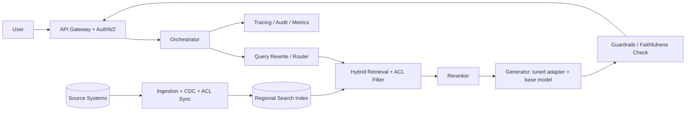

# RAG vs fine-tuning — when to use each and hybrid approaches

> [← Back to Interview Preparation Home](interview-index.md)

## 1. Brief Summary

### Definition
- **Retrieval-Augmented Generation (RAG)** retrieves relevant external content (documents, records, snippets) at inference time and places it in the prompt so the model can ground its answer in it.
- **Fine-tuning** updates model weights (fully, or via parameter-efficient methods such as LoRA/QLoRA) using curated examples so the model internalizes a style, format, skill, or domain behavior.
- **Hybrid approaches** combine both: fine-tune for behavior and format, use RAG for knowledge.

### Why it matters
This is the most common architectural decision in enterprise LLM projects. A wrong choice leads to stale answers, hallucinations, high cost, compliance problems, or months of wasted training effort.

### Core concepts and terminology
- **Parametric knowledge**: facts stored in model weights. **Non-parametric knowledge**: facts stored in an external index.
- **Grounding / citations**: tying answers to retrieved sources.
- **SFT (supervised fine-tuning)**, **LoRA/QLoRA/PEFT**, **DPO/RLHF** (preference tuning), **distillation**.
- **Embedding, vector index, hybrid search (BM25 + vector), reranker**.
- **Catastrophic forgetting**: loss of general capability after narrow fine-tuning.

### How it works
- **RAG**: query → (rewrite) → retrieve top-k chunks → (rerank) → assemble prompt → generate → cite.
- **Fine-tuning**: collect and clean input/output pairs → train adapters or weights → evaluate against a held-out set → deploy the tuned model/adapter.
- **Hybrid**: e.g., a fine-tuned small model that reliably emits JSON and follows tone rules, fed by retrieved context; or fine-tuning the retriever/embedding model or the reranker on domain pairs.

### Where it is used
- RAG: enterprise Q&A, policy/knowledge assistants, support copilots, legal/contract search.
- Fine-tuning: classification, extraction with strict schemas, brand voice, domain-specific code, latency-sensitive small-model deployments, tool-calling reliability.

### Important tools and platforms
Azure AI Search, Azure OpenAI fine-tuning, OpenAI fine-tuning API, Hugging Face (PEFT, TRL), LangChain, LlamaIndex, Semantic Kernel, pgvector, Pinecone, Weaviate, Ragas, DeepEval, Azure AI Foundry evaluation.

### Common misconceptions
- "Fine-tuning teaches the model new facts reliably" — it is poor at injecting factual knowledge and can increase hallucination of those facts.
- "RAG removes hallucination" — it reduces it; bad retrieval still produces confident wrong answers.
- "Long context windows make RAG obsolete" — cost, latency, attention degradation ("lost in the middle"), and access control still favor retrieval.
- "RAG and fine-tuning are mutually exclusive."

### Key points to remember
- **RAG for knowledge, fine-tuning for behavior.**
- Choose RAG when data changes often, needs citations, or has per-user access control.
- Choose fine-tuning when you need consistent format/style/skill, lower latency/cost via a smaller model, or prompt size reduction.
- Always start with prompt engineering + RAG baseline and evaluate before investing in tuning.

---

## 2. Interview Questions

### Beginner Questions

**Q1. What is RAG?**
- **Model answer:** RAG retrieves relevant documents at query time and gives them to the LLM as context so the answer is grounded in current, specific data rather than only in what the model memorized during training.
- **Key points expected:** Retrieve → augment → generate; external knowledge; reduces hallucination; supports citations.
- **Mistake to avoid:** Saying RAG "trains the model on your documents."

**Q2. What is fine-tuning?**
- **Model answer:** Continuing training of a pre-trained model on a smaller task-specific dataset so its weights adapt to a desired behavior, format, or domain language.
- **Key points expected:** Weights change; needs labeled examples; PEFT/LoRA reduces cost.
- **Mistake to avoid:** Claiming fine-tuning is the best way to add up-to-date facts.

**Q3. Give one scenario where RAG is clearly better than fine-tuning.**
- **Model answer:** An HR policy assistant whose documents change weekly and must cite the policy section. Updating the index is instant and cheap; retraining each week is not, and tuned weights can't provide citations.
- **Key points expected:** Freshness, traceability, update cost.
- **Mistake to avoid:** Giving a generic answer without a driver (freshness, citations, ACLs).

**Q4. Give one scenario where fine-tuning is clearly better than RAG.**
- **Model answer:** Extracting structured fields from invoices into a strict JSON schema at high volume. A small tuned model gives consistent formatting, lower latency, and lower per-call cost than a large prompted model with long instructions.
- **Key points expected:** Format consistency, cost/latency, task is behavior not knowledge.
- **Mistake to avoid:** Suggesting RAG for a problem that has no knowledge-retrieval need.

**Q5. What are the main components of a RAG pipeline?**
- **Model answer:** Ingestion (parse, chunk, embed, index), retrieval (vector/keyword/hybrid, filters), optional reranking, prompt assembly, generation, and evaluation/monitoring.
- **Key points expected:** Ingestion vs query-time split; chunking and embeddings.
- **Mistake to avoid:** Forgetting the ingestion side and evaluation.

**Q6. What is LoRA and why is it popular?**
- **Model answer:** Low-Rank Adaptation trains small low-rank matrices added to frozen weights, so you train a tiny fraction of parameters. It cuts GPU memory and storage, and adapters can be swapped per task or tenant.
- **Key points expected:** Parameter-efficient, adapters, cost.
- **Mistake to avoid:** Confusing LoRA with quantization (QLoRA combines both).

**Q7. Can RAG and fine-tuning be combined?**
- **Model answer:** Yes. Fine-tune the model for tone, schema, and tool use, and use RAG to supply facts. You can also fine-tune embeddings or rerankers for better retrieval.
- **Key points expected:** Complementary roles; hybrid examples.
- **Mistake to avoid:** Treating them as either/or.

**Q8. Why can a RAG system still hallucinate?**
- **Model answer:** Retrieval may miss the right chunk, return irrelevant chunks, or the model may ignore context or over-extrapolate. Poor chunking and ambiguous queries make it worse.
- **Key points expected:** Retrieval quality, context faithfulness, need for evaluation and "I don't know" behavior.
- **Mistake to avoid:** Claiming RAG eliminates hallucination.

### Intermediate Questions

**Q1. Walk me through your decision framework for RAG vs fine-tuning.**
- **Model answer:** Ask: (1) Is the gap knowledge or behavior? Knowledge → RAG; behavior/format/style → tuning. (2) How often does data change? Frequent → RAG. (3) Do we need citations or per-user access control? → RAG. (4) Latency/cost at volume with a narrow task? → consider tuning a smaller model. (5) Do we have quality labeled data (hundreds to thousands of examples)? If not, tuning is premature. (6) Data residency/IP concerns on training data? Start with prompting + RAG baseline, measure failures, then decide.
- **Key technical considerations:** Evaluation baseline, data availability, update cadence, governance, total cost of ownership.
- **Follow-up:** "What evidence would convince you to move from prompted RAG to a tuned model?"

**Q2. How does access control work in RAG versus fine-tuning?**
- **Model answer:** In RAG, ACLs are enforced at retrieval via metadata filters or security trimming (e.g., group IDs on chunks, Azure AI Search security filters) so users only see authorized content. In fine-tuning, data is baked into weights and cannot be selectively hidden by user, so sensitive or role-restricted data should not be used to tune a shared model.
- **Key technical considerations:** Security trimming before generation, document-level permissions sync, tenant isolation.
- **Follow-up:** "How do you keep ACLs in the index in sync with the source system?"

**Q3. How do you improve RAG quality before considering fine-tuning?**
- **Model answer:** Better parsing and chunking, metadata, hybrid search, query rewriting, reranking, increasing/decreasing top-k, prompt instructions for citations and refusal, and golden-set evaluation. Often retrieval is the bottleneck, not the generator.
- **Key technical considerations:** Measure retrieval recall@k separately from answer faithfulness.
- **Follow-up:** "Which metrics would you track for retrieval versus generation?"

**Q4. What data do you need for fine-tuning and how do you prepare it?**
- **Model answer:** High-quality, representative input/output pairs matching production prompts. Deduplicate, remove PII, balance classes, hold out validation/test sets, standardize formats, and review labels. Quality beats quantity; hundreds of strong examples can shift style, thousands may be needed for complex tasks.
- **Key technical considerations:** Label noise, leakage between train and test, licensing/PII, versioning datasets.
- **Follow-up:** "How would you create training data if you have none?"

**Q5. Explain catastrophic forgetting and mitigation.**
- **Model answer:** Narrow tuning can degrade general abilities. Mitigate with LoRA/adapters, low learning rates, mixing general data, early stopping, and regression evaluation on general benchmarks.
- **Key technical considerations:** Regression test suite, adapter isolation.
- **Follow-up:** "How would you detect forgetting in production-bound models?"

**Q6. When would you fine-tune an embedding model or reranker?**
- **Model answer:** When domain vocabulary (medical codes, part numbers, internal jargon) causes off-the-shelf embeddings to retrieve poorly. Use query–positive–hard-negative triples from click logs or labeled data. It often yields larger gains than tuning the generator.
- **Key technical considerations:** Re-embedding corpus after model change, index versioning, evaluation on recall@k/nDCG.
- **Follow-up:** "What is the operational impact of changing the embedding model?"

**Q7. Compare cost profiles.**
- **Model answer:** RAG: indexing + vector store + per-query retrieval + larger prompts (token cost). Fine-tuning: upfront training, hosting a custom model (possibly dedicated deployment fees), retraining on drift, but shorter prompts and potentially a cheaper small model. Break-even depends on query volume and prompt length.
- **Key technical considerations:** Token cost per request, hosting minimums, retraining cadence.
- **Follow-up:** "At what volume does a tuned small model beat a prompted large model?"

**Q8. Can long-context models replace RAG?**
- **Model answer:** Rarely at enterprise scale. Corpora exceed context limits, per-request cost and latency grow with context, accuracy can degrade on long inputs, and ACLs/citations are harder. Long context is useful for single-document tasks; RAG for large, changing corpora. Often combine both.
- **Key technical considerations:** Cost per call, caching, recall in long contexts.
- **Follow-up:** "How would prompt caching change your answer?"

### Advanced Questions

**Q1. A bank wants an assistant answering questions on 2M policy documents (updated daily), with strict JSON output to a downstream system and per-user entitlements. Design it.**
- **Model answer:** Use RAG for knowledge with security-trimmed hybrid search (BM25 + vectors + semantic reranker) and incremental ingestion keyed on document version. Use a fine-tuned (or strongly prompted + constrained decoding) model for the JSON schema and refusal style. Add citations, a faithfulness check, and an evaluation harness with golden questions per business unit. Log retrieval IDs for audit.
- **Design considerations:** ACL sync, change-data-capture ingestion, schema validation with retry, audit trail, PII redaction.
- **Trade-offs:** Fine-tuning adds ops burden vs constrained decoding/structured outputs with a base model; start with the latter.
- **Follow-ups:** "How do you handle a document deleted for legal reasons?" "How do you prove which version was used for an answer?"

**Q2. Your RAG answer accuracy dropped after a content migration. How do you troubleshoot?**
- **Model answer:** Isolate layer by layer: compare retrieval recall on the golden set before/after; inspect parsing output (tables, headers lost?), chunk size/overlap, metadata/filter changes, embedding model/version mismatches, index staleness, and prompt changes. Then check generation faithfulness with fixed retrieved context to separate retrieval from generation faults.
- **Design considerations:** Versioned index, shadow indexes, regression suite, tracing of retrieved chunks.
- **Trade-offs:** Blue/green indexes cost storage but allow safe rollback.
- **Follow-ups:** "How do you automate detection before users report it?"

**Q3. When fine-tuning degrades the model's safety behavior, what do you do?**
- **Model answer:** Fine-tuning can erode alignment. Re-run safety/red-team evaluations on the tuned model, mix safety examples into the data, keep guardrail layers (content filters, input/output classifiers) outside the model, and gate deployment on safety regression.
- **Design considerations:** External guardrails as defense in depth; evaluation gating in CI.
- **Trade-offs:** Extra filter latency vs weaker model-only safety.
- **Follow-ups:** "Who signs off on release of a tuned model?"

**Q4. Design a hybrid system where a small fine-tuned model handles 80% of traffic and a large model handles the rest.**
- **Model answer:** Router/classifier (rules, embedding similarity, or small-LLM) decides complexity; small tuned model answers common intents with RAG context; low-confidence or complex cases escalate to a larger model. Use confidence signals (logprobs, self-consistency, validators) and feedback loops to refine routing.
- **Design considerations:** Router accuracy, fallback, consistent tone across models, A/B testing.
- **Trade-offs:** Router errors vs cost savings; added complexity.
- **Follow-ups:** "How do you measure router regret?"

**Q5. How would you update a fine-tuned model when underlying product knowledge changes monthly?**
- **Model answer:** Move volatile knowledge out of weights into RAG; retain tuning only for stable behaviors. If tuning is unavoidable, use scheduled adapter retraining with versioned datasets, canary rollout, and rollback.
- **Design considerations:** Separation of volatile vs stable knowledge, MLOps pipeline, evaluation gates.
- **Trade-offs:** Retrain cost vs retrieval complexity.
- **Follow-ups:** "How do you decide what is volatile?"

**Q6. How do you evaluate whether fine-tuning added value over a well-engineered RAG baseline?**
- **Model answer:** Define metrics (task accuracy, format-validity rate, faithfulness, latency, cost/request). Run an offline comparison on a held-out golden set with identical retrieval, then an online A/B test. Report statistical significance and cost per correct answer.
- **Design considerations:** Avoiding leakage, human review of a sample, subgroup analysis.
- **Trade-offs:** Evaluation cost vs risk of shipping an unneeded model.
- **Follow-ups:** "What if tuned is 3% better but 2x more expensive to operate?"

**Q7. Data residency requires EU-only processing. How does it affect RAG vs tuning choices?**
- **Model answer:** For RAG, deploy index, embeddings, and model endpoints in EU regions and control logging. For tuning, training data and resulting weights must stay in-region; confirm the provider's fine-tuning region availability and data handling. RAG leaves source data in your controlled store, which simplifies deletion/erasure; tuned weights complicate "right to be forgotten".
- **Design considerations:** Region-pinned deployments, abuse-monitoring/data-retention settings, deletion workflows.
- **Trade-offs:** Fewer model options in-region vs compliance.
- **Follow-ups:** "How do you honor an erasure request after training on that data?"

**Q8. Propose an architecture that uses RAG, fine-tuning, and agents together and explain where you would not use each.**
- **Model answer:** Agent orchestrates tools; RAG tool supplies enterprise knowledge; tuned model (or adapter) does reliable tool-call formatting and domain extraction. Avoid tuning for volatile facts, avoid RAG for pure transformation tasks, avoid agents when a deterministic workflow suffices.
- **Design considerations:** Boundaries, observability across steps, failure containment.
- **Trade-offs:** Flexibility vs predictability and cost.
- **Follow-ups:** "How do you cap agent loops and cost?"

---

## 3. Use Cases

### Simple Use Case — Internal FAQ bot
- **Problem:** Employees repeatedly ask IT helpdesk the same questions; answers live in 300 wiki pages.
- **Assumptions:** Content is non-sensitive, updated monthly, ~500 queries/day.
- **Steps:**
  1. Export wiki pages and clean HTML.
  2. Chunk by heading (300–500 tokens) with titles as metadata.
  3. Embed and load into a vector store (e.g., pgvector).
  4. At query time retrieve top 5, build prompt with "answer only from context, cite sources".
  5. Return answer + links.
- **Expected result:** ~60–70% deflection of repeated tickets with cited answers.
- **Tools:** Azure OpenAI (or similar), pgvector/Azure AI Search, LangChain/Semantic Kernel.

### Intermediate Use Case — Claims triage with strict output
- **Scenario:** An insurer needs to classify incoming claim emails and extract 15 fields into JSON, also referencing policy terms.
- **Requirements:** ≥95% valid JSON, <2 s latency, cost under $0.002/request, policy citations for decisions.
- **Proposed solution:** Hybrid. Fine-tune a small model (LoRA) on 3,000 labeled emails for classification + extraction; use RAG over policy documents for the coverage-explanation step.
- **Implementation steps:**
  1. Label and split data (train/val/test), mask PII.
  2. Baseline: prompted large model + schema validation.
  3. Fine-tune small model; compare on test set.
  4. Add RAG for policy snippets with metadata filters (product, jurisdiction).
  5. Deploy behind API with JSON schema validation and retry.
- **Technical challenges:** Label inconsistency, policy versions by jurisdiction, long emails with attachments.
- **Expected result:** Format validity >98%, cost reduced ~5–10x vs baseline.
- **Testing approach:** Held-out test set, per-field F1, adversarial emails, shadow-mode run for two weeks, human review sample.

### Difficult Use Case — Global regulated knowledge copilot
- **Scenario:** A multinational with 5M documents across SharePoint, Confluence, and ERP wants a copilot for 50k employees, with entitlements, multi-region residency, audit, and domain-specific behavior.
- **Functional requirements:** Cited answers, document-level permissions, multi-language, structured outputs for workflows.
- **Non-functional requirements:** p95 < 4 s, 99.9% availability, regional data residency, full auditability, cost ceiling per user/month.

**Proposed architecture**

**Components and responsibilities**
- **Ingestion/CDC:** parse, chunk, embed, attach ACL + version metadata; handle deletes.
- **Regional indexes:** one per residency zone; queries routed by user region.
- **Retriever + reranker:** hybrid search with security trimming.
- **Generator:** base model with LoRA adapter for tone/schema; fallback to base prompt.
- **Guardrails:** PII scan, groundedness check, content safety.
- **Observability:** trace of query, chunk IDs, model version, tokens, latency.

**Processing flow:** authenticate → resolve entitlements → rewrite → retrieve with filters → rerank → generate → validate → log → respond.

**Security:** Zero-trust, managed identities, private endpoints, encryption at rest/in transit, no tenant data in tuning, prompt-injection defenses for retrieved content, audit-immutable logs.

**Performance/scalability:** Autoscaled retrieval tier, cache frequent queries and embeddings, prompt caching, async ingestion queues, partitioned indexes, model routing for cost.

**Monitoring:** Retrieval hit-rate, faithfulness score sampling, thumbs up/down, latency by stage, token spend per team, drift in query distribution.

**Failure scenarios and recovery**
- Index outage → fail over to secondary replica/region; degrade to cached or "search-only" mode.
- Model endpoint throttled → route to secondary deployment/model.
- Bad ingestion batch → blue/green index swap rollback.
- Adapter regression → revert to previous adapter version via feature flag.

**Trade-offs and alternatives**
- Adapter tuning improves consistency but adds a lifecycle; alternative: strong prompts + structured output.
- Regional indexes raise cost but meet residency; alternative: federated query across regions (higher latency, compliance risk).
- Fully managed search vs self-hosted vector DB: speed to market vs control and cost.
