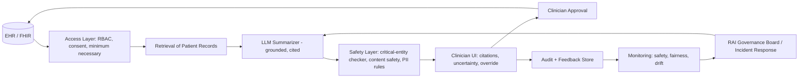

# Responsible AI principles applied to a real use case

> [← Back to Interview Preparation Home](interview-index.md)

## 1. Brief Summary

### Definition
**Responsible AI (RAI)** is the practice of designing, building, deploying, and operating AI systems so they are fair, reliable and safe, private and secure, inclusive, transparent, and accountable. "Applied to a real use case" means translating these principles into concrete requirements, tests, controls, and governance for a specific system (for example, an AI-assisted loan pre-screening assistant or a clinical documentation summarizer).

### Why it matters
Failures cause real-world harm (discrimination, unsafe advice, privacy breaches), legal exposure (EU AI Act, GDPR, sector regulations), and reputational damage. Interviewers want evidence that a candidate can operationalize principles, not just recite them.

### Core concepts and terminology
- **Microsoft RAI principles:** fairness; reliability & safety; privacy & security; inclusiveness; transparency; accountability.
- **Google / OECD / NIST** equivalents; **NIST AI RMF** (Govern, Map, Measure, Manage); **ISO/IEC 42001** (AI management system); **EU AI Act** risk tiers (unacceptable, high, limited, minimal).
- **Fairness metrics:** demographic parity, equalized odds, equal opportunity, calibration; **disparate impact** (four-fifths rule).
- **Explainability / interpretability**, **model cards**, **system cards**, **datasheets for datasets**, **impact assessment (AIA/DPIA)**.
- **Human oversight (HITL/HOTL)**, **red teaming**, **content safety**, **groundedness**, **contestability / appeal**.
- **Harm taxonomy:** allocative, quality-of-service, representational, safety, privacy harms.

### How it works (applying to a use case)
1. **Define the use case and stakeholders;** identify who could be harmed.
2. **Classify risk** (regulatory tier, impact severity, autonomy level).
3. **Map principles to requirements** (e.g., fairness → subgroup performance thresholds).
4. **Design controls:** data governance, guardrails, human oversight, transparency UX, appeal paths.
5. **Test:** fairness evaluation, red teaming, safety and robustness tests, privacy review.
6. **Document:** impact assessment, model/system card, limitations.
7. **Operate:** monitoring, incident response, periodic review, retirement criteria.

### Where it is used
Hiring, lending/insurance, healthcare, education, public sector, customer service, content moderation, generative-AI copilots.

### Important tools and frameworks
Microsoft Responsible AI Standard and Responsible AI dashboard, Azure AI Content Safety, Fairlearn, AIF360, InterpretML, SHAP/LIME, Google What-If Tool, Model Cards Toolkit, PyRIT, NIST AI RMF, ISO 42001, EU AI Act, OECD AI Principles.

### Common misconceptions
- "RAI is a checklist at the end of the project" — it's continuous.
- "Removing protected attributes guarantees fairness" — proxies remain.
- "Transparency means exposing the model internals."
- "A human in the loop makes it automatically safe" — automation bias and rubber-stamping.

### Key points to remember
- Always **tie principles to measurable requirements and owners**.
- Scale rigor to **risk tier**.
- Plan for **monitoring, appeals, and incident response** — not only pre-launch testing.
- Document trade-offs (e.g., accuracy vs fairness; privacy vs explainability).

---

## 2. Interview Questions

### Beginner Questions

**Q1. What are the main principles of Responsible AI?**
- **Model answer:** Fairness, reliability and safety, privacy and security, inclusiveness, transparency, and accountability (Microsoft's set); other frameworks add human oversight, sustainability, and societal benefit.
- **Key points expected:** Name principles and give one-line meaning for each.
- **Mistake to avoid:** Listing only "fairness and privacy".

**Q2. What is bias in AI and where can it come from?**
- **Model answer:** Systematic, unfair differences in outcomes across groups. Sources include unrepresentative training data, historical bias, label bias, proxy features, measurement error, and deployment context mismatch.
- **Key points expected:** Data, model, and deployment stages.
- **Mistake to avoid:** Blaming only the algorithm.

**Q3. What is explainability and why does it matter?**
- **Model answer:** Ability to understand and communicate why a system produced an output. It supports trust, debugging, regulatory compliance, and contestability.
- **Key points expected:** Audience-appropriate explanations.
- **Mistake to avoid:** Assuming one technique serves all stakeholders.

**Q4. What is human-in-the-loop?**
- **Model answer:** Humans review or approve AI outputs or decisions, especially in high-impact situations, providing oversight and correction.
- **Key points expected:** Risk-based; must have authority and information to override.
- **Mistake to avoid:** Treating a rubber-stamp review as oversight.

**Q5. What is a model card?**
- **Model answer:** A document describing a model's intended use, training data, performance across groups, limitations, and ethical considerations.
- **Key points expected:** Transparency artifact.
- **Mistake to avoid:** Confusing it with marketing material.

**Q6. Why does privacy matter in AI systems?**
- **Model answer:** AI uses large amounts of data that may include personal information; misuse or leakage causes harm and violates laws like GDPR. Controls include minimization, consent, anonymization, and access control.
- **Key points expected:** Data minimization, legal basis.
- **Mistake to avoid:** Considering privacy only a legal issue.

**Q7. What is an AI impact assessment?**
- **Model answer:** A structured evaluation of a system's purpose, stakeholders, risks, mitigations, and compliance before deployment, updated over time.
- **Key points expected:** Pre-deployment, risk-focused.
- **Mistake to avoid:** One-time paperwork.

**Q8. What is a hallucination and why is it a responsible AI issue?**
- **Model answer:** Confident but false or unsupported model output. It can mislead users, causing unsafe decisions; mitigated by grounding, citations, uncertainty, and oversight.
- **Key points expected:** Reliability and safety link.
- **Mistake to avoid:** Saying it's solved by a disclaimer.

### Intermediate Questions

**Q1. Walk through applying Responsible AI to a loan pre-screening assistant.**
- **Model answer:** Identify as high-risk (credit decisions). Define stakeholders (applicants, underwriters, regulators). Requirements: no disparate impact (four-fifths rule monitoring), explainable adverse action reasons, human underwriter makes final decisions, data minimization, audit logs. Testing: subgroup performance, counterfactual fairness, red-team prompts for biased language. Transparency: disclose AI use and provide appeal path. Operations: drift and fairness monitoring, quarterly review, incident process.
- **Key technical considerations:** Proxy variables (zip code), regulatory regimes (ECOA/FCRA, EU AI Act high-risk).
- **Follow-up:** "How do you handle a fairness metric conflicting with accuracy?"

**Q2. How do you measure fairness, and which metric would you choose?**
- **Model answer:** Choose per context: demographic parity (equal selection rates), equal opportunity (equal TPR), equalized odds (TPR and FPR), calibration within groups. Impossibility results mean not all can hold; pick based on harm model and legal context, document rationale. For generative AI, measure differences in quality, refusal, and toxicity across demographics/dialects with paired prompts.
- **Key technical considerations:** Group definitions, intersectionality, sample sizes, confidence intervals.
- **Follow-up:** "What if you lack demographic labels?"

**Q3. How do you implement transparency for end users of a generative AI assistant?**
- **Model answer:** Clearly disclose AI interaction, show sources/citations, communicate limitations and confidence, provide feedback and escalation paths, and label AI-generated content. Keep internal documentation (system card) for auditors.
- **Key technical considerations:** Avoid over-claiming; accessible language.
- **Follow-up:** "How do you avoid overwhelming users with disclaimers?"

**Q4. Describe safety controls for a user-facing LLM app.**
- **Model answer:** Input/output content filters (hate, violence, self-harm), prompt-injection defenses, grounding, refusal policy, topic restrictions, rate limiting, red-teaming, escalation for crisis situations, logging and review.
- **Key technical considerations:** Threshold tuning, false positives, multilingual coverage.
- **Follow-up:** "How would you handle a user expressing self-harm intent?"

**Q5. How do you manage privacy in an LLM solution?**
- **Model answer:** Data minimization, PII detection/redaction before sending to the model and in logs, access controls, encryption, retention limits, no training on customer data unless permitted, residency controls, DPIA, and user rights handling (access/erasure).
- **Key technical considerations:** Embeddings may encode personal data; trace stores hold prompts.
- **Follow-up:** "How do you honor deletion requests across vector indexes and logs?"

**Q6. What does accountability look like operationally?**
- **Model answer:** Named owners for each system, RACI, approval gates by risk tier, audit trails, incident response, escalation, and consequences. A governance board reviews high-risk deployments.
- **Key technical considerations:** Evidence automation from pipelines.
- **Follow-up:** "Who can pull the plug on a deployed system?"

**Q7. How do you address automation bias in human-in-the-loop designs?**
- **Model answer:** Present evidence not just recommendations, show uncertainty, require reasons for overrides/accepts in high-risk cases, randomly audit approvals, rotate reviewers, measure override rates, and train staff.
- **Key technical considerations:** UI design, workload.
- **Follow-up:** "What override rate would concern you—high or low?"

**Q8. How do you handle inclusiveness and accessibility?**
- **Model answer:** Test across languages, dialects, abilities; provide accessible interfaces (screen reader, voice); evaluate performance gaps by segment; involve diverse users in design and testing.
- **Key technical considerations:** Multilingual evaluation sets, tokenizer effects on low-resource languages.
- **Follow-up:** "How would you detect quality gaps for a minority language?"

### Advanced Questions

**Q1. You're asked to deploy an AI résumé screening tool. How do you decide whether to proceed and under what conditions?**
- **Model answer:** Treat as high-risk (EU AI Act Annex III employment; NYC Local Law 144 bias audit). Conduct impact assessment, define lawful basis and job-relatedness, run independent bias audits for protected groups, avoid proxies, ensure human decision-making, provide candidate notice and appeal, monitor ongoing adverse impact. If audit reveals disparate impact that can't be mitigated, do not deploy or restrict to assistive use.
- **Design considerations:** Data provenance, explainability for candidates, re-audit cadence.
- **Trade-offs:** Efficiency gains vs legal/fairness risk; fairness vs accuracy.
- **Follow-ups:** "What would make you recommend a no-go?"

**Q2. Design a Responsible AI governance process that doesn't slow the organization to a crawl.**
- **Model answer:** Risk-tiered intake questionnaire; low-risk uses pre-approved with standard controls (paved road); medium/high require impact assessment, testing evidence, and review board sign-off; automated evidence from CI/CD; clear SLAs for reviews; templates; periodic audits; embedded RAI champions in teams.
- **Design considerations:** Policy-as-code, standard control library, inventory of AI systems.
- **Trade-offs:** Speed vs assurance; centralized vs federated governance.
- **Follow-ups:** "How do you measure governance effectiveness?"

**Q3. A deployed healthcare summarization tool omits critical allergy information in 0.5% of summaries. What do you do?**
- **Model answer:** Treat as a safety incident: assess severity, notify stakeholders, add mandatory clinician review for allergy fields, deploy a deterministic extraction check for critical entities, roll back or restrict use if needed, root-cause (chunking, prompts), expand evaluation with critical-entity recall as a gating metric, and update risk assessment.
- **Design considerations:** Severity-weighted metrics, defense in depth, regulatory reporting (FDA/SaMD if applicable).
- **Trade-offs:** Utility vs risk; clinician workload.
- **Follow-ups:** "What recall target would you set for critical entities?"

**Q4. How would you red team a generative AI system for responsible AI harms?**
- **Model answer:** Build a harm taxonomy relevant to the use case; assemble diverse red team including domain experts; test jailbreaks, bias elicitation, privacy leakage, misinformation, unsafe advice; combine manual and automated (PyRIT, garak); score by severity; track mitigation and retest; integrate in release gates.
- **Design considerations:** Safe handling of harmful content, coverage tracking, repeatability.
- **Trade-offs:** Depth vs breadth; cost.
- **Follow-ups:** "How do you prove coverage is sufficient?"

**Q5. Explain trade-offs between explainability and performance and how you resolve them in regulated decisions.**
- **Model answer:** Complex models may outperform interpretable ones, but regulated decisions require reasons (adverse action notices). Options: inherently interpretable models, post-hoc explanations (SHAP) with validation of fidelity, hybrid design where an interpretable model decides and a complex model assists. For LLMs, don't rely on self-generated "explanations" as faithful; use evidence citations and rule-based reason codes.
- **Design considerations:** Explanation fidelity testing, user comprehension.
- **Trade-offs:** Accuracy vs transparency vs cost.
- **Follow-ups:** "Why are LLM chain-of-thought rationales not reliable explanations?"

**Q6. How do you align a RAI program with NIST AI RMF and the EU AI Act?**
- **Model answer:** Map functions: Govern (policies, roles), Map (context, risk identification), Measure (metrics, testing), Manage (mitigation, monitoring). For the EU AI Act, classify systems by tier, implement required obligations for high-risk (risk management, data governance, technical documentation, logging, human oversight, accuracy/robustness/cybersecurity) and GPAI transparency duties. Maintain a crosswalk to avoid duplicating work.
- **Design considerations:** Single control library mapped to multiple frameworks.
- **Trade-offs:** Compliance depth vs agility.
- **Follow-ups:** "Which obligations would you automate first?"

**Q7. A model performs well overall but 15% worse for a minority subgroup. Walk through your options.**
- **Model answer:** Verify with confidence intervals; investigate data representation and label quality; options: collect/augment data, reweight, subgroup thresholds (legal considerations), model changes, fairness constraints (Fairlearn), additional human review for the subgroup, or restrict deployment scope. Document residual disparity and monitor.
- **Design considerations:** Legal permissibility of group-aware methods, intersectional analysis.
- **Trade-offs:** Overall accuracy vs equity; cost of data collection.
- **Follow-ups:** "How do you communicate the residual gap to stakeholders?"

**Q8. How do you ensure continued responsibility after deployment?**
- **Model answer:** Continuous monitoring of performance, fairness, safety incidents, user complaints, drift; scheduled reassessments; change management triggering reassessment on model/data/prompt changes; incident response playbooks; sunset criteria; transparency reports.
- **Design considerations:** Alerts on subgroup metrics, feedback channels, audit logs.
- **Trade-offs:** Monitoring cost and privacy of demographic data.
- **Follow-ups:** "What changes would trigger a full re-review?"

---

## 3. Use Cases

### Simple Use Case — Responsible launch of an HR policy chatbot
- **Problem:** An internal chatbot answers HR policy questions; leaders want it to be safe and trustworthy.
- **Assumptions:** Low-risk, no decisions about individuals, uses internal documents.
- **Steps:**
  1. Write a one-page impact assessment (users, harms, mitigations).
  2. Ground answers in HR documents with citations; refuse out-of-scope or personal case advice.
  3. Add content safety filters and PII redaction in logs.
  4. Add disclosure banner and feedback button; route sensitive topics to HR staff.
  5. Test with 100 questions including sensitive scenarios.
- **Expected result:** Transparent, scoped assistant with clear escalation.
- **Tools:** Azure OpenAI, Azure AI Content Safety, Azure AI Search.

### Intermediate Use Case — AI-assisted insurance claims triage
- **Scenario:** An insurer uses AI to prioritize claims and draft adjuster summaries.
- **Requirements:** No discriminatory prioritization, explainable priority reasons, human adjuster decides, privacy compliance, audit logs.
- **Proposed solution:** Interpretable gradient-boosted model for priority with SHAP reason codes; LLM drafts summaries grounded in claim documents; adjuster must confirm; fairness monitoring on prioritization by protected-class proxies.
- **Implementation steps:**
  1. Impact assessment and data review (remove/inspect proxies).
  2. Train model; evaluate fairness metrics (equal opportunity) with Fairlearn.
  3. Implement reason codes and UI showing evidence and uncertainty.
  4. Add override logging and random audit sampling.
  5. Create monitoring dashboards and incident playbook.
- **Technical challenges:** Missing demographic data for audit, proxy features, adjuster over-reliance.
- **Expected result:** Faster triage with documented fairness checks and human accountability.
- **Testing approach:** Subgroup performance tests, counterfactual tests, red-team on summaries, usability tests on override behavior.

### Difficult Use Case — Enterprise clinical decision-support copilot
- **Scenario:** A hospital network deploys a generative AI copilot summarizing patient records and suggesting follow-up considerations to clinicians.
- **Functional requirements:** Summaries with citations to chart entries, risk flags, clinician approval, multilingual patient communication drafts.
- **Non-functional requirements:** HIPAA/GDPR compliance, safety-critical reliability, auditability, equity across demographics, 99.9% availability.

**Proposed architecture**

**Components and responsibilities**
- **Access layer:** enforces consent and least-privilege access to records.
- **Grounded summarizer:** restricts output to chart evidence with inline citations.
- **Safety layer:** deterministic extraction check for allergies, medications, and diagnoses; flags omissions or contradictions.
- **Clinician UI:** displays sources, confidence indicators, and requires approval before charting.
- **Audit/feedback store:** immutable logs, error reports.
- **Governance:** risk register, periodic review, incident handling.

**Processing flow:** clinician request → authorized retrieval → summary generation → critical-entity validation → clinician review → commit with audit.

**Security and privacy:** Private networking, CMK encryption, region-locked processing, de-identified evaluation data, no vendor training on PHI, strict log redaction, role-based access, DPIA and BAA in place.

**Performance/scalability:** Pre-computed summaries on admission events, caching, autoscaling inference, latency target p95 < 8 s, queueing for batch contexts.

**Monitoring:** Critical-entity omission rate, hallucination rate via sampled clinician review, subgroup quality gaps (language, age, race where lawful), override rates, incident counts, drift in documentation patterns.

**Failure scenarios and recovery**
- Model outage → fall back to standard EHR views; no blocking of care.
- Safety layer detects omission → block summary, display warning.
- Subgroup quality gap detected → restrict feature for affected segment pending mitigation.
- Data breach suspicion → incident protocol, token revocation, regulator notifications.

**Trade-offs and alternatives**
- Strict grounding and checks reduce fluency/coverage but improve safety.
- Clinician review adds workload; mitigate through UI design and risk-based review depth.
- Alternative: extractive-only summarization (lower risk, less helpful) as first phase before generative features.
