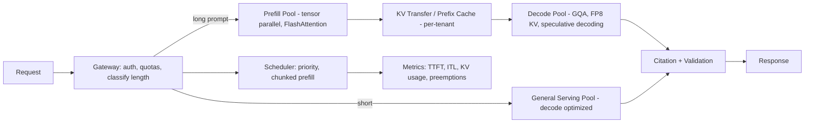

# Transformer architecture — attention, positional encoding, KV cache

> [← Back to Interview Preparation Home](interview-index.md)

## 1. Brief Summary

### Definition
The **Transformer** (Vaswani et al., 2017, "Attention Is All You Need") is a neural network architecture that processes sequences using **self-attention** rather than recurrence or convolution. Modern LLMs (GPT, Llama, Claude, Gemini, Mistral) are mostly **decoder-only Transformers** trained to predict the next token.

### Why it matters
Understanding Transformers explains LLM behavior and constraints: context windows, quadratic attention cost, why long prompts are slow/expensive, why generation is sequential, how memory (KV cache) limits concurrency, and how techniques like quantization, FlashAttention, and GQA improve efficiency. Architects use this knowledge for capacity planning and cost/latency decisions.

### Core concepts and terminology
- **Tokenization:** text → tokens (BPE/SentencePiece) → integer IDs → **embeddings** (vectors of size `d_model`).
- **Self-attention:** each token computes **Query (Q)**, **Key (K)**, **Value (V)** vectors via learned projections. Attention weights = `softmax(QKᵀ / √d_k)`; output = weights × V. Tokens "look at" other tokens to build context-aware representations.
- **Multi-head attention (MHA):** multiple attention "heads" in parallel capture different relationships; outputs are concatenated and projected.
- **Causal (masked) attention:** in decoder-only models, a token may attend only to earlier tokens.
- **Feed-forward network (FFN/MLP):** per-token nonlinear transformation (often SwiGLU), contains most parameters; **MoE** replaces it with expert sub-networks routed per token.
- **Residual connections + normalization** (LayerNorm/RMSNorm; pre-norm) stabilize deep training.
- **Positional encoding:** attention is permutation-invariant, so position information must be injected:
  - **Sinusoidal** (original) – fixed functions of position.
  - **Learned absolute** embeddings.
  - **Relative** (T5 bias), **ALiBi** (linear biases on attention scores).
  - **RoPE (Rotary Position Embedding)** – rotates Q and K by position-dependent angles; encodes relative position; used by Llama, Mistral, Qwen; supports context extension via scaling (NTK, YaRN, position interpolation).
- **KV cache:** during autoregressive generation, the K and V tensors for already-processed tokens are stored and reused so each new token only computes its own Q/K/V and attends to cached K/V, avoiding recomputation.
- **Prefill vs decode:** *prefill* processes the whole prompt in parallel (compute-bound); *decode* generates one token at a time (memory-bandwidth-bound).
- **Efficiency variants:** **MQA/GQA** (share K/V across heads → smaller KV cache), **FlashAttention** (IO-aware exact attention), **PagedAttention** (vLLM; paged KV memory), **sliding-window/sparse attention**, **speculative decoding**, **quantization** (weights and KV cache).
- **Context window**, **temperature/top-p sampling**, **logits**, **softmax**.

### How it works (decoder-only flow)
1. Tokenize input → embeddings (+ positional info, e.g., RoPE applied inside attention).
2. Pass through N identical layers: [RMSNorm → causal multi-head attention → residual] → [RMSNorm → FFN → residual].
3. Final norm → linear "LM head" → logits over vocabulary → sampling → next token.
4. Append token; reuse KV cache; repeat until stop condition.

### KV cache size (useful interview formula)
`KV bytes ≈ 2 (K and V) × layers × kv_heads × head_dim × seq_len × batch × bytes_per_element`
Example (Llama-2-7B style: 32 layers, 32 heads, head_dim 128, FP16): per token ≈ 2×32×32×128×2 bytes ≈ **0.5 MB/token** → 4k tokens ≈ **2 GB per sequence**. GQA with 8 KV heads cuts this ~4×.

### Where it is used
All modern LLMs, vision transformers (ViT), speech (Whisper), multimodal models, embedding models (encoder-only BERT-style), code models.

### Important tools and libraries
PyTorch, Hugging Face Transformers, vLLM, TensorRT-LLM, FlashAttention, DeepSpeed, Megatron-LM, llama.cpp, ONNX Runtime, JAX/Flax, Triton kernels.

### Common misconceptions
- "Attention means the model understands like humans" — it's learned weighted mixing.
- "Context window equals memory" — the model has no persistent memory beyond context/cache.
- "Longer context is free" — compute grows ~O(n²) for attention, and KV memory grows O(n).
- "Positional encoding is optional."
- "KV cache is a semantic cache" — it caches tensors, not answers.

### Key points to remember
- Attention = softmax(QKᵀ/√d)·V; causal masking in decoders.
- Prefill is compute-bound; decode is memory-bandwidth-bound; KV cache trades memory for compute.
- RoPE encodes relative positions by rotation; context extension needs scaling methods.
- GQA/MQA, FlashAttention, PagedAttention, and quantization are the key inference optimizations.

---

## 2. Interview Questions

### Beginner Questions

**Q1. What problem did the Transformer solve compared to RNNs/LSTMs?**
- **Model answer:** RNNs process tokens sequentially, limiting parallelism and struggling with long-range dependencies. Transformers use self-attention to connect any pair of tokens directly and process sequences in parallel during training, enabling scaling.
- **Key points expected:** Parallelism, long-range dependencies.
- **Mistake to avoid:** Saying Transformers have no cost for long sequences.

**Q2. Explain self-attention in simple terms.**
- **Model answer:** Each token creates a query, key, and value. The query is compared with all keys to produce weights (via softmax), and the output is a weighted sum of values—so each token gathers relevant information from others.
- **Key points expected:** Q, K, V roles; softmax weights.
- **Mistake to avoid:** Not mentioning how weights are computed.

**Q3. Why divide by √d_k in attention?**
- **Model answer:** Dot products grow with dimension, pushing softmax into saturated regions with tiny gradients; scaling stabilizes training.
- **Key points expected:** Variance control.
- **Mistake to avoid:** "It's just a convention."

**Q4. What is multi-head attention and why use it?**
- **Model answer:** Multiple attention operations in parallel on different learned subspaces, letting the model capture varied relationships (syntax, coreference, position) simultaneously.
- **Key points expected:** Parallel heads, concatenation.
- **Mistake to avoid:** Saying heads are duplicates.

**Q5. Why do Transformers need positional encoding?**
- **Model answer:** Self-attention treats tokens as an unordered set; positional information must be added so the model knows word order.
- **Key points expected:** Permutation invariance.
- **Mistake to avoid:** Thinking embeddings alone carry order.

**Q6. What is the KV cache?**
- **Model answer:** Stored key and value tensors from previous tokens during generation, so the model doesn't recompute them for each new token, speeding up decoding at the cost of memory.
- **Key points expected:** Speed vs memory.
- **Mistake to avoid:** Confusing with response caching.

**Q7. What is the difference between encoder-only, decoder-only, and encoder-decoder models?**
- **Model answer:** Encoder-only (BERT) uses bidirectional attention for understanding/embeddings; decoder-only (GPT/Llama) uses causal attention for generation; encoder-decoder (T5) encodes input then decodes output, used for translation/summarization.
- **Key points expected:** Attention type and use cases.
- **Mistake to avoid:** Claiming GPT is bidirectional.

**Q8. What is a context window?**
- **Model answer:** The maximum number of tokens (input + output) the model can attend to in one pass.
- **Key points expected:** Token-based limit.
- **Mistake to avoid:** Equating with words or with long-term memory.

### Intermediate Questions

**Q1. Why is attention O(n²) and what are the practical consequences?**
- **Model answer:** Each of n tokens attends to n tokens, so the attention matrix is n×n in compute and (naively) memory. Long prompts increase prefill latency and cost; FlashAttention reduces memory I/O but not FLOPs; long-context models rely on optimizations and still have higher cost.
- **Key technical considerations:** Prefill time scaling, TTFT, chunked prefill.
- **Follow-up:** "How does FlashAttention help if complexity is still quadratic?"

**Q2. Compare sinusoidal, learned, ALiBi, and RoPE positional encodings.**
- **Model answer:** Sinusoidal: fixed, added to embeddings; limited extrapolation. Learned: flexible but fixed max length. ALiBi: adds distance-based bias to scores; extrapolates well. RoPE: rotates Q/K so dot product depends on relative offset; strong performance, widely used; context extension through scaling (position interpolation, NTK-aware, YaRN).
- **Key technical considerations:** Extrapolation beyond trained length; compatibility with KV cache.
- **Follow-up:** "Why does extending a RoPE model's context without scaling degrade quality?"

**Q3. Explain prefill vs decode and why they have different bottlenecks.**
- **Model answer:** Prefill processes all prompt tokens in parallel with large matrix multiplies (compute-bound, high GPU utilization). Decode processes one token per step; each step must load all weights and the KV cache from memory for tiny compute (memory-bandwidth-bound). Hence batching multiple requests improves decode throughput.
- **Key technical considerations:** Continuous batching, chunked prefill, disaggregated prefill/decode.
- **Follow-up:** "How does that influence TTFT vs tokens/sec?"

**Q4. How do MQA and GQA reduce inference cost?**
- **Model answer:** MHA has separate K/V per head. MQA shares one K/V across all query heads; GQA shares K/V across groups of heads. This shrinks the KV cache (and bandwidth) by factors like 4–8× with minimal quality loss, allowing longer contexts/larger batches.
- **Key technical considerations:** Quality vs memory; models trained with GQA vs converted.
- **Follow-up:** "How would you compute the KV cache for Llama-3-8B with GQA?"

**Q5. Estimate the memory needed to serve a 13B model with 8k context for 20 concurrent users.**
- **Model answer:** Weights FP16 ≈ 26 GB. KV cache per token for 13B (40 layers, 40 heads, head_dim 128, MHA): 2×40×40×128×2 B ≈ 0.82 MB; ×8k ≈ 6.7 GB/seq; ×20 ≈ 134 GB (too much!). With GQA (e.g., 8 KV heads) ≈ 1/5 → ~27 GB. Add activations and overhead; consider quantizing weights/KV (FP8) and PagedAttention. Conclusion: KV cache can exceed weights.
- **Key technical considerations:** Concurrency vs context length vs GPU memory.
- **Follow-up:** "What levers reduce memory without changing the model?"

**Q6. What is PagedAttention?**
- **Model answer:** vLLM manages KV cache in fixed-size blocks (like OS virtual memory paging) rather than contiguous per-sequence buffers, reducing fragmentation and over-allocation, enabling higher batch sizes and prefix sharing.
- **Key technical considerations:** Throughput gains, prefix caching, copy-on-write for parallel sampling.
- **Follow-up:** "How does prefix caching relate to provider 'prompt caching'?"

**Q7. How do temperature, top-p, and top-k affect generation?**
- **Model answer:** They shape sampling from logits: temperature rescales distribution (low = more deterministic), top-k limits to k most likely tokens, top-p (nucleus) samples from the smallest set with cumulative probability ≥ p. Greedy decoding picks argmax.
- **Key technical considerations:** Determinism, diversity, hallucination risk, structured outputs.
- **Follow-up:** "Is temperature 0 fully deterministic in practice?"

**Q8. What is a Mixture of Experts (MoE) Transformer?**
- **Model answer:** The FFN is replaced by multiple expert FFNs; a router selects top-k experts per token, so only a fraction of parameters are active per token. Gives large capacity with lower compute per token, but needs more memory and complex serving/load balancing.
- **Key technical considerations:** Memory for all experts, routing load imbalance, communication overhead.
- **Follow-up:** "Why can a 47B MoE be as fast as a ~13B dense model but need more memory?"

### Advanced Questions

**Q1. Your LLM service has high p95 TTFT when users send 30k-token prompts. Diagnose and propose fixes.**
- **Model answer:** Long prefill dominates and blocks decode for others. Fixes: chunked prefill to interleave, prefix caching for shared system/context, prompt reduction/RAG reranking, separate prefill/decode pools (disaggregated serving), tensor parallelism for faster prefill, FlashAttention kernels, FP8 quantization, priority queues, and routing long prompts to dedicated capacity.
- **Design considerations:** Scheduling policy, SLO per request class, cost of dedicated pools.
- **Trade-offs:** Throughput vs latency fairness; complexity of disaggregation.
- **Follow-ups:** "How would you measure prefill vs decode contribution?"

**Q2. Explain how to extend a model's context window from 8k to 128k and risks.**
- **Model answer:** Adjust RoPE scaling (position interpolation, NTK-aware, YaRN), continue pretraining/fine-tune on long sequences, use efficient attention (FlashAttention, ring attention for sequence parallelism), and optimize KV (GQA, quantized KV, offloading). Risks: degraded short-context quality, "lost in the middle," needle-in-haystack vs real reasoning gaps, huge KV memory, higher cost. Validate with long-context benchmarks (RULER) and your own tasks.
- **Design considerations:** Evaluation on real long documents; fallbacks to RAG.
- **Trade-offs:** Long context convenience vs cost and reliability.
- **Follow-ups:** "When would you still prefer RAG with a 128k model?"

**Q3. Design serving for a 70B model at 200 concurrent requests with 4k context and p95 decode latency <50 ms/token.**
- **Model answer:** Use FP8/INT4 quantized weights (≈70 GB/35 GB), tensor parallelism across 2–4 H100s per replica, GQA model to reduce KV; compute KV: e.g., 80 layers, 8 KV heads, 128 dim, FP16: per token 2×80×8×128×2 ≈ 0.33 MB → 4k ≈ 1.3 GB/seq → 200 seqs ≈ 260 GB across replicas; choose several replicas, continuous batching, PagedAttention, speculative decoding with a draft model, autoscaling, and benchmark. Monitor batch size vs latency curves to stay under SLO.
- **Design considerations:** Memory-bandwidth limits (decode), NVLink topology, quantization quality.
- **Trade-offs:** Higher batch increases throughput but latency; speculative decoding adds complexity.
- **Follow-ups:** "How do you find the max concurrency per replica under the SLO?"

**Q4. Compare FlashAttention, sparse/sliding-window attention, and linear attention/SSMs (Mamba).**
- **Model answer:** FlashAttention: exact attention with IO-aware tiling—faster and memory-efficient, no approximation. Sliding-window/sparse: restrict attention patterns—reduces compute/KV (e.g., Mistral) but may lose long-range info unless combined with global tokens. Linear attention/SSMs: sub-quadratic scaling and constant-size state at inference, but historically weaker on recall/in-context learning; hybrid models (attention + SSM layers) are emerging.
- **Design considerations:** Task type (retrieval-heavy needs exact recall), hardware support, ecosystem maturity.
- **Trade-offs:** Exactness vs efficiency vs ecosystem.
- **Follow-ups:** "Why hasn't the pure SSM replaced Transformers?"

**Q5. How does the KV cache interact with multi-tenant security and caching?**
- **Model answer:** Prefix/KV sharing across requests improves efficiency, but shared caches can create timing side channels or leak if isolation is wrong. Scope prefix caches per tenant/security domain, avoid sharing across users with different permissions, encrypt/offload carefully, and clear on session end. Managed providers isolate caches per organization.
- **Design considerations:** Cache keys, TTL, eviction policy.
- **Trade-offs:** Hit rate vs isolation.
- **Follow-ups:** "Could a timing attack reveal another user's prompt prefix?"

**Q6. What causes "lost in the middle" and how do architecture and system design mitigate it?**
- **Model answer:** Models attend more reliably to the beginning and end of the context (primacy/recency effects from training distribution and positional encoding behavior). Mitigations: rerank and place most relevant chunks at edges, limit context, summarize, use long-context-trained models, instruction to cite, and evaluate retrieval position sensitivity.
- **Design considerations:** Chunk ordering strategy, context compression.
- **Trade-offs:** Compression may drop details.
- **Follow-ups:** "How would you test position sensitivity?"

**Q7. Explain speculative decoding and its trade-offs.**
- **Model answer:** A small draft model proposes several tokens; the large model verifies them in one forward pass and accepts the matching prefix, preserving the large model's output distribution while reducing sequential steps. Speedups of ~2–3× when acceptance rate is high. Costs: extra memory, complexity, less benefit at large batch sizes or low acceptance (creative text).
- **Design considerations:** Draft model alignment, K tokens speculated, variants (Medusa, EAGLE, n-gram).
- **Trade-offs:** Latency gains vs resource overhead.
- **Follow-ups:** "When would it hurt throughput?"

**Q8. Why might quantizing the KV cache or weights degrade certain tasks more than others?**
- **Model answer:** Quantization introduces noise; tasks needing precise recall, arithmetic, or long-context retrieval are more sensitive. Outlier activations/weights matter; methods like AWQ/GPTQ/SmoothQuant mitigate. KV quantization can harm long-context accuracy. Must evaluate on your own tasks at target context lengths.
- **Design considerations:** Mixed precision, per-layer sensitivity, calibration data.
- **Trade-offs:** Memory/throughput gain vs accuracy.
- **Follow-ups:** "How would you design a quantization evaluation protocol?"

---

## 3. Use Cases

### Simple Use Case — Explaining why a chatbot slows down with long conversations
- **Problem:** Users complain response time increases as chat history grows.
- **Assumptions:** The app resends full history each turn; decoder-only hosted model.
- **Steps:**
  1. Measure prompt tokens per turn and TTFT.
  2. Explain: prefill cost grows with prompt length (attention O(n²), more KV to build).
  3. Implement summarization of older turns and sliding window of recent turns.
  4. Place static instructions first to benefit from prompt caching.
- **Expected result:** Stable TTFT and lower cost per turn.
- **Tools:** Provider usage metrics, tiktoken, prompt caching.

### Intermediate Use Case — Sizing GPUs for an internal 8B model deployment
- **Scenario:** Host a Llama-3-8B-class model for 100 concurrent users, 8k context.
- **Requirements:** TTFT < 1.5 s, ~30 tokens/s per user, cost-effective.
- **Proposed solution:** vLLM on L40S/H100 GPUs with FP8 weights and KV cache, continuous batching, PagedAttention, prefix caching.
- **Implementation steps:**
  1. Compute weights (≈8–16 GB) and KV per token (GQA: 32 layers × 8 kv_heads × 128 × 2 × 2 B ≈ 131 KB) → 8k ≈ ~1 GB/seq → 100 seqs ≈ ~100 GB (reduce with FP8 KV ≈ 50 GB; average context smaller).
  2. Benchmark with realistic prompt/response length distributions.
  3. Determine replicas count and autoscaling thresholds.
  4. Load-test, tune `max_num_seqs`, `gpu_memory_utilization`.
- **Technical challenges:** Long-tail contexts, bursty traffic, memory fragmentation.
- **Expected result:** Meets latency targets with 2–3 GPUs and headroom.
- **Testing approach:** Load test with replayed traffic, track TTFT/ITL/p95, OOM and preemption counts.

### Difficult Use Case — Long-context document analysis service (100k tokens) at enterprise scale
- **Scenario:** A legal-tech platform analyzes contracts up to 100k tokens, with 500 concurrent analyses and strict latency expectations.
- **Functional requirements:** Whole-document reasoning, cross-clause questions, citations, batch and interactive modes.
- **Non-functional requirements:** TTFT < 8 s on 100k prompts, throughput scalable, cost per document bounded, tenant isolation.

**Proposed architecture**

**Components and responsibilities**
- **Gateway/scheduler:** classifies requests by length/priority, enforces quotas.
- **Prefill pool:** high-FLOP GPUs with tensor parallelism and FlashAttention to process long prompts quickly.
- **KV/prefix cache layer:** reuses document KV across multiple questions on the same contract (per-tenant isolation).
- **Decode pool:** memory-bandwidth-optimized replicas with GQA/FP8 KV and speculative decoding.
- **Validation:** citation checks and schema validation.

**Processing flow:** classify → prefill (chunked) → cache doc KV → decode answers for follow-up questions using cached prefix → validate → respond.

**Security:** Tenant-scoped prefix caches, memory isolation, encrypted storage if KV is offloaded, no cross-tenant sharing, audit logging, restricted access to model endpoints.

**Performance/scalability:** Prefix caching so repeated questions skip prefill (large savings), chunked prefill to protect decode latency, KV offload to CPU/NVMe for idle sessions, autoscale pools independently on queue time (prefill) and batch occupancy (decode), long-context fine-tuned model with YaRN scaling validated on contract tasks.

**Monitoring and observability:** TTFT by prompt-length bucket, ITL, KV cache utilization/evictions/preemptions, prefix cache hit rate, GPU memory bandwidth, accuracy on long-context eval, cost per document.

**Failure scenarios and recovery**
- KV cache eviction under memory pressure → recompute prefill (higher latency); alert and scale.
- OOM from unexpected long contexts → admission control with max tokens, reject or route to larger-memory nodes.
- Prefill pool saturation → queue with backpressure, degrade to RAG-based chunk retrieval for non-critical requests.
- Node failure mid-generation → restart request (idempotent), prefix cache rebuild.

**Trade-offs and alternatives**
- Disaggregated prefill/decode improves SLOs but adds KV transfer complexity; alternative: single pool with chunked prefill.
- Whole-document long context is simpler for reasoning but costly; alternative: hierarchical RAG with section summaries.
- Prefix caching boosts speed but raises isolation concerns; scope per tenant or per document.
