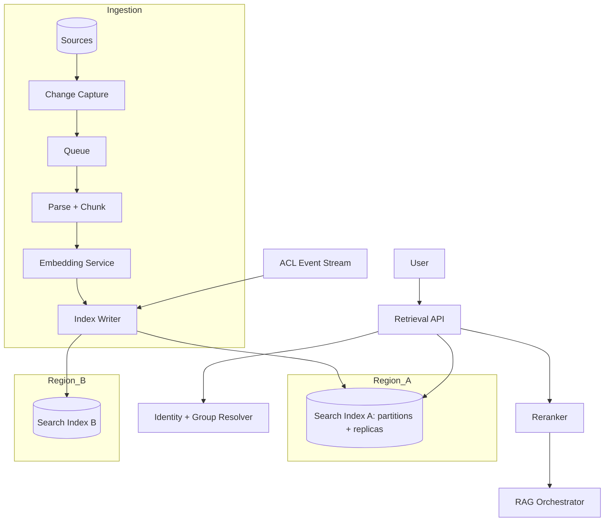

# Vector database selection (pgvector vs Azure AI Search vs Pinecone vs Weaviate)

> [← Back to Interview Preparation Home](interview-index.md)

## 1. Brief Summary

### Definition
A **vector database / vector search engine** stores high-dimensional embeddings and retrieves nearest neighbors by similarity (cosine, dot product, L2). Selection means choosing the engine that best fits your scale, query types, security, operations, and cost constraints.

### Why it matters
The retrieval layer determines RAG quality, latency, cost, and compliance posture. Migrating later means re-ingesting data, rewriting query code, and re-validating relevance.

### Core concepts and terminology
- **ANN (approximate nearest neighbor)** indexes: **HNSW**, **IVF/IVFFlat**, **DiskANN**, product quantization (PQ).
- **Recall vs latency vs memory** trade-off; parameters like `ef_search`, `m`, `lists`, `probes`.
- **Hybrid search**: BM25/keyword + vector, fused with RRF; **semantic reranking**.
- **Metadata filtering** (pre-filter vs post-filter), **namespaces/tenants**, **sharding/replicas**.
- **Quantization** (scalar/binary), **dimensionality** (e.g., 1536, 3072; Matryoshka truncation).

### How each option works
| Option | Nature | Strengths | Limits |
|---|---|---|---|
| **pgvector** | Postgres extension | Familiar SQL, transactions, joins with relational data, single store, ACID, RLS for security, cheap | Scaling beyond tens of millions of vectors needs tuning/partitioning; ANN features less rich; you operate it (or use managed PG) |
| **Azure AI Search** | Managed search service | Native hybrid (BM25 + vector), semantic ranker, integrated chunking/skills/indexers, security trimming, Azure integration, enterprise compliance | Azure lock-in, pricing by search units, index schema management, per-service limits |
| **Pinecone** | Fully managed vector DB (serverless/pod) | Minimal ops, scales well, namespaces, fast setup, sparse-dense hybrid | SaaS data residency/egress considerations, cost at scale, limited relational/query features |
| **Weaviate** | Open-source / managed vector DB | Built-in hybrid search, modules, multi-tenancy, GraphQL/REST, flexible self-host or cloud | Operating cluster yourself requires expertise; feature/version changes; tuning memory |

### Where it is used
RAG, semantic search, recommendations, deduplication, anomaly detection, agent memory, image/multimodal retrieval.

### Important tools
pgvector, pgvectorscale, Azure AI Search, Pinecone, Weaviate, Qdrant, Milvus, Elasticsearch/OpenSearch, Redis, Chroma, FAISS; benchmarks such as ANN-Benchmarks.

### Common misconceptions
- "Vector search alone is enough" — keyword/hybrid is often better for IDs, names, and acronyms.
- "Bigger dimensions are always better."
- "Pinecone/managed always costs less than self-hosting" — depends on scale and ops cost.
- "pgvector can't scale" — it handles many millions with proper indexing/partitioning, but it's not unlimited.

### Key points to remember
- Decide on **workload shape**: corpus size, QPS, filter complexity, update rate, hybrid needs.
- Existing platform alignment (Postgres shop → pgvector; Azure shop → AI Search) is often decisive.
- Plan evaluation (recall@k) and portability (abstraction layer, store raw text and metadata).

---

## 2. Interview Questions

### Beginner Questions

**Q1. What is a vector database and why is it used for RAG?**
- **Model answer:** It stores embeddings and quickly finds those most similar to a query embedding, letting RAG retrieve semantically relevant text even without keyword overlap.
- **Key points expected:** Embeddings, similarity search, ANN.
- **Mistake to avoid:** Describing it as a regular DB with a "vector column" and no mention of indexing/ANN.

**Q2. What is cosine similarity?**
- **Model answer:** A measure of the angle between two vectors; value near 1 means similar direction. Often used for text embeddings; for normalized vectors it's equivalent to dot product ranking.
- **Key points expected:** Direction not magnitude; alternatives (dot product, L2).
- **Mistake to avoid:** Saying it measures Euclidean distance.

**Q3. What is HNSW?**
- **Model answer:** Hierarchical Navigable Small World graph, an ANN index that navigates a layered proximity graph for fast, high-recall search at the cost of memory and build time.
- **Key points expected:** Graph-based, approximate, tunable recall/latency.
- **Mistake to avoid:** Thinking ANN returns exact results.

**Q4. When would you pick pgvector?**
- **Model answer:** When you already use PostgreSQL, the corpus is moderate (up to low tens of millions of vectors), you want transactional consistency and joins with relational data, and want to minimize new infrastructure.
- **Key points expected:** Simplicity, SQL, ACID, cost.
- **Mistake to avoid:** Ignoring scale limits and tuning needs.

**Q5. What is hybrid search?**
- **Model answer:** Combining keyword (BM25) and vector search, then fusing results (e.g., reciprocal rank fusion) to capture exact terms and semantic meaning.
- **Key points expected:** Keywords for exact tokens, vectors for semantics, fusion.
- **Mistake to avoid:** Claiming vector search always outperforms keyword.

**Q6. What is metadata filtering?**
- **Model answer:** Restricting search to vectors whose attributes match conditions (tenant, date, document type, ACL group), applied before or during ANN search.
- **Key points expected:** Multi-tenancy, security trimming, relevance.
- **Mistake to avoid:** Forgetting that post-filtering can return too few results.

**Q7. What is an embedding model and does it matter which one you use?**
- **Model answer:** A model mapping text to vectors. Quality, dimensions, language support, and domain fit affect retrieval; changing it requires re-embedding all data.
- **Key points expected:** Re-index cost, evaluation.
- **Mistake to avoid:** Mixing embeddings from different models in one index.

**Q8. What is a namespace or tenant in a vector DB?**
- **Model answer:** Logical partition separating data per customer/team, improving isolation and query efficiency.
- **Key points expected:** Isolation, filtering, per-tenant deletion.
- **Mistake to avoid:** Assuming namespaces equal strong security isolation by default.

### Intermediate Questions

**Q1. Compare pre-filtering and post-filtering in ANN search.**
- **Model answer:** Post-filtering runs ANN then filters results, risking too few matches when filters are selective. Pre-filtering (or filtered-HNSW traversal) applies constraints during search, preserving recall but requiring engine support and sometimes slower. Selective filters in pgvector with HNSW can need iterative scans or partial/partitioned indexes.
- **Key technical considerations:** Filter selectivity, partitioning by tenant, planner behavior.
- **Follow-up:** "How would you handle a tenant with 100 documents inside a 50M-vector index?"

**Q2. How do you tune HNSW parameters?**
- **Model answer:** `m` (graph connectivity) and `ef_construction` affect build quality and memory; `ef_search` trades recall for latency at query time. Benchmark on your data with ground-truth exact search to hit target recall (e.g., 95%+) at acceptable p95.
- **Key technical considerations:** Memory footprint, rebuild time, update patterns.
- **Follow-up:** "What happens to recall when you have heavy deletes/updates?"

**Q3. Why might you choose Azure AI Search over pgvector?**
- **Model answer:** Native hybrid search, semantic ranker, built-in indexers and skillsets for ingestion, security filters, managed scaling, Azure private networking/compliance, and integration with Azure OpenAI "on your data" patterns. Good fit when search relevance features matter more than relational joins.
- **Key technical considerations:** Cost (search units), service tier limits, index design.
- **Follow-up:** "How do you do zero-downtime reindexing in Azure AI Search?"

**Q4. What are the data-residency and security considerations for Pinecone?**
- **Model answer:** Pinecone is SaaS; verify region availability, encryption, private connectivity options, SOC2/ISO attestations, and data-processing agreements. Sensitive data may require private endpoints or a self-hosted alternative.
- **Key technical considerations:** Egress, vendor risk, BYOK availability, deletion guarantees.
- **Follow-up:** "What would you do if legal prohibits third-party SaaS for this data?"

**Q5. How does quantization affect a vector index?**
- **Model answer:** Scalar/binary/product quantization shrinks vectors (4–32x) lowering memory and cost with some recall loss. Often combined with rescoring using full-precision vectors.
- **Key technical considerations:** Recall measurement, oversampling + rescore.
- **Follow-up:** "How would you validate acceptable recall loss?"

**Q6. How do you design for multi-tenancy?**
- **Model answer:** Options: index/collection per tenant (strong isolation, overhead), shared index with tenant filter/namespace (efficient, requires strict filters), or PG row-level security. Choose by tenant count, size skew, compliance, and noisy-neighbor risk.
- **Key technical considerations:** Per-tenant deletion, quotas, cost allocation.
- **Follow-up:** "How would you prove tenant isolation to an auditor?"

**Q7. How do you handle updates and deletes?**
- **Model answer:** Use stable document/chunk IDs, upsert with version metadata, soft delete + purge, and CDC-driven ingestion. For HNSW, deletes may leave tombstones requiring compaction/reindex.
- **Key technical considerations:** Consistency lag, index bloat, legal deletion SLAs.
- **Follow-up:** "How do you guarantee deletion within 24 hours?"

**Q8. How do you evaluate vector DBs objectively?**
- **Model answer:** Build a golden query set with relevant docs; measure recall@k/nDCG, p50/p95/p99 latency under target QPS and filters, ingestion throughput, cost per million vectors/queries, and operational effort. Test with production-like data volume.
- **Key technical considerations:** Same embeddings and chunking across candidates; warm vs cold performance.
- **Follow-up:** "What would make you reject a technically faster candidate?"

### Advanced Questions

**Q1. You must serve 200M vectors with 500 QPS, filters on tenant and date, and p95 < 150 ms. Which option(s) and why?**
- **Model answer:** Single-node pgvector is unlikely to be comfortable. Candidates: Pinecone (managed scaling), Weaviate/Qdrant/Milvus sharded cluster, or Azure AI Search with multiple partitions/replicas and quantization. Use quantization + rescoring, tenant partitioning, replicas for QPS, and caching. Validate through load tests.
- **Design considerations:** Sharding strategy, memory sizing, filter selectivity, index rebuild windows.
- **Trade-offs:** Managed simplicity and cost vs control; recall loss from quantization.
- **Follow-ups:** "How do you do a no-downtime embedding model upgrade at this scale?"

**Q2. Design a zero-downtime embedding model migration.**
- **Model answer:** Create a new index/collection with the new model, dual-write new/updated documents, backfill historical data via batch jobs, run shadow queries to compare relevance, then flip a feature flag and retain old index for rollback.
- **Design considerations:** Version metadata, cost of double storage, compute for re-embedding, evaluation gates.
- **Trade-offs:** Temporary cost vs risk reduction.
- **Follow-ups:** "How do you detect regressions for rare queries?"

**Q3. A legal team requires document-level access control that changes hourly. How do you design retrieval?**
- **Model answer:** Store ACL group IDs per chunk and apply filter at query time using the caller's resolved group claims; sync permission changes through events to update metadata (cheap partial updates). In pgvector, RLS can enforce this; in Azure AI Search, use `search.in` security filters. Fail closed on ACL lookup failures.
- **Design considerations:** Large group sets (filter length limits), token group-overage, propagation latency.
- **Trade-offs:** Query-time filtering flexibility vs index size/latency; ACL staleness window.
- **Follow-ups:** "What if a user belongs to 5,000 groups?"

**Q4. Vector search returns irrelevant results for part numbers and acronyms. Diagnose and fix.**
- **Model answer:** Dense embeddings fail on exact tokens. Add BM25/hybrid with RRF, use sparse-dense models (SPLADE), field boosting, normalization of identifiers, query classification to route exact-match queries, and a reranker.
- **Design considerations:** Analyzer configuration, tokenization of IDs.
- **Trade-offs:** More complexity and index size vs relevance.
- **Follow-ups:** "How do you evaluate improvement objectively?"

**Q5. How would you architect for portability across vector stores?**
- **Model answer:** Keep canonical chunk store (text, metadata, version) in blob/relational storage; treat vector index as rebuildable derived data; wrap retrieval behind an interface; avoid proprietary query features in business logic; export embeddings.
- **Design considerations:** Rebuild time, feature parity, hybrid and filter semantics differences.
- **Trade-offs:** Abstraction hides unique features (semantic ranker) and may reduce performance.
- **Follow-ups:** "Which features would you deliberately accept lock-in for?"

**Q6. Total-cost analysis: pgvector on managed Postgres vs Azure AI Search vs Pinecone for 20M chunks.**
- **Model answer:** Compute memory needs (20M × dims × bytes + index overhead), then compare: PG instance size + storage + HA replica; AI Search tier/units with partitions and replicas; Pinecone storage + read/write units. Add ops labor, egress, dev time, and feature value (hybrid, reranker). Provide ranges and a sensitivity analysis on QPS.
- **Design considerations:** Peak vs average load, dev/test environments, DR copies.
- **Trade-offs:** Opex predictability vs flexibility.
- **Follow-ups:** "How does cost change with binary quantization?"

**Q7. How do you design DR for the vector tier?**
- **Model answer:** Because indexes are derived, DR can rebuild from source, but RTO may be hours. For tighter RTO use geo-replicated PG, secondary AI Search service in paired region populated via the same pipeline, or managed DB backup/collections. Define RPO from ingestion lag, test failover.
- **Design considerations:** Rebuild time at scale, region pairing, DNS/traffic manager.
- **Trade-offs:** Hot standby cost vs rebuild time.
- **Follow-ups:** "Can you serve degraded search during rebuild?"

**Q8. The business asks "just use whatever the cloud vendor has." How do you push back or agree?**
- **Model answer:** Frame decision criteria and scoring: relevance on our data, security, ops, skills, cost, lock-in. If the vendor option wins or is within tolerance, adopt it; otherwise document the gap and a proof-of-concept result. Decisions should be data-based and recorded in an ADR.
- **Design considerations:** Exit strategy, time-to-value.
- **Trade-offs:** Strategic alignment vs best-of-breed.
- **Follow-ups:** "What evidence would change your recommendation?"

---

## 3. Use Cases

### Simple Use Case — Product documentation search
- **Problem:** Semantic search over 20k doc chunks for a startup app already on PostgreSQL.
- **Assumptions:** <1M vectors, 20 QPS peak, no complex ACLs.
- **Steps:**
  1. Enable `pgvector`; create table `chunks(id, doc_id, content, embedding vector(1536), metadata jsonb)`.
  2. Insert embeddings from the embedding API.
  3. Create HNSW index with cosine ops.
  4. Query with `ORDER BY embedding <=> $1 LIMIT 5`.
- **Expected result:** Sub-50 ms search with no new infrastructure.
- **Tools:** PostgreSQL, pgvector, embedding API, Python/SQLAlchemy.

### Intermediate Use Case — Multi-tenant SaaS knowledge assistant
- **Scenario:** B2B SaaS with 300 tenants, 40M total chunks, skewed tenant size.
- **Requirements:** Tenant isolation, hybrid relevance, p95 < 300 ms, SOC2.
- **Proposed solution:** Azure AI Search (or Weaviate multi-tenancy) with hybrid + semantic ranking; large tenants get dedicated indexes, small tenants share an index with a mandatory tenant filter enforced in a retrieval service.
- **Implementation steps:**
  1. Define index schema (content, vector, tenantId, acl, version).
  2. Build ingestion pipeline with queue per tenant for fairness.
  3. Implement retrieval service that injects tenant filter from the token, not from the client.
  4. Add quotas and per-tenant metrics.
- **Technical challenges:** Noisy neighbors, tenant offboarding deletion, filter bugs causing leakage.
- **Expected result:** Relevant results, enforced isolation, predictable cost per tenant.
- **Testing approach:** Cross-tenant leakage tests (automated negative tests), recall@k on golden sets per tenant tier, load test with skewed distribution.

### Difficult Use Case — Global enterprise search platform on a shared vector tier
- **Scenario:** 150M chunks across 30 business units, 3 regions, hourly ACL changes, 800 QPS peak.
- **Functional requirements:** Hybrid search, ACL trimming, multilingual, citations.
- **Non-functional requirements:** p95 < 250 ms, 99.95% availability, regional residency, RPO ≤ 15 min, audited access.

**Proposed architecture**

**Components and responsibilities**
- **CDC + queue:** reliable, ordered, idempotent updates.
- **Embedding service:** batching, rate-limit handling, model version tag.
- **Index writer:** upserts, partial ACL updates, soft deletes.
- **Retrieval API:** query rewrite, hybrid search, filter construction, reranking.
- **Identity resolver:** expands user→groups with caching and fail-closed policy.

**Processing flow:** ingest/ACL events → index; query → authenticate → groups → filter → hybrid search → rerank → return with chunk IDs.

**Security:** Private endpoints, managed identity/RBAC, CMK encryption, fail-closed ACL, filter injection prevention, audit logs of queries and returned doc IDs.

**Performance/scalability:** Partitions for data size, replicas for QPS, binary quantization with rescoring, result caching for popular queries, bulk ingestion windows off-peak, per-BU quotas.

**Monitoring:** Recall canary queries, p95 latency per stage, ingestion lag, ACL propagation lag, index fill, throttling rates, cost per BU.

**Failure scenarios and recovery**
- Region outage → traffic manager shifts to peer region (index already populated).
- Ingestion poison message → DLQ with replay; alert on lag.
- Embedding provider throttling → backoff + secondary deployment.
- Corrupt index/schema change → blue/green alias swap and rollback.

**Trade-offs and alternatives**
- Active-active indexes double cost but meet RTO; alternative is warm standby with rebuild.
- Single shared index is cheaper but weak isolation; per-BU indexes simplify compliance.
- Alternative stack: self-hosted Weaviate/Qdrant for control at higher ops cost.
