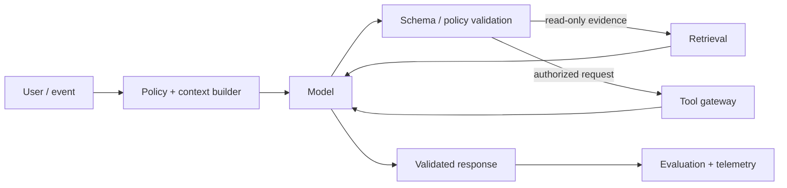

# Vector Databases: pgvector, Qdrant, Milvus, Weaviate, Pinecone, and OpenSearch

## 1. Title and Learning Position
- **Category:** Embeddings and Semantic Retrieval
- **Prerequisites:** [Exact Search, HNSW, IVF, Product Quantization, and Index Trade-offs](33-vector-indexes.md)
- **Why it matters:** Vector Databases: pgvector, Qdrant, Milvus, Weaviate, Pinecone, and OpenSearch contributes to building LLM systems that are accurate enough for their task, secure, observable, cost-aware and operable.
- **Learning objectives:** explain core mechanics; implement a safe pattern; select evaluation metrics; diagnose failures; make production architecture decisions.
- **Difficulty:** Intermediate
- **Estimated study time:** 4-8 hours plus hands-on exercises.
- **Practical competency:** design and review an implementation of Vector Databases: pgvector, Qdrant, Milvus, Weaviate, Pinecone, and OpenSearch with explicit quality and operational controls.

## 2. Concept
**Beginner.** Define Vector Databases: pgvector, Qdrant, Milvus, Weaviate, Pinecone, and OpenSearch by the problem it solves and the input/output contract. LLM output is probabilistic; application correctness therefore depends on context quality, validation and evaluation as much as the model call.

**Intermediate.** Separate durable application logic from provider-specific model APIs. Version prompts/configuration and preserve test cases. Explicitly mark trusted instructions, user input, retrieved content, tool outputs and application state.

**Advanced.** Analyze failure distributions, authorization boundaries, concurrency/rate limits, token economics, model/provider drift, evaluation variance, tail latency and graceful degradation. Use complexity only when measurable utility justifies it.

**Technical anchor.** Retrieval quality is distinct from answer quality. For cosine similarity, $sim(q,d)=q\cdot d/(||q||||d||)$. Ranking metrics such as Recall@k, MRR and NDCG evaluate candidate quality before generation; groundedness/faithfulness and citation checks evaluate generation.

**Message/control flow.** Keep system/application policy separate from untrusted user and retrieved content. Validate structured model responses before using them. Tool calls are proposed by a model but authorized and executed by deterministic software.

**Failure modes:** hallucination, missing context, instruction conflict, malformed output, rate limiting, context overflow, over-retrieval, tool misuse, stale data, drift and poorly calibrated evaluation.



## 3. Intermediate and Advanced Use Cases
### Intermediate application
**Problem:** Build a controlled application of Vector Databases: pgvector, Qdrant, Milvus, Weaviate, Pinecone, and OpenSearch with typed inputs/outputs and offline evaluation. **Inputs/context:** versioned requests, instructions, model/config versions and relevant governed enterprise data. **Why suitable:** the technique addresses a measured capability gap better than a simpler deterministic alternative. **Design:** typed API -> context/policy -> model/retrieval/tools as needed -> validation -> response/action -> telemetry. **Evaluation:** golden tasks plus task-specific correctness, safety, latency and cost metrics. **Risks:** nondeterminism, hallucination, injection, authorization mistakes, provider failure and regressions. **Fallback:** abstain, clarify, degrade to a smaller/simpler path, use deterministic logic, or escalate to a human. **Alternatives:** rules/workflows, search, SQL, smaller models, RAG or fine-tuning depending on the actual gap.
### Intermediate integration
**Problem:** Integrate Vector Databases: pgvector, Qdrant, Milvus, Weaviate, Pinecone, and OpenSearch into an enterprise API/document/search workflow. **Inputs/context:** versioned requests, instructions, model/config versions and relevant governed enterprise data. **Why suitable:** the technique addresses a measured capability gap better than a simpler deterministic alternative. **Design:** typed API -> context/policy -> model/retrieval/tools as needed -> validation -> response/action -> telemetry. **Evaluation:** golden tasks plus task-specific correctness, safety, latency and cost metrics. **Risks:** nondeterminism, hallucination, injection, authorization mistakes, provider failure and regressions. **Fallback:** abstain, clarify, degrade to a smaller/simpler path, use deterministic logic, or escalate to a human. **Alternatives:** rules/workflows, search, SQL, smaller models, RAG or fine-tuning depending on the actual gap.
### Advanced quality
**Problem:** Improve Vector Databases: pgvector, Qdrant, Milvus, Weaviate, Pinecone, and OpenSearch using a measurable regression set and failure-focused slices. **Inputs/context:** versioned requests, instructions, model/config versions and relevant governed enterprise data. **Why suitable:** the technique addresses a measured capability gap better than a simpler deterministic alternative. **Design:** typed API -> context/policy -> model/retrieval/tools as needed -> validation -> response/action -> telemetry. **Evaluation:** golden tasks plus task-specific correctness, safety, latency and cost metrics. **Risks:** nondeterminism, hallucination, injection, authorization mistakes, provider failure and regressions. **Fallback:** abstain, clarify, degrade to a smaller/simpler path, use deterministic logic, or escalate to a human. **Alternatives:** rules/workflows, search, SQL, smaller models, RAG or fine-tuning depending on the actual gap.
### Advanced scale
**Problem:** Operate Vector Databases: pgvector, Qdrant, Milvus, Weaviate, Pinecone, and OpenSearch under concurrency, latency, cost and dependency-failure constraints. **Inputs/context:** versioned requests, instructions, model/config versions and relevant governed enterprise data. **Why suitable:** the technique addresses a measured capability gap better than a simpler deterministic alternative. **Design:** typed API -> context/policy -> model/retrieval/tools as needed -> validation -> response/action -> telemetry. **Evaluation:** golden tasks plus task-specific correctness, safety, latency and cost metrics. **Risks:** nondeterminism, hallucination, injection, authorization mistakes, provider failure and regressions. **Fallback:** abstain, clarify, degrade to a smaller/simpler path, use deterministic logic, or escalate to a human. **Alternatives:** rules/workflows, search, SQL, smaller models, RAG or fine-tuning depending on the actual gap.
### Enterprise
**Problem:** Deploy Vector Databases: pgvector, Qdrant, Milvus, Weaviate, Pinecone, and OpenSearch with identity, audit, governance, observability, evaluation gates and rollback. **Inputs/context:** versioned requests, instructions, model/config versions and relevant governed enterprise data. **Why suitable:** the technique addresses a measured capability gap better than a simpler deterministic alternative. **Design:** typed API -> context/policy -> model/retrieval/tools as needed -> validation -> response/action -> telemetry. **Evaluation:** golden tasks plus task-specific correctness, safety, latency and cost metrics. **Risks:** nondeterminism, hallucination, injection, authorization mistakes, provider failure and regressions. **Fallback:** abstain, clarify, degrade to a smaller/simpler path, use deterministic logic, or escalate to a human. **Alternatives:** rules/workflows, search, SQL, smaller models, RAG or fine-tuning depending on the actual gap.

## 4. Python Implementation
**Implementation discipline.** Use typed requests/responses, environment/managed secrets, explicit timeouts, bounded retries with backoff, rate-limit handling, async I/O where beneficial, prompt/config version IDs, structured validation, telemetry and mocked tests.

```python
import os, asyncio
from typing import Protocol, Any
from pydantic import BaseModel, Field

class ModelReply(BaseModel):
    answer: str = Field(min_length=1)
    evidence_ids: list[str] = []

class LLM(Protocol):
    async def generate(self, messages: list[dict[str, str]]) -> dict[str, Any]: ...

async def validated_call(client: LLM, messages: list[dict[str, str]]) -> ModelReply:
    # Provider-specific client should enforce timeout, retry/backoff and rate-limit policy.
    raw = await client.generate(messages)
    return ModelReply.model_validate(raw)

# Secrets come from environment/managed identity; never put keys in source code.
api_key = os.getenv("LLM_API_KEY")
```

```python
from sklearn.feature_extraction.text import TfidfVectorizer
from sklearn.metrics.pairwise import cosine_similarity
docs = ["supplier approval policy", "purchase order matching", "invoice exception workflow"]
query = "supplier approval"
v = TfidfVectorizer().fit(docs + [query])
D, q = v.transform(docs), v.transform([query])
ranked = sorted(zip(cosine_similarity(q, D)[0], range(len(docs))), reverse=True)
# Production: preserve doc/chunk/version/ACL metadata; dense/hybrid retrieve, rerank, then assemble context.
```

**Testing:** mock provider/tool responses for deterministic unit tests; maintain golden examples for behavioral evaluation; separately load-test latency/concurrency.

**Token/cost hooks:** record model/provider/version, input/output tokens when available, cache status, latency and task outcome. Optimize cost per successful task, not token price alone.

**Common mistake:** trusting model-generated structured text because it looks valid. **Correction:** schema-validate it and independently authorize any action requested by that output.

## 5. Architectural Considerations
- **Model/provider abstraction:** isolate provider APIs behind a narrow interface; do not reduce provider differences to an assumed lowest common denominator when capability matters.
- **Context:** define explicit budgets for instructions, conversation, retrieved evidence, tool data and output; truncate/compress based on relevance and policy.
- **Managed vs self-hosted:** managed APIs reduce serving burden; self-hosted open-weight models offer greater control but add GPU capacity, patching, scaling and safety operations. Verify current provider documentation for mutable limits/capabilities.
- **Reliability:** enforce timeout, retry/backoff, circuit breaking, queue/back-pressure and fallback routing. Retries for side-effecting tools require idempotency keys.
- **Security:** treat prompts/retrieved documents/model outputs as untrusted; enforce IAM/RBAC/ABAC outside the model, minimize credentials, validate outputs, sandbox code and human-approve consequential actions.
- **RAG:** preserve source/version/chunk/ACL metadata; evaluate retrieval independently from answer faithfulness/citations.
- **Agents/tools:** define typed state, max steps, budgets, terminal states and checkpoints. Use deterministic workflows when the path is known.
- **Observability:** distributed traces should cover application, prompt/model call, retrieval, reranking, tool calls, validation and final outcome without leaking sensitive content. OpenTelemetry/Phoenix/LangSmith-style systems can support this depending on governance.
- **Evaluation/CI:** block releases on regressions in representative golden tasks, safety tests and schemas. Calibrate LLM judges against human labels for high-stakes quality gates.
- **Persistence:** PostgreSQL/Redis may fit transactional/session state; pgvector/Qdrant/Milvus/Weaviate/Pinecone/OpenSearch fit different vector/search requirements; selection depends on ACLs, filters, scale, operational model and retrieval evaluation.
- **Serving:** vLLM/Triton-style self-hosting becomes relevant when open models and workload economics justify owning GPU serving. Measure TTFT, inter-token latency, throughput, VRAM and queueing.
- **Deployment:** shadow first for risky changes, then canary/A-B where appropriate; retain a known-good prompt/model/index release and rollback path.
- **Enterprise integration:** use API gateways, model gateways, event streams and auditable service identities rather than embedding credentials into prompts or agents.

## 6. Interview Questions
### Q1. Beginner: What is a critical engineering decision for **Vector Databases: pgvector, Qdrant, Milvus, Weaviate, Pinecone, and OpenSearch**, and how would you validate it?
**Model answer:** Define the task and constraints, choose the simplest viable pattern, identify trusted/untrusted boundaries, establish an evaluation baseline, measure quality plus latency/cost, test failure modes, and define rollback/fallback behavior before release.

**Evaluates:** conceptual depth, production judgment, evaluation discipline and security awareness.

**Weak answer:** naming a framework/model without discussing data, evaluation, authorization, failure containment or operational trade-offs.

**Follow-up:** How would the design change under strict privacy, p99 latency, provider outage, low confidence, or a consequential tool action?

### Q2. Beginner: What is a critical engineering decision for **Vector Databases: pgvector, Qdrant, Milvus, Weaviate, Pinecone, and OpenSearch**, and how would you validate it?
**Model answer:** Define the task and constraints, choose the simplest viable pattern, identify trusted/untrusted boundaries, establish an evaluation baseline, measure quality plus latency/cost, test failure modes, and define rollback/fallback behavior before release.

**Evaluates:** conceptual depth, production judgment, evaluation discipline and security awareness.

**Weak answer:** naming a framework/model without discussing data, evaluation, authorization, failure containment or operational trade-offs.

**Follow-up:** How would the design change under strict privacy, p99 latency, provider outage, low confidence, or a consequential tool action?

### Q3. Beginner: What is a critical engineering decision for **Vector Databases: pgvector, Qdrant, Milvus, Weaviate, Pinecone, and OpenSearch**, and how would you validate it?
**Model answer:** Define the task and constraints, choose the simplest viable pattern, identify trusted/untrusted boundaries, establish an evaluation baseline, measure quality plus latency/cost, test failure modes, and define rollback/fallback behavior before release.

**Evaluates:** conceptual depth, production judgment, evaluation discipline and security awareness.

**Weak answer:** naming a framework/model without discussing data, evaluation, authorization, failure containment or operational trade-offs.

**Follow-up:** How would the design change under strict privacy, p99 latency, provider outage, low confidence, or a consequential tool action?

### Q4. Beginner: What is a critical engineering decision for **Vector Databases: pgvector, Qdrant, Milvus, Weaviate, Pinecone, and OpenSearch**, and how would you validate it?
**Model answer:** Define the task and constraints, choose the simplest viable pattern, identify trusted/untrusted boundaries, establish an evaluation baseline, measure quality plus latency/cost, test failure modes, and define rollback/fallback behavior before release.

**Evaluates:** conceptual depth, production judgment, evaluation discipline and security awareness.

**Weak answer:** naming a framework/model without discussing data, evaluation, authorization, failure containment or operational trade-offs.

**Follow-up:** How would the design change under strict privacy, p99 latency, provider outage, low confidence, or a consequential tool action?

### Q5. Beginner: What is a critical engineering decision for **Vector Databases: pgvector, Qdrant, Milvus, Weaviate, Pinecone, and OpenSearch**, and how would you validate it?
**Model answer:** Define the task and constraints, choose the simplest viable pattern, identify trusted/untrusted boundaries, establish an evaluation baseline, measure quality plus latency/cost, test failure modes, and define rollback/fallback behavior before release.

**Evaluates:** conceptual depth, production judgment, evaluation discipline and security awareness.

**Weak answer:** naming a framework/model without discussing data, evaluation, authorization, failure containment or operational trade-offs.

**Follow-up:** How would the design change under strict privacy, p99 latency, provider outage, low confidence, or a consequential tool action?

### Q6. Intermediate: What is a critical engineering decision for **Vector Databases: pgvector, Qdrant, Milvus, Weaviate, Pinecone, and OpenSearch**, and how would you validate it?
**Model answer:** Define the task and constraints, choose the simplest viable pattern, identify trusted/untrusted boundaries, establish an evaluation baseline, measure quality plus latency/cost, test failure modes, and define rollback/fallback behavior before release.

**Evaluates:** conceptual depth, production judgment, evaluation discipline and security awareness.

**Weak answer:** naming a framework/model without discussing data, evaluation, authorization, failure containment or operational trade-offs.

**Follow-up:** How would the design change under strict privacy, p99 latency, provider outage, low confidence, or a consequential tool action?

### Q7. Intermediate: What is a critical engineering decision for **Vector Databases: pgvector, Qdrant, Milvus, Weaviate, Pinecone, and OpenSearch**, and how would you validate it?
**Model answer:** Define the task and constraints, choose the simplest viable pattern, identify trusted/untrusted boundaries, establish an evaluation baseline, measure quality plus latency/cost, test failure modes, and define rollback/fallback behavior before release.

**Evaluates:** conceptual depth, production judgment, evaluation discipline and security awareness.

**Weak answer:** naming a framework/model without discussing data, evaluation, authorization, failure containment or operational trade-offs.

**Follow-up:** How would the design change under strict privacy, p99 latency, provider outage, low confidence, or a consequential tool action?

### Q8. Intermediate: What is a critical engineering decision for **Vector Databases: pgvector, Qdrant, Milvus, Weaviate, Pinecone, and OpenSearch**, and how would you validate it?
**Model answer:** Define the task and constraints, choose the simplest viable pattern, identify trusted/untrusted boundaries, establish an evaluation baseline, measure quality plus latency/cost, test failure modes, and define rollback/fallback behavior before release.

**Evaluates:** conceptual depth, production judgment, evaluation discipline and security awareness.

**Weak answer:** naming a framework/model without discussing data, evaluation, authorization, failure containment or operational trade-offs.

**Follow-up:** How would the design change under strict privacy, p99 latency, provider outage, low confidence, or a consequential tool action?

### Q9. Intermediate: What is a critical engineering decision for **Vector Databases: pgvector, Qdrant, Milvus, Weaviate, Pinecone, and OpenSearch**, and how would you validate it?
**Model answer:** Define the task and constraints, choose the simplest viable pattern, identify trusted/untrusted boundaries, establish an evaluation baseline, measure quality plus latency/cost, test failure modes, and define rollback/fallback behavior before release.

**Evaluates:** conceptual depth, production judgment, evaluation discipline and security awareness.

**Weak answer:** naming a framework/model without discussing data, evaluation, authorization, failure containment or operational trade-offs.

**Follow-up:** How would the design change under strict privacy, p99 latency, provider outage, low confidence, or a consequential tool action?

### Q10. Intermediate: What is a critical engineering decision for **Vector Databases: pgvector, Qdrant, Milvus, Weaviate, Pinecone, and OpenSearch**, and how would you validate it?
**Model answer:** Define the task and constraints, choose the simplest viable pattern, identify trusted/untrusted boundaries, establish an evaluation baseline, measure quality plus latency/cost, test failure modes, and define rollback/fallback behavior before release.

**Evaluates:** conceptual depth, production judgment, evaluation discipline and security awareness.

**Weak answer:** naming a framework/model without discussing data, evaluation, authorization, failure containment or operational trade-offs.

**Follow-up:** How would the design change under strict privacy, p99 latency, provider outage, low confidence, or a consequential tool action?

### Q11. Advanced: What is a critical engineering decision for **Vector Databases: pgvector, Qdrant, Milvus, Weaviate, Pinecone, and OpenSearch**, and how would you validate it?
**Model answer:** Define the task and constraints, choose the simplest viable pattern, identify trusted/untrusted boundaries, establish an evaluation baseline, measure quality plus latency/cost, test failure modes, and define rollback/fallback behavior before release.

**Evaluates:** conceptual depth, production judgment, evaluation discipline and security awareness.

**Weak answer:** naming a framework/model without discussing data, evaluation, authorization, failure containment or operational trade-offs.

**Follow-up:** How would the design change under strict privacy, p99 latency, provider outage, low confidence, or a consequential tool action?

### Q12. Advanced: What is a critical engineering decision for **Vector Databases: pgvector, Qdrant, Milvus, Weaviate, Pinecone, and OpenSearch**, and how would you validate it?
**Model answer:** Define the task and constraints, choose the simplest viable pattern, identify trusted/untrusted boundaries, establish an evaluation baseline, measure quality plus latency/cost, test failure modes, and define rollback/fallback behavior before release.

**Evaluates:** conceptual depth, production judgment, evaluation discipline and security awareness.

**Weak answer:** naming a framework/model without discussing data, evaluation, authorization, failure containment or operational trade-offs.

**Follow-up:** How would the design change under strict privacy, p99 latency, provider outage, low confidence, or a consequential tool action?

### Q13. Advanced: What is a critical engineering decision for **Vector Databases: pgvector, Qdrant, Milvus, Weaviate, Pinecone, and OpenSearch**, and how would you validate it?
**Model answer:** Define the task and constraints, choose the simplest viable pattern, identify trusted/untrusted boundaries, establish an evaluation baseline, measure quality plus latency/cost, test failure modes, and define rollback/fallback behavior before release.

**Evaluates:** conceptual depth, production judgment, evaluation discipline and security awareness.

**Weak answer:** naming a framework/model without discussing data, evaluation, authorization, failure containment or operational trade-offs.

**Follow-up:** How would the design change under strict privacy, p99 latency, provider outage, low confidence, or a consequential tool action?

### Q14. Advanced: What is a critical engineering decision for **Vector Databases: pgvector, Qdrant, Milvus, Weaviate, Pinecone, and OpenSearch**, and how would you validate it?
**Model answer:** Define the task and constraints, choose the simplest viable pattern, identify trusted/untrusted boundaries, establish an evaluation baseline, measure quality plus latency/cost, test failure modes, and define rollback/fallback behavior before release.

**Evaluates:** conceptual depth, production judgment, evaluation discipline and security awareness.

**Weak answer:** naming a framework/model without discussing data, evaluation, authorization, failure containment or operational trade-offs.

**Follow-up:** How would the design change under strict privacy, p99 latency, provider outage, low confidence, or a consequential tool action?

### Q15. Advanced: What is a critical engineering decision for **Vector Databases: pgvector, Qdrant, Milvus, Weaviate, Pinecone, and OpenSearch**, and how would you validate it?
**Model answer:** Define the task and constraints, choose the simplest viable pattern, identify trusted/untrusted boundaries, establish an evaluation baseline, measure quality plus latency/cost, test failure modes, and define rollback/fallback behavior before release.

**Evaluates:** conceptual depth, production judgment, evaluation discipline and security awareness.

**Weak answer:** naming a framework/model without discussing data, evaluation, authorization, failure containment or operational trade-offs.

**Follow-up:** How would the design change under strict privacy, p99 latency, provider outage, low confidence, or a consequential tool action?

### Q16. Architecture: What is a critical engineering decision for **Vector Databases: pgvector, Qdrant, Milvus, Weaviate, Pinecone, and OpenSearch**, and how would you validate it?
**Model answer:** Define the task and constraints, choose the simplest viable pattern, identify trusted/untrusted boundaries, establish an evaluation baseline, measure quality plus latency/cost, test failure modes, and define rollback/fallback behavior before release.

**Evaluates:** conceptual depth, production judgment, evaluation discipline and security awareness.

**Weak answer:** naming a framework/model without discussing data, evaluation, authorization, failure containment or operational trade-offs.

**Follow-up:** How would the design change under strict privacy, p99 latency, provider outage, low confidence, or a consequential tool action?

### Q17. Architecture: What is a critical engineering decision for **Vector Databases: pgvector, Qdrant, Milvus, Weaviate, Pinecone, and OpenSearch**, and how would you validate it?
**Model answer:** Define the task and constraints, choose the simplest viable pattern, identify trusted/untrusted boundaries, establish an evaluation baseline, measure quality plus latency/cost, test failure modes, and define rollback/fallback behavior before release.

**Evaluates:** conceptual depth, production judgment, evaluation discipline and security awareness.

**Weak answer:** naming a framework/model without discussing data, evaluation, authorization, failure containment or operational trade-offs.

**Follow-up:** How would the design change under strict privacy, p99 latency, provider outage, low confidence, or a consequential tool action?

### Q18. Architecture: What is a critical engineering decision for **Vector Databases: pgvector, Qdrant, Milvus, Weaviate, Pinecone, and OpenSearch**, and how would you validate it?
**Model answer:** Define the task and constraints, choose the simplest viable pattern, identify trusted/untrusted boundaries, establish an evaluation baseline, measure quality plus latency/cost, test failure modes, and define rollback/fallback behavior before release.

**Evaluates:** conceptual depth, production judgment, evaluation discipline and security awareness.

**Weak answer:** naming a framework/model without discussing data, evaluation, authorization, failure containment or operational trade-offs.

**Follow-up:** How would the design change under strict privacy, p99 latency, provider outage, low confidence, or a consequential tool action?

### Q19. Debugging: What is a critical engineering decision for **Vector Databases: pgvector, Qdrant, Milvus, Weaviate, Pinecone, and OpenSearch**, and how would you validate it?
**Model answer:** Define the task and constraints, choose the simplest viable pattern, identify trusted/untrusted boundaries, establish an evaluation baseline, measure quality plus latency/cost, test failure modes, and define rollback/fallback behavior before release.

**Evaluates:** conceptual depth, production judgment, evaluation discipline and security awareness.

**Weak answer:** naming a framework/model without discussing data, evaluation, authorization, failure containment or operational trade-offs.

**Follow-up:** How would the design change under strict privacy, p99 latency, provider outage, low confidence, or a consequential tool action?

### Q20. Debugging: What is a critical engineering decision for **Vector Databases: pgvector, Qdrant, Milvus, Weaviate, Pinecone, and OpenSearch**, and how would you validate it?
**Model answer:** Define the task and constraints, choose the simplest viable pattern, identify trusted/untrusted boundaries, establish an evaluation baseline, measure quality plus latency/cost, test failure modes, and define rollback/fallback behavior before release.

**Evaluates:** conceptual depth, production judgment, evaluation discipline and security awareness.

**Weak answer:** naming a framework/model without discussing data, evaluation, authorization, failure containment or operational trade-offs.

**Follow-up:** How would the design change under strict privacy, p99 latency, provider outage, low confidence, or a consequential tool action?

### Q21. Coding: What is a critical engineering decision for **Vector Databases: pgvector, Qdrant, Milvus, Weaviate, Pinecone, and OpenSearch**, and how would you validate it?
**Model answer:** Define the task and constraints, choose the simplest viable pattern, identify trusted/untrusted boundaries, establish an evaluation baseline, measure quality plus latency/cost, test failure modes, and define rollback/fallback behavior before release.

**Evaluates:** conceptual depth, production judgment, evaluation discipline and security awareness.

**Weak answer:** naming a framework/model without discussing data, evaluation, authorization, failure containment or operational trade-offs.

**Follow-up:** How would the design change under strict privacy, p99 latency, provider outage, low confidence, or a consequential tool action?

### Q22. Coding: What is a critical engineering decision for **Vector Databases: pgvector, Qdrant, Milvus, Weaviate, Pinecone, and OpenSearch**, and how would you validate it?
**Model answer:** Define the task and constraints, choose the simplest viable pattern, identify trusted/untrusted boundaries, establish an evaluation baseline, measure quality plus latency/cost, test failure modes, and define rollback/fallback behavior before release.

**Evaluates:** conceptual depth, production judgment, evaluation discipline and security awareness.

**Weak answer:** naming a framework/model without discussing data, evaluation, authorization, failure containment or operational trade-offs.

**Follow-up:** How would the design change under strict privacy, p99 latency, provider outage, low confidence, or a consequential tool action?

## 7. Practical Exercises
### Foundational
Implement a minimal, typed example of Vector Databases: pgvector, Qdrant, Milvus, Weaviate, Pinecone, and OpenSearch with mocked model/provider behavior. **Expected:** reproducible code and tests. **Evaluate:** conceptual correctness, schema validation and failure handling. **Failure modes:** malformed output, timeout and incorrect assumptions.

### Intermediate
Add a golden dataset, metrics, retry/rate-limit behavior and tracing. Compare against a simpler baseline. **Expected:** evaluation report with per-example failures. **Evaluate:** quality, latency, cost and test design.

### Advanced production
Design an enterprise implementation with identity, data classification, model gateway, observability, evaluation gates, security controls, fallback and rollback. **Expected:** architecture diagram plus runbook/SLOs. **Evaluate:** operability, quality, security and cost. **Stretch:** add controlled chaos tests for provider/tool failure.

## 8. Summary and Revision Checklist
### Key takeaways
- Design from task and risk, not model novelty.
- Treat LLM output as probabilistic and untrusted until validated.
- Version prompts, models, data/retrieval, tools and evaluation artifacts together.
- Optimize quality, latency, security, reliability and cost as a system.

### Important formulas or design rules
Revisit the Technical anchor and be able to explain why its metric/objective affects system behavior. For operational design, track success rate, tail latency, tokens/cost per successful task and failure categories.

### Critical configuration parameters
Model/version, temperature/sampling, output limit, timeout/retries, context budget, retrieval top-k/rerank depth where relevant, tool max steps/budgets and cache policy.

### Selection checklist
- [ ] Deterministic baseline considered
- [ ] Task/golden dataset defined
- [ ] Provider/model selection evidence-based
- [ ] Schema/output validation present
- [ ] Security/authorization enforced outside model
- [ ] Quality/latency/cost measured
- [ ] Fallback and rollback tested

### Security checklist
- [ ] No credentials in prompts/source
- [ ] Untrusted text separated from policy
- [ ] Tool permissions least-privilege
- [ ] Consequential actions require appropriate approval
- [ ] Sensitive telemetry is minimized/redacted

### Common pitfalls
Prompt-only authorization, no golden dataset, evaluating only happy paths, overengineering with agents, retrying non-idempotent actions, leaking sensitive context, stale indexes, unbounded token/tool loops and missing rollback.

### Five flashcards
1. **Q:** Why is structured output not automatically safe? **A:** Schema validity does not prove authorization or semantic correctness.
2. **Q:** Why separate retrieval and answer evaluation? **A:** Bad evidence and bad generation are different failure sources.
3. **Q:** When is an agent unnecessary? **A:** When a deterministic workflow can express the control path reliably.
4. **Q:** What should an LLM release version? **A:** Model/provider, prompt/config, relevant data/index/tools/policies and evaluation set/results.
5. **Q:** What is a useful optimization target? **A:** Quality-adjusted cost and latency per successful task under reliability/security constraints.

### Next recommended topics
- [Sparse, Dense, Hybrid Search, and Rank Fusion](35-hybrid-search.md)
- [Cross-Encoder, LLM, and Learned Reranking](36-reranking.md)
