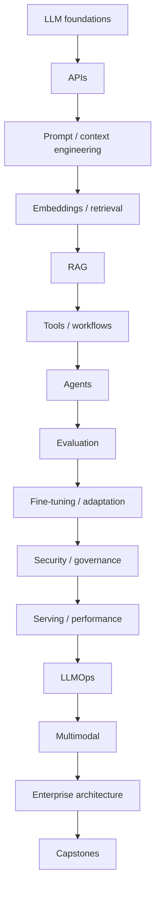
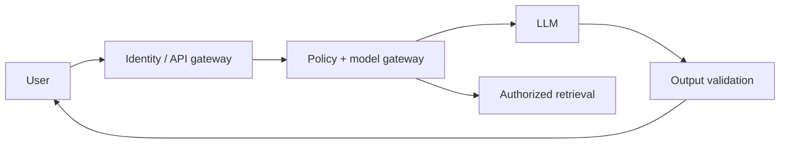

# LLM Engineering Notes

## Repository Purpose

A production-oriented learning repository for experienced Python/ML engineers moving toward LLM Engineering, Agentic AI and AI Solution Architecture. Study sequentially, run implementations, maintain a golden evaluation set, perform threat modeling, and complete architecture exercises.

## Recommended Learning Path

## Category Summary

### Category 1: LLM Engineering Foundations

**Purpose:** build practical capability in llm engineering foundations. **Prerequisites:** prior categories unless already proficient. **Estimated study time:** 48-80 hours. **Outcome:** implement, evaluate, secure and architect these capabilities.

1. **[LLM Engineering Problem Framing and End-to-End Lifecycle](01-llm-engineering-workflow.md)**  
   Foundational. Prerequisite: Python, APIs and ML fundamentals. Study: 4-8 hours. Skill: implementation plus production review of LLM Engineering Problem Framing and End-to-End Lifecycle.
2. **[Language Modeling, Probability, Logits, Softmax, and Next-Token Prediction](02-language-modeling-foundations.md)**  
   Foundational. Prerequisite: LLM Engineering Problem Framing and End-to-End Lifecycle. Study: 4-8 hours. Skill: implementation plus production review of Language Modeling, Probability, Logits, Softmax, and Next-Token Prediction.
3. **[Transformer Architecture for LLM Engineers](03-transformer-architecture.md)**  
   Foundational. Prerequisite: Language Modeling, Probability, Logits, Softmax, and Next-Token Prediction. Study: 4-8 hours. Skill: implementation plus production review of Transformer Architecture for LLM Engineers.
4. **[Tokenization, BPE, WordPiece, SentencePiece, and Token Economics](04-tokenization.md)**  
   Foundational. Prerequisite: Transformer Architecture for LLM Engineers. Study: 4-8 hours. Skill: implementation plus production review of Tokenization, BPE, WordPiece, SentencePiece, and Token Economics.
5. **[Context Windows, Attention Complexity, and Context Budgeting](05-context-windows.md)**  
   Foundational. Prerequisite: Tokenization, BPE, WordPiece, SentencePiece, and Token Economics. Study: 4-8 hours. Skill: implementation plus production review of Context Windows, Attention Complexity, and Context Budgeting.
6. **[Encoder, Decoder, Encoder-Decoder, and Modern LLM Families](06-llm-model-families.md)**  
   Foundational. Prerequisite: Context Windows, Attention Complexity, and Context Budgeting. Study: 4-8 hours. Skill: implementation plus production review of Encoder, Decoder, Encoder-Decoder, and Modern LLM Families.
7. **[Managed APIs vs Open-Weight and Self-Hosted Models](07-managed-vs-open-models.md)**  
   Foundational. Prerequisite: Encoder, Decoder, Encoder-Decoder, and Modern LLM Families. Study: 4-8 hours. Skill: implementation plus production review of Managed APIs vs Open-Weight and Self-Hosted Models.
8. **[Model Selection by Quality, Latency, Cost, Privacy, and Capability](08-model-selection.md)**  
   Foundational. Prerequisite: Managed APIs vs Open-Weight and Self-Hosted Models. Study: 4-8 hours. Skill: implementation plus production review of Model Selection by Quality, Latency, Cost, Privacy, and Capability.

### Category 2: LLM API and Application Engineering

**Purpose:** build practical capability in llm api and application engineering. **Prerequisites:** prior categories unless already proficient. **Estimated study time:** 54-90 hours. **Outcome:** implement, evaluate, secure and architect these capabilities.

9. **[Chat/Responses APIs, Messages, Roles, and Request Lifecycles](09-llm-api-fundamentals.md)**  
   Foundational. Prerequisite: Model Selection by Quality, Latency, Cost, Privacy, and Capability. Study: 4-8 hours. Skill: implementation plus production review of Chat/Responses APIs, Messages, Roles, and Request Lifecycles.
10. **[Temperature, Top-p, Top-k, Max Tokens, Stop Conditions, and Seeds](10-generation-parameters.md)**  
   Foundational. Prerequisite: Chat/Responses APIs, Messages, Roles, and Request Lifecycles. Study: 4-8 hours. Skill: implementation plus production review of Temperature, Top-p, Top-k, Max Tokens, Stop Conditions, and Seeds.
11. **[Streaming, Server-Sent Events, and Incremental User Experience](11-streaming-responses.md)**  
   Foundational. Prerequisite: Temperature, Top-p, Top-k, Max Tokens, Stop Conditions, and Seeds. Study: 4-8 hours. Skill: implementation plus production review of Streaming, Server-Sent Events, and Incremental User Experience.
12. **[Async Calls, Concurrency, Rate Limits, Back Pressure, and Retries](12-async-concurrency-rate-limits.md)**  
   Foundational. Prerequisite: Streaming, Server-Sent Events, and Incremental User Experience. Study: 4-8 hours. Skill: implementation plus production review of Async Calls, Concurrency, Rate Limits, Back Pressure, and Retries.
13. **[Structured Outputs, JSON Schema, Pydantic, Parsing, and Validation](13-structured-outputs.md)**  
   Foundational. Prerequisite: Async Calls, Concurrency, Rate Limits, Back Pressure, and Retries. Study: 4-8 hours. Skill: implementation plus production review of Structured Outputs, JSON Schema, Pydantic, Parsing, and Validation.
14. **[Function Calling and Tool Schemas](14-function-calling.md)**  
   Foundational. Prerequisite: Structured Outputs, JSON Schema, Pydantic, Parsing, and Validation. Study: 4-8 hours. Skill: implementation plus production review of Function Calling and Tool Schemas.
15. **[Timeouts, Retries, Circuit Breakers, Idempotency, and Fallbacks](15-error-handling-resilience.md)**  
   Foundational. Prerequisite: Function Calling and Tool Schemas. Study: 4-8 hours. Skill: implementation plus production review of Timeouts, Retries, Circuit Breakers, Idempotency, and Fallbacks.
16. **[Token Measurement, Budgeting, Chargeback, and Cost Controls](16-token-cost-accounting.md)**  
   Foundational. Prerequisite: Timeouts, Retries, Circuit Breakers, Idempotency, and Fallbacks. Study: 4-8 hours. Skill: implementation plus production review of Token Measurement, Budgeting, Chargeback, and Cost Controls.
17. **[Provider Abstraction, Model Routing, Cascades, and Fallback Models](17-provider-abstraction-routing.md)**  
   Foundational. Prerequisite: Token Measurement, Budgeting, Chargeback, and Cost Controls. Study: 4-8 hours. Skill: implementation plus production review of Provider Abstraction, Model Routing, Cascades, and Fallback Models.

### Category 3: Prompt Engineering

**Purpose:** build practical capability in prompt engineering. **Prerequisites:** prior categories unless already proficient. **Estimated study time:** 60-100 hours. **Outcome:** implement, evaluate, secure and architect these capabilities.

18. **[Prompt Anatomy, Instruction Hierarchy, Roles, Delimiters, and Context](18-prompt-anatomy.md)**  
   Foundational. Prerequisite: Provider Abstraction, Model Routing, Cascades, and Fallback Models. Study: 4-8 hours. Skill: implementation plus production review of Prompt Anatomy, Instruction Hierarchy, Roles, Delimiters, and Context.
19. **[Zero-Shot, One-Shot, and Few-Shot Prompting](19-zero-shot-few-shot.md)**  
   Foundational. Prerequisite: Prompt Anatomy, Instruction Hierarchy, Roles, Delimiters, and Context. Study: 4-8 hours. Skill: implementation plus production review of Zero-Shot, One-Shot, and Few-Shot Prompting.
20. **[Classification, Extraction, Transformation, Summarization, and Generation Patterns](20-prompt-patterns.md)**  
   Foundational. Prerequisite: Zero-Shot, One-Shot, and Few-Shot Prompting. Study: 4-8 hours. Skill: implementation plus production review of Classification, Extraction, Transformation, Summarization, and Generation Patterns.
21. **[Reasoning-Oriented Prompting and Verifiable Intermediate Artifacts](21-reasoning-prompting.md)**  
   Foundational. Prerequisite: Classification, Extraction, Transformation, Summarization, and Generation Patterns. Study: 4-8 hours. Skill: implementation plus production review of Reasoning-Oriented Prompting and Verifiable Intermediate Artifacts.
22. **[Task Decomposition, Planning, Reflection, and Critique Patterns](22-decomposition-planning.md)**  
   Foundational. Prerequisite: Reasoning-Oriented Prompting and Verifiable Intermediate Artifacts. Study: 4-8 hours. Skill: implementation plus production review of Task Decomposition, Planning, Reflection, and Critique Patterns.
23. **[Prompt Templates, Versioning, Registries, and Change Control](23-prompt-templates-versioning.md)**  
   Foundational. Prerequisite: Task Decomposition, Planning, Reflection, and Critique Patterns. Study: 4-8 hours. Skill: implementation plus production review of Prompt Templates, Versioning, Registries, and Change Control.
24. **[Prompt Testing, Search, Optimization, and Regression Prevention](24-prompt-testing-optimization.md)**  
   Foundational. Prerequisite: Prompt Templates, Versioning, Registries, and Change Control. Study: 4-8 hours. Skill: implementation plus production review of Prompt Testing, Search, Optimization, and Regression Prevention.
25. **[Context Engineering and Information Prioritization](25-context-engineering.md)**  
   Foundational. Prerequisite: Prompt Testing, Search, Optimization, and Regression Prevention. Study: 4-8 hours. Skill: implementation plus production review of Context Engineering and Information Prioritization.
26. **[Long-Context Strategies, Compression, Summarization, and Context Selection](26-long-context-strategies.md)**  
   Foundational. Prerequisite: Context Engineering and Information Prioritization. Study: 4-8 hours. Skill: implementation plus production review of Long-Context Strategies, Compression, Summarization, and Context Selection.
27. **[Prompt Injection, Instruction Conflicts, and Defensive Prompt Design](27-prompt-injection-defenses.md)**  
   Foundational. Prerequisite: Long-Context Strategies, Compression, Summarization, and Context Selection. Study: 4-8 hours. Skill: implementation plus production review of Prompt Injection, Instruction Conflicts, and Defensive Prompt Design.

### Category 4: Embeddings and Semantic Retrieval

**Purpose:** build practical capability in embeddings and semantic retrieval. **Prerequisites:** prior categories unless already proficient. **Estimated study time:** 60-100 hours. **Outcome:** implement, evaluate, secure and architect these capabilities.

28. **[Embedding Models and Representation Spaces](28-embedding-foundations.md)**  
   Intermediate. Prerequisite: Prompt Injection, Instruction Conflicts, and Defensive Prompt Design. Study: 4-8 hours. Skill: implementation plus production review of Embedding Models and Representation Spaces.
29. **[Cosine Similarity, Dot Product, Euclidean Distance, and Normalization](29-similarity-metrics.md)**  
   Intermediate. Prerequisite: Embedding Models and Representation Spaces. Study: 4-8 hours. Skill: implementation plus production review of Cosine Similarity, Dot Product, Euclidean Distance, and Normalization.
30. **[Embedding Model Selection, Domain Fit, Dimensions, and Multilingual Needs](30-embedding-model-selection.md)**  
   Intermediate. Prerequisite: Cosine Similarity, Dot Product, Euclidean Distance, and Normalization. Study: 4-8 hours. Skill: implementation plus production review of Embedding Model Selection, Domain Fit, Dimensions, and Multilingual Needs.
31. **[Fixed, Recursive, Semantic, Structural, and Document-Aware Chunking](31-chunking-strategies.md)**  
   Intermediate. Prerequisite: Embedding Model Selection, Domain Fit, Dimensions, and Multilingual Needs. Study: 4-8 hours. Skill: implementation plus production review of Fixed, Recursive, Semantic, Structural, and Document-Aware Chunking.
32. **[Metadata Design, Filtering, Access Control, and Retrieval Scoping](32-metadata-filtering.md)**  
   Intermediate. Prerequisite: Fixed, Recursive, Semantic, Structural, and Document-Aware Chunking. Study: 4-8 hours. Skill: implementation plus production review of Metadata Design, Filtering, Access Control, and Retrieval Scoping.
33. **[Exact Search, HNSW, IVF, Product Quantization, and Index Trade-offs](33-vector-indexes.md)**  
   Intermediate. Prerequisite: Metadata Design, Filtering, Access Control, and Retrieval Scoping. Study: 4-8 hours. Skill: implementation plus production review of Exact Search, HNSW, IVF, Product Quantization, and Index Trade-offs.
34. **[Vector Databases: pgvector, Qdrant, Milvus, Weaviate, Pinecone, and OpenSearch](34-vector-databases.md)**  
   Intermediate. Prerequisite: Exact Search, HNSW, IVF, Product Quantization, and Index Trade-offs. Study: 4-8 hours. Skill: implementation plus production review of Vector Databases: pgvector, Qdrant, Milvus, Weaviate, Pinecone, and OpenSearch.
35. **[Sparse, Dense, Hybrid Search, and Rank Fusion](35-hybrid-search.md)**  
   Intermediate. Prerequisite: Vector Databases: pgvector, Qdrant, Milvus, Weaviate, Pinecone, and OpenSearch. Study: 4-8 hours. Skill: implementation plus production review of Sparse, Dense, Hybrid Search, and Rank Fusion.
36. **[Cross-Encoder, LLM, and Learned Reranking](36-reranking.md)**  
   Intermediate. Prerequisite: Sparse, Dense, Hybrid Search, and Rank Fusion. Study: 4-8 hours. Skill: implementation plus production review of Cross-Encoder, LLM, and Learned Reranking.
37. **[Recall@k, Precision@k, MRR, NDCG, and Retrieval Diagnostics](37-retrieval-evaluation.md)**  
   Intermediate. Prerequisite: Cross-Encoder, LLM, and Learned Reranking. Study: 4-8 hours. Skill: implementation plus production review of Recall@k, Precision@k, MRR, NDCG, and Retrieval Diagnostics.

### Category 5: Retrieval-Augmented Generation

**Purpose:** build practical capability in retrieval-augmented generation. **Prerequisites:** prior categories unless already proficient. **Estimated study time:** 72-120 hours. **Outcome:** implement, evaluate, secure and architect these capabilities.

38. **[End-to-End RAG Architecture](38-rag-architecture.md)**  
   Intermediate. Prerequisite: Recall@k, Precision@k, MRR, NDCG, and Retrieval Diagnostics. Study: 4-8 hours. Skill: implementation plus production review of End-to-End RAG Architecture.
39. **[Connectors, Parsing, Cleaning, Chunking, Embedding, and Indexing](39-rag-ingestion-pipeline.md)**  
   Intermediate. Prerequisite: End-to-End RAG Architecture. Study: 4-8 hours. Skill: implementation plus production review of Connectors, Parsing, Cleaning, Chunking, Embedding, and Indexing.
40. **[Query Rewriting, Retrieval, Reranking, Context Assembly, and Generation](40-rag-query-pipeline.md)**  
   Intermediate. Prerequisite: Connectors, Parsing, Cleaning, Chunking, Embedding, and Indexing. Study: 4-8 hours. Skill: implementation plus production review of Query Rewriting, Retrieval, Reranking, Context Assembly, and Generation.
41. **[Grounding, Source Attribution, Citations, and Evidence Presentation](41-grounding-citations.md)**  
   Intermediate. Prerequisite: Query Rewriting, Retrieval, Reranking, Context Assembly, and Generation. Study: 4-8 hours. Skill: implementation plus production review of Grounding, Source Attribution, Citations, and Evidence Presentation.
42. **[Multi-Query, HyDE, Parent-Child, Small-to-Big, and Contextual Retrieval](42-advanced-rag.md)**  
   Intermediate. Prerequisite: Grounding, Source Attribution, Citations, and Evidence Presentation. Study: 4-8 hours. Skill: implementation plus production review of Multi-Query, HyDE, Parent-Child, Small-to-Big, and Contextual Retrieval.
43. **[Agentic RAG and Adaptive Retrieval](43-agentic-rag.md)**  
   Intermediate. Prerequisite: Multi-Query, HyDE, Parent-Child, Small-to-Big, and Contextual Retrieval. Study: 4-8 hours. Skill: implementation plus production review of Agentic RAG and Adaptive Retrieval.
44. **[Knowledge Graphs, GraphRAG, Entity Linking, and Community Summaries](44-graph-rag.md)**  
   Intermediate. Prerequisite: Agentic RAG and Adaptive Retrieval. Study: 4-8 hours. Skill: implementation plus production review of Knowledge Graphs, GraphRAG, Entity Linking, and Community Summaries.
45. **[Text-to-SQL, Semantic Layers, Query Validation, and Database Safety](45-sql-rag.md)**  
   Intermediate. Prerequisite: Knowledge Graphs, GraphRAG, Entity Linking, and Community Summaries. Study: 4-8 hours. Skill: implementation plus production review of Text-to-SQL, Semantic Layers, Query Validation, and Database Safety.
46. **[Multimodal RAG for PDFs, Images, Tables, Charts, and Audio](46-multimodal-rag.md)**  
   Intermediate. Prerequisite: Text-to-SQL, Semantic Layers, Query Validation, and Database Safety. Study: 4-8 hours. Skill: implementation plus production review of Multimodal RAG for PDFs, Images, Tables, Charts, and Audio.
47. **[RAG Authorization, Data Leakage, Poisoning, and Prompt-Injection Risks](47-rag-security.md)**  
   Intermediate. Prerequisite: Multimodal RAG for PDFs, Images, Tables, Charts, and Audio. Study: 4-8 hours. Skill: implementation plus production review of RAG Authorization, Data Leakage, Poisoning, and Prompt-Injection Risks.
48. **[RAG Evaluation: Retrieval, Faithfulness, Relevance, Citation, and Task Success](48-rag-evaluation.md)**  
   Intermediate. Prerequisite: RAG Authorization, Data Leakage, Poisoning, and Prompt-Injection Risks. Study: 4-8 hours. Skill: implementation plus production review of RAG Evaluation: Retrieval, Faithfulness, Relevance, Citation, and Task Success.
49. **[RAG Latency, Caching, Index Maintenance, Freshness, and Cost](49-rag-production-optimization.md)**  
   Intermediate. Prerequisite: RAG Evaluation: Retrieval, Faithfulness, Relevance, Citation, and Task Success. Study: 4-8 hours. Skill: implementation plus production review of RAG Latency, Caching, Index Maintenance, Freshness, and Cost.

### Category 6: Tool Use and Workflow Automation

**Purpose:** build practical capability in tool use and workflow automation. **Prerequisites:** prior categories unless already proficient. **Estimated study time:** 48-80 hours. **Outcome:** implement, evaluate, secure and architect these capabilities.

50. **[Tool Use, Tool Choice, Arguments, Results, and Control Flow](50-tool-use-foundations.md)**  
   Intermediate. Prerequisite: RAG Latency, Caching, Index Maintenance, Freshness, and Cost. Study: 4-8 hours. Skill: implementation plus production review of Tool Use, Tool Choice, Arguments, Results, and Control Flow.
51. **[Schema Design, Validation, Retries, Idempotency, and Error Recovery](51-reliable-tool-calling.md)**  
   Intermediate. Prerequisite: Tool Use, Tool Choice, Arguments, Results, and Control Flow. Study: 4-8 hours. Skill: implementation plus production review of Schema Design, Validation, Retries, Idempotency, and Error Recovery.
52. **[Integrating REST, GraphQL, Databases, Search, and Enterprise APIs](52-api-integration.md)**  
   Intermediate. Prerequisite: Schema Design, Validation, Retries, Idempotency, and Error Recovery. Study: 4-8 hours. Skill: implementation plus production review of Integrating REST, GraphQL, Databases, Search, and Enterprise APIs.
53. **[Secure Code Execution, Sandboxing, Resource Limits, and Isolation](53-code-execution-sandboxes.md)**  
   Intermediate. Prerequisite: Integrating REST, GraphQL, Databases, Search, and Enterprise APIs. Study: 4-8 hours. Skill: implementation plus production review of Secure Code Execution, Sandboxing, Resource Limits, and Isolation.
54. **[Human Approval, Escalation, and Consequential Action Controls](54-human-approval.md)**  
   Intermediate. Prerequisite: Secure Code Execution, Sandboxing, Resource Limits, and Isolation. Study: 4-8 hours. Skill: implementation plus production review of Human Approval, Escalation, and Consequential Action Controls.
55. **[Deterministic Workflows with LLM Decision Points](55-deterministic-workflows.md)**  
   Intermediate. Prerequisite: Human Approval, Escalation, and Consequential Action Controls. Study: 4-8 hours. Skill: implementation plus production review of Deterministic Workflows with LLM Decision Points.
56. **[State Machines, Durable Execution, and Workflow Engines](56-state-machines-workflow-engines.md)**  
   Intermediate. Prerequisite: Deterministic Workflows with LLM Decision Points. Study: 4-8 hours. Skill: implementation plus production review of State Machines, Durable Execution, and Workflow Engines.
57. **[Model Context Protocol: Servers, Clients, Resources, Tools, and Security](57-mcp.md)**  
   Intermediate. Prerequisite: State Machines, Durable Execution, and Workflow Engines. Study: 4-8 hours. Skill: implementation plus production review of Model Context Protocol: Servers, Clients, Resources, Tools, and Security.

### Category 7: Agentic AI Engineering

**Purpose:** build practical capability in agentic ai engineering. **Prerequisites:** prior categories unless already proficient. **Estimated study time:** 60-100 hours. **Outcome:** implement, evaluate, secure and architect these capabilities.

58. **[Agent Architecture, Loops, State, Actions, and Termination](58-agent-foundations.md)**  
   Intermediate. Prerequisite: Model Context Protocol: Servers, Clients, Resources, Tools, and Security. Study: 4-8 hours. Skill: implementation plus production review of Agent Architecture, Loops, State, Actions, and Termination.
59. **[ReAct, Plan-and-Execute, Reflection, and Critique](59-react-and-plan-execute.md)**  
   Intermediate. Prerequisite: Agent Architecture, Loops, State, Actions, and Termination. Study: 4-8 hours. Skill: implementation plus production review of ReAct, Plan-and-Execute, Reflection, and Critique.
60. **[LangGraph State, Nodes, Edges, Checkpoints, and Human Interrupts](60-langgraph.md)**  
   Intermediate. Prerequisite: ReAct, Plan-and-Execute, Reflection, and Critique. Study: 4-8 hours. Skill: implementation plus production review of LangGraph State, Nodes, Edges, Checkpoints, and Human Interrupts.
61. **[Working, Episodic, Semantic, and Long-Term Agent Memory](61-agent-memory.md)**  
   Intermediate. Prerequisite: LangGraph State, Nodes, Edges, Checkpoints, and Human Interrupts. Study: 4-8 hours. Skill: implementation plus production review of Working, Episodic, Semantic, and Long-Term Agent Memory.
62. **[Multi-Agent Patterns, Supervisors, Handoffs, and Collaboration](62-multi-agent-systems.md)**  
   Intermediate. Prerequisite: Working, Episodic, Semantic, and Long-Term Agent Memory. Study: 4-8 hours. Skill: implementation plus production review of Multi-Agent Patterns, Supervisors, Handoffs, and Collaboration.
63. **[Planning, Task Graphs, Scheduling, and Dynamic Replanning](63-agent-planning.md)**  
   Intermediate. Prerequisite: Multi-Agent Patterns, Supervisors, Handoffs, and Collaboration. Study: 4-8 hours. Skill: implementation plus production review of Planning, Task Graphs, Scheduling, and Dynamic Replanning.
64. **[Agent Evaluation: Task Success, Tool Accuracy, Trajectories, and Efficiency](64-agent-evaluation.md)**  
   Intermediate. Prerequisite: Planning, Task Graphs, Scheduling, and Dynamic Replanning. Study: 4-8 hours. Skill: implementation plus production review of Agent Evaluation: Task Success, Tool Accuracy, Trajectories, and Efficiency.
65. **[Agent Tracing, State Inspection, Replay, and Debugging](65-agent-observability.md)**  
   Intermediate. Prerequisite: Agent Evaluation: Task Success, Tool Accuracy, Trajectories, and Efficiency. Study: 4-8 hours. Skill: implementation plus production review of Agent Tracing, State Inspection, Replay, and Debugging.
66. **[Agent Permissions, Tool Abuse, Prompt Injection, and Action Safety](66-agent-security.md)**  
   Intermediate. Prerequisite: Agent Tracing, State Inspection, Replay, and Debugging. Study: 4-8 hours. Skill: implementation plus production review of Agent Permissions, Tool Abuse, Prompt Injection, and Action Safety.
67. **[Production Agent Patterns, Failure Containment, and Graceful Degradation](67-agent-production-patterns.md)**  
   Intermediate. Prerequisite: Agent Permissions, Tool Abuse, Prompt Injection, and Action Safety. Study: 4-8 hours. Skill: implementation plus production review of Production Agent Patterns, Failure Containment, and Graceful Degradation.

### Category 8: LLM Evaluation and Testing

**Purpose:** build practical capability in llm evaluation and testing. **Prerequisites:** prior categories unless already proficient. **Estimated study time:** 60-100 hours. **Outcome:** implement, evaluate, secure and architect these capabilities.

68. **[LLM Evaluation Strategy and Quality Taxonomy](68-evaluation-strategy.md)**  
   Advanced. Prerequisite: Production Agent Patterns, Failure Containment, and Graceful Degradation. Study: 4-8 hours. Skill: implementation plus production review of LLM Evaluation Strategy and Quality Taxonomy.
69. **[Golden Datasets, Sampling, Annotation, and Test-Set Governance](69-golden-datasets.md)**  
   Advanced. Prerequisite: LLM Evaluation Strategy and Quality Taxonomy. Study: 4-8 hours. Skill: implementation plus production review of Golden Datasets, Sampling, Annotation, and Test-Set Governance.
70. **[Exact Match, Schema, Regex, Code, SQL, and Rule-Based Evaluators](70-deterministic-evaluators.md)**  
   Advanced. Prerequisite: Golden Datasets, Sampling, Annotation, and Test-Set Governance. Study: 4-8 hours. Skill: implementation plus production review of Exact Match, Schema, Regex, Code, SQL, and Rule-Based Evaluators.
71. **[LLM-as-Judge, Rubrics, Pairwise Evaluation, Bias, and Calibration](71-llm-as-judge.md)**  
   Advanced. Prerequisite: Exact Match, Schema, Regex, Code, SQL, and Rule-Based Evaluators. Study: 4-8 hours. Skill: implementation plus production review of LLM-as-Judge, Rubrics, Pairwise Evaluation, Bias, and Calibration.
72. **[Human Evaluation, Annotation Guidelines, Agreement, and Adjudication](72-human-evaluation.md)**  
   Advanced. Prerequisite: LLM-as-Judge, Rubrics, Pairwise Evaluation, Bias, and Calibration. Study: 4-8 hours. Skill: implementation plus production review of Human Evaluation, Annotation Guidelines, Agreement, and Adjudication.
73. **[Ragas, DeepEval, TruLens, Phoenix, promptfoo, and Evaluation Harnesses](73-rag-agent-evaluation-tools.md)**  
   Advanced. Prerequisite: Human Evaluation, Annotation Guidelines, Agreement, and Adjudication. Study: 4-8 hours. Skill: implementation plus production review of Ragas, DeepEval, TruLens, Phoenix, promptfoo, and Evaluation Harnesses.
74. **[A/B Testing, Interleaving, User Feedback, and Business Metrics](74-online-evaluation.md)**  
   Advanced. Prerequisite: Ragas, DeepEval, TruLens, Phoenix, promptfoo, and Evaluation Harnesses. Study: 4-8 hours. Skill: implementation plus production review of A/B Testing, Interleaving, User Feedback, and Business Metrics.
75. **[Prompt/Model Regression Testing and CI Quality Gates](75-regression-testing-ci.md)**  
   Advanced. Prerequisite: A/B Testing, Interleaving, User Feedback, and Business Metrics. Study: 4-8 hours. Skill: implementation plus production review of Prompt/Model Regression Testing and CI Quality Gates.
76. **[Adversarial Testing, Red Teaming, and Abuse-Case Evaluation](76-red-teaming.md)**  
   Advanced. Prerequisite: Prompt/Model Regression Testing and CI Quality Gates. Study: 4-8 hours. Skill: implementation plus production review of Adversarial Testing, Red Teaming, and Abuse-Case Evaluation.
77. **[Confidence Intervals, Statistical Significance, Variance, and Sample Size](77-evaluation-statistics.md)**  
   Advanced. Prerequisite: Adversarial Testing, Red Teaming, and Abuse-Case Evaluation. Study: 4-8 hours. Skill: implementation plus production review of Confidence Intervals, Statistical Significance, Variance, and Sample Size.

### Category 9: Fine-Tuning and Model Adaptation

**Purpose:** build practical capability in fine-tuning and model adaptation. **Prerequisites:** prior categories unless already proficient. **Estimated study time:** 54-90 hours. **Outcome:** implement, evaluate, secure and architect these capabilities.

78. **[When to Prompt, Retrieve, Fine-Tune, or Train](78-fine-tuning-decision.md)**  
   Advanced. Prerequisite: Confidence Intervals, Statistical Significance, Variance, and Sample Size. Study: 4-8 hours. Skill: implementation plus production review of When to Prompt, Retrieve, Fine-Tune, or Train.
79. **[Data Collection, Cleaning, Formatting, Deduplication, and Splits](79-training-data-preparation.md)**  
   Advanced. Prerequisite: When to Prompt, Retrieve, Fine-Tune, or Train. Study: 4-8 hours. Skill: implementation plus production review of Data Collection, Cleaning, Formatting, Deduplication, and Splits.
80. **[Supervised Fine-Tuning and Instruction Tuning](80-supervised-fine-tuning.md)**  
   Advanced. Prerequisite: Data Collection, Cleaning, Formatting, Deduplication, and Splits. Study: 4-8 hours. Skill: implementation plus production review of Supervised Fine-Tuning and Instruction Tuning.
81. **[PEFT, Adapters, LoRA, and QLoRA](81-peft-lora-qlora.md)**  
   Advanced. Prerequisite: Supervised Fine-Tuning and Instruction Tuning. Study: 4-8 hours. Skill: implementation plus production review of PEFT, Adapters, LoRA, and QLoRA.
82. **[RLHF, Reward Models, DPO, and Preference Optimization](82-preference-optimization.md)**  
   Advanced. Prerequisite: PEFT, Adapters, LoRA, and QLoRA. Study: 4-8 hours. Skill: implementation plus production review of RLHF, Reward Models, DPO, and Preference Optimization.
83. **[Domain Adaptation and Continued Pretraining](83-domain-adaptation.md)**  
   Advanced. Prerequisite: RLHF, Reward Models, DPO, and Preference Optimization. Study: 4-8 hours. Skill: implementation plus production review of Domain Adaptation and Continued Pretraining.
84. **[Fine-Tuning Evaluation, Catastrophic Forgetting, and Regression](84-fine-tuning-evaluation.md)**  
   Advanced. Prerequisite: Domain Adaptation and Continued Pretraining. Study: 4-8 hours. Skill: implementation plus production review of Fine-Tuning Evaluation, Catastrophic Forgetting, and Regression.
85. **[GPU Memory, Distributed Training, Checkpointing, and Experiment Tracking](85-fine-tuning-infrastructure.md)**  
   Advanced. Prerequisite: Fine-Tuning Evaluation, Catastrophic Forgetting, and Regression. Study: 4-8 hours. Skill: implementation plus production review of GPU Memory, Distributed Training, Checkpointing, and Experiment Tracking.
86. **[Model Merging, Adapter Composition, and Operational Risks](86-model-merging.md)**  
   Advanced. Prerequisite: GPU Memory, Distributed Training, Checkpointing, and Experiment Tracking. Study: 4-8 hours. Skill: implementation plus production review of Model Merging, Adapter Composition, and Operational Risks.

### Category 10: LLM Security, Safety, and Governance

**Purpose:** build practical capability in llm security, safety, and governance. **Prerequisites:** prior categories unless already proficient. **Estimated study time:** 66-110 hours. **Outcome:** implement, evaluate, secure and architect these capabilities.

87. **[LLM Application Threat Modeling](87-llm-threat-modeling.md)**  
   Advanced. Prerequisite: Model Merging, Adapter Composition, and Operational Risks. Study: 4-8 hours. Skill: implementation plus production review of LLM Application Threat Modeling.
88. **[OWASP-Style LLM Application Risks and Controls](88-owasp-llm-risks.md)**  
   Advanced. Prerequisite: LLM Application Threat Modeling. Study: 4-8 hours. Skill: implementation plus production review of OWASP-Style LLM Application Risks and Controls.
89. **[Direct and Indirect Prompt Injection](89-prompt-injection.md)**  
   Advanced. Prerequisite: OWASP-Style LLM Application Risks and Controls. Study: 4-8 hours. Skill: implementation plus production review of Direct and Indirect Prompt Injection.
90. **[Sensitive Data Disclosure, Exfiltration, and Boundary Enforcement](90-data-exfiltration.md)**  
   Advanced. Prerequisite: Direct and Indirect Prompt Injection. Study: 4-8 hours. Skill: implementation plus production review of Sensitive Data Disclosure, Exfiltration, and Boundary Enforcement.
91. **[Output Validation, Encoding, Allowlists, and Safe Rendering](91-output-validation.md)**  
   Advanced. Prerequisite: Sensitive Data Disclosure, Exfiltration, and Boundary Enforcement. Study: 4-8 hours. Skill: implementation plus production review of Output Validation, Encoding, Allowlists, and Safe Rendering.
92. **[Secrets, Managed Identity, RBAC, and Least Privilege](92-secrets-identity-access.md)**  
   Advanced. Prerequisite: Output Validation, Encoding, Allowlists, and Safe Rendering. Study: 4-8 hours. Skill: implementation plus production review of Secrets, Managed Identity, RBAC, and Least Privilege.
93. **[Content Safety, Moderation, Policy Enforcement, and Escalation](93-content-safety.md)**  
   Advanced. Prerequisite: Secrets, Managed Identity, RBAC, and Least Privilege. Study: 4-8 hours. Skill: implementation plus production review of Content Safety, Moderation, Policy Enforcement, and Escalation.
94. **[PII, Data Minimization, Retention, Deletion, and Auditability](94-privacy-retention.md)**  
   Advanced. Prerequisite: Content Safety, Moderation, Policy Enforcement, and Escalation. Study: 4-8 hours. Skill: implementation plus production review of PII, Data Minimization, Retention, Deletion, and Auditability.
95. **[Model, Dataset, Dependency, and Artifact Supply-Chain Security](95-model-supply-chain.md)**  
   Advanced. Prerequisite: PII, Data Minimization, Retention, Deletion, and Auditability. Study: 4-8 hours. Skill: implementation plus production review of Model, Dataset, Dependency, and Artifact Supply-Chain Security.
96. **[Responsible AI, Risk Classification, Documentation, and Governance](96-responsible-ai-governance.md)**  
   Advanced. Prerequisite: Model, Dataset, Dependency, and Artifact Supply-Chain Security. Study: 4-8 hours. Skill: implementation plus production review of Responsible AI, Risk Classification, Documentation, and Governance.
97. **[Security Testing, Monitoring, Incident Response, and Recovery](97-security-testing-incident-response.md)**  
   Advanced. Prerequisite: Responsible AI, Risk Classification, Documentation, and Governance. Study: 4-8 hours. Skill: implementation plus production review of Security Testing, Monitoring, Incident Response, and Recovery.

### Category 11: LLM Serving and Performance Engineering

**Purpose:** build practical capability in llm serving and performance engineering. **Prerequisites:** prior categories unless already proficient. **Estimated study time:** 60-100 hours. **Outcome:** implement, evaluate, secure and architect these capabilities.

98. **[Prefill, Decode, KV Cache, Memory, Latency, and Throughput](98-llm-inference-foundations.md)**  
   Advanced. Prerequisite: Security Testing, Monitoring, Incident Response, and Recovery. Study: 4-8 hours. Skill: implementation plus production review of Prefill, Decode, KV Cache, Memory, Latency, and Throughput.
99. **[INT8/INT4, GPTQ, AWQ, GGUF, and Quantization Trade-offs](99-quantization.md)**  
   Advanced. Prerequisite: Prefill, Decode, KV Cache, Memory, Latency, and Throughput. Study: 4-8 hours. Skill: implementation plus production review of INT8/INT4, GPTQ, AWQ, GGUF, and Quantization Trade-offs.
100. **[vLLM, TGI, TensorRT-LLM, llama.cpp, and Inference Engines](100-inference-engines.md)**  
   Advanced. Prerequisite: INT8/INT4, GPTQ, AWQ, GGUF, and Quantization Trade-offs. Study: 4-8 hours. Skill: implementation plus production review of vLLM, TGI, TensorRT-LLM, llama.cpp, and Inference Engines.
101. **[Continuous Batching, Scheduling, and Request Prioritization](101-continuous-batching.md)**  
   Advanced. Prerequisite: vLLM, TGI, TensorRT-LLM, llama.cpp, and Inference Engines. Study: 4-8 hours. Skill: implementation plus production review of Continuous Batching, Scheduling, and Request Prioritization.
102. **[Speculative Decoding and Latency Optimization](102-speculative-decoding.md)**  
   Advanced. Prerequisite: Continuous Batching, Scheduling, and Request Prioritization. Study: 4-8 hours. Skill: implementation plus production review of Speculative Decoding and Latency Optimization.
103. **[Prompt, Prefix, KV, Response, and Semantic Caching](103-caching.md)**  
   Advanced. Prerequisite: Speculative Decoding and Latency Optimization. Study: 4-8 hours. Skill: implementation plus production review of Prompt, Prefix, KV, Response, and Semantic Caching.
104. **[GPU Memory, Concurrency, Token Throughput, and Capacity Planning](104-capacity-planning.md)**  
   Advanced. Prerequisite: Prompt, Prefix, KV, Response, and Semantic Caching. Study: 4-8 hours. Skill: implementation plus production review of GPU Memory, Concurrency, Token Throughput, and Capacity Planning.
105. **[Autoscaling, Queues, Load Shedding, and Admission Control](105-autoscaling-load-shedding.md)**  
   Advanced. Prerequisite: GPU Memory, Concurrency, Token Throughput, and Capacity Planning. Study: 4-8 hours. Skill: implementation plus production review of Autoscaling, Queues, Load Shedding, and Admission Control.
106. **[Local and Edge LLMs, Privacy, Packaging, and Resource Constraints](106-edge-local-llms.md)**  
   Advanced. Prerequisite: Autoscaling, Queues, Load Shedding, and Admission Control. Study: 4-8 hours. Skill: implementation plus production review of Local and Edge LLMs, Privacy, Packaging, and Resource Constraints.
107. **[Benchmarking Time-to-First-Token, Inter-Token Latency, Throughput, and Quality](107-serving-benchmarks.md)**  
   Advanced. Prerequisite: Local and Edge LLMs, Privacy, Packaging, and Resource Constraints. Study: 4-8 hours. Skill: implementation plus production review of Benchmarking Time-to-First-Token, Inter-Token Latency, Throughput, and Quality.

### Category 12: LLMOps and Observability

**Purpose:** build practical capability in llmops and observability. **Prerequisites:** prior categories unless already proficient. **Estimated study time:** 60-100 hours. **Outcome:** implement, evaluate, secure and architect these capabilities.

108. **[Prompt, Model, Dataset, and Evaluation Registries](108-prompt-model-registry.md)**  
   Advanced. Prerequisite: Benchmarking Time-to-First-Token, Inter-Token Latency, Throughput, and Quality. Study: 4-8 hours. Skill: implementation plus production review of Prompt, Model, Dataset, and Evaluation Registries.
109. **[Distributed Tracing and OpenTelemetry for LLM Applications](109-tracing-opentelemetry.md)**  
   Advanced. Prerequisite: Prompt, Model, Dataset, and Evaluation Registries. Study: 4-8 hours. Skill: implementation plus production review of Distributed Tracing and OpenTelemetry for LLM Applications.
110. **[Logs, Metrics, Traces, Token Usage, Quality, and Cost Observability](110-llm-observability.md)**  
   Advanced. Prerequisite: Distributed Tracing and OpenTelemetry for LLM Applications. Study: 4-8 hours. Skill: implementation plus production review of Logs, Metrics, Traces, Token Usage, Quality, and Cost Observability.
111. **[User Feedback, Annotation Queues, Error Taxonomy, and Continuous Improvement](111-feedback-loops.md)**  
   Advanced. Prerequisite: Logs, Metrics, Traces, Token Usage, Quality, and Cost Observability. Study: 4-8 hours. Skill: implementation plus production review of User Feedback, Annotation Queues, Error Taxonomy, and Continuous Improvement.
112. **[CI/CD for Prompts, RAG, Agents, Models, and Evaluations](112-llm-ci-cd.md)**  
   Advanced. Prerequisite: User Feedback, Annotation Queues, Error Taxonomy, and Continuous Improvement. Study: 4-8 hours. Skill: implementation plus production review of CI/CD for Prompts, RAG, Agents, Models, and Evaluations.
113. **[Canary, Shadow, A/B, Rollback, and Feature Flags](113-deployment-release-strategies.md)**  
   Advanced. Prerequisite: CI/CD for Prompts, RAG, Agents, Models, and Evaluations. Study: 4-8 hours. Skill: implementation plus production review of Canary, Shadow, A/B, Rollback, and Feature Flags.
114. **[Data, Retrieval, Prompt, Model, and Behavior Drift](114-data-model-prompt-drift.md)**  
   Advanced. Prerequisite: Canary, Shadow, A/B, Rollback, and Feature Flags. Study: 4-8 hours. Skill: implementation plus production review of Data, Retrieval, Prompt, Model, and Behavior Drift.
115. **[Production Debugging and Replay of LLM Workflows](115-production-debugging.md)**  
   Advanced. Prerequisite: Data, Retrieval, Prompt, Model, and Behavior Drift. Study: 4-8 hours. Skill: implementation plus production review of Production Debugging and Replay of LLM Workflows.
116. **[SLOs, SLAs, Error Budgets, Cost Budgets, and Chargeback](116-slo-sla-cost-governance.md)**  
   Advanced. Prerequisite: Production Debugging and Replay of LLM Workflows. Study: 4-8 hours. Skill: implementation plus production review of SLOs, SLAs, Error Budgets, Cost Budgets, and Chargeback.
117. **[Incident Detection, Triage, Mitigation, Postmortems, and Recovery](117-llm-incident-management.md)**  
   Advanced. Prerequisite: SLOs, SLAs, Error Budgets, Cost Budgets, and Chargeback. Study: 4-8 hours. Skill: implementation plus production review of Incident Detection, Triage, Mitigation, Postmortems, and Recovery.

### Category 13: Multimodal LLM Engineering

**Purpose:** build practical capability in multimodal llm engineering. **Prerequisites:** prior categories unless already proficient. **Estimated study time:** 42-70 hours. **Outcome:** implement, evaluate, secure and architect these capabilities.

118. **[Multimodal Model Foundations](118-multimodal-models.md)**  
   Advanced. Prerequisite: Incident Detection, Triage, Mitigation, Postmortems, and Recovery. Study: 4-8 hours. Skill: implementation plus production review of Multimodal Model Foundations.
119. **[Vision-Language Prompting and Image Understanding](119-vision-language-prompts.md)**  
   Advanced. Prerequisite: Multimodal Model Foundations. Study: 4-8 hours. Skill: implementation plus production review of Vision-Language Prompting and Image Understanding.
120. **[OCR, Layout, Tables, Charts, and Document Understanding](120-document-ai-pipelines.md)**  
   Advanced. Prerequisite: Vision-Language Prompting and Image Understanding. Study: 4-8 hours. Skill: implementation plus production review of OCR, Layout, Tables, Charts, and Document Understanding.
121. **[Speech-to-Text, Text-to-Speech, Audio Understanding, and Voice Agents](121-audio-speech-llms.md)**  
   Advanced. Prerequisite: OCR, Layout, Tables, Charts, and Document Understanding. Study: 4-8 hours. Skill: implementation plus production review of Speech-to-Text, Text-to-Speech, Audio Understanding, and Voice Agents.
122. **[Extracting Structured Data from Images and Documents](122-multimodal-structured-outputs.md)**  
   Advanced. Prerequisite: Speech-to-Text, Text-to-Speech, Audio Understanding, and Voice Agents. Study: 4-8 hours. Skill: implementation plus production review of Extracting Structured Data from Images and Documents.
123. **[Production Multimodal RAG and Evidence Presentation](123-multimodal-rag-production.md)**  
   Advanced. Prerequisite: Extracting Structured Data from Images and Documents. Study: 4-8 hours. Skill: implementation plus production review of Production Multimodal RAG and Evidence Presentation.
124. **[Multimodal Evaluation, Privacy, Safety, and Failure Analysis](124-multimodal-evaluation-safety.md)**  
   Advanced. Prerequisite: Production Multimodal RAG and Evidence Presentation. Study: 4-8 hours. Skill: implementation plus production review of Multimodal Evaluation, Privacy, Safety, and Failure Analysis.

### Category 14: Enterprise LLM Architecture

**Purpose:** build practical capability in enterprise llm architecture. **Prerequisites:** prior categories unless already proficient. **Estimated study time:** 60-100 hours. **Outcome:** implement, evaluate, secure and architect these capabilities.

125. **[Enterprise Use-Case Selection, Feasibility, and ROI](125-enterprise-use-case-selection.md)**  
   Architecture. Prerequisite: Multimodal Evaluation, Privacy, Safety, and Failure Analysis. Study: 4-8 hours. Skill: implementation plus production review of Enterprise Use-Case Selection, Feasibility, and ROI.
126. **[Enterprise LLM Reference Architecture](126-reference-architecture.md)**  
   Architecture. Prerequisite: Enterprise Use-Case Selection, Feasibility, and ROI. Study: 4-8 hours. Skill: implementation plus production review of Enterprise LLM Reference Architecture.
127. **[API Gateway, Model Gateway, Routing, Policy, and Quotas](127-api-gateway-model-gateway.md)**  
   Architecture. Prerequisite: Enterprise LLM Reference Architecture. Study: 4-8 hours. Skill: implementation plus production review of API Gateway, Model Gateway, Routing, Policy, and Quotas.
128. **[Enterprise Data, ERP, SaaS, Databases, Events, and Document Integration](128-enterprise-data-integration.md)**  
   Architecture. Prerequisite: API Gateway, Model Gateway, Routing, Policy, and Quotas. Study: 4-8 hours. Skill: implementation plus production review of Enterprise Data, ERP, SaaS, Databases, Events, and Document Integration.
129. **[Identity-Aware Retrieval, Authorization, Delegation, and Audit](129-identity-authorization.md)**  
   Architecture. Prerequisite: Enterprise Data, ERP, SaaS, Databases, Events, and Document Integration. Study: 4-8 hours. Skill: implementation plus production review of Identity-Aware Retrieval, Authorization, Delegation, and Audit.
130. **[Multi-Tenant Isolation, Configuration, Data, and Cost Controls](130-multi-tenant-architecture.md)**  
   Architecture. Prerequisite: Identity-Aware Retrieval, Authorization, Delegation, and Audit. Study: 4-8 hours. Skill: implementation plus production review of Multi-Tenant Isolation, Configuration, Data, and Cost Controls.
131. **[Cloud, Hybrid, On-Premises, and Sovereign Deployment Choices](131-cloud-hybrid-onprem.md)**  
   Architecture. Prerequisite: Multi-Tenant Isolation, Configuration, Data, and Cost Controls. Study: 4-8 hours. Skill: implementation plus production review of Cloud, Hybrid, On-Premises, and Sovereign Deployment Choices.
132. **[LLM Platform Teams, Product Teams, Governance, and Operating Model](132-platform-team-operating-model.md)**  
   Architecture. Prerequisite: Cloud, Hybrid, On-Premises, and Sovereign Deployment Choices. Study: 4-8 hours. Skill: implementation plus production review of LLM Platform Teams, Product Teams, Governance, and Operating Model.
133. **[Vendor Selection, Lock-In, Portability, and Exit Strategy](133-vendor-selection-portability.md)**  
   Architecture. Prerequisite: LLM Platform Teams, Product Teams, Governance, and Operating Model. Study: 4-8 hours. Skill: implementation plus production review of Vendor Selection, Lock-In, Portability, and Exit Strategy.
134. **[End-to-End Enterprise LLM System Design](134-enterprise-llm-system-design.md)**  
   Architecture. Prerequisite: Vendor Selection, Lock-In, Portability, and Exit Strategy. Study: 4-8 hours. Skill: implementation plus production review of End-to-End Enterprise LLM System Design.

### Category 15: Capstones and Interview Preparation

**Purpose:** build practical capability in capstones and interview preparation. **Prerequisites:** prior categories unless already proficient. **Estimated study time:** 36-60 hours. **Outcome:** implement, evaluate, secure and architect these capabilities.

135. **[Production RAG Capstone](135-production-rag-capstone.md)**  
   Architecture. Prerequisite: End-to-End Enterprise LLM System Design. Study: 4-8 hours. Skill: implementation plus production review of Production RAG Capstone.
136. **[Agentic Enterprise Workflow Capstone](136-agentic-workflow-capstone.md)**  
   Architecture. Prerequisite: Production RAG Capstone. Study: 4-8 hours. Skill: implementation plus production review of Agentic Enterprise Workflow Capstone.
137. **[Evaluation and Regression Harness Capstone](137-llm-evaluation-capstone.md)**  
   Architecture. Prerequisite: Agentic Enterprise Workflow Capstone. Study: 4-8 hours. Skill: implementation plus production review of Evaluation and Regression Harness Capstone.
138. **[Secure Enterprise LLM Architecture Capstone](138-secure-llm-architecture-capstone.md)**  
   Architecture. Prerequisite: Evaluation and Regression Harness Capstone. Study: 4-8 hours. Skill: implementation plus production review of Secure Enterprise LLM Architecture Capstone.
139. **[LLM System-Design Interview Framework](139-llm-system-design-interviews.md)**  
   Architecture. Prerequisite: Secure Enterprise LLM Architecture Capstone. Study: 4-8 hours. Skill: implementation plus production review of LLM System-Design Interview Framework.
140. **[Comprehensive LLM Engineering Interview Bank](140-llm-engineering-interview-bank.md)**  
   Architecture. Prerequisite: LLM System-Design Interview Framework. Study: 4-8 hours. Skill: implementation plus production review of Comprehensive LLM Engineering Interview Bank.

## LLM Solution Selection Guide

| Decision | Prefer first when | Prefer second when | Main trade-off |
|---|---|---|---|
| Prompt vs RAG vs fine-tuning | behavior/instruction gap | knowledge/evidence gap / stable behavior adaptation | simplicity vs data/ops complexity |
| Managed vs self-hosted | managed reliability/time-to-market | data/control/economics justify GPU operations | convenience vs control |
| Small vs large model | bounded task, latency/cost sensitive | difficult reasoning/capability demands | efficiency vs capability |
| Long context vs retrieval | modest corpus, context fits reliably | large/frequently changing evidence base | simplicity vs retrieval engineering |
| Sparse vs dense vs hybrid | exact identifiers/keywords | semantic intent / both | precision modes vs infrastructure |
| Workflow vs agent | path is known | next action depends on observations | predictability vs flexibility |
| Single vs multi-agent | most tasks | distinct expertise/isolation proves useful | simplicity vs coordination cost |
| Function call vs MCP | app-local fixed tools | interoperable discoverable tool/resource ecosystem | directness vs protocol layer |
| Full FT vs LoRA/QLoRA | maximum adaptation and resources | efficient/domain adapters | capacity vs cost |
| Sync vs async vs batch | interactive low-latency | long/decoupled / high-volume offline | UX vs throughput |
| Exact vs judge vs human eval | deterministic output | nuanced rubric / high-consequence adjudication | reproducibility vs semantic judgment |
| Vector DB choices | choose by filters/ACL, scale, update, ops, portability and measured retrieval quality rather than brand | | |

## Reference Architectures

### 1. Secure enterprise chat assistant

### 2. Production RAG
Source -> ingest/version -> parse/chunk -> embed/index -> hybrid retrieve -> rerank -> context -> LLM -> citation validation -> evaluation/tracing.
### 3. Document intelligence
Documents -> malware/format checks -> OCR/layout/table extraction -> validated structured schema -> business workflow -> human exception queue.
### 4. Tool-using workflow assistant
Request -> deterministic state machine -> model decision at bounded nodes -> tool gateway -> validation -> checkpoint -> result.
### 5. Human-approved automation
Model proposes action -> deterministic policy/authorization -> human review -> idempotent executor -> audit trail.
### 6. Multimodal RAG
Text/image/document parsers -> multimodal representations/index -> ranked evidence -> multimodal model -> source-highlighted answer.
### 7. Self-hosted LLM serving
Gateway -> queue/scheduler -> vLLM/Triton-style GPU pool -> cache/telemetry -> autoscaling and fallback.
### 8. Multi-provider gateway
Applications -> centralized policy/routing -> provider adapters -> observability/cost/eval -> fallback providers.

## Token, Latency, and Cost Engineering Guide

Define separate budgets for system instructions, user/history, retrieved context and output. Measure **TTFT**, inter-token latency, end-to-end p50/p95/p99, tokens/second, concurrency and queue time. Caching can eliminate repeat work; batching raises utilization but can increase tail latency; quantization reduces memory with possible quality trade-offs. For self-hosting, capacity depends on parameter/KV-cache memory, context/concurrency, precision and engine. For managed APIs, track usage and cost per successful business task. Any price example must use explicit user-supplied/current official pricing rather than assumed historical numbers.

## Evaluation and Testing Playbook

1. Define taxonomy and representative golden tasks. 2. Add deterministic schema/rule checks. 3. Measure retrieval separately for RAG. 4. Use rubric-based judges only after calibration. 5. Human-review high-risk/ambiguous slices. 6. Test tools and full agent trajectories. 7. Red-team injection/exfiltration/misuse. 8. Use paired regression comparisons and uncertainty estimates. 9. Gate CI/CD on material regressions. 10. Monitor online task/business outcomes and feed failures back into the dataset.

## Security Checklist

- [ ] Authentication and authorization enforced outside prompts
- [ ] Direct/indirect prompt injection tested
- [ ] RAG ACLs propagated to document/chunk retrieval
- [ ] Tool arguments/results schema validated
- [ ] Consequential tools least-privilege and human-approved where needed
- [ ] Secrets isolated from model context
- [ ] PII retention/residency/audit policy implemented
- [ ] Untrusted code/files sandboxed
- [ ] Model/dependency/tool supply chain governed
- [ ] Incident disable/revoke/fallback path tested

## Production Debugging Playbook

- **Hallucination:** separate missing evidence from generation failure; inspect retrieved context and groundedness.
- **Poor retrieval/wrong citations:** inspect query, filters, chunk IDs, top-k, hybrid scores, reranker and source mapping.
- **Malformed JSON:** enforce provider schema/typed validation plus bounded retry/repair.
- **Repeated tool/agent loop:** inspect state, termination, max steps and tool error responses.
- **Latency/rate limits:** decompose queue, retrieval, provider, tools and streaming; apply back pressure/routing.
- **Cost spike:** segment by endpoint/model/prompt/index/agent steps; inspect context/output growth and cache misses.
- **Context overflow:** enforce budgeting, summarization and relevance-based selection.
- **Quality drift:** compare versioned prompts/models/index/evaluator and representative regression set.
- **Permission leakage:** fail closed; audit ACL filtering and delegated identity propagation.
- **Provider outage:** circuit-break, queue where safe, fail over or degrade deterministically.

## Suggested Study Schedules

### 18-week intensive
Weeks 1-3 foundations/APIs/prompts; 4-6 embeddings/RAG; 7-8 tools/agents; 9-10 evaluation; 11 adaptation; 12-13 security; 14 serving; 15 LLMOps; 16 multimodal; 17 enterprise architecture; 18 capstones.

### 30-week balanced
Allocate roughly two weeks per major category group, with four weeks collectively for RAG/agents/evaluation and four for security/serving/LLMOps.

### 44-week part-time
Study 6-10 hours weekly and alternate concept, implementation, evaluation and architecture weeks. Reserve at least 12 weeks for RAG, agents, evaluation and security, plus six for LLMOps/serving and enterprise architecture.

## Cross-Cutting Skills

- Software engineering, testing and API design
- Async/concurrency and distributed systems
- Data engineering/search/retrieval
- Evaluation and statistics
- Identity, security and threat modeling
- Observability and SRE
- Cloud/GPU and cost engineering
- Product thinking, Responsible AI and stakeholder communication

## Repository File Map

### LLM Engineering Foundations
- [LLM Engineering Problem Framing and End-to-End Lifecycle](01-llm-engineering-workflow.md)
- [Language Modeling, Probability, Logits, Softmax, and Next-Token Prediction](02-language-modeling-foundations.md)
- [Transformer Architecture for LLM Engineers](03-transformer-architecture.md)
- [Tokenization, BPE, WordPiece, SentencePiece, and Token Economics](04-tokenization.md)
- [Context Windows, Attention Complexity, and Context Budgeting](05-context-windows.md)
- [Encoder, Decoder, Encoder-Decoder, and Modern LLM Families](06-llm-model-families.md)
- [Managed APIs vs Open-Weight and Self-Hosted Models](07-managed-vs-open-models.md)
- [Model Selection by Quality, Latency, Cost, Privacy, and Capability](08-model-selection.md)

### LLM API and Application Engineering
- [Chat/Responses APIs, Messages, Roles, and Request Lifecycles](09-llm-api-fundamentals.md)
- [Temperature, Top-p, Top-k, Max Tokens, Stop Conditions, and Seeds](10-generation-parameters.md)
- [Streaming, Server-Sent Events, and Incremental User Experience](11-streaming-responses.md)
- [Async Calls, Concurrency, Rate Limits, Back Pressure, and Retries](12-async-concurrency-rate-limits.md)
- [Structured Outputs, JSON Schema, Pydantic, Parsing, and Validation](13-structured-outputs.md)
- [Function Calling and Tool Schemas](14-function-calling.md)
- [Timeouts, Retries, Circuit Breakers, Idempotency, and Fallbacks](15-error-handling-resilience.md)
- [Token Measurement, Budgeting, Chargeback, and Cost Controls](16-token-cost-accounting.md)
- [Provider Abstraction, Model Routing, Cascades, and Fallback Models](17-provider-abstraction-routing.md)

### Prompt Engineering
- [Prompt Anatomy, Instruction Hierarchy, Roles, Delimiters, and Context](18-prompt-anatomy.md)
- [Zero-Shot, One-Shot, and Few-Shot Prompting](19-zero-shot-few-shot.md)
- [Classification, Extraction, Transformation, Summarization, and Generation Patterns](20-prompt-patterns.md)
- [Reasoning-Oriented Prompting and Verifiable Intermediate Artifacts](21-reasoning-prompting.md)
- [Task Decomposition, Planning, Reflection, and Critique Patterns](22-decomposition-planning.md)
- [Prompt Templates, Versioning, Registries, and Change Control](23-prompt-templates-versioning.md)
- [Prompt Testing, Search, Optimization, and Regression Prevention](24-prompt-testing-optimization.md)
- [Context Engineering and Information Prioritization](25-context-engineering.md)
- [Long-Context Strategies, Compression, Summarization, and Context Selection](26-long-context-strategies.md)
- [Prompt Injection, Instruction Conflicts, and Defensive Prompt Design](27-prompt-injection-defenses.md)

### Embeddings and Semantic Retrieval
- [Embedding Models and Representation Spaces](28-embedding-foundations.md)
- [Cosine Similarity, Dot Product, Euclidean Distance, and Normalization](29-similarity-metrics.md)
- [Embedding Model Selection, Domain Fit, Dimensions, and Multilingual Needs](30-embedding-model-selection.md)
- [Fixed, Recursive, Semantic, Structural, and Document-Aware Chunking](31-chunking-strategies.md)
- [Metadata Design, Filtering, Access Control, and Retrieval Scoping](32-metadata-filtering.md)
- [Exact Search, HNSW, IVF, Product Quantization, and Index Trade-offs](33-vector-indexes.md)
- [Vector Databases: pgvector, Qdrant, Milvus, Weaviate, Pinecone, and OpenSearch](34-vector-databases.md)
- [Sparse, Dense, Hybrid Search, and Rank Fusion](35-hybrid-search.md)
- [Cross-Encoder, LLM, and Learned Reranking](36-reranking.md)
- [Recall@k, Precision@k, MRR, NDCG, and Retrieval Diagnostics](37-retrieval-evaluation.md)

### Retrieval-Augmented Generation
- [End-to-End RAG Architecture](38-rag-architecture.md)
- [Connectors, Parsing, Cleaning, Chunking, Embedding, and Indexing](39-rag-ingestion-pipeline.md)
- [Query Rewriting, Retrieval, Reranking, Context Assembly, and Generation](40-rag-query-pipeline.md)
- [Grounding, Source Attribution, Citations, and Evidence Presentation](41-grounding-citations.md)
- [Multi-Query, HyDE, Parent-Child, Small-to-Big, and Contextual Retrieval](42-advanced-rag.md)
- [Agentic RAG and Adaptive Retrieval](43-agentic-rag.md)
- [Knowledge Graphs, GraphRAG, Entity Linking, and Community Summaries](44-graph-rag.md)
- [Text-to-SQL, Semantic Layers, Query Validation, and Database Safety](45-sql-rag.md)
- [Multimodal RAG for PDFs, Images, Tables, Charts, and Audio](46-multimodal-rag.md)
- [RAG Authorization, Data Leakage, Poisoning, and Prompt-Injection Risks](47-rag-security.md)
- [RAG Evaluation: Retrieval, Faithfulness, Relevance, Citation, and Task Success](48-rag-evaluation.md)
- [RAG Latency, Caching, Index Maintenance, Freshness, and Cost](49-rag-production-optimization.md)

### Tool Use and Workflow Automation
- [Tool Use, Tool Choice, Arguments, Results, and Control Flow](50-tool-use-foundations.md)
- [Schema Design, Validation, Retries, Idempotency, and Error Recovery](51-reliable-tool-calling.md)
- [Integrating REST, GraphQL, Databases, Search, and Enterprise APIs](52-api-integration.md)
- [Secure Code Execution, Sandboxing, Resource Limits, and Isolation](53-code-execution-sandboxes.md)
- [Human Approval, Escalation, and Consequential Action Controls](54-human-approval.md)
- [Deterministic Workflows with LLM Decision Points](55-deterministic-workflows.md)
- [State Machines, Durable Execution, and Workflow Engines](56-state-machines-workflow-engines.md)
- [Model Context Protocol: Servers, Clients, Resources, Tools, and Security](57-mcp.md)

### Agentic AI Engineering
- [Agent Architecture, Loops, State, Actions, and Termination](58-agent-foundations.md)
- [ReAct, Plan-and-Execute, Reflection, and Critique](59-react-and-plan-execute.md)
- [LangGraph State, Nodes, Edges, Checkpoints, and Human Interrupts](60-langgraph.md)
- [Working, Episodic, Semantic, and Long-Term Agent Memory](61-agent-memory.md)
- [Multi-Agent Patterns, Supervisors, Handoffs, and Collaboration](62-multi-agent-systems.md)
- [Planning, Task Graphs, Scheduling, and Dynamic Replanning](63-agent-planning.md)
- [Agent Evaluation: Task Success, Tool Accuracy, Trajectories, and Efficiency](64-agent-evaluation.md)
- [Agent Tracing, State Inspection, Replay, and Debugging](65-agent-observability.md)
- [Agent Permissions, Tool Abuse, Prompt Injection, and Action Safety](66-agent-security.md)
- [Production Agent Patterns, Failure Containment, and Graceful Degradation](67-agent-production-patterns.md)

### LLM Evaluation and Testing
- [LLM Evaluation Strategy and Quality Taxonomy](68-evaluation-strategy.md)
- [Golden Datasets, Sampling, Annotation, and Test-Set Governance](69-golden-datasets.md)
- [Exact Match, Schema, Regex, Code, SQL, and Rule-Based Evaluators](70-deterministic-evaluators.md)
- [LLM-as-Judge, Rubrics, Pairwise Evaluation, Bias, and Calibration](71-llm-as-judge.md)
- [Human Evaluation, Annotation Guidelines, Agreement, and Adjudication](72-human-evaluation.md)
- [Ragas, DeepEval, TruLens, Phoenix, promptfoo, and Evaluation Harnesses](73-rag-agent-evaluation-tools.md)
- [A/B Testing, Interleaving, User Feedback, and Business Metrics](74-online-evaluation.md)
- [Prompt/Model Regression Testing and CI Quality Gates](75-regression-testing-ci.md)
- [Adversarial Testing, Red Teaming, and Abuse-Case Evaluation](76-red-teaming.md)
- [Confidence Intervals, Statistical Significance, Variance, and Sample Size](77-evaluation-statistics.md)

### Fine-Tuning and Model Adaptation
- [When to Prompt, Retrieve, Fine-Tune, or Train](78-fine-tuning-decision.md)
- [Data Collection, Cleaning, Formatting, Deduplication, and Splits](79-training-data-preparation.md)
- [Supervised Fine-Tuning and Instruction Tuning](80-supervised-fine-tuning.md)
- [PEFT, Adapters, LoRA, and QLoRA](81-peft-lora-qlora.md)
- [RLHF, Reward Models, DPO, and Preference Optimization](82-preference-optimization.md)
- [Domain Adaptation and Continued Pretraining](83-domain-adaptation.md)
- [Fine-Tuning Evaluation, Catastrophic Forgetting, and Regression](84-fine-tuning-evaluation.md)
- [GPU Memory, Distributed Training, Checkpointing, and Experiment Tracking](85-fine-tuning-infrastructure.md)
- [Model Merging, Adapter Composition, and Operational Risks](86-model-merging.md)

### LLM Security, Safety, and Governance
- [LLM Application Threat Modeling](87-llm-threat-modeling.md)
- [OWASP-Style LLM Application Risks and Controls](88-owasp-llm-risks.md)
- [Direct and Indirect Prompt Injection](89-prompt-injection.md)
- [Sensitive Data Disclosure, Exfiltration, and Boundary Enforcement](90-data-exfiltration.md)
- [Output Validation, Encoding, Allowlists, and Safe Rendering](91-output-validation.md)
- [Secrets, Managed Identity, RBAC, and Least Privilege](92-secrets-identity-access.md)
- [Content Safety, Moderation, Policy Enforcement, and Escalation](93-content-safety.md)
- [PII, Data Minimization, Retention, Deletion, and Auditability](94-privacy-retention.md)
- [Model, Dataset, Dependency, and Artifact Supply-Chain Security](95-model-supply-chain.md)
- [Responsible AI, Risk Classification, Documentation, and Governance](96-responsible-ai-governance.md)
- [Security Testing, Monitoring, Incident Response, and Recovery](97-security-testing-incident-response.md)

### LLM Serving and Performance Engineering
- [Prefill, Decode, KV Cache, Memory, Latency, and Throughput](98-llm-inference-foundations.md)
- [INT8/INT4, GPTQ, AWQ, GGUF, and Quantization Trade-offs](99-quantization.md)
- [vLLM, TGI, TensorRT-LLM, llama.cpp, and Inference Engines](100-inference-engines.md)
- [Continuous Batching, Scheduling, and Request Prioritization](101-continuous-batching.md)
- [Speculative Decoding and Latency Optimization](102-speculative-decoding.md)
- [Prompt, Prefix, KV, Response, and Semantic Caching](103-caching.md)
- [GPU Memory, Concurrency, Token Throughput, and Capacity Planning](104-capacity-planning.md)
- [Autoscaling, Queues, Load Shedding, and Admission Control](105-autoscaling-load-shedding.md)
- [Local and Edge LLMs, Privacy, Packaging, and Resource Constraints](106-edge-local-llms.md)
- [Benchmarking Time-to-First-Token, Inter-Token Latency, Throughput, and Quality](107-serving-benchmarks.md)

### LLMOps and Observability
- [Prompt, Model, Dataset, and Evaluation Registries](108-prompt-model-registry.md)
- [Distributed Tracing and OpenTelemetry for LLM Applications](109-tracing-opentelemetry.md)
- [Logs, Metrics, Traces, Token Usage, Quality, and Cost Observability](110-llm-observability.md)
- [User Feedback, Annotation Queues, Error Taxonomy, and Continuous Improvement](111-feedback-loops.md)
- [CI/CD for Prompts, RAG, Agents, Models, and Evaluations](112-llm-ci-cd.md)
- [Canary, Shadow, A/B, Rollback, and Feature Flags](113-deployment-release-strategies.md)
- [Data, Retrieval, Prompt, Model, and Behavior Drift](114-data-model-prompt-drift.md)
- [Production Debugging and Replay of LLM Workflows](115-production-debugging.md)
- [SLOs, SLAs, Error Budgets, Cost Budgets, and Chargeback](116-slo-sla-cost-governance.md)
- [Incident Detection, Triage, Mitigation, Postmortems, and Recovery](117-llm-incident-management.md)

### Multimodal LLM Engineering
- [Multimodal Model Foundations](118-multimodal-models.md)
- [Vision-Language Prompting and Image Understanding](119-vision-language-prompts.md)
- [OCR, Layout, Tables, Charts, and Document Understanding](120-document-ai-pipelines.md)
- [Speech-to-Text, Text-to-Speech, Audio Understanding, and Voice Agents](121-audio-speech-llms.md)
- [Extracting Structured Data from Images and Documents](122-multimodal-structured-outputs.md)
- [Production Multimodal RAG and Evidence Presentation](123-multimodal-rag-production.md)
- [Multimodal Evaluation, Privacy, Safety, and Failure Analysis](124-multimodal-evaluation-safety.md)

### Enterprise LLM Architecture
- [Enterprise Use-Case Selection, Feasibility, and ROI](125-enterprise-use-case-selection.md)
- [Enterprise LLM Reference Architecture](126-reference-architecture.md)
- [API Gateway, Model Gateway, Routing, Policy, and Quotas](127-api-gateway-model-gateway.md)
- [Enterprise Data, ERP, SaaS, Databases, Events, and Document Integration](128-enterprise-data-integration.md)
- [Identity-Aware Retrieval, Authorization, Delegation, and Audit](129-identity-authorization.md)
- [Multi-Tenant Isolation, Configuration, Data, and Cost Controls](130-multi-tenant-architecture.md)
- [Cloud, Hybrid, On-Premises, and Sovereign Deployment Choices](131-cloud-hybrid-onprem.md)
- [LLM Platform Teams, Product Teams, Governance, and Operating Model](132-platform-team-operating-model.md)
- [Vendor Selection, Lock-In, Portability, and Exit Strategy](133-vendor-selection-portability.md)
- [End-to-End Enterprise LLM System Design](134-enterprise-llm-system-design.md)

### Capstones and Interview Preparation
- [Production RAG Capstone](135-production-rag-capstone.md)
- [Agentic Enterprise Workflow Capstone](136-agentic-workflow-capstone.md)
- [Evaluation and Regression Harness Capstone](137-llm-evaluation-capstone.md)
- [Secure Enterprise LLM Architecture Capstone](138-secure-llm-architecture-capstone.md)
- [LLM System-Design Interview Framework](139-llm-system-design-interviews.md)
- [Comprehensive LLM Engineering Interview Bank](140-llm-engineering-interview-bank.md)

## Completion Checklist

- [ ] Read topics in mandatory order
- [ ] Run/modify examples
- [ ] Build and maintain golden evaluation sets
- [ ] Complete threat models/security tests
- [ ] Measure latency/token/cost behavior
- [ ] Create architecture/runbook artifacts
- [ ] Practice system-design/interview questions
- [ ] Complete all capstones