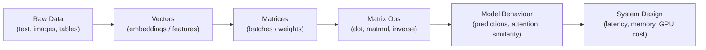
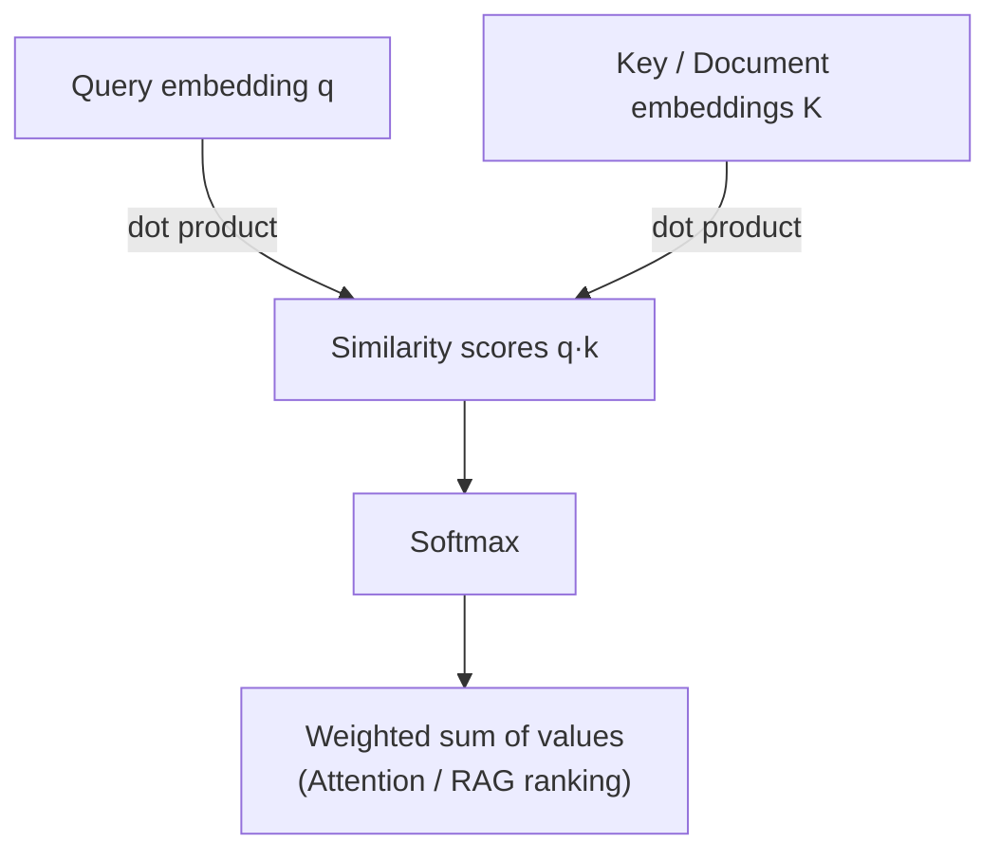
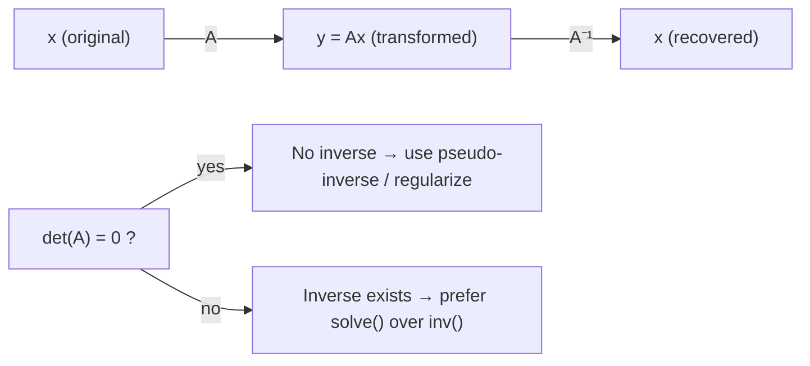

# Linear Algebra - Vectors & Matrices

[Home](math-index.md#linear-algebra)

## Overview

**Vectors** and **matrices** are the basic data types of machine learning. A vector is an ordered list of numbers, like an embedding, a feature row, or a gradient. A matrix is a 2-D grid of numbers, like a weight layer, a batch of embeddings, or an attention score table. Almost every operation inside a neural network comes down to a few primitive operations on these objects.

This note covers the four primitives every AI Architect needs to know well:

| Sub-topic | One-line intuition | Where you meet it in AI |
|---|---|---|
| **Dot product** | "How much do two vectors point the same way?" | Attention scores, cosine similarity, vector search, every neuron |
| **Cross product** | "Which vector is perpendicular to both?" | 3-D vision, robotics, surface normals, rotations |
| **Determinant** | "How much does a matrix stretch or squash space?" | Invertibility checks, normalizing flows, Gaussian densities |
| **Matrix inversion** | "Undo the transformation" | Closed-form regression, Kalman filters, second-order optimizers |

---

## Why It Matters





> **Architect's lens:** When you size a GPU cluster, pick a vector database index, or estimate inference latency, you are really counting **matrix multiplications** and **dot products**. A matmul of shapes $(m \times k)\cdot(k \times n)$ costs about $2mkn$ FLOPs, and that number feeds directly into your capacity planning.

---

## 1. Vectors and Matrices — The Basics

### Explanation

- A **vector** $\mathbf{v} \in \mathbb{R}^n$ is an ordered list of $n$ real numbers. You can read it as a **point** in space or as an **arrow** (direction + magnitude).
- A **matrix** $A \in \mathbb{R}^{m \times n}$ has $m$ rows and $n$ columns. You can read it as a **table of data** (rows = samples) or as a **linear transformation** that maps $\mathbb{R}^n \to \mathbb{R}^m$.

Key operations:

| Operation | Formula | Shape rule |
|---|---|---|
| Addition | $(A+B)_{ij} = A_{ij} + B_{ij}$ | Same shape |
| Scalar multiply | $(cA)_{ij} = c\,A_{ij}$ | Any |
| Matrix multiply | $(AB)_{ij} = \sum_k A_{ik} B_{kj}$ | $(m\times k)(k\times n) \to (m\times n)$ |
| Transpose | $(A^\top)_{ij} = A_{ji}$ | $(m\times n) \to (n\times m)$ |
| Norm (L2) | $\lVert \mathbf{v} \rVert_2 = \sqrt{\sum_i v_i^2}$ | Vector → scalar |

### Diagram — matrix multiplication shape rule


```ditaa
      A (2 x 3)          B (3 x 2)          C = AB (2 x 2)
   +-------------+      +---------+         +----------------+
   | a11 a12 a13 |      | b11 b12 |         | row1·col1  ... |
   | a21 a22 a23 |  x   | b21 b22 |   =     |                |
   +-------------+      | b31 b32 |         +----------------+
                        +---------+
        inner dimensions must match (3 = 3); outer give result shape
```

### Architectural Relevance

- A **dense / linear layer** is just $\mathbf{y} = W\mathbf{x} + \mathbf{b}$. A Transformer with $d_{model}=4096$ spends most of its FLOPs here.
- **Batching** stacks vectors into a matrix so the GPU can do one large matmul instead of many small ones. This is the main reason batch inference gives better throughput.
- **Memory footprint**: a $4096 \times 4096$ weight matrix in FP16 takes $4096^2 \times 2$ bytes ≈ **32 MB**. Multiply that across layers and you get the VRAM budget.

### Python Implementation

```python
import numpy as np

x = np.array([1.0, 2.0, 3.0])            # input vector (3 features)
W = np.array([[0.2, -0.5, 1.0],          # weight matrix (2 outputs x 3 inputs)
              [1.5,  0.3, -0.7]])
b = np.array([0.1, -0.2])                # bias

y = W @ x + b                            # a dense layer forward pass
print("y =", y)
print("shape W:", W.shape, "| shape x:", x.shape, "| shape y:", y.shape)
print("L2 norm of x:", round(float(np.linalg.norm(x)), 4))

# Memory estimate of a 4096 x 4096 FP16 weight matrix
params = 4096 * 4096
print(f"FP16 size: {params * 2 / 2**20:.0f} MiB")
```

**Output:**
```text
y = [ 2.3 -0.2]
shape W: (2, 3) | shape x: (3,) | shape y: (2,)
L2 norm of x: 3.7417
FP16 size: 32 MiB
```

---

## 2. Dot Product

### Explanation

The **dot product** (inner product) of two vectors of the same length is a single number:

$$
\mathbf{a}\cdot\mathbf{b} = \sum_{i=1}^{n} a_i b_i = \lVert\mathbf{a}\rVert\,\lVert\mathbf{b}\rVert \cos\theta
$$

The second form gives the geometric picture:

| Value of $\mathbf{a}\cdot\mathbf{b}$ | Angle $\theta$ | Meaning |
|---|---|---|
| Large positive | $\theta \approx 0^\circ$ | Vectors point the same way (similar) |
| Zero | $\theta = 90^\circ$ | **Orthogonal** (unrelated) |
| Large negative | $\theta \approx 180^\circ$ | Opposite directions |

**Cosine similarity** normalizes out the magnitudes:

$$
\text{cos\_sim}(\mathbf{a},\mathbf{b}) = \frac{\mathbf{a}\cdot\mathbf{b}}{\lVert\mathbf{a}\rVert\,\lVert\mathbf{b}\rVert} \in [-1, 1]
$$

### Worked Example

$\mathbf{a} = [1, 2, 3]$, $\mathbf{b} = [4, -5, 6]$

$$
\mathbf{a}\cdot\mathbf{b} = (1)(4) + (2)(-5) + (3)(6) = 4 - 10 + 18 = 12
$$

$\lVert\mathbf{a}\rVert = \sqrt{14} \approx 3.742$, $\lVert\mathbf{b}\rVert = \sqrt{77} \approx 8.775$, so $\cos\theta = 12 / 32.83 \approx 0.3655$, which gives $\theta \approx 68.6^\circ$.

### Diagram — geometric meaning

```text
            b
           ↗
          /
         /  θ
        /_______→ a
       O
   projection of b onto a  =  (a·b / |a|)   ← the "shadow" of b on a
```

### Architectural Relevance

- **Attention**: $\text{score}(q, k) = \frac{q \cdot k}{\sqrt{d_k}}$. The $\sqrt{d_k}$ scaling exists because dot products of random high-dimensional vectors grow like $\sqrt{d}$, which would saturate the softmax.
- **Vector databases / RAG retrieval**: similarity search ranks documents by dot product or cosine similarity. If your embeddings are **L2-normalized**, dot product equals cosine similarity, so you can use the cheaper inner-product index (e.g., FAISS `IndexFlatIP`).
- **Every neuron** computes $\mathbf{w}\cdot\mathbf{x} + b$.
- **Design decision:** pick the similarity metric your embedding model was **trained with**. Mismatching metrics (e.g., L2 distance on un-normalized cosine-trained vectors) quietly lowers retrieval quality.

### Python Implementation

```python
import numpy as np

a = np.array([1.0, 2.0, 3.0])
b = np.array([4.0, -5.0, 6.0])

dot = np.dot(a, b)                       # same as a @ b
cos = dot / (np.linalg.norm(a) * np.linalg.norm(b))
angle = np.degrees(np.arccos(cos))
print("a · b             =", dot)
print(f"cosine similarity = {cos:.4f}")
print(f"angle (degrees)   = {angle:.1f}")

# --- Mini semantic search: rank documents by cosine similarity ---
docs = np.array([[0.9, 0.1, 0.0],        # doc 0 : "GPU pricing"
                 [0.1, 0.8, 0.3],        # doc 1 : "Python asyncio"
                 [0.8, 0.3, 0.1]])       # doc 2 : "Cloud GPU costs"
query = np.array([1.0, 0.2, 0.0])        # query : "how much do GPUs cost?"

docs_n = docs / np.linalg.norm(docs, axis=1, keepdims=True)   # L2-normalize
query_n = query / np.linalg.norm(query)
scores = docs_n @ query_n                # one matmul = all dot products
print("scores:", np.round(scores, 3))
print("ranking:", np.argsort(-scores))
```

**Output:**
```text
a · b             = 12.0
cosine similarity = 0.3655
angle (degrees)   = 68.6
scores: [0.996 0.296 0.98 ]
ranking: [0 2 1]
```

---

## 3. Cross Product

### Explanation

The **cross product** is defined **only in 3-D**. It takes two vectors and returns a **new vector perpendicular to both**:

$$
\mathbf{a}\times\mathbf{b} =
\begin{vmatrix}
\mathbf{i} & \mathbf{j} & \mathbf{k}\\
a_1 & a_2 & a_3\\
b_1 & b_2 & b_3
\end{vmatrix}
= \big(a_2b_3 - a_3b_2,\; a_3b_1 - a_1b_3,\; a_1b_2 - a_2b_1\big)
$$

Properties:

- $\lVert\mathbf{a}\times\mathbf{b}\rVert = \lVert\mathbf{a}\rVert\lVert\mathbf{b}\rVert\sin\theta$ = **area of the parallelogram** spanned by $\mathbf{a}$ and $\mathbf{b}$.
- Direction follows the **right-hand rule**.
- **Anti-commutative**: $\mathbf{a}\times\mathbf{b} = -(\mathbf{b}\times\mathbf{a})$.
- $\mathbf{a}\times\mathbf{b} = \mathbf{0}$ if the vectors are parallel.

### Worked Example

$\mathbf{a} = [1, 0, 0]$ (x-axis), $\mathbf{b} = [0, 1, 0]$ (y-axis)

$$
\mathbf{a}\times\mathbf{b} = (0\cdot0 - 0\cdot1,\; 0\cdot0 - 1\cdot0,\; 1\cdot1 - 0\cdot0) = (0, 0, 1)
$$

That is the z-axis, perpendicular to both inputs.

### Diagram — right-hand rule

```text
          z  (a × b)
          ↑
          │
          │
          O──────→ y (b)
         /
        ↙
       x (a)
   Curl fingers from a toward b → thumb points along a × b
```

### Architectural Relevance

- **Computer vision & 3-D / robotics pipelines**: computing **surface normals** of mesh triangles (lighting, NeRF, 3-D reconstruction), camera pose estimation, and the **epipolar geometry** (the essential matrix uses the skew-symmetric cross-product matrix $[\mathbf{t}]_\times$).
- **Rotation representations**: angular velocity and axis-angle rotations in robotics and AR/VR.
- **Not used** in standard NLP/LLM architectures, because embeddings live in hundreds or thousands of dimensions where the cross product does not exist. Knowing *where a tool does not apply* is part of the architect's job too.

### Python Implementation

```python
import numpy as np

a = np.array([1.0, 0.0, 0.0])
b = np.array([0.0, 1.0, 0.0])
print("a x b =", np.cross(a, b))
print("b x a =", np.cross(b, a))          # anti-commutative

# Surface normal of a 3-D triangle (used in rendering / 3-D vision)
p0 = np.array([0.0, 0.0, 0.0])
p1 = np.array([2.0, 0.0, 0.0])
p2 = np.array([0.0, 3.0, 0.0])
n = np.cross(p1 - p0, p2 - p0)
area = 0.5 * np.linalg.norm(n)
print("normal:", n, "| unit normal:", n / np.linalg.norm(n), "| triangle area:", area)
```

**Output:**
```text
a x b = [0. 0. 1.]
b x a = [ 0.  0. -1.]
normal: [0. 0. 6.] | unit normal: [0. 0. 1.] | triangle area: 3.0
```

---

## 4. Determinants

### Explanation

The **determinant** $\det(A)$ of a **square** matrix is a single number that tells you **how much the transformation $A$ scales volume**:

| $\det(A)$ | Geometric meaning |
|---|---|
| $\lvert\det A\rvert > 1$ | Expands space |
| $0 < \lvert\det A\rvert < 1$ | Shrinks space |
| $\det A < 0$ | Flips orientation (mirror) |
| $\det A = 0$ | **Squashes space into a lower dimension**, so the matrix is **singular** (not invertible) |

Formulas:

$$
\det\begin{bmatrix} a & b \\ c & d \end{bmatrix} = ad - bc
$$

$$
\det\begin{bmatrix} a & b & c\\ d & e & f\\ g & h & i \end{bmatrix} = a(ei - fh) - b(di - fg) + c(dh - eg)
$$

Useful identities: $\det(AB) = \det(A)\det(B)$, $\det(A^{-1}) = 1/\det(A)$, $\det(A^\top) = \det(A)$, and $\det(A) = \prod_i \lambda_i$ (product of eigenvalues).

### Worked Example

$$
A = \begin{bmatrix} 3 & 1 \\ 2 & 4 \end{bmatrix}, \quad \det(A) = 3\cdot4 - 1\cdot2 = 10
$$

So $A$ maps the unit square (area 1) onto a parallelogram of area 10.

$$
B = \begin{bmatrix} 1 & 2 \\ 2 & 4 \end{bmatrix}, \quad \det(B) = 4 - 4 = 0
$$

The second row is twice the first, so $B$ collapses the plane onto a line and is singular.

### Diagram

```text
  Unit square (area = 1)          After A (area = |det A| = 10)
   ┌───┐                                 ________
   │   │        ──── A ────►            /       /
   └───┘                               /_______/
                                 If det = 0 → flattened to a line (info lost!)
```

### Architectural Relevance

- **Normalizing flows** (generative models such as RealNVP and Glow) compute exact likelihoods with the change-of-variables formula $\log p(x) = \log p(z) + \log\lvert\det \frac{\partial z}{\partial x}\rvert$. Those architectures are *designed* so that the Jacobian determinant is cheap to compute (triangular Jacobians).
- **Multivariate Gaussians**: the density contains $\det(\Sigma)^{-1/2}$. That shows up in Gaussian Processes, anomaly detection, and VAEs.
- **Numerical-health signal**: a near-zero determinant (more precisely, a large **condition number**) warns you that a system is ill-conditioned, so inverting it will amplify noise.
- **Production tip:** never compute `det` directly for large matrices because it overflows or underflows. Use `np.linalg.slogdet` (sign + log-determinant).

### Python Implementation

```python
import numpy as np

A = np.array([[3.0, 1.0],
              [2.0, 4.0]])
B = np.array([[1.0, 2.0],
              [2.0, 4.0]])               # rows are linearly dependent

print("det(A) =", round(np.linalg.det(A), 6))
print("det(B) =", round(np.linalg.det(B), 6))

# Large matrices: det() overflows, slogdet() is stable
big = np.eye(500) * 10.0                 # det = 10^500 -> overflows float64
print("det(big)        =", np.linalg.det(big))
sign, logdet = np.linalg.slogdet(big)
print("slogdet(big)    = sign", sign, "| log det", round(logdet, 2))

# Condition number: a better "is this safe to invert?" signal than det
print("cond(A) =", round(np.linalg.cond(A), 3))
```

**Output:**
```text
det(A) = 10.0
det(B) = 0.0
det(big)        = inf
slogdet(big)    = sign 1.0 | log det 1151.29
cond(A) = 2.618
```

---

## 5. Matrix Inversion

### Explanation

The **inverse** $A^{-1}$ of a square matrix $A$ is the matrix that "undoes" $A$:

$$
A A^{-1} = A^{-1} A = I
$$

It exists **only if $\det(A) \neq 0$** (the matrix is *non-singular*, i.e., *full rank*). For a $2\times2$ matrix:

$$
\begin{bmatrix} a & b \\ c & d \end{bmatrix}^{-1} = \frac{1}{ad - bc}\begin{bmatrix} d & -b \\ -c & a \end{bmatrix}
$$

Related ideas:

- **Solving linear systems**: $A\mathbf{x} = \mathbf{b} \Rightarrow \mathbf{x} = A^{-1}\mathbf{b}$. In practice you **solve** with LU/Cholesky instead of forming $A^{-1}$.
- **Pseudo-inverse** $A^{+}$ (Moore–Penrose, computed via SVD) works for non-square or singular matrices and gives the least-squares solution.
- **Cost**: inverting an $n\times n$ matrix is $O(n^3)$.

### Worked Example

$$
A = \begin{bmatrix} 3 & 1 \\ 2 & 4 \end{bmatrix} \Rightarrow A^{-1} = \frac{1}{10}\begin{bmatrix} 4 & -1 \\ -2 & 3 \end{bmatrix} = \begin{bmatrix} 0.4 & -0.1 \\ -0.2 & 0.3 \end{bmatrix}
$$

Solve $A\mathbf{x} = [5, 10]^\top$: $\mathbf{x} = A^{-1}\mathbf{b} = [0.4\cdot5 - 0.1\cdot10,\; -0.2\cdot5 + 0.3\cdot10] = [1, 2]$.

Check: $3(1) + 1(2) = 5$ ✓, $2(1) + 4(2) = 10$ ✓

### Diagram



### Architectural Relevance

- **Linear regression closed form** (Normal Equation): $\boldsymbol\theta = (X^\top X)^{-1}X^\top\mathbf{y}$. It works well for small feature counts. For millions of features, the $O(n^3)$ cost forces you to iterative methods (gradient descent), and that trade-off is a classic architecture decision.
- **Ridge regression** adds $\lambda I$: $(X^\top X + \lambda I)^{-1}$. This guarantees invertibility, which is the same idea as weight decay in deep learning.
- **Kalman filters** (tracking, sensor fusion), **Gaussian Processes** (inverting the kernel matrix, $O(n^3)$ in the number of training points, which is why GPs don't scale without approximations), and **second-order optimizers** (Newton's method, K-FAC, Shampoo approximate $H^{-1}$).
- **Rule of thumb:** `np.linalg.solve(A, b)` is faster and more numerically stable than `np.linalg.inv(A) @ b`.

### Python Implementation

```python
import numpy as np

A = np.array([[3.0, 1.0],
              [2.0, 4.0]])
b = np.array([5.0, 10.0])

A_inv = np.linalg.inv(A)
print("A^-1 =\n", A_inv)
print("A @ A^-1 = I ?", np.allclose(A @ A_inv, np.eye(2)))
print("x via inv  :", A_inv @ b)
print("x via solve:", np.linalg.solve(A, b))   # preferred in production

# --- Linear regression with the Normal Equation vs. Ridge ---
rng = np.random.default_rng(0)
X = np.c_[np.ones(100), rng.normal(size=(100, 2))]       # bias + 2 features
true_theta = np.array([1.0, 2.0, -3.0])
y = X @ true_theta + rng.normal(scale=0.1, size=100)

theta = np.linalg.solve(X.T @ X, X.T @ y)                 # (XᵀX)θ = Xᵀy
lam = 1.0
theta_ridge = np.linalg.solve(X.T @ X + lam * np.eye(3), X.T @ y)
print("OLS   θ:", np.round(theta, 2))
print("Ridge θ:", np.round(theta_ridge, 2))

# Singular matrix -> use the pseudo-inverse
S = np.array([[1.0, 2.0], [2.0, 4.0]])
print("pinv(S) @ [1, 2] =", np.round(np.linalg.pinv(S) @ np.array([1.0, 2.0]), 3))
```

**Output:**
```text
A^-1 =
 [[ 0.4 -0.1]
 [-0.2  0.3]]
A @ A^-1 = I ? True
x via inv  : [1. 2.]
x via solve: [1. 2.]
OLS   θ: [ 0.98  1.99 -2.98]
Ridge θ: [ 0.97  1.96 -2.94]
pinv(S) @ [1, 2] = [0.2 0.4]
```

---

## Common Mistakes

| Mistake | Why it hurts | Better approach |
|---|---|---|
| Using `*` instead of `@` for matmul | `*` is element-wise and silently broadcasts | Use `@` / `np.matmul` for matrix products |
| `np.linalg.inv(A) @ b` | Slower, less stable | `np.linalg.solve(A, b)` |
| Checking invertibility with `det == 0` | Floating point; det scales with matrix size | Check `np.linalg.cond(A)` or the rank |
| Mixing similarity metrics | Cosine-trained embeddings in an L2 index lower recall | Normalize vectors; match the metric to the model |
| Confusing row vs. column vectors | Shape bugs: `(n,)` vs `(n,1)` vs `(1,n)` | Assert shapes; use `keepdims=True` |
| Computing `det` of big matrices | Overflow / underflow to `inf`/`0` | `np.linalg.slogdet` |

---

## Interview Questions

### Beginner
1. **What does the dot product of two vectors tell you geometrically?**
   *Their alignment: $\lVert a\rVert\lVert b\rVert\cos\theta$. Positive means similar direction, zero means orthogonal.*
2. **When is a matrix not invertible?**
   *When its determinant is zero, which is the same as its columns being linearly dependent (not full rank).*
3. **What is the shape of $(3\times4)\cdot(4\times2)$?**
   *$(3\times2)$.*

### Intermediate
1. **Why does attention divide by $\sqrt{d_k}$?**
   *For random vectors with unit-variance components, the dot product has variance $d_k$. Scaling keeps the logits at unit variance so the softmax doesn't saturate and gradients don't vanish.*
2. **When is dot product equal to cosine similarity?**
   *When both vectors are L2-normalized to unit length.*
3. **Why prefer `solve` over `inv`?**
   *It uses LU factorization without forming the inverse explicitly: fewer FLOPs and lower numerical error.*

### Architect-Level
1. **You need linear regression on 10M rows × 50K features. Normal equation or gradient descent?**
   *Forming $X^\top X$ costs $O(n d^2)$ and inverting a 50K×50K matrix is $O(d^3)$ ≈ $10^{14}$ FLOPs, plus about 20 GB of memory. Prefer (mini-batch) gradient descent or iterative solvers (CG, LSQR), possibly distributed.*
2. **How would you choose the similarity metric for a production vector store?**
   *Match the embedding model's training objective; normalize to make IP equal cosine; benchmark recall@k vs. latency on approximate indexes (HNSW/IVF-PQ).*
3. **Where do determinants appear in generative modeling, and how are architectures adapted for them?**
   *In normalizing flows' change-of-variables. Coupling layers make Jacobians triangular so that $\log\lvert\det\rvert$ is just a sum of diagonal logs, $O(n)$ instead of $O(n^3)$.*

---

## Key Takeaways

- Vectors represent **data points, embeddings, and gradients**; matrices represent **batches and transformations**.
- The **dot product** measures alignment. It powers neurons, attention, and vector search.
- The **cross product** is 3-D only. It is important for vision, robotics, and graphics, not for LLMs.
- The **determinant** measures volume scaling. Zero means information is lost and there is no inverse.
- **Matrix inversion** undoes a transformation. In production, *solve* rather than *invert*, and regularize ($+\lambda I$) for stability.
- Count matmul FLOPs and matrix memory: they drive **latency, throughput, and GPU cost**.
