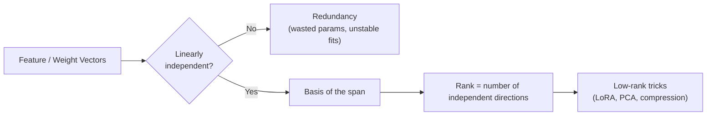
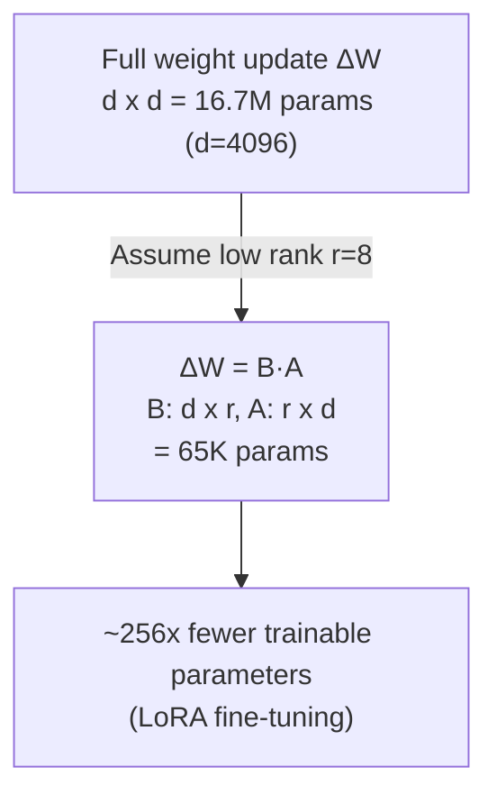
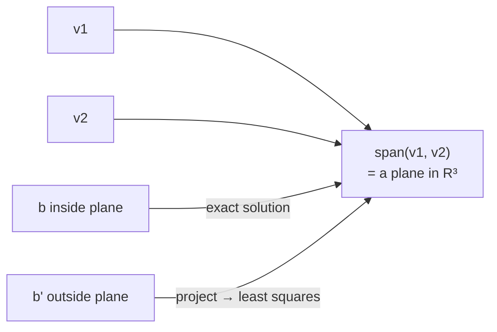

# Linear Algebra - Vector Spaces

[Home](math-index.md#linear-algebra)

## Overview

A **vector space** is a set of vectors that is closed under **addition** and **scalar multiplication**: you can add any two vectors, or scale one, and still stay inside the set. $\mathbb{R}^n$ is the familiar example, and so is the 768-dimensional embedding space of a BERT model.

The four concepts in this note answer one practical question: **how much real information does my data or my weight matrix actually contain?**

| Sub-topic | Question it answers | AI relevance |
|---|---|---|
| **Linear independence** | Is any vector redundant? | Multicollinearity, redundant features |
| **Span** | What can I reach by combining these vectors? | Expressiveness of a layer / feature set |
| **Basis** | What is the minimal set of "building blocks"? | Coordinates, PCA axes, embedding dimensions |
| **Rank** | How many truly independent directions exist? | LoRA, low-rank compression, invertibility |

---

## Why It Matters





> **Architect's lens:** Rank is the main reason you can fine-tune a 70B-parameter model on a single GPU node. **LoRA** relies on the observation that weight *updates* have low intrinsic rank.

---

## 1. Linear Independence

### Explanation

Vectors $\mathbf{v}_1, \dots, \mathbf{v}_k$ are **linearly independent** if the only solution to

$$
c_1\mathbf{v}_1 + c_2\mathbf{v}_2 + \dots + c_k\mathbf{v}_k = \mathbf{0}
$$

is $c_1 = c_2 = \dots = c_k = 0$. In plain words, **no vector can be built from the others**. If some non-zero combination gives $\mathbf{0}$, the set is **linearly dependent**, and at least one vector is redundant.

Quick tests:

- Stack the vectors as columns of a matrix $A$. They are independent **iff** $\text{rank}(A) = k$.
- For $n$ vectors in $\mathbb{R}^n$: independent **iff** $\det(A) \neq 0$.
- More than $n$ vectors in $\mathbb{R}^n$ are **always** dependent.

### Worked Example

$$
\mathbf{v}_1 = \begin{bmatrix}1\\2\\3\end{bmatrix},\;
\mathbf{v}_2 = \begin{bmatrix}4\\5\\6\end{bmatrix},\;
\mathbf{v}_3 = \begin{bmatrix}7\\8\\9\end{bmatrix}
$$

Notice $\mathbf{v}_1 - 2\mathbf{v}_2 + \mathbf{v}_3 = [1-8+7,\; 2-10+8,\; 3-12+9] = [0,0,0]$.

A non-trivial combination ($c = 1, -2, 1$) gives zero, so the set is **dependent**: $\mathbf{v}_3 = 2\mathbf{v}_2 - \mathbf{v}_1$.

### Diagram

```text
  Independent (2-D)                 Dependent (2-D)
       v2                               v2 = 2·v1
       ↑                                  ↗
       │                                ↗
       │                              ↗  v1
       O────→ v1                    O↗
  span = whole plane            span = just a line
```

### Architectural Relevance

- **Multicollinearity** in tabular ML: if `price_usd` and `price_eur` are both features, $X^\top X$ becomes (nearly) singular, so coefficients blow up and become uninterpretable. Detect it and drop or merge the redundant features.
- **Redundant neurons / attention heads**: pruning research shows many heads are close to linear combinations of others. Removing them reduces inference cost with little accuracy loss.
- **Data pipelines**: one-hot encoding *all* categories plus an intercept creates exact dependence (the "dummy variable trap"). Drop one category.

### Python Implementation

```python
import numpy as np

V = np.array([[1, 4, 7],
              [2, 5, 8],
              [3, 6, 9]], dtype=float)       # columns are v1, v2, v3

rank = np.linalg.matrix_rank(V)
print("rank:", rank, "| number of vectors:", V.shape[1])
print("independent?", rank == V.shape[1])

# Find the dependency: the null space gives the coefficients c
_, s, Vt = np.linalg.svd(V)
c = Vt[-1] / Vt[-1][0]                       # scale so c1 = 1
print("coefficients c:", np.round(c, 3))
print("V @ c ≈ 0 ?", np.allclose(V @ c, 0))

# Dummy-variable trap: intercept + all one-hot columns
X = np.array([[1, 1, 0, 0],
              [1, 0, 1, 0],
              [1, 0, 0, 1],
              [1, 1, 0, 0]], dtype=float)    # intercept, cat_A, cat_B, cat_C
print("design-matrix rank:", np.linalg.matrix_rank(X), "of", X.shape[1], "columns")
```

**Output:**
```text
rank: 2 | number of vectors: 3
independent? False
coefficients c: [ 1. -2.  1.]
V @ c ≈ 0 ? True
design-matrix rank: 3 of 4 columns
```

---

## 2. Span

### Explanation

The **span** of a set of vectors is **every vector you can reach** with linear combinations of them:

$$
\text{span}(\mathbf{v}_1,\dots,\mathbf{v}_k) = \{\, c_1\mathbf{v}_1 + \dots + c_k\mathbf{v}_k \;\mid\; c_i \in \mathbb{R} \,\}
$$

- The span is always a **subspace** (a line, a plane, a hyperplane, or the whole space) passing through the origin.
- The span of a matrix's columns is the **column space** $\mathcal{C}(A)$. The system $A\mathbf{x} = \mathbf{b}$ has a solution **iff** $\mathbf{b} \in \mathcal{C}(A)$.

### Worked Example

Does $\mathbf{b} = [3, 5, 7]^\top$ lie in $\text{span}([1,1,1]^\top, [1,2,3]^\top)$?

Try $c_1[1,1,1] + c_2[1,2,3] = [3,5,7]$. From rows 1 and 2: $c_1 + c_2 = 3$ and $c_1 + 2c_2 = 5$, so $c_2 = 2, c_1 = 1$. Row 3 check: $1 + 6 = 7$ ✓, so **yes**.

$\mathbf{b}' = [3, 5, 8]^\top$: row 3 gives $7 \neq 8$, so it is **not** in the span. The best you can do is the **least-squares projection**.

### Diagram



### Architectural Relevance

- **Model expressiveness**: a linear layer $W\mathbf{x}$ can only output vectors in the **column space of $W$**. If $W$ is $4096\times 64$ (a bottleneck), outputs live in at most a 64-dim subspace. This is the motivation behind multi-head attention's per-head dimension and the "softmax bottleneck" discussion in language models.
- **Least squares / regression**: when targets are not in the span of features, the model finds the closest point in the span. The residual is the part your features **cannot explain**, which tells you to engineer better features.
- **RAG & embeddings**: a query that is "outside the span" of your document embeddings' main directions will match poorly. This is one reason domain-adapted embedding models matter.

### Python Implementation

```python
import numpy as np

A = np.array([[1, 1],
              [1, 2],
              [1, 3]], dtype=float)         # columns span a plane in R^3

def in_span(A, b, tol=1e-9):
    c, residual, *_ = np.linalg.lstsq(A, b, rcond=None)
    err = np.linalg.norm(A @ c - b)
    return bool(err < tol), np.round(c, 3), round(float(err), 4)

print("b  = [3,5,7]:", in_span(A, np.array([3.0, 5.0, 7.0])))
print("b' = [3,5,8]:", in_span(A, np.array([3.0, 5.0, 8.0])))

# Bottleneck layer: outputs are confined to a low-dimensional column space
rng = np.random.default_rng(42)
W_down = rng.normal(size=(8, 64))       # 64 -> 8
W_up = rng.normal(size=(64, 8))         # 8  -> 64
outputs = (W_up @ W_down @ rng.normal(size=(64, 1000))).T   # 1000 outputs in R^64
print("output dimension:", outputs.shape[1], "| rank of outputs:", np.linalg.matrix_rank(outputs))
```

**Output:**
```text
b  = [3,5,7]: (True, array([1., 2.]), 0.0)
b' = [3,5,8]: (False, array([0.333, 2.5  ]), 0.4082)
output dimension: 64 | rank of outputs: 8
```

---

## 3. Basis

### Explanation

A **basis** of a vector space $V$ is a set of vectors that is

1. **linearly independent** (no redundancy), and
2. **spans** $V$ (enough to reach everything).

Every vector in $V$ can then be written in exactly **one** way as a combination of basis vectors, and those coefficients are its **coordinates**. The number of basis vectors is the **dimension** of the space.

- **Standard basis** of $\mathbb{R}^3$: $\mathbf{e}_1 = [1,0,0], \mathbf{e}_2 = [0,1,0], \mathbf{e}_3 = [0,0,1]$.
- **Orthonormal basis**: basis vectors are mutually orthogonal and unit-length. Then coordinates are just dot products: $c_i = \mathbf{q}_i \cdot \mathbf{v}$. You get one with **Gram–Schmidt** / **QR decomposition**.
- **Change of basis**: if $B$ holds basis vectors as columns, coordinates are $\mathbf{c} = B^{-1}\mathbf{v}$.

### Worked Example

Basis $B = \{[1,1], [1,-1]\}$. Find the coordinates of $\mathbf{v} = [5, 1]$:

$c_1[1,1] + c_2[1,-1] = [5,1]$ gives $c_1 + c_2 = 5$, $c_1 - c_2 = 1$, so $c_1 = 3$, $c_2 = 2$.

So $\mathbf{v} = 3\,[1,1] + 2\,[1,-1]$, and its coordinates in basis $B$ are $(3, 2)$, while in the standard basis they are $(5, 1)$. **Same vector, different coordinates.**

### Diagram

```text
  Standard basis                     Rotated (PCA-like) basis
      e2                                 b1 ↗
      ↑                                    ↗      ↖ b2
      │                                  ↗      ↖
      O───→ e1                          O    ↖
  v = 5·e1 + 1·e2                  v = 3·b1 + 2·b2   (same point!)
```

### Architectural Relevance

- **PCA** finds an orthonormal basis aligned with the directions of highest variance. Keeping the top-$k$ basis vectors gives **dimensionality reduction** for embeddings: e.g., 1536-d to 256-d to cut vector-DB storage and latency.
- **Embedding dimensions** are coordinates in a learned basis. Individual axes are rarely interpretable, because the model can use *any* rotation of the basis. Interpretability work (sparse autoencoders) searches for a *better* basis of "features".
- **Positional encodings** (sinusoidal, RoPE) are built from basis functions (sines/cosines at different frequencies).
- **Orthogonal initialization** of weights (an orthonormal basis) preserves vector norms through layers and stabilizes deep and recurrent nets.

### Python Implementation

```python
import numpy as np

B = np.array([[1.0, 1.0],
              [1.0, -1.0]])                 # columns: b1=[1,1], b2=[1,-1]
v = np.array([5.0, 1.0])
coords = np.linalg.solve(B, v)
print("coordinates in basis B:", coords)
print("reconstructed v:", B @ coords)

# Orthonormal basis via QR (Gram-Schmidt) -> coordinates are dot products
Q, _ = np.linalg.qr(B)
print("Q^T Q = I ?", np.allclose(Q.T @ Q, np.eye(2)))
print("coords in orthonormal basis:", np.round(Q.T @ v, 4))

# PCA basis for dimensionality reduction of "embeddings"
rng = np.random.default_rng(0)
latent = rng.normal(size=(500, 3))          # true signal lives in 3 dims
emb = latent @ rng.normal(size=(3, 50)) + 0.01 * rng.normal(size=(500, 50))
emb_c = emb - emb.mean(axis=0)
U, S, Vt = np.linalg.svd(emb_c, full_matrices=False)
explained = (S**2) / (S**2).sum()
print("variance explained by top-3 basis vectors:", round(float(explained[:3].sum()), 4))
reduced = emb_c @ Vt[:3].T                  # 50-d -> 3-d coordinates
print("reduced shape:", reduced.shape)
```

**Output:**
```text
coordinates in basis B: [3. 2.]
reconstructed v: [5. 1.]
Q^T Q = I ? True
coords in orthonormal basis: [-4.2426 -2.8284]
variance explained by top-3 basis vectors: 1.0
reduced shape: (500, 3)
```

---

## 4. Rank

### Explanation

The **rank** of a matrix $A \in \mathbb{R}^{m\times n}$ is the **number of linearly independent columns**, which always equals the number of independent rows:

$$
\text{rank}(A) = \dim \mathcal{C}(A) = \dim \mathcal{R}(A) \le \min(m, n)
$$

| Term | Condition | Consequence |
|---|---|---|
| **Full rank** | $\text{rank} = \min(m,n)$ | No redundancy; square ⇒ invertible |
| **Rank-deficient** | $\text{rank} < \min(m,n)$ | Redundant rows/cols; square ⇒ singular |
| **Low rank** | $\text{rank} \ll \min(m,n)$ | Highly compressible: $A \approx BC$ |

**Rank–nullity theorem:** $\text{rank}(A) + \dim\mathcal{N}(A) = n$. Every lost dimension of rank becomes a direction that $A$ maps to zero (information destroyed).

**Product rule:** $\text{rank}(BC) \le \min(\text{rank}(B), \text{rank}(C))$. A rank-$r$ matrix can always be factored as $B_{m\times r}\,C_{r\times n}$, which costs $r(m+n)$ numbers instead of $mn$.

### Worked Example

$$
A = \begin{bmatrix} 1 & 2 & 3 \\ 2 & 4 & 6 \\ 1 & 1 & 1 \end{bmatrix}
$$

Row 2 = 2 × Row 1, so it is redundant. Rows 1 and 3 are independent, so $\text{rank}(A) = 2$.

Rank–nullity: $2 + \dim\mathcal{N}(A) = 3$, so the null space is a line. For example $\mathbf{x} = [1,-2,1]$: $A\mathbf{x} = [1-4+3,\; 2-8+6,\; 1-2+1] = \mathbf{0}$ ✓

### Diagram — LoRA as a rank decomposition

```text
        Full fine-tune                   LoRA (rank r)
   ┌───────────────────┐          ┌──┐
   │                   │          │  │   ┌───────────────────┐
   │     ΔW (d x d)    │    ≈     │B │ x │     A (r x d)     │
   │   d² parameters   │          │  │   └───────────────────┘
   │                   │          │dxr│
   └───────────────────┘          └──┘   2·d·r parameters
   d = 4096 → 16.8M params        r = 8 → 65.5K params (≈ 0.4%)
```

### Architectural Relevance

- **LoRA / QLoRA** fine-tuning: freeze $W$ and learn $\Delta W = BA$ with rank $r$ (typically 4–64). This cuts trainable parameters and optimizer memory by 100×+, allows **hot-swapping many adapters** on one base model in serving, and makes merging back easy ($W' = W + BA$).
- **Model compression**: replace a dense layer with two thin layers through truncated SVD (see [Matrix Decompositions](03_Matrix%20Decompositions.md)).
- **Recommender systems**: the user×item rating matrix is assumed low-rank (users have a few latent "tastes"). That is the basis of matrix factorization.
- **Rank collapse** is a failure mode: in deep Transformers without residual connections, token representations can collapse toward rank 1 (all tokens look alike). **Residual connections + LayerNorm** prevent this, which is an architectural safeguard justified by rank.
- **Embedding health monitoring**: if the *effective rank* of your production embeddings drops, the encoder may have collapsed (common in contrastive training without enough negatives).

### Python Implementation

```python
import numpy as np

A = np.array([[1, 2, 3],
              [2, 4, 6],
              [1, 1, 1]], dtype=float)
print("rank(A):", np.linalg.matrix_rank(A))
x = np.array([1.0, -2.0, 1.0])
print("A @ [1,-2,1] =", A @ x, " (null-space vector)")

# --- LoRA-style low-rank update ---
d, r = 4096, 8
full_params = d * d
lora_params = d * r + r * d
print(f"full ΔW params: {full_params:,} | LoRA params: {lora_params:,} "
      f"| ratio: {full_params / lora_params:.0f}x")

rng = np.random.default_rng(0)
d_small = 256
B = rng.normal(size=(d_small, r))
A_lora = rng.normal(size=(r, d_small))
delta_W = B @ A_lora
print("rank of B @ A:", np.linalg.matrix_rank(delta_W), "(matrix size", delta_W.shape, ")")

# --- Effective rank: a monitoring metric for embedding collapse ---
def effective_rank(M):
    s = np.linalg.svd(M - M.mean(0), compute_uv=False)
    p = s / s.sum()
    return float(np.exp(-(p * np.log(p + 1e-12)).sum()))

healthy = rng.normal(size=(1000, 64))
collapsed = rng.normal(size=(1000, 2)) @ rng.normal(size=(2, 64)) + 0.01 * rng.normal(size=(1000, 64))
print(f"effective rank healthy  : {effective_rank(healthy):.1f}")
print(f"effective rank collapsed: {effective_rank(collapsed):.1f}")
```

**Output:**
```text
rank(A): 2
A @ [1,-2,1] = [0. 0. 0.]  (null-space vector)
full ΔW params: 16,777,216 | LoRA params: 65,536 | ratio: 256x
rank of B @ A: 8 (matrix size (256, 256) )
effective rank healthy  : 63.4
effective rank collapsed: 2.6
```

---

## Common Mistakes

| Mistake | Why it hurts | Better approach |
|---|---|---|
| Testing independence with `det == 0` on floats | Rounding error; non-square matrices have no det | `np.linalg.matrix_rank` (SVD-based, with tolerance) |
| Including all one-hot columns + intercept | Exact multicollinearity → singular $X^\top X$ | Drop one category or use regularization |
| Assuming embedding axes are meaningful | Basis is arbitrary up to rotation | Analyze directions (PCA, probes), not raw axes |
| Picking LoRA rank by habit | Too low underfits, too high wastes memory | Sweep $r$ (4, 8, 16, 32) and check eval metrics |
| Ignoring numerical rank | A matrix can be "full rank" but have tiny singular values | Inspect the singular-value spectrum / condition number |

---

## Interview Questions

### Beginner
1. **Define linear independence.**
   *No vector in the set can be written as a linear combination of the others; the only combination giving zero is all-zero coefficients.*
2. **What is a basis?**
   *A linearly independent set that spans the space. Its size is the dimension.*
3. **What is the maximum rank of a 100×20 matrix?**
   *20.*

### Intermediate
1. **How does rank relate to solving $A\mathbf{x}=\mathbf{b}$?**
   *A solution exists iff $\text{rank}(A) = \text{rank}([A\,|\,\mathbf{b}])$. It is unique iff additionally $\text{rank}(A) = n$.*
2. **Why does multicollinearity hurt linear regression?**
   *$X^\top X$ becomes (near-)singular, so the coefficient variance explodes and estimates become unstable and uninterpretable.*
3. **State the rank–nullity theorem and its meaning.**
   *rank + nullity = number of columns; every dimension not preserved is collapsed to zero.*

### Architect-Level
1. **Explain why LoRA works and its serving implications.**
   *Fine-tuning updates have low intrinsic rank, so $\Delta W = BA$ with small $r$ captures most of the adaptation. Serving: one base model plus many tiny adapters (MBs each), loaded per tenant/request (multi-LoRA serving), or merged into $W$ for zero-overhead inference.*
2. **How would you detect representation collapse in a production embedding service?**
   *Track the effective rank / singular-value spectrum of embedding batches over time, average pairwise cosine similarity, and retrieval recall on a golden set. Alert on drops.*
3. **When would you compress a model with low-rank factorization vs. quantization?**
   *Low-rank cuts FLOPs and params when the weight spectra decay fast. Quantization cuts bytes per param with no structural change. They are often combined (e.g., QLoRA = 4-bit base + low-rank adapters).*

---

## Key Takeaways

- **Linear independence** means no redundancy. Dependent features and neurons waste capacity and destabilize fits.
- **Span** is everything reachable by combination. A layer can only output vectors in its column space.
- **Basis** is a minimal spanning set. PCA picks a *better* basis for compression.
- **Rank** counts real information directions. Low rank means compressible, which is the foundation of **LoRA, PCA, matrix factorization**.
- Use **SVD-based numerical rank** instead of determinants in floating-point code.
