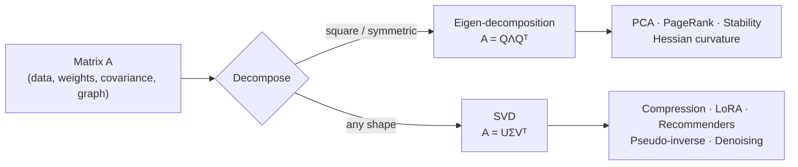
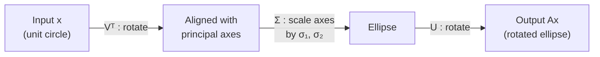

# Linear Algebra - Matrix Decompositions

[Home](math-index.md#linear-algebra)

## Overview

A **matrix decomposition** factors a matrix into simpler pieces that expose its structure, much like factoring $60 = 2^2 \cdot 3 \cdot 5$. The two decompositions every AI Architect must understand are:

| Sub-topic | Factorization | Works on | Core insight |
|---|---|---|---|
| **Eigenvalues & Eigenvectors** | $A = Q\Lambda Q^{-1}$ | Square matrices | Directions a transform only *stretches* (never rotates) |
| **Singular Value Decomposition (SVD)** | $A = U\Sigma V^\top$ | **Any** matrix | Every matrix = rotate → scale → rotate |

These are the math behind **PCA, low-rank compression, LoRA initialization, spectral normalization, recommender systems, latent semantic analysis, PageRank, and stability analysis of training dynamics**.

---

## Why It Matters



> **Architect's lens:** SVD tells you **how compressible** a weight matrix or dataset is. A fast-decaying singular-value spectrum means you can cut parameters, storage, and latency with little quality loss.

---

## 1. Eigenvalues

### Explanation

For a square matrix $A \in \mathbb{R}^{n\times n}$, a scalar $\lambda$ is an **eigenvalue** if there is a non-zero vector $\mathbf{v}$ with

$$
A\mathbf{v} = \lambda\mathbf{v}
$$

The eigenvalue is the **scaling factor** applied along that special direction. To find them, solve the **characteristic equation**:

$$
\det(A - \lambda I) = 0
$$

Key facts:

| Property | Formula / meaning |
|---|---|
| Sum of eigenvalues | $\sum_i\lambda_i = \text{trace}(A)$ |
| Product of eigenvalues | $\prod_i\lambda_i = \det(A)$, so any $\lambda=0$ ⇒ singular |
| Symmetric $A$ | All $\lambda_i$ are **real**; eigenvectors are **orthogonal** |
| Positive definite | All $\lambda_i > 0$ (e.g., covariance matrices, Hessian at a strict minimum) |
| Spectral radius | $\rho(A) = \max_i\lvert\lambda_i\rvert$, which controls whether $A^k$ explodes or vanishes |

### Worked Example

$$
A = \begin{bmatrix} 2 & 1 \\ 1 & 2 \end{bmatrix}
$$

$\det(A - \lambda I) = (2-\lambda)^2 - 1 = \lambda^2 - 4\lambda + 3 = (\lambda-3)(\lambda-1) = 0$

So $\lambda_1 = 3$, $\lambda_2 = 1$. Check: trace $= 4 = 3+1$ ✓, det $= 3 = 3\times1$ ✓

### Architectural Relevance

- **Exploding / vanishing gradients**: in an RNN, the hidden state is repeatedly multiplied by $W_{hh}$. If $\rho(W_{hh}) > 1$, gradients explode; if $< 1$, they vanish. This motivated **LSTMs/GRUs, gradient clipping, orthogonal initialization**, and residual connections.
- **Loss curvature**: eigenvalues of the **Hessian** describe how sharp the loss landscape is. The largest eigenvalue $\lambda_{max}$ bounds the stable learning rate ($\eta < 2/\lambda_{max}$ for gradient descent). See [Jacobian & Hessian](08_Jacobian%20and%20Hessian.md).
- **Graph ML**: eigenvalues of the graph Laplacian power **spectral clustering** and spectral Graph Neural Networks.

### Python Implementation

```python
import numpy as np

A = np.array([[2.0, 1.0],
              [1.0, 2.0]])
eigvals = np.linalg.eigvalsh(A)                    # symmetric -> eigvalsh (sorted, real)
print("eigenvalues:", eigvals)
print("trace =", np.trace(A), "| sum λ =", eigvals.sum())
print("det   =", round(np.linalg.det(A), 6), "| prod λ =", eigvals.prod())

# Spectral radius decides whether repeated multiplication explodes or vanishes
for scale in (0.9, 1.1):
    W = scale * np.eye(4)
    h = np.ones(4)
    for _ in range(50):                            # 50 "time steps" of an RNN
        h = W @ h
    rho = max(abs(np.linalg.eigvals(W)))
    print(f"ρ(W) = {rho:.1f} -> |h| after 50 steps = {np.linalg.norm(h):.4g}")
```

**Output:**
```text
eigenvalues: [1. 3.]
trace = 4.0 | sum λ = 4.0
det   = 3.0 | prod λ = 3.0
ρ(W) = 0.9 -> |h| after 50 steps = 0.01031
ρ(W) = 1.1 -> |h| after 50 steps = 234.8
```

---

## 2. Eigenvectors

### Explanation

An **eigenvector** $\mathbf{v}$ is a direction that the matrix **does not rotate**; it only stretches or shrinks it by $\lambda$. Find it by solving $(A - \lambda I)\mathbf{v} = \mathbf{0}$ for each eigenvalue.

When $A$ has $n$ independent eigenvectors, it **diagonalizes**:

$$
A = Q\Lambda Q^{-1}, \qquad \Lambda = \text{diag}(\lambda_1,\dots,\lambda_n)
$$

For **symmetric** $A$ (covariance matrices, Hessians, kernels), $Q$ is orthogonal ($Q^{-1} = Q^\top$). This is the **spectral theorem**: $A = Q\Lambda Q^\top$.

**Power iteration** (repeatedly computing $\mathbf{v} \leftarrow A\mathbf{v}/\lVert A\mathbf{v}\rVert$) converges to the eigenvector with the largest $\lvert\lambda\rvert$. It is cheap, needs only matrix-vector products, and scales to huge sparse matrices.

### Worked Example

For $A = \begin{bmatrix}2&1\\1&2\end{bmatrix}$:

- $\lambda=3$: $(A-3I)\mathbf{v} = \begin{bmatrix}-1&1\\1&-1\end{bmatrix}\mathbf{v}=0 \Rightarrow \mathbf{v}_1 = \frac{1}{\sqrt2}[1, 1]$
- $\lambda=1$: $(A-I)\mathbf{v} = \begin{bmatrix}1&1\\1&1\end{bmatrix}\mathbf{v}=0 \Rightarrow \mathbf{v}_2 = \frac{1}{\sqrt2}[1, -1]$

Check: $A[1,1]^\top = [3,3]^\top = 3\,[1,1]^\top$ ✓. The two eigenvectors are orthogonal ✓ (symmetric matrix).

### Diagram

```text
   Before A                         After A
      ↑ y                              ↑
      │   ↗ v1=[1,1]                   │        ↗ 3·v1   (stretched x3, same direction)
      │ ↗                              │      ↗
  ────O────→ x                     ────O────→
       ↘                                ↘
         ↘ v2=[1,-1]                      ↘ 1·v2   (unchanged)
   Any other vector gets ROTATED toward v1 — eigenvectors do not.
```

### Architectural Relevance

- **PCA** = eigen-decomposition of the covariance matrix $\Sigma = \frac{1}{n}X^\top X$ (centered data). Eigenvectors are the **principal components** (directions of maximum variance), and eigenvalues are the **variance along each**. It is used for embedding compression, visualization, and denoising.
- **PageRank** is the dominant eigenvector of the web's link matrix, computed with **power iteration**. The same pattern appears in graph-based retrieval and node importance in knowledge graphs.
- **Spectral normalization** (GAN discriminators, Lipschitz-constrained nets) divides weights by their top singular value, estimated by **one power-iteration step per training step**. That makes it cheap enough to run in the training loop.

### Python Implementation

```python
import numpy as np

A = np.array([[2.0, 1.0],
              [1.0, 2.0]])
vals, vecs = np.linalg.eigh(A)                 # columns of vecs are eigenvectors
for lam, v in zip(vals, vecs.T):
    print(f"λ={lam:.0f}  v={np.round(v, 4)}  A@v == λv ? {np.allclose(A @ v, lam * v)}")
print("Q Λ Qᵀ == A ?", np.allclose(vecs @ np.diag(vals) @ vecs.T, A))

# Power iteration (PageRank / spectral norm style)
def power_iteration(M, iters=100):
    v = np.ones(M.shape[0])
    for _ in range(iters):
        v = M @ v
        v /= np.linalg.norm(v)
    return float(v @ M @ v), v                 # Rayleigh quotient, eigenvector

lam, v = power_iteration(A)
print(f"power iteration -> λ_max={lam:.4f}, v={np.round(v, 4)}")

# Tiny PageRank over 4 pages
links = np.array([[0, 0, 1, 0],                # column j -> pages that j links to
                  [1, 0, 0, 0],
                  [1, 1, 0, 1],
                  [0, 1, 0, 0]], dtype=float)
M = links / links.sum(axis=0)                  # column-stochastic
d = 0.85
G = d * M + (1 - d) / 4
_, rank = power_iteration(G)
print("PageRank:", np.round(rank / rank.sum(), 3))
```

**Output:**
```text
λ=1  v=[-0.7071  0.7071]  A@v == λv ? True
λ=3  v=[0.7071 0.7071]  A@v == λv ? True
Q Λ Qᵀ == A ? True
power iteration -> λ_max=3.0000, v=[0.7071 0.7071]
PageRank: [0.343 0.183 0.359 0.115]
```

---

## 3. Singular Value Decomposition (SVD)

### Explanation

**Every** real matrix $A \in \mathbb{R}^{m\times n}$ (any shape, any rank) can be factored as

$$
A = U\Sigma V^\top
$$

| Factor | Shape | Meaning |
|---|---|---|
| $U$ | $m\times m$, orthogonal | **Left singular vectors**: output-space directions |
| $\Sigma$ | $m\times n$, diagonal, $\sigma_1 \ge \sigma_2 \ge \dots \ge 0$ | **Singular values**: importance / strength of each direction |
| $V^\top$ | $n\times n$, orthogonal | **Right singular vectors**: input-space directions |

Connections to eigen-decomposition: $A^\top A = V\Sigma^2V^\top$ and $AA^\top = U\Sigma^2U^\top$, so $\sigma_i = \sqrt{\lambda_i(A^\top A)}$.

**Eckart–Young theorem:** keeping only the top-$k$ singular values gives the **best rank-$k$ approximation** of $A$ (in Frobenius and spectral norm):

$$
A_k = \sum_{i=1}^{k}\sigma_i\,\mathbf{u}_i\mathbf{v}_i^\top, \qquad \lVert A - A_k\rVert_F = \sqrt{\textstyle\sum_{i>k}\sigma_i^2}
$$

Other uses: rank = number of non-zero $\sigma_i$; condition number $= \sigma_{max}/\sigma_{min}$; pseudo-inverse $A^+ = V\Sigma^+U^\top$.

### Worked Example

$$
A = \begin{bmatrix} 3 & 0 \\ 4 & 5 \end{bmatrix}, \quad A^\top A = \begin{bmatrix} 25 & 20 \\ 20 & 25 \end{bmatrix}
$$

Eigenvalues of $A^\top A$: $(25-\lambda)^2 = 400 \Rightarrow \lambda = 45, 5$.

So $\sigma_1 = \sqrt{45} \approx 6.708$, $\sigma_2 = \sqrt5 \approx 2.236$. Check: $\sigma_1\sigma_2 = \sqrt{225} = 15 = \lvert\det A\rvert$ ✓

### Diagram — SVD as rotate → scale → rotate



```text
     A (m x n)       =      U (m x k)   x   Σ (k x k)   x   Vᵀ (k x n)
  ┌─────────────┐        ┌───┐           ┌─────┐          ┌─────────────┐
  │             │        │   │           │σ1   │          │             │
  │             │   ≈    │   │     x     │  σ2 │    x     └─────────────┘
  │             │        │   │           └─────┘
  └─────────────┘        └───┘        keep top-k → truncated SVD
   m·n numbers              k·(m + n + 1) numbers
```

### Architectural Relevance

- **Model compression**: replace a $d_{out}\times d_{in}$ linear layer by two layers $U_k\Sigma_k$ and $V_k^\top$. If $k \ll d$, you save parameters **and** FLOPs. Variants (ASVD, SVD-LLM) compress LLM weights post-training.
- **LoRA variants**: **PiSSA** initializes LoRA adapters from the top singular vectors of $W$, and **DoRA**/**SVD-based analysis** look at which spectral directions fine-tuning changes.
- **Recommender systems**: truncated SVD / matrix factorization of the user-item matrix gives latent user and item embeddings (Netflix Prize lineage).
- **Latent Semantic Analysis**: SVD of the term-document matrix was a forerunner of modern embeddings and is still a strong baseline for small RAG corpora.
- **Spectral norm** $\sigma_1(W)$ = the Lipschitz constant of a linear layer. Controlling it improves **robustness and training stability**.
- **Cost warning:** a full SVD is $O(mn\min(m,n))$. For large matrices use **randomized / truncated SVD** (`sklearn.utils.extmath.randomized_svd`, `torch.svd_lowrank`).

### Python Implementation

```python
import numpy as np

A = np.array([[3.0, 0.0],
              [4.0, 5.0]])
U, S, Vt = np.linalg.svd(A)
print("singular values:", np.round(S, 3))
print("U Σ Vᵀ == A ?", np.allclose(U @ np.diag(S) @ Vt, A))
print("σ1·σ2 =", round(S.prod(), 3), "| |det A| =", round(abs(np.linalg.det(A)), 3))

# --- Low-rank compression of a "weight matrix" -------------------------------
rng = np.random.default_rng(0)
d_out, d_in, true_rank = 512, 512, 16
W = rng.normal(size=(d_out, true_rank)) @ rng.normal(size=(true_rank, d_in))
W += 0.05 * rng.normal(size=W.shape)               # small noise -> full rank

U, S, Vt = np.linalg.svd(W, full_matrices=False)
for k in (4, 16, 64):
    W_k = (U[:, :k] * S[:k]) @ Vt[:k]
    rel_err = np.linalg.norm(W - W_k) / np.linalg.norm(W)
    params = k * (d_out + d_in)
    print(f"rank {k:>2}: rel. error {rel_err:.4f} | params {params:>6,} "
          f"({params / W.size:.1%} of {W.size:,})")

# Factored layer: y = W x  ≈  (U_k Σ_k) (V_kᵀ x)  -> two thin matmuls
k = 16
first, second = Vt[:k], U[:, :k] * S[:k]
x = rng.normal(size=d_in)
print("max |Wx - factored(x)| / max|Wx|:",
      round(float(np.abs(W @ x - second @ (first @ x)).max() / np.abs(W @ x).max()), 4))
```

**Output:**
```text
singular values: [6.708 2.236]
U Σ Vᵀ == A ? True
σ1·σ2 = 15.0 | |det A| = 15.0
rank  4: rel. error 0.8149 | params  4,096 (1.6% of 262,144)
rank 16: rel. error 0.0122 | params 16,384 (6.2% of 262,144)
rank 64: rel. error 0.0102 | params 65,536 (25.0% of 262,144)
max |Wx - factored(x)| / max|Wx|: 0.0137
```

> Notice the "elbow": past the true rank (16), extra singular values only capture noise. **Plotting the singular-value spectrum is the first step in any low-rank compression decision.**

### PyTorch: randomized SVD on a real layer

```python
import torch

torch.manual_seed(0)
layer = torch.nn.Linear(1024, 1024, bias=False)
with torch.no_grad():
    U, S, V = torch.svd_lowrank(layer.weight, q=32)    # fast approximate top-32 SVD
print("U:", tuple(U.shape), "S:", tuple(S.shape), "V:", tuple(V.shape))
print("top-3 singular values:", [round(s, 3) for s in S[:3].tolist()])
```

**Output:**
```text
U: (1024, 32) S: (32,) V: (1024, 32)
top-3 singular values: [1.086, 1.084, 1.072]
```

---

## Eigen-decomposition vs. SVD — Quick Comparison

| Aspect | Eigen-decomposition | SVD |
|---|---|---|
| Input | Square only | **Any** $m\times n$ |
| Always exists? | No (needs $n$ independent eigenvectors) | **Yes** |
| Values | Can be negative / complex | Always real, $\ge 0$ |
| Basis | Same basis for input & output | Separate $U$ (output) and $V$ (input) |
| Typical AI use | PCA on covariance, stability, PageRank | Compression, LoRA init, recommenders, pseudo-inverse |
| NumPy | `np.linalg.eigh` (symmetric) / `eig` | `np.linalg.svd` |

---

## Common Mistakes

| Mistake | Why it hurts | Better approach |
|---|---|---|
| Using `np.linalg.eig` on symmetric matrices | Slower; may return complex values from round-off | `np.linalg.eigh` |
| Forgetting to center data before PCA | First component just points at the mean | Subtract column means first |
| Full SVD on huge matrices | $O(n^3)$ time, huge memory | Randomized / truncated SVD |
| Assuming `eig` output is sorted | `eig` does not sort | Sort explicitly; `eigh`/`svd` return sorted values |
| Choosing rank $k$ blindly | Over- or under-compression | Use energy threshold $\sum_{i\le k}\sigma_i^2 / \sum\sigma_i^2 \ge 0.9$ (or similar) |

---

## Interview Questions

### Beginner
1. **What does $A\mathbf{v} = \lambda\mathbf{v}$ mean geometrically?**
   *$A$ maps $\mathbf{v}$ onto its own line, only scaling it by $\lambda$.*
2. **Does every matrix have an SVD?**
   *Yes, any real matrix of any shape.*

### Intermediate
1. **How is PCA related to eigen-decomposition and SVD?**
   *PCA directions = eigenvectors of the covariance matrix = right singular vectors $V$ of the centered data matrix. Variances = $\sigma_i^2/(n-1)$. SVD is numerically preferred.*
2. **Why do RNNs suffer exploding/vanishing gradients in eigen terms?**
   *Back-propagation through time multiplies by $W^\top$ repeatedly, so gradient magnitude scales like $\rho(W)^T$.*
3. **What does the Eckart–Young theorem guarantee?**
   *Truncated SVD is the optimal rank-$k$ approximation in Frobenius/spectral norm.*

### Architect-Level
1. **How would you decide whether to compress a production model's layers with truncated SVD?**
   *Profile per-layer singular spectra; choose $k$ per layer by energy or accuracy budget; validate on task metrics; check that the two thin matmuls are actually faster on the target hardware (small $k$ may underutilize tensor cores); consider fine-tuning after compression.*
2. **Why is power iteration preferred for spectral normalization in training loops?**
   *It needs only a couple of mat-vec products per step and reuses the previous vector (warm start), giving $O(mn)$ cost instead of a full $O(mn\min(m,n))$ SVD.*
3. **How can SVD help in a RAG system?**
   *Dimensionality reduction of embeddings (storage/latency), LSA baselines, denoising, and diagnosing anisotropy (a dominant singular direction shared by all embeddings, which can be removed to improve similarity quality).*

---

## Key Takeaways

- **Eigenvalues** are the stretch factors and **eigenvectors** are the un-rotated directions of a square transform.
- The **spectral radius** decides whether repeated application explodes or vanishes, which is central to RNN stability and learning-rate limits.
- **SVD** works on *any* matrix: rotate → scale → rotate. Singular values rank the importance of directions.
- **Truncated SVD** is the optimal low-rank approximation, the math behind **compression, PCA, recommenders, and LoRA variants**.
- In production, use **`eigh`** for symmetric matrices and **randomized SVD** for large ones.
