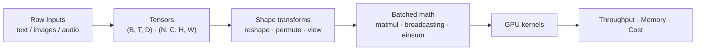
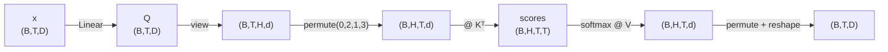

# Linear Algebra - Tensors

[Home](math-index.md#linear-algebra)

## Overview

In deep learning, a **tensor** is an **n-dimensional array of numbers**, the generalization of scalars, vectors, and matrices to any number of axes. PyTorch, TensorFlow, and JAX are all built around this one data structure. (In physics and differential geometry "tensor" has a stricter meaning tied to coordinate transformations; in ML it simply means a multi-dimensional array.)

| Rank (ndim) | Name | Example shape | AI example |
|---|---|---|---|
| 0 | Scalar | `()` | Loss value, learning rate |
| 1 | Vector | `(768,)` | One token embedding |
| 2 | Matrix | `(512, 768)` | One sequence of embeddings / a weight matrix |
| 3 | 3-D tensor | `(32, 512, 768)` | A **batch** of sequences `(B, T, D)` |
| 4 | 4-D tensor | `(32, 3, 224, 224)` | A batch of RGB images `(N, C, H, W)` |
| 5 | 5-D tensor | `(8, 16, 3, 112, 112)` | A batch of video clips `(N, T, C, H, W)` |

This note covers:

1. **High-dimensional data structures**: what tensors are and how they sit in memory
2. **Tensor shapes**: reading, reshaping, permuting, and reasoning about shapes
3. **Broadcasting operations**: how operations on different-shaped tensors work without copying

---

## Why It Matters



> **Architect's lens:** Most production ML bugs are **shape bugs**, and most performance problems are **memory-layout problems** (non-contiguous tensors, unnecessary copies, accidental broadcasting that explodes memory). Fluency with tensor shapes is a core architectural skill.

---

## 1. High-Dimensional Data Structures

### Explanation

A tensor is defined by:

| Attribute | Meaning | PyTorch |
|---|---|---|
| **Shape** | Size of each axis | `t.shape` |
| **Rank / ndim** | Number of axes | `t.ndim` |
| **dtype** | Element type (fp32, fp16, bf16, int8 …) | `t.dtype` |
| **Device** | Where it lives (CPU, CUDA, MPS) | `t.device` |
| **Strides** | Elements to skip to move one step along each axis | `t.stride()` |

Under the hood, a tensor is a **flat, contiguous 1-D buffer** plus metadata (shape + strides). Element $[i, j, k]$ sits at offset $i\cdot s_0 + j\cdot s_1 + k\cdot s_2$. Because of this, operations like `transpose` or slicing can be **free** (zero-copy *views*): they only change the strides.

**Memory size** = (number of elements) × (bytes per element):

$$
\text{bytes} = \prod_i \text{shape}_i \times \text{sizeof(dtype)}
$$

### Worked Example — KV-cache memory of an LLM

A KV cache stores keys and values per layer: shape `(2, B, H, T, d_head)`. For a 7B-class model (32 layers, 32 heads, $d_{head}=128$), batch $B=8$, context $T=4096$, FP16:

$$
2 \times 32_{\text{layers}} \times 8 \times 32 \times 4096 \times 128 \times 2\text{ bytes} = 17{,}179{,}869{,}184 \text{ bytes} = 16 \text{ GiB}
$$

The cache is 16 GiB, *on top of* ~13 GiB of weights. This tensor arithmetic is what motivates **GQA/MQA** (fewer KV heads), **paged attention**, and **KV-cache quantization**.

### Diagram — memory layout and strides

```text
  Logical 2x3 tensor            Physical memory (row-major / C-contiguous)
  ┌─────────────┐               ┌───┬───┬───┬───┬───┬───┐
  │ 0   1   2   │               │ 0 │ 1 │ 2 │ 3 │ 4 │ 5 │
  │ 3   4   5   │               └───┴───┴───┴───┴───┴───┘
  └─────────────┘               strides = (3, 1)

  Transpose (3x2) → SAME buffer, strides = (1, 3)  → a zero-copy "view"
  but now NON-contiguous → some kernels must copy (.contiguous()) first
```

### Architectural Relevance

- **Capacity planning**: VRAM = weights + activations + KV cache + optimizer state. Every term is a tensor-size computation.
- **dtype choice** is a 2× or 4× memory lever: FP32 → BF16 halves memory; INT8/INT4 quantization goes further.
- **Data layout** (`NCHW` vs `NHWC` / `channels_last`) changes convolution throughput on tensor cores by a lot.
- **Zero-copy views** (`view`, `transpose`, slicing) are cheap, but **non-contiguous** tensors can trigger hidden copies or errors (`view` on non-contiguous memory fails; `reshape` silently copies).

### Python Implementation

```python
import torch

t = torch.arange(6, dtype=torch.float32).reshape(2, 3)
print("shape:", tuple(t.shape), "| ndim:", t.ndim, "| dtype:", t.dtype, "| strides:", t.stride())

tt = t.T                                          # transpose: zero-copy view
print("transposed strides:", tt.stride(), "| contiguous?", tt.is_contiguous())
print("shares memory?", tt.data_ptr() == t.data_ptr())

# Memory for a batch of images
images = torch.zeros(32, 3, 224, 224)              # (N, C, H, W)
print(f"image batch: {images.numel():,} elements, "
      f"{images.element_size() * images.numel() / 2**20:.1f} MiB in fp32")

# KV-cache capacity planning helper
def kv_cache_gib(layers, batch, kv_heads, seq, d_head, bytes_per=2):
    return 2 * layers * batch * kv_heads * seq * d_head * bytes_per / 2**30

print("KV cache MHA (32 KV heads):", kv_cache_gib(32, 8, 32, 4096, 128), "GiB")
print("KV cache GQA ( 8 KV heads):", kv_cache_gib(32, 8, 8, 4096, 128), "GiB")
```

**Output:**
```text
shape: (2, 3) | ndim: 2 | dtype: torch.float32 | strides: (3, 1)
transposed strides: (1, 3) | contiguous? False
shares memory? True
image batch: 4,816,896 elements, 18.4 MiB in fp32
KV cache MHA (32 KV heads): 16.0 GiB
KV cache GQA ( 8 KV heads): 4.0 GiB
```

---

## 2. Tensor Shapes

### Explanation

Thinking in shapes is the most practical tensor skill. Core shape operations:

| Operation | What it does | Copies data? |
|---|---|---|
| `reshape` / `view` | Re-interpret the same elements with a new shape (element count must match) | `view`: never; `reshape`: only if needed |
| `permute` / `transpose` | Reorder axes | No (view) |
| `unsqueeze` / `squeeze` | Add / remove a size-1 axis | No |
| `flatten` | Merge axes into one | Only if non-contiguous |
| `cat` / `stack` | Join tensors along an existing / new axis | Yes |
| `einsum` | Express contractions with index notation | Output only |

**Shape algebra of batched matmul**: `(..., m, k) @ (..., k, n) → (..., m, n)`. Leading "batch" axes are broadcast (next section).

### Worked Example — multi-head attention shapes

With batch $B=2$, sequence $T=5$, model dim $D=8$, heads $H=2$ (so $d_{head}=4$):

```text
x                       (B, T, D)        = (2, 5, 8)
Q = x @ W_q             (B, T, D)        = (2, 5, 8)
split heads: view       (B, T, H, d)     = (2, 5, 2, 4)
move heads:  permute    (B, H, T, d)     = (2, 2, 5, 4)
scores = Q @ Kᵀ         (B, H, T, T)     = (2, 2, 5, 5)   ← T² memory!
out = softmax(scores)@V (B, H, T, d)     = (2, 2, 5, 4)
merge heads             (B, T, D)        = (2, 5, 8)
```

The `(B, H, T, T)` score tensor grows **quadratically** with context length, which is why **FlashAttention** never materializes it in GPU high-bandwidth memory.

### Diagram



### Architectural Relevance

- **Shape contracts are API contracts.** Document and assert tensor shapes at module boundaries (e.g., with `jaxtyping` annotations like `Float[Tensor, "batch seq dim"]`).
- **Sequence-length scaling**: memory/compute of attention scale with $T^2$. This drives decisions on context window, chunking strategies in RAG, and sparse/linear attention.
- **Padding & masking**: batching variable-length inputs requires padding to a common shape. The waste ("padding tax") motivates **dynamic batching**, **bucketing**, and **packed sequences** in inference servers (vLLM, TGI).
- **Distributed training** splits tensors along specific axes: data parallel → batch axis, tensor parallel → hidden axis, sequence parallel → sequence axis.

### Python Implementation

```python
import torch

torch.manual_seed(0)
B, T, D, H = 2, 5, 8, 2
d = D // H
x = torch.randn(B, T, D)
W_q, W_k, W_v = (torch.randn(D, D) for _ in range(3))

def split_heads(t):                                   # (B,T,D) -> (B,H,T,d)
    return t.view(B, T, H, d).permute(0, 2, 1, 3)

Q, K, V = split_heads(x @ W_q), split_heads(x @ W_k), split_heads(x @ W_v)
scores = Q @ K.transpose(-2, -1) / d**0.5             # (B,H,T,T)
attn = scores.softmax(dim=-1)
out = (attn @ V).permute(0, 2, 1, 3).reshape(B, T, D) # merge heads

print("Q:", tuple(Q.shape), "| scores:", tuple(scores.shape), "| out:", tuple(out.shape))

# Same computation with einsum: index notation documents the shapes
scores_e = torch.einsum("bhqd,bhkd->bhqk", Q, K) / d**0.5
print("einsum matches matmul?", torch.allclose(scores, scores_e, atol=1e-6))

# view() fails on non-contiguous tensors; reshape() copies when needed
p = (attn @ V).permute(0, 2, 1, 3)                    # (B,T,H,d) but non-contiguous
print("contiguous?", p.is_contiguous())
try:
    p.view(B, T, D)
except RuntimeError:
    print("view() failed on non-contiguous tensor -> use .reshape() or .contiguous().view()")
print("reshape OK:", tuple(p.reshape(B, T, D).shape))
```

**Output:**
```text
Q: (2, 2, 5, 4) | scores: (2, 2, 5, 5) | out: (2, 5, 8)
einsum matches matmul? True
contiguous? False
view() failed on non-contiguous tensor -> use .reshape() or .contiguous().view()
reshape OK: (2, 5, 8)
```

---

## 3. Broadcasting Operations

### Explanation

**Broadcasting** lets element-wise operations work on tensors with **different but compatible shapes**, without copying data. The rules (NumPy, PyTorch, and JAX all follow them):

1. **Align shapes from the right** (trailing dimensions).
2. Two dimensions are compatible if they are **equal**, or **one of them is 1**.
3. Missing leading dimensions are treated as **1**.
4. Size-1 dimensions are virtually **stretched** (stride 0, no copy) to match.

| Shape A | Shape B | Result | Valid? |
|---|---|---|---|
| `(32, 768)` | `(768,)` | `(32, 768)` | ✓ add bias to every row |
| `(B, H, T, T)` | `(1, 1, T, T)` | `(B, H, T, T)` | ✓ causal mask |
| `(B, T, D)` | `(B, 1, D)` | `(B, T, D)` | ✓ per-sample offset |
| `(3, 1)` | `(1, 4)` | `(3, 4)` | ✓ outer operation |
| `(32, 768)` | `(32,)` | — | ✗ trailing dims 768 ≠ 32 |

### Worked Example

$$
\underbrace{\begin{bmatrix}1\\2\\3\end{bmatrix}}_{(3,1)} + \underbrace{\begin{bmatrix}10 & 20 & 30 & 40\end{bmatrix}}_{(1,4)}
= \underbrace{\begin{bmatrix}11 & 21 & 31 & 41\\12 & 22 & 32 & 42\\13 & 23 & 33 & 43\end{bmatrix}}_{(3,4)}
$$

### Diagram

```text
  Align from the right:
      A:      32 x 768
      B:           768        →  treated as  1 x 768  →  stretched to 32 x 768
   result:    32 x 768

  Causal mask broadcast:
   scores: B x H x T x T
   mask  : 1 x 1 x T x T      → same mask applied to every batch item and head
```

### Architectural Relevance

- **Bias addition, LayerNorm scale/shift, attention masks, positional encodings** all rely on broadcasting, so it shows up in every Transformer block.
- **Memory efficiency**: broadcasting uses stride 0, so a `(1, 1, T, T)` mask is stored once rather than `B×H` times.
- **Silent-bug risk**: broadcasting rarely raises errors when shapes are *accidentally* compatible. Classic example: `y_pred` of shape `(N, 1)` minus `y_true` of shape `(N,)` gives an `(N, N)` matrix. The loss silently becomes wrong and memory use is $O(N^2)$.
- **Pairwise computations** (distance matrices, similarity matrices for contrastive learning or retrieval evaluation) are written idiomatically as broadcasts: `a[:, None, :] - b[None, :, :]`.

### Python Implementation

```python
import torch

col = torch.tensor([[1.], [2.], [3.]])            # (3, 1)
row = torch.tensor([[10., 20., 30., 40.]])        # (1, 4)
print((col + row))

# 1) Bias add + causal mask in attention
B, H, T = 2, 4, 5
scores = torch.randn(B, H, T, T)
causal = torch.triu(torch.ones(T, T, dtype=torch.bool), diagonal=1)   # (T, T)
masked = scores.masked_fill(causal, float("-inf"))                    # broadcasts over B, H
print("masked shape:", tuple(masked.shape), "| upper-triangle all -inf:",
      bool(torch.isinf(masked[..., causal]).all()))

# 2) Pairwise squared distances via broadcasting (retrieval / clustering)
a = torch.randn(100, 64)
b = torch.randn(50, 64)
d2 = ((a[:, None, :] - b[None, :, :]) ** 2).sum(-1)                   # (100, 50)
print("pairwise distances:", tuple(d2.shape),
      "| matches cdist?", torch.allclose(d2, torch.cdist(a, b) ** 2, atol=1e-3))

# 3) The silent broadcasting bug
y_true = torch.randn(1000)                                 # (N,)
y_pred = (y_true + 0.1 * torch.randn(1000)).unsqueeze(-1)  # (N, 1) good predictions, nn.Linear(...,1)-style shape
wrong = ((y_pred - y_true) ** 2).mean()
right = ((y_pred.squeeze(-1) - y_true) ** 2).mean()
print("buggy diff shape:", tuple((y_pred - y_true).shape), "<- N x N, not N!")
print(f"wrong MSE={wrong:.3f} vs right MSE={right:.3f}")
```

**Output:**
```text
tensor([[11., 21., 31., 41.],
        [12., 22., 32., 42.],
        [13., 23., 33., 43.]])
masked shape: (2, 4, 5, 5) | upper-triangle all -inf: True
pairwise distances: (100, 50) | matches cdist? True
buggy diff shape: (1000, 1000) <- N x N, not N!
wrong MSE=2.026 vs right MSE=0.010
```

---

## Common Mistakes

| Mistake | Why it hurts | Better approach |
|---|---|---|
| `(N,1) - (N,)` broadcasting | Silent $N\times N$ result; wrong loss, $O(N^2)$ memory | Squeeze/assert shapes; PyTorch losses warn about this |
| `view()` after `permute()` | RuntimeError on non-contiguous memory | `.reshape()` or `.contiguous().view()` |
| Reshaping when you meant permuting | Scrambles data without any error | `reshape` keeps element order; use `permute` to reorder axes |
| Ignoring dtype in memory estimates | 2–4× capacity miscalculation | Always multiply by `element_size()` |
| Materializing `(B,H,T,T)` for long contexts | OOM at large $T$ | FlashAttention / `scaled_dot_product_attention` |
| Mixing `NCHW` and `NHWC` | Wrong results or slow kernels | Standardize layout; use `channels_last` for conv on tensor cores |

---

## Interview Questions

### Beginner
1. **What is a tensor in deep learning?**
   *An n-dimensional array with a shape, dtype, and device; it generalizes scalars, vectors, and matrices.*
2. **What shape is a batch of 16 RGB 256×256 images in PyTorch?**
   *`(16, 3, 256, 256)` in NCHW.*
3. **State the broadcasting rule.**
   *Align from the right; each dimension pair must be equal or one of them must be 1.*

### Intermediate
1. **Difference between `view`, `reshape`, and `permute`?**
   *`view` reinterprets contiguous memory (no copy, can fail); `reshape` = view if possible, else copy; `permute` reorders axes by changing strides.*
2. **Why does attention memory scale quadratically?**
   *The score tensor has shape `(B, H, T, T)`.*
3. **What is the shape of `einsum("bij,bjk->bik")`?**
   *Batched matmul: `(b,i,j)·(b,j,k) → (b,i,k)`.*

### Architect-Level
1. **Estimate GPU memory to serve a 7B model with 32K context for 4 concurrent users.**
   *Weights ≈ 7B × 2 B = 14 GB (FP16). KV cache (MHA, 32 layers, 4096 hidden) ≈ 2 × 32 × 4096 × 2 B = 0.5 MiB per token, so 32K × 4 users ≈ 64 GiB. Total ≈ 80 GB, which needs GQA, KV quantization, or paged attention to fit on smaller GPUs.*
2. **How would you prevent shape bugs in a large ML codebase?**
   *Shape-annotated types (jaxtyping + beartype), assertions at module boundaries, unit tests with odd sizes (e.g., B=3, T=7) so swapped axes fail loudly, and `einops` for self-documenting reshapes.*
3. **Which tensor axes do data, tensor, and sequence parallelism split?**
   *Batch axis, hidden/feature axis (weight matrices), and sequence axis respectively.*

---

## Key Takeaways

- A tensor is a **flat buffer + shape + strides + dtype + device**.
- **Memory = number of elements × bytes per element**. Use it for VRAM, KV-cache, and cost planning.
- **Shapes are contracts**: learn `reshape`, `permute`, `einsum`, and the `(B, H, T, d)` attention layout.
- **Broadcasting** gives you memory-free expansion, but watch for silent `(N,1)` vs `(N,)` bugs.
- Know which ops are **zero-copy views** and which **allocate**. This is where performance is won or lost.
