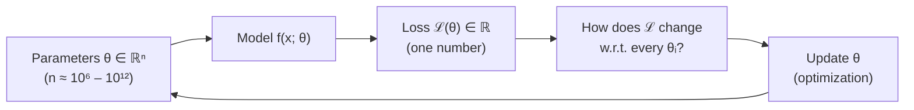
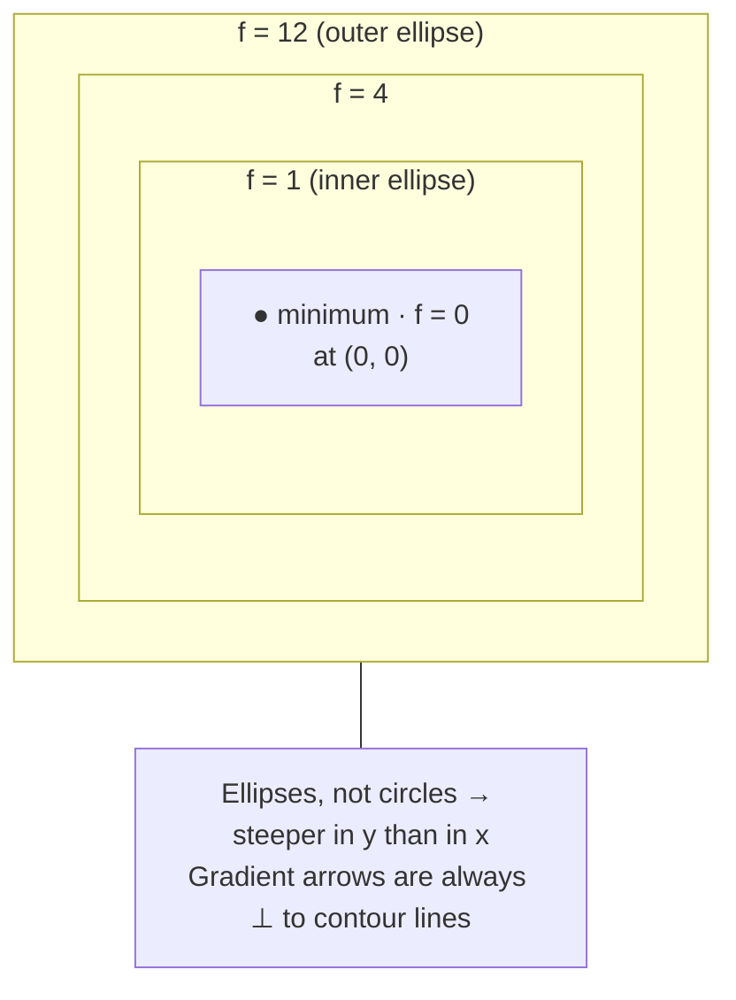
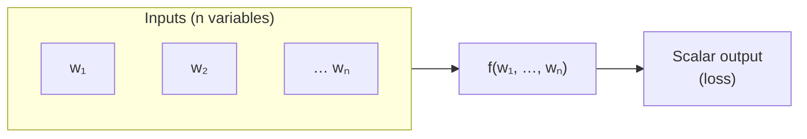

# Calculus - Multivariate Calculus

[Home](math-index.md#calculus)

## Overview

**Multivariate calculus** studies functions of **many input variables**, which is exactly what a neural network is. A loss function like $\mathcal{L}(\boldsymbol\theta)$ takes millions or billions of parameters and returns a single number. Training means finding parameter values that make that number small, so you need to understand how the output changes when you nudge *each* input.

This note builds the foundation (functions of multiple variables) that the next three notes use: [Derivatives](06_Derivatives.md), [The Chain Rule](07_The%20Chain%20Rule.md), and [Jacobian & Hessian](08_Jacobian%20and%20Hessian.md).

| Concept | Single-variable | Multivariable |
|---|---|---|
| Function | $f: \mathbb{R}\to\mathbb{R}$ | $f: \mathbb{R}^n \to \mathbb{R}$ (scalar field) or $\mathbb{R}^n \to \mathbb{R}^m$ (vector field) |
| Graph | A curve | A surface / hypersurface |
| Rate of change | $f'(x)$ | Partial derivatives, gradient, Jacobian |
| Curvature | $f''(x)$ | Hessian matrix |
| Optimum | $f'(x)=0$ | $\nabla f = \mathbf{0}$ |

---

## Why It Matters



> **Architect's lens:** Every training run is a walk across a surface in a space with billions of dimensions. Knowing the *shape* of that surface (smooth vs. rugged, well-conditioned vs. stretched) explains why we need normalization layers, residual connections, adaptive optimizers, and learning-rate warmup.

---

## 1. Functions of Multiple Variables

### Explanation

A **multivariable function** maps a vector of inputs to an output:

- **Scalar-valued** $f: \mathbb{R}^n \to \mathbb{R}$: e.g., a loss function, $f(x, y) = x^2 + 3y^2$.
- **Vector-valued** $\mathbf{f}: \mathbb{R}^n \to \mathbb{R}^m$: e.g., a neural-network layer mapping 768 inputs to 3072 outputs.

Ways to visualize a 2-input scalar function $z = f(x, y)$:

| Visualization | What you see | ML analogue |
|---|---|---|
| **Surface plot** | 3-D landscape | "Loss landscape" |
| **Contour plot** (level sets) | Lines where $f(x,y) = c$ | Top-down map of the loss; gradient is ⟂ to contours |
| **Heatmap** | Color = value | Hyperparameter sweep grids |

Important properties:

- **Continuity & differentiability**: needed for gradient-based learning. ReLU is not differentiable at 0; in practice we use a *subgradient* (0 or 1).
- **Level sets / contours**: elongated, narrow contours mean an **ill-conditioned** problem, where gradient descent zig-zags.
- **Critical points**: where all partial derivatives are zero: minima, maxima, or **saddle points** (see [Optimization Landscapes](15_Optimization%20Landscapes.md)).

### Worked Example

$f(x, y) = x^2 + 3y^2$ (an elongated bowl).

- $f(1, 1) = 1 + 3 = 4$
- $f(2, 0) = 4$ and $f(0, 1.1547) \approx 4$, so all three points lie on the **same contour** $f = 4$, an ellipse.
- Partial rates: moving in $y$ is **3× steeper** (coefficient 3 vs 1), so contours are squashed along $y$.
- Minimum at $(0, 0)$ with $f = 0$.

Now a neural-network-flavored function, a single neuron with squared-error loss on one data point $(x=2, y=1)$:

$$
\mathcal{L}(w, b) = \big(\sigma(wx + b) - y\big)^2
$$

Here the *inputs of the function* are the **parameters** $(w, b)$; the data $(x, y)$ is fixed. Training thinks of the loss as a function of parameters.

### Diagram — contour view of a loss surface





### Architectural Relevance

- **The model is a multivariable function**: $\hat y = f(\mathbf{x}; \boldsymbol\theta)$, and so is the loss $\mathcal{L}(\boldsymbol\theta)$. Thinking this way explains *why* we need gradients: there is no closed-form solution in $10^9$ dimensions.
- **Conditioning and normalization**: if one parameter direction is far steeper than another (elongated contours), one learning rate cannot suit both. **Feature scaling, BatchNorm/LayerNorm, and adaptive optimizers (Adam)** are architectural fixes for this.
- **Smoothness choices**: activation functions (ReLU vs GELU vs SiLU) change how smooth the function is. Smoother activations give better-behaved gradients, one reason modern LLMs use GELU/SwiGLU.
- **Hyperparameter search** is itself optimization of a black-box multivariable function (lr, batch size, weight decay → validation loss). Bayesian optimization models this surface explicitly.

### Python Implementation

```python
import numpy as np

def f(x, y):
    return x**2 + 3 * y**2

# Evaluate on a grid (vectorized over many inputs at once)
xs = np.linspace(-2, 2, 5)
ys = np.linspace(-2, 2, 5)
X, Y = np.meshgrid(xs, ys)
Z = f(X, Y)
print("grid of f values:\n", Z)
i = Z.argmin()
print(f"min on grid at: ({X.flat[i]}, {Y.flat[i]}) value {Z.min()}")

# Points on the same contour f = 4
for x, y in [(1.0, 1.0), (2.0, 0.0), (0.0, np.sqrt(4 / 3))]:
    print(f"f({x:.4f}, {y:.4f}) = {f(x, y):.4f}")

# A neuron's loss viewed as a function of its PARAMETERS (w, b)
def sigmoid(z):
    return 1 / (1 + np.exp(-z))

def loss(w, b, x=2.0, y=1.0):
    return (sigmoid(w * x + b) - y) ** 2

for w, b in [(0.0, 0.0), (1.0, 0.0), (2.0, 1.0)]:
    print(f"L(w={w}, b={b}) = {loss(w, b):.4f}")
```

**Output:**
```text
grid of f values:
 [[16. 13. 12. 13. 16.]
 [ 7.  4.  3.  4.  7.]
 [ 4.  1.  0.  1.  4.]
 [ 7.  4.  3.  4.  7.]
 [16. 13. 12. 13. 16.]]
min on grid at: (0.0, 0.0) value 0.0
f(1.0000, 1.0000) = 4.0000
f(2.0000, 0.0000) = 4.0000
f(0.0000, 1.1547) = 4.0000
L(w=0.0, b=0.0) = 0.2500
L(w=1.0, b=0.0) = 0.0142
L(w=2.0, b=1.0) = 0.0000
```

### Visualizing a loss landscape (optional, requires matplotlib)

```python
import numpy as np
import matplotlib
matplotlib.use("Agg")                       # headless backend for servers / CI
import matplotlib.pyplot as plt

x = np.linspace(-3, 3, 200)
y = np.linspace(-3, 3, 200)
X, Y = np.meshgrid(x, y)
Z = X**2 + 3 * Y**2

fig, ax = plt.subplots(figsize=(5, 4))
cs = ax.contour(X, Y, Z, levels=[1, 4, 9, 16])
ax.clabel(cs)
ax.set_title("Contours of f(x, y) = x² + 3y²")
fig.savefig("contours.png", dpi=120)
```

---

## Key Multivariable Concepts Preview

| Concept | Definition | Covered in |
|---|---|---|
| Partial derivative $\frac{\partial f}{\partial x_i}$ | Rate of change along one axis, others fixed | [Derivatives](06_Derivatives.md) |
| Gradient $\nabla f$ | Vector of all partials; direction of steepest ascent | [Derivatives](06_Derivatives.md) |
| Directional derivative $D_{\mathbf{u}}f$ | Rate of change along any direction $\mathbf{u}$ | [Derivatives](06_Derivatives.md) |
| Chain rule | Derivative of composed functions | [The Chain Rule](07_The%20Chain%20Rule.md) |
| Jacobian $J$ | Matrix of first derivatives of a vector function | [Jacobian & Hessian](08_Jacobian%20and%20Hessian.md) |
| Hessian $H$ | Matrix of second derivatives (curvature) | [Jacobian & Hessian](08_Jacobian%20and%20Hessian.md) |

---

## Common Mistakes

| Mistake | Why it hurts | Better approach |
|---|---|---|
| Treating the loss as a function of the *data* | Confuses what is being optimized | Loss is a function of **parameters**; data is fixed per step |
| Imagining high-dimensional landscapes as 2-D bowls | Misses saddle points and flat regions that dominate in high dimensions | Use 2-D slices only as intuition aids |
| Not scaling input features | Elongated contours → slow, zig-zagging training | Standardize features; use normalization layers |
| Assuming differentiability everywhere | ReLU / max / abs have kinks | Frameworks use subgradients; smooth alternatives (GELU, softplus) exist |

---

## Interview Questions

### Beginner
1. **What is a function of multiple variables? Give an ML example.**
   *A map from a vector of inputs to an output, e.g., the loss as a function of all model weights.*
2. **What is a contour (level set)?**
   *The set of inputs where the function equals a fixed value.*

### Intermediate
1. **Why do elongated contours slow down gradient descent?**
   *The gradient points mostly across the narrow valley, not along it, so updates zig-zag and the learning rate is limited by the steepest direction.*
2. **Why is the loss viewed as a function of parameters rather than inputs?**
   *During training, data is fixed per batch and we adjust parameters to minimize loss.*

### Architect-Level
1. **Which architectural components exist mainly to make the loss surface easier to optimize?**
   *Normalization layers (BatchNorm/LayerNorm/RMSNorm), residual connections, careful initialization, smooth activations, and adaptive optimizers. They improve conditioning and gradient flow.*
2. **How would you visualize a billion-parameter loss landscape?**
   *Project onto 1-D/2-D random or PCA directions around the trained weights (filter-normalized as in Li et al., 2018) and evaluate the loss on a grid along those directions.*

---

## Key Takeaways

- Neural networks and their losses are **multivariable functions**: $\mathcal{L}: \mathbb{R}^n \to \mathbb{R}$, with $n$ in the billions.
- **Contours** show the landscape: circles are easy, elongated ellipses are ill-conditioned.
- Training = navigating this surface with derivative information, covered in the next three notes.
- Many architectural choices (**normalization, residuals, activations, optimizers**) exist to make this surface easier to navigate.
