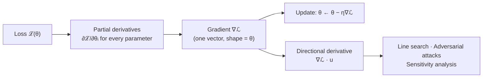
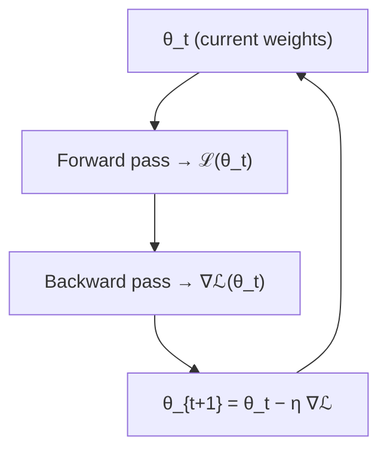
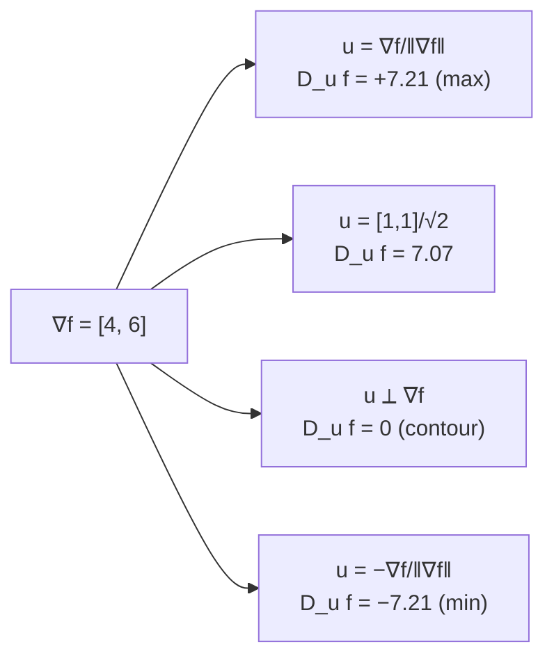

# Calculus - Derivatives

[Home](math-index.md#calculus)

## Overview

A **derivative** measures **how fast a function's output changes when you nudge its input**. For multivariable functions such as loss functions, there are three related ideas:

| Sub-topic | Question it answers | Output |
|---|---|---|
| **Partial derivative** $\frac{\partial f}{\partial x_i}$ | How does $f$ change if I move **only** $x_i$? | Scalar |
| **Gradient** $\nabla f$ | Which direction increases $f$ fastest, and how fast? | Vector (same shape as the input) |
| **Directional derivative** $D_{\mathbf u}f$ | How does $f$ change if I move along direction $\mathbf u$? | Scalar |

The gradient connects them: **every partial derivative is a component of the gradient, and every directional derivative is a dot product with the gradient.**

---

## Why It Matters



> **Architect's lens:** `loss.backward()` computes **the gradient**, and nothing more. Everything else in training (optimizers, clipping, mixed precision, gradient accumulation, distributed all-reduce) is infrastructure built around moving, scaling, and applying this one tensor.

---

## 1. Partial Derivatives

### Explanation

The **partial derivative** of $f(x_1, \dots, x_n)$ with respect to $x_i$ treats all other variables as **constants**:

$$
\frac{\partial f}{\partial x_i} = \lim_{h\to0}\frac{f(x_1,\dots,x_i + h,\dots,x_n) - f(x_1,\dots,x_n)}{h}
$$

Rules are the same as single-variable calculus (power, product, quotient, chain), applied to one variable at a time.

**Numerical approximation** (central difference, error $O(h^2)$):

$$
\frac{\partial f}{\partial x_i} \approx \frac{f(\mathbf x + h\mathbf e_i) - f(\mathbf x - h\mathbf e_i)}{2h}
$$

This is too slow for training ($2n$ function evaluations) but useful for **gradient checking**.

### Worked Example

$f(x, y) = x^2y + 3xy^2 + 5$

$$
\frac{\partial f}{\partial x} = 2xy + 3y^2, \qquad \frac{\partial f}{\partial y} = x^2 + 6xy
$$

At $(x, y) = (1, 2)$:

$$
\frac{\partial f}{\partial x} = 2(1)(2) + 3(4) = 16, \qquad \frac{\partial f}{\partial y} = 1 + 12 = 13
$$

So near $(1, 2)$, $f$ is more sensitive to $x$ than to $y$.

**ML example**: linear model with MSE on one sample, $\mathcal{L} = (wx + b - y)^2$:

$$
\frac{\partial \mathcal L}{\partial w} = 2(wx + b - y)\,x, \qquad \frac{\partial \mathcal L}{\partial b} = 2(wx + b - y)
$$

### Diagram

```text
   f(x, y) surface — slice it two ways:

   Fix y = 2, vary x         Fix x = 1, vary y
        f                         f
        │     ╱  slope = 16       │    ╱  slope = 13
        │   ╱                     │  ╱
        │ ╱                       │╱
        └────────── x             └────────── y
   ∂f/∂x is the slope of the first slice; ∂f/∂y the slope of the second.
```

### Architectural Relevance

- **Per-parameter credit assignment**: $\frac{\partial\mathcal L}{\partial \theta_i}$ tells you how much parameter $\theta_i$ contributed to the error. Optimizers use one partial per parameter.
- **Gradient checking**: comparing analytical partials to finite differences is the standard unit test for **custom autograd functions and CUDA kernels**.
- **Feature attribution / explainability**: $\frac{\partial \hat y}{\partial x_i}$ ("saliency") measures input sensitivity, the basis of Integrated Gradients and other XAI methods used for model audits.
- **Frozen parameters**: setting `requires_grad=False` skips those partials entirely. This is how transfer learning, LoRA, and adapters save memory and compute.

### Python Implementation

```python
import torch

def f(x, y):
    return x**2 * y + 3 * x * y**2 + 5

# Analytical partials at (1, 2)
x0, y0 = 1.0, 2.0
print("analytical ∂f/∂x =", 2 * x0 * y0 + 3 * y0**2, "| ∂f/∂y =", x0**2 + 6 * x0 * y0)

# Numerical partials (central difference) — used for gradient checking
h = 1e-5
dfdx = (f(x0 + h, y0) - f(x0 - h, y0)) / (2 * h)
dfdy = (f(x0, y0 + h) - f(x0, y0 - h)) / (2 * h)
print(f"numerical  ∂f/∂x = {dfdx:.4f} | ∂f/∂y = {dfdy:.4f}")

# Autograd partials
x = torch.tensor(x0, requires_grad=True)
y = torch.tensor(y0, requires_grad=True)
f(x, y).backward()
print("autograd   ∂f/∂x =", x.grad.item(), "| ∂f/∂y =", y.grad.item())

# Gradient check for a custom function using torch.autograd.gradcheck
def custom_fn(a, b):
    return (a * b.sin()).sum()
a = torch.randn(3, dtype=torch.double, requires_grad=True)
b = torch.randn(3, dtype=torch.double, requires_grad=True)
print("gradcheck passed:", torch.autograd.gradcheck(custom_fn, (a, b)))
```

**Output:**
```text
analytical ∂f/∂x = 16.0 | ∂f/∂y = 13.0
numerical  ∂f/∂x = 16.0000 | ∂f/∂y = 13.0000
autograd   ∂f/∂x = 16.0 | ∂f/∂y = 13.0
gradcheck passed: True
```

---

## 2. Gradients

### Explanation

The **gradient** collects all partial derivatives into one vector:

$$
\nabla f(\mathbf x) = \left[\frac{\partial f}{\partial x_1}, \frac{\partial f}{\partial x_2}, \dots, \frac{\partial f}{\partial x_n}\right]^\top
$$

Three key properties:

1. **Direction**: $\nabla f$ points in the direction of **steepest ascent**, so $-\nabla f$ is **steepest descent**.
2. **Magnitude**: $\lVert\nabla f\rVert$ is the slope in that steepest direction.
3. **Orthogonality**: $\nabla f$ is **perpendicular to the contour lines** (level sets).

At a minimum, maximum, or saddle point: $\nabla f = \mathbf 0$.

**Gradient descent** update:

$$
\boldsymbol\theta_{t+1} = \boldsymbol\theta_t - \eta\,\nabla_{\boldsymbol\theta}\mathcal L(\boldsymbol\theta_t)
$$

**Useful gradients to memorize**:

| Function | Gradient |
|---|---|
| $\mathbf a^\top\mathbf x$ | $\mathbf a$ |
| $\mathbf x^\top\mathbf x = \lVert\mathbf x\rVert^2$ | $2\mathbf x$ |
| $\mathbf x^\top A\mathbf x$ | $(A + A^\top)\mathbf x$ (= $2A\mathbf x$ if symmetric) |
| $\lVert X\mathbf w - \mathbf y\rVert^2$ (least squares) | $2X^\top(X\mathbf w - \mathbf y)$ |
| Softmax + cross-entropy w.r.t. logits | $\text{softmax}(\mathbf z) - \mathbf y_{\text{onehot}}$ |

### Worked Example

$f(x, y) = x^2 + 3y^2$, $\nabla f = [2x, 6y]$.

At $(2, 1)$: $\nabla f = [4, 6]$, $\lVert\nabla f\rVert = \sqrt{52} \approx 7.21$.

One gradient-descent step with $\eta = 0.1$:

$$
(x, y) \leftarrow (2, 1) - 0.1\,[4, 6] = (1.6,\; 0.4)
$$

$f$ drops from $4 + 3 = 7$ to $2.56 + 0.48 = 3.04$ ✓

### Diagram



```text
        contour lines (ellipses)
       ╭──────────────────────╮
      ╭┴────────────────────╮ │
      │      ↖ −∇f           │ │     ∇f is perpendicular to the contour
      │       ● (2,1) → ∇f   │ │     and points "uphill"
      │                      │ │
      ╰──────────────────────╯─╯
```

### Architectural Relevance

- **The gradient tensor has the same shape and size as the parameters**. For a 7B model in FP32, gradients alone take 28 GB. Mixed precision, **gradient checkpointing**, ZeRO/FSDP sharding, and gradient accumulation all manage this memory.
- **Distributed data parallel**: each GPU computes gradients on its data shard, then they are **averaged via all-reduce**. Gradient size sets the communication volume, which is why gradient compression and overlap of compute and communication matter.
- **Gradient health monitoring**: track the global gradient norm $\lVert\nabla\mathcal L\rVert$. Spikes mean instability (use **gradient clipping**), and near-zero values mean vanishing gradients or dead units.
- **Softmax + cross-entropy gradient = $\mathbf p - \mathbf y$** is simple and numerically stable, which is why frameworks fuse them (`F.cross_entropy` takes raw logits).

### Python Implementation

```python
import torch

# Gradient and one GD step on f(x, y) = x² + 3y²
p = torch.tensor([2.0, 1.0], requires_grad=True)
f = p[0] ** 2 + 3 * p[1] ** 2
f.backward()
print("∇f(2,1) =", p.grad.tolist(), "| ‖∇f‖ =", round(p.grad.norm().item(), 3))
with torch.no_grad():
    p_new = p - 0.1 * p.grad
print("after one step:", [round(v, 4) for v in p_new.tolist()], "| f =", round((p_new[0]**2 + 3*p_new[1]**2).item(), 4))

# Gradient descent on linear regression (gradient = 2Xᵀ(Xw − y)/N)
torch.manual_seed(0)
X = torch.randn(200, 3)
w_true = torch.tensor([1.5, -2.0, 0.5])
y = X @ w_true + 0.05 * torch.randn(200)

w = torch.zeros(3, requires_grad=True)
for step in range(200):
    loss = ((X @ w - y) ** 2).mean()
    loss.backward()
    with torch.no_grad():
        w -= 0.1 * w.grad
        w.grad.zero_()
print("learned w:", [round(v, 3) for v in w.tolist()], "| final loss:", round(loss.item(), 5))

# Softmax + cross-entropy: gradient w.r.t. logits is (p − y)
logits = torch.tensor([2.0, 1.0, 0.1], requires_grad=True)
target = torch.tensor(0)
torch.nn.functional.cross_entropy(logits.unsqueeze(0), target.unsqueeze(0)).backward()
p_soft = logits.detach().softmax(-1)
print("autograd grad:", [round(v, 4) for v in logits.grad.tolist()])
print("p − onehot   :", [round(v, 4) for v in (p_soft - torch.tensor([1., 0., 0.])).tolist()])
```

**Output:**
```text
∇f(2,1) = [4.0, 6.0] | ‖∇f‖ = 7.211
after one step: [1.6, 0.4] | f = 3.04
learned w: [1.497, -2.001, 0.498] | final loss: 0.00285
autograd grad: [-0.341, 0.2424, 0.0986]
p − onehot   : [-0.341, 0.2424, 0.0986]
```

---

## 3. Directional Derivatives

### Explanation

The **directional derivative** measures the rate of change of $f$ along an arbitrary **unit** direction $\mathbf u$ ($\lVert\mathbf u\rVert = 1$):

$$
D_{\mathbf u}f(\mathbf x) = \lim_{h\to0}\frac{f(\mathbf x + h\mathbf u) - f(\mathbf x)}{h} = \nabla f(\mathbf x)\cdot\mathbf u = \lVert\nabla f\rVert\cos\theta
$$

Consequences:

| Direction $\mathbf u$ | $\theta$ | $D_{\mathbf u}f$ | Meaning |
|---|---|---|---|
| $\nabla f / \lVert\nabla f\rVert$ | $0^\circ$ | $+\lVert\nabla f\rVert$ (max) | Steepest ascent |
| $-\nabla f / \lVert\nabla f\rVert$ | $180^\circ$ | $-\lVert\nabla f\rVert$ (min) | Steepest descent |
| $\perp \nabla f$ | $90^\circ$ | $0$ | Along the contour (no change) |

This **proves** why gradient descent uses $-\nabla f$: it is the direction with the most negative directional derivative.

Partial derivatives are special cases: $\frac{\partial f}{\partial x_i} = D_{\mathbf e_i}f$.

### Worked Example

$f(x, y) = x^2 + 3y^2$ at $(2, 1)$, $\nabla f = [4, 6]$.

Direction $\mathbf u = \frac{1}{\sqrt2}[1, 1]$ (diagonal):

$$
D_{\mathbf u}f = [4, 6]\cdot\tfrac{1}{\sqrt2}[1, 1] = \tfrac{10}{\sqrt2} \approx 7.07
$$

Compare with the maximum possible, $\lVert\nabla f\rVert = \sqrt{52} \approx 7.21$. The diagonal is almost, but not quite, the steepest direction.

Direction along the contour: $\mathbf u = \frac{1}{\sqrt{52}}[6, -4]$ gives $D_{\mathbf u}f = (24 - 24)/\sqrt{52} = 0$ ✓

### Diagram



### Architectural Relevance

- **Adversarial robustness**: FGSM perturbs an input along $\text{sign}(\nabla_{\mathbf x}\mathcal L)$, the direction that increases loss the most per unit of $L_\infty$ change. Red-teaming and robustness evaluation of vision and multimodal models build on this.
- **Line search & trust regions**: optimizers check $D_{\mathbf u}\mathcal L < 0$ to confirm that a proposed direction $\mathbf u$ is a **descent direction**. Momentum, Adam, and preconditioned updates are not exactly $-\nabla\mathcal L$, but they must stay descent directions on average.
- **Jacobian-vector products (JVPs)** = directional derivatives of vector functions. **Forward-mode autodiff** (`torch.func.jvp`, JAX `jvp`) computes them in a single pass, which matters for Hessian-vector products and some scientific-ML workloads.
- **Model editing / steering**: changing activations along a "concept direction" $\mathbf u$ (activation steering) and measuring the effect is a directional-derivative idea used in LLM interpretability.

### Python Implementation

```python
import torch

def f(p):
    return p[0] ** 2 + 3 * p[1] ** 2

x = torch.tensor([2.0, 1.0])
grad = torch.func.grad(f)(x)
print("∇f =", grad.tolist(), "| max rate ‖∇f‖ =", round(grad.norm().item(), 4))

directions = {
    "steepest ascent ": grad / grad.norm(),
    "diagonal [1,1]  ": torch.tensor([1.0, 1.0]) / 2**0.5,
    "along contour   ": torch.tensor([6.0, -4.0]) / 52**0.5,
    "steepest descent": -grad / grad.norm(),
}
for name, u in directions.items():
    via_dot = torch.dot(grad, u).item()
    _, via_jvp = torch.func.jvp(f, (x,), (u,))        # forward-mode autodiff
    print(f"{name}: D_u f = {via_dot:+.4f}  (jvp: {via_jvp.item():+.4f})")

# FGSM-style adversarial step: move input along sign of the input-gradient
torch.manual_seed(0)
model = torch.nn.Sequential(torch.nn.Linear(4, 8), torch.nn.ReLU(), torch.nn.Linear(8, 2))
inp = torch.randn(1, 4, requires_grad=True)
label = torch.tensor([0])
loss = torch.nn.functional.cross_entropy(model(inp), label)
loss.backward()
adv = inp + 0.25 * inp.grad.sign()
adv_loss = torch.nn.functional.cross_entropy(model(adv), label)
print(f"loss clean = {loss.item():.4f} -> loss adversarial = {adv_loss.item():.4f}")
```

**Output:**
```text
∇f = [4.0, 6.0] | max rate ‖∇f‖ = 7.2111
steepest ascent : D_u f = +7.2111  (jvp: +7.2111)
diagonal [1,1]  : D_u f = +7.0711  (jvp: +7.0711)
along contour   : D_u f = +0.0000  (jvp: +0.0000)
steepest descent: D_u f = -7.2111  (jvp: -7.2111)
loss clean = 0.7157 -> loss adversarial = 0.7739
```

---

## Common Mistakes

| Mistake | Why it hurts | Better approach |
|---|---|---|
| Forgetting `optimizer.zero_grad()` | PyTorch **accumulates** gradients, so updates get larger every step | Zero grads every step (unless accumulating on purpose) |
| Using a non-unit direction in $D_{\mathbf u}f$ | Result is scaled by $\lVert\mathbf u\rVert$ | Normalize $\mathbf u$ first |
| Gradient checking in float32 | Finite differences are too noisy | Use `float64` for gradcheck |
| Applying softmax before `F.cross_entropy` | Double softmax → wrong gradients | Pass raw logits |
| Ignoring gradient norm in logs | Instability goes unnoticed until loss turns NaN | Log global grad norm; clip at a threshold |

---

## Interview Questions

### Beginner
1. **What is a partial derivative?**
   *Rate of change of $f$ w.r.t. one variable with the others held constant.*
2. **What direction does the gradient point?**
   *Steepest ascent; gradient descent moves in the opposite direction.*

### Intermediate
1. **Prove that $-\nabla f$ is the steepest-descent direction.**
   *$D_{\mathbf u}f = \lVert\nabla f\rVert\cos\theta$ is minimized at $\theta = 180^\circ$, i.e., $\mathbf u = -\nabla f/\lVert\nabla f\rVert$.*
2. **What is the gradient of softmax cross-entropy w.r.t. logits?**
   *$\mathbf p - \mathbf y$ (predicted probabilities minus one-hot target).*
3. **Why is the gradient perpendicular to contour lines?**
   *Along a contour, $f$ is constant, so $D_{\mathbf u}f = \nabla f\cdot\mathbf u = 0$.*

### Architect-Level
1. **How much memory do gradients need when training a 13B model, and how do you reduce it?**
   *13B × 4 B = 52 GB in FP32 (26 GB in BF16). Reduce with BF16 grads, ZeRO-2/FSDP sharding across GPUs, gradient accumulation (smaller micro-batches), and freezing parameters (LoRA).*
2. **What happens to gradients in data-parallel training, and what is the bottleneck?**
   *Each worker computes local grads, then all-reduce averages them. Bandwidth scales with parameter count. Mitigate with bucketing, overlap with backward, compression, or hierarchical all-reduce.*
3. **Forward-mode vs reverse-mode AD: when would you choose each?**
   *Reverse mode is cheap when there are many inputs and few outputs (loss → params: training). Forward mode is cheap when there are few inputs and many outputs (JVPs, sensitivity to a few hyperparameters).*

---

## Key Takeaways

- **Partial derivatives** measure the sensitivity to one variable, with the others frozen.
- The **gradient** stacks all partials. It points uphill, is perpendicular to contours, and has the same shape as the parameters.
- The **directional derivative** is $\nabla f\cdot\mathbf u$, which proves that $-\nabla f$ is the best descent direction.
- Gradients drive **training, memory budgets, distributed communication, adversarial testing, and explainability**.
