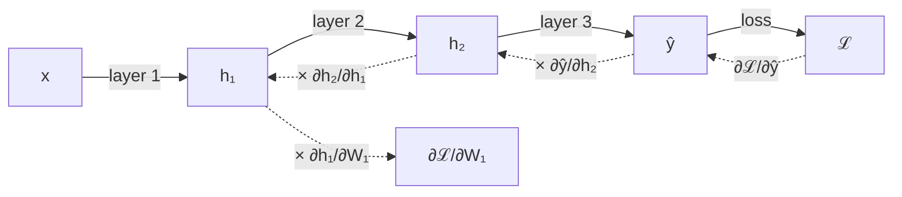
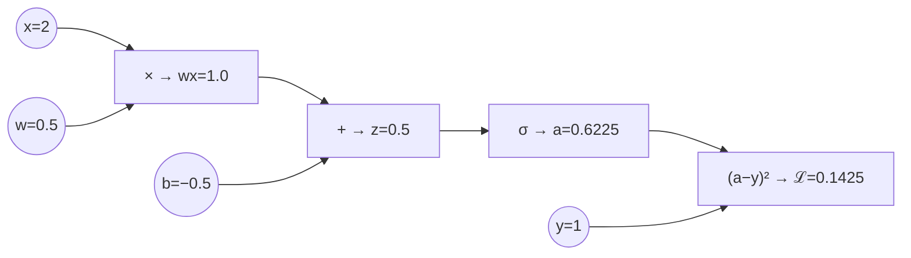

# Calculus - The Chain Rule

[Home](math-index.md#calculus)

## Overview

The **chain rule** tells you how to differentiate a **composition of functions**. A neural network is one long composition: input → layer 1 → layer 2 → … → loss. **Backpropagation is the chain rule applied systematically, from the loss backward, reusing intermediate results.** Every gradient computed by PyTorch, TensorFlow, or JAX comes from this one rule.

| Form | Formula |
|---|---|
| Single variable | $\dfrac{dy}{dx} = \dfrac{dy}{du}\cdot\dfrac{du}{dx}$ |
| Multivariable (sum over paths) | $\dfrac{\partial z}{\partial x} = \sum_i \dfrac{\partial z}{\partial u_i}\dfrac{\partial u_i}{\partial x}$ |
| Vector / matrix (Jacobians) | $J_{\mathbf f\circ\mathbf g} = J_{\mathbf f}\cdot J_{\mathbf g}$ |

---

## Why It Matters



> **Architect's lens:** Backprop cost is about **2× the forward pass** in FLOPs, but it requires **storing the forward activations**. That activation memory, not the weights, is often what limits batch size and context length, and it is the reason **gradient checkpointing** exists.

---

## 1. The Chain Rule — The Mathematical Core of Backpropagation

### Explanation

#### Single-variable chain rule

If $y = f(u)$ and $u = g(x)$, then $y = f(g(x))$ and

$$
\frac{dy}{dx} = f'(g(x))\cdot g'(x) = \frac{dy}{du}\cdot\frac{du}{dx}
$$

Intuition: if $u$ changes 3× as fast as $x$, and $y$ changes 2× as fast as $u$, then $y$ changes $2\times3 = 6$× as fast as $x$. **Rates multiply along a chain.**

#### Multivariable chain rule

If $z$ depends on $x$ through **several intermediate paths** $u_1, \dots, u_k$, the contributions of all paths **add up**:

$$
\frac{\partial z}{\partial x} = \sum_{i=1}^{k}\frac{\partial z}{\partial u_i}\cdot\frac{\partial u_i}{\partial x}
$$

This "**multiply along paths, sum across paths**" rule is why a **residual connection** $\mathbf h_{l+1} = \mathbf h_l + F(\mathbf h_l)$ helps: its local derivative is $I + \frac{\partial F}{\partial \mathbf h_l}$, so the gradient always has a direct identity path backward.

#### Backpropagation = chain rule + dynamic programming

1. **Forward pass**: compute and **cache** every intermediate value.
2. **Backward pass**: start with $\frac{\partial\mathcal L}{\partial\mathcal L} = 1$ and walk the computation graph in reverse. At each node, multiply the incoming **upstream gradient** by the node's **local gradient** and pass the result further back.
3. If a node feeds several consumers, **sum** the gradients arriving from each one.

$$
\underbrace{\frac{\partial\mathcal L}{\partial\,\text{input}}}_{\text{downstream}} = \underbrace{\frac{\partial\mathcal L}{\partial\,\text{output}}}_{\text{upstream}}\times\underbrace{\frac{\partial\,\text{output}}{\partial\,\text{input}}}_{\text{local}}
$$

Because each intermediate gradient is computed **once and reused**, the backward pass costs about the same order as the forward pass, instead of being exponential in depth.

### Worked Example 1 — single variable

$y = (3x + 1)^2$. Let $u = 3x + 1$, $y = u^2$.

$$
\frac{dy}{dx} = \frac{dy}{du}\cdot\frac{du}{dx} = 2u \cdot 3 = 6(3x+1)
$$

At $x = 1$: $u = 4$, $\frac{dy}{dx} = 6 \cdot 4 = 24$.

### Worked Example 2 — backprop through one neuron by hand

Neuron: $z = wx + b$, $a = \sigma(z)$, loss $\mathcal L = (a - y)^2$.

Values: $x = 2,\; w = 0.5,\; b = -0.5,\; y = 1$.

**Forward pass:**

| Step | Computation | Value |
|---|---|---|
| $z$ | $0.5\cdot2 - 0.5$ | $0.5$ |
| $a = \sigma(z)$ | $1/(1+e^{-0.5})$ | $0.6225$ |
| $\mathcal L$ | $(0.6225 - 1)^2$ | $0.1425$ |

**Backward pass** (local derivatives: $\frac{\partial\mathcal L}{\partial a} = 2(a-y)$, $\frac{\partial a}{\partial z} = \sigma(z)(1-\sigma(z))$, $\frac{\partial z}{\partial w} = x$, $\frac{\partial z}{\partial b} = 1$):

| Gradient | Chain | Value |
|---|---|---|
| $\frac{\partial\mathcal L}{\partial a}$ | $2(0.6225 - 1)$ | $-0.7551$ |
| $\frac{\partial\mathcal L}{\partial z}$ | $-0.7551 \times 0.6225(1 - 0.6225)$ | $-0.1774$ |
| $\frac{\partial\mathcal L}{\partial w}$ | $-0.1774 \times x = -0.1774 \times 2$ | $-0.3549$ |
| $\frac{\partial\mathcal L}{\partial b}$ | $-0.1774 \times 1$ | $-0.1774$ |

Both gradients are negative, so gradient descent will **increase** $w$ and $b$, pushing $a$ toward the target 1 ✓

### Worked Example 3 — the vanishing-gradient problem

In a deep chain of sigmoid layers, the gradient picks up a factor $\sigma'(z) \le 0.25$ at **every** layer:

$$
\frac{\partial\mathcal L}{\partial \mathbf h_1} \propto \prod_{l=1}^{L}\sigma'(z_l)\,w_l \quad\Rightarrow\quad \le 0.25^{L}\prod_l w_l
$$

With 20 layers and $w \approx 1$: $0.25^{20} \approx 9\times10^{-13}$, so the early layers effectively **stop learning**. This one chain-rule calculation explains the move to **ReLU-family activations, residual connections, normalization layers, and careful initialization**.

### Diagram — computation graph of the neuron



```text
 Backward (right → left), multiply upstream × local:

  ℒ ──(1)──► a ──(×2(a−y) = −0.7551)──► z ──(×σ'(z)=0.2350 → −0.1774)──┬──► w : ×x=2 → −0.3549
                                                                         └──► b : ×1   → −0.1774
```

### Architectural Relevance

- **Autograd engines** (PyTorch, JAX, TensorFlow) build a computation graph during the forward pass and apply the chain rule in reverse. Custom ops only need a **local gradient** rule (`torch.autograd.Function.backward`); the engine handles the chaining.
- **Activation memory**: backward needs the cached forward values (e.g., $\sigma(z)$, inputs $x$). Memory grows with **batch × sequence length × hidden size × layers**. Solutions:
  - **Gradient (activation) checkpointing**: store only some activations and recompute the rest during backward. This trades about 30% extra compute for large memory savings.
  - **Mixed precision**: store activations in BF16/FP16.
- **Gradient flow design**: the chain-rule product explains vanishing/exploding gradients. Architectural remedies:
  - **Residual connections** (gradient highway: $\partial/\partial\mathbf h = I + \dots$)
  - **Pre-LayerNorm** Transformers (more stable than post-LN)
  - **ReLU/GELU** activations (derivative 1 on the active side instead of $\le 0.25$)
  - **LSTM/GRU gating** (additive cell-state path)
  - **Gradient clipping** for exploding products
- **`detach()` / `stop_gradient`** cut the chain on purpose. This is used in target networks (RL), BYOL/SimSiam, straight-through estimators, and KV caches during inference.
- **Pipeline parallelism** splits the chain across devices: activations flow forward and gradients flow backward between stages, and the schedule (GPipe, 1F1B) manages the bubbles.

### Python Implementation

#### (a) Manual backprop vs. autograd for one neuron

```python
import math
import torch

x, w, b, y = 2.0, 0.5, -0.5, 1.0

# ---- Manual forward ----
z = w * x + b
a = 1 / (1 + math.exp(-z))
L = (a - y) ** 2

# ---- Manual backward (chain rule) ----
dL_da = 2 * (a - y)
da_dz = a * (1 - a)
dL_dz = dL_da * da_dz
dL_dw = dL_dz * x
dL_db = dL_dz * 1.0
print(f"forward : z={z:.4f}  a={a:.4f}  L={L:.4f}")
print(f"manual  : dL/dw={dL_dw:.4f}  dL/db={dL_db:.4f}")

# ---- Autograd ----
wt = torch.tensor(w, requires_grad=True)
bt = torch.tensor(b, requires_grad=True)
loss = (torch.sigmoid(wt * x + bt) - y) ** 2
loss.backward()
print(f"autograd: dL/dw={wt.grad.item():.4f}  dL/db={bt.grad.item():.4f}")
```

**Output:**
```text
forward : z=0.5000  a=0.6225  L=0.1425
manual  : dL/dw=-0.3549  dL/db=-0.1774
autograd: dL/dw=-0.3549  dL/db=-0.1774
```

#### (b) A tiny reverse-mode autodiff engine (how autograd works inside)

```python
import math

class Value:
    """Scalar that records the computation graph and supports backprop."""
    def __init__(self, data, parents=(), op=""):
        self.data, self.grad = data, 0.0
        self._parents, self._op = parents, op
        self._backward = lambda: None

    def __add__(self, other):
        other = other if isinstance(other, Value) else Value(other)
        out = Value(self.data + other.data, (self, other), "+")
        def _backward():                       # local grad of + is 1 for both inputs
            self.grad += out.grad
            other.grad += out.grad
        out._backward = _backward
        return out

    def __mul__(self, other):
        other = other if isinstance(other, Value) else Value(other)
        out = Value(self.data * other.data, (self, other), "*")
        def _backward():                       # d(xy)/dx = y, d(xy)/dy = x
            self.grad += other.data * out.grad
            other.grad += self.data * out.grad
        out._backward = _backward
        return out

    def __sub__(self, other):
        return self + (other * -1.0 if isinstance(other, Value) else Value(-other))

    def __pow__(self, k):
        out = Value(self.data ** k, (self,), f"**{k}")
        def _backward():
            self.grad += k * self.data ** (k - 1) * out.grad
        out._backward = _backward
        return out

    def sigmoid(self):
        s = 1 / (1 + math.exp(-self.data))
        out = Value(s, (self,), "σ")
        def _backward():
            self.grad += s * (1 - s) * out.grad
        out._backward = _backward
        return out

    def backward(self):
        order, seen = [], set()                # topological sort of the graph
        def build(v):
            if v not in seen:
                seen.add(v)
                for p in v._parents:
                    build(p)
                order.append(v)
        build(self)
        self.grad = 1.0                        # dL/dL = 1
        for v in reversed(order):              # chain rule, output -> inputs
            v._backward()

w, b = Value(0.5), Value(-0.5)
loss = ((w * 2.0 + b).sigmoid() - 1.0) ** 2
loss.backward()
print(f"mini-engine: L={loss.data:.4f}  dL/dw={w.grad:.4f}  dL/db={b.grad:.4f}")

# Multiple paths: gradients ADD (multivariable chain rule)
x = Value(3.0)
z = x * x + x * 4.0                            # z = x² + 4x  -> dz/dx = 2x + 4 = 10
z.backward()
print("dz/dx with two paths:", x.grad)
```

**Output:**
```text
mini-engine: L=0.1425  dL/dw=-0.3549  dL/db=-0.1774
dz/dx with two paths: 10.0
```

#### (c) Vanishing gradients and how residual connections fix them

```python
import torch

torch.manual_seed(0)
depth, width = 30, 64

def first_layer_grad_norm(residual: bool, act):
    layers = [torch.nn.Linear(width, width) for _ in range(depth)]
    norms = [torch.nn.LayerNorm(width) for _ in range(depth)]
    h = torch.randn(16, width)
    for layer, norm in zip(layers, norms):
        if residual:
            h = h + act(layer(norm(h)))     # Pre-LN residual block (Transformer style)
        else:
            h = act(layer(h))               # plain deep stack
    h.pow(2).mean().backward()
    return layers[0].weight.grad.norm().item()

for name, act in [("sigmoid", torch.sigmoid), ("relu", torch.relu)]:
    plain = first_layer_grad_norm(False, act)
    res = first_layer_grad_norm(True, act)
    print(f"{name:7s} | plain: {plain:.2e} | residual: {res:.2e}")
```

**Output:**
```text
sigmoid | plain: 0.00e+00 | residual: 2.41e+00
relu    | plain: 3.91e-14 | residual: 7.89e+00
```

> In a 30-layer plain stack, the first layer's gradient vanishes (exactly 0 for sigmoid in float32, ~1e-14 for ReLU with default init). With **Pre-LN residual blocks** the gradient reaching layer 1 stays O(1). That is why every modern Transformer uses this design.

#### (d) Gradient checkpointing: trading compute for memory

```python
import torch
from torch.utils.checkpoint import checkpoint

block = torch.nn.Sequential(torch.nn.Linear(256, 1024), torch.nn.GELU(), torch.nn.Linear(1024, 256))
x = torch.randn(32, 256, requires_grad=True)

y_normal = block(x).sum()
y_ckpt = checkpoint(block, x, use_reentrant=False).sum()   # activations recomputed in backward

g1 = torch.autograd.grad(y_normal, x)[0]
g2 = torch.autograd.grad(y_ckpt, x)[0]
print("same gradients with checkpointing?", torch.allclose(g1, g2, atol=1e-6))
```

**Output:**
```text
same gradients with checkpointing? True
```

---

## Common Mistakes

| Mistake | Why it hurts | Better approach |
|---|---|---|
| Overwriting instead of accumulating grads at branch points | Wrong gradients when a value is used twice | Use `+=` in backward (multivariable chain rule) |
| In-place ops on tensors needed for backward | `RuntimeError: ... modified by an inplace operation` | Avoid in-place on saved tensors |
| Calling `.item()` / `.numpy()` mid-graph | Breaks the chain; no gradient flows | Keep computations in tensors |
| Accidentally `detach()`-ing | Silent zero gradients for upstream params | Check `requires_grad` and `grad_fn` |
| Deep sigmoid/tanh stacks without residuals | Vanishing gradients | ReLU/GELU, residuals, normalization |

---

## Interview Questions

### Beginner
1. **State the chain rule.**
   *$\frac{dy}{dx} = \frac{dy}{du}\cdot\frac{du}{dx}$: rates multiply along a composition.*
2. **What is backpropagation?**
   *Efficient reverse-order application of the chain rule over a computation graph to get gradients of the loss w.r.t. all parameters.*

### Intermediate
1. **Why must gradients be summed when a variable is used in multiple places?**
   *Multivariable chain rule: total derivative = sum of contributions over all paths.*
2. **Explain vanishing gradients using the chain rule.**
   *The gradient is a product of per-layer local derivatives. If each factor is < 1 (sigmoid' ≤ 0.25), the product shrinks exponentially with depth.*
3. **Why is backprop efficient compared to computing each partial derivative separately?**
   *It reuses intermediate upstream gradients (dynamic programming), so all $n$ partials cost about one extra pass instead of $n$ passes.*

### Architect-Level
1. **Training OOMs at sequence length 8K. Which chain-rule-related levers do you have?**
   *Activation checkpointing, FlashAttention (avoids storing the $T^2$ attention matrix, recomputes in backward), BF16 activations, smaller micro-batches + gradient accumulation, sequence/tensor parallelism, CPU offload.*
2. **How do residual connections change the gradient mathematically?**
   *$\frac{\partial\mathbf h_{l+1}}{\partial\mathbf h_l} = I + \frac{\partial F}{\partial\mathbf h_l}$; expanding the product over layers gives a sum that always contains the identity term, so gradients reach early layers without decaying.*
3. **When would you intentionally stop gradients?**
   *Target networks in RL, momentum encoders, straight-through estimators for quantization, freezing backbones for fine-tuning, and preventing leakage from auxiliary heads.*

---

## Key Takeaways

- **Chain rule**: multiply local derivatives along a path and **sum across paths**.
- **Backpropagation** is the chain rule run in reverse with cached forward values, at about 2× forward compute.
- **Activation memory** comes from the chain rule; checkpointing, mixed precision, and FlashAttention manage it.
- **Vanishing/exploding gradients** come from long products of local derivatives; **residuals, normalization, ReLU/GELU, and clipping** are the architectural fixes.
