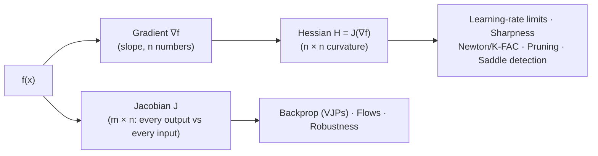
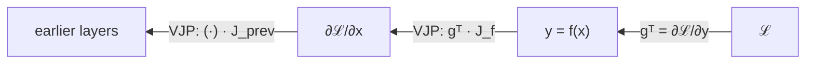
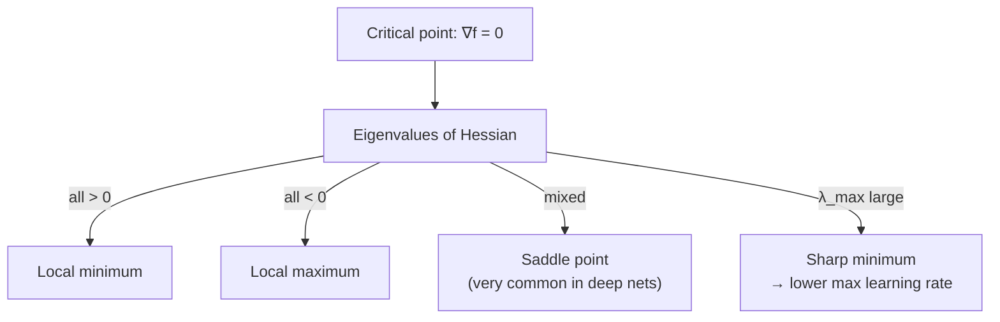

# Calculus - Advanced Matrices: Jacobian & Hessian

[Home](math-index.md#calculus)

## Overview

The gradient handles **scalar** functions to first order. Two matrices extend it:

| Matrix | Contains | For a function | Shape | Tells you |
|---|---|---|---|---|
| **Jacobian** $J$ | **First-order** partial derivatives | $\mathbf f: \mathbb{R}^n \to \mathbb{R}^m$ (vector → vector) | $m \times n$ | How each output responds to each input (local linear map) |
| **Hessian** $H$ | **Second-order** partial derivatives | $f: \mathbb{R}^n \to \mathbb{R}$ (vector → scalar) | $n \times n$ | **Curvature**: how the gradient itself changes |

Relationship: the Hessian is the **Jacobian of the gradient**, $H_f = J_{\nabla f}$.

---

## Why It Matters



> **Architect's lens:** For a model with $n = 10^9$ parameters, the Hessian would have $10^{18}$ entries, which is impossible to store. Every practical second-order method (K-FAC, Shampoo, Sophia, Hessian-free) is a strategy for **using curvature without materializing $H$**, usually through **Hessian-vector products** that cost about two backward passes.

---

## 1. The Jacobian (First-Order Partial Derivatives)

### Explanation

For $\mathbf f: \mathbb{R}^n \to \mathbb{R}^m$ with $\mathbf f(\mathbf x) = [f_1(\mathbf x), \dots, f_m(\mathbf x)]$:

$$
J = \frac{\partial\mathbf f}{\partial\mathbf x} =
\begin{bmatrix}
\frac{\partial f_1}{\partial x_1} & \cdots & \frac{\partial f_1}{\partial x_n}\\
\vdots & \ddots & \vdots\\
\frac{\partial f_m}{\partial x_1} & \cdots & \frac{\partial f_m}{\partial x_n}
\end{bmatrix} \in \mathbb{R}^{m\times n}
$$

- **Row $i$** is the gradient of output $f_i$.
- **Column $j$** shows how all outputs respond to input $x_j$.
- **Linear approximation**: $\mathbf f(\mathbf x + \Delta\mathbf x) \approx \mathbf f(\mathbf x) + J\,\Delta\mathbf x$.
- **Chain rule in matrix form**: $J_{\mathbf f\circ\mathbf g} = J_{\mathbf f}(\mathbf g(\mathbf x))\cdot J_{\mathbf g}(\mathbf x)$.

Common Jacobians:

| Function | Jacobian |
|---|---|
| Linear $\mathbf y = W\mathbf x$ | $W$ |
| Element-wise $\mathbf y = \sigma(\mathbf x)$ | $\text{diag}(\sigma'(\mathbf x))$, diagonal |
| Softmax $\mathbf p = \text{softmax}(\mathbf z)$ | $\text{diag}(\mathbf p) - \mathbf p\mathbf p^\top$ |

#### Why autograd never builds the full Jacobian

Frameworks compute **products** with the Jacobian instead:

| Product | Mode | Cost | Use |
|---|---|---|---|
| **VJP** $\mathbf v^\top J$ | Reverse (backprop) | ≈ 1 backward pass | Training: $\mathbf v = \partial\mathcal L/\partial\mathbf y$ |
| **JVP** $J\mathbf v$ | Forward | ≈ 1 forward pass | Directional sensitivities |

Backprop through a layer computes $\frac{\partial\mathcal L}{\partial\mathbf x} = \left(\frac{\partial\mathcal L}{\partial\mathbf y}\right)^\top J$, a VJP. For a linear layer that is just $W^\top\mathbf g$, and the $m\times n$ Jacobian is never stored.

### Worked Example

$\mathbf f(x, y) = \begin{bmatrix} x^2 y \\ 5x + \sin y \end{bmatrix}$

$$
J = \begin{bmatrix} 2xy & x^2 \\ 5 & \cos y \end{bmatrix}
\;\xrightarrow{(x, y) = (1, 0)}\;
\begin{bmatrix} 0 & 1 \\ 5 & 1 \end{bmatrix}
$$

$\det J = 0 - 5 = -5$: near $(1, 0)$ the map scales small areas by 5 and flips orientation.

**Softmax Jacobian** for $\mathbf p = [0.7, 0.2, 0.1]$:

$$
J = \text{diag}(\mathbf p) - \mathbf p\mathbf p^\top =
\begin{bmatrix} 0.21 & -0.14 & -0.07\\ -0.14 & 0.16 & -0.02\\ -0.07 & -0.02 & 0.09 \end{bmatrix}
$$

Each row sums to 0, because the probabilities always sum to 1.

### Diagram

```text
             inputs x₁ … xₙ  (columns)
           ┌──────────────────────────┐
  outputs  │ ∂f₁/∂x₁   ...   ∂f₁/∂xₙ  │  ← row 1 = ∇f₁ᵀ
  f₁ … fₘ  │    ⋮       ⋱       ⋮     │
  (rows)   │ ∂fₘ/∂x₁   ...   ∂fₘ/∂xₙ  │  ← row m = ∇fₘᵀ
           └──────────────────────────┘
   Backprop multiplies upstream gradient (row vector) by J  →  VJP
```



### Architectural Relevance

- **Backpropagation is a chain of VJPs**: each layer's `backward()` implements $\mathbf v^\top J$ efficiently without forming $J$. This is the design principle behind every autograd system.
- **Normalizing flows** need $\log\lvert\det J\rvert$ of the transform, so architectures (coupling layers, autoregressive flows) are built to have **triangular Jacobians** where the determinant is the product of the diagonal.
- **Robustness & Lipschitz control**: the Jacobian norm $\lVert\partial\hat y/\partial\mathbf x\rVert$ measures sensitivity to input perturbations. Jacobian regularization and spectral normalization limit it for safer, more robust models.
- **Physics-informed and scientific ML, robotics** (kinematic Jacobians), and **implicit layers** (Deep Equilibrium Models solve linear systems with $I - J$).
- **Neural Tangent Kernel**: $\Theta = J_\theta J_\theta^\top$ (Jacobian w.r.t. parameters) describes the training dynamics of very wide networks.

### Python Implementation

```python
import torch
from torch.func import jacrev, vjp, jvp

def f(v):
    x, y = v
    return torch.stack([x**2 * y, 5 * x + torch.sin(y)])

pt = torch.tensor([1.0, 0.0])
J = jacrev(f)(pt)
print("Jacobian at (1,0):\n", J)
print("det J =", round(torch.linalg.det(J).item(), 4))

# Softmax Jacobian = diag(p) - p pᵀ
z = torch.log(torch.tensor([0.7, 0.2, 0.1]))
J_soft = jacrev(lambda t: t.softmax(-1))(z)
print("softmax Jacobian:\n", J_soft.round(decimals=4))
print("row sums:", J_soft.sum(1).round(decimals=6).tolist())

# VJP / JVP without materializing J (how autograd really works)
_, vjp_fn = vjp(f, pt)
u = torch.tensor([1.0, 2.0])
print("VJP uᵀJ  :", vjp_fn(u)[0].tolist(), "| check:", (u @ J).tolist())
_, jvp_out = jvp(f, (pt,), (u,))
print("JVP J u  :", jvp_out.tolist(), "| check:", (J @ u).tolist())

# Linear layer: Jacobian w.r.t. input equals the weight matrix
layer = torch.nn.Linear(4, 3)
J_lin = jacrev(layer)(torch.randn(4))
print("Linear Jacobian == W ?", torch.allclose(J_lin, layer.weight))
```

**Output:**
```text
Jacobian at (1,0):
 tensor([[0., 1.],
        [5., 1.]])
det J = -5.0
softmax Jacobian:
 tensor([[ 0.2100, -0.1400, -0.0700],
        [-0.1400,  0.1600, -0.0200],
        [-0.0700, -0.0200,  0.0900]])
row sums: [0.0, 0.0, 0.0]
VJP uᵀJ  : [10.0, 3.0] | check: [10.0, 3.0]
JVP J u  : [2.0, 7.0] | check: [2.0, 7.0]
Linear Jacobian == W ? True
```

---

## 2. The Hessian (Second-Order Partial Derivatives)

### Explanation

For a scalar function $f: \mathbb{R}^n \to \mathbb{R}$:

$$
H = \nabla^2 f =
\begin{bmatrix}
\frac{\partial^2 f}{\partial x_1^2} & \cdots & \frac{\partial^2 f}{\partial x_1\partial x_n}\\
\vdots & \ddots & \vdots\\
\frac{\partial^2 f}{\partial x_n\partial x_1} & \cdots & \frac{\partial^2 f}{\partial x_n^2}
\end{bmatrix} \in \mathbb{R}^{n\times n}
$$

- **Symmetric** for smooth functions (Schwarz's theorem): $\frac{\partial^2 f}{\partial x_i\partial x_j} = \frac{\partial^2 f}{\partial x_j\partial x_i}$, so its eigenvalues are real.
- **Second-order Taylor expansion** (the local quadratic model of the loss):

$$
f(\mathbf x + \Delta) \approx f(\mathbf x) + \nabla f^\top\Delta + \tfrac12\Delta^\top H\,\Delta
$$

**Classifying critical points** ($\nabla f = \mathbf 0$) by the Hessian's eigenvalues:

| Eigenvalues of $H$ | Type | Shape |
|---|---|---|
| All $> 0$ (positive definite) | **Local minimum** | Bowl |
| All $< 0$ (negative definite) | **Local maximum** | Dome |
| Mixed signs | **Saddle point** | Pringle chip |
| Some $= 0$ | Inconclusive / flat directions | Valley / plateau |

**Condition number** $\kappa = \lambda_{max}/\lambda_{min}$ measures how stretched the bowl is. Large $\kappa$ means slow, zig-zagging gradient descent.

**Learning-rate stability limit**: for gradient descent on a quadratic, convergence requires

$$
\eta < \frac{2}{\lambda_{max}(H)}
$$

**Newton's method** uses curvature directly: $\Delta = -H^{-1}\nabla f$. On a quadratic it reaches the minimum in **one** step, but it costs $O(n^3)$.

**Hessian-vector product (HVP)** $H\mathbf v = \nabla_{\mathbf x}\big(\nabla f\cdot\mathbf v\big)$ is computable with two backward passes and **no $n\times n$ matrix**. That is the key to scalable curvature methods.

### Worked Example

$f(x, y) = x^2 + 3y^2 + 2xy$

$$
\nabla f = \begin{bmatrix} 2x + 2y \\ 6y + 2x \end{bmatrix}, \qquad
H = \begin{bmatrix} 2 & 2 \\ 2 & 6 \end{bmatrix}
$$

Eigenvalues: $\lambda^2 - 8\lambda + 8 = 0 \Rightarrow \lambda = 4 \pm 2\sqrt2 \approx \{1.17,\; 6.83\}$. Both are positive, so $(0,0)$ is a **minimum**. Condition number $\kappa \approx 5.83$, and the max stable GD learning rate is $\eta < 2/6.83 \approx 0.293$.

**Saddle example**: $g(x, y) = x^2 - y^2$, $H = \text{diag}(2, -2)$ has mixed signs, so $(0,0)$ is a **saddle point**.

### Diagram

```text
     Minimum (H ≻ 0)        Maximum (H ≺ 0)         Saddle (mixed)
        \       /              ___                    \   ↑ curves down /
         \     /             /     \                   \  │           /
          \___/             /       \                 ──●──→ curves up
        all λ > 0          all λ < 0                 λ₁ > 0, λ₂ < 0
```



### Architectural Relevance

- **Learning-rate ceilings & "edge of stability"**: training tends to push $\lambda_{max}(H)$ toward $2/\eta$. Warmup schedules, normalization layers, and adaptive optimizers manage curvature so training stays stable at high learning rates.
- **Sharpness and generalization**: flatter minima (small Hessian eigenvalues) often generalize better and are more robust to **quantization noise**. **SAM** (Sharpness-Aware Minimization) explicitly seeks flat regions.
- **Second-order & preconditioned optimizers**: Adam's second-moment estimate is a rough *diagonal* curvature proxy. **K-FAC**, **Shampoo**, and **Sophia** use structured Hessian/Fisher approximations to converge in fewer steps, at the cost of extra memory and compute per step.
- **Model compression**: **Optimal Brain Surgeon**, and its modern successors **GPTQ** / **SparseGPT**, use the (layer-wise) Hessian to decide which weights can be quantized or pruned with the smallest increase in loss. GPTQ is how many production LLMs are quantized to 4-bit.
- **Uncertainty**: the **Laplace approximation** treats the Hessian at the optimum as an inverse covariance to get Bayesian uncertainty estimates.
- **Scale constraint**: never form $H$ for real models. Use HVPs, diagonal/Kronecker approximations, or power iteration on HVPs to estimate $\lambda_{max}$.

### Python Implementation

```python
import torch
from torch.func import hessian, grad

def f(v):
    x, y = v
    return x**2 + 3 * y**2 + 2 * x * y

H = hessian(f)(torch.tensor([0.0, 0.0]))
eig = torch.linalg.eigvalsh(H)
print("Hessian:\n", H)
print("eigenvalues:", [round(e, 3) for e in eig.tolist()], "-> minimum" if (eig > 0).all() else "")
print(f"condition number κ = {(eig.max() / eig.min()).item():.2f}"
      f" | max stable GD lr = {2 / eig.max().item():.3f}")

# Saddle detection
g = lambda v: v[0] ** 2 - v[1] ** 2
print("saddle eigenvalues:", torch.linalg.eigvalsh(hessian(g)(torch.zeros(2))).tolist())

# Newton's method solves a quadratic in ONE step
x = torch.tensor([3.0, -2.0])
step = torch.linalg.solve(H, grad(f)(x))
print("Newton step from (3,-2) ->", (x - step).tolist())

# GD with lr just below / above 2/λ_max
for lr in (0.28, 0.30):
    p = torch.tensor([3.0, -2.0])
    for _ in range(100):
        p = p - lr * grad(f)(p)
    print(f"GD lr={lr}: final f = {f(p).item():.3e}")
```

**Output:**
```text
Hessian:
 tensor([[2., 2.],
        [2., 6.]])
eigenvalues: [1.172, 6.828] -> minimum
condition number κ = 5.83 | max stable GD lr = 0.293
saddle eigenvalues: [-2.0, 2.0]
Newton step from (3,-2) -> [0.0, 0.0]
GD lr=0.28: final f = 1.653e-08
GD lr=0.3: final f = 2.183e+04
```

#### Hessian-vector products and λ_max estimation on a real network (no full Hessian)

```python
import torch

torch.manual_seed(0)
model = torch.nn.Sequential(torch.nn.Linear(10, 32), torch.nn.Tanh(), torch.nn.Linear(32, 1))
X, y = torch.randn(256, 10), torch.randn(256, 1)
params = [p for p in model.parameters()]
n_params = sum(p.numel() for p in params)

loss = torch.nn.functional.mse_loss(model(X), y)
grads = torch.autograd.grad(loss, params, create_graph=True)    # keep graph for 2nd derivative

def hvp(vec):
    """H @ vec via Pearlmutter's trick: ∇(∇ℒ · v)."""
    dot = sum((g * v).sum() for g, v in zip(grads, vec))
    return torch.autograd.grad(dot, params, retain_graph=True)

# Power iteration on HVPs -> top Hessian eigenvalue (sharpness)
v = [torch.randn_like(p) for p in params]
for _ in range(50):
    norm = torch.sqrt(sum((x**2).sum() for x in v))
    v = [x / norm for x in v]
    Hv = hvp(v)
    lam = sum((a * b).sum() for a, b in zip(Hv, v)).item()
    v = [h.detach() for h in Hv]

print(f"parameters: {n_params:,} (full Hessian would be {n_params**2:,} entries)")
print(f"estimated λ_max(H) = {lam:.4f} -> GD stability limit lr < {2 / lam:.3f}")
```

**Output:**
```text
parameters: 385 (full Hessian would be 148,225 entries)
estimated λ_max(H) = 4.7124 -> GD stability limit lr < 0.424
```

---

## Jacobian vs. Hessian — Summary

| Aspect | Jacobian | Hessian |
|---|---|---|
| Order | First derivatives | Second derivatives |
| Function type | Vector → vector | Vector → scalar |
| Shape | $m\times n$ | $n\times n$ (symmetric) |
| Meaning | Local linear map / sensitivity | Local curvature |
| Used via | VJP (backprop), JVP | HVP, diagonal / Kronecker approximations |
| AI uses | Backprop, flows, robustness, NTK | LR limits, sharpness, SAM, K-FAC, GPTQ pruning/quantization |

---

## Common Mistakes

| Mistake | Why it hurts | Better approach |
|---|---|---|
| Materializing full Jacobians/Hessians | $O(mn)$ / $O(n^2)$ memory blows up | Use VJP/JVP/HVP products |
| Forgetting `create_graph=True` for second derivatives | Second backward fails or returns `None` | Keep graph when differentiating gradients |
| Using Newton's method on non-convex losses | $H$ may be indefinite, so the step moves *toward* saddles/maxima | Damping ($H + \lambda I$), trust regions, Gauss-Newton / Fisher |
| Assuming $\nabla = 0$ means minimum | Most critical points in high dimensions are saddles | Check Hessian eigenvalues / use stochastic noise |
| Ignoring curvature when picking learning rate | Divergence above $2/\lambda_{max}$ | Warmup; estimate sharpness; adaptive optimizers |

---

## Interview Questions

### Beginner
1. **What is the Jacobian?**
   *The $m\times n$ matrix of first-order partial derivatives of a vector-valued function.*
2. **What does the Hessian tell you?**
   *The curvature of a scalar function; its eigenvalues classify critical points.*

### Intermediate
1. **Why does backprop use VJPs instead of full Jacobians?**
   *Only $\mathbf v^\top J$ is needed for a scalar loss; it costs about one backward pass and avoids $O(mn)$ memory.*
2. **How do you identify a saddle point?**
   *Gradient is zero and the Hessian has both positive and negative eigenvalues.*
3. **What is the relationship between the Hessian and the maximum learning rate?**
   *For GD on a quadratic, stability requires $\eta < 2/\lambda_{max}(H)$.*

### Architect-Level
1. **How does GPTQ use second-order information to quantize LLMs?**
   *For each layer it uses $H = 2XX^\top$ (from calibration inputs) to quantize weights one at a time, updating the remaining weights to compensate for the error with the inverse Hessian. This gives minimal loss increase without retraining.*
2. **Why aren't second-order optimizers the default for LLM training?**
   *Memory and compute overhead of curvature estimates, communication cost in distributed setups, sensitivity to stochastic noise, and the strong baseline of AdamW. Methods like Shampoo/Sophia are closing the gap.*
3. **How would you monitor training stability using curvature?**
   *Periodically estimate $\lambda_{max}$ with power iteration on HVPs over a fixed batch. Compare it with $2/\eta$ and correlate with loss spikes to tune warmup, learning rate, or clipping.*

---

## Key Takeaways

- The **Jacobian** is the matrix of first derivatives of a vector function. **Backprop is a chain of VJPs** that never builds it.
- The **Hessian** is the matrix of second derivatives (curvature). Its eigenvalues identify **minima, maxima, saddles** and set the **learning-rate ceiling** $2/\lambda_{max}$.
- At scale, use **products** (VJP, JVP, HVP) and **approximations** (diagonal, Kronecker), never full matrices.
- Curvature underpins **SAM, K-FAC/Shampoo, GPTQ/SparseGPT, Laplace uncertainty, and stability monitoring**.
