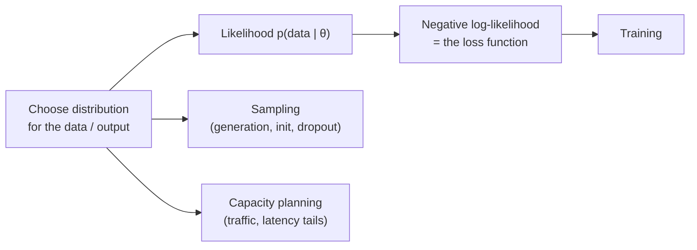
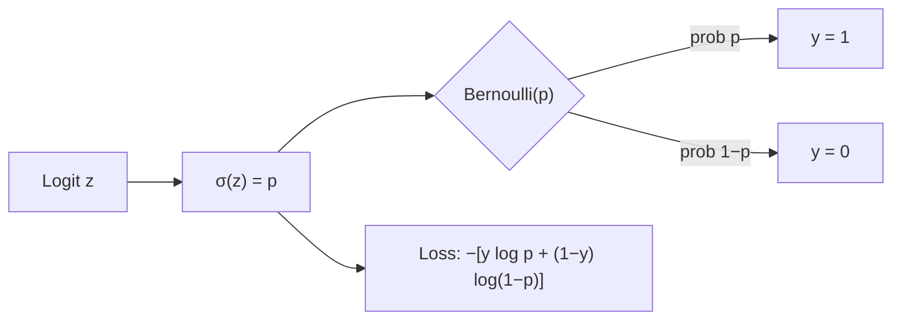
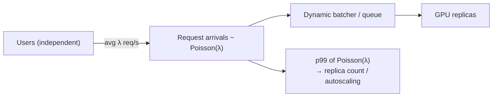
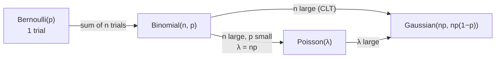

# Probability & Statistics - Probability Distributions

[Home](math-index.md#probability-statistics)

## Overview

A **probability distribution** describes how likely each possible value of a random variable is. Machine-learning models are **distribution machines**: a classifier outputs a categorical distribution, a language model outputs a distribution over the next token, a diffusion model learns a distribution over images, and weight initialization samples from a distribution.

| Distribution | Type | Parameters | Models… | AI example |
|---|---|---|---|---|
| **Gaussian (Normal)** | Continuous | $\mu, \sigma^2$ | Sums of many small effects | Weight init, noise in diffusion, VAEs, MSE loss |
| **Bernoulli** | Discrete $\{0,1\}$ | $p$ | One yes/no trial | Binary classification, dropout masks |
| **Binomial** | Discrete $\{0..n\}$ | $n, p$ | # successes in $n$ trials | A/B tests, accuracy confidence intervals |
| **Poisson** | Discrete $\{0,1,2,..\}$ | $\lambda$ | # events in a fixed interval | Request traffic, token-count modeling, autoscaling |

Key vocabulary:

| Term | Discrete | Continuous |
|---|---|---|
| Probability function | **PMF** $P(X = k)$ | **PDF** $p(x)$ (density, can exceed 1) |
| Cumulative | **CDF** $F(x) = P(X \le x)$ | same |
| Mean | $\mathbb E[X] = \sum_k k\,P(k)$ | $\int x\,p(x)\,dx$ |
| Variance | $\text{Var}[X] = \mathbb E[(X - \mu)^2]$ | same |

---

## Why It Matters



| Output distribution assumption | Resulting loss |
|---|---|
| Gaussian | **Mean Squared Error** |
| Bernoulli | **Binary Cross-Entropy** |
| Categorical | **Cross-Entropy** (softmax) |
| Poisson | **Poisson NLL** (count regression) |

> **Architect's lens:** Choosing a loss function means choosing a distribution. Choosing infrastructure capacity means modeling a distribution of traffic. Understanding distributions turns "magic defaults" into deliberate design decisions.

---

## 1. Gaussian (Normal) Distribution

### Explanation

$$
p(x \mid \mu, \sigma^2) = \frac{1}{\sqrt{2\pi\sigma^2}}\exp\!\left(-\frac{(x - \mu)^2}{2\sigma^2}\right)
$$

- **Mean** $\mu$ (center), **variance** $\sigma^2$ (spread). Symmetric bell curve.
- **68–95–99.7 rule**: about 68% of mass lies within $\pm1\sigma$, 95% within $\pm2\sigma$, and 99.7% within $\pm3\sigma$.
- **Central Limit Theorem (CLT)**: the sum or average of many independent random variables tends to a Gaussian, whatever their original distribution. This is why it appears everywhere.
- **Multivariate Gaussian** $\mathcal N(\boldsymbol\mu, \Sigma)$: $\Sigma$ is the covariance matrix (its eigenvectors are PCA directions; see [Matrix Decompositions](03_Matrix%20Decompositions.md)).
- **Reparameterization**: $x = \mu + \sigma\epsilon$, $\epsilon\sim\mathcal N(0,1)$. This makes sampling differentiable.

### Worked Example

Model inference latency $\sim\mathcal N(\mu = 120\text{ ms}, \sigma = 15\text{ ms})$.

- $P(\text{latency} \le 150) = \Phi\!\left(\frac{150 - 120}{15}\right) = \Phi(2) \approx 0.977$
- The 99th percentile is $\mu + 2.326\sigma \approx 154.9$ ms

**Gaussian NLL ⇒ MSE**: $-\log p(y\mid\hat y,\sigma^2) = \frac{(y - \hat y)^2}{2\sigma^2} + \text{const}$. With fixed $\sigma$, minimizing NLL **is** minimizing squared error.

### Diagram

```text
                       ▁▂▄▆█▆▄▂▁
                    ▁▃▆█████████▆▃▁
                ▁▂▄▇███████████████▇▄▂▁
   ──────────┼─────┼─────┼─────┼─────┼─────┼──────
           μ-3σ  μ-2σ   μ-σ    μ    μ+σ  μ+2σ  μ+3σ
                    |←── 68% ──→|
              |←──────── 95% ────────→|
```

### Architectural Relevance

- **Weight initialization**: Xavier/Glorot ($\sigma^2 = 2/(n_{in}+n_{out})$) and Kaiming/He ($\sigma^2 = 2/n_{in}$) Gaussians keep activation variance stable across layers. Bad init means vanishing or exploding signals.
- **Diffusion models** add Gaussian noise step by step and learn to reverse it. **VAEs** use a Gaussian latent and the reparameterization trick.
- **Regression heads with MSE** assume Gaussian errors. If your errors are heavy-tailed (outliers), switch to Huber/L1 losses (Laplace assumption).
- **Monitoring & SLOs**: Gaussian assumptions **underestimate tail latency**. Real latency is right-skewed (log-normal), so always measure p95/p99 directly rather than computing $\mu + k\sigma$.
- **Data drift detection**: compare feature distributions in production vs training (KS test, KL divergence; see [Information Theory](12_Information%20Theory.md)).

### Python Implementation

```python
import numpy as np
from scipy import stats
import torch

lat = stats.norm(loc=120, scale=15)
print(f"P(latency <= 150ms) = {lat.cdf(150):.4f}")
print(f"p99 latency         = {lat.ppf(0.99):.1f} ms")

# 68-95-99.7 rule by simulation
rng = np.random.default_rng(0)
x = rng.normal(0, 1, 1_000_000)
print("within 1σ, 2σ, 3σ:", [round(float(np.mean(np.abs(x) <= k)), 4) for k in (1, 2, 3)])

# Central Limit Theorem: mean of 30 uniform samples looks Gaussian
means = rng.uniform(0, 1, size=(100_000, 30)).mean(axis=1)
print(f"CLT: mean={means.mean():.4f} (theory 0.5), std={means.std():.4f} "
      f"(theory {np.sqrt(1/12/30):.4f})")

# Kaiming init keeps activation variance stable through deep ReLU nets
torch.manual_seed(0)
h = torch.randn(1024, 512)
for init in ("normal_std_1", "kaiming"):
    a = h.clone()
    for _ in range(20):
        W = torch.empty(512, 512)
        if init == "kaiming":
            torch.nn.init.kaiming_normal_(W, nonlinearity="relu")
        else:
            torch.nn.init.normal_(W, std=1.0)
        a = torch.relu(a @ W.T)
    print(f"{init:13s}: activation std after 20 layers = {a.std().item():.3e}")
```

**Output:**
```text
P(latency <= 150ms) = 0.9772
p99 latency         = 154.9 ms
within 1σ, 2σ, 3σ: [0.6823, 0.9544, 0.9973]
CLT: mean=0.4999 (theory 0.5), std=0.0526 (theory 0.0527)
normal_std_1 : activation std after 20 layers = 8.806e+23
kaiming      : activation std after 20 layers = 1.065e+00
```

---

## 2. Bernoulli Distribution

### Explanation

The simplest distribution: **one trial with two outcomes**, success (1) with probability $p$ or failure (0):

$$
P(X = k) = p^k(1 - p)^{1-k}, \quad k\in\{0, 1\}
$$

- Mean $= p$, variance $= p(1-p)$, which peaks at $p = 0.5$ (maximum uncertainty).
- The **categorical** distribution generalizes Bernoulli to $K$ classes, and is what a softmax outputs.

**Bernoulli NLL ⇒ Binary Cross-Entropy:**

$$
-\log P(y\mid p) = -\big[y\log p + (1 - y)\log(1 - p)\big]
$$

### Worked Example

A spam classifier outputs $p = \sigma(z) = 0.9$ for an email.

- True label $y = 1$ (spam): loss $= -\log 0.9 = 0.105$ (small, correct and confident)
- True label $y = 0$ (not spam): loss $= -\log 0.1 = 2.303$ (large, confidently wrong)

Variance of the prediction: $0.9 \times 0.1 = 0.09$.

### Diagram



### Architectural Relevance

- **Binary / multi-label classifiers** (toxicity filters, content moderation, guardrails, click-through prediction) model each label as a Bernoulli with a sigmoid output and **BCE loss**.
- **Dropout**: each activation is kept with a Bernoulli($1 - p_{drop}$) mask, and the survivors are scaled by $1/(1 - p_{drop})$ so expected values stay the same at inference.
- **Numerical stability**: compute BCE from **logits** (`BCEWithLogitsLoss`) rather than probabilities, to avoid $\log(0)$.
- **Class imbalance** (fraud at 0.1%): the Bernoulli base rate is tiny. Use `pos_weight`, focal loss, or resampling, and evaluate with precision/recall rather than accuracy.

### Python Implementation

```python
import torch
import torch.nn.functional as F

p = torch.tensor(0.9)
for y in (1.0, 0.0):
    loss = F.binary_cross_entropy(p, torch.tensor(y))
    print(f"y={int(y)}: BCE = {loss.item():.3f}")

# Use logits for numerical stability
logit = torch.tensor(20.0)                         # sigmoid(20) rounds to 1.0 in fp32
# true loss is -log(1 - σ(20)) ≈ 20; the prob version hits log(0) and is clamped to 100
print("BCE from prob  :", F.binary_cross_entropy(torch.sigmoid(logit), torch.tensor(0.0)).item())
print("BCE from logits:", F.binary_cross_entropy_with_logits(logit, torch.tensor(0.0)).item())

# Dropout = Bernoulli mask + rescaling (expectation preserved)
torch.manual_seed(0)
x = torch.ones(1_000_000)
drop = torch.nn.Dropout(p=0.3).train()
out = drop(x)
print(f"kept fraction = {(out > 0).float().mean():.4f} | mean after dropout = {out.mean():.4f}")

# Sampling from a Bernoulli distribution
dist = torch.distributions.Bernoulli(probs=torch.tensor(0.2))
samples = dist.sample((100_000,))
print(f"sample mean = {samples.mean():.4f}, variance = {samples.var():.4f} (theory 0.16)")
```

**Output:**
```text
y=1: BCE = 0.105
y=0: BCE = 2.303
BCE from prob  : 100.0
BCE from logits: 20.0
kept fraction = 0.7004 | mean after dropout = 1.0006
sample mean = 0.1997, variance = 0.1598 (theory 0.16)
```

---

## 3. Binomial Distribution

### Explanation

The number of successes $k$ in $n$ **independent** Bernoulli($p$) trials:

$$
P(X = k) = \binom{n}{k}p^k(1-p)^{n-k}, \qquad \binom{n}{k} = \frac{n!}{k!(n-k)!}
$$

- Mean $= np$, variance $= np(1-p)$.
- For large $n$: Binomial $\approx \mathcal N(np,\, np(1-p))$ (CLT).
- For large $n$ and small $p$: Binomial $\approx$ Poisson($\lambda = np$).

### Worked Example

A model has true accuracy $p = 0.8$. You evaluate on $n = 10$ samples. Probability of getting **exactly 8 correct**:

$$
P(X = 8) = \binom{10}{8}(0.8)^8(0.2)^2 = 45 \times 0.16777 \times 0.04 \approx 0.302
$$

So even a truly 80%-accurate model scores exactly 80% on a 10-item test only **30%** of the time.

**Confidence interval for accuracy** on $n = 1000$ with 850 correct: standard error $= \sqrt{0.85 \times 0.15/1000} \approx 0.0113$, so the 95% CI is $0.85 \pm 1.96 \times 0.0113 = [0.828, 0.872]$.

### Diagram

```text
  Binomial(n=10, p=0.8) PMF
  P(k)
  0.30 │                         ██
  0.25 │                      ██ ██
  0.20 │                      ██ ██ ██
  0.15 │                      ██ ██ ██
  0.10 │                   ██ ██ ██ ██ ██
  0.05 │                ██ ██ ██ ██ ██ ██
       └──┬──┬──┬──┬──┬──┬──┬──┬──┬──┬──┬── k
          0  1  2  3  4  5  6  7  8  9  10
```

### Architectural Relevance

- **Evaluation rigor**: benchmark scores are Binomial random variables. On a 100-question eval, ±4 to 9 points is just noise. Always report **confidence intervals** before claiming model A beats model B, and size eval sets accordingly.
- **A/B testing** of model versions in production (conversion = success): compare two Binomial rates with a two-proportion z-test, and decide sample size **before** launching.
- **Reliability engineering**: probability that at least $k$ of $n$ replicas/GPUs fail ⇒ redundancy planning for inference clusters.
- **LLM sampling**: "pass@k" in code-generation benchmarks is derived from Binomial/hypergeometric reasoning.

### Python Implementation

```python
import numpy as np
from scipy import stats

n, p = 10, 0.8
print(f"P(exactly 8/10 correct) = {stats.binom.pmf(8, n, p):.4f}")
print(f"P(at least 9/10 correct) = {stats.binom.sf(8, n, p):.4f}")

# 95% confidence interval for measured accuracy
correct, total = 850, 1000
acc = correct / total
se = np.sqrt(acc * (1 - acc) / total)
print(f"accuracy {acc:.3f}, 95% CI (normal approx) = [{acc - 1.96*se:.3f}, {acc + 1.96*se:.3f}]")
ci = stats.binomtest(correct, total).proportion_ci(confidence_level=0.95, method="wilson")
print(f"95% CI (Wilson) = [{ci.low:.3f}, {ci.high:.3f}]")

# A/B test: is model B's 52.0% success rate really better than A's 50.0%?
n_a, s_a, n_b, s_b = 5000, 2500, 5000, 2600
p_pool = (s_a + s_b) / (n_a + n_b)
z = (s_b / n_b - s_a / n_a) / np.sqrt(p_pool * (1 - p_pool) * (1 / n_a + 1 / n_b))
p_value = 2 * stats.norm.sf(abs(z))
print(f"A/B test: z = {z:.3f}, p-value = {p_value:.4f}")

# pass@k: unbiased estimator (n samples, c correct)
def pass_at_k(n, c, k):
    if n - c < k:
        return 1.0
    return 1.0 - np.prod(1.0 - k / np.arange(n - c + 1, n + 1))
print(f"pass@1 = {pass_at_k(20, 3, 1):.3f}, pass@10 = {pass_at_k(20, 3, 10):.3f}")
```

**Output:**
```text
P(exactly 8/10 correct) = 0.3020
P(at least 9/10 correct) = 0.3758
accuracy 0.850, 95% CI (normal approx) = [0.828, 0.872]
95% CI (Wilson) = [0.827, 0.871]
A/B test: z = 2.000, p-value = 0.0455
pass@1 = 0.150, pass@10 = 0.895
```

---

## 4. Poisson Distribution

### Explanation

The number of events $k$ occurring in a fixed interval when events happen **independently** at a constant average rate $\lambda$:

$$
P(X = k) = \frac{\lambda^k e^{-\lambda}}{k!}, \quad k = 0, 1, 2, \dots
$$

- Mean $=$ variance $= \lambda$ (a distinctive property; if variance ≫ mean, the data is **over-dispersed**, so use the Negative Binomial instead).
- Times *between* Poisson events follow an **Exponential** distribution with rate $\lambda$.
- Sums of independent Poissons are Poisson: $\text{Pois}(\lambda_1) + \text{Pois}(\lambda_2) = \text{Pois}(\lambda_1 + \lambda_2)$.

### Worked Example

An LLM API endpoint receives on average $\lambda = 4$ requests per second.

- $P(\text{0 requests in a second}) = e^{-4} \approx 0.0183$
- $P(\text{exactly 4}) = \frac{4^4e^{-4}}{24} \approx 0.195$
- $P(X > 8) \approx 0.0214$: in about 2% of seconds you get more than **twice** the average load.

**Capacity planning**: if each GPU replica handles 2 req/s, provisioning for the mean (2 replicas) means overload ~37% of the time ($P(X>4) \approx 0.371$). Provisioning to the 99th percentile ($k = 9$) needs 5 replicas.

### Diagram



### Architectural Relevance

- **Inference capacity planning & autoscaling**: request arrivals are commonly modeled as Poisson. Queueing theory (M/M/c models) built on it predicts wait times, sets **batch-timeout** parameters in dynamic batching, and sizes replica pools for an SLO.
- **Load testing**: realistic load generators use Poisson arrivals (exponential gaps), not fixed intervals. Fixed-rate tests hide burst behavior.
- **Count regression**: predicting counts (clicks, tokens, events, defects) with a Poisson NLL loss (`PoissonNLLLoss`) and a log-link output.
- **Rare-event monitoring**: alert when an observed error count is improbable under the baseline Poisson rate (e.g., $P(X \ge k) < 0.001$).

### Python Implementation

```python
import numpy as np
from scipy import stats
import torch

lam = 4
pois = stats.poisson(lam)
print(f"P(0) = {pois.pmf(0):.4f} | P(4) = {pois.pmf(4):.4f} | P(>8) = {pois.sf(8):.4f}")

# Capacity planning: replicas needed (each handles 2 req/s)
per_replica = 2
for q in (0.50, 0.95, 0.99):
    k = int(pois.ppf(q))
    print(f"p{int(q*100)} load = {k} req/s -> replicas = {int(np.ceil(k / per_replica))}")
print(f"overload prob with 2 replicas (capacity 4): {pois.sf(4):.3f}")

# Simulated arrivals: exponential inter-arrival times (use in load tests)
rng = np.random.default_rng(0)
gaps = rng.exponential(1 / lam, size=100_000)
arrivals = np.cumsum(gaps)
counts = np.bincount(arrivals.astype(int))[:-1]
print(f"simulated mean={counts.mean():.3f}, var={counts.var():.3f} (Poisson: both = {lam})")

# Count regression with Poisson NLL loss (log-rate output)
log_rate = torch.tensor([1.2, 0.5, 2.0])           # model outputs log λ
targets = torch.tensor([3.0, 1.0, 8.0])            # observed counts
loss = torch.nn.PoissonNLLLoss(log_input=True)(log_rate, targets)
print(f"Poisson NLL loss = {loss.item():.4f}  (drops the constant log(k!) term, so it can be negative)")
```

**Output:**
```text
P(0) = 0.0183 | P(4) = 0.1954 | P(>8) = 0.0214
p50 load = 4 req/s -> replicas = 2
p95 load = 8 req/s -> replicas = 4
p99 load = 9 req/s -> replicas = 5
overload prob with 2 replicas (capacity 4): 0.371
simulated mean=4.011, var=4.056 (Poisson: both = 4)
Poisson NLL loss = -2.5807  (drops the constant log(k!) term, so it can be negative)
```

---

## How the Four Distributions Relate



---

## Common Mistakes

| Mistake | Why it hurts | Better approach |
|---|---|---|
| Assuming Gaussian latency for SLOs | Underestimates tail latency badly | Measure empirical p95/p99; use log-normal |
| Computing BCE on probabilities | `log(0)` → `inf`/`NaN` | Use `*_with_logits` losses |
| Reporting eval accuracy without CIs | Mistaking noise for improvement | Binomial CIs; larger eval sets; paired tests |
| Using Poisson for over-dispersed counts | Underestimates variance and bursts | Check mean vs variance; Negative Binomial |
| Load-testing with fixed-rate requests | Misses queueing bursts | Poisson (exponential gap) arrivals |
| Applying softmax for multi-label tasks | Forces labels to compete | Independent sigmoids (Bernoulli per label) |

---

## Interview Questions

### Beginner
1. **Which distribution models a single coin flip? $n$ flips?**
   *Bernoulli; Binomial.*
2. **What loss corresponds to a Gaussian likelihood?**
   *Mean squared error.*
3. **What is special about the Poisson's mean and variance?**
   *Both equal $\lambda$.*

### Intermediate
1. **Why is the Gaussian so common?**
   *The CLT (sums of many effects), maximum-entropy for fixed mean/variance, and analytical tractability.*
2. **Explain dropout in distribution terms.**
   *Activations are multiplied by Bernoulli masks and rescaled to keep expectations constant, which trains an implicit ensemble.*
3. **Model A scored 82% and B 84% on a 200-item benchmark. Is B better?**
   *SE ≈ √(0.83·0.17/200) ≈ 2.7%. The difference is within noise; use a paired test (McNemar) or a bigger benchmark.*

### Architect-Level
1. **How would you size GPU replicas for an LLM endpoint averaging 30 req/s with p99 latency SLO?**
   *Model arrivals as Poisson (validate with traffic data). Combine with service-time distribution (tokens/request) in an M/G/c queue or simulation. Provision for burst quantiles plus headroom, and use autoscaling with queue-depth signals and dynamic batching limits.*
2. **Why do diffusion models and VAEs both rely on Gaussians?**
   *Closed-form KL terms, easy sampling, the reparameterization trick for gradients, and the fact that Gaussian noise is additive and composable (sum of Gaussians is Gaussian), which makes forward-noising analytic.*
3. **When would you choose a Poisson or Negative-Binomial head over MSE regression?**
   *For non-negative integer counts with variance growing with the mean (demand forecasting, event counts). MSE wrongly assumes constant variance and can predict negatives.*

---

## Key Takeaways

- **Gaussian** for continuous noise and sums. Behind MSE, initialization, diffusion, and VAEs.
- **Bernoulli** for one binary outcome. Behind BCE, sigmoid outputs, and dropout.
- **Binomial** for counts of successes. Behind eval confidence intervals, A/B tests, and pass@k.
- **Poisson** for event counts at a rate. Behind traffic modeling, autoscaling, and load testing.
- **Choosing a loss = choosing a distribution**, and **capacity planning = modeling a distribution**.
