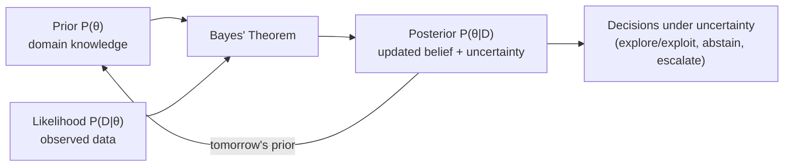
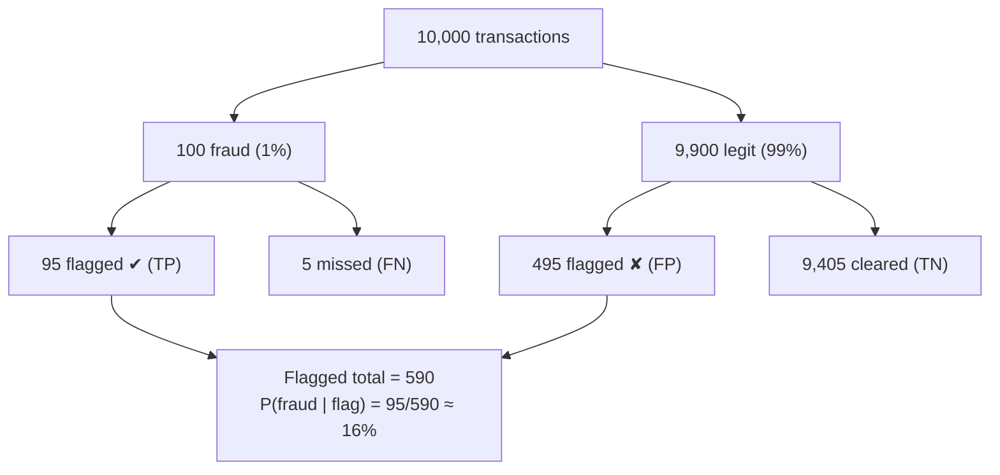
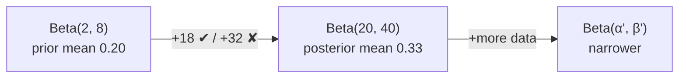

# Probability & Statistics - Bayesian Statistics

[Home](math-index.md#probability-statistics)

## Overview

**Bayesian statistics** treats unknown quantities (model parameters, hypotheses, user intent) as **random variables with probability distributions**, and **updates beliefs as evidence arrives**. The frequentist view treats parameters as fixed unknown constants; the Bayesian view says: *start with what you believe (prior), observe data (likelihood), end with an updated belief (posterior).*

| Sub-topic | Symbol | Meaning |
|---|---|---|
| **Bayes' Theorem** | $P(\theta\mid D) = \frac{P(D\mid\theta)P(\theta)}{P(D)}$ | The update rule |
| **Prior** | $P(\theta)$ | Belief **before** seeing data |
| **Likelihood** | $P(D\mid\theta)$ | How well $\theta$ explains the data |
| **Posterior** | $P(\theta\mid D)$ | Belief **after** seeing data |
| **Evidence** | $P(D) = \int P(D\mid\theta)P(\theta)\,d\theta$ | Normalizer; used for model comparison |

$$
\underbrace{P(\theta\mid D)}_{\text{posterior}} \;\propto\; \underbrace{P(D\mid\theta)}_{\text{likelihood}} \times \underbrace{P(\theta)}_{\text{prior}}
$$

---

## Why It Matters



> **Architect's lens:** Bayesian thinking shows up in AI systems as **uncertainty quantification** (when should the model abstain or route to a human?), **online learning** (bandits for model routing and A/B tests), **regularization** (priors = weight decay), and **hyperparameter tuning** (Bayesian optimization).

---

## 1. Bayes' Theorem

### Explanation

From the definition of conditional probability, $P(A\cap B) = P(A\mid B)P(B) = P(B\mid A)P(A)$, so

$$
P(A\mid B) = \frac{P(B\mid A)\,P(A)}{P(B)}, \qquad P(B) = \sum_{a} P(B\mid a)P(a)
$$

The most common reasoning error it prevents is **base-rate neglect**: forgetting that $P(A\mid B) \neq P(B\mid A)$ and ignoring how rare $A$ is to begin with.

**Odds form**, useful for sequential evidence:

$$
\underbrace{\frac{P(H\mid D)}{P(\neg H\mid D)}}_{\text{posterior odds}} = \underbrace{\frac{P(D\mid H)}{P(D\mid\neg H)}}_{\text{likelihood ratio}} \times \underbrace{\frac{P(H)}{P(\neg H)}}_{\text{prior odds}}
$$

### Worked Example — a fraud / toxicity detector

- Base rate: 1% of transactions are fraud, $P(F) = 0.01$
- Detector **recall** (true-positive rate): $P(+\mid F) = 0.95$
- **False-positive rate**: $P(+\mid\neg F) = 0.05$

What is the probability a **flagged** transaction is actually fraud?

$$
P(F\mid +) = \frac{0.95\times0.01}{0.95\times0.01 + 0.05\times0.99} = \frac{0.0095}{0.0095 + 0.0495} = \frac{0.0095}{0.059} \approx 0.161
$$

Only **16%** of alerts are real, despite "95% accuracy". This is the precision you will see in production.

### Diagram — 10,000 transactions



### Architectural Relevance

- **Alerting & guardrail design**: for rare events (fraud, abuse, prompt-injection, PII leakage), even good classifiers yield **low precision**. Architect **multi-stage pipelines** (cheap high-recall filter → expensive high-precision model or human review) and size review queues using Bayes.
- **Naive Bayes classifiers** remain strong, cheap baselines for text classification and intent routing.
- **Calibration**: Bayes needs *probabilities*, not scores. Calibrate model outputs (temperature scaling, Platt, isotonic) before using them in downstream decision logic or thresholds.
- **Label shift**: when the production base rate differs from training, posteriors can be **re-weighted** by the prior ratio: $P_{new}(y\mid x) \propto P_{train}(y\mid x)\,\frac{P_{new}(y)}{P_{train}(y)}$.

### Python Implementation

```python
def posterior(prior, tpr, fpr):
    evidence = tpr * prior + fpr * (1 - prior)
    return tpr * prior / evidence

print(f"P(fraud | flagged) = {posterior(0.01, 0.95, 0.05):.3f}")
for base_rate in (0.001, 0.01, 0.1, 0.5):
    print(f"base rate {base_rate:>5}: precision = {posterior(base_rate, 0.95, 0.05):.3f}")

# Sequential evidence with odds: two independent detectors both fire
prior_odds = 0.01 / 0.99
lr1 = 0.95 / 0.05            # likelihood ratio of detector 1
lr2 = 0.90 / 0.02            # likelihood ratio of detector 2
post_odds = prior_odds * lr1 * lr2
print(f"after both detectors: P(fraud) = {post_odds / (1 + post_odds):.3f}")

# Label-shift correction: re-weight posteriors by the prior ratio
import numpy as np
p_train_given_x = np.array([0.30, 0.70])          # model output [legit, fraud] (trained at 50/50)
prior_train = np.array([0.5, 0.5])
prior_prod = np.array([0.99, 0.01])
adj = p_train_given_x * prior_prod / prior_train
print("adjusted posterior [legit, fraud]:", np.round(adj / adj.sum(), 4))
```

**Output:**
```text
P(fraud | flagged) = 0.161
base rate 0.001: precision = 0.019
base rate  0.01: precision = 0.161
base rate   0.1: precision = 0.679
base rate   0.5: precision = 0.950
after both detectors: P(fraud) = 0.896
adjusted posterior [legit, fraud]: [0.977 0.023]
```

---

## 2. Priors

### Explanation

The **prior** $P(\theta)$ encodes what you believe about $\theta$ **before** seeing the current data.

| Prior type | Description | Example |
|---|---|---|
| **Informative** | Strong domain knowledge | "Conversion rate is near 3%": Beta(3, 97) |
| **Weakly informative** | Gentle regularization | $\mathcal N(0, 1)$ on weights |
| **Uninformative / flat** | Minimal assumptions | Beta(1, 1) = Uniform(0, 1) |
| **Conjugate** | Posterior has the same family as the prior, giving closed-form updates | Beta–Bernoulli, Gaussian–Gaussian, Gamma–Poisson |

Conjugate pairs are what make **online / streaming Bayesian updates** cheap:

| Likelihood | Conjugate prior | Posterior update |
|---|---|---|
| Bernoulli / Binomial ($k$ successes in $n$) | Beta($\alpha, \beta$) | Beta($\alpha + k,\; \beta + n - k$) |
| Poisson (counts) | Gamma($\alpha, \beta$) | Gamma($\alpha + \sum x_i,\; \beta + n$) |
| Gaussian (known $\sigma$) | Gaussian | Gaussian (precision-weighted mean) |

The **Beta($\alpha, \beta$)** prior acts like "$\alpha - 1$ prior successes and $\beta - 1$ prior failures" of pseudo-data. Its mean is $\frac{\alpha}{\alpha + \beta}$.

### Worked Example

You launch a new LLM prompt template. Historical templates achieve ~20% "thumbs-up" rates. Encode that as a prior **Beta(2, 8)** (mean 0.2, weak: equivalent to 10 observations).

### Architectural Relevance

- **Priors = regularization**: a Gaussian prior on weights is **L2 weight decay**, and a Laplace prior is **L1 / sparsity** (derived in [Estimations](11_Estimations.md)).
- **Cold-start problems**: new users, new items, new model variants in a router. Priors provide sensible behavior before data accumulates, then fade out as evidence grows.
- **Transfer learning as a prior**: a pre-trained model is an implicit prior over functions. Fine-tuning updates it with task data.
- **Prompting as a prior**: in-context examples shift the LLM's predictive distribution, and there is a body of research framing in-context learning as implicit Bayesian inference.
- **Governance**: priors make assumptions **explicit and auditable**, which matters in regulated domains (credit, healthcare).

---

## 3. Posteriors

### Explanation

The **posterior** combines prior and likelihood:

$$
P(\theta\mid D) = \frac{P(D\mid\theta)\,P(\theta)}{P(D)}
$$

It is a **full distribution**, not just a point estimate, so it carries **uncertainty**:

- **Posterior mean / mode**: point estimates (the mode is the MAP estimate).
- **Credible interval**: "there's a 95% probability that $\theta$ lies in $[a, b]$", the interpretation people usually *want* from confidence intervals.
- **Posterior predictive**: $P(x_{new}\mid D) = \int P(x_{new}\mid\theta)P(\theta\mid D)\,d\theta$, which averages predictions over parameter uncertainty (the principle behind **ensembles**).

As data grows, the **likelihood dominates** and the posterior concentrates around the true value (the prior washes out).

When there is no closed form (deep nets), use approximations:

| Method | Idea | Practical example |
|---|---|---|
| MCMC | Sample from the posterior | Small, high-stakes models |
| Variational inference | Fit a simple $q(\theta)\approx P(\theta\mid D)$ | VAEs, Bayesian NNs |
| Laplace approximation | Gaussian at the MAP using the Hessian | Post-hoc uncertainty for trained nets |
| **Deep ensembles** | Train several models, average | Most practical "Bayesian" deep learning |
| **MC Dropout** | Keep dropout on at inference, sample | Cheap uncertainty estimate |

### Worked Example — Beta–Bernoulli update

Prior Beta(2, 8). After 50 users, you see **18 thumbs-up, 32 thumbs-down**:

$$
\text{Posterior} = \text{Beta}(2 + 18,\; 8 + 32) = \text{Beta}(20, 40), \qquad \text{mean} = \frac{20}{60} \approx 0.333
$$

The raw data alone says $18/50 = 0.36$. The prior pulled the estimate slightly toward 0.2 (shrinkage). The 95% credible interval is approximately $[0.22, 0.46]$.

### Diagram

```text
 density
   │        prior Beta(2,8)        posterior Beta(20,40)
   │          ▄▆▄                         ▄█▄
   │        ▄█████▄                     ▄█████▄
   │      ▄█████████▄▂               ▂▄███████████▄▂
   └──────┼────────────┼────────────────┼─────────────────── θ
         0.1          0.2              0.33           (thumbs-up rate)
   More data → narrower, taller posterior (less uncertainty)
```



### Architectural Relevance

- **Multi-armed bandits / Thompson sampling**: keep a Beta posterior per variant (prompt template, model, ranking strategy). At each request, sample from each posterior and serve the variant with the highest sample. Traffic automatically shifts to winners while still exploring. This is widely used for **LLM model routing, prompt optimization, and recommendation**.
- **Uncertainty-aware AI**: route high-uncertainty predictions to a human or a bigger model (**selective prediction / cascades**). Posterior spread or ensemble disagreement is the routing signal.
- **Active learning**: label the examples where the posterior is most uncertain, which maximizes the value of a labeling budget.
- **Bayesian optimization** for hyperparameters: a Gaussian Process posterior over "hyperparameters → validation loss" picks the next configuration to try (Optuna, Ax, Vizier).
- **Kalman filters** (tracking, forecasting) are recursive Gaussian posterior updates.

### Python Implementation

```python
import numpy as np
from scipy import stats

# --- Beta-Bernoulli posterior update ---
alpha0, beta0 = 2, 8                      # prior: ~20% thumbs-up, weak
ups, downs = 18, 32
alpha, beta = alpha0 + ups, beta0 + downs
post = stats.beta(alpha, beta)
lo, hi = post.ppf([0.025, 0.975])
print(f"prior mean = {alpha0 / (alpha0 + beta0):.3f}")
print(f"MLE        = {ups / (ups + downs):.3f}")
print(f"posterior  = Beta({alpha}, {beta}), mean = {post.mean():.3f}, 95% CI = [{lo:.3f}, {hi:.3f}]")

# --- Thompson sampling: route traffic among 3 prompt variants ---
rng = np.random.default_rng(42)
true_rates = np.array([0.20, 0.25, 0.32])           # unknown in reality
a = np.ones(3)
b = np.ones(3)                                      # Beta(1,1) priors
served = np.zeros(3, dtype=int)
for _ in range(5000):
    samples = rng.beta(a, b)                        # one draw from each posterior
    arm = int(np.argmax(samples))
    reward = rng.random() < true_rates[arm]
    a[arm] += reward
    b[arm] += 1 - reward
    served[arm] += 1
print("traffic share per variant:", np.round(served / served.sum(), 3))
print("posterior means          :", np.round(a / (a + b), 3))

# --- Posterior concentrates as data grows ---
for n in (10, 100, 1000, 10000):
    k = int(0.3 * n)
    d = stats.beta(1 + k, 1 + n - k)
    print(f"n={n:>5}: posterior std = {d.std():.4f}")
```

**Output:**
```text
prior mean = 0.200
MLE        = 0.360
posterior  = Beta(20, 40), mean = 0.333, 95% CI = [0.221, 0.456]
traffic share per variant: [0.016 0.037 0.948]
posterior means          : [0.188 0.247 0.318]
n=   10: posterior std = 0.1307
n=  100: posterior std = 0.0453
n= 1000: posterior std = 0.0145
n=10000: posterior std = 0.0046
```

#### Uncertainty for deep models: MC Dropout vs. deep ensembles (sketch)

```python
import torch

torch.manual_seed(0)
model = torch.nn.Sequential(torch.nn.Linear(4, 64), torch.nn.ReLU(),
                            torch.nn.Dropout(0.2), torch.nn.Linear(64, 3))
x = torch.randn(1, 4)

model.train()                                     # keep dropout ON at inference
with torch.no_grad():
    probs = torch.stack([model(x).softmax(-1) for _ in range(100)])   # 100 posterior samples
mean, std = probs.mean(0), probs.std(0)
entropy = -(mean * mean.log()).sum().item()
print("predictive mean:", [round(v, 3) for v in mean.squeeze().tolist()])
print("predictive std :", [round(v, 3) for v in std.squeeze().tolist()])
print(f"predictive entropy = {entropy:.3f} (max {torch.log(torch.tensor(3.)).item():.3f})"
      " -> high entropy => abstain / escalate")
```

**Output:**
```text
predictive mean: [0.348, 0.327, 0.325]
predictive std : [0.019, 0.035, 0.027]
predictive entropy = 1.098 (max 1.099) -> high entropy => abstain / escalate
```

---

## Frequentist vs. Bayesian — Quick Comparison

| Aspect | Frequentist | Bayesian |
|---|---|---|
| Parameters | Fixed, unknown | Random variables with distributions |
| Output | Point estimate + confidence interval | Full posterior + credible interval |
| Prior knowledge | Not used formally | Encoded explicitly in the prior |
| Small data | Can be unstable | Prior stabilizes (shrinkage) |
| Compute | Usually cheap | Can be expensive (MCMC/VI) |
| ML analogue | MLE training | MAP (regularized) training, ensembles, BNNs |

---

## Common Mistakes

| Mistake | Why it hurts | Better approach |
|---|---|---|
| Base-rate neglect | Overestimating precision of rare-event detectors | Always compute $P(H\mid D)$ with the real base rate |
| Treating softmax scores as calibrated probabilities | Overconfident decisions | Calibrate (temperature scaling), measure ECE |
| Overly strong priors | Data can't move the posterior | Use weak priors; run sensitivity analysis |
| Ignoring uncertainty in decisions | Silent failures on out-of-distribution inputs | Abstain/escalate on high predictive entropy |
| Fixed 50/50 A/B splits for long periods | Wasted traffic on losers | Thompson sampling / Bayesian bandits |

---

## Interview Questions

### Beginner
1. **State Bayes' theorem.**
   *$P(\theta\mid D) = P(D\mid\theta)P(\theta)/P(D)$: posterior ∝ likelihood × prior.*
2. **What is a prior?**
   *A probability distribution expressing belief about parameters before observing the data.*

### Intermediate
1. **A 99%-accurate test for a 1-in-1000 condition comes back positive. Probability of having it?**
   *$\frac{0.99\times0.001}{0.99\times0.001 + 0.01\times0.999} \approx 9\%$.*
2. **What is a conjugate prior and why is it useful?**
   *A prior whose posterior is in the same family, so updates are closed-form and cheap (e.g., Beta–Bernoulli for online CTR estimation).*
3. **How does a Gaussian prior relate to weight decay?**
   *The MAP objective adds $\frac{1}{2\sigma^2}\lVert\theta\rVert^2$, which is exactly L2 regularization.*

### Architect-Level
1. **Design an LLM routing layer that sends traffic to the best of 4 models while minimizing regret.**
   *Thompson sampling with per-model Beta (or Gaussian) posteriors over a reward (user rating, task success, cost-adjusted). Add contextual features (contextual bandits), decay old evidence for non-stationarity, and enforce guardrail minimum traffic for monitoring.*
2. **How would you add uncertainty estimates to a production classifier without retraining from scratch?**
   *Temperature scaling for calibration, MC dropout if dropout exists, Laplace approximation on the last layer, or a small deep ensemble of fine-tuned heads. Use predictive entropy to trigger human review.*
3. **Why do rare-event safety classifiers need multi-stage architectures?**
   *Low base rates make single-stage precision poor (Bayes). A cascade of high-recall cheap filters followed by high-precision expensive checks improves precision and keeps review volume manageable.*

---

## Key Takeaways

- **Bayes' theorem**: posterior ∝ likelihood × prior. Always account for **base rates**.
- **Priors** encode knowledge and act as **regularization**. Conjugate priors allow cheap streaming updates.
- **Posteriors** give **uncertainty**, which drives abstention, escalation, active learning, and exploration.
- Practical Bayesian AI: **Thompson sampling for routing / A/B**, **calibration**, **ensembles / MC dropout**, **Bayesian optimization**.
