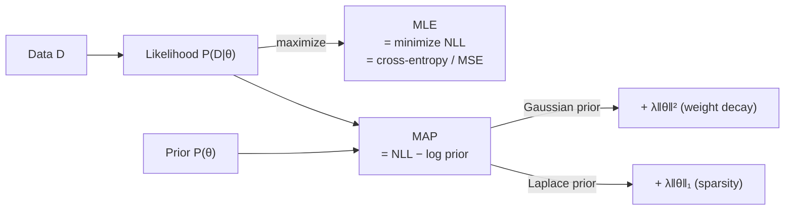
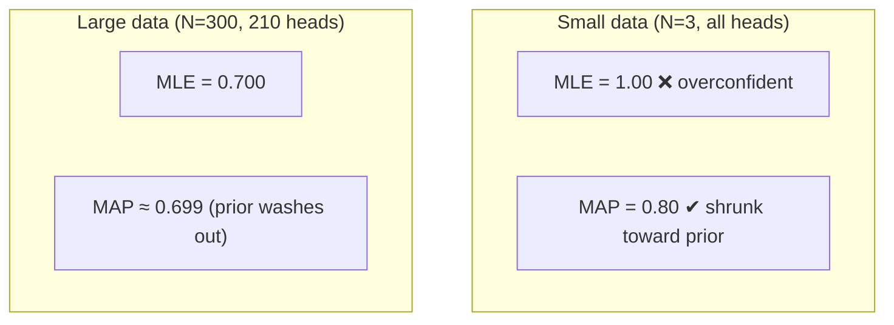

# Probability & Statistics - Estimations (MLE & MAP)

[Home](math-index.md#probability-statistics)

## Overview

**Parameter estimation** answers: *given observed data, which parameter values are best?* Two principles cover almost every training objective in machine learning:

| Estimator | Objective | Uses a prior? | ML equivalent |
|---|---|---|---|
| **Maximum Likelihood Estimation (MLE)** | $\hat\theta_{MLE} = \arg\max_\theta P(D\mid\theta)$ | No | Standard training: minimize the loss (cross-entropy, MSE) |
| **Maximum A Posteriori (MAP)** | $\hat\theta_{MAP} = \arg\max_\theta P(D\mid\theta)\,P(\theta)$ | **Yes** | **Regularized** training: loss + weight decay / L1 |

The connection to [Bayesian Statistics](10_Bayesian%20Statistics.md): MAP is the **mode of the posterior**. MLE is MAP with a **flat prior**.

---

## Why It Matters



> **Architect's lens:** When someone says "we trained the model with cross-entropy loss and weight decay 0.1", they mean "we computed a **MAP estimate** under a **categorical likelihood** and a **Gaussian prior**." Seeing loss functions this way lets you derive the right loss for new problems (counts, heteroscedastic noise, ranking) instead of guessing.

---

## 1. Maximum Likelihood Estimation (MLE)

### Explanation

For independent and identically distributed (i.i.d.) data $D = \{x_1,\dots,x_N\}$, the likelihood factorizes:

$$
P(D\mid\theta) = \prod_{i=1}^N P(x_i\mid\theta)
$$

Products of many small probabilities underflow, so we maximize the **log-likelihood** (log is monotonic, so the argmax doesn't change) or equivalently **minimize the negative log-likelihood (NLL)**:

$$
\hat\theta_{MLE} = \arg\max_\theta \sum_{i=1}^N \log P(x_i\mid\theta) = \arg\min_\theta \underbrace{-\sum_{i=1}^N \log P(x_i\mid\theta)}_{\text{NLL = the loss}}
$$

**Classic closed-form MLEs:**

| Model | MLE |
|---|---|
| Bernoulli($p$), $k$ successes in $N$ | $\hat p = k/N$ |
| Gaussian($\mu, \sigma^2$) | $\hat\mu = \bar x$, $\hat\sigma^2 = \frac1N\sum(x_i - \bar x)^2$ (biased: divides by $N$) |
| Poisson($\lambda$) | $\hat\lambda = \bar x$ |
| Linear regression with Gaussian noise | Ordinary least squares |

**The loss functions you already use are NLLs:**

| Output distribution | NLL | Loss name |
|---|---|---|
| Gaussian (fixed $\sigma$) | $\frac{1}{2\sigma^2}(y - \hat y)^2 + c$ | MSE |
| Bernoulli | $-[y\log p + (1-y)\log(1-p)]$ | Binary cross-entropy |
| Categorical | $-\log p_{y}$ | Cross-entropy |
| Laplace | $\frac{\lvert y - \hat y\rvert}{b} + c$ | L1 / MAE |

**Language-model pre-training is MLE**: maximize $\sum_t\log P_\theta(x_t\mid x_{<t})$ over trillions of tokens.

### Worked Example — Bernoulli MLE derivation

Data: 10 coin flips, 7 heads. $\log L(p) = 7\log p + 3\log(1-p)$.

$$
\frac{d}{dp}\log L = \frac{7}{p} - \frac{3}{1-p} = 0 \;\Rightarrow\; 7(1-p) = 3p \;\Rightarrow\; \hat p = 0.7
$$

**Problem with small data**: with 3 flips and 3 heads, $\hat p_{MLE} = 1.0$, which claims tails is *impossible*. MLE **overfits** small samples. MAP fixes this.

### Diagram

```text
  log-likelihood  ℓ(p) = 7 log p + 3 log(1−p)
      │
      │                 ▁▂▃▄▅▆▇█▇▆▅▄
      │           ▁▂▃▅▆▇            ▆▄▂
      │      ▁▃▅▇                       ▅▂
      │   ▂▅                               ▆▁
      │ ▃                                     ▅
      └──────┬──────┬──────┬──────┬──────┬──────── p
            0.2    0.4    0.6   (0.7)   0.9
                                 ▲ maximum = MLE
```

### Architectural Relevance

- **Every supervised and self-supervised loss is an NLL.** Picking the likelihood is a design decision:
  - Heavy-tailed targets → Laplace / Huber instead of Gaussian.
  - Counts → Poisson / Negative-Binomial NLL.
  - **Heteroscedastic regression** (noise varies by input) → predict both $\mu(x)$ and $\sigma(x)$ and minimize the Gaussian NLL (`GaussianNLLLoss`). This gives per-prediction uncertainty for free.
- **Perplexity** $= \exp(\text{average NLL per token})$ is the standard LLM metric. It is just the MLE objective reported on held-out data.
- **MLE overfits** with high capacity or little data. That is why production training adds regularization (MAP), data augmentation, and early stopping.
- **Log-space numerics**: always work with log-probabilities (`log_softmax`, `logsumexp`) to avoid underflow. This is mandatory in beam search, sequence scoring, and ranking.

### Python Implementation

```python
import numpy as np
import torch
from scipy import optimize, stats

# --- Bernoulli MLE: analytic vs numeric ---
flips = np.array([1, 1, 0, 1, 1, 1, 0, 1, 0, 1])          # 7 heads / 10
nll = lambda p: -(flips * np.log(p) + (1 - flips) * np.log(1 - p)).sum()
res = optimize.minimize_scalar(nll, bounds=(1e-6, 1 - 1e-6), method="bounded")
print(f"Bernoulli MLE: analytic={flips.mean():.3f}, numeric={res.x:.3f}")

# --- Gaussian MLE ---
rng = np.random.default_rng(0)
data = rng.normal(loc=5.0, scale=2.0, size=10_000)
mu_hat, var_hat = data.mean(), ((data - data.mean()) ** 2).mean()
print(f"Gaussian MLE: mu={mu_hat:.3f}, sigma={np.sqrt(var_hat):.3f}")
print(f"scipy fit   : mu={stats.norm.fit(data)[0]:.3f}, sigma={stats.norm.fit(data)[1]:.3f}")

# --- Cross-entropy loss IS the categorical NLL ---
logits = torch.tensor([[2.0, 0.5, -1.0], [0.1, 0.2, 3.0]])
labels = torch.tensor([0, 2])
manual_nll = -torch.log_softmax(logits, dim=-1)[torch.arange(2), labels].mean()
print(f"manual NLL = {manual_nll:.4f} | F.cross_entropy = "
      f"{torch.nn.functional.cross_entropy(logits, labels):.4f}")
print(f"perplexity = exp(NLL) = {manual_nll.exp():.4f}")

# --- Heteroscedastic regression: learn mean AND variance via Gaussian NLL ---
torch.manual_seed(0)
x = torch.linspace(-3, 3, 512).unsqueeze(1)
y = 2 * x + torch.randn_like(x) * (0.1 + 0.5 * x.abs())   # noise grows with |x|
net = torch.nn.Sequential(torch.nn.Linear(1, 32), torch.nn.Tanh(), torch.nn.Linear(32, 2))
opt = torch.optim.Adam(net.parameters(), lr=1e-2)
for _ in range(1500):
    out = net(x)
    mean, var = out[:, :1], torch.nn.functional.softplus(out[:, 1:]) + 1e-4
    loss = torch.nn.functional.gaussian_nll_loss(mean, y, var)
    opt.zero_grad(); loss.backward(); opt.step()
with torch.no_grad():
    o = net(torch.tensor([[0.0], [2.5]]))
    sd = (torch.nn.functional.softplus(o[:, 1]) + 1e-4).sqrt()
print(f"predicted noise std at x=0: {sd[0]:.3f} (true 0.1) | at x=2.5: {sd[1]:.3f} (true 1.35)")
```

**Output:**
```text
Bernoulli MLE: analytic=0.700, numeric=0.700
Gaussian MLE: mu=5.013, sigma=1.996
scipy fit   : mu=5.013, sigma=1.996
manual NLL = 0.1755 | F.cross_entropy = 0.1755
perplexity = exp(NLL) = 1.1918
predicted noise std at x=0: 0.144 (true 0.1) | at x=2.5: 1.456 (true 1.35)
```

---

## 2. Maximum A Posteriori (MAP)

### Explanation

MAP maximizes the **posterior** instead of the likelihood:

$$
\hat\theta_{MAP} = \arg\max_\theta P(\theta\mid D) = \arg\max_\theta \big[\log P(D\mid\theta) + \log P(\theta)\big]
$$

(The evidence $P(D)$ does not depend on $\theta$, so it drops out.) As a loss to minimize:

$$
\mathcal L_{MAP}(\theta) = \underbrace{-\log P(D\mid\theta)}_{\text{data loss (NLL)}} \;\underbrace{-\;\log P(\theta)}_{\text{regularizer}}
$$

**Priors become regularizers:**

| Prior on weights | $-\log P(\theta)$ | Regularizer | Effect |
|---|---|---|---|
| Gaussian $\mathcal N(0, \sigma^2)$ | $\frac{1}{2\sigma^2}\lVert\theta\rVert_2^2$ | **L2 / weight decay / Ridge** | Small weights, smooth functions |
| Laplace$(0, b)$ | $\frac{1}{b}\lVert\theta\rVert_1$ | **L1 / Lasso** | **Sparse** weights (feature selection) |
| Flat (uniform) | constant | none | MAP = MLE |

Regularization strength $\lambda = \frac{1}{2\sigma^2}$: a **tighter prior** (small $\sigma$) means **stronger regularization**.

**Data vs. prior**: the NLL term grows with $N$ while the prior term is fixed, so **as data grows, MAP → MLE**.

### Worked Example — MAP for a coin with a Beta prior

Data: **3 flips, 3 heads**. Prior Beta($\alpha = 2, \beta = 2$) ("probably fair-ish").

MAP of a Beta–Binomial posterior Beta($\alpha + k, \beta + N - k$) is its mode:

$$
\hat p_{MAP} = \frac{k + \alpha - 1}{N + \alpha + \beta - 2} = \frac{3 + 1}{3 + 2} = 0.8
$$

Compare with $\hat p_{MLE} = 3/3 = 1.0$. MAP gives a more sensible estimate with tiny data.

With **300 flips, 210 heads**: MLE $= 0.700$, MAP $= 211/302 \approx 0.699$. The prior barely matters now.

### Diagram



```text
   L2 (Gaussian prior)            L1 (Laplace prior)
   constraint region: circle      constraint region: diamond
          ╭───╮                         ◇
         │  ●  │ ← solution rarely      ◇ ◇ ← corners on axes →
          ╰───╯   on an axis            ◇    solutions often have
                                             zeros = SPARSE
```

### Architectural Relevance

- **Weight decay in every LLM/vision training recipe** is a Gaussian-prior MAP estimate. In practice the decoupled version (**AdamW**, see [Advanced Optimizers](14_Advanced%20Optimizers.md)) is preferred, because adaptive optimizers distort plain L2.
- **L1 sparsity** gives compact models, feature selection in tabular systems, and sparse autoencoders in interpretability research.
- **Fine-tuning as MAP with an informative prior**: regularizing toward the pre-trained weights, $\lambda\lVert\theta - \theta_{pre}\rVert^2$ (L2-SP, EWC for continual learning), keeps the model close to its prior knowledge and reduces **catastrophic forgetting**. The **KL penalty to the reference model in RLHF/DPO** has the same spirit.
- **Label smoothing** can be read as MAP-style regularization of the output distribution (a prior toward the uniform distribution), which improves calibration.
- **Limitation**: MAP is still a **point estimate**, so it gives no uncertainty. When uncertainty matters (safety, active learning), go fully Bayesian (ensembles, Laplace, MC dropout).

### Python Implementation

```python
import numpy as np
import torch

# --- MAP vs MLE for a coin with a Beta(2,2) prior ---
def mle(k, n):
    return k / n

def map_beta(k, n, a=2, b=2):
    return (k + a - 1) / (n + a + b - 2)

for k, n in [(3, 3), (7, 10), (210, 300)]:
    print(f"{k:>3}/{n:<3} heads: MLE = {mle(k, n):.3f} | MAP = {map_beta(k, n):.3f}")

# --- Gaussian prior = L2 (ridge) ; Laplace prior = L1 (lasso) ---
rng = np.random.default_rng(0)
N, d = 40, 20
X = rng.normal(size=(N, d))
true_w = np.zeros(d)
true_w[:3] = [3.0, -2.0, 1.5]                                    # only 3 useful features
y = X @ true_w + rng.normal(scale=0.5, size=N)

Xt, yt = torch.tensor(X, dtype=torch.float32), torch.tensor(y, dtype=torch.float32)

def fit(penalty, lam, steps=3000):
    w = torch.zeros(d, requires_grad=True)
    opt = torch.optim.Adam([w], lr=0.05)
    for _ in range(steps):
        nll = ((Xt @ w - yt) ** 2).mean()                       # Gaussian likelihood
        reg = {"none": 0.0, "l2": (w ** 2).sum(), "l1": w.abs().sum()}[penalty]
        loss = nll + lam * reg                                  # MAP objective
        opt.zero_grad(); loss.backward(); opt.step()
    return w.detach().numpy()

for name, lam in [("none", 0.0), ("l2", 0.1), ("l1", 0.1)]:
    w = fit(name, lam)
    print(f"{name:>4}: ‖w‖₂={np.linalg.norm(w):.3f} | |w|<0.01: {int((np.abs(w) < 0.01).sum()):>2}/20"
          f" | first 3 = {np.round(w[:3], 2)}")

# --- Fine-tuning with a prior centered at pre-trained weights (L2-SP) ---
theta_pre = torch.tensor([1.0, -1.0, 0.5])
theta = theta_pre.clone().requires_grad_(True)
task_target = torch.tensor([3.0, 2.0, -1.0])
opt = torch.optim.SGD([theta], lr=0.1)
for _ in range(200):
    loss = ((theta - task_target) ** 2).sum() + 1.0 * ((theta - theta_pre) ** 2).sum()
    opt.zero_grad(); loss.backward(); opt.step()
print("L2-SP fine-tuned θ:", [round(v, 3) for v in theta.tolist()], "(halfway between prior and task)")
```

**Output:**
```text
  3/3   heads: MLE = 1.000 | MAP = 0.800
  7/10  heads: MLE = 0.700 | MAP = 0.667
210/300 heads: MLE = 0.700 | MAP = 0.699
none: ‖w‖₂=3.990 | |w|<0.01:  2/20 | first 3 = [ 3.06 -2.08  1.46]
  l2: ‖w‖₂=3.199 | |w|<0.01:  0/20 | first 3 = [ 2.54 -1.5   1.12]
  l1: ‖w‖₂=3.826 | |w|<0.01: 11/20 | first 3 = [ 2.97 -1.96  1.4 ]
L2-SP fine-tuned θ: [2.0, 0.5, -0.25] (halfway between prior and task)
```

---

## MLE vs. MAP — Summary

| Aspect | MLE | MAP |
|---|---|---|
| Objective | $\max P(D\mid\theta)$ | $\max P(D\mid\theta)P(\theta)$ |
| Prior | None (flat) | Explicit |
| Small data | Overfits / extreme estimates | Shrinks toward prior |
| Large data | Consistent, efficient | Converges to MLE |
| Deep-learning form | Loss = NLL | Loss = NLL + regularizer |
| Uncertainty | None (point estimate) | None (point estimate, the posterior mode) |

---

## Common Mistakes

| Mistake | Why it hurts | Better approach |
|---|---|---|
| Multiplying raw probabilities | Numerical underflow to 0 | Sum log-probabilities |
| Using MSE for every regression | Wrong noise model (outliers, counts, heteroscedasticity) | Pick the likelihood that matches the data |
| Regularizing biases and LayerNorm gains | Hurts performance, no benefit | Exclude them from weight decay |
| Reporting the MAP estimate as "Bayesian" | No uncertainty quantified | Use posterior approximations if uncertainty matters |
| Same λ regardless of dataset size | Prior over-/under-powers the data | Tune λ with validation; it should depend on $N$ |

---

## Interview Questions

### Beginner
1. **What does MLE maximize?**
   *The probability of the observed data under the model, $P(D\mid\theta)$.*
2. **Why do we use log-likelihood?**
   *It turns products into sums (numerical stability, easier derivatives) without changing the argmax.*

### Intermediate
1. **Show that minimizing MSE is MLE under Gaussian noise.**
   *$-\log\mathcal N(y\mid\hat y,\sigma^2) = \frac{(y-\hat y)^2}{2\sigma^2} + \frac12\log(2\pi\sigma^2)$. With $\sigma$ fixed, minimizing the sum over data is minimizing squared error.*
2. **What prior corresponds to L1 regularization, and why does it produce sparsity?**
   *Laplace prior. Its sharp peak at 0 (the diamond-shaped constraint) makes optima land exactly on axes, giving zero weights.*
3. **When do MLE and MAP coincide?**
   *With a flat prior, or in the large-data limit.*

### Architect-Level
1. **How would you design the loss for predicting delivery times that are skewed and have input-dependent noise?**
   *Use a likelihood matching the data: log-normal or Gamma NLL, or a heteroscedastic Gaussian on log-time predicting $\mu(x), \sigma(x)$. This gives calibrated intervals for SLA decisions. Validate with calibration plots.*
2. **Interpret the KL-to-reference penalty in RLHF in MAP terms.**
   *The reference (SFT) model acts as a prior over policies; the objective maximizes reward subject to staying close to the prior, preventing reward hacking and language drift.*
3. **Why is perplexity alone insufficient for evaluating a production LLM?**
   *It measures MLE fit on a held-out text distribution, not instruction following, factuality, safety, or task success. It is also tokenizer-dependent. Combine it with task-level and human/LLM-judge evals.*

---

## Key Takeaways

- **MLE** = choose parameters that make the data most probable = **minimize NLL**. Cross-entropy and MSE are NLLs.
- **MAP** = MLE + log-prior = **regularized training**. Gaussian prior is L2/weight decay; Laplace prior is L1/sparsity.
- With small data MAP **shrinks** toward the prior; with big data MAP → MLE.
- Choosing a likelihood is a **design decision** (counts, outliers, heteroscedasticity). Choosing a prior is a **regularization decision**.
