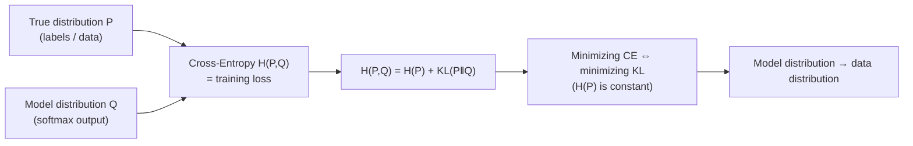
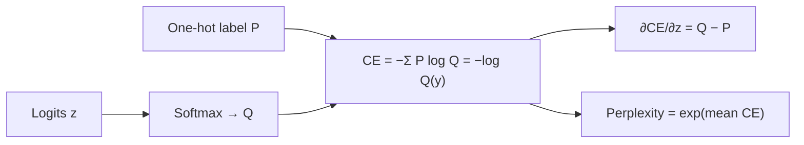
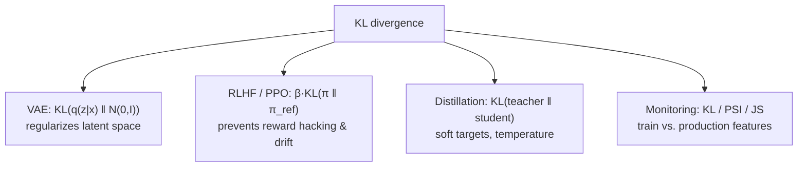
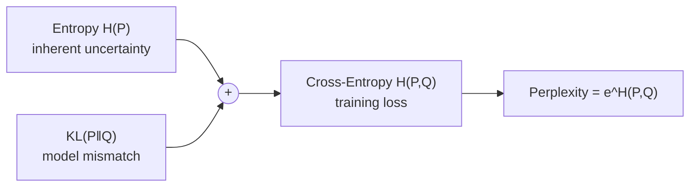

# Probability & Statistics - Information Theory

[Home](math-index.md#probability-statistics)

## Overview

**Information theory**, founded by Claude Shannon in 1948, quantifies **uncertainty** and **information** in probability distributions. It supplies the most important loss function in deep learning (**cross-entropy**), the standard way to compare distributions (**KL divergence**), and the measure of uncertainty (**entropy**) behind decoding strategies, calibration, and monitoring.

| Sub-topic | Formula | Measures | AI use |
|---|---|---|---|
| **Shannon Entropy** $H(P)$ | $-\sum_x P(x)\log P(x)$ | Uncertainty / average surprise of $P$ | Uncertainty, decoding temperature, decision trees |
| **Cross-Entropy** $H(P, Q)$ | $-\sum_x P(x)\log Q(x)$ | Avg. cost of encoding $P$ using $Q$ | **Classification & LLM loss**, perplexity |
| **KL Divergence** $D_{KL}(P\Vert Q)$ | $\sum_x P(x)\log\frac{P(x)}{Q(x)}$ | Extra cost of using $Q$ instead of $P$ | VAEs, RLHF/DPO, distillation, drift detection |

The key identity tying them together:

$$
\boxed{H(P, Q) = H(P) + D_{KL}(P\,\Vert\,Q)}
$$

Units: $\log_2$ gives **bits**, natural $\log$ gives **nats** (frameworks use nats).

---

## Why It Matters



> **Architect's lens:** An LLM's training loss *is* cross-entropy, its evaluation metric (perplexity) *is* exponentiated cross-entropy, its alignment step (RLHF/DPO) is regularized by a *KL* penalty, and its sampling knobs (temperature, top-p) control output *entropy*. Information theory runs through the whole LLM lifecycle.

---

## 1. Shannon Entropy

### Explanation

The **information content** (surprise) of an event with probability $p$ is $-\log p$: rare events are more surprising. **Entropy** is the **expected surprise**:

$$
H(P) = -\sum_x P(x)\log P(x) = \mathbb E_{x\sim P}[-\log P(x)]
$$

Properties:

- $H(P) \ge 0$; $H = 0$ iff the outcome is **certain** (one-hot).
- Maximized by the **uniform** distribution: $H = \log K$ for $K$ outcomes.
- **Shannon's source-coding theorem**: $H(P)$ (in bits) is the minimum average number of bits per symbol needed to encode samples from $P$.
- **Binary entropy**: $H(p) = -p\log p - (1-p)\log(1-p)$, peak 1 bit at $p = 0.5$.
- **Differential entropy** for continuous variables, e.g., Gaussian: $\frac12\log(2\pi e\sigma^2)$.

### Worked Example

| Distribution | Entropy (bits) |
|---|---|
| Fair coin $[0.5, 0.5]$ | $-2(0.5\log_2 0.5) = 1.0$ |
| Biased coin $[0.9, 0.1]$ | $-(0.9\log_2 0.9 + 0.1\log_2 0.1) \approx 0.469$ |
| Certain $[1, 0]$ | $0$ |
| Fair 8-sided die | $\log_2 8 = 3.0$ |

An LLM next-token distribution over a 50K vocabulary has a maximum entropy of $\log_2 50000 \approx 15.6$ bits. A confident prediction may be under 1 bit.

### Diagram

```text
  Binary entropy H(p) in bits
   1.0 │            ▄▆█▆▄
       │        ▄▆██████████▆▄
   0.5 │     ▄███████████████████▄
       │   ▄██████████████████████▄
   0.0 │▄███████████████████████████▄
       └┬──────────┬──────────┬──────┬ p
        0         0.5                1
     certain    max uncertainty    certain
```

### Architectural Relevance

- **Decoding control**: **temperature** $T$ rescales logits, $\text{softmax}(z/T)$. $T<1$ lowers entropy (more deterministic), $T>1$ raises it (more diverse). **Top-p (nucleus)** sampling truncates to the smallest set holding probability mass $p$. Product teams tune these per use-case (code generation: low entropy; brainstorming: higher).
- **Uncertainty signal**: high **predictive entropy** marks uncertain predictions and can trigger fallbacks, retrieval (RAG), or human review. Token-level entropy is used in hallucination-detection heuristics.
- **Decision trees / gradient boosting** split on **information gain** = reduction in entropy.
- **Entropy regularization** in RL (PPO, SAC) keeps policies exploratory. **Entropy collapse** in attention or policies is a known training-instability signal.
- **Compression & tokenization**: entropy bounds achievable compression; LLMs are excellent compressors precisely because they have low cross-entropy on text.

### Python Implementation

```python
import numpy as np
import torch
from scipy.stats import entropy

for name, p in [("fair coin", [0.5, 0.5]), ("biased coin", [0.9, 0.1]),
                ("certain", [1.0, 0.0]), ("fair 8-die", [1 / 8] * 8)]:
    print(f"{name:12s}: H = {entropy(p, base=2):.3f} bits")

# Temperature controls entropy of an LLM's next-token distribution
logits = torch.tensor([4.0, 2.5, 2.0, 1.0, 0.5, -1.0])
for T in (0.3, 0.7, 1.0, 1.5):
    probs = torch.softmax(logits / T, dim=-1)
    H = -(probs * probs.log2()).sum().item()
    print(f"T={T:<3}: top prob={probs.max():.3f}  entropy={H:.3f} bits")

# Top-p (nucleus) truncation
def top_p_filter(logits, p=0.9):
    probs = torch.softmax(logits, -1)
    sorted_p, idx = probs.sort(descending=True)
    keep = sorted_p.cumsum(0) - sorted_p < p          # keep tokens until mass >= p
    out = torch.zeros_like(probs)
    out[idx[keep]] = probs[idx[keep]]
    return out / out.sum()
print("top-p=0.9 keeps", int((top_p_filter(logits) > 0).sum()), "of", len(logits), "tokens")

# Entropy-based abstention
preds = torch.tensor([[0.97, 0.02, 0.01], [0.40, 0.35, 0.25]])
H = -(preds * preds.log()).sum(-1)
threshold = 0.5 * np.log(3)
for p, h in zip(preds, H):
    print(f"pred={[round(v, 2) for v in p.tolist()]} entropy={h:.3f} nats ->",
          "ANSWER" if h < threshold else "ESCALATE")
```

**Output:**
```text
fair coin   : H = 1.000 bits
biased coin : H = 0.469 bits
certain     : H = 0.000 bits
fair 8-die  : H = 3.000 bits
T=0.3: top prob=0.992  entropy=0.073 bits
T=0.7: top prob=0.836  entropy=0.878 bits
T=1.0: top prob=0.692  entropy=1.424 bits
T=1.5: top prob=0.526  entropy=1.940 bits
top-p=0.9 keeps 3 of 6 tokens
pred=[0.97, 0.02, 0.01] entropy=0.154 nats -> ANSWER
pred=[0.4, 0.35, 0.25] entropy=1.081 nats -> ESCALATE
```

---

## 2. Cross-Entropy

### Explanation

**Cross-entropy** measures the average surprise when outcomes come from the true distribution $P$ but you **predict them with $Q$**:

$$
H(P, Q) = -\sum_x P(x)\log Q(x)
$$

- $H(P, Q) \ge H(P)$, with equality iff $Q = P$.
- **Not symmetric**: $H(P, Q) \neq H(Q, P)$.
- For **one-hot labels** (classification), $P$ puts all mass on the true class $y$, so

$$
H(P, Q) = -\log Q(y)
$$

  That is exactly the **negative log-likelihood** of the correct class (see [Estimations](11_Estimations.md)). Cross-entropy loss = categorical NLL = MLE.

- **Gradient w.r.t. logits** is simply $\text{softmax}(\mathbf z) - \mathbf y$, which is clean and stable.
- **Perplexity** $= e^{H}$ (nats) is the "effective number of equally likely choices" the model is uncertain between.
- **Bits per byte / bits per character** normalize cross-entropy by text length for tokenizer-independent comparison.

### Worked Example

True class = "cat" (index 0). Two models:

| Model | $Q$ = [cat, dog, bird] | Cross-entropy $-\ln Q(\text{cat})$ |
|---|---|---|
| A (confident, correct) | $[0.8, 0.15, 0.05]$ | $-\ln 0.8 = 0.223$ |
| B (unsure) | $[0.4, 0.4, 0.2]$ | $-\ln 0.4 = 0.916$ |
| C (confident, **wrong**) | $[0.05, 0.9, 0.05]$ | $-\ln 0.05 = 2.996$ |

Cross-entropy **heavily punishes confident mistakes**, which pushes models toward honest probabilities.

LLM example: an average token loss of 2.0 nats gives perplexity $e^{2.0} \approx 7.39$, so the model is about as uncertain as a uniform choice among ~7.4 tokens.

### Diagram



### Architectural Relevance

- **The default loss** for classification, token prediction (LLM pre-training and SFT), and contrastive learning (**InfoNCE** in CLIP and embedding models is cross-entropy over a batch of candidates).
- **Fused, numerically stable kernels**: always pass **raw logits** (`F.cross_entropy` uses `log_softmax` + `logsumexp` internally). For huge vocabularies, the logits tensor $(B\times T\times V)$ can dominate memory, which is why **chunked / fused cross-entropy** kernels (e.g., Liger, Apple's Cut Cross-Entropy) exist.
- **Label smoothing** replaces one-hot $P$ with $(1-\epsilon)\,\text{onehot} + \epsilon/K$. It improves calibration and generalization, and is standard in many vision and translation models.
- **Class imbalance**: use weighted cross-entropy or **focal loss** $-(1 - Q_y)^\gamma\log Q_y$ to down-weight easy examples.
- **Perplexity as a monitoring metric**: track it on held-out data in continuous pre-training; spikes indicate data issues or instability.

### Python Implementation

```python
import torch
import torch.nn.functional as F

target = torch.tensor([0])                                    # true class = cat
for name, q in [("A confident-correct", [0.8, 0.15, 0.05]),
                ("B unsure           ", [0.4, 0.4, 0.2]),
                ("C confident-wrong  ", [0.05, 0.9, 0.05])]:
    logits = torch.log(torch.tensor([q]))                      # logits whose softmax = q
    print(f"{name}: CE = {F.cross_entropy(logits, target).item():.3f}")

# Gradient of CE w.r.t. logits = softmax − onehot
z = torch.tensor([[1.0, 2.0, 0.5]], requires_grad=True)
F.cross_entropy(z, torch.tensor([2])).backward()
print("∂CE/∂z  :", [round(v, 4) for v in z.grad[0].tolist()])
print("Q − P   :", [round(v, 4) for v in (z.softmax(-1) - torch.tensor([0., 0., 1.]))[0].tolist()])

# LLM-style loss + perplexity over a batch of token predictions
torch.manual_seed(0)
B, T, V = 2, 8, 1000
logits = torch.randn(B, T, V)
tokens = torch.randint(0, V, (B, T))
loss = F.cross_entropy(logits.view(-1, V), tokens.view(-1))
print(f"random-model token CE = {loss:.3f} nats | perplexity = {loss.exp():.1f} (vocab {V})")
uniform = F.cross_entropy(torch.zeros(B * T, V), tokens.view(-1))
print(f"uniform-model CE      = {uniform:.3f} nats | perplexity = {uniform.exp():.1f}"
      "  <- random logits are *confidently wrong*, so they score worse than uniform")

# Label smoothing
logits = torch.tensor([[5.0, 0.0, 0.0]])
print("CE no smoothing :", round(F.cross_entropy(logits, torch.tensor([0])).item(), 4))
print("CE smoothing 0.1:", round(F.cross_entropy(logits, torch.tensor([0]), label_smoothing=0.1).item(), 4))

# InfoNCE / CLIP-style contrastive loss = cross-entropy over the similarity matrix
img = F.normalize(torch.randn(4, 16), dim=-1)
txt = F.normalize(img + 0.1 * torch.randn(4, 16), dim=-1)    # matched pairs on the diagonal
sim = img @ txt.T / 0.07                                      # temperature 0.07
print(f"InfoNCE loss = {F.cross_entropy(sim, torch.arange(4)).item():.4f}")
```

**Output:**
```text
A confident-correct: CE = 0.223
B unsure           : CE = 0.916
C confident-wrong  : CE = 2.996
∂CE/∂z  : [0.2312, 0.6285, -0.8598]
Q − P   : [0.2312, 0.6285, -0.8598]
random-model token CE = 7.715 nats | perplexity = 2240.8 (vocab 1000)
uniform-model CE      = 6.908 nats | perplexity = 1000.0  <- random logits are *confidently wrong*, so they score worse than uniform
CE no smoothing : 0.0134
CE smoothing 0.1: 0.3467
InfoNCE loss = 0.0003
```

---

## 3. Kullback–Leibler (KL) Divergence

### Explanation

**KL divergence** measures how much distribution $Q$ **differs** from a reference distribution $P$, i.e., the **extra** nats or bits you pay for using $Q$ when the truth is $P$:

$$
D_{KL}(P\,\Vert\,Q) = \sum_x P(x)\log\frac{P(x)}{Q(x)} = H(P, Q) - H(P)
$$

Properties:

| Property | Statement |
|---|---|
| Non-negative | $D_{KL}(P\Vert Q)\ge 0$, $= 0$ iff $P = Q$ (Gibbs' inequality) |
| **Asymmetric** | $D_{KL}(P\Vert Q)\neq D_{KL}(Q\Vert P)$, so it is **not** a distance metric |
| Infinite if support mismatch | If $Q(x) = 0$ where $P(x) > 0$, then $D_{KL} = \infty$ |
| Gaussian closed form | $D_{KL}(\mathcal N(\mu,\sigma^2)\Vert\mathcal N(0,1)) = \frac12(\mu^2 + \sigma^2 - 1 - \log\sigma^2)$ |

**Forward vs. reverse KL** behave very differently:

| | Forward $D_{KL}(P\Vert Q)$ | Reverse $D_{KL}(Q\Vert P)$ |
|---|---|---|
| Penalizes | $Q$ missing mass where $P$ has it | $Q$ putting mass where $P$ has none |
| Behavior | **Mass-covering** (mean-seeking) | **Mode-seeking** (picks one mode) |
| Used in | MLE / cross-entropy training, distillation | Variational inference (VAEs), RLHF policy KL |

Symmetric alternative: **Jensen–Shannon divergence** $\text{JS} = \frac12 D_{KL}(P\Vert M) + \frac12 D_{KL}(Q\Vert M)$, $M = \frac{P+Q}{2}$, which is bounded and symmetric.

### Worked Example

$P = [0.5, 0.4, 0.1]$, $Q = [0.4, 0.4, 0.2]$ (natural log):

$$
D_{KL}(P\Vert Q) = 0.5\ln\tfrac{0.5}{0.4} + 0.4\ln\tfrac{0.4}{0.4} + 0.1\ln\tfrac{0.1}{0.2} = 0.1116 + 0 - 0.0693 = 0.0423
$$

$$
D_{KL}(Q\Vert P) = 0.4\ln\tfrac{0.4}{0.5} + 0 + 0.2\ln\tfrac{0.2}{0.1} = -0.0893 + 0.1386 = 0.0494
$$

They differ, which shows the asymmetry. Check the identity: $H(P) = 0.9433$, $H(P,Q) = 0.9856$, and $0.9856 - 0.9433 = 0.0423$ ✓

### Diagram

```text
   True P: bimodal              Forward KL(P‖Q) fit          Reverse KL(Q‖P) fit
     ▄       ▄                   ▁▃▅▆▆▆▆▆▅▃▁                  ▄
    ███     ███                 (covers both modes,          ███   (locks onto
   █████   █████                 blurry in the middle)       █████   ONE mode)
```



### Architectural Relevance

- **VAEs**: the ELBO = reconstruction − $D_{KL}(q(z\mid x)\Vert p(z))$. The KL term keeps the latent space smooth and sample-able. Latent diffusion models (Stable Diffusion) rely on a KL-regularized autoencoder.
- **RLHF & alignment**: PPO-based RLHF maximizes $\text{reward} - \beta\,D_{KL}(\pi_\theta\Vert\pi_{ref})$, keeping the aligned policy near the SFT model to prevent **reward hacking**, mode collapse, and language drift. **DPO** derives its loss from the same KL-constrained objective. $\beta$ is a key alignment hyperparameter.
- **Knowledge distillation**: train a small student to match a large teacher's softened distribution, $D_{KL}(\text{softmax}(z_T/\tau)\Vert\text{softmax}(z_S/\tau))\cdot\tau^2$. This is how many production-sized models are made from frontier models.
- **Data / concept drift monitoring**: compare production vs. training feature or prediction distributions using KL, JS, or **PSI** (Population Stability Index, a symmetrized KL). Alert above a threshold (PSI > 0.2 is a common rule of thumb).
- **Speculative decoding & quantization evaluation**: KL between the quantized/draft model's and the full model's token distributions is a sensitive quality metric, often better than perplexity for detecting degradation.

### Python Implementation

```python
import numpy as np
import torch
import torch.nn.functional as F
from scipy.stats import entropy
from scipy.spatial.distance import jensenshannon

P = np.array([0.5, 0.4, 0.1])
Q = np.array([0.4, 0.4, 0.2])
print(f"KL(P‖Q) = {entropy(P, Q):.4f} | KL(Q‖P) = {entropy(Q, P):.4f}  (asymmetric)")
H_P, H_PQ = entropy(P), -(P * np.log(Q)).sum()
print(f"H(P,Q) − H(P) = {H_PQ - H_P:.4f}  (= KL)")
print(f"JS divergence  = {jensenshannon(P, Q) ** 2:.4f}  (symmetric)")

# VAE KL term: closed form vs Monte Carlo
mu, logvar = torch.tensor([0.5, -0.3]), torch.tensor([-0.2, 0.4])
kl_closed = 0.5 * (mu**2 + logvar.exp() - 1 - logvar).sum()
q = torch.distributions.Normal(mu, (0.5 * logvar).exp())
p = torch.distributions.Normal(torch.zeros(2), torch.ones(2))
print(f"VAE KL closed-form = {kl_closed:.4f} | torch.distributions = "
      f"{torch.distributions.kl_divergence(q, p).sum():.4f}")

# Knowledge distillation loss (teacher -> student), temperature τ
teacher = torch.tensor([[4.0, 1.0, 0.2]])
student = torch.tensor([[2.5, 1.5, 0.5]])
tau = 2.0
kd = F.kl_div(F.log_softmax(student / tau, -1), F.softmax(teacher / tau, -1),
              reduction="batchmean") * tau**2
print(f"distillation KL loss = {kd:.4f}")

# RLHF-style per-token KL penalty between policy and reference model
torch.manual_seed(0)
ref_logits = torch.randn(5, 100)
policy_logits = ref_logits + 0.3 * torch.randn(5, 100)       # policy drifted a bit
kl_tok = (F.softmax(policy_logits, -1) *
          (F.log_softmax(policy_logits, -1) - F.log_softmax(ref_logits, -1))).sum(-1)
beta = 0.1
print(f"mean per-token KL(π‖π_ref) = {kl_tok.mean():.4f} -> penalty β·KL = {beta * kl_tok.mean():.4f}")

# Drift monitoring with PSI (binned, symmetrized KL)
def psi(expected, actual, bins=10):
    edges = np.quantile(expected, np.linspace(0, 1, bins + 1))
    e = np.histogram(np.clip(expected, edges[0], edges[-1]), edges)[0] / len(expected) + 1e-6
    a = np.histogram(np.clip(actual, edges[0], edges[-1]), edges)[0] / len(actual) + 1e-6
    return float(((a - e) * np.log(a / e)).sum())

rng = np.random.default_rng(0)
train = rng.normal(0, 1, 50_000)
print(f"PSI no drift    = {psi(train, rng.normal(0, 1, 10_000)):.4f}")
print(f"PSI mean shift  = {psi(train, rng.normal(0.5, 1, 10_000)):.4f}  (> 0.2 => alert)")
```

**Output:**
```text
KL(P‖Q) = 0.0423 | KL(Q‖P) = 0.0494  (asymmetric)
H(P,Q) − H(P) = 0.0423  (= KL)
JS divergence  = 0.0113  (symmetric)
VAE KL closed-form = 0.2253 | torch.distributions = 0.2253
distillation KL loss = 0.4115
mean per-token KL(π‖π_ref) = 0.0615 -> penalty β·KL = 0.0061
PSI no drift    = 0.0012
PSI mean shift  = 0.2362  (> 0.2 => alert)
```

---

## Summary of Relationships



| Quantity | Symmetric? | ≥ 0? | Zero when | Typical use |
|---|---|---|---|---|
| $H(P)$ | n/a | ✓ | $P$ is one-hot | Uncertainty, sampling control |
| $H(P,Q)$ | ✗ | ✓ | Never below $H(P)$ | Loss function |
| $D_{KL}(P\Vert Q)$ | ✗ | ✓ | $P = Q$ | Regularization, distillation, drift |
| JS divergence | ✓ | ✓ (bounded by $\ln 2$) | $P = Q$ | Symmetric comparison, GAN theory |

---

## Common Mistakes

| Mistake | Why it hurts | Better approach |
|---|---|---|
| Passing probabilities to `F.cross_entropy` | Double softmax; wrong loss and gradients | Pass raw logits |
| Wrong argument order in `F.kl_div` | PyTorch expects `(log Q, P)` and computes $D_{KL}(P\Vert Q)$ | Input = **log-probs** of the model, target = probs |
| Treating KL as a distance | Asymmetric; no triangle inequality | Use JS or Wasserstein when you need a metric |
| Zero probabilities in KL | $\log 0$ gives infinite KL | Add $\epsilon$ smoothing; clip |
| Comparing perplexity across tokenizers | Different units per token | Use bits-per-byte for cross-model comparison |
| Forgetting $\tau^2$ in distillation | Gradients shrink with temperature | Multiply KD loss by $\tau^2$ |

---

## Interview Questions

### Beginner
1. **What does entropy measure?**
   *Average uncertainty/surprise of a distribution; max for uniform, zero for certain outcomes.*
2. **Why is cross-entropy used for classification?**
   *It equals the NLL of the correct class (MLE), heavily penalizes confident errors, and has a simple gradient $Q - P$.*

### Intermediate
1. **Show the relation between cross-entropy and KL.**
   *$H(P,Q) = H(P) + D_{KL}(P\Vert Q)$; since $H(P)$ is fixed by the data, minimizing CE minimizes KL.*
2. **What is perplexity? A model has loss 3.0 nats/token; what's its perplexity?**
   *$e^{3.0} \approx 20.1$, about as uncertain as choosing uniformly among ~20 tokens.*
3. **Forward vs reverse KL: which is mode-seeking?**
   *Reverse KL $D_{KL}(Q\Vert P)$.*

### Architect-Level
1. **Why does RLHF include a KL penalty to the reference model, and how do you tune β?**
   *To keep the policy within the region where the reward model is reliable, preventing reward hacking and degeneration. Too low β causes reward hacking and gibberish; too high gives little alignment gain. Tune by tracking reward vs. KL curves and human evals; adaptive-KL controllers target a KL budget.*
2. **How would you detect a degraded quantized model before deployment?**
   *Measure token-level KL between the full-precision and quantized model's output distributions on representative prompts (plus perplexity and task evals). KL catches distribution shifts that greedy-decoding accuracy misses.*
3. **Design drift monitoring for an ML service.**
   *Compute PSI/JS on key features and on prediction distributions per time window against the training baseline. Alert on thresholds; segment by cohort; pair with delayed ground-truth performance metrics and retraining triggers.*

---

## Key Takeaways

- **Entropy**: uncertainty of one distribution. It drives temperature/top-p decoding, abstention, and information gain.
- **Cross-entropy**: the training loss for classifiers and LLMs. $e^{CE}$ is **perplexity**.
- **KL divergence**: asymmetric mismatch between distributions. It appears in VAEs, **RLHF/DPO**, **distillation**, and **drift detection**.
- **$H(P,Q) = H(P) + D_{KL}(P\Vert Q)$**: minimizing cross-entropy is the same as minimizing KL to the data.
