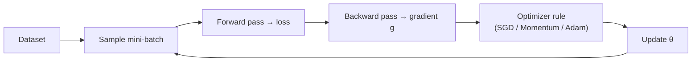
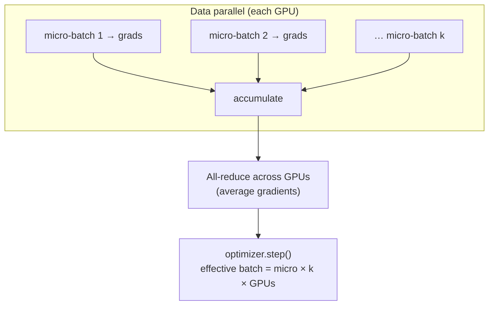
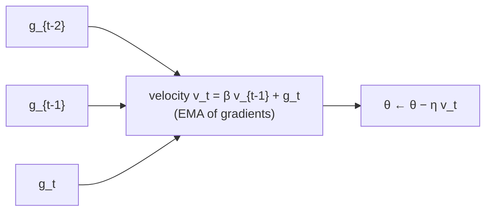

# Optimization Methods - Gradient Descent Variants

[Home](math-index.md#optimization-methods)

## Overview

**Gradient descent** is the algorithm that trains virtually every neural network: compute the gradient of the loss, take a small step the opposite way, repeat. The variants differ in **how much data they use per step** and **how they use past gradients**.

| Variant | Data per update | Update rule | Character |
|---|---|---|---|
| **Batch (full) GD** | Entire dataset | $\theta \leftarrow \theta - \eta\nabla\mathcal L(\theta)$ | Exact but slow and memory-hungry |
| **Stochastic GD (SGD)** | 1 example | $\theta \leftarrow \theta - \eta\nabla\ell_i(\theta)$ | Noisy, cheap, can escape bad regions |
| **Mini-batch GD** | $B$ examples (e.g., 32–4M tokens) | $\theta \leftarrow \theta - \eta\frac1B\sum_{i\in\mathcal B}\nabla\ell_i$ | The practical standard, GPU-friendly |
| **Momentum** | Mini-batch + velocity | $v \leftarrow \beta v + g$; $\theta \leftarrow \theta - \eta v$ | Accelerates along consistent directions, damps oscillation |

(In deep-learning code, "SGD" almost always means **mini-batch SGD**, often with momentum.)

---

## Why It Matters



> **Architect's lens:** Batch size is one of the most consequential infrastructure decisions in training. It sets **GPU utilization, memory, the number of GPUs you can use efficiently (data parallelism), communication frequency, and the learning-rate schedule**. The math of gradient-descent variants tells you how these trade off.

---

## 1. Stochastic Gradient Descent (SGD)

### Explanation

The true loss is an average over $N$ examples: $\mathcal L(\theta) = \frac1N\sum_{i=1}^N\ell_i(\theta)$. Computing $\nabla\mathcal L$ exactly costs a pass over **all** data per step, which is impossible for billions of tokens.

**SGD** estimates the gradient from a **single randomly chosen example**:

$$
\theta_{t+1} = \theta_t - \eta\,\nabla\ell_{i_t}(\theta_t), \qquad i_t \sim \text{Uniform}\{1..N\}
$$

- The estimate is **unbiased**: $\mathbb E[\nabla\ell_i] = \nabla\mathcal L$.
- It is **noisy**, with variance $\sigma^2$ per example. The noise means SGD never settles exactly; it **bounces around** the minimum unless $\eta$ decays.
- **Convergence** (convex case) requires a decaying learning rate, e.g., $\sum\eta_t = \infty$, $\sum\eta_t^2 < \infty$ (Robbins–Monro conditions).
- **Benefit of noise**: helps escape saddle points and sharp minima, and acts as **implicit regularization**.

### Worked Example

Minimize $\mathcal L(w) = \frac1N\sum_i (w x_i - y_i)^2$ with data points $(1, 2), (2, 4), (3, 6)$ (true $w = 2$). Start at $w = 0$, $\eta = 0.05$.

The per-example gradient is $2(wx_i - y_i)x_i$.

| Step | Example | Gradient | New $w$ |
|---|---|---|---|
| 1 | $(2,4)$ | $2(0 - 4)(2) = -16$ | $0 + 0.05\cdot16 = 0.80$ |
| 2 | $(1,2)$ | $2(0.8 - 2)(1) = -2.4$ | $0.80 + 0.12 = 0.92$ |
| 3 | $(3,6)$ | $2(2.76 - 6)(3) = -19.44$ | $0.92 + 0.972 = 1.892$ |

It moves toward 2, unevenly, with step sizes depending on which example was drawn.

### Architectural Relevance

- **Streaming / online learning**: pure SGD (batch size 1) suits systems that update on each event (online ad-click models, recommendation feedback loops).
- **Data shuffling is part of the algorithm**: the unbiasedness assumption requires random sampling. Data loaders must shuffle (and in distributed training, shard deterministically per epoch) or training quality degrades.
- **Non-determinism**: sampling order, GPU reductions, and data-loader workers affect results. Reproducibility needs seeded samplers and deterministic kernels, which matters for audits and debugging.
- **Plain SGD (+ momentum) still wins in some domains**, such as CNN image classification, where it often generalizes better than Adam.

### Python Implementation

```python
import numpy as np

X = np.array([1.0, 2.0, 3.0])
Y = np.array([2.0, 4.0, 6.0])

# Reproduce the worked example exactly (fixed order 2nd, 1st, 3rd example)
w, lr = 0.0, 0.05
for i in [1, 0, 2]:
    g = 2 * (w * X[i] - Y[i]) * X[i]
    w -= lr * g
    print(f"example {i}: grad={g:8.3f} -> w={w:.3f}")

# Full SGD with shuffling; noise keeps w bouncing unless lr decays
rng = np.random.default_rng(0)
Xn = rng.normal(size=1000)
Yn = 2.0 * Xn + rng.normal(scale=0.5, size=1000)

def run_sgd(decay: bool, epochs=5, lr0=0.05):
    w, history = 0.0, []
    t = 0
    for _ in range(epochs):
        for i in rng.permutation(len(Xn)):               # shuffle each epoch
            lr = lr0 / (1 + 0.01 * t) if decay else lr0
            w -= lr * 2 * (w * Xn[i] - Yn[i]) * Xn[i]
            history.append(w)
            t += 1
    tail = np.array(history[-500:])
    return w, tail.std()

for decay in (False, True):
    w, jitter = run_sgd(decay)
    print(f"decay={decay!s:5}: final w={w:.4f}, jitter(std of last 500)={jitter:.4f}")
```

**Output:**
```text
example 1: grad= -16.000 -> w=0.800
example 0: grad=  -2.400 -> w=0.920
example 2: grad= -19.440 -> w=1.892
decay=False: final w=2.0936, jitter(std of last 500)=0.1081
decay=True : final w=2.0421, jitter(std of last 500)=0.0106
```

---

## 2. Mini-batch Gradient Descent

### Explanation

Mini-batch GD averages the gradient over a batch $\mathcal B$ of $B$ examples:

$$
g_t = \frac1B\sum_{i\in\mathcal B_t}\nabla\ell_i(\theta_t), \qquad \theta_{t+1} = \theta_t - \eta\,g_t
$$

**Variance reduction**: averaging $B$ independent gradients divides the variance by $B$:

$$
\text{Var}[g_t] = \frac{\sigma^2}{B} \quad\Rightarrow\quad \text{noise std} \propto \frac{1}{\sqrt B}
$$

So going from $B = 32$ to $B = 128$ (4×) only **halves** the noise. There are diminishing returns.

**Trade-offs of batch size:**

| Small batch | Large batch |
|---|---|
| Noisier gradients (regularizing) | Smoother gradients |
| More updates per epoch | Fewer updates per epoch |
| Poor GPU utilization | High hardware throughput |
| Less memory | More memory (activations scale with $B$) |
| Often better generalization | Risk of sharp minima; needs LR scaling + warmup |

**Linear scaling rule** (Goyal et al., 2017): when multiplying the batch size by $k$, multiply the learning rate by $k$ (with warmup). This holds up to the **critical batch size**, beyond which extra batch gives little speed-up. For Adam-family optimizers a **square-root** scaling ($\eta\propto\sqrt k$) is often closer.

**Gradient accumulation**: simulate a large batch on limited memory by summing gradients over $k$ micro-batches before stepping:

$$
\text{effective batch} = \text{micro-batch} \times \text{accumulation steps} \times \text{data-parallel GPUs}
$$

### Worked Example

Per-example gradient noise std $\sigma = 2.0$:

| Batch size $B$ | Noise std $\sigma/\sqrt B$ |
|---|---|
| 1 | 2.00 |
| 16 | 0.50 |
| 64 | 0.25 |
| 256 | 0.125 |

LLM example: micro-batch 4 sequences × 4096 tokens, 8 accumulation steps, 64 GPUs gives $4\times8\times64 = 2048$ sequences ≈ **8.4M tokens per step**.

### Diagram



```text
  Loss trajectory (top view of contours)
   Full-batch GD:   ●────────────────────●  smooth, few expensive steps
   Mini-batch:      ●──╮╭──╮╭─╮╭─────────●  mild noise, many cheap steps
   SGD (B=1):       ●╮╭╯╰╮╭╯╰╮╭╯╰╮╭╯╰─╮╭╯●  very noisy
```

### Architectural Relevance

- **Batch size ↔ cluster design**: data parallelism replicates the model and splits the batch. Global batch = per-GPU batch × #GPUs, so scaling to more GPUs **forces** larger global batches. Past the critical batch size, more GPUs buy little speed-up, which is a key input to cluster sizing and cost.
- **Memory planning**: activations scale linearly with micro-batch size (and sequence length). Choose the largest micro-batch that fits, then use **gradient accumulation** for the target global batch.
- **Communication**: gradients are all-reduced once per optimizer step, so accumulation reduces communication frequency.
- **Batch-size warmup / ramp-up**: some LLM recipes start with smaller batches and increase them, combining early noise with later efficiency.
- **Inference batching** is a different concept (throughput vs latency), but the same hardware-utilization logic applies.

### Python Implementation

```python
import torch

torch.manual_seed(0)
N, d = 4096, 20
X = torch.randn(N, d)
w_true = torch.randn(d)
y = X @ w_true + 0.5 * torch.randn(N)

def grad_noise(batch_size, trials=200):
    w = torch.zeros(d)
    full = 2 * X.T @ (X @ w - y) / N
    errs = []
    for _ in range(trials):
        idx = torch.randint(0, N, (batch_size,))
        g = 2 * X[idx].T @ (X[idx] @ w - y[idx]) / batch_size
        errs.append((g - full).norm())
    return torch.stack(errs).mean().item()

for B in (1, 16, 64, 256):
    print(f"B={B:>3}: gradient error ≈ {grad_noise(B):.3f}")

# Gradient accumulation == large-batch gradient
model = torch.nn.Linear(d, 1)
loss_fn = torch.nn.MSELoss()
xb, yb = X[:256], y[:256].unsqueeze(1)

model.zero_grad()
loss_fn(model(xb), yb).backward()
big = model.weight.grad.clone()

model.zero_grad()
accum = 4
for chunk_x, chunk_y in zip(xb.chunk(accum), yb.chunk(accum)):
    (loss_fn(model(chunk_x), chunk_y) / accum).backward()     # scale by 1/accum!
print("accumulated grad == big-batch grad ?", torch.allclose(big, model.weight.grad, atol=1e-6))

# Standard mini-batch training loop with a DataLoader
from torch.utils.data import DataLoader, TensorDataset
loader = DataLoader(TensorDataset(X, y.unsqueeze(1)), batch_size=64, shuffle=True)
model = torch.nn.Linear(d, 1)
opt = torch.optim.SGD(model.parameters(), lr=0.05)
for epoch in range(3):
    for xb, yb in loader:
        opt.zero_grad()
        loss = loss_fn(model(xb), yb)
        loss.backward()
        opt.step()
    print(f"epoch {epoch}: last batch loss = {loss.item():.4f}")
```

**Output:**
```text
B=  1: gradient error ≈ 39.383
B= 16: gradient error ≈ 12.208
B= 64: gradient error ≈ 6.041
B=256: gradient error ≈ 3.037
accumulated grad == big-batch grad ? True
epoch 0: last batch loss = 0.2619
epoch 1: last batch loss = 0.3787
epoch 2: last batch loss = 0.1941
```

---

## 3. Momentum

### Explanation

Plain gradient descent has two problems: it **zig-zags** across narrow valleys (ill-conditioned curvature) and **crawls** along flat directions. **Momentum** fixes both by accumulating a **velocity**, an exponentially weighted moving average of past gradients:

$$
v_{t} = \beta\,v_{t-1} + g_t, \qquad \theta_{t+1} = \theta_t - \eta\,v_t
$$

with $\beta$ typically **0.9**.

- **Consistent directions** add up: effective step ≈ $\frac{\eta}{1 - \beta}$ (10× for $\beta = 0.9$).
- **Oscillating directions** cancel out, which damps zig-zag.
- Physical analogy: a heavy ball rolling downhill that builds speed and isn't knocked off course by every bump.

**Nesterov Accelerated Gradient (NAG)** looks ahead: it evaluates the gradient at the anticipated position,

$$
v_t = \beta\,v_{t-1} + \nabla\mathcal L(\theta_t - \eta\beta v_{t-1}), \qquad \theta_{t+1} = \theta_t - \eta\,v_t
$$

This gives a more responsive correction and better theoretical rates for convex problems. In PyTorch: `SGD(..., momentum=0.9, nesterov=True)`.

Momentum's EMA of gradients is also the **first-moment** estimate in Adam (see [Advanced Optimizers](14_Advanced%20Optimizers.md)).

### Worked Example

Consistent gradient $g = 1$ every step, $\beta = 0.9$, $v_0 = 0$:

| Step | $v_t = 0.9\,v_{t-1} + 1$ |
|---|---|
| 1 | 1.0 |
| 2 | 1.9 |
| 3 | 2.71 |
| 10 | 6.51 |
| ∞ | $1/(1-0.9) = 10$ |

Alternating gradient $g = +1, -1, +1, \dots$: $v$ settles into oscillating between $\pm\frac{1}{1+\beta} \approx \pm0.53$ (about half the raw gradient), so the oscillation is **damped**.

### Diagram

```text
  Narrow valley (ill-conditioned): contours stretched horizontally

   Plain GD:            Momentum:
   ╲╱╲╱╲╱╲╱╲╱→ min      ───────────────→ min
   zig-zags across      oscillations cancel,
   the valley           speed builds along it
```



### Architectural Relevance

- **Standard in vision training**: SGD + Nesterov momentum 0.9 with cosine schedule is the classic ResNet/ImageNet recipe.
- **Memory cost**: momentum stores one extra tensor per parameter (+1× params). For a 7B model in FP32 that is +28 GB. Optimizer-state memory is a first-class concern (ZeRO-1 shards it across GPUs; 8-bit optimizers compress it).
- **Interaction with learning rate**: the effective learning rate is about $\eta/(1-\beta)$. Changing $\beta$ without adjusting $\eta$ changes training dynamics, so treat them as a pair in hyperparameter searches.
- **Large-batch training**: momentum and its relatives (LARS/LAMB layer-wise scaling) are part of the recipe for stable training at very large batch sizes.
- **EMA of weights** (a related idea: averaging parameters rather than gradients) is used in diffusion models and self-supervised learning (teacher networks) for more stable final models.

### Python Implementation

```python
import numpy as np
import torch

# Velocity build-up and damping
beta = 0.9
v = 0.0
for t in range(1, 11):
    v = beta * v + 1.0
print(f"constant gradient: v after 10 steps = {v:.2f} (limit {1 / (1 - beta):.0f})")
v, vs = 0.0, []
for t in range(200):
    v = beta * v + (1.0 if t % 2 == 0 else -1.0)
    vs.append(v)
print(f"alternating gradient: v oscillates in [{min(vs[-4:]):.2f}, {max(vs[-4:]):.2f}]")

# Ill-conditioned quadratic: f = 0.5*(x² + 50 y²)  (condition number 50)
def grad(p):
    return np.array([p[0], 50 * p[1]])

def optimize(momentum, nesterov=False, lr=0.02, steps=100):
    p, v = np.array([10.0, 1.0]), np.zeros(2)
    for _ in range(steps):
        look = p - lr * momentum * v if nesterov else p
        v = momentum * v + grad(look)
        p = p - lr * v
    return 0.5 * (p[0] ** 2 + 50 * p[1] ** 2)

print(f"plain GD      : f = {optimize(0.0):.2e}")
print(f"momentum 0.9  : f = {optimize(0.9):.2e}")
print(f"nesterov 0.9  : f = {optimize(0.9, nesterov=True):.2e}")
# Caution: momentum raises the effective step to ~lr/(1-β); too large an lr diverges
print(f"nesterov 0.9, lr=0.035: f = {optimize(0.9, nesterov=True, lr=0.035):.2e}  <- diverged")

# PyTorch usage
model = torch.nn.Linear(10, 1)
opt = torch.optim.SGD(model.parameters(), lr=0.01, momentum=0.9, nesterov=True)
x, y = torch.randn(32, 10), torch.randn(32, 1)
torch.nn.functional.mse_loss(model(x), y).backward()
opt.step()
state = opt.state[model.weight]
print("optimizer state keys:", list(state.keys()), "| shape:", tuple(state["momentum_buffer"].shape))
```

**Output:**
```text
constant gradient: v after 10 steps = 6.51 (limit 10)
alternating gradient: v oscillates in [-0.53, 0.53]
plain GD      : f = 8.79e-01
momentum 0.9  : f = 9.39e-04
nesterov 0.9  : f = 1.93e-04
nesterov 0.9, lr=0.035: f = 7.58e+51  <- diverged
optimizer state keys: ['momentum_buffer'] | shape: (1, 10)
```

---

## Comparison Summary

| Variant | Gradient quality | Cost / step | Memory overhead | Typical use |
|---|---|---|---|---|
| Full-batch GD | Exact | Very high | — | Small convex problems |
| SGD (B=1) | Very noisy | Very low | — | Online/streaming learning |
| Mini-batch | Tunable noise ($\propto1/\sqrt B$) | Moderate (GPU-efficient) | — | **Default** |
| + Momentum | Smoothed (EMA) | Same | +1× params | Vision, large-batch |
| + Nesterov | Smoothed + look-ahead | Same | +1× params | Vision, convex theory |

---

## Common Mistakes

| Mistake | Why it hurts | Better approach |
|---|---|---|
| Not shuffling data | Biased gradients, cyclic artifacts | `shuffle=True`; `DistributedSampler.set_epoch()` |
| Forgetting to scale loss in gradient accumulation | Effective LR multiplied by #accum steps | Divide loss by accumulation steps |
| Increasing batch size without changing LR | Slower convergence per epoch | Linear (SGD) / sqrt (Adam) scaling + warmup |
| Huge batch for small data | Poor generalization, wasted compute | Stay below the critical batch size |
| Changing momentum without retuning LR | Effective step $\eta/(1-\beta)$ changes | Tune $(\eta, \beta)$ jointly |
| Ignoring optimizer-state memory | OOM when scaling the model | Budget +1× (momentum) / +2× (Adam) params; shard with ZeRO |

---

## Interview Questions

### Beginner
1. **Difference between batch GD, SGD, and mini-batch GD?**
   *Gradient computed from all data, one example, or a small batch respectively.*
2. **What does momentum do?**
   *Accumulates an exponential average of gradients to speed up consistent directions and damp oscillations.*

### Intermediate
1. **Why is the SGD gradient unbiased, and why does that matter?**
   *Random sampling makes $\mathbb E[\nabla\ell_i] = \nabla\mathcal L$, so on average it moves in the right direction. This requires proper shuffling.*
2. **How does gradient noise scale with batch size?**
   *Std $\propto 1/\sqrt B$, so 4× batch only halves noise.*
3. **How do you train with an effective batch of 1024 on a GPU that fits 16?**
   *Gradient accumulation over 64 micro-batches (with loss scaled by 1/64), or combine with data parallelism.*

### Architect-Level
1. **You are scaling training from 8 to 256 GPUs. What changes in the optimization setup?**
   *Global batch grows 32×. Check the critical batch size; scale LR (linear/sqrt) with longer warmup; maybe use LAMB/LARS; reduce accumulation; ensure deterministic sharded shuffling; overlap all-reduce with backward; re-validate convergence per token, not per step.*
2. **What is the critical batch size and why should architects care?**
   *The batch size beyond which doubling the batch no longer roughly halves the number of steps. Above it, more GPUs give diminishing speed-up per dollar, which bounds efficient cluster size for a given model and data.*
3. **How much memory does momentum add for a 70B model, and how do you mitigate it?**
   *70B × 4 B = 280 GB (FP32). Shard across data-parallel ranks (ZeRO-1/FSDP), use 8-bit optimizer states, or use optimizers with factored states (Adafactor).*

---

## Key Takeaways

- **SGD** uses one-example gradient estimates: unbiased, noisy, cheap, and implicitly regularizing.
- **Mini-batch GD** is the practical default. Noise scales as $1/\sqrt B$; use **gradient accumulation** to decouple memory from batch size.
- **Momentum** is an EMA of gradients that accelerates along valleys and damps oscillation (effective LR ≈ $\eta/(1-\beta)$).
- Batch size is an **infrastructure decision**: it couples to LR schedules, GPU count, memory, and communication.
