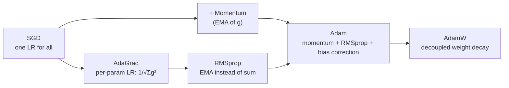
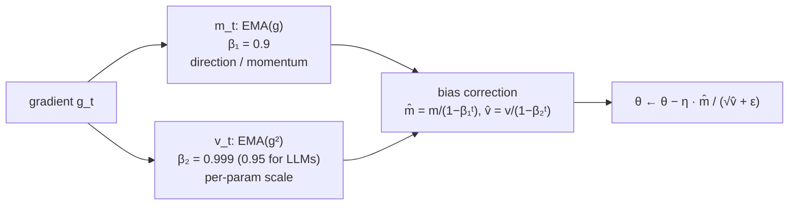
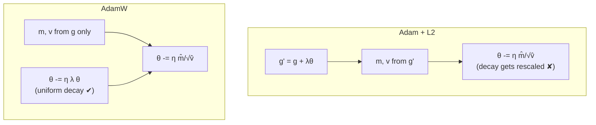

# Optimization Methods - Advanced Optimizers

[Home](math-index.md#optimization-methods)

## Overview

Plain SGD uses **one global learning rate** for every parameter. Real networks have parameters with very different gradient scales: rare-token embeddings get tiny, infrequent gradients, while LayerNorm gains get large, frequent ones. **Adaptive optimizers** give each parameter its **own effective learning rate** based on its gradient history.

| Optimizer | Key idea | State per parameter | Typical use |
|---|---|---|---|
| **AdaGrad** | Divide by $\sqrt{\text{sum of all past } g^2}$ | 1× (sum of squares) | Sparse features, NLP embeddings (historically) |
| **RMSprop** | Divide by $\sqrt{\text{EMA of } g^2}$ (forgets the past) | 1× (EMA of squares) | RNNs, RL |
| **Adam** | Momentum (EMA of $g$) + RMSprop (EMA of $g^2$) + bias correction | 2× ($m$, $v$) | General default |
| **AdamW** | Adam + **decoupled** weight decay | 2× ($m$, $v$) | **Default for Transformers / LLMs** |

---

## Why It Matters



> **Architect's lens:** Optimizer choice drives **memory**. AdamW keeps two FP32 state tensors per parameter. Training a 7B model in mixed precision needs about **16 bytes/parameter** (BF16 weights 2 + BF16 grads 2 + FP32 master weights 4 + Adam $m$ 4 + Adam $v$ 4), which is ~112 GB before activations. That is why **ZeRO/FSDP sharding, 8-bit optimizers, and memory-light optimizers** (Adafactor, Lion) exist.

---

## 1. AdaGrad

### Explanation

AdaGrad (Duchi et al., 2011) scales each parameter's step by the **inverse root of its accumulated squared gradients**:

$$
G_t = G_{t-1} + g_t^2, \qquad \theta_{t+1} = \theta_t - \frac{\eta}{\sqrt{G_t} + \epsilon}\,g_t
$$

(all operations element-wise).

- Parameters with **large/frequent** gradients get **smaller** steps.
- Parameters with **small/rare** gradients get **larger** steps, which suits **sparse features**.
- **Fatal flaw for deep learning**: $G_t$ only grows, so the effective learning rate **decays toward zero** and training stalls.

### Worked Example

Two parameters, $\eta = 1$:

| Step | $g$ (param A, frequent) | $G_A$ | step A | $g$ (param B, rare) | $G_B$ | step B |
|---|---|---|---|---|---|---|
| 1 | 1.0 | 1 | 1.00 | 0.0 | 0 | 0 |
| 2 | 1.0 | 2 | 0.71 | 0.0 | 0 | 0 |
| 3 | 1.0 | 3 | 0.58 | 0.1 | 0.01 | **1.00** |

Param B's rare gradient of 0.1 still produces a **full-size** step, while A's steps shrink steadily.

### Architectural Relevance

- **Sparse, high-dimensional models** (click-through-rate prediction, recommendation with huge embedding tables): AdaGrad-style per-coordinate rates help rare IDs learn. Variants like **FTRL** and **row-wise AdaGrad** are used in production recommender training (e.g., TorchRec).
- Rarely used for modern dense deep nets because of the decaying learning rate. Its idea lives on in RMSprop and Adam.

---

## 2. RMSprop

### Explanation

RMSprop (Hinton, 2012) fixes AdaGrad's decay by using an **exponential moving average (EMA)** of squared gradients, so old history is forgotten:

$$
v_t = \rho\,v_{t-1} + (1 - \rho)\,g_t^2, \qquad \theta_{t+1} = \theta_t - \frac{\eta}{\sqrt{v_t} + \epsilon}\,g_t
$$

with $\rho \approx 0.9$–$0.99$.

- $\sqrt{v_t}$ ≈ the **recent RMS gradient magnitude** per parameter.
- Dividing by it **normalizes step sizes**, making updates roughly scale-invariant to gradient magnitude.
- The effective learning rate adapts up and down instead of only decaying.

### Worked Example

Gradient magnitude for one parameter suddenly drops from 10 to 0.1 ($\rho = 0.9$):

- AdaGrad: $G$ is huge from the early large gradients, so the steps become tiny **forever**.
- RMSprop: after ~20–30 steps $v$ adapts to $\approx 0.01$, so the steps return to $\approx\eta\cdot\frac{0.1}{0.1} = \eta$.

### Architectural Relevance

- Historically important for **RNNs** and **deep RL** (DQN, A3C). Still a common choice in RL, where non-stationary objectives benefit from forgetting.
- Shows up inside Adam as the second-moment estimate.

---

## 3. Adam (Adaptive Moment Estimation)

### Explanation

Adam (Kingma & Ba, 2015) combines **momentum** (first moment) with **RMSprop** (second moment) and adds **bias correction**:

$$
\begin{aligned}
m_t &= \beta_1 m_{t-1} + (1 - \beta_1)\,g_t &&\text{(EMA of gradients: direction)}\\
v_t &= \beta_2 v_{t-1} + (1 - \beta_2)\,g_t^2 &&\text{(EMA of squared gradients: scale)}\\
\hat m_t &= \frac{m_t}{1 - \beta_1^t}, \quad \hat v_t = \frac{v_t}{1 - \beta_2^t} &&\text{(bias correction)}\\
\theta_{t+1} &= \theta_t - \eta\,\frac{\hat m_t}{\sqrt{\hat v_t} + \epsilon}
\end{aligned}
$$

Defaults: $\beta_1 = 0.9$, $\beta_2 = 0.999$, $\epsilon = 10^{-8}$. (LLM training typically uses $\beta_2 = 0.95$ for faster adaptation and better stability.)

**Why bias correction?** $m_0 = v_0 = 0$, so the early EMAs are biased toward zero. At $t = 1$: $m_1 = 0.1g_1$, but $\hat m_1 = 0.1g_1/0.1 = g_1$ ✓

**Step size intuition**: $\lvert\hat m/\sqrt{\hat v}\rvert \lesssim 1$, so each parameter moves **at most about $\eta$ per step**, regardless of gradient scale. This makes Adam robust and easy to tune, and is a big reason it is the default.

### Worked Example — first step

$g_1 = 0.5$, $\eta = 0.001$:

- $m_1 = 0.1 \times 0.5 = 0.05$, $\hat m_1 = 0.05/0.1 = 0.5$
- $v_1 = 0.001 \times 0.25 = 0.00025$, $\hat v_1 = 0.00025/0.001 = 0.25$
- Step $= 0.001 \times 0.5/\sqrt{0.25} = 0.001 \times 1 = 0.001$

The first step has magnitude ≈ $\eta$ whatever the gradient size: $g_1 = 0.5$ or $g_1 = 500$ give the same step.

### Diagram



### Architectural Relevance

- **Default for Transformers, diffusion models, and most deep learning**: robust to badly scaled gradients and less sensitive to the learning rate than SGD.
- **Memory: 2 extra FP32 tensors per parameter** ($m$, $v$), so the optimizer state is 2× model size in FP32. Mitigations:
  - **ZeRO-1/2/3 / FSDP**: shard optimizer state (and grads/params) across data-parallel GPUs.
  - **8-bit Adam** (bitsandbytes): quantized states, ~75% state-memory savings.
  - **Paged optimizers** (QLoRA): page state to CPU RAM during spikes.
  - **Adafactor**: factorizes $v$ into row/column statistics, sub-linear memory.
- **Stability knobs**: lower $\beta_2$ (0.95) reacts faster to gradient-scale changes; $\epsilon$ matters in low precision (too small causes huge steps when $v \approx 0$); combine with **warmup** (early $\hat v$ estimates are noisy) and **gradient clipping**.
- **Checkpointing**: optimizer state is part of the checkpoint, and is often 2–3× the size of the weights. Plan storage and checkpoint I/O bandwidth accordingly.

---

## 4. AdamW (Adam with Decoupled Weight Decay)

### Explanation

**L2 regularization** adds $\frac\lambda2\lVert\theta\rVert^2$ to the loss, which adds $\lambda\theta$ to the gradient. With plain SGD this is the same as **weight decay** ($\theta \leftarrow \theta - \eta\lambda\theta$).

**With Adam it is not.** The $\lambda\theta$ term goes **into** $m$ and $v$ and gets **divided by $\sqrt{\hat v}$**. Parameters with large gradients get **less** regularization, which is the opposite of what we want, so regularization becomes inconsistent.

**AdamW** (Loshchilov & Hutter, 2019) **decouples** weight decay from the gradient-based update:

$$
\theta_{t+1} = \theta_t - \eta\left(\frac{\hat m_t}{\sqrt{\hat v_t} + \epsilon} + \lambda\,\theta_t\right)
$$

The decay $\lambda\theta_t$ is applied **directly** to the weights and is **not** normalized by $\sqrt{\hat v}$. Every weight shrinks at the same relative rate, so it implements the Gaussian-prior MAP intent (see [Estimations](11_Estimations.md)) correctly.

### Worked Example

Two weights, both $\theta = 1.0$, $\lambda = 0.1$, $\eta = 0.01$. Weight A has $\sqrt{\hat v} = 10$ (large gradients), weight B has $\sqrt{\hat v} = 0.1$ (small gradients).

| | Adam + L2 (decay inside gradient) | AdamW (decoupled) |
|---|---|---|
| Decay effect on A | $\eta\cdot\frac{\lambda\theta}{\sqrt{\hat v}} = 0.01\cdot\frac{0.1}{10} = 0.0001$ | $\eta\lambda\theta = 0.001$ |
| Decay effect on B | $0.01\cdot\frac{0.1}{0.1} = 0.01$ | $0.001$ |

With Adam + L2, A is barely regularized while B is regularized 100× more. AdamW treats them equally.

(Real updates mix the decay with the gradient term inside $m, v$, but the scaling argument is the same.)

### Diagram



### Architectural Relevance

- **The standard optimizer for LLM pre-training and fine-tuning** (GPT, LLaMA, BERT recipes). Typical settings: $\beta_1 = 0.9$, $\beta_2 = 0.95$, weight decay $0.1$, $\epsilon = 10^{-8}$, warmup + cosine decay, gradient clipping at 1.0.
- **Parameter groups**: exclude **biases, LayerNorm/RMSNorm gains, and often embeddings** from weight decay. Decaying normalization gains toward 0 hurts the model.
- **Fine-tuning**: lower LR (1e-5 to 2e-4 for LoRA), smaller or zero weight decay on adapters.
- **Alternatives worth knowing**: **Lion** (sign-based, 1× state), **Adafactor** (factored second moment), **Sophia** (diagonal Hessian estimate), **Shampoo/SOAP** (Kronecker preconditioners), **Muon** (orthogonalized momentum). They trade memory, compute, and tuning effort against convergence speed.

### Python Implementation

#### (a) From-scratch implementations, compared on an ill-conditioned problem

```python
import numpy as np

def loss_grad(p):
    # Ill-conditioned + differently-scaled quadratic: f = 0.5*(100 x² + 0.01 y²)
    return np.array([100 * p[0], 0.01 * p[1]])

def f(p):
    return 0.5 * (100 * p[0] ** 2 + 0.01 * p[1] ** 2)

def run(opt, steps=300, lr=0.1):
    p = np.array([1.0, 10.0])
    m = np.zeros(2); v = np.zeros(2); G = np.zeros(2)
    b1, b2, eps = 0.9, 0.999, 1e-8
    for t in range(1, steps + 1):
        g = loss_grad(p)
        if opt == "sgd":
            p = p - 0.009 * g                          # must be < 2/100 for stability
        elif opt == "adagrad":
            G += g**2
            p = p - lr / (np.sqrt(G) + eps) * g
        elif opt == "rmsprop":
            v = 0.9 * v + 0.1 * g**2
            p = p - lr / (np.sqrt(v) + eps) * g
        elif opt == "adam":
            m = b1 * m + (1 - b1) * g
            v = b2 * v + (1 - b2) * g**2
            mh, vh = m / (1 - b1**t), v / (1 - b2**t)
            p = p - lr * mh / (np.sqrt(vh) + eps)
    return f(p), p

for name in ("sgd", "adagrad", "rmsprop", "adam"):
    val, p = run(name)
    print(f"{name:8s}: f = {val:.4e} | x = {p[0]: .4f}, y = {p[1]: .4f}")
```

**Output:**
```text
sgd     : f = 4.7371e-01 | x =  0.0000, y =  9.7336
adagrad : f = 2.3783e-01 | x =  0.0000, y =  6.8968
rmsprop : f = 1.2502e-01 | x =  0.0500, y =  0.0496
adam    : f = 1.6696e-08 | x =  0.0000, y =  0.0018
```

> SGD is forced to use a tiny learning rate by the steep $x$ direction (curvature 100), so it barely moves along the flat $y$ direction (curvature 0.01). Adaptive methods rescale each coordinate. **AdaGrad** starts well, but its ever-growing denominator makes it stall. **RMSprop** reaches the minimum quickly but then keeps bouncing around it with steps of about $\eta$ ($x$ oscillates at ±0.05), because nothing damps it. **Adam**'s momentum and bias correction let it converge precisely.

#### (b) Adam + L2 vs AdamW in PyTorch, and production-style setup

```python
import torch

torch.manual_seed(0)

def train(opt_name, steps=1000):
    torch.manual_seed(0)
    w = torch.nn.Parameter(torch.tensor([1.0, 1.0]))
    scales = torch.tensor([100.0, 0.01])                 # very different gradient scales
    if opt_name == "adam+l2":
        opt = torch.optim.Adam([w], lr=0.01, weight_decay=0.1)     # L2 folded into gradient
    else:
        opt = torch.optim.AdamW([w], lr=0.01, weight_decay=0.1)    # decoupled
    for _ in range(steps):
        noise = torch.randn(2)                            # zero-mean task gradient
        loss = (scales * noise * w).sum()
        opt.zero_grad(); loss.backward(); opt.step()
    return w.detach()

# Both weights start at 1.0 and see only zero-mean noise, so weight decay alone should shrink them.
print("Adam + L2 :", [round(v, 3) for v in train("adam+l2").tolist()],
      "<- large-grad weight barely decayed, small-grad weight crushed to 0")
print("AdamW     :", [round(v, 3) for v in train("adamw").tolist()], "<- both decayed comparably")

# Production-style AdamW: parameter groups exclude norms / biases from weight decay
model = torch.nn.TransformerEncoderLayer(d_model=64, nhead=4, batch_first=True)
decay, no_decay = [], []
for name, p in model.named_parameters():
    (no_decay if p.ndim < 2 or "norm" in name else decay).append(p)
opt = torch.optim.AdamW([{"params": decay, "weight_decay": 0.1},
                         {"params": no_decay, "weight_decay": 0.0}],
                        lr=3e-4, betas=(0.9, 0.95), eps=1e-8)
print(f"decay tensors: {len(decay)} | no-decay tensors: {len(no_decay)}")

# Optimizer-state memory: Adam keeps 2 tensors per parameter
x = torch.randn(8, 16, 64)
model(x).sum().backward()
opt.step()
n_params = sum(p.numel() for p in model.parameters())
n_state = sum(s["exp_avg"].numel() + s["exp_avg_sq"].numel() for s in opt.state.values())
print(f"params: {n_params:,} | Adam state elements: {n_state:,} ({n_state / n_params:.0f}x)")

# Memory planner for mixed-precision AdamW training
def training_memory_gb(params_billion):
    bytes_per_param = 2 + 2 + 4 + 4 + 4   # bf16 weights, bf16 grads, fp32 master, m, v
    return params_billion * 1e9 * bytes_per_param / 1e9

for size in (1, 7, 70):
    print(f"{size:>3}B model: ~{training_memory_gb(size):,.0f} GB (excl. activations) "
          f"-> per GPU with ZeRO-3 on 64 GPUs: ~{training_memory_gb(size) / 64:.1f} GB")
```

**Output:**
```text
Adam + L2 : [1.061, -0.002] <- large-grad weight barely decayed, small-grad weight crushed to 0
AdamW     : [0.369, 0.226] <- both decayed comparably
decay tensors: 4 | no-decay tensors: 8
params: 281,152 | Adam state elements: 562,304 (2x)
  1B model: ~16 GB (excl. activations) -> per GPU with ZeRO-3 on 64 GPUs: ~0.2 GB
  7B model: ~112 GB (excl. activations) -> per GPU with ZeRO-3 on 64 GPUs: ~1.8 GB
 70B model: ~1,120 GB (excl. activations) -> per GPU with ZeRO-3 on 64 GPUs: ~17.5 GB
```

---

## Optimizer Cheat Sheet

| Optimizer | Update (element-wise) | Extra memory | Strengths | Weaknesses |
|---|---|---|---|---|
| SGD + momentum | $\theta -= \eta\,v$ | 1× | Generalizes well (vision), cheap | LR-sensitive, needs tuning |
| AdaGrad | $\theta -= \eta\,g/\sqrt{\sum g^2}$ | 1× | Sparse features | LR decays to zero |
| RMSprop | $\theta -= \eta\,g/\sqrt{\text{EMA}(g^2)}$ | 1× | Non-stationary (RL) | No momentum, no bias correction |
| Adam | $\theta -= \eta\,\hat m/\sqrt{\hat v}$ | 2× | Robust default | L2 interacts badly; memory |
| **AdamW** | Adam $-\;\eta\lambda\theta$ | 2× | **LLM/Transformer standard** | Memory |
| Adafactor | Factored $v$ | ≪2× | Memory-light (T5) | Sometimes less stable |
| Lion | $\theta -= \eta\,\text{sign}(\text{interp}(m, g))$ | 1× | Memory-light, fast | Needs smaller LR, larger WD |

---

## Common Mistakes

| Mistake | Why it hurts | Better approach |
|---|---|---|
| Using `Adam(weight_decay=...)` expecting decoupled decay | It's L2, not true weight decay | Use `AdamW` |
| Applying weight decay to LayerNorm/bias | Degrades quality | Parameter groups with `weight_decay=0` |
| No warmup with Adam | Early $\hat v$ noisy → large, unstable steps | Linear warmup (e.g., 1–5% of steps) |
| Tiny $\epsilon$ in FP16/BF16 | Division blow-ups when $v\approx0$ | $\epsilon$ 1e-8 to 1e-6; keep states in FP32 |
| Forgetting optimizer state in checkpoints | Resume changes dynamics (loss spikes) | Save and restore optimizer + scheduler + scaler state |
| Using SGD LRs with Adam | Adam's step ≈ η per param; 0.1 is enormous | Typical Adam LR: 1e-4 to 1e-3 (pre-training), 1e-5 to 2e-4 (fine-tuning) |

---

## Interview Questions

### Beginner
1. **Why are adaptive optimizers useful?**
   *They give each parameter its own effective learning rate based on gradient history, handling different gradient scales automatically.*
2. **What two moments does Adam track?**
   *EMA of gradients (first moment, momentum) and EMA of squared gradients (second moment, scale).*

### Intermediate
1. **Why does AdaGrad stop learning, and how does RMSprop fix it?**
   *Its accumulated sum only grows, so the LR goes to 0. RMSprop uses an EMA that forgets old gradients.*
2. **Why does Adam need bias correction?**
   *EMAs start at 0, biasing early estimates toward 0; dividing by $1 - \beta^t$ corrects this.*
3. **What's the difference between Adam with L2 and AdamW?**
   *In Adam+L2 the decay term is rescaled by $1/\sqrt{\hat v}$, giving inconsistent regularization. AdamW applies decay directly to the weights.*

### Architect-Level
1. **Estimate the GPU memory to full-fine-tune a 13B model with AdamW, and how you would reduce it.**
   *≈16 B/param × 13B ≈ 208 GB + activations. Options: ZeRO-3/FSDP across GPUs, 8-bit Adam, activation checkpointing, CPU/NVMe offload, or switch to LoRA/QLoRA (trainable params < 1%, so the optimizer state shrinks proportionally).*
2. **Training diverges with loss spikes mid-run. Which optimizer-related levers do you check?**
   *Lower peak LR or longer warmup; $\beta_2$ 0.999 → 0.95; gradient clipping; check $\epsilon$ and precision of optimizer states; skip bad batches; inspect per-layer gradient norms; consider QK-norm / logit soft-capping in the architecture.*
3. **When would you choose SGD over AdamW in production?**
   *CNN vision training where SGD+momentum often generalizes better, memory-constrained settings (1× vs 2× state), or when matching a well-established recipe.*

---

## Key Takeaways

- **AdaGrad**: per-parameter LR from cumulative squared gradients. Good for sparse features, but the LR decays to zero.
- **RMSprop**: EMA of squared gradients, so it adapts and forgets.
- **Adam**: momentum + RMSprop + bias correction. Robust, with steps ≈ $\eta$ per parameter.
- **AdamW**: decoupled weight decay. **The standard for Transformers/LLMs**; exclude norms and biases from decay.
- Optimizer state is a major **memory and checkpoint cost** (2× params). Plan for ZeRO, 8-bit states, or PEFT.
