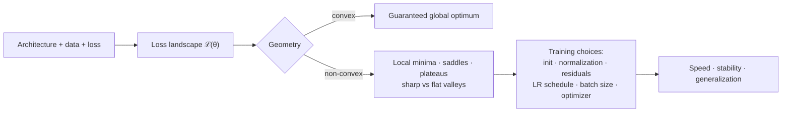
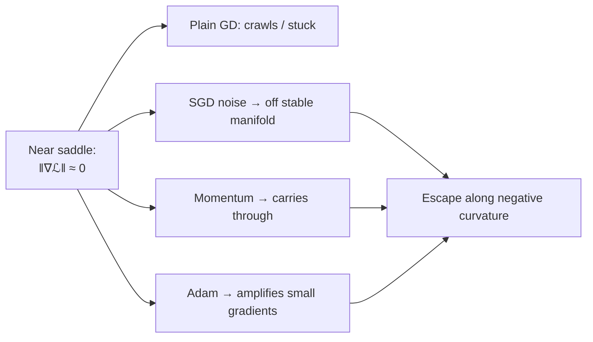

# Optimization Methods - Optimization Landscapes

[Home](math-index.md#optimization-methods)

## Overview

The **optimization landscape** (loss landscape) is the surface $\mathcal L(\boldsymbol\theta)$ over parameter space. Its geometry decides whether training is easy or hard, fast or slow, stable or explosive, and whether the solution generalizes.

| Sub-topic | Core question | Key insight |
|---|---|---|
| **Convex vs. non-convex** | Is every local minimum global? | Convex: yes, guaranteed. Deep nets: non-convex, but *usually benign* in practice |
| **Local minima** | Can training get stuck in a bad valley? | In very high dimensions, most local minima are **nearly as good** as the global one |
| **Saddle points** | Can training stall on flat "passes"? | Saddles vastly **outnumber** minima in high dimensions; noise and momentum escape them |

---

## Why It Matters



> **Architect's lens:** Many "tricks" in modern deep learning (residual connections, normalization layers, warmup, Adam, large width, over-parameterization) can be understood as ways of **reshaping the landscape** to be smoother and better conditioned, or of **navigating it** more effectively.

---

## 1. Convex vs. Non-Convex Functions

### Explanation

A function $f$ is **convex** if the line segment between any two points on its graph lies **on or above** the graph:

$$
f(\lambda\mathbf a + (1 - \lambda)\mathbf b) \le \lambda f(\mathbf a) + (1 - \lambda)f(\mathbf b), \qquad \lambda\in[0, 1]
$$

Equivalent tests (for twice-differentiable $f$):

| Test | Convex iff |
|---|---|
| Second derivative (1-D) | $f''(x) \ge 0$ everywhere |
| Hessian (n-D) | $H(\mathbf x) \succeq 0$ (all eigenvalues $\ge 0$) everywhere |
| First-order | $f(\mathbf b) \ge f(\mathbf a) + \nabla f(\mathbf a)^\top(\mathbf b - \mathbf a)$ (tangent planes lie below) |

**Why convexity is great**: every local minimum is a **global** minimum, gradient descent with a suitable LR converges, and there are convergence-rate guarantees. **Strongly convex** functions ($H \succeq \mu I$, $\mu > 0$) have a **unique** minimum and converge linearly.

| Convex (classic ML) | Non-convex (deep learning) |
|---|---|
| Linear/ridge regression (MSE) | Any network with a hidden layer + nonlinearity |
| Logistic regression | Transformers, CNNs, RNNs |
| SVMs (hinge loss) | Matrix factorization ($\lVert X - UV^\top\rVert^2$) |
| Lasso | GANs (a min-max game, even harder) |

**Why neural nets are non-convex**: composing nonlinearities breaks convexity, and there are **symmetries**. Permuting hidden units gives identical functions with different parameters, so there are many equivalent minima, and the average of two minima is generally *not* a minimum.

### Worked Example

- $f(x) = x^2$: $f'' = 2 > 0$, so it is **convex**.
- $f(x) = x^4 - 3x^2$: $f'' = 12x^2 - 6$, which is negative for $\lvert x\rvert < 0.707$, so it is **non-convex**. Critical points: $f' = 4x^3 - 6x = 0 \Rightarrow x = 0, \pm\sqrt{1.5}$. $x = 0$ is a local max; $x = \pm1.2247$ are two (equal) global minima.
- **Permutation symmetry**: a 1-hidden-layer net with weights $(w_1, w_2)$ for two hidden units computes the same function as $(w_2, w_1)$. Both are minima, but their midpoint $\frac{(w_1 + w_2)}{2}$ for both units collapses them into one unit and is usually much worse. That is non-convexity.

### Diagram

```text
     Convex: one basin                Non-convex: many basins, saddles, plateaus
   ℒ                                 ℒ
   │╲               ╱                │╲    ╱╲        ___        ╱
   │ ╲             ╱                 │ ╲  ╱  ╲  ╱╲  /   \      ╱
   │  ╲           ╱                  │  ╲╱    ╲╱  ╲/     \____╱
   │   ╲_________╱                   │  local   saddle  plateau  global?
   └──────────────── θ               └──────────────────────────────── θ
   any descent path → global min     outcome depends on init, LR, noise
```

### Architectural Relevance

- **Choosing convex models when possible**: for tabular baselines, logistic regression or linear models with convex losses give **reproducible, guaranteed** optima. This is valuable for regulated settings (credit scoring), auditability, and as strong baselines.
- **Convex sub-problems inside non-convex systems**: training only a **linear probe / classification head** on frozen embeddings is a convex problem, which is fast, stable, and reproducible. It is a standard production pattern (embedding + logistic regression).
- **Reproducibility**: in non-convex training, different seeds give different solutions (different minima). Production pipelines must pin seeds, track runs, and evaluate **variance across seeds** before declaring improvements.
- **Model merging / weight averaging**: averaging fine-tuned models (model soups, task arithmetic) works only when the models sit in the **same basin** (shared pre-trained init → linear mode connectivity). Averaging independently trained models fails because of permutation symmetry.

### Python Implementation

```python
import numpy as np
import torch

# Convexity check via second derivative / Hessian eigenvalues
xs = np.linspace(-2, 2, 401)
for name, f2 in [("x^2", lambda x: 2 + 0 * x), ("x^4 - 3x^2", lambda x: 12 * x**2 - 6)]:
    print(f"{name:11s}: min f'' on [-2,2] = {f2(xs).min():+.2f} ->",
          "convex" if f2(xs).min() >= 0 else "NON-convex")

# Logistic regression loss is convex: Hessian PSD at random points
torch.manual_seed(0)
X = torch.randn(100, 3)
y = (X[:, 0] + 0.5 * X[:, 1] > 0).float()
def logreg_loss(w):
    return torch.nn.functional.binary_cross_entropy_with_logits(X @ w, y)
for _ in range(3):
    H = torch.autograd.functional.hessian(logreg_loss, torch.randn(3) * 3)
    print("logreg Hessian min eigenvalue:", round(torch.linalg.eigvalsh(H).min().item(), 5))

# Non-convexity from symmetry: two equivalent minima, their midpoint is worse
torch.manual_seed(0)
Xs = torch.randn(256, 1)
ys = torch.relu(2 * Xs) + torch.relu(-1 * Xs)                  # target needs two hidden units
def net_loss(W1, W2):                                          # W1: (2,1) hidden, W2: (1,2) output
    return ((torch.relu(Xs @ W1.T) @ W2.T - ys) ** 2).mean().item()
W1_a, W2_a = torch.tensor([[2.0], [-1.0]]), torch.tensor([[1.0, 1.0]])
W1_b, W2_b = W1_a.flip(0), W2_a.flip(1)                        # swap hidden units
print(f"loss at solution A        = {net_loss(W1_a, W2_a):.4f}")
print(f"loss at permuted solution = {net_loss(W1_b, W2_b):.4f}")
print(f"loss at their midpoint    = {net_loss((W1_a + W1_b) / 2, (W2_a + W2_b) / 2):.4f}  <- non-convex!")
```

**Output:**
```text
x^2        : min f'' on [-2,2] = +2.00 -> convex
x^4 - 3x^2 : min f'' on [-2,2] = -6.00 -> NON-convex
logreg Hessian min eigenvalue: 0.00823
logreg Hessian min eigenvalue: 0.00544
logreg Hessian min eigenvalue: 0.00861
loss at solution A        = 0.0000
loss at permuted solution = 0.0000
loss at their midpoint    = 0.8822  <- non-convex!
```

---

## 2. Local Minima

### Explanation

A **local minimum** $\theta^*$ satisfies $\nabla\mathcal L(\theta^*) = 0$ and $H(\theta^*) \succ 0$: it is lower than all nearby points, but possibly not the lowest overall.

The classic fear was that gradient descent gets **trapped** in poor local minima. For large neural networks, both theory and experiments suggest this fear is mostly unfounded:

- **Over-parameterization**: when parameters far outnumber what is needed, most local minima have loss close to the global minimum. Wide networks can often reach **zero training loss**.
- **Random-matrix arguments** (Dauphin et al., 2014; Choromanska et al., 2015): for a critical point to be a minimum, *all* $n$ Hessian eigenvalues must be positive, which is exponentially unlikely at high loss. So high-loss critical points are mostly **saddles**, and minima concentrate in a narrow band of low loss.
- **Mode connectivity**: different minima are often connected by paths of low loss. The landscape behaves more like a connected valley floor than isolated pits.

**What matters more is the *kind* of minimum: sharp vs. flat.**

| | Sharp minimum | Flat minimum |
|---|---|---|
| Hessian eigenvalues | Large | Small |
| Sensitivity to weight perturbation | High | Low |
| Typical generalization | Often worse | Often better |
| Robustness to quantization/noise | Lower | Higher |
| Favored by | Large batches, high LR without noise | Small batches (SGD noise), SAM, weight averaging |

(The sharpness–generalization link is a useful heuristic, not a law; reparameterization can change sharpness without changing the function.)

### Worked Example

$f(x) = x^4 - 3x^2 + x$:

- $f'(x) = 4x^3 - 6x + 1 = 0$ has three roots: $x \approx -1.30,\; 0.17,\; 1.13$.
- $f(-1.30) \approx -3.51$ (**global** minimum), $f(1.13) \approx -1.07$ (**local** minimum), $x \approx 0.17$ is a local max.
- Gradient descent from $x_0 = 2$ falls into the **local** minimum at 1.13; from $x_0 = -2$ it finds the global one. **Initialization decides the outcome** in low dimensions.

### Diagram

```text
   f(x) = x⁴ − 3x² + x
   │
   │╲                                   ╱
   │ ╲              ╱‾‾╲               ╱
   │  ╲            ╱    ╲             ╱
   │   ╲          ╱      ╲     ___   ╱   ← local min (x≈1.13, f≈−1.07)
   │    ╲        ╱        ╲___╱   ╲_╱
   │     ╲______╱   ← global min (x≈−1.30, f≈−3.51)
   └──────────────────────────────────────── x
      start at −2 → global         start at +2 → local
```

### Architectural Relevance

- **Multiple seeds / restarts**: for small models or high-stakes training, run several seeds and pick by validation (or ensemble them). For giant LLMs this is unaffordable, which is why robust recipes (init, warmup, normalization) matter so much.
- **Over-parameterization as a design choice**: larger models are often *easier* to optimize. This is part of why scaling works and why "train large, then distill/compress/quantize" is a standard deployment pattern.
- **Flatness for deployment**: flat minima tolerate **quantization** (INT8/INT4) and **pruning** better. Techniques like **SAM**, **SWA/EMA weight averaging**, and model soups produce flatter, more deployable models.
- **Fine-tuning stays in the pre-trained basin**: small LRs and few steps keep the model near the pre-trained minimum, which is why fine-tuned variants of one base can be **merged** (model soups, TIES, DARE) and why LoRA adapters work.

### Python Implementation

```python
import numpy as np
import torch

f = lambda x: x**4 - 3 * x**2 + x
df = lambda x: 4 * x**3 - 6 * x + 1

roots = np.roots([4, 0, -6, 1])
for r in sorted(roots.real):
    kind = "min" if 12 * r**2 - 6 > 0 else "max"
    print(f"critical point x={r:+.3f}, f={f(r):+.3f} ({kind})")

def gd(x0, lr=0.01, steps=2000):
    x = x0
    for _ in range(steps):
        x -= lr * df(x)
    return x

for x0 in (-2.0, 2.0):
    x = gd(x0)
    print(f"GD from x0={x0:+.0f} -> x={x:+.3f}, f={f(x):+.3f}")

# Sharp vs flat minima: same loss, very different robustness to weight noise
def perturbed_loss(curvature, sigma=0.1, n=10000, seed=0):
    rng = np.random.default_rng(seed)
    eps = rng.normal(0, sigma, n)
    return np.mean(0.5 * curvature * eps**2)            # loss increase near a minimum ≈ ½ λ ε²

for name, lam in [("flat (λ=1)", 1.0), ("sharp (λ=100)", 100.0)]:
    print(f"{name:14s}: expected loss increase under weight noise = {perturbed_loss(lam):.4f}")

# SAM (Sharpness-Aware Minimization) step, minimal version
def sam_step(model, loss_fn, x, y, opt, rho=0.05):
    loss_fn(model(x), y).backward()
    grads = [p.grad for p in model.parameters()]
    norm = torch.norm(torch.stack([g.norm() for g in grads]))
    eps = [rho * g / (norm + 1e-12) for g in grads]
    with torch.no_grad():
        for p, e in zip(model.parameters(), eps):
            p.add_(e)                                  # climb to worst-case neighbor
    opt.zero_grad()
    loss = loss_fn(model(x), y)
    loss.backward()                                    # gradient at perturbed point
    with torch.no_grad():
        for p, e in zip(model.parameters(), eps):
            p.sub_(e)                                  # return to original weights
    opt.step()
    opt.zero_grad()
    return loss.item()

torch.manual_seed(0)
model = torch.nn.Sequential(torch.nn.Linear(4, 16), torch.nn.ReLU(), torch.nn.Linear(16, 1))
opt = torch.optim.SGD(model.parameters(), lr=0.05)
X, Y = torch.randn(128, 4), torch.randn(128, 1)
for step in range(3):
    print(f"SAM step {step}: loss at perturbed point = "
          f"{sam_step(model, torch.nn.functional.mse_loss, X, Y, opt):.4f}")
```

**Output:**
```text
critical point x=-1.301, f=-3.514 (min)
critical point x=+0.170, f=+0.084 (max)
critical point x=+1.131, f=-1.070 (min)
GD from x0=-2 -> x=-1.301, f=-3.514
GD from x0=+2 -> x=+1.131, f=-1.070
flat (λ=1)    : expected loss increase under weight noise = 0.0050
sharp (λ=100) : expected loss increase under weight noise = 0.4981
SAM step 0: loss at perturbed point = 1.2120
SAM step 1: loss at perturbed point = 1.1862
SAM step 2: loss at perturbed point = 1.1702
```

---

## 3. Saddle Points

### Explanation

A **saddle point** has $\nabla\mathcal L = 0$, but the Hessian has **both positive and negative eigenvalues**. It is a minimum along some directions and a maximum along others, like a mountain pass or a Pringle chip.

$$
f(x, y) = x^2 - y^2: \quad \nabla f(0,0) = \mathbf 0, \quad H = \begin{bmatrix}2 & 0\\ 0 & -2\end{bmatrix}
$$

**Why saddles dominate in high dimensions**: heuristically, if each Hessian eigenvalue at a random critical point were positive or negative with probability ½, the chance that **all** $n$ are positive (a minimum) is $2^{-n}$. For $n = 10^6$, essentially every critical point at high loss is a saddle. (The real distribution isn't independent coin flips, but the qualitative conclusion holds.)

**Why saddles slow training**: near a saddle the gradient is tiny, so plain gradient descent **crawls**. Along the escape direction (negative curvature) the distance grows only as $e^{\lvert\lambda\rvert t}$ starting from a tiny offset. If GD starts *exactly* on the stable manifold, it never escapes.

**Escaping saddles**:

| Mechanism | Why it helps |
|---|---|
| **SGD noise** | Random perturbations push off the stable manifold (perturbed GD escapes in polynomial time; Jin et al., 2017) |
| **Momentum** | Accumulated velocity carries through flat regions |
| **Adaptive methods (Adam/RMSprop)** | Dividing by small $\sqrt v$ amplifies tiny gradients in flat directions |
| **Second-order methods** | Use negative curvature directly (with care: plain Newton is *attracted* to saddles) |

**Plateaus** are related flat regions (tiny gradients over large areas). They cause long loss plateaus followed by sudden drops. This appears in early Transformer training and in **grokking**.

### Worked Example

$f(x, y) = x^2 - y^2$ starting at $(1, 10^{-6})$, $\eta = 0.1$:

- $x$ shrinks: $x_{t+1} = x_t(1 - 0.2) = 0.8\,x_t$, converging to 0 (attracted along $x$).
- $y$ grows: $y_{t+1} = y_t(1 + 0.2) = 1.2\,y_t$. Starting from $10^{-6}$, it needs $\log(10^6)/\log(1.2) \approx 76$ steps to reach magnitude 1.

So the optimizer **lingers near the saddle for ~70 steps** with almost-zero gradient before escaping. Starting at exactly $y = 0$, it **never** escapes. Adding small noise fixes that.

### Diagram

```text
   Saddle: f(x, y) = x² − y²

              y ↑   (curves DOWN → escape direction)
                │
     ↘          │          ↙
       ↘        │        ↙         along x: valley  (λ = +2, attracts)
   ──────→──────●──────←──────→ x   along y: ridge   (λ = −2, repels)
       ↗        │        ↖
     ↗          │          ↖
                │
   Gradient ≈ 0 near ● → plain GD stalls; noise/momentum push it off along y
```



### Architectural Relevance

- **Loss plateaus in monitoring**: a flat loss curve for many steps is often a saddle/plateau, **not** convergence. Don't kill runs too early. Check gradient norms and per-layer statistics, and remember that sudden drops (phase transitions, grokking) happen.
- **Initialization**: symmetric initializations (e.g., all-zeros) place the network **exactly on a saddle** where hidden units stay identical forever. Random init (Xavier/Kaiming) breaks the symmetry.
- **Why noise is a feature**: mini-batch noise, dropout, and data augmentation help optimization (escaping saddles) as well as generalization. Extremely large batches reduce this noise and can need compensating techniques.
- **Learning-rate warmup**: early training passes through highly curved, saddle-rich regions near initialization. Warmup avoids large destabilizing steps there, especially with Adam's noisy early second-moment estimates.
- **Diagnostics at scale**: estimating the top/bottom Hessian eigenvalues with HVP power iteration (see [Jacobian & Hessian](08_Jacobian%20and%20Hessian.md)) can tell you whether a stalled run is at a saddle (negative eigenvalues present) or a minimum.

### Python Implementation

```python
import numpy as np
import torch

grad = lambda p: np.array([2 * p[0], -2 * p[1]])          # f = x² − y²

def run(p0, lr=0.1, steps=100, noise=0.0, momentum=0.0, seed=0):
    rng = np.random.default_rng(seed)
    p, v = np.array(p0, dtype=float), np.zeros(2)
    escape_step = None
    for t in range(steps):
        g = grad(p) + noise * rng.normal(size=2)
        v = momentum * v + g
        p = p - lr * v
        if escape_step is None and abs(p[1]) > 1:
            escape_step = t
    return p, escape_step

for label, kwargs in [("exactly on saddle manifold (y=0)", dict(p0=[1, 0])),
                      ("tiny offset y=1e-6            ", dict(p0=[1, 1e-6])),
                      ("y=0 + SGD-like noise          ", dict(p0=[1, 0], noise=0.01)),
                      ("tiny offset + momentum 0.9    ", dict(p0=[1, 1e-6], momentum=0.9))]:
    p, esc = run(**kwargs)
    print(f"{label}: escaped at step {esc}")

# Hessian eigenvalues identify the saddle
H = torch.autograd.functional.hessian(lambda v: v[0] ** 2 - v[1] ** 2, torch.zeros(2))
print("Hessian eigenvalues at (0,0):", torch.linalg.eigvalsh(H).tolist(), "-> saddle (mixed signs)")

# Symmetric (zero) initialization is a saddle: hidden units never differentiate
torch.manual_seed(0)
X = torch.randn(64, 3)
Y = torch.randn(64, 1)
net = torch.nn.Sequential(torch.nn.Linear(3, 4), torch.nn.Tanh(), torch.nn.Linear(4, 1))
for p in net.parameters():
    torch.nn.init.constant_(p, 0.5)                     # every hidden unit identical
opt = torch.optim.SGD(net.parameters(), lr=0.1)
for _ in range(200):
    opt.zero_grad()
    torch.nn.functional.mse_loss(net(X), Y).backward()
    opt.step()
W = net[0].weight.detach()
print("hidden-unit weight rows identical after training?", bool(torch.allclose(W, W[0].expand_as(W))))
```

**Output:**
```text
exactly on saddle manifold (y=0): escaped at step None
tiny offset y=1e-6            : escaped at step 75
y=0 + SGD-like noise          : escaped at step 44
tiny offset + momentum 0.9    : escaped at step 35
Hessian eigenvalues at (0,0): [-2.0, 2.0] -> saddle (mixed signs)
hidden-unit weight rows identical after training? True
```

---

## Landscape-Shaping Techniques — Summary

| Technique | Landscape effect |
|---|---|
| **Residual connections** | Smoother landscape, avoids chaotic loss surfaces in deep nets (Li et al., 2018) |
| **BatchNorm / LayerNorm** | Better conditioning, smoother loss (Santurkar et al., 2018) |
| **Over-parameterization (width)** | Fewer bad local minima; near-convex behavior locally (NTK regime) |
| **Random initialization** | Breaks symmetry; avoids the symmetric saddle |
| **LR warmup + decay** | Safe navigation of sharp early regions, then settles into wide basins |
| **SGD noise / small batches** | Escapes saddles, prefers flatter minima |
| **SAM / SWA / EMA** | Explicitly or implicitly targets flat minima |
| **Adam / momentum** | Moves through plateaus and saddles faster |

---

## Common Mistakes

| Mistake | Why it hurts | Better approach |
|---|---|---|
| Killing runs on loss plateaus | Many plateaus precede sharp improvements | Monitor grad norms; patience; check curvature |
| Zero / constant initialization | Symmetric saddle: units never differentiate | Xavier/Kaiming random init |
| Assuming a 2-D picture describes $10^9$ dimensions | Intuition about "trapping" is misleading | Remember: saddles dominate, minima mostly good |
| Averaging weights of independently trained models | Different basins (permutation symmetry) → broken model | Merge only models fine-tuned from a shared base |
| Single-seed comparisons | Non-convex training is seed-dependent | Report mean ± std over seeds |
| Ignoring sharpness before quantizing | Sharp minima degrade more under INT4/INT8 | SAM/EMA, quantization-aware training, evaluate post-quantization |

---

## Interview Questions

### Beginner
1. **What makes a function convex, and why is it desirable?**
   *Line segments between points lie above the graph ($H\succeq0$); every local minimum is global, so optimization is reliable.*
2. **What is a saddle point?**
   *A critical point that is a minimum in some directions and a maximum in others (mixed-sign Hessian eigenvalues).*

### Intermediate
1. **Why are neural network losses non-convex?**
   *Composition of nonlinear activations and parameter symmetries (e.g., permuting hidden units) create multiple equivalent minima separated by higher-loss regions.*
2. **Why are saddle points more problematic than local minima in deep learning?**
   *In high dimensions, critical points with high loss are overwhelmingly saddles. Gradients vanish near them, slowing training, while most minima are near-optimal.*
3. **Why does zero initialization fail?**
   *All hidden units receive identical gradients and stay identical (a symmetric saddle), so the network acts as if it had one unit per layer.*

### Architect-Level
1. **How do landscape properties influence your deployment pipeline?**
   *Flat minima quantize and prune better, so use EMA/SWA/SAM or QAT before INT4/INT8 deployment. Fine-tuned models from one base stay in a shared basin, which enables model merging and adapter swapping.*
2. **A 70B training run plateaus for 2,000 steps. How do you decide whether to intervene?**
   *Check gradient-norm trends, per-layer update/weight ratios, LR schedule position, and data-loader health; estimate Hessian eigenvalues on a probe batch (negative eigenvalues mean saddle/plateau). Compare with historical runs of the same recipe. Intervene (LR change, rollback, skip data) only on clear evidence of divergence or data issues.*
3. **Why can bigger models be easier to train despite having more parameters?**
   *Over-parameterization makes the landscape more benign: more descent directions, fewer bad local minima, connected low-loss regions, and near-linear dynamics around init in the wide limit. Together with good recipes, this makes optimization more reliable.*

---

## Key Takeaways

- **Convex** problems guarantee global optima; use them where you can (linear probes, tabular baselines).
- Deep-learning landscapes are **non-convex but often benign**: most local minima are good, and **flat** ones deploy better.
- **Saddle points** dominate in high dimensions and cause stalls and plateaus. **Noise, momentum, adaptive methods, and random init** get past them.
- Residuals, normalization, warmup, over-parameterization, and SAM/EMA are **landscape-engineering tools**.
