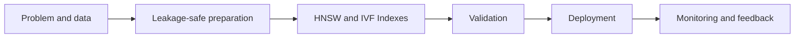

# HNSW and IVF Indexes

## 1. Title and Learning Position

- **Category:** Embeddings, Similarity, and Retrieval
- **Prerequisite:** [Approximate Nearest Neighbors](47-approximate-nearest-neighbors.md)
- **Why it matters:** HNSW and IVF Indexes contributes a distinct modeling or architectural capability in an AI engineer's toolkit. The goal is to know when it is appropriate, how to implement it safely, and how it behaves in production.
- **Learning objectives:** explain the intuition and mathematics; build a reproducible implementation; select useful metrics; identify failure modes; design a production deployment; answer architecture-level interview questions.
- **Estimated study time:** 3-6 hours for first pass, plus 2-4 hours of exercises.

## 2. Concept

**Plain language.** HNSW and IVF Indexes is best understood as a problem-solving pattern, not merely an API. Begin with the objective, data-generating process, assumptions, optimization target, and how errors will affect the business.

**Mental model.** Map inputs to a representation, apply the method's inductive bias, optimize or estimate parameters, and validate on data that was not used to fit the model. At advanced level, examine stability under distribution shift, calibration, uncertainty, computational complexity, and failure modes.

**Workflow.** 1) frame the task and metric; 2) establish a simple baseline; 3) split data without leakage; 4) transform training data; 5) fit/tune; 6) validate by slices; 7) test once; 8) package preprocessing with the model; 9) monitor in production.
**Mathematical anchor.** Retrieval ranks candidates using a similarity $s(q,d)$. For cosine similarity, $s=\frac{q\cdot d}{||q||||d||}$. ANN structures trade exactness for latency and memory; retrieval quality must be measured separately from generation quality.
**Strengths and weaknesses.** Prefer the method when its inductive bias fits the data and operational constraints. Avoid it when assumptions are violated, labels are unreliable, leakage dominates signal, or a simpler baseline performs comparably. Key hyperparameters should be tuned on validation data, not on the test set. Complexity depends on feature count, sample count, model capacity, and search/training strategy.

**Worked example.** In procurement risk prediction, define the prediction timestamp first. Features may include approved supplier history, amount, commodity, requester patterns, and lead time. Exclude data created after the prediction timestamp. Compare against a simple rule/logistic baseline, measure precision-recall under class imbalance, and inspect error slices by business unit and spend band.



## 3. Intermediate and Advanced Use Cases

### Intermediate: operational prediction
**Problem:** Predict whether an enterprise transaction will need manual intervention. **Why suitable:** HNSW and IVF Indexes supplies a principled modeling pattern when its assumptions fit. **Data:** timestamped, governed features with stable definitions. **Design:** baseline -> leakage-safe pipeline -> validation -> deployable artifact. **Validation:** use time/scope-aware splits and metrics tied to the decision. **Risks:** drift, bias, false-alert fatigue, missing values, and training-serving skew. **Alternatives:** simpler rules/models for interpretability; more complex models only when validated lift justifies operating cost.

### Intermediate: prioritization
**Problem:** Rank records for analyst review when capacity is limited. **Why suitable:** HNSW and IVF Indexes supplies a principled modeling pattern when its assumptions fit. **Data:** timestamped, governed features with stable definitions. **Design:** baseline -> leakage-safe pipeline -> validation -> deployable artifact. **Validation:** use time/scope-aware splits and metrics tied to the decision. **Risks:** drift, bias, false-alert fatigue, missing values, and training-serving skew. **Alternatives:** simpler rules/models for interpretability; more complex models only when validated lift justifies operating cost.

### Advanced: distribution shift
**Problem:** Deploy across business units whose data distributions and base rates differ. **Why suitable:** HNSW and IVF Indexes supplies a principled modeling pattern when its assumptions fit. **Data:** timestamped, governed features with stable definitions. **Design:** baseline -> leakage-safe pipeline -> validation -> deployable artifact. **Validation:** use time/scope-aware splits and metrics tied to the decision. **Risks:** drift, bias, false-alert fatigue, missing values, and training-serving skew. **Alternatives:** simpler rules/models for interpretability; more complex models only when validated lift justifies operating cost.

### Advanced: near-real-time service
**Problem:** Serve predictions or representations behind an API with latency and availability objectives. **Why suitable:** HNSW and IVF Indexes supplies a principled modeling pattern when its assumptions fit. **Data:** timestamped, governed features with stable definitions. **Design:** baseline -> leakage-safe pipeline -> validation -> deployable artifact. **Validation:** use time/scope-aware splits and metrics tied to the decision. **Risks:** drift, bias, false-alert fatigue, missing values, and training-serving skew. **Alternatives:** simpler rules/models for interpretability; more complex models only when validated lift justifies operating cost.

### Enterprise: ERP and supply chain
**Problem:** Use Oracle ERP/procurement events, supplier/master data, and workflow history to reduce exceptions or surface risks. **Why suitable:** HNSW and IVF Indexes supplies a principled modeling pattern when its assumptions fit. **Data:** timestamped, governed features with stable definitions. **Design:** baseline -> leakage-safe pipeline -> validation -> deployable artifact. **Validation:** use time/scope-aware splits and metrics tied to the decision. **Risks:** drift, bias, false-alert fatigue, missing values, and training-serving skew. **Alternatives:** simpler rules/models for interpretability; more complex models only when validated lift justifies operating cost.

## 4. Python Implementation

**Libraries and strategy.** Use a deterministic seed, split before fitting preprocessing, keep a held-out test set, and package transformations with the estimator. Choose metrics based on error cost and base rates rather than habit.

```python
from sklearn.feature_extraction.text import TfidfVectorizer
from sklearn.metrics.pairwise import cosine_similarity
docs = ['purchase order approval', 'supplier invoice mismatch', 'requisition sourcing workflow']
query = ['supplier sourcing approval']
v = TfidfVectorizer().fit(docs + query)
D, q = v.transform(docs), v.transform(query)
scores = cosine_similarity(q, D)[0]
print(sorted(zip(scores, docs), reverse=True))
# Replace TF-IDF with a governed embedding model and ANN index for semantic retrieval at scale.
```

**Hyperparameter tuning and error analysis.** Search a constrained parameter space with cross-validation appropriate to the data-generating process. Inspect confusion/error distributions, difficult slices, calibration where probabilities drive decisions, and performance against the baseline. Persist the entire inference pipeline rather than the estimator alone.

**Common mistake:** preprocessing the complete dataset before splitting. **Correction:** fit imputers, scalers, encoders, feature selection, and learned representations using training data only.

## 5. Architectural Considerations

- **Serving mode:** batch is efficient for scheduled scoring; online REST/gRPC is appropriate when the decision is synchronous; Kafka-style asynchronous inference decouples producers and consumers.
- **Consistency:** version feature definitions and preprocessing with the model. A feature store such as Feast may help when online/offline reuse is substantial.
- **Lifecycle:** track experiments in MLflow or the equivalent service in Azure Machine Learning, SageMaker, or Vertex AI; register immutable model artifacts and data/code lineage.
- **Compute:** profile CPU/GPU, memory, serialization, cold-start, p95/p99 latency and throughput before scaling. Kubernetes is useful only when orchestration needs justify its complexity.
- **Monitoring:** observe input schema, missingness, data drift, concept/performance drift, latency, failures, resource saturation and decision-quality metrics. Retrain on explicit triggers, not merely a calendar.
- **Security:** minimize sensitive attributes, encrypt data in transit/at rest, enforce least privilege, audit model/data access, and threat-model exposed inference endpoints.
- **Deployment:** prefer shadow validation before canary rollout for consequential changes; retain rollback to the previous model and a deterministic rule/manual fallback.
- **Enterprise integration:** separate ERP systems of record from feature/training stores; use APIs or event streams for serving and governed batch jobs for large historical extracts.
- **Cost:** compare business lift with feature-computation, training, inference, storage, vector-index and operational costs. More accurate but materially expensive models may lose to reliable baselines.

## 6. Interview Questions

### Q1. Beginner 1: What is a key design or failure consideration for HNSW and IVF Indexes?
**Model answer:** Start from the objective and assumptions, then connect data preparation, model behavior, metric selection, validation and production constraints. Provide a concrete failure mode and mitigation.

**Evaluates:** conceptual depth, applied judgment, and ability to connect modeling with systems.

**Weak answer:** Defining the algorithm only, quoting an API, or citing accuracy without explaining the validation design and trade-offs.

**Follow-up:** How would your answer change under class imbalance, distribution shift, strict latency, or explainability requirements?

### Q2. Beginner 2: What is a key design or failure consideration for HNSW and IVF Indexes?
**Model answer:** Start from the objective and assumptions, then connect data preparation, model behavior, metric selection, validation and production constraints. Provide a concrete failure mode and mitigation.

**Evaluates:** conceptual depth, applied judgment, and ability to connect modeling with systems.

**Weak answer:** Defining the algorithm only, quoting an API, or citing accuracy without explaining the validation design and trade-offs.

**Follow-up:** How would your answer change under class imbalance, distribution shift, strict latency, or explainability requirements?

### Q3. Beginner 3: What is a key design or failure consideration for HNSW and IVF Indexes?
**Model answer:** Start from the objective and assumptions, then connect data preparation, model behavior, metric selection, validation and production constraints. Provide a concrete failure mode and mitigation.

**Evaluates:** conceptual depth, applied judgment, and ability to connect modeling with systems.

**Weak answer:** Defining the algorithm only, quoting an API, or citing accuracy without explaining the validation design and trade-offs.

**Follow-up:** How would your answer change under class imbalance, distribution shift, strict latency, or explainability requirements?

### Q4. Beginner 4: What is a key design or failure consideration for HNSW and IVF Indexes?
**Model answer:** Start from the objective and assumptions, then connect data preparation, model behavior, metric selection, validation and production constraints. Provide a concrete failure mode and mitigation.

**Evaluates:** conceptual depth, applied judgment, and ability to connect modeling with systems.

**Weak answer:** Defining the algorithm only, quoting an API, or citing accuracy without explaining the validation design and trade-offs.

**Follow-up:** How would your answer change under class imbalance, distribution shift, strict latency, or explainability requirements?

### Q5. Beginner 5: What is a key design or failure consideration for HNSW and IVF Indexes?
**Model answer:** Start from the objective and assumptions, then connect data preparation, model behavior, metric selection, validation and production constraints. Provide a concrete failure mode and mitigation.

**Evaluates:** conceptual depth, applied judgment, and ability to connect modeling with systems.

**Weak answer:** Defining the algorithm only, quoting an API, or citing accuracy without explaining the validation design and trade-offs.

**Follow-up:** How would your answer change under class imbalance, distribution shift, strict latency, or explainability requirements?

### Q6. Intermediate 1: What is a key design or failure consideration for HNSW and IVF Indexes?
**Model answer:** Start from the objective and assumptions, then connect data preparation, model behavior, metric selection, validation and production constraints. Provide a concrete failure mode and mitigation.

**Evaluates:** conceptual depth, applied judgment, and ability to connect modeling with systems.

**Weak answer:** Defining the algorithm only, quoting an API, or citing accuracy without explaining the validation design and trade-offs.

**Follow-up:** How would your answer change under class imbalance, distribution shift, strict latency, or explainability requirements?

### Q7. Intermediate 2: What is a key design or failure consideration for HNSW and IVF Indexes?
**Model answer:** Start from the objective and assumptions, then connect data preparation, model behavior, metric selection, validation and production constraints. Provide a concrete failure mode and mitigation.

**Evaluates:** conceptual depth, applied judgment, and ability to connect modeling with systems.

**Weak answer:** Defining the algorithm only, quoting an API, or citing accuracy without explaining the validation design and trade-offs.

**Follow-up:** How would your answer change under class imbalance, distribution shift, strict latency, or explainability requirements?

### Q8. Intermediate 3: What is a key design or failure consideration for HNSW and IVF Indexes?
**Model answer:** Start from the objective and assumptions, then connect data preparation, model behavior, metric selection, validation and production constraints. Provide a concrete failure mode and mitigation.

**Evaluates:** conceptual depth, applied judgment, and ability to connect modeling with systems.

**Weak answer:** Defining the algorithm only, quoting an API, or citing accuracy without explaining the validation design and trade-offs.

**Follow-up:** How would your answer change under class imbalance, distribution shift, strict latency, or explainability requirements?

### Q9. Intermediate 4: What is a key design or failure consideration for HNSW and IVF Indexes?
**Model answer:** Start from the objective and assumptions, then connect data preparation, model behavior, metric selection, validation and production constraints. Provide a concrete failure mode and mitigation.

**Evaluates:** conceptual depth, applied judgment, and ability to connect modeling with systems.

**Weak answer:** Defining the algorithm only, quoting an API, or citing accuracy without explaining the validation design and trade-offs.

**Follow-up:** How would your answer change under class imbalance, distribution shift, strict latency, or explainability requirements?

### Q10. Intermediate 5: What is a key design or failure consideration for HNSW and IVF Indexes?
**Model answer:** Start from the objective and assumptions, then connect data preparation, model behavior, metric selection, validation and production constraints. Provide a concrete failure mode and mitigation.

**Evaluates:** conceptual depth, applied judgment, and ability to connect modeling with systems.

**Weak answer:** Defining the algorithm only, quoting an API, or citing accuracy without explaining the validation design and trade-offs.

**Follow-up:** How would your answer change under class imbalance, distribution shift, strict latency, or explainability requirements?

### Q11. Advanced 1: What is a key design or failure consideration for HNSW and IVF Indexes?
**Model answer:** Start from the objective and assumptions, then connect data preparation, model behavior, metric selection, validation and production constraints. Provide a concrete failure mode and mitigation.

**Evaluates:** conceptual depth, applied judgment, and ability to connect modeling with systems.

**Weak answer:** Defining the algorithm only, quoting an API, or citing accuracy without explaining the validation design and trade-offs.

**Follow-up:** How would your answer change under class imbalance, distribution shift, strict latency, or explainability requirements?

### Q12. Advanced 2: What is a key design or failure consideration for HNSW and IVF Indexes?
**Model answer:** Start from the objective and assumptions, then connect data preparation, model behavior, metric selection, validation and production constraints. Provide a concrete failure mode and mitigation.

**Evaluates:** conceptual depth, applied judgment, and ability to connect modeling with systems.

**Weak answer:** Defining the algorithm only, quoting an API, or citing accuracy without explaining the validation design and trade-offs.

**Follow-up:** How would your answer change under class imbalance, distribution shift, strict latency, or explainability requirements?

### Q13. Advanced 3: What is a key design or failure consideration for HNSW and IVF Indexes?
**Model answer:** Start from the objective and assumptions, then connect data preparation, model behavior, metric selection, validation and production constraints. Provide a concrete failure mode and mitigation.

**Evaluates:** conceptual depth, applied judgment, and ability to connect modeling with systems.

**Weak answer:** Defining the algorithm only, quoting an API, or citing accuracy without explaining the validation design and trade-offs.

**Follow-up:** How would your answer change under class imbalance, distribution shift, strict latency, or explainability requirements?

### Q14. Advanced 4: What is a key design or failure consideration for HNSW and IVF Indexes?
**Model answer:** Start from the objective and assumptions, then connect data preparation, model behavior, metric selection, validation and production constraints. Provide a concrete failure mode and mitigation.

**Evaluates:** conceptual depth, applied judgment, and ability to connect modeling with systems.

**Weak answer:** Defining the algorithm only, quoting an API, or citing accuracy without explaining the validation design and trade-offs.

**Follow-up:** How would your answer change under class imbalance, distribution shift, strict latency, or explainability requirements?

### Q15. Advanced 5: What is a key design or failure consideration for HNSW and IVF Indexes?
**Model answer:** Start from the objective and assumptions, then connect data preparation, model behavior, metric selection, validation and production constraints. Provide a concrete failure mode and mitigation.

**Evaluates:** conceptual depth, applied judgment, and ability to connect modeling with systems.

**Weak answer:** Defining the algorithm only, quoting an API, or citing accuracy without explaining the validation design and trade-offs.

**Follow-up:** How would your answer change under class imbalance, distribution shift, strict latency, or explainability requirements?

### Q16. Architecture scenario 1: What is a key design or failure consideration for HNSW and IVF Indexes?
**Model answer:** Start from the objective and assumptions, then connect data preparation, model behavior, metric selection, validation and production constraints. Provide a concrete failure mode and mitigation.

**Evaluates:** conceptual depth, applied judgment, and ability to connect modeling with systems.

**Weak answer:** Defining the algorithm only, quoting an API, or citing accuracy without explaining the validation design and trade-offs.

**Follow-up:** How would your answer change under class imbalance, distribution shift, strict latency, or explainability requirements?

### Q17. Architecture scenario 2: What is a key design or failure consideration for HNSW and IVF Indexes?
**Model answer:** Start from the objective and assumptions, then connect data preparation, model behavior, metric selection, validation and production constraints. Provide a concrete failure mode and mitigation.

**Evaluates:** conceptual depth, applied judgment, and ability to connect modeling with systems.

**Weak answer:** Defining the algorithm only, quoting an API, or citing accuracy without explaining the validation design and trade-offs.

**Follow-up:** How would your answer change under class imbalance, distribution shift, strict latency, or explainability requirements?

### Q18. Architecture scenario 3: What is a key design or failure consideration for HNSW and IVF Indexes?
**Model answer:** Start from the objective and assumptions, then connect data preparation, model behavior, metric selection, validation and production constraints. Provide a concrete failure mode and mitigation.

**Evaluates:** conceptual depth, applied judgment, and ability to connect modeling with systems.

**Weak answer:** Defining the algorithm only, quoting an API, or citing accuracy without explaining the validation design and trade-offs.

**Follow-up:** How would your answer change under class imbalance, distribution shift, strict latency, or explainability requirements?

### Q19. Debugging 1: What is a key design or failure consideration for HNSW and IVF Indexes?
**Model answer:** Start from the objective and assumptions, then connect data preparation, model behavior, metric selection, validation and production constraints. Provide a concrete failure mode and mitigation.

**Evaluates:** conceptual depth, applied judgment, and ability to connect modeling with systems.

**Weak answer:** Defining the algorithm only, quoting an API, or citing accuracy without explaining the validation design and trade-offs.

**Follow-up:** How would your answer change under class imbalance, distribution shift, strict latency, or explainability requirements?

### Q20. Debugging 2: What is a key design or failure consideration for HNSW and IVF Indexes?
**Model answer:** Start from the objective and assumptions, then connect data preparation, model behavior, metric selection, validation and production constraints. Provide a concrete failure mode and mitigation.

**Evaluates:** conceptual depth, applied judgment, and ability to connect modeling with systems.

**Weak answer:** Defining the algorithm only, quoting an API, or citing accuracy without explaining the validation design and trade-offs.

**Follow-up:** How would your answer change under class imbalance, distribution shift, strict latency, or explainability requirements?

### Q21. Coding 1: What is a key design or failure consideration for HNSW and IVF Indexes?
**Model answer:** Start from the objective and assumptions, then connect data preparation, model behavior, metric selection, validation and production constraints. Provide a concrete failure mode and mitigation.

**Evaluates:** conceptual depth, applied judgment, and ability to connect modeling with systems.

**Weak answer:** Defining the algorithm only, quoting an API, or citing accuracy without explaining the validation design and trade-offs.

**Follow-up:** How would your answer change under class imbalance, distribution shift, strict latency, or explainability requirements?

### Q22. Coding 2: What is a key design or failure consideration for HNSW and IVF Indexes?
**Model answer:** Start from the objective and assumptions, then connect data preparation, model behavior, metric selection, validation and production constraints. Provide a concrete failure mode and mitigation.

**Evaluates:** conceptual depth, applied judgment, and ability to connect modeling with systems.

**Weak answer:** Defining the algorithm only, quoting an API, or citing accuracy without explaining the validation design and trade-offs.

**Follow-up:** How would your answer change under class imbalance, distribution shift, strict latency, or explainability requirements?

## 7. Practical Exercises

### Foundational
Implement a minimal example and explain each transformation, objective and metric. **Expected:** reproducible notebook/script. **Evaluate:** correctness, no leakage, clear interpretation.

### Intermediate
Compare a baseline against HNSW and IVF Indexes, tune only on training/validation data, and analyze at least three error slices. **Expected:** defensible model-selection memo. **Evaluate:** metric rationale, validation quality, error analysis.

### Advanced / production
Design a service for an ERP or supply-chain use case with data contracts, training pipeline, registry, deployment, monitoring, rollback and security controls. **Expected:** architecture diagram plus SLOs and failure plan. **Evaluate:** end-to-end consistency, operability, cost, governance and graceful degradation.

## 8. Summary and Revision Checklist

### Key takeaways
- Understand HNSW and IVF Indexes as a set of assumptions, objectives and trade-offs, not just a library class.
- Validate against a simple baseline and choose metrics that represent the decision.
- Prevent leakage and training-serving skew.
- Production readiness requires observability, governance, security, cost control and rollback.

### Important formulas
Review the mathematical anchor in the Concept section and be able to explain every symbol and how changing the objective changes learned behavior.

### Critical hyperparameters
Identify parameters controlling capacity/regularization, optimization, neighborhood/search size, thresholds, and resource consumption as applicable. Tune on validation data only.

### Selection checklist
- [ ] Problem and prediction timestamp defined
- [ ] Baseline established
- [ ] Assumptions match the data
- [ ] Leakage-safe validation implemented
- [ ] Business-aligned metrics selected
- [ ] Production latency/cost measured
- [ ] Drift, rollback, security and human fallback designed

### Common pitfalls
Data leakage, inappropriate random splits, unrepresentative metrics, uncontrolled complexity, poor calibration, ignored data quality, and deploying without monitoring.

### Five flashcards
1. **Q:** What comes before model choice? **A:** Problem framing, prediction timestamp, constraints and metric.
2. **Q:** Why keep a test set? **A:** To obtain a final estimate not used during model selection.
3. **Q:** What is training-serving skew? **A:** Different feature logic or distributions between training and inference.
4. **Q:** When should complexity increase? **A:** When validated utility justifies added cost and risk.
5. **Q:** What must every deployment have? **A:** Monitoring, versioning, rollback and a failure-handling strategy.

### Next topics
- [Vector Databases and Index Selection](49-vector-databases.md)
- [Retrieval-Augmented Generation Pipeline](50-rag-pipeline.md)
