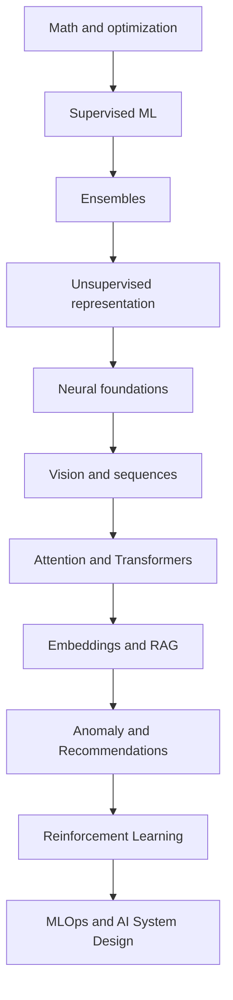

# Machine Learning and AI Engineering Notes

## Repository Purpose

A practitioner-oriented path for experienced Python/software engineers moving toward AI Engineering or AI Solutions Architecture. Work in order: study the concept, run the implementation, complete the exercises, then rehearse the interview section. Expected prerequisites are Python, algebra, probability, statistics, SQL/data handling, and basic software architecture.

## Recommended Learning Path

## Category Summary

### Category 1: Mathematical and Optimization Foundations

**Purpose:** Build capability in mathematical and optimization foundations. **Prerequisite:** complete prior categories unless already proficient. **Outcome:** explain, implement, evaluate and architect these methods. **Estimated time:** 25-40 hours.

1. **[ML Problem Framing and End-to-End Workflow](01-ml-problem-framing-and-workflow.md)**  
   Foundational. Builds the ability to reason about and apply ML Problem Framing and End-to-End Workflow safely. Prerequisite: Python and ML mathematics. Study: 4-8 hours. Outcome: implementation plus production-design fluency.
2. **[Loss Functions and Evaluation Metrics](02-loss-functions-and-evaluation-metrics.md)**  
   Foundational. Builds the ability to reason about and apply Loss Functions and Evaluation Metrics safely. Prerequisite: ML Problem Framing and End-to-End Workflow. Study: 4-8 hours. Outcome: implementation plus production-design fluency.
3. **[Gradient Descent and Optimization](03-gradient-descent-and-optimization.md)**  
   Foundational. Builds the ability to reason about and apply Gradient Descent and Optimization safely. Prerequisite: Loss Functions and Evaluation Metrics. Study: 4-8 hours. Outcome: implementation plus production-design fluency.
4. **[Momentum, RMSProp, Adam, and AdamW](04-momentum-rmsprop-adam-adamw.md)**  
   Foundational. Builds the ability to reason about and apply Momentum, RMSProp, Adam, and AdamW safely. Prerequisite: Gradient Descent and Optimization. Study: 4-8 hours. Outcome: implementation plus production-design fluency.
5. **[Regularization and Generalization](05-regularization-and-generalization.md)**  
   Foundational. Builds the ability to reason about and apply Regularization and Generalization safely. Prerequisite: Momentum, RMSProp, Adam, and AdamW. Study: 4-8 hours. Outcome: implementation plus production-design fluency.

### Category 2: Core Supervised Learning

**Purpose:** Build capability in core supervised learning. **Prerequisite:** complete prior categories unless already proficient. **Outcome:** explain, implement, evaluate and architect these methods. **Estimated time:** 35-56 hours.

6. **[Linear Regression](06-linear-regression.md)**  
   Foundational. Builds the ability to reason about and apply Linear Regression safely. Prerequisite: Regularization and Generalization. Study: 4-8 hours. Outcome: implementation plus production-design fluency.
7. **[Logistic Regression](07-logistic-regression.md)**  
   Foundational. Builds the ability to reason about and apply Logistic Regression safely. Prerequisite: Linear Regression. Study: 4-8 hours. Outcome: implementation plus production-design fluency.
8. **[K-Nearest Neighbors](08-knn.md)**  
   Foundational. Builds the ability to reason about and apply K-Nearest Neighbors safely. Prerequisite: Logistic Regression. Study: 4-8 hours. Outcome: implementation plus production-design fluency.
9. **[Naive Bayes](09-naive-bayes.md)**  
   Foundational. Builds the ability to reason about and apply Naive Bayes safely. Prerequisite: K-Nearest Neighbors. Study: 4-8 hours. Outcome: implementation plus production-design fluency.
10. **[Decision Trees](10-decision-trees.md)**  
   Foundational. Builds the ability to reason about and apply Decision Trees safely. Prerequisite: Naive Bayes. Study: 4-8 hours. Outcome: implementation plus production-design fluency.
11. **[Random Forest](11-random-forest.md)**  
   Foundational. Builds the ability to reason about and apply Random Forest safely. Prerequisite: Decision Trees. Study: 4-8 hours. Outcome: implementation plus production-design fluency.
12. **[Support Vector Machines and Kernel Methods](12-support-vector-machines.md)**  
   Foundational. Builds the ability to reason about and apply Support Vector Machines and Kernel Methods safely. Prerequisite: Random Forest. Study: 4-8 hours. Outcome: implementation plus production-design fluency.

### Category 3: Ensemble and High-Performance Tabular Learning

**Purpose:** Build capability in ensemble and high-performance tabular learning. **Prerequisite:** complete prior categories unless already proficient. **Outcome:** explain, implement, evaluate and architect these methods. **Estimated time:** 30-48 hours.

13. **[Ensemble Learning, Bagging, and Boosting](13-ensemble-learning-bagging-and-boosting.md)**  
   Intermediate. Builds the ability to reason about and apply Ensemble Learning, Bagging, and Boosting safely. Prerequisite: Support Vector Machines and Kernel Methods. Study: 4-8 hours. Outcome: implementation plus production-design fluency.
14. **[AdaBoost](14-adaboost.md)**  
   Intermediate. Builds the ability to reason about and apply AdaBoost safely. Prerequisite: Ensemble Learning, Bagging, and Boosting. Study: 4-8 hours. Outcome: implementation plus production-design fluency.
15. **[Gradient Boosting Machines](15-gradient-boosting.md)**  
   Intermediate. Builds the ability to reason about and apply Gradient Boosting Machines safely. Prerequisite: AdaBoost. Study: 4-8 hours. Outcome: implementation plus production-design fluency.
16. **[XGBoost](16-xgboost.md)**  
   Intermediate. Builds the ability to reason about and apply XGBoost safely. Prerequisite: Gradient Boosting Machines. Study: 4-8 hours. Outcome: implementation plus production-design fluency.
17. **[LightGBM](17-lightgbm.md)**  
   Intermediate. Builds the ability to reason about and apply LightGBM safely. Prerequisite: XGBoost. Study: 4-8 hours. Outcome: implementation plus production-design fluency.
18. **[CatBoost](18-catboost.md)**  
   Intermediate. Builds the ability to reason about and apply CatBoost safely. Prerequisite: LightGBM. Study: 4-8 hours. Outcome: implementation plus production-design fluency.

### Category 4: Unsupervised Learning and Representation

**Purpose:** Build capability in unsupervised learning and representation. **Prerequisite:** complete prior categories unless already proficient. **Outcome:** explain, implement, evaluate and architect these methods. **Estimated time:** 30-48 hours.

19. **[K-Means Clustering](19-k-means-clustering.md)**  
   Intermediate. Builds the ability to reason about and apply K-Means Clustering safely. Prerequisite: CatBoost. Study: 4-8 hours. Outcome: implementation plus production-design fluency.
20. **[Hierarchical Clustering](20-hierarchical-clustering.md)**  
   Intermediate. Builds the ability to reason about and apply Hierarchical Clustering safely. Prerequisite: K-Means Clustering. Study: 4-8 hours. Outcome: implementation plus production-design fluency.
21. **[DBSCAN](21-dbscan.md)**  
   Intermediate. Builds the ability to reason about and apply DBSCAN safely. Prerequisite: Hierarchical Clustering. Study: 4-8 hours. Outcome: implementation plus production-design fluency.
22. **[Gaussian Mixture Models](22-gaussian-mixture-models.md)**  
   Intermediate. Builds the ability to reason about and apply Gaussian Mixture Models safely. Prerequisite: DBSCAN. Study: 4-8 hours. Outcome: implementation plus production-design fluency.
23. **[Principal Component Analysis](23-pca.md)**  
   Intermediate. Builds the ability to reason about and apply Principal Component Analysis safely. Prerequisite: Gaussian Mixture Models. Study: 4-8 hours. Outcome: implementation plus production-design fluency.
24. **[t-SNE and UMAP](24-tsne-and-umap.md)**  
   Intermediate. Builds the ability to reason about and apply t-SNE and UMAP safely. Prerequisite: Principal Component Analysis. Study: 4-8 hours. Outcome: implementation plus production-design fluency.

### Category 5: Neural Network Foundations

**Purpose:** Build capability in neural network foundations. **Prerequisite:** complete prior categories unless already proficient. **Outcome:** explain, implement, evaluate and architect these methods. **Estimated time:** 25-40 hours.

25. **[Perceptron](25-perceptron.md)**  
   Intermediate. Builds the ability to reason about and apply Perceptron safely. Prerequisite: t-SNE and UMAP. Study: 4-8 hours. Outcome: implementation plus production-design fluency.
26. **[Multi-Layer Perceptrons](26-multilayer-perceptrons.md)**  
   Intermediate. Builds the ability to reason about and apply Multi-Layer Perceptrons safely. Prerequisite: Perceptron. Study: 4-8 hours. Outcome: implementation plus production-design fluency.
27. **[Activation Functions](27-activation-functions.md)**  
   Intermediate. Builds the ability to reason about and apply Activation Functions safely. Prerequisite: Multi-Layer Perceptrons. Study: 4-8 hours. Outcome: implementation plus production-design fluency.
28. **[Backpropagation and Automatic Differentiation](28-backpropagation.md)**  
   Intermediate. Builds the ability to reason about and apply Backpropagation and Automatic Differentiation safely. Prerequisite: Activation Functions. Study: 4-8 hours. Outcome: implementation plus production-design fluency.
29. **[Initialization, Normalization, and Dropout](29-weight-initialization-normalization-and-dropout.md)**  
   Intermediate. Builds the ability to reason about and apply Initialization, Normalization, and Dropout safely. Prerequisite: Backpropagation and Automatic Differentiation. Study: 4-8 hours. Outcome: implementation plus production-design fluency.

### Category 6: Computer Vision Foundations

**Purpose:** Build capability in computer vision foundations. **Prerequisite:** complete prior categories unless already proficient. **Outcome:** explain, implement, evaluate and architect these methods. **Estimated time:** 15-24 hours.

30. **[Convolutional Neural Networks](30-convolutional-neural-networks.md)**  
   Intermediate. Builds the ability to reason about and apply Convolutional Neural Networks safely. Prerequisite: Initialization, Normalization, and Dropout. Study: 4-8 hours. Outcome: implementation plus production-design fluency.
31. **[Residual Networks and Skip Connections](31-residual-networks.md)**  
   Intermediate. Builds the ability to reason about and apply Residual Networks and Skip Connections safely. Prerequisite: Convolutional Neural Networks. Study: 4-8 hours. Outcome: implementation plus production-design fluency.
32. **[EfficientNet and Vision Transformers](32-efficientnet-and-vision-transformers.md)**  
   Intermediate. Builds the ability to reason about and apply EfficientNet and Vision Transformers safely. Prerequisite: Residual Networks and Skip Connections. Study: 4-8 hours. Outcome: implementation plus production-design fluency.

### Category 7: Sequence Learning

**Purpose:** Build capability in sequence learning. **Prerequisite:** complete prior categories unless already proficient. **Outcome:** explain, implement, evaluate and architect these methods. **Estimated time:** 20-32 hours.

33. **[Recurrent Neural Networks](33-recurrent-neural-networks.md)**  
   Intermediate. Builds the ability to reason about and apply Recurrent Neural Networks safely. Prerequisite: EfficientNet and Vision Transformers. Study: 4-8 hours. Outcome: implementation plus production-design fluency.
34. **[Long Short-Term Memory Networks](34-lstm.md)**  
   Intermediate. Builds the ability to reason about and apply Long Short-Term Memory Networks safely. Prerequisite: Recurrent Neural Networks. Study: 4-8 hours. Outcome: implementation plus production-design fluency.
35. **[Gated Recurrent Units](35-gru.md)**  
   Intermediate. Builds the ability to reason about and apply Gated Recurrent Units safely. Prerequisite: Long Short-Term Memory Networks. Study: 4-8 hours. Outcome: implementation plus production-design fluency.
36. **[Sequence-to-Sequence and Encoder-Decoder Models](36-sequence-to-sequence-and-encoder-decoder.md)**  
   Intermediate. Builds the ability to reason about and apply Sequence-to-Sequence and Encoder-Decoder Models safely. Prerequisite: Gated Recurrent Units. Study: 4-8 hours. Outcome: implementation plus production-design fluency.

### Category 8: Attention, Transformers, and LLM Foundations

**Purpose:** Build capability in attention, transformers, and llm foundations. **Prerequisite:** complete prior categories unless already proficient. **Outcome:** explain, implement, evaluate and architect these methods. **Estimated time:** 35-56 hours.

37. **[Attention Mechanisms](37-attention-mechanisms.md)**  
   Advanced. Builds the ability to reason about and apply Attention Mechanisms safely. Prerequisite: Sequence-to-Sequence and Encoder-Decoder Models. Study: 4-8 hours. Outcome: implementation plus production-design fluency.
38. **[Self-Attention, Queries, Keys, and Values](38-self-attention-qkv.md)**  
   Advanced. Builds the ability to reason about and apply Self-Attention, Queries, Keys, and Values safely. Prerequisite: Attention Mechanisms. Study: 4-8 hours. Outcome: implementation plus production-design fluency.
39. **[Multi-Head Attention](39-multi-head-attention.md)**  
   Advanced. Builds the ability to reason about and apply Multi-Head Attention safely. Prerequisite: Self-Attention, Queries, Keys, and Values. Study: 4-8 hours. Outcome: implementation plus production-design fluency.
40. **[Transformer Architecture](40-transformer-architecture.md)**  
   Advanced. Builds the ability to reason about and apply Transformer Architecture safely. Prerequisite: Multi-Head Attention. Study: 4-8 hours. Outcome: implementation plus production-design fluency.
41. **[Tokenization and Positional Encoding](41-tokenization-and-positional-encoding.md)**  
   Advanced. Builds the ability to reason about and apply Tokenization and Positional Encoding safely. Prerequisite: Transformer Architecture. Study: 4-8 hours. Outcome: implementation plus production-design fluency.
42. **[Encoder-Only, Encoder-Decoder, and Decoder-Only Models](42-encoder-decoder-and-decoder-only-models.md)**  
   Advanced. Builds the ability to reason about and apply Encoder-Only, Encoder-Decoder, and Decoder-Only Models safely. Prerequisite: Tokenization and Positional Encoding. Study: 4-8 hours. Outcome: implementation plus production-design fluency.
43. **[LLM Training, Fine-Tuning, and Alignment](43-llm-training-fine-tuning-and-alignment.md)**  
   Advanced. Builds the ability to reason about and apply LLM Training, Fine-Tuning, and Alignment safely. Prerequisite: Encoder-Only, Encoder-Decoder, and Decoder-Only Models. Study: 4-8 hours. Outcome: implementation plus production-design fluency.

### Category 9: Embeddings, Similarity, and Retrieval

**Purpose:** Build capability in embeddings, similarity, and retrieval. **Prerequisite:** complete prior categories unless already proficient. **Outcome:** explain, implement, evaluate and architect these methods. **Estimated time:** 40-64 hours.

44. **[One-Hot Encoding, Word2Vec, and GloVe](44-one-hot-word2vec-and-glove.md)**  
   Advanced. Builds the ability to reason about and apply One-Hot Encoding, Word2Vec, and GloVe safely. Prerequisite: LLM Training, Fine-Tuning, and Alignment. Study: 4-8 hours. Outcome: implementation plus production-design fluency.
45. **[Contextual and Transformer Embeddings](45-contextual-and-transformer-embeddings.md)**  
   Advanced. Builds the ability to reason about and apply Contextual and Transformer Embeddings safely. Prerequisite: One-Hot Encoding, Word2Vec, and GloVe. Study: 4-8 hours. Outcome: implementation plus production-design fluency.
46. **[Similarity and Distance Metrics](46-similarity-and-distance-metrics.md)**  
   Advanced. Builds the ability to reason about and apply Similarity and Distance Metrics safely. Prerequisite: Contextual and Transformer Embeddings. Study: 4-8 hours. Outcome: implementation plus production-design fluency.
47. **[Approximate Nearest Neighbors](47-approximate-nearest-neighbors.md)**  
   Advanced. Builds the ability to reason about and apply Approximate Nearest Neighbors safely. Prerequisite: Similarity and Distance Metrics. Study: 4-8 hours. Outcome: implementation plus production-design fluency.
48. **[HNSW and IVF Indexes](48-hnsw-and-ivf-indexes.md)**  
   Advanced. Builds the ability to reason about and apply HNSW and IVF Indexes safely. Prerequisite: Approximate Nearest Neighbors. Study: 4-8 hours. Outcome: implementation plus production-design fluency.
49. **[Vector Databases and Index Selection](49-vector-databases.md)**  
   Advanced. Builds the ability to reason about and apply Vector Databases and Index Selection safely. Prerequisite: HNSW and IVF Indexes. Study: 4-8 hours. Outcome: implementation plus production-design fluency.
50. **[Retrieval-Augmented Generation Pipeline](50-rag-pipeline.md)**  
   Advanced. Builds the ability to reason about and apply Retrieval-Augmented Generation Pipeline safely. Prerequisite: Vector Databases and Index Selection. Study: 4-8 hours. Outcome: implementation plus production-design fluency.
51. **[RAG Evaluation, Hybrid Search, and Reranking](51-rag-evaluation-and-reranking.md)**  
   Advanced. Builds the ability to reason about and apply RAG Evaluation, Hybrid Search, and Reranking safely. Prerequisite: Retrieval-Augmented Generation Pipeline. Study: 4-8 hours. Outcome: implementation plus production-design fluency.

### Category 10: Anomaly Detection

**Purpose:** Build capability in anomaly detection. **Prerequisite:** complete prior categories unless already proficient. **Outcome:** explain, implement, evaluate and architect these methods. **Estimated time:** 25-40 hours.

52. **[Statistical Anomaly Detection](52-statistical-anomaly-detection.md)**  
   Advanced. Builds the ability to reason about and apply Statistical Anomaly Detection safely. Prerequisite: RAG Evaluation, Hybrid Search, and Reranking. Study: 4-8 hours. Outcome: implementation plus production-design fluency.
53. **[Isolation Forest](53-isolation-forest.md)**  
   Advanced. Builds the ability to reason about and apply Isolation Forest safely. Prerequisite: Statistical Anomaly Detection. Study: 4-8 hours. Outcome: implementation plus production-design fluency.
54. **[One-Class SVM](54-one-class-svm.md)**  
   Advanced. Builds the ability to reason about and apply One-Class SVM safely. Prerequisite: Isolation Forest. Study: 4-8 hours. Outcome: implementation plus production-design fluency.
55. **[Local Outlier Factor](55-local-outlier-factor.md)**  
   Advanced. Builds the ability to reason about and apply Local Outlier Factor safely. Prerequisite: One-Class SVM. Study: 4-8 hours. Outcome: implementation plus production-design fluency.
56. **[Autoencoders for Anomaly Detection](56-autoencoders-for-anomaly-detection.md)**  
   Advanced. Builds the ability to reason about and apply Autoencoders for Anomaly Detection safely. Prerequisite: Local Outlier Factor. Study: 4-8 hours. Outcome: implementation plus production-design fluency.

### Category 11: Recommendation Systems

**Purpose:** Build capability in recommendation systems. **Prerequisite:** complete prior categories unless already proficient. **Outcome:** explain, implement, evaluate and architect these methods. **Estimated time:** 20-32 hours.

57. **[Content-Based Recommendation](57-content-based-recommendation.md)**  
   Advanced. Builds the ability to reason about and apply Content-Based Recommendation safely. Prerequisite: Autoencoders for Anomaly Detection. Study: 4-8 hours. Outcome: implementation plus production-design fluency.
58. **[Collaborative Filtering](58-collaborative-filtering.md)**  
   Advanced. Builds the ability to reason about and apply Collaborative Filtering safely. Prerequisite: Content-Based Recommendation. Study: 4-8 hours. Outcome: implementation plus production-design fluency.
59. **[Matrix Factorization](59-matrix-factorization.md)**  
   Advanced. Builds the ability to reason about and apply Matrix Factorization safely. Prerequisite: Collaborative Filtering. Study: 4-8 hours. Outcome: implementation plus production-design fluency.
60. **[Hybrid Recommendation Systems](60-hybrid-recommendation-systems.md)**  
   Advanced. Builds the ability to reason about and apply Hybrid Recommendation Systems safely. Prerequisite: Matrix Factorization. Study: 4-8 hours. Outcome: implementation plus production-design fluency.

### Category 12: Reinforcement Learning and Preference Optimization

**Purpose:** Build capability in reinforcement learning and preference optimization. **Prerequisite:** complete prior categories unless already proficient. **Outcome:** explain, implement, evaluate and architect these methods. **Estimated time:** 35-56 hours.

61. **[Multi-Armed Bandits](61-multi-armed-bandits.md)**  
   Advanced. Builds the ability to reason about and apply Multi-Armed Bandits safely. Prerequisite: Hybrid Recommendation Systems. Study: 4-8 hours. Outcome: implementation plus production-design fluency.
62. **[Q-Learning](62-q-learning.md)**  
   Advanced. Builds the ability to reason about and apply Q-Learning safely. Prerequisite: Multi-Armed Bandits. Study: 4-8 hours. Outcome: implementation plus production-design fluency.
63. **[Deep Q Networks](63-deep-q-networks.md)**  
   Advanced. Builds the ability to reason about and apply Deep Q Networks safely. Prerequisite: Q-Learning. Study: 4-8 hours. Outcome: implementation plus production-design fluency.
64. **[Policy Gradients](64-policy-gradients.md)**  
   Advanced. Builds the ability to reason about and apply Policy Gradients safely. Prerequisite: Deep Q Networks. Study: 4-8 hours. Outcome: implementation plus production-design fluency.
65. **[Actor-Critic Methods](65-actor-critic.md)**  
   Advanced. Builds the ability to reason about and apply Actor-Critic Methods safely. Prerequisite: Policy Gradients. Study: 4-8 hours. Outcome: implementation plus production-design fluency.
66. **[Proximal Policy Optimization](66-ppo.md)**  
   Advanced. Builds the ability to reason about and apply Proximal Policy Optimization safely. Prerequisite: Actor-Critic Methods. Study: 4-8 hours. Outcome: implementation plus production-design fluency.
67. **[RLHF, Reward Models, and DPO](67-rlhf-reward-models-and-dpo.md)**  
   Advanced. Builds the ability to reason about and apply RLHF, Reward Models, and DPO safely. Prerequisite: Proximal Policy Optimization. Study: 4-8 hours. Outcome: implementation plus production-design fluency.

### Category 13: Production Model Selection and AI Engineering

**Purpose:** Build capability in production model selection and ai engineering. **Prerequisite:** complete prior categories unless already proficient. **Outcome:** explain, implement, evaluate and architect these methods. **Estimated time:** 35-56 hours.

68. **[Model Selection, Baselines, and Experiment Design](68-model-selection-and-baselines.md)**  
   Architecture. Builds the ability to reason about and apply Model Selection, Baselines, and Experiment Design safely. Prerequisite: RLHF, Reward Models, and DPO. Study: 4-8 hours. Outcome: implementation plus production-design fluency.
69. **[Hyperparameter Optimization](69-hyperparameter-optimization.md)**  
   Architecture. Builds the ability to reason about and apply Hyperparameter Optimization safely. Prerequisite: Model Selection, Baselines, and Experiment Design. Study: 4-8 hours. Outcome: implementation plus production-design fluency.
70. **[Imbalanced Learning](70-imbalanced-learning.md)**  
   Architecture. Builds the ability to reason about and apply Imbalanced Learning safely. Prerequisite: Hyperparameter Optimization. Study: 4-8 hours. Outcome: implementation plus production-design fluency.
71. **[Explainable AI](71-explainable-ai.md)**  
   Architecture. Builds the ability to reason about and apply Explainable AI safely. Prerequisite: Imbalanced Learning. Study: 4-8 hours. Outcome: implementation plus production-design fluency.
72. **[Data and Model Drift](72-data-and-model-drift.md)**  
   Architecture. Builds the ability to reason about and apply Data and Model Drift safely. Prerequisite: Explainable AI. Study: 4-8 hours. Outcome: implementation plus production-design fluency.
73. **[MLOps and Model Lifecycle](73-mlops-and-model-lifecycle.md)**  
   Architecture. Builds the ability to reason about and apply MLOps and Model Lifecycle safely. Prerequisite: Data and Model Drift. Study: 4-8 hours. Outcome: implementation plus production-design fluency.
74. **[AI System Design and Enterprise Architecture Patterns](74-ai-system-design.md)**  
   Architecture. Builds the ability to reason about and apply AI System Design and Enterprise Architecture Patterns safely. Prerequisite: MLOps and Model Lifecycle. Study: 4-8 hours. Outcome: implementation plus production-design fluency.

## Suggested Study Schedules

### 12-week intensive plan
1. Weeks 1-2: Categories 1-2, foundations and core supervised ML.
2. Week 3: Category 3, ensembles and high-performance tabular learning.
3. Week 4: Category 4, unsupervised learning and representation.
4. Weeks 5-6: Categories 5-7, neural, vision and sequence foundations.
5. Weeks 7-8: Category 8, attention, transformers and LLM foundations.
6. Week 9: Category 9, embeddings, ANN, vector databases and RAG.
7. Week 10: Categories 10-11, anomaly detection and recommenders.
8. Week 11: Category 12, reinforcement learning and preference optimization.
9. Week 12: Category 13, MLOps and an end-to-end AI architecture capstone.

### 24-week balanced plan
Spend roughly two weeks per major category pair, with Categories 8, 9 and 13 receiving two weeks each. Use the first week for concepts/code and the second for exercises, comparisons and interview practice.

### 36-week part-time plan
Allocate roughly 8-10 hours per week: one topic cluster for reading, one implementation session, and one architecture/interview session. Give the Transformer/RAG sequence six weeks and production AI four weeks.

## Algorithm Selection Guide

| Problem | Start with | Escalate to | Key metrics | Major trade-off |
|---|---|---|---|---|
| Regression | Linear/regularized regression | Gradient boosting / neural model | MAE, RMSE, R2 | Interpretability vs nonlinear capacity |
| Classification | Logistic regression | Random forest, XGBoost, neural model | PR-AUC, ROC-AUC, F1, log-loss, calibration | Threshold and error cost |
| Clustering | K-Means | GMM, DBSCAN, hierarchical | Silhouette plus domain validation | Geometry/density assumptions |
| Dimensionality reduction | PCA | UMAP/t-SNE for exploration | Explained variance / neighborhood quality | Interpretability vs nonlinear structure |
| Anomaly detection | Statistical rules | Isolation Forest, One-Class SVM, autoencoder | Precision@k, recall, alert yield | Rare labels and false alerts |
| Recommendation | Popularity/content baseline | Collaborative/matrix/hybrid | Recall@k, NDCG, business lift | Cold start and feedback loops |
| Deep learning | MLP baseline | CNN/Transformer by modality | Task metric + loss | Compute and data requirements |
| Embeddings/retrieval | lexical baseline | dense/hybrid ANN + reranking | Recall@k, MRR/NDCG, answer groundedness | Quality vs latency/cost |
| Reinforcement learning | rules/bandit | Q-learning, actor-critic, PPO | expected return + safety constraints | Exploration risk and reward design |

## Cross-Cutting Skills

- **Data preparation:** schemas, timestamps, missingness, outliers, leakage controls and reproducible transformations.
- **Feature engineering:** domain-aware signals, categorical handling, feature stores only when reuse and consistency justify them.
- **Evaluation:** baselines, cross-validation, time splits, slice analysis, calibration and business-error costs.
- **Experiment design:** immutable code/data/model versions, controlled comparisons, statistical and practical significance.
- **Explainability:** global and local explanations appropriate to method and audience; validate explanation stability.
- **Security and privacy:** least privilege, encryption, minimized data, audit logs, threat modeling and secrets management.
- **Responsible AI:** document intended use, limitations, fairness checks, human oversight and escalation paths.
- **MLOps:** CI/CD/CT, model registry, deployment, monitoring, rollback and retraining governance.
- **Monitoring:** data quality, drift, service SLOs, model quality and downstream decision outcomes.
- **Cost and performance:** p95/p99 latency, throughput, memory, accelerator utilization, storage/index cost and operational burden.

## Repository File Map

### Mathematical and Optimization Foundations
- [ML Problem Framing and End-to-End Workflow](01-ml-problem-framing-and-workflow.md)
- [Loss Functions and Evaluation Metrics](02-loss-functions-and-evaluation-metrics.md)
- [Gradient Descent and Optimization](03-gradient-descent-and-optimization.md)
- [Momentum, RMSProp, Adam, and AdamW](04-momentum-rmsprop-adam-adamw.md)
- [Regularization and Generalization](05-regularization-and-generalization.md)

### Core Supervised Learning
- [Linear Regression](06-linear-regression.md)
- [Logistic Regression](07-logistic-regression.md)
- [K-Nearest Neighbors](08-knn.md)
- [Naive Bayes](09-naive-bayes.md)
- [Decision Trees](10-decision-trees.md)
- [Random Forest](11-random-forest.md)
- [Support Vector Machines and Kernel Methods](12-support-vector-machines.md)

### Ensemble and High-Performance Tabular Learning
- [Ensemble Learning, Bagging, and Boosting](13-ensemble-learning-bagging-and-boosting.md)
- [AdaBoost](14-adaboost.md)
- [Gradient Boosting Machines](15-gradient-boosting.md)
- [XGBoost](16-xgboost.md)
- [LightGBM](17-lightgbm.md)
- [CatBoost](18-catboost.md)

### Unsupervised Learning and Representation
- [K-Means Clustering](19-k-means-clustering.md)
- [Hierarchical Clustering](20-hierarchical-clustering.md)
- [DBSCAN](21-dbscan.md)
- [Gaussian Mixture Models](22-gaussian-mixture-models.md)
- [Principal Component Analysis](23-pca.md)
- [t-SNE and UMAP](24-tsne-and-umap.md)

### Neural Network Foundations
- [Perceptron](25-perceptron.md)
- [Multi-Layer Perceptrons](26-multilayer-perceptrons.md)
- [Activation Functions](27-activation-functions.md)
- [Backpropagation and Automatic Differentiation](28-backpropagation.md)
- [Initialization, Normalization, and Dropout](29-weight-initialization-normalization-and-dropout.md)

### Computer Vision Foundations
- [Convolutional Neural Networks](30-convolutional-neural-networks.md)
- [Residual Networks and Skip Connections](31-residual-networks.md)
- [EfficientNet and Vision Transformers](32-efficientnet-and-vision-transformers.md)

### Sequence Learning
- [Recurrent Neural Networks](33-recurrent-neural-networks.md)
- [Long Short-Term Memory Networks](34-lstm.md)
- [Gated Recurrent Units](35-gru.md)
- [Sequence-to-Sequence and Encoder-Decoder Models](36-sequence-to-sequence-and-encoder-decoder.md)

### Attention, Transformers, and LLM Foundations
- [Attention Mechanisms](37-attention-mechanisms.md)
- [Self-Attention, Queries, Keys, and Values](38-self-attention-qkv.md)
- [Multi-Head Attention](39-multi-head-attention.md)
- [Transformer Architecture](40-transformer-architecture.md)
- [Tokenization and Positional Encoding](41-tokenization-and-positional-encoding.md)
- [Encoder-Only, Encoder-Decoder, and Decoder-Only Models](42-encoder-decoder-and-decoder-only-models.md)
- [LLM Training, Fine-Tuning, and Alignment](43-llm-training-fine-tuning-and-alignment.md)

### Embeddings, Similarity, and Retrieval
- [One-Hot Encoding, Word2Vec, and GloVe](44-one-hot-word2vec-and-glove.md)
- [Contextual and Transformer Embeddings](45-contextual-and-transformer-embeddings.md)
- [Similarity and Distance Metrics](46-similarity-and-distance-metrics.md)
- [Approximate Nearest Neighbors](47-approximate-nearest-neighbors.md)
- [HNSW and IVF Indexes](48-hnsw-and-ivf-indexes.md)
- [Vector Databases and Index Selection](49-vector-databases.md)
- [Retrieval-Augmented Generation Pipeline](50-rag-pipeline.md)
- [RAG Evaluation, Hybrid Search, and Reranking](51-rag-evaluation-and-reranking.md)

### Anomaly Detection
- [Statistical Anomaly Detection](52-statistical-anomaly-detection.md)
- [Isolation Forest](53-isolation-forest.md)
- [One-Class SVM](54-one-class-svm.md)
- [Local Outlier Factor](55-local-outlier-factor.md)
- [Autoencoders for Anomaly Detection](56-autoencoders-for-anomaly-detection.md)

### Recommendation Systems
- [Content-Based Recommendation](57-content-based-recommendation.md)
- [Collaborative Filtering](58-collaborative-filtering.md)
- [Matrix Factorization](59-matrix-factorization.md)
- [Hybrid Recommendation Systems](60-hybrid-recommendation-systems.md)

### Reinforcement Learning and Preference Optimization
- [Multi-Armed Bandits](61-multi-armed-bandits.md)
- [Q-Learning](62-q-learning.md)
- [Deep Q Networks](63-deep-q-networks.md)
- [Policy Gradients](64-policy-gradients.md)
- [Actor-Critic Methods](65-actor-critic.md)
- [Proximal Policy Optimization](66-ppo.md)
- [RLHF, Reward Models, and DPO](67-rlhf-reward-models-and-dpo.md)

### Production Model Selection and AI Engineering
- [Model Selection, Baselines, and Experiment Design](68-model-selection-and-baselines.md)
- [Hyperparameter Optimization](69-hyperparameter-optimization.md)
- [Imbalanced Learning](70-imbalanced-learning.md)
- [Explainable AI](71-explainable-ai.md)
- [Data and Model Drift](72-data-and-model-drift.md)
- [MLOps and Model Lifecycle](73-mlops-and-model-lifecycle.md)
- [AI System Design and Enterprise Architecture Patterns](74-ai-system-design.md)

## Completion Checklist

- [ ] Read each concept section in order
- [ ] Run and modify each Python implementation
- [ ] Complete foundational, intermediate and production exercises
- [ ] Answer interview questions without notes
- [ ] Produce architecture diagrams and operational failure plans
- [ ] Complete an end-to-end capstone that includes monitoring and rollback