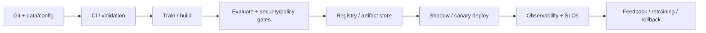

# IAM, RBAC, Managed Identities, Secrets, and Least Privilege

## 1. Title and Learning Position
- **Category:** MLOps Security, Governance, and Responsible AI
- **Prerequisites:** [Threat Modeling ML Pipelines and Platforms](97-ml-threat-modeling.md)
- **Relevance:** IAM, RBAC, Managed Identities, Secrets, and Least Privilege contributes to making ML/LLM systems reproducible, releasable, observable, secure and economically operable.
- **Learning objectives:** explain lifecycle concepts; implement automation; define gates/SLOs; diagnose production failures; make platform trade-offs.
- **Difficulty:** Intermediate
- **Estimated study time:** 4-8 hours plus labs.
- **Practical competency:** implement/review IAM, RBAC, Managed Identities, Secrets, and Least Privilege with a production lifecycle and measurable operations.

## 2. Concept
**Beginner.** MLOps applies software, data and production engineering discipline to the complete model lifecycle. LLMOps extends that scope to prompts, provider/model versions, RAG, tools/agents, evaluations, safety policies and token/cost behavior.

**Intermediate.** Treat every promoted AI system as a reproducible release context rather than a model file alone. Separate source/build, experiment/training, registry, deployment and runtime concerns while preserving lineage between them.

**Advanced.** Analyze control/data planes, multi-tenancy, delayed labels, drift, capacity/GPU scheduling, partial pipeline failure, supply chain, model/provider deprecation, quality budgets, disaster recovery and unit economics.

**Operational anchor.** Security boundaries are deterministic: IAM/RBAC, network controls, encryption, secret brokers, artifact signatures and policy-as-code. Model or prompt instructions never replace authorization.

**Versioned artifacts:** code SHA, environment/container digest, dataset snapshot, feature definitions, training configuration, model weights/adapters, prompt/system instructions, embedding/index versions, tool/graph schemas, evaluation datasets/rubrics/results and infrastructure release.

**Reliability view:** use SLIs for availability, latency, errors, saturation, freshness and task/model quality. An SLO is a target over a window; error/quality budgets convert targets into change/incident decisions.

**Failure modes:** unpinned dependencies, irreproducible data, training-serving skew, broken promotion, registry/artifact mismatch, silent drift, missing ground truth, OOM/GPU saturation, bad autoscaling, provider rate limits, stale indexes, agent loops, security-policy regression and incomplete rollback.



## 3. Intermediate and Advanced Use Cases
### Intermediate lifecycle
**Problem:** Operationalize IAM, RBAC, Managed Identities, Secrets, and Least Privilege for a versioned ML workload. **Lifecycle/artifacts:** code, data, config, model/prompt/index/tool versions and evaluation evidence as applicable. **Architecture:** source -> automated pipeline -> artifact/registry -> gated promotion -> serving/runtime -> telemetry/feedback. **Infrastructure:** immutable containers/IaC, least-privilege identities, observable services and capacity controls. **Evaluation:** software/data/model/LLM/RAG/agent checks appropriate to the release. **SLOs:** availability/latency plus quality/freshness where measurable. **Risks:** irreproducibility, skew, drift, supply-chain compromise, GPU saturation, hidden regressions and cost growth. **Recovery:** rollback, rebuild/replay, failover or deterministic degradation. **Ownership:** platform provides paved paths/controls; workload teams own task correctness and data/model behavior; SRE/security/governance own shared policies and incident processes. **Alternative:** managed cloud platform or simpler deployment pattern when internal platform complexity is not justified.
### Intermediate GenAI
**Problem:** Apply IAM, RBAC, Managed Identities, Secrets, and Least Privilege to an LLM/RAG application with prompt and evaluation artifacts. **Lifecycle/artifacts:** code, data, config, model/prompt/index/tool versions and evaluation evidence as applicable. **Architecture:** source -> automated pipeline -> artifact/registry -> gated promotion -> serving/runtime -> telemetry/feedback. **Infrastructure:** immutable containers/IaC, least-privilege identities, observable services and capacity controls. **Evaluation:** software/data/model/LLM/RAG/agent checks appropriate to the release. **SLOs:** availability/latency plus quality/freshness where measurable. **Risks:** irreproducibility, skew, drift, supply-chain compromise, GPU saturation, hidden regressions and cost growth. **Recovery:** rollback, rebuild/replay, failover or deterministic degradation. **Ownership:** platform provides paved paths/controls; workload teams own task correctness and data/model behavior; SRE/security/governance own shared policies and incident processes. **Alternative:** managed cloud platform or simpler deployment pattern when internal platform complexity is not justified.
### Advanced scale
**Problem:** Operate IAM, RBAC, Managed Identities, Secrets, and Least Privilege across multiple teams/environments under capacity and reliability constraints. **Lifecycle/artifacts:** code, data, config, model/prompt/index/tool versions and evaluation evidence as applicable. **Architecture:** source -> automated pipeline -> artifact/registry -> gated promotion -> serving/runtime -> telemetry/feedback. **Infrastructure:** immutable containers/IaC, least-privilege identities, observable services and capacity controls. **Evaluation:** software/data/model/LLM/RAG/agent checks appropriate to the release. **SLOs:** availability/latency plus quality/freshness where measurable. **Risks:** irreproducibility, skew, drift, supply-chain compromise, GPU saturation, hidden regressions and cost growth. **Recovery:** rollback, rebuild/replay, failover or deterministic degradation. **Ownership:** platform provides paved paths/controls; workload teams own task correctness and data/model behavior; SRE/security/governance own shared policies and incident processes. **Alternative:** managed cloud platform or simpler deployment pattern when internal platform complexity is not justified.
### Advanced resilience
**Problem:** Test IAM, RBAC, Managed Identities, Secrets, and Least Privilege during dependency, data, model, GPU or provider failures. **Lifecycle/artifacts:** code, data, config, model/prompt/index/tool versions and evaluation evidence as applicable. **Architecture:** source -> automated pipeline -> artifact/registry -> gated promotion -> serving/runtime -> telemetry/feedback. **Infrastructure:** immutable containers/IaC, least-privilege identities, observable services and capacity controls. **Evaluation:** software/data/model/LLM/RAG/agent checks appropriate to the release. **SLOs:** availability/latency plus quality/freshness where measurable. **Risks:** irreproducibility, skew, drift, supply-chain compromise, GPU saturation, hidden regressions and cost growth. **Recovery:** rollback, rebuild/replay, failover or deterministic degradation. **Ownership:** platform provides paved paths/controls; workload teams own task correctness and data/model behavior; SRE/security/governance own shared policies and incident processes. **Alternative:** managed cloud platform or simpler deployment pattern when internal platform complexity is not justified.
### Enterprise
**Problem:** Govern IAM, RBAC, Managed Identities, Secrets, and Least Privilege for a multi-tenant AI platform with IAM, audit, SLOs, FinOps and DR. **Lifecycle/artifacts:** code, data, config, model/prompt/index/tool versions and evaluation evidence as applicable. **Architecture:** source -> automated pipeline -> artifact/registry -> gated promotion -> serving/runtime -> telemetry/feedback. **Infrastructure:** immutable containers/IaC, least-privilege identities, observable services and capacity controls. **Evaluation:** software/data/model/LLM/RAG/agent checks appropriate to the release. **SLOs:** availability/latency plus quality/freshness where measurable. **Risks:** irreproducibility, skew, drift, supply-chain compromise, GPU saturation, hidden regressions and cost growth. **Recovery:** rollback, rebuild/replay, failover or deterministic degradation. **Ownership:** platform provides paved paths/controls; workload teams own task correctness and data/model behavior; SRE/security/governance own shared policies and incident processes. **Alternative:** managed cloud platform or simpler deployment pattern when internal platform complexity is not justified.

## 4. Implementation
**Repository pattern:** keep application/training code, tests, pipeline definitions, environment lock files and deployment/IaC under version control; keep large immutable artifacts in governed stores and reference them by durable IDs/digests.

```python
from dataclasses import dataclass

@dataclass(frozen=True)
class ReleaseContext:
    code_version: str
    data_version: str
    config_version: str
    artifact_version: str
    evaluation_version: str

release = ReleaseContext(
    code_version="<git_sha>", data_version="<dataset_snapshot>",
    config_version="<config_digest>", artifact_version="<model_or_app_version>",
    evaluation_version="<eval_dataset_and_rubric_version>")
```

```dockerfile
FROM python:3.12-slim
WORKDIR /app
COPY requirements.lock ./
RUN pip install --no-cache-dir -r requirements.lock
COPY . .
USER 10001
CMD ["python", "-m", "app"]
```

```yaml
# CI/CD sketch: pin actions/tasks to approved versions in a real pipeline.
stages:
  - test
  - evaluate
  - security_scan
  - package
  - deploy_shadow
  - verify_slo
  - promote_or_rollback
```

```yaml
apiVersion: apps/v1
kind: Deployment
metadata: {name: model-service}
spec:
  replicas: 2
  selector: {matchLabels: {app: model-service}}
  template:
    metadata: {labels: {app: model-service}}
    spec:
      containers:
      - name: serving
        image: registry.example/model-service:<immutable-digest-or-version>
        readinessProbe: {httpGet: {path: /ready, port: 8080}}
        resources:
          requests: {cpu: "500m", memory: "1Gi"}
          limits: {cpu: "2", memory: "4Gi"}
```

**Evaluation gates:** software tests must pass before costly training/deployment; data/schema tests before training; task/model evaluation before registry promotion; security/policy checks before production; post-deploy shadow/canary verifies SLOs before full traffic.

**Secrets:** use managed identities/workload identity/vault integrations, not environment files committed to Git or credentials embedded in pipeline YAML.

**Tracing/metrics:** emit stable run/release IDs across pipeline and serving spans. Record infrastructure signals separately from data/model/task-quality metrics and redact sensitive payloads.

**Rollback:** preserve immutable prior release references and schema/data compatibility. Rollback procedures should be exercised, not merely documented.

**Common mistake:** treating successful deployment as proof of model quality. **Correction:** release requires both service health and validated task/model/evaluation criteria.

## 5. Architectural Considerations
- **Build vs buy:** Azure Machine Learning, SageMaker and Vertex AI reduce platform ownership; Kubernetes/Kubeflow/KServe/Ray/open-source stacks add portability/control but require SRE/security/platform staffing. Verify current vendor capabilities and limits from official docs.
- **Control/data plane:** central control plane manages definitions, orchestration, registry/policy/identity; execution/data plane handles data movement, training and inference. Isolate tenant/workload credentials and quotas.
- **Data/feature:** Airflow/Dagster/Prefect fit orchestration needs; Feast-style stores are justified when offline/online feature reuse and point-in-time consistency matter.
- **Artifacts/experiments:** MLflow-style tracking/registry supports lineage and promotion, but governance must define ownership, retention, signatures and immutable release metadata.
- **Serving:** FastAPI/BentoML fit application service patterns; KServe/Triton fit standardized Kubernetes/GPU serving needs. Batch often wins on cost for noninteractive workloads.
- **GPU:** schedule via explicit requests/limits/quotas; monitor utilization/memory/queueing and use MIG/time-slicing only with workload compatibility and measured isolation/performance.
- **LLMOps:** model gateway centralizes routing, quotas, safety/policy and telemetry; prompt/model/provider changes require evaluation even without code changes.
- **RAGOps:** preserve document/chunk/embedding/index/ACL versions, freshness SLO and rebuild/rollback. Retrieval/citation evaluation is independent from final answer quality.
- **AgentOps:** trace graph/state/tool/model/human transitions; checkpoint; enforce max steps/budgets/approval; evaluate trajectories and duplicate-action recovery.
- **Observability/SRE:** Prometheus/Grafana metric patterns and OpenTelemetry tracing are useful when standardized telemetry is required. Alert on symptoms/SLO burn, not every metric movement.
- **Security:** IAM/RBAC, private networks/egress control, encryption/KMS, secret brokers, image/model signing/SBOM, policy-as-code and supply-chain scanning belong in platform controls.
- **FinOps:** tag/attribute training, inference, storage, tokens and shared platform costs; optimize cost per successful prediction/answer/task and enforce budgets/quotas.
- **DR:** define RPO/RTO per artifact/store/service, backup registries/config/state, and prefer deterministic rebuild-from-source for derived artifacts such as indexes when practical.

## 6. Interview Questions
### Q1. Beginner: What is a critical operational decision for **IAM, RBAC, Managed Identities, Secrets, and Least Privilege**, and how would you validate it?
**Model answer:** Identify the lifecycle artifact and owner, make build/release inputs reproducible, define automated tests/evaluation and policy gates, deploy with observable health/SLO signals, measure quality plus capacity/cost, and preserve rollback/recovery.

**Evaluates:** lifecycle depth, platform/SRE judgment, security/governance awareness and ability to operate AI beyond notebooks.

**Weak answer:** naming a tool such as Kubernetes or MLflow without explaining ownership, versioning, release gates, SLOs, failure modes or rollback.

**Follow-up:** How would the design change for GPU scarcity, delayed ground truth, provider outage, multi-tenancy, RAG freshness or a regulated workload?

### Q2. Beginner: What is a critical operational decision for **IAM, RBAC, Managed Identities, Secrets, and Least Privilege**, and how would you validate it?
**Model answer:** Identify the lifecycle artifact and owner, make build/release inputs reproducible, define automated tests/evaluation and policy gates, deploy with observable health/SLO signals, measure quality plus capacity/cost, and preserve rollback/recovery.

**Evaluates:** lifecycle depth, platform/SRE judgment, security/governance awareness and ability to operate AI beyond notebooks.

**Weak answer:** naming a tool such as Kubernetes or MLflow without explaining ownership, versioning, release gates, SLOs, failure modes or rollback.

**Follow-up:** How would the design change for GPU scarcity, delayed ground truth, provider outage, multi-tenancy, RAG freshness or a regulated workload?

### Q3. Beginner: What is a critical operational decision for **IAM, RBAC, Managed Identities, Secrets, and Least Privilege**, and how would you validate it?
**Model answer:** Identify the lifecycle artifact and owner, make build/release inputs reproducible, define automated tests/evaluation and policy gates, deploy with observable health/SLO signals, measure quality plus capacity/cost, and preserve rollback/recovery.

**Evaluates:** lifecycle depth, platform/SRE judgment, security/governance awareness and ability to operate AI beyond notebooks.

**Weak answer:** naming a tool such as Kubernetes or MLflow without explaining ownership, versioning, release gates, SLOs, failure modes or rollback.

**Follow-up:** How would the design change for GPU scarcity, delayed ground truth, provider outage, multi-tenancy, RAG freshness or a regulated workload?

### Q4. Beginner: What is a critical operational decision for **IAM, RBAC, Managed Identities, Secrets, and Least Privilege**, and how would you validate it?
**Model answer:** Identify the lifecycle artifact and owner, make build/release inputs reproducible, define automated tests/evaluation and policy gates, deploy with observable health/SLO signals, measure quality plus capacity/cost, and preserve rollback/recovery.

**Evaluates:** lifecycle depth, platform/SRE judgment, security/governance awareness and ability to operate AI beyond notebooks.

**Weak answer:** naming a tool such as Kubernetes or MLflow without explaining ownership, versioning, release gates, SLOs, failure modes or rollback.

**Follow-up:** How would the design change for GPU scarcity, delayed ground truth, provider outage, multi-tenancy, RAG freshness or a regulated workload?

### Q5. Beginner: What is a critical operational decision for **IAM, RBAC, Managed Identities, Secrets, and Least Privilege**, and how would you validate it?
**Model answer:** Identify the lifecycle artifact and owner, make build/release inputs reproducible, define automated tests/evaluation and policy gates, deploy with observable health/SLO signals, measure quality plus capacity/cost, and preserve rollback/recovery.

**Evaluates:** lifecycle depth, platform/SRE judgment, security/governance awareness and ability to operate AI beyond notebooks.

**Weak answer:** naming a tool such as Kubernetes or MLflow without explaining ownership, versioning, release gates, SLOs, failure modes or rollback.

**Follow-up:** How would the design change for GPU scarcity, delayed ground truth, provider outage, multi-tenancy, RAG freshness or a regulated workload?

### Q6. Intermediate: What is a critical operational decision for **IAM, RBAC, Managed Identities, Secrets, and Least Privilege**, and how would you validate it?
**Model answer:** Identify the lifecycle artifact and owner, make build/release inputs reproducible, define automated tests/evaluation and policy gates, deploy with observable health/SLO signals, measure quality plus capacity/cost, and preserve rollback/recovery.

**Evaluates:** lifecycle depth, platform/SRE judgment, security/governance awareness and ability to operate AI beyond notebooks.

**Weak answer:** naming a tool such as Kubernetes or MLflow without explaining ownership, versioning, release gates, SLOs, failure modes or rollback.

**Follow-up:** How would the design change for GPU scarcity, delayed ground truth, provider outage, multi-tenancy, RAG freshness or a regulated workload?

### Q7. Intermediate: What is a critical operational decision for **IAM, RBAC, Managed Identities, Secrets, and Least Privilege**, and how would you validate it?
**Model answer:** Identify the lifecycle artifact and owner, make build/release inputs reproducible, define automated tests/evaluation and policy gates, deploy with observable health/SLO signals, measure quality plus capacity/cost, and preserve rollback/recovery.

**Evaluates:** lifecycle depth, platform/SRE judgment, security/governance awareness and ability to operate AI beyond notebooks.

**Weak answer:** naming a tool such as Kubernetes or MLflow without explaining ownership, versioning, release gates, SLOs, failure modes or rollback.

**Follow-up:** How would the design change for GPU scarcity, delayed ground truth, provider outage, multi-tenancy, RAG freshness or a regulated workload?

### Q8. Intermediate: What is a critical operational decision for **IAM, RBAC, Managed Identities, Secrets, and Least Privilege**, and how would you validate it?
**Model answer:** Identify the lifecycle artifact and owner, make build/release inputs reproducible, define automated tests/evaluation and policy gates, deploy with observable health/SLO signals, measure quality plus capacity/cost, and preserve rollback/recovery.

**Evaluates:** lifecycle depth, platform/SRE judgment, security/governance awareness and ability to operate AI beyond notebooks.

**Weak answer:** naming a tool such as Kubernetes or MLflow without explaining ownership, versioning, release gates, SLOs, failure modes or rollback.

**Follow-up:** How would the design change for GPU scarcity, delayed ground truth, provider outage, multi-tenancy, RAG freshness or a regulated workload?

### Q9. Intermediate: What is a critical operational decision for **IAM, RBAC, Managed Identities, Secrets, and Least Privilege**, and how would you validate it?
**Model answer:** Identify the lifecycle artifact and owner, make build/release inputs reproducible, define automated tests/evaluation and policy gates, deploy with observable health/SLO signals, measure quality plus capacity/cost, and preserve rollback/recovery.

**Evaluates:** lifecycle depth, platform/SRE judgment, security/governance awareness and ability to operate AI beyond notebooks.

**Weak answer:** naming a tool such as Kubernetes or MLflow without explaining ownership, versioning, release gates, SLOs, failure modes or rollback.

**Follow-up:** How would the design change for GPU scarcity, delayed ground truth, provider outage, multi-tenancy, RAG freshness or a regulated workload?

### Q10. Intermediate: What is a critical operational decision for **IAM, RBAC, Managed Identities, Secrets, and Least Privilege**, and how would you validate it?
**Model answer:** Identify the lifecycle artifact and owner, make build/release inputs reproducible, define automated tests/evaluation and policy gates, deploy with observable health/SLO signals, measure quality plus capacity/cost, and preserve rollback/recovery.

**Evaluates:** lifecycle depth, platform/SRE judgment, security/governance awareness and ability to operate AI beyond notebooks.

**Weak answer:** naming a tool such as Kubernetes or MLflow without explaining ownership, versioning, release gates, SLOs, failure modes or rollback.

**Follow-up:** How would the design change for GPU scarcity, delayed ground truth, provider outage, multi-tenancy, RAG freshness or a regulated workload?

### Q11. Advanced: What is a critical operational decision for **IAM, RBAC, Managed Identities, Secrets, and Least Privilege**, and how would you validate it?
**Model answer:** Identify the lifecycle artifact and owner, make build/release inputs reproducible, define automated tests/evaluation and policy gates, deploy with observable health/SLO signals, measure quality plus capacity/cost, and preserve rollback/recovery.

**Evaluates:** lifecycle depth, platform/SRE judgment, security/governance awareness and ability to operate AI beyond notebooks.

**Weak answer:** naming a tool such as Kubernetes or MLflow without explaining ownership, versioning, release gates, SLOs, failure modes or rollback.

**Follow-up:** How would the design change for GPU scarcity, delayed ground truth, provider outage, multi-tenancy, RAG freshness or a regulated workload?

### Q12. Advanced: What is a critical operational decision for **IAM, RBAC, Managed Identities, Secrets, and Least Privilege**, and how would you validate it?
**Model answer:** Identify the lifecycle artifact and owner, make build/release inputs reproducible, define automated tests/evaluation and policy gates, deploy with observable health/SLO signals, measure quality plus capacity/cost, and preserve rollback/recovery.

**Evaluates:** lifecycle depth, platform/SRE judgment, security/governance awareness and ability to operate AI beyond notebooks.

**Weak answer:** naming a tool such as Kubernetes or MLflow without explaining ownership, versioning, release gates, SLOs, failure modes or rollback.

**Follow-up:** How would the design change for GPU scarcity, delayed ground truth, provider outage, multi-tenancy, RAG freshness or a regulated workload?

### Q13. Advanced: What is a critical operational decision for **IAM, RBAC, Managed Identities, Secrets, and Least Privilege**, and how would you validate it?
**Model answer:** Identify the lifecycle artifact and owner, make build/release inputs reproducible, define automated tests/evaluation and policy gates, deploy with observable health/SLO signals, measure quality plus capacity/cost, and preserve rollback/recovery.

**Evaluates:** lifecycle depth, platform/SRE judgment, security/governance awareness and ability to operate AI beyond notebooks.

**Weak answer:** naming a tool such as Kubernetes or MLflow without explaining ownership, versioning, release gates, SLOs, failure modes or rollback.

**Follow-up:** How would the design change for GPU scarcity, delayed ground truth, provider outage, multi-tenancy, RAG freshness or a regulated workload?

### Q14. Advanced: What is a critical operational decision for **IAM, RBAC, Managed Identities, Secrets, and Least Privilege**, and how would you validate it?
**Model answer:** Identify the lifecycle artifact and owner, make build/release inputs reproducible, define automated tests/evaluation and policy gates, deploy with observable health/SLO signals, measure quality plus capacity/cost, and preserve rollback/recovery.

**Evaluates:** lifecycle depth, platform/SRE judgment, security/governance awareness and ability to operate AI beyond notebooks.

**Weak answer:** naming a tool such as Kubernetes or MLflow without explaining ownership, versioning, release gates, SLOs, failure modes or rollback.

**Follow-up:** How would the design change for GPU scarcity, delayed ground truth, provider outage, multi-tenancy, RAG freshness or a regulated workload?

### Q15. Advanced: What is a critical operational decision for **IAM, RBAC, Managed Identities, Secrets, and Least Privilege**, and how would you validate it?
**Model answer:** Identify the lifecycle artifact and owner, make build/release inputs reproducible, define automated tests/evaluation and policy gates, deploy with observable health/SLO signals, measure quality plus capacity/cost, and preserve rollback/recovery.

**Evaluates:** lifecycle depth, platform/SRE judgment, security/governance awareness and ability to operate AI beyond notebooks.

**Weak answer:** naming a tool such as Kubernetes or MLflow without explaining ownership, versioning, release gates, SLOs, failure modes or rollback.

**Follow-up:** How would the design change for GPU scarcity, delayed ground truth, provider outage, multi-tenancy, RAG freshness or a regulated workload?

### Q16. Architecture: What is a critical operational decision for **IAM, RBAC, Managed Identities, Secrets, and Least Privilege**, and how would you validate it?
**Model answer:** Identify the lifecycle artifact and owner, make build/release inputs reproducible, define automated tests/evaluation and policy gates, deploy with observable health/SLO signals, measure quality plus capacity/cost, and preserve rollback/recovery.

**Evaluates:** lifecycle depth, platform/SRE judgment, security/governance awareness and ability to operate AI beyond notebooks.

**Weak answer:** naming a tool such as Kubernetes or MLflow without explaining ownership, versioning, release gates, SLOs, failure modes or rollback.

**Follow-up:** How would the design change for GPU scarcity, delayed ground truth, provider outage, multi-tenancy, RAG freshness or a regulated workload?

### Q17. Architecture: What is a critical operational decision for **IAM, RBAC, Managed Identities, Secrets, and Least Privilege**, and how would you validate it?
**Model answer:** Identify the lifecycle artifact and owner, make build/release inputs reproducible, define automated tests/evaluation and policy gates, deploy with observable health/SLO signals, measure quality plus capacity/cost, and preserve rollback/recovery.

**Evaluates:** lifecycle depth, platform/SRE judgment, security/governance awareness and ability to operate AI beyond notebooks.

**Weak answer:** naming a tool such as Kubernetes or MLflow without explaining ownership, versioning, release gates, SLOs, failure modes or rollback.

**Follow-up:** How would the design change for GPU scarcity, delayed ground truth, provider outage, multi-tenancy, RAG freshness or a regulated workload?

### Q18. Architecture: What is a critical operational decision for **IAM, RBAC, Managed Identities, Secrets, and Least Privilege**, and how would you validate it?
**Model answer:** Identify the lifecycle artifact and owner, make build/release inputs reproducible, define automated tests/evaluation and policy gates, deploy with observable health/SLO signals, measure quality plus capacity/cost, and preserve rollback/recovery.

**Evaluates:** lifecycle depth, platform/SRE judgment, security/governance awareness and ability to operate AI beyond notebooks.

**Weak answer:** naming a tool such as Kubernetes or MLflow without explaining ownership, versioning, release gates, SLOs, failure modes or rollback.

**Follow-up:** How would the design change for GPU scarcity, delayed ground truth, provider outage, multi-tenancy, RAG freshness or a regulated workload?

### Q19. Debugging: What is a critical operational decision for **IAM, RBAC, Managed Identities, Secrets, and Least Privilege**, and how would you validate it?
**Model answer:** Identify the lifecycle artifact and owner, make build/release inputs reproducible, define automated tests/evaluation and policy gates, deploy with observable health/SLO signals, measure quality plus capacity/cost, and preserve rollback/recovery.

**Evaluates:** lifecycle depth, platform/SRE judgment, security/governance awareness and ability to operate AI beyond notebooks.

**Weak answer:** naming a tool such as Kubernetes or MLflow without explaining ownership, versioning, release gates, SLOs, failure modes or rollback.

**Follow-up:** How would the design change for GPU scarcity, delayed ground truth, provider outage, multi-tenancy, RAG freshness or a regulated workload?

### Q20. Debugging: What is a critical operational decision for **IAM, RBAC, Managed Identities, Secrets, and Least Privilege**, and how would you validate it?
**Model answer:** Identify the lifecycle artifact and owner, make build/release inputs reproducible, define automated tests/evaluation and policy gates, deploy with observable health/SLO signals, measure quality plus capacity/cost, and preserve rollback/recovery.

**Evaluates:** lifecycle depth, platform/SRE judgment, security/governance awareness and ability to operate AI beyond notebooks.

**Weak answer:** naming a tool such as Kubernetes or MLflow without explaining ownership, versioning, release gates, SLOs, failure modes or rollback.

**Follow-up:** How would the design change for GPU scarcity, delayed ground truth, provider outage, multi-tenancy, RAG freshness or a regulated workload?

### Q21. Coding/Configuration: What is a critical operational decision for **IAM, RBAC, Managed Identities, Secrets, and Least Privilege**, and how would you validate it?
**Model answer:** Identify the lifecycle artifact and owner, make build/release inputs reproducible, define automated tests/evaluation and policy gates, deploy with observable health/SLO signals, measure quality plus capacity/cost, and preserve rollback/recovery.

**Evaluates:** lifecycle depth, platform/SRE judgment, security/governance awareness and ability to operate AI beyond notebooks.

**Weak answer:** naming a tool such as Kubernetes or MLflow without explaining ownership, versioning, release gates, SLOs, failure modes or rollback.

**Follow-up:** How would the design change for GPU scarcity, delayed ground truth, provider outage, multi-tenancy, RAG freshness or a regulated workload?

### Q22. Coding/Configuration: What is a critical operational decision for **IAM, RBAC, Managed Identities, Secrets, and Least Privilege**, and how would you validate it?
**Model answer:** Identify the lifecycle artifact and owner, make build/release inputs reproducible, define automated tests/evaluation and policy gates, deploy with observable health/SLO signals, measure quality plus capacity/cost, and preserve rollback/recovery.

**Evaluates:** lifecycle depth, platform/SRE judgment, security/governance awareness and ability to operate AI beyond notebooks.

**Weak answer:** naming a tool such as Kubernetes or MLflow without explaining ownership, versioning, release gates, SLOs, failure modes or rollback.

**Follow-up:** How would the design change for GPU scarcity, delayed ground truth, provider outage, multi-tenancy, RAG freshness or a regulated workload?

## 7. Practical Exercises
### Foundational
Implement a reproducible mini-pipeline for IAM, RBAC, Managed Identities, Secrets, and Least Privilege with pinned dependencies/version metadata and automated tests. **Expected:** repeatable local/CI run. **Evaluate:** lineage and testability. **Failure modes:** mutable dependencies, hidden local state. **Stretch:** create an SBOM and artifact digest.

### Intermediate
Containerize and deploy a model/LLM service through CI with evaluation gates, health checks, telemetry and rollback. **Expected:** deployment pipeline and dashboard. **Evaluate:** release safety, observability and reproducibility. **Stretch:** shadow/canary traffic.

### Advanced production
Design a multi-team platform capability for IAM, RBAC, Managed Identities, Secrets, and Least Privilege including IAM, IaC, quotas, SLOs, DR, evaluation/policy gates, cost allocation and runbooks. **Expected:** architecture, IaC/pipeline skeleton and operational plan. **Evaluate:** reliability, governance, usability and cost. **Stretch:** chaos/failure injection.

## 8. Summary and Revision Checklist
### Key takeaways
- Version all inputs required to reproduce behavior, not only model weights.
- Automate testing/evaluation/policy checks before promotion.
- Separate service health from model/task quality.
- Every production release needs observability, rollback/rebuild and clear ownership.

### Operational formulas/design rules
Availability = successful service time/requests over scope; utilization and queueing must be interpreted with tail latency. Unit cost = total attributable workload cost / successful business tasks. Drift statistics require a reference distribution and threshold but should trigger investigation, not blind retraining.

### Critical settings
Immutable versions/digests, environment/config IDs, evaluation thresholds, resource requests/limits, autoscaling signals, timeouts/retries, retention, SLO windows, alert burn thresholds, quotas and budget limits.

### Architecture checklist
- [ ] Data/code/config/environment/artifacts versioned
- [ ] Automated tests/evaluation/policy gates defined
- [ ] Registry/promotion ownership defined
- [ ] Serving SLOs/capacity/rollback tested
- [ ] Observability links release to outcome

### Security checklist
- [ ] Workload identity/least privilege
- [ ] Secrets outside source/prompt
- [ ] Network/egress controls
- [ ] Signed/scanned artifacts and dependencies
- [ ] Audit/policy/incident process

### SRE checklist
- [ ] SLIs/SLOs and error/quality budgets
- [ ] Symptom-based alerting
- [ ] Runbook with rollback/failover
- [ ] Capacity/load testing
- [ ] Postmortem/corrective-action process

### Common pitfalls
Notebook-to-production handoff without reproducibility, mutable tags, no data lineage, metric-only deployment gates, retraining on every drift alert, Kubernetes without platform ownership, unallocated GPU/token cost, LLM prompt changes without evaluation, stale RAG indexes and AgentOps without trajectory/replay controls.

### Five flashcards
1. **Q:** What must a reproducible ML release identify? **A:** Code, data, environment, configuration, model/artifacts and evaluation evidence.
2. **Q:** Drift means retrain? **A:** No. It is a diagnostic signal; assess impact and root cause first.
3. **Q:** What does LLMOps add? **A:** Prompt/model-provider, RAG/tool/agent/policy/evaluation and token/cost operations.
4. **Q:** Service SLO vs quality SLO? **A:** Availability/latency can be healthy while model/task quality is degraded; both need signals.
5. **Q:** Best cost metric? **A:** Attributable cost per successful business outcome under required quality/reliability.

### Next recommended topics
- [Private Networks, Endpoints, Firewalls, Egress, and Zero Trust](99-network-security.md)
- [Encryption at Rest/In Transit and Key Management](100-data-model-encryption.md)
