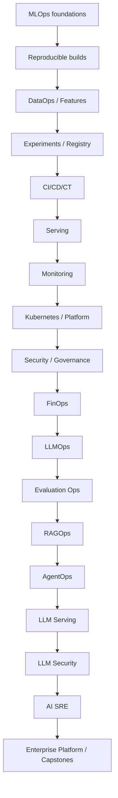
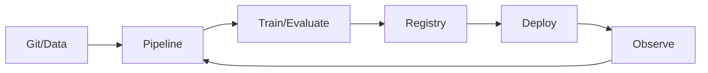

# MLOps and LLMOps Engineering Notes

## Repository Purpose

A production-oriented path for experienced Python/ML/GenAI engineers moving toward ML Platform, LLMOps, Principal AI Engineering and AI Platform Architecture roles. Study in order and pair every concept with automation, evaluation, observability, security, SRE and cost exercises.

## Recommended Learning Path

## Category Summary

### Category 1: MLOps Foundations

**Purpose:** build competency in mlops foundations. **Prerequisites:** previous categories unless already proficient. **Estimated study time:** 54-90 hours. **Outcome:** implement, automate, secure and operate these platform capabilities.

1. **[MLOps Definition, Motivation, Principles, and Lifecycle](01-mlops-overview.md)**  
   Foundational. Prerequisite: Python, Git, Linux and ML fundamentals. Study: 4-8 hours. Competency: implement/operate/review MLOps Definition, Motivation, Principles, and Lifecycle.
2. **[ML Systems vs Traditional Software Systems](02-ml-vs-software-lifecycle.md)**  
   Foundational. Prerequisite: MLOps Definition, Motivation, Principles, and Lifecycle. Study: 4-8 hours. Competency: implement/operate/review ML Systems vs Traditional Software Systems.
3. **[Data, Features, Code, Models, Infrastructure, and Feedback](03-ml-system-components.md)**  
   Foundational. Prerequisite: ML Systems vs Traditional Software Systems. Study: 4-8 hours. Competency: implement/operate/review Data, Features, Code, Models, Infrastructure, and Feedback.
4. **[Reproducibility, Determinism, Seeds, Environments, and Lineage](04-reproducibility.md)**  
   Foundational. Prerequisite: Data, Features, Code, Models, Infrastructure, and Feedback. Study: 4-8 hours. Competency: implement/operate/review Reproducibility, Determinism, Seeds, Environments, and Lineage.
5. **[ML Technical Debt and Hidden Production Dependencies](05-ml-technical-debt.md)**  
   Foundational. Prerequisite: Reproducibility, Determinism, Seeds, Environments, and Lineage. Study: 4-8 hours. Competency: implement/operate/review ML Technical Debt and Hidden Production Dependencies.
6. **[MLOps Maturity Levels and Organizational Readiness](06-mlops-maturity.md)**  
   Foundational. Prerequisite: ML Technical Debt and Hidden Production Dependencies. Study: 4-8 hours. Competency: implement/operate/review MLOps Maturity Levels and Organizational Readiness.
7. **[DevOps, DataOps, MLOps, LLMOps, RAGOps, and AgentOps](07-devops-dataops-mlops.md)**  
   Foundational. Prerequisite: MLOps Maturity Levels and Organizational Readiness. Study: 4-8 hours. Competency: implement/operate/review DevOps, DataOps, MLOps, LLMOps, RAGOps, and AgentOps.
8. **[Baseline ML Platform Reference Architecture](08-ml-platform-reference-architecture.md)**  
   Foundational. Prerequisite: DevOps, DataOps, MLOps, LLMOps, RAGOps, and AgentOps. Study: 4-8 hours. Competency: implement/operate/review Baseline ML Platform Reference Architecture.
9. **[Platform Capabilities, Prioritization, Risk, and ROI](09-mlops-use-case-selection.md)**  
   Foundational. Prerequisite: Baseline ML Platform Reference Architecture. Study: 4-8 hours. Competency: implement/operate/review Platform Capabilities, Prioritization, Risk, and ROI.

### Category 2: Source Control, Environments, and Reproducible Builds

**Purpose:** build competency in source control, environments, and reproducible builds. **Prerequisites:** previous categories unless already proficient. **Estimated study time:** 54-90 hours. **Outcome:** implement, automate, secure and operate these platform capabilities.

10. **[Git Branching, Pull Requests, Tags, and ML Repository Practices](10-git-for-ml.md)**  
   Foundational. Prerequisite: Platform Capabilities, Prioritization, Risk, and ROI. Study: 4-8 hours. Competency: implement/operate/review Git Branching, Pull Requests, Tags, and ML Repository Practices.
11. **[ML/AI Monorepo vs Multi-Repo and Project Layout](11-repository-structure.md)**  
   Foundational. Prerequisite: Git Branching, Pull Requests, Tags, and ML Repository Practices. Study: 4-8 hours. Competency: implement/operate/review ML/AI Monorepo vs Multi-Repo and Project Layout.
12. **[Virtual Environments, Lock Files, Packaging, and Dependency Pinning](12-python-dependency-management.md)**  
   Foundational. Prerequisite: ML/AI Monorepo vs Multi-Repo and Project Layout. Study: 4-8 hours. Competency: implement/operate/review Virtual Environments, Lock Files, Packaging, and Dependency Pinning.
13. **[Dev/Test/Prod Parity and Environment Reproduction](13-environment-reproducibility.md)**  
   Foundational. Prerequisite: Virtual Environments, Lock Files, Packaging, and Dependency Pinning. Study: 4-8 hours. Competency: implement/operate/review Dev/Test/Prod Parity and Environment Reproduction.
14. **[Docker Images, Layers, Registries, and Secure Containers](14-docker-foundations.md)**  
   Foundational. Prerequisite: Dev/Test/Prod Parity and Environment Reproduction. Study: 4-8 hours. Competency: implement/operate/review Docker Images, Layers, Registries, and Secure Containers.
15. **[Multi-Stage Builds, Base Images, Size, Caching, and Vulnerabilities](15-container-optimization.md)**  
   Foundational. Prerequisite: Docker Images, Layers, Registries, and Secure Containers. Study: 4-8 hours. Competency: implement/operate/review Multi-Stage Builds, Base Images, Size, Caching, and Vulnerabilities.
16. **[Versioning Code, Data, Models, Features, Prompts, and Configurations](16-artifact-versioning.md)**  
   Foundational. Prerequisite: Multi-Stage Builds, Base Images, Size, Caching, and Vulnerabilities. Study: 4-8 hours. Competency: implement/operate/review Versioning Code, Data, Models, Features, Prompts, and Configurations.
17. **[Dataset Versioning, DVC/LakeFS-Style Patterns, and Snapshots](17-data-versioning.md)**  
   Foundational. Prerequisite: Versioning Code, Data, Models, Features, Prompts, and Configurations. Study: 4-8 hours. Competency: implement/operate/review Dataset Versioning, DVC/LakeFS-Style Patterns, and Snapshots.
18. **[SBOM, Image Signing, Provenance, Dependencies, and Supply-Chain Security](18-software-supply-chain.md)**  
   Foundational. Prerequisite: Dataset Versioning, DVC/LakeFS-Style Patterns, and Snapshots. Study: 4-8 hours. Competency: implement/operate/review SBOM, Image Signing, Provenance, Dependencies, and Supply-Chain Security.

### Category 3: Data Engineering and DataOps for ML

**Purpose:** build competency in data engineering and dataops for ml. **Prerequisites:** previous categories unless already proficient. **Estimated study time:** 60-100 hours. **Outcome:** implement, automate, secure and operate these platform capabilities.

19. **[Batch and Streaming Data Pipelines for ML](19-data-pipelines.md)**  
   Foundational. Prerequisite: SBOM, Image Signing, Provenance, Dependencies, and Supply-Chain Security. Study: 4-8 hours. Competency: implement/operate/review Batch and Streaming Data Pipelines for ML.
20. **[Schema, Constraints, Statistics, and Data Quality Gates](20-data-validation.md)**  
   Foundational. Prerequisite: Batch and Streaming Data Pipelines for ML. Study: 4-8 hours. Competency: implement/operate/review Schema, Constraints, Statistics, and Data Quality Gates.
21. **[Data Contracts, Ownership, SLAs, and Schema Evolution](21-data-contracts.md)**  
   Foundational. Prerequisite: Schema, Constraints, Statistics, and Data Quality Gates. Study: 4-8 hours. Competency: implement/operate/review Data Contracts, Ownership, SLAs, and Schema Evolution.
22. **[Data Lineage and Provenance](22-data-lineage.md)**  
   Foundational. Prerequisite: Data Contracts, Ownership, SLAs, and Schema Evolution. Study: 4-8 hours. Competency: implement/operate/review Data Lineage and Provenance.
23. **[Airflow, Dagster, Prefect, and Workflow Orchestration Concepts](23-orchestration.md)**  
   Foundational. Prerequisite: Data Lineage and Provenance. Study: 4-8 hours. Competency: implement/operate/review Airflow, Dagster, Prefect, and Workflow Orchestration Concepts.
24. **[CDC, Incremental Pipelines, Backfills, and Idempotency](24-incremental-processing.md)**  
   Foundational. Prerequisite: Airflow, Dagster, Prefect, and Workflow Orchestration Concepts. Study: 4-8 hours. Competency: implement/operate/review CDC, Incremental Pipelines, Backfills, and Idempotency.
25. **[Object Stores, Data Lakes, Lakehouses, and Table Formats](25-data-lakes-lakehouse.md)**  
   Foundational. Prerequisite: CDC, Incremental Pipelines, Backfills, and Idempotency. Study: 4-8 hours. Competency: implement/operate/review Object Stores, Data Lakes, Lakehouses, and Table Formats.
26. **[Kafka/Event Streaming and Real-Time ML Data](26-streaming-ml.md)**  
   Foundational. Prerequisite: Object Stores, Data Lakes, Lakehouses, and Table Formats. Study: 4-8 hours. Competency: implement/operate/review Kafka/Event Streaming and Real-Time ML Data.
27. **[PII, Retention, Residency, Access, and Dataset Governance](27-data-privacy-governance.md)**  
   Foundational. Prerequisite: Kafka/Event Streaming and Real-Time ML Data. Study: 4-8 hours. Competency: implement/operate/review PII, Retention, Residency, Access, and Dataset Governance.
28. **[Data Freshness, Quality, Lineage, and Pipeline Monitoring](28-data-pipeline-observability.md)**  
   Foundational. Prerequisite: PII, Retention, Residency, Access, and Dataset Governance. Study: 4-8 hours. Competency: implement/operate/review Data Freshness, Quality, Lineage, and Pipeline Monitoring.

### Category 4: Feature Engineering and Feature Stores

**Purpose:** build competency in feature engineering and feature stores. **Prerequisites:** previous categories unless already proficient. **Estimated study time:** 54-90 hours. **Outcome:** implement, automate, secure and operate these platform capabilities.

29. **[Reproducible Feature Engineering](29-feature-engineering-pipelines.md)**  
   Foundational. Prerequisite: Data Freshness, Quality, Lineage, and Pipeline Monitoring. Study: 4-8 hours. Competency: implement/operate/review Reproducible Feature Engineering.
30. **[Training-Serving Skew and Feature Consistency](30-training-serving-skew.md)**  
   Foundational. Prerequisite: Reproducible Feature Engineering. Study: 4-8 hours. Competency: implement/operate/review Training-Serving Skew and Feature Consistency.
31. **[Feature Store Concepts and Architecture](31-feature-store-foundations.md)**  
   Foundational. Prerequisite: Training-Serving Skew and Feature Consistency. Study: 4-8 hours. Competency: implement/operate/review Feature Store Concepts and Architecture.
32. **[Offline and Online Feature Stores](32-offline-online-feature-stores.md)**  
   Foundational. Prerequisite: Feature Store Concepts and Architecture. Study: 4-8 hours. Competency: implement/operate/review Offline and Online Feature Stores.
33. **[Feature Definitions, Discovery, Ownership, and Governance](33-feature-registry.md)**  
   Foundational. Prerequisite: Offline and Online Feature Stores. Study: 4-8 hours. Competency: implement/operate/review Feature Definitions, Discovery, Ownership, and Governance.
34. **[Point-in-Time Joins and Leakage Prevention](34-point-in-time-correctness.md)**  
   Foundational. Prerequisite: Feature Definitions, Discovery, Ownership, and Governance. Study: 4-8 hours. Competency: implement/operate/review Point-in-Time Joins and Leakage Prevention.
35. **[Streaming Features and Freshness](35-feature-freshness.md)**  
   Foundational. Prerequisite: Point-in-Time Joins and Leakage Prevention. Study: 4-8 hours. Competency: implement/operate/review Streaming Features and Freshness.
36. **[Feast-Style Feature Store Implementation Patterns](36-feast-patterns.md)**  
   Foundational. Prerequisite: Streaming Features and Freshness. Study: 4-8 hours. Competency: implement/operate/review Feast-Style Feature Store Implementation Patterns.
37. **[Feature Quality, Drift, Freshness, and Availability](37-feature-monitoring.md)**  
   Foundational. Prerequisite: Feast-Style Feature Store Implementation Patterns. Study: 4-8 hours. Competency: implement/operate/review Feature Quality, Drift, Freshness, and Availability.

### Category 5: Experiment Tracking and Model Development Operations

**Purpose:** build competency in experiment tracking and model development operations. **Prerequisites:** previous categories unless already proficient. **Estimated study time:** 54-90 hours. **Outcome:** implement, automate, secure and operate these platform capabilities.

38. **[Experiments, Parameters, Metrics, Tags, Artifacts, and Lineage](38-experiment-tracking.md)**  
   Foundational. Prerequisite: Feature Quality, Drift, Freshness, and Availability. Study: 4-8 hours. Competency: implement/operate/review Experiments, Parameters, Metrics, Tags, Artifacts, and Lineage.
39. **[MLflow-Style Experiment Tracking](39-mlflow-tracking.md)**  
   Foundational. Prerequisite: Experiments, Parameters, Metrics, Tags, Artifacts, and Lineage. Study: 4-8 hours. Competency: implement/operate/review MLflow-Style Experiment Tracking.
40. **[Reproducing Runs and Comparing Experiments](40-experiment-reproducibility.md)**  
   Foundational. Prerequisite: MLflow-Style Experiment Tracking. Study: 4-8 hours. Competency: implement/operate/review Reproducing Runs and Comparing Experiments.
41. **[Distributed HPO, Search Spaces, and Early Stopping](41-hyperparameter-optimization.md)**  
   Foundational. Prerequisite: Reproducing Runs and Comparing Experiments. Study: 4-8 hours. Competency: implement/operate/review Distributed HPO, Search Spaces, and Early Stopping.
42. **[Distributed Training Operations and Failure Recovery](42-distributed-training-operations.md)**  
   Foundational. Prerequisite: Distributed HPO, Search Spaces, and Early Stopping. Study: 4-8 hours. Competency: implement/operate/review Distributed Training Operations and Failure Recovery.
43. **[GPU Scheduling, Utilization, Quotas, and Experiment Queues](43-gpu-experiment-management.md)**  
   Foundational. Prerequisite: Distributed Training Operations and Failure Recovery. Study: 4-8 hours. Competency: implement/operate/review GPU Scheduling, Utilization, Quotas, and Experiment Queues.
44. **[Reusable Training Pipelines](44-training-pipelines.md)**  
   Foundational. Prerequisite: GPU Scheduling, Utilization, Quotas, and Experiment Queues. Study: 4-8 hours. Competency: implement/operate/review Reusable Training Pipelines.
45. **[Data, Code, Metric, Bias, and Quality Gates](45-training-validation-gates.md)**  
   Foundational. Prerequisite: Reusable Training Pipelines. Study: 4-8 hours. Competency: implement/operate/review Data, Code, Metric, Bias, and Quality Gates.
46. **[Ownership, Retention, Audit, and Experiment Governance](46-experiment-metadata-governance.md)**  
   Foundational. Prerequisite: Data, Code, Metric, Bias, and Quality Gates. Study: 4-8 hours. Competency: implement/operate/review Ownership, Retention, Audit, and Experiment Governance.

### Category 6: Model Registry and Artifact Management

**Purpose:** build competency in model registry and artifact management. **Prerequisites:** previous categories unless already proficient. **Estimated study time:** 48-80 hours. **Outcome:** implement, automate, secure and operate these platform capabilities.

47. **[Model Registry Concepts and Lifecycle](47-model-registry.md)**  
   Foundational. Prerequisite: Ownership, Retention, Audit, and Experiment Governance. Study: 4-8 hours. Competency: implement/operate/review Model Registry Concepts and Lifecycle.
48. **[Model Signatures, Dependencies, Pre/Post-Processing, and Packaging](48-model-packaging.md)**  
   Foundational. Prerequisite: Model Registry Concepts and Lifecycle. Study: 4-8 hours. Competency: implement/operate/review Model Signatures, Dependencies, Pre/Post-Processing, and Packaging.
49. **[Object Storage, Artifact Integrity, Retention, and Replication](49-artifact-store.md)**  
   Foundational. Prerequisite: Model Signatures, Dependencies, Pre/Post-Processing, and Packaging. Study: 4-8 hours. Competency: implement/operate/review Object Storage, Artifact Integrity, Retention, and Replication.
50. **[Versioning and Immutable Model Artifacts](50-model-versioning.md)**  
   Foundational. Prerequisite: Object Storage, Artifact Integrity, Retention, and Replication. Study: 4-8 hours. Competency: implement/operate/review Versioning and Immutable Model Artifacts.
51. **[Review, Validation, Approval, and Promotion](51-model-approval.md)**  
   Foundational. Prerequisite: Versioning and Immutable Model Artifacts. Study: 4-8 hours. Competency: implement/operate/review Review, Validation, Approval, and Promotion.
52. **[Dev, Test, Staging, Production Promotion Patterns](52-environment-promotion.md)**  
   Foundational. Prerequisite: Review, Validation, Approval, and Promotion. Study: 4-8 hours. Competency: implement/operate/review Dev, Test, Staging, Production Promotion Patterns.
53. **[Model Cards, Ownership, Metrics, Data, Code, and Lineage](53-model-metadata.md)**  
   Foundational. Prerequisite: Dev, Test, Staging, Production Promotion Patterns. Study: 4-8 hours. Competency: implement/operate/review Model Cards, Ownership, Metrics, Data, Code, and Lineage.
54. **[Registry Governance, Audit, Deprecation, and Retirement](54-model-governance.md)**  
   Foundational. Prerequisite: Model Cards, Ownership, Metrics, Data, Code, and Lineage. Study: 4-8 hours. Competency: implement/operate/review Registry Governance, Audit, Deprecation, and Retirement.

### Category 7: CI/CD/CT for ML

**Purpose:** build competency in ci/cd/ct for ml. **Prerequisites:** previous categories unless already proficient. **Estimated study time:** 54-90 hours. **Outcome:** implement, automate, secure and operate these platform capabilities.

55. **[Continuous Integration for ML Code and Pipelines](55-ci-for-ml.md)**  
   Intermediate. Prerequisite: Registry Governance, Audit, Deprecation, and Retirement. Study: 4-8 hours. Competency: implement/operate/review Continuous Integration for ML Code and Pipelines.
56. **[Unit, Data, Integration, Model, Pipeline, and System Tests](56-ml-testing-pyramid.md)**  
   Intermediate. Prerequisite: Continuous Integration for ML Code and Pipelines. Study: 4-8 hours. Competency: implement/operate/review Unit, Data, Integration, Model, Pipeline, and System Tests.
57. **[Continuous Delivery/Deployment for Models](57-cd-for-models.md)**  
   Intermediate. Prerequisite: Unit, Data, Integration, Model, Pipeline, and System Tests. Study: 4-8 hours. Competency: implement/operate/review Continuous Delivery/Deployment for Models.
58. **[Continuous Training and Retraining Triggers](58-continuous-training.md)**  
   Intermediate. Prerequisite: Continuous Delivery/Deployment for Models. Study: 4-8 hours. Competency: implement/operate/review Continuous Training and Retraining Triggers.
59. **[Pipelines as Code and Declarative Workflows](59-pipeline-as-code.md)**  
   Intermediate. Prerequisite: Continuous Training and Retraining Triggers. Study: 4-8 hours. Competency: implement/operate/review Pipelines as Code and Declarative Workflows.
60. **[Metric Thresholds, Baselines, Regression, and Policy Gates](60-ci-evaluation-gates.md)**  
   Intermediate. Prerequisite: Pipelines as Code and Declarative Workflows. Study: 4-8 hours. Competency: implement/operate/review Metric Thresholds, Baselines, Regression, and Policy Gates.
61. **[GitHub Actions/Azure DevOps-Style ML Pipelines](61-github-actions-azure-devops.md)**  
   Intermediate. Prerequisite: Metric Thresholds, Baselines, Regression, and Policy Gates. Study: 4-8 hours. Competency: implement/operate/review GitHub Actions/Azure DevOps-Style ML Pipelines.
62. **[GitOps Patterns for ML Deployments](62-gitops-ml.md)**  
   Intermediate. Prerequisite: GitHub Actions/Azure DevOps-Style ML Pipelines. Study: 4-8 hours. Competency: implement/operate/review GitOps Patterns for ML Deployments.
63. **[Release Versioning, Change Management, and Rollback](63-release-management.md)**  
   Intermediate. Prerequisite: GitOps Patterns for ML Deployments. Study: 4-8 hours. Competency: implement/operate/review Release Versioning, Change Management, and Rollback.

### Category 8: Model Deployment and Serving

**Purpose:** build competency in model deployment and serving. **Prerequisites:** previous categories unless already proficient. **Estimated study time:** 66-110 hours. **Outcome:** implement, automate, secure and operate these platform capabilities.

64. **[Batch, Online, Streaming, and Asynchronous Inference](64-serving-patterns.md)**  
   Intermediate. Prerequisite: Release Versioning, Change Management, and Rollback. Study: 4-8 hours. Competency: implement/operate/review Batch, Online, Streaming, and Asynchronous Inference.
65. **[FastAPI and Model Service Design](65-fastapi-serving.md)**  
   Intermediate. Prerequisite: Batch, Online, Streaming, and Asynchronous Inference. Study: 4-8 hours. Competency: implement/operate/review FastAPI and Model Service Design.
66. **[KServe, BentoML, Triton, TorchServe, and Serving Concepts](66-model-servers.md)**  
   Intermediate. Prerequisite: FastAPI and Model Service Design. Study: 4-8 hours. Competency: implement/operate/review KServe, BentoML, Triton, TorchServe, and Serving Concepts.
67. **[Production Inference Images and Runtime Dependencies](67-inference-containers.md)**  
   Intermediate. Prerequisite: KServe, BentoML, Triton, TorchServe, and Serving Concepts. Study: 4-8 hours. Competency: implement/operate/review Production Inference Images and Runtime Dependencies.
68. **[Kubernetes Deployments, Services, Ingress, and Model Serving](68-kubernetes-serving.md)**  
   Intermediate. Prerequisite: Production Inference Images and Runtime Dependencies. Study: 4-8 hours. Competency: implement/operate/review Kubernetes Deployments, Services, Ingress, and Model Serving.
69. **[HPA/KEDA-Style Autoscaling and Scaling Signals](69-autoscaling.md)**  
   Intermediate. Prerequisite: Kubernetes Deployments, Services, Ingress, and Model Serving. Study: 4-8 hours. Competency: implement/operate/review HPA/KEDA-Style Autoscaling and Scaling Signals.
70. **[GPU Scheduling, Memory, Batching, and Serving](70-gpu-inference.md)**  
   Intermediate. Prerequisite: HPA/KEDA-Style Autoscaling and Scaling Signals. Study: 4-8 hours. Competency: implement/operate/review GPU Scheduling, Memory, Batching, and Serving.
71. **[Blue/Green, Canary, Shadow, and A/B Model Deployment](71-deployment-strategies.md)**  
   Intermediate. Prerequisite: GPU Scheduling, Memory, Batching, and Serving. Study: 4-8 hours. Competency: implement/operate/review Blue/Green, Canary, Shadow, and A/B Model Deployment.
72. **[Model Routing, Ensembles, Cascades, and Fallback](72-model-routing.md)**  
   Intermediate. Prerequisite: Blue/Green, Canary, Shadow, and A/B Model Deployment. Study: 4-8 hours. Competency: implement/operate/review Model Routing, Ensembles, Cascades, and Fallback.
73. **[Timeouts, Retries, Circuit Breakers, Bulkheads, and Fallback](73-inference-resilience.md)**  
   Intermediate. Prerequisite: Model Routing, Ensembles, Cascades, and Fallback. Study: 4-8 hours. Competency: implement/operate/review Timeouts, Retries, Circuit Breakers, Bulkheads, and Fallback.
74. **[Edge/Offline ML Deployment and Model Updates](74-edge-ml.md)**  
   Intermediate. Prerequisite: Timeouts, Retries, Circuit Breakers, Bulkheads, and Fallback. Study: 4-8 hours. Competency: implement/operate/review Edge/Offline ML Deployment and Model Updates.

### Category 9: Model Monitoring and Observability

**Purpose:** build competency in model monitoring and observability. **Prerequisites:** previous categories unless already proficient. **Estimated study time:** 66-110 hours. **Outcome:** implement, automate, secure and operate these platform capabilities.

75. **[Logs, Metrics, Traces, Predictions, and Ground Truth](75-ml-observability.md)**  
   Intermediate. Prerequisite: Edge/Offline ML Deployment and Model Updates. Study: 4-8 hours. Competency: implement/operate/review Logs, Metrics, Traces, Predictions, and Ground Truth.
76. **[Data Drift Detection](76-data-drift.md)**  
   Intermediate. Prerequisite: Logs, Metrics, Traces, Predictions, and Ground Truth. Study: 4-8 hours. Competency: implement/operate/review Data Drift Detection.
77. **[Concept Drift and Performance Decay](77-concept-drift.md)**  
   Intermediate. Prerequisite: Data Drift Detection. Study: 4-8 hours. Competency: implement/operate/review Concept Drift and Performance Decay.
78. **[Online/Delayed Ground-Truth Model Quality](78-model-performance-monitoring.md)**  
   Intermediate. Prerequisite: Concept Drift and Performance Decay. Study: 4-8 hours. Competency: implement/operate/review Online/Delayed Ground-Truth Model Quality.
79. **[Input Quality, Outliers, Missingness, and Schema Changes](79-outlier-quality-monitoring.md)**  
   Intermediate. Prerequisite: Online/Delayed Ground-Truth Model Quality. Study: 4-8 hours. Competency: implement/operate/review Input Quality, Outliers, Missingness, and Schema Changes.
80. **[Fairness, Slice Metrics, and Responsible ML Monitoring](80-fairness-monitoring.md)**  
   Intermediate. Prerequisite: Input Quality, Outliers, Missingness, and Schema Changes. Study: 4-8 hours. Competency: implement/operate/review Fairness, Slice Metrics, and Responsible ML Monitoring.
81. **[Latency, Throughput, Errors, Saturation, and Resources](81-latency-throughput-monitoring.md)**  
   Intermediate. Prerequisite: Fairness, Slice Metrics, and Responsible ML Monitoring. Study: 4-8 hours. Competency: implement/operate/review Latency, Throughput, Errors, Saturation, and Resources.
82. **[Prometheus/Grafana-Style Monitoring](82-prometheus-grafana.md)**  
   Intermediate. Prerequisite: Latency, Throughput, Errors, Saturation, and Resources. Study: 4-8 hours. Competency: implement/operate/review Prometheus/Grafana-Style Monitoring.
83. **[Distributed Tracing for ML Services](83-opentelemetry-ml.md)**  
   Intermediate. Prerequisite: Prometheus/Grafana-Style Monitoring. Study: 4-8 hours. Competency: implement/operate/review Distributed Tracing for ML Services.
84. **[Alerting, SLOs, Burn Rates, and Quality Budgets](84-alerting-slos.md)**  
   Intermediate. Prerequisite: Distributed Tracing for ML Services. Study: 4-8 hours. Competency: implement/operate/review Alerting, SLOs, Burn Rates, and Quality Budgets.
85. **[Event, Drift, Data, Schedule, and Performance-Based Retraining](85-retraining-triggers.md)**  
   Intermediate. Prerequisite: Alerting, SLOs, Burn Rates, and Quality Budgets. Study: 4-8 hours. Competency: implement/operate/review Event, Drift, Data, Schedule, and Performance-Based Retraining.

### Category 10: Kubernetes, Infrastructure, and Platform Engineering

**Purpose:** build competency in kubernetes, infrastructure, and platform engineering. **Prerequisites:** previous categories unless already proficient. **Estimated study time:** 66-110 hours. **Outcome:** implement, automate, secure and operate these platform capabilities.

86. **[Kubernetes Fundamentals for ML Engineers](86-kubernetes-foundations-ml.md)**  
   Intermediate. Prerequisite: Event, Drift, Data, Schedule, and Performance-Based Retraining. Study: 4-8 hours. Competency: implement/operate/review Kubernetes Fundamentals for ML Engineers.
87. **[Requests, Limits, Nodes, Taints, Affinity, and Scheduling](87-k8s-resources-scheduling.md)**  
   Intermediate. Prerequisite: Kubernetes Fundamentals for ML Engineers. Study: 4-8 hours. Competency: implement/operate/review Requests, Limits, Nodes, Taints, Affinity, and Scheduling.
88. **[GPU Nodes, Device Plugins, Scheduling, MIG, and Utilization](88-gpu-kubernetes.md)**  
   Intermediate. Prerequisite: Requests, Limits, Nodes, Taints, Affinity, and Scheduling. Study: 4-8 hours. Competency: implement/operate/review GPU Nodes, Device Plugins, Scheduling, MIG, and Utilization.
89. **[Kubeflow-Style Pipelines, Training, and Serving](89-kubeflow.md)**  
   Intermediate. Prerequisite: GPU Nodes, Device Plugins, Scheduling, MIG, and Utilization. Study: 4-8 hours. Competency: implement/operate/review Kubeflow-Style Pipelines, Training, and Serving.
90. **[Terraform/IaC Foundations for ML Platforms](90-infrastructure-as-code.md)**  
   Intermediate. Prerequisite: Kubeflow-Style Pipelines, Training, and Serving. Study: 4-8 hours. Competency: implement/operate/review Terraform/IaC Foundations for ML Platforms.
91. **[Azure ML, SageMaker, Vertex AI, and Managed Platform Concepts](91-cloud-ml-platforms.md)**  
   Intermediate. Prerequisite: Terraform/IaC Foundations for ML Platforms. Study: 4-8 hours. Competency: implement/operate/review Azure ML, SageMaker, Vertex AI, and Managed Platform Concepts.
92. **[Hybrid and On-Premises ML Platforms](92-hybrid-onprem-platforms.md)**  
   Intermediate. Prerequisite: Azure ML, SageMaker, Vertex AI, and Managed Platform Concepts. Study: 4-8 hours. Competency: implement/operate/review Hybrid and On-Premises ML Platforms.
93. **[Namespaces, Quotas, Isolation, Identity, and Multi-Tenancy](93-multi-tenant-platform.md)**  
   Intermediate. Prerequisite: Hybrid and On-Premises ML Platforms. Study: 4-8 hours. Competency: implement/operate/review Namespaces, Quotas, Isolation, Identity, and Multi-Tenancy.
94. **[Golden Paths, Templates, SDKs, Portals, and Self-Service](94-platform-self-service.md)**  
   Intermediate. Prerequisite: Namespaces, Quotas, Isolation, Identity, and Multi-Tenancy. Study: 4-8 hours. Competency: implement/operate/review Golden Paths, Templates, SDKs, Portals, and Self-Service.
95. **[Control Plane, Data Plane, APIs, and Platform Contracts](95-platform-apis.md)**  
   Intermediate. Prerequisite: Golden Paths, Templates, SDKs, Portals, and Self-Service. Study: 4-8 hours. Competency: implement/operate/review Control Plane, Data Plane, APIs, and Platform Contracts.
96. **[HA, Backup, DR, Upgrades, and Platform SRE](96-platform-reliability.md)**  
   Intermediate. Prerequisite: Control Plane, Data Plane, APIs, and Platform Contracts. Study: 4-8 hours. Competency: implement/operate/review HA, Backup, DR, Upgrades, and Platform SRE.

### Category 11: MLOps Security, Governance, and Responsible AI

**Purpose:** build competency in mlops security, governance, and responsible ai. **Prerequisites:** previous categories unless already proficient. **Estimated study time:** 60-100 hours. **Outcome:** implement, automate, secure and operate these platform capabilities.

97. **[Threat Modeling ML Pipelines and Platforms](97-ml-threat-modeling.md)**  
   Intermediate. Prerequisite: HA, Backup, DR, Upgrades, and Platform SRE. Study: 4-8 hours. Competency: implement/operate/review Threat Modeling ML Pipelines and Platforms.
98. **[IAM, RBAC, Managed Identities, Secrets, and Least Privilege](98-iam-secrets.md)**  
   Intermediate. Prerequisite: Threat Modeling ML Pipelines and Platforms. Study: 4-8 hours. Competency: implement/operate/review IAM, RBAC, Managed Identities, Secrets, and Least Privilege.
99. **[Private Networks, Endpoints, Firewalls, Egress, and Zero Trust](99-network-security.md)**  
   Intermediate. Prerequisite: IAM, RBAC, Managed Identities, Secrets, and Least Privilege. Study: 4-8 hours. Competency: implement/operate/review Private Networks, Endpoints, Firewalls, Egress, and Zero Trust.
100. **[Encryption at Rest/In Transit and Key Management](100-data-model-encryption.md)**  
   Intermediate. Prerequisite: Private Networks, Endpoints, Firewalls, Egress, and Zero Trust. Study: 4-8 hours. Competency: implement/operate/review Encryption at Rest/In Transit and Key Management.
101. **[Model Poisoning, Serialization, Artifact Integrity, and Supply Chain](101-model-supply-chain.md)**  
   Intermediate. Prerequisite: Encryption at Rest/In Transit and Key Management. Study: 4-8 hours. Competency: implement/operate/review Model Poisoning, Serialization, Artifact Integrity, and Supply Chain.
102. **[Adversarial ML and Evasion/Poisoning Foundations](102-adversarial-ml.md)**  
   Intermediate. Prerequisite: Model Poisoning, Serialization, Artifact Integrity, and Supply Chain. Study: 4-8 hours. Competency: implement/operate/review Adversarial ML and Evasion/Poisoning Foundations.
103. **[Fairness, Explainability, Human Oversight, and Documentation](103-responsible-ai-controls.md)**  
   Intermediate. Prerequisite: Adversarial ML and Evasion/Poisoning Foundations. Study: 4-8 hours. Competency: implement/operate/review Fairness, Explainability, Human Oversight, and Documentation.
104. **[Risk Classification, Audit Evidence, Retention, and Governance](104-regulatory-governance.md)**  
   Intermediate. Prerequisite: Fairness, Explainability, Human Oversight, and Documentation. Study: 4-8 hours. Competency: implement/operate/review Risk Classification, Audit Evidence, Retention, and Governance.
105. **[Policy-as-Code and Automated Compliance Gates](105-policy-as-code.md)**  
   Intermediate. Prerequisite: Risk Classification, Audit Evidence, Retention, and Governance. Study: 4-8 hours. Competency: implement/operate/review Policy-as-Code and Automated Compliance Gates.
106. **[Security Detection, Containment, Revocation, and Recovery](106-ml-security-incident-response.md)**  
   Intermediate. Prerequisite: Policy-as-Code and Automated Compliance Gates. Study: 4-8 hours. Competency: implement/operate/review Security Detection, Containment, Revocation, and Recovery.

### Category 12: FinOps and ML Cost Engineering

**Purpose:** build competency in finops and ml cost engineering. **Prerequisites:** previous categories unless already proficient. **Estimated study time:** 48-80 hours. **Outcome:** implement, automate, secure and operate these platform capabilities.

107. **[Training, Inference, Storage, Data, and Platform Cost Drivers](107-ml-cost-model.md)**  
   Intermediate. Prerequisite: Security Detection, Containment, Revocation, and Recovery. Study: 4-8 hours. Competency: implement/operate/review Training, Inference, Storage, Data, and Platform Cost Drivers.
108. **[GPU Utilization, Right-Sizing, Spot/Preemptible, and Scheduling](108-gpu-cost-engineering.md)**  
   Intermediate. Prerequisite: Training, Inference, Storage, Data, and Platform Cost Drivers. Study: 4-8 hours. Competency: implement/operate/review GPU Utilization, Right-Sizing, Spot/Preemptible, and Scheduling.
109. **[Batch Size, Concurrency, CPU/GPU, and Cost per Prediction](109-inference-cost.md)**  
   Intermediate. Prerequisite: GPU Utilization, Right-Sizing, Spot/Preemptible, and Scheduling. Study: 4-8 hours. Competency: implement/operate/review Batch Size, Concurrency, CPU/GPU, and Cost per Prediction.
110. **[Artifact, Dataset, Feature, and Network Costs](110-storage-data-transfer-cost.md)**  
   Intermediate. Prerequisite: Batch Size, Concurrency, CPU/GPU, and Cost per Prediction. Study: 4-8 hours. Competency: implement/operate/review Artifact, Dataset, Feature, and Network Costs.
111. **[Tags, Budgets, Showback, and Chargeback](111-platform-cost-allocation.md)**  
   Intermediate. Prerequisite: Artifact, Dataset, Feature, and Network Costs. Study: 4-8 hours. Competency: implement/operate/review Tags, Budgets, Showback, and Chargeback.
112. **[Capacity, Autoscaling, Caching, Scheduling, and Reserved Capacity](112-cost-optimization.md)**  
   Intermediate. Prerequisite: Tags, Budgets, Showback, and Chargeback. Study: 4-8 hours. Competency: implement/operate/review Capacity, Autoscaling, Caching, Scheduling, and Reserved Capacity.
113. **[Quality vs Latency vs Reliability vs Cost](113-cost-quality-tradeoffs.md)**  
   Intermediate. Prerequisite: Capacity, Autoscaling, Caching, Scheduling, and Reserved Capacity. Study: 4-8 hours. Competency: implement/operate/review Quality vs Latency vs Reliability vs Cost.
114. **[Quotas, Budgets, Alerts, and Cost Policy](114-finops-governance.md)**  
   Intermediate. Prerequisite: Quality vs Latency vs Reliability vs Cost. Study: 4-8 hours. Competency: implement/operate/review Quotas, Budgets, Alerts, and Cost Policy.

### Category 13: LLMOps Foundations

**Purpose:** build competency in llmops foundations. **Prerequisites:** previous categories unless already proficient. **Estimated study time:** 54-90 hours. **Outcome:** implement, automate, secure and operate these platform capabilities.

115. **[LLMOps Lifecycle and How It Extends MLOps](115-llmops-overview.md)**  
   Advanced. Prerequisite: Quotas, Budgets, Alerts, and Cost Policy. Study: 4-8 hours. Competency: implement/operate/review LLMOps Lifecycle and How It Extends MLOps.
116. **[Models, Prompts, System Instructions, Tools, RAG, Evals, and Policies as Artifacts](116-llm-artifacts.md)**  
   Advanced. Prerequisite: LLMOps Lifecycle and How It Extends MLOps. Study: 4-8 hours. Competency: implement/operate/review Models, Prompts, System Instructions, Tools, RAG, Evals, and Policies as Artifacts.
117. **[Managed vs Open Models, Versions, Providers, and Deprecations](117-foundation-model-management.md)**  
   Advanced. Prerequisite: Models, Prompts, System Instructions, Tools, RAG, Evals, and Policies as Artifacts. Study: 4-8 hours. Competency: implement/operate/review Managed vs Open Models, Versions, Providers, and Deprecations.
118. **[Prompt Registry, Templates, Versioning, Ownership, and Promotion](118-prompt-registry.md)**  
   Advanced. Prerequisite: Managed vs Open Models, Versions, Providers, and Deprecations. Study: 4-8 hours. Competency: implement/operate/review Prompt Registry, Templates, Versioning, Ownership, and Promotion.
119. **[Model Gateway, Routing, Quotas, Policies, and Provider Abstraction](119-model-gateway.md)**  
   Advanced. Prerequisite: Prompt Registry, Templates, Versioning, Ownership, and Promotion. Study: 4-8 hours. Competency: implement/operate/review Model Gateway, Routing, Quotas, Policies, and Provider Abstraction.
120. **[Generation Parameters, Context Limits, and Configuration Versioning](120-llm-configuration-management.md)**  
   Advanced. Prerequisite: Model Gateway, Routing, Quotas, Policies, and Provider Abstraction. Study: 4-8 hours. Competency: implement/operate/review Generation Parameters, Context Limits, and Configuration Versioning.
121. **[JSON Schemas, Pydantic Contracts, and Compatibility](121-structured-output-contracts.md)**  
   Advanced. Prerequisite: Generation Parameters, Context Limits, and Configuration Versioning. Study: 4-8 hours. Competency: implement/operate/review JSON Schemas, Pydantic Contracts, and Compatibility.
122. **[Prompt/Completion Tokens, Cache Usage, Cost, and Chargeback](122-token-cost-telemetry.md)**  
   Advanced. Prerequisite: JSON Schemas, Pydantic Contracts, and Compatibility. Study: 4-8 hours. Competency: implement/operate/review Prompt/Completion Tokens, Cache Usage, Cost, and Chargeback.
123. **[Model/Prompt Changes, Compatibility, Canary, and Rollback](123-llm-release-management.md)**  
   Advanced. Prerequisite: Prompt/Completion Tokens, Cache Usage, Cost, and Chargeback. Study: 4-8 hours. Competency: implement/operate/review Model/Prompt Changes, Compatibility, Canary, and Rollback.

### Category 14: LLM Evaluation Operations

**Purpose:** build competency in llm evaluation operations. **Prerequisites:** previous categories unless already proficient. **Estimated study time:** 66-110 hours. **Outcome:** implement, automate, secure and operate these platform capabilities.

124. **[Offline/Online Evaluation and Quality Taxonomy](124-llm-evaluation-strategy.md)**  
   Advanced. Prerequisite: Model/Prompt Changes, Compatibility, Canary, and Rollback. Study: 4-8 hours. Competency: implement/operate/review Offline/Online Evaluation and Quality Taxonomy.
125. **[Golden Datasets, Sampling, Labels, and Governance](125-golden-datasets.md)**  
   Advanced. Prerequisite: Offline/Online Evaluation and Quality Taxonomy. Study: 4-8 hours. Competency: implement/operate/review Golden Datasets, Sampling, Labels, and Governance.
126. **[Exact, Schema, Rule, Code, and Task Evaluators](126-deterministic-evaluators.md)**  
   Advanced. Prerequisite: Golden Datasets, Sampling, Labels, and Governance. Study: 4-8 hours. Competency: implement/operate/review Exact, Schema, Rule, Code, and Task Evaluators.
127. **[Judge Models, Rubrics, Calibration, Bias, and Pairwise Evaluation](127-llm-as-judge.md)**  
   Advanced. Prerequisite: Exact, Schema, Rule, Code, and Task Evaluators. Study: 4-8 hours. Competency: implement/operate/review Judge Models, Rubrics, Calibration, Bias, and Pairwise Evaluation.
128. **[Human Review, Annotation, Agreement, and Adjudication](128-human-evaluation.md)**  
   Advanced. Prerequisite: Judge Models, Rubrics, Calibration, Bias, and Pairwise Evaluation. Study: 4-8 hours. Competency: implement/operate/review Human Review, Annotation, Agreement, and Adjudication.
129. **[Ragas, DeepEval, promptfoo, Phoenix, TruLens-Style Harnesses](129-evaluation-harness.md)**  
   Advanced. Prerequisite: Human Review, Annotation, Agreement, and Adjudication. Study: 4-8 hours. Competency: implement/operate/review Ragas, DeepEval, promptfoo, Phoenix, TruLens-Style Harnesses.
130. **[Dataset, Rubric, Evaluator, Judge, and Score Versioning](130-eval-versioning.md)**  
   Advanced. Prerequisite: Ragas, DeepEval, promptfoo, Phoenix, TruLens-Style Harnesses. Study: 4-8 hours. Competency: implement/operate/review Dataset, Rubric, Evaluator, Judge, and Score Versioning.
131. **[Variance, Confidence Intervals, Significance, and Sample Size](131-statistical-evaluation.md)**  
   Advanced. Prerequisite: Dataset, Rubric, Evaluator, Judge, and Score Versioning. Study: 4-8 hours. Competency: implement/operate/review Variance, Confidence Intervals, Significance, and Sample Size.
132. **[Evaluation Gates in CI/CD](132-eval-ci-gates.md)**  
   Advanced. Prerequisite: Variance, Confidence Intervals, Significance, and Sample Size. Study: 4-8 hours. Competency: implement/operate/review Evaluation Gates in CI/CD.
133. **[A/B Tests, User Feedback, Task Outcomes, and Business Metrics](133-online-experiments.md)**  
   Advanced. Prerequisite: Evaluation Gates in CI/CD. Study: 4-8 hours. Competency: implement/operate/review A/B Tests, User Feedback, Task Outcomes, and Business Metrics.
134. **[Automated/Manual Adversarial Evaluation and Regression Suites](134-red-team-operations.md)**  
   Advanced. Prerequisite: A/B Tests, User Feedback, Task Outcomes, and Business Metrics. Study: 4-8 hours. Competency: implement/operate/review Automated/Manual Adversarial Evaluation and Regression Suites.

### Category 15: RAGOps

**Purpose:** build competency in ragops. **Prerequisites:** previous categories unless already proficient. **Estimated study time:** 72-120 hours. **Outcome:** implement, automate, secure and operate these platform capabilities.

135. **[Operational Lifecycle for Production RAG](135-ragops-overview.md)**  
   Advanced. Prerequisite: Automated/Manual Adversarial Evaluation and Regression Suites. Study: 4-8 hours. Competency: implement/operate/review Operational Lifecycle for Production RAG.
136. **[Parsing, Chunking, Embedding, Indexing, Retry, and DLQ Operations](136-ingestion-pipeline-ops.md)**  
   Advanced. Prerequisite: Operational Lifecycle for Production RAG. Study: 4-8 hours. Competency: implement/operate/review Parsing, Chunking, Embedding, Indexing, Retry, and DLQ Operations.
137. **[Document/Chunk IDs, Versioning, Deletes, and Provenance](137-document-versioning-lineage.md)**  
   Advanced. Prerequisite: Parsing, Chunking, Embedding, Indexing, Retry, and DLQ Operations. Study: 4-8 hours. Competency: implement/operate/review Document/Chunk IDs, Versioning, Deletes, and Provenance.
138. **[Embedding Versions, Migration, Dual Indexes, and Re-Embedding](138-embedding-model-operations.md)**  
   Advanced. Prerequisite: Document/Chunk IDs, Versioning, Deletes, and Provenance. Study: 4-8 hours. Competency: implement/operate/review Embedding Versions, Migration, Dual Indexes, and Re-Embedding.
139. **[Index Builds, HNSW/IVF Tuning, Backups, Replication, and Capacity](139-vector-index-operations.md)**  
   Advanced. Prerequisite: Embedding Versions, Migration, Dual Indexes, and Re-Embedding. Study: 4-8 hours. Competency: implement/operate/review Index Builds, HNSW/IVF Tuning, Backups, Replication, and Capacity.
140. **[ACL Metadata, Identity-Aware Retrieval, and Tenant Isolation](140-rag-metadata-security.md)**  
   Advanced. Prerequisite: Index Builds, HNSW/IVF Tuning, Backups, Replication, and Capacity. Study: 4-8 hours. Competency: implement/operate/review ACL Metadata, Identity-Aware Retrieval, and Tenant Isolation.
141. **[Retrieval, Reranking, Grounding, Citation, and Answer Evaluation](141-rag-evaluation-ops.md)**  
   Advanced. Prerequisite: ACL Metadata, Identity-Aware Retrieval, and Tenant Isolation. Study: 4-8 hours. Competency: implement/operate/review Retrieval, Reranking, Grounding, Citation, and Answer Evaluation.
142. **[Query, Retrieval, Reranking, Context, Generation, and Citation Tracing](142-rag-observability.md)**  
   Advanced. Prerequisite: Retrieval, Reranking, Grounding, Citation, and Answer Evaluation. Study: 4-8 hours. Competency: implement/operate/review Query, Retrieval, Reranking, Context, Generation, and Citation Tracing.
143. **[Corpus Freshness, Query Drift, Index Staleness, and Quality Regression](143-rag-freshness-drift.md)**  
   Advanced. Prerequisite: Query, Retrieval, Reranking, Context, Generation, and Citation Tracing. Study: 4-8 hours. Competency: implement/operate/review Corpus Freshness, Query Drift, Index Staleness, and Quality Regression.
144. **[CI/CD for Parsers, Chunkers, Embeddings, Indexes, Prompts, and Evaluation](144-rag-cicd.md)**  
   Advanced. Prerequisite: Corpus Freshness, Query Drift, Index Staleness, and Quality Regression. Study: 4-8 hours. Competency: implement/operate/review CI/CD for Parsers, Chunkers, Embeddings, Indexes, Prompts, and Evaluation.
145. **[Embedding, Vector Storage, Retrieval, Reranking, Token Cost, and Capacity](145-rag-cost-capacity.md)**  
   Advanced. Prerequisite: CI/CD for Parsers, Chunkers, Embeddings, Indexes, Prompts, and Evaluation. Study: 4-8 hours. Competency: implement/operate/review Embedding, Vector Storage, Retrieval, Reranking, Token Cost, and Capacity.
146. **[Index Backup/Rebuild, Source Replay, and Provider Failure](146-rag-disaster-recovery.md)**  
   Advanced. Prerequisite: Embedding, Vector Storage, Retrieval, Reranking, Token Cost, and Capacity. Study: 4-8 hours. Competency: implement/operate/review Index Backup/Rebuild, Source Replay, and Provider Failure.

### Category 16: AgentOps

**Purpose:** build competency in agentops. **Prerequisites:** previous categories unless already proficient. **Estimated study time:** 66-110 hours. **Outcome:** implement, automate, secure and operate these platform capabilities.

147. **[Operational Lifecycle for Production Agents](147-agentops-overview.md)**  
   Advanced. Prerequisite: Index Backup/Rebuild, Source Replay, and Provider Failure. Study: 4-8 hours. Competency: implement/operate/review Operational Lifecycle for Production Agents.
148. **[Prompts, Graphs, Tools, State Schemas, Policies, and Evals](148-agent-artifact-versioning.md)**  
   Advanced. Prerequisite: Operational Lifecycle for Production Agents. Study: 4-8 hours. Competency: implement/operate/review Prompts, Graphs, Tools, State Schemas, Policies, and Evals.
149. **[Model, Tool, Retrieval, State, Human, and Decision Traces](149-agent-tracing.md)**  
   Advanced. Prerequisite: Prompts, Graphs, Tools, State Schemas, Policies, and Evals. Study: 4-8 hours. Competency: implement/operate/review Model, Tool, Retrieval, State, Human, and Decision Traces.
150. **[Golden Tasks, Tool Accuracy, Trajectory, Task Success, and Cost](150-agent-evaluation-ops.md)**  
   Advanced. Prerequisite: Model, Tool, Retrieval, State, Human, and Decision Traces. Study: 4-8 hours. Competency: implement/operate/review Golden Tasks, Tool Accuracy, Trajectory, Task Success, and Cost.
151. **[State Stores, Checkpoints, Replay, Resume, and Migration](151-agent-state-checkpoints.md)**  
   Advanced. Prerequisite: Golden Tasks, Tool Accuracy, Trajectory, Task Success, and Cost. Study: 4-8 hours. Competency: implement/operate/review State Stores, Checkpoints, Replay, Resume, and Migration.
152. **[Tool Versions, Contracts, Credentials, Health, and Deprecation](152-tool-registry-operations.md)**  
   Advanced. Prerequisite: State Stores, Checkpoints, Replay, Resume, and Migration. Study: 4-8 hours. Competency: implement/operate/review Tool Versions, Contracts, Credentials, Health, and Deprecation.
153. **[Max Steps, Budgets, Approval Gates, Sandboxing, and Kill Switches](153-agent-safety-controls.md)**  
   Advanced. Prerequisite: Tool Versions, Contracts, Credentials, Health, and Deprecation. Study: 4-8 hours. Competency: implement/operate/review Max Steps, Budgets, Approval Gates, Sandboxing, and Kill Switches.
154. **[Simulation, Evaluation, Security, and Regression Gates for Agents](154-agent-cicd.md)**  
   Advanced. Prerequisite: Max Steps, Budgets, Approval Gates, Sandboxing, and Kill Switches. Study: 4-8 hours. Competency: implement/operate/review Simulation, Evaluation, Security, and Regression Gates for Agents.
155. **[Model/Prompt/Tool/Retrieval/Behavior Drift](155-agent-behavior-drift.md)**  
   Advanced. Prerequisite: Simulation, Evaluation, Security, and Regression Gates for Agents. Study: 4-8 hours. Competency: implement/operate/review Model/Prompt/Tool/Retrieval/Behavior Drift.
156. **[Task Success, Reliability, Latency, Cost, and Quality SLOs](156-agent-slos.md)**  
   Advanced. Prerequisite: Model/Prompt/Tool/Retrieval/Behavior Drift. Study: 4-8 hours. Competency: implement/operate/review Task Success, Reliability, Latency, Cost, and Quality SLOs.
157. **[Loop, Duplicate Action, Privilege, Tool, State, and Provider Incidents](157-agent-incident-response.md)**  
   Advanced. Prerequisite: Task Success, Reliability, Latency, Cost, and Quality SLOs. Study: 4-8 hours. Competency: implement/operate/review Loop, Duplicate Action, Privilege, Tool, State, and Provider Incidents.

### Category 17: LLM Serving and Inference Operations

**Purpose:** build competency in llm serving and inference operations. **Prerequisites:** previous categories unless already proficient. **Estimated study time:** 54-90 hours. **Outcome:** implement, automate, secure and operate these platform capabilities.

158. **[Prefill, Decode, KV Cache, and Serving Architecture](158-llm-inference-architecture.md)**  
   Advanced. Prerequisite: Loop, Duplicate Action, Privilege, Tool, State, and Provider Incidents. Study: 4-8 hours. Competency: implement/operate/review Prefill, Decode, KV Cache, and Serving Architecture.
159. **[vLLM, TGI, Triton, TensorRT-LLM, and Serving Engine Concepts](159-vllm-tgi-triton.md)**  
   Advanced. Prerequisite: Prefill, Decode, KV Cache, and Serving Architecture. Study: 4-8 hours. Competency: implement/operate/review vLLM, TGI, Triton, TensorRT-LLM, and Serving Engine Concepts.
160. **[Quantized Models, Validation, Deployment, and Rollback](160-quantization-operations.md)**  
   Advanced. Prerequisite: vLLM, TGI, Triton, TensorRT-LLM, and Serving Engine Concepts. Study: 4-8 hours. Competency: implement/operate/review Quantized Models, Validation, Deployment, and Rollback.
161. **[Dynamic/Continuous Batching and Scheduling](161-continuous-batching.md)**  
   Advanced. Prerequisite: Quantized Models, Validation, Deployment, and Rollback. Study: 4-8 hours. Competency: implement/operate/review Dynamic/Continuous Batching and Scheduling.
162. **[GPU Autoscaling, Queues, Concurrency, and Load Shedding](162-llm-autoscaling.md)**  
   Advanced. Prerequisite: Dynamic/Continuous Batching and Scheduling. Study: 4-8 hours. Competency: implement/operate/review GPU Autoscaling, Queues, Concurrency, and Load Shedding.
163. **[VRAM, Context Length, Concurrency, Throughput, and Capacity](163-llm-capacity-planning.md)**  
   Advanced. Prerequisite: GPU Autoscaling, Queues, Concurrency, and Load Shedding. Study: 4-8 hours. Competency: implement/operate/review VRAM, Context Length, Concurrency, Throughput, and Capacity.
164. **[TTFT, Inter-Token Latency, Tokens/sec, Throughput, and Quality](164-llm-performance-benchmarking.md)**  
   Advanced. Prerequisite: VRAM, Context Length, Concurrency, Throughput, and Capacity. Study: 4-8 hours. Competency: implement/operate/review TTFT, Inter-Token Latency, Tokens/sec, Throughput, and Quality.
165. **[Prefix, KV, Response, and Semantic Caching Operations](165-llm-caching.md)**  
   Advanced. Prerequisite: TTFT, Inter-Token Latency, Tokens/sec, Throughput, and Quality. Study: 4-8 hours. Competency: implement/operate/review Prefix, KV, Response, and Semantic Caching Operations.
166. **[Overload, Provider Failure, Model Fallback, and Graceful Degradation](166-llm-serving-resilience.md)**  
   Advanced. Prerequisite: Prefix, KV, Response, and Semantic Caching Operations. Study: 4-8 hours. Competency: implement/operate/review Overload, Provider Failure, Model Fallback, and Graceful Degradation.

### Category 18: LLM Security, Governance, and Compliance Operations

**Purpose:** build competency in llm security, governance, and compliance operations. **Prerequisites:** previous categories unless already proficient. **Estimated study time:** 54-90 hours. **Outcome:** implement, automate, secure and operate these platform capabilities.

167. **[Threat Modeling LLM Platforms and Apps](167-llm-threat-modeling.md)**  
   Advanced. Prerequisite: Overload, Provider Failure, Model Fallback, and Graceful Degradation. Study: 4-8 hours. Competency: implement/operate/review Threat Modeling LLM Platforms and Apps.
168. **[Injection Testing, Detection, Defense, and Regression](168-prompt-injection-ops.md)**  
   Advanced. Prerequisite: Threat Modeling LLM Platforms and Apps. Study: 4-8 hours. Competency: implement/operate/review Injection Testing, Detection, Defense, and Regression.
169. **[Sensitive Data Boundaries and Exfiltration Controls](169-data-exfiltration-controls.md)**  
   Advanced. Prerequisite: Injection Testing, Detection, Defense, and Regression. Study: 4-8 hours. Competency: implement/operate/review Sensitive Data Boundaries and Exfiltration Controls.
170. **[User Identity, Delegation, RBAC/ABAC, and Audit](170-llm-identity-access.md)**  
   Advanced. Prerequisite: Sensitive Data Boundaries and Exfiltration Controls. Study: 4-8 hours. Competency: implement/operate/review User Identity, Delegation, RBAC/ABAC, and Audit.
171. **[Moderation, Safety Policies, Versioning, and Escalation](171-content-safety-ops.md)**  
   Advanced. Prerequisite: User Identity, Delegation, RBAC/ABAC, and Audit. Study: 4-8 hours. Competency: implement/operate/review Moderation, Safety Policies, Versioning, and Escalation.
172. **[Automated LLM Security/Governance Policy Gates](172-llm-policy-as-code.md)**  
   Advanced. Prerequisite: Moderation, Safety Policies, Versioning, and Escalation. Study: 4-8 hours. Competency: implement/operate/review Automated LLM Security/Governance Policy Gates.
173. **[Prompt/Response/Tool/Retrieval Evidence and Audit](173-llm-auditability.md)**  
   Advanced. Prerequisite: Automated LLM Security/Governance Policy Gates. Study: 4-8 hours. Competency: implement/operate/review Prompt/Response/Tool/Retrieval Evidence and Audit.
174. **[Foundation Models, Adapters, Datasets, Tools, and Dependency Supply Chain](174-llm-supply-chain.md)**  
   Advanced. Prerequisite: Prompt/Response/Tool/Retrieval Evidence and Audit. Study: 4-8 hours. Competency: implement/operate/review Foundation Models, Adapters, Datasets, Tools, and Dependency Supply Chain.
175. **[Prompt, Data, Tool, Safety, Provider, and Model Incident Response](175-llm-incident-response.md)**  
   Advanced. Prerequisite: Foundation Models, Adapters, Datasets, Tools, and Dependency Supply Chain. Study: 4-8 hours. Competency: implement/operate/review Prompt, Data, Tool, Safety, Provider, and Model Incident Response.

### Category 19: SRE for AI Systems

**Purpose:** build competency in sre for ai systems. **Prerequisites:** previous categories unless already proficient. **Estimated study time:** 54-90 hours. **Outcome:** implement, automate, secure and operate these platform capabilities.

176. **[Applying SRE to ML/LLM Systems](176-ai-sre-foundations.md)**  
   Advanced. Prerequisite: Prompt, Data, Tool, Safety, Provider, and Model Incident Response. Study: 4-8 hours. Competency: implement/operate/review Applying SRE to ML/LLM Systems.
177. **[Availability, Latency, Quality, Freshness, and Cost SLIs/SLOs](177-ai-sli-slo.md)**  
   Advanced. Prerequisite: Applying SRE to ML/LLM Systems. Study: 4-8 hours. Competency: implement/operate/review Availability, Latency, Quality, Freshness, and Cost SLIs/SLOs.
178. **[Error Budgets and Quality Budgets](178-error-quality-budgets.md)**  
   Advanced. Prerequisite: Availability, Latency, Quality, Freshness, and Cost SLIs/SLOs. Study: 4-8 hours. Competency: implement/operate/review Error Budgets and Quality Budgets.
179. **[Symptom-Based Alerts, Burn Rates, and Paging](179-ai-alerting.md)**  
   Advanced. Prerequisite: Error Budgets and Quality Budgets. Study: 4-8 hours. Competency: implement/operate/review Symptom-Based Alerts, Burn Rates, and Paging.
180. **[Runbooks for Model, RAG, Agent, GPU, and Provider Failures](180-ai-runbooks.md)**  
   Advanced. Prerequisite: Symptom-Based Alerts, Burn Rates, and Paging. Study: 4-8 hours. Competency: implement/operate/review Runbooks for Model, RAG, Agent, GPU, and Provider Failures.
181. **[Incident Command, Triage, Mitigation, and Communication](181-ai-incident-command.md)**  
   Advanced. Prerequisite: Runbooks for Model, RAG, Agent, GPU, and Provider Failures. Study: 4-8 hours. Competency: implement/operate/review Incident Command, Triage, Mitigation, and Communication.
182. **[Failure Injection and Resilience Testing for AI Systems](182-chaos-ai.md)**  
   Advanced. Prerequisite: Incident Command, Triage, Mitigation, and Communication. Study: 4-8 hours. Competency: implement/operate/review Failure Injection and Resilience Testing for AI Systems.
183. **[Capacity, Load Testing, Saturation, and Reliability](183-capacity-reliability.md)**  
   Advanced. Prerequisite: Failure Injection and Resilience Testing for AI Systems. Study: 4-8 hours. Competency: implement/operate/review Capacity, Load Testing, Saturation, and Reliability.
184. **[Blameless Postmortems and Corrective Actions for AI Incidents](184-postmortems.md)**  
   Advanced. Prerequisite: Capacity, Load Testing, Saturation, and Reliability. Study: 4-8 hours. Competency: implement/operate/review Blameless Postmortems and Corrective Actions for AI Incidents.

### Category 20: Enterprise AI Platform Architecture and Capstones

**Purpose:** build competency in enterprise ai platform architecture and capstones. **Prerequisites:** previous categories unless already proficient. **Estimated study time:** 96-160 hours. **Outcome:** implement, automate, secure and operate these platform capabilities.

185. **[Enterprise MLOps/LLMOps Platform Reference Architecture](185-enterprise-ai-platform.md)**  
   Architecture. Prerequisite: Blameless Postmortems and Corrective Actions for AI Incidents. Study: 4-8 hours. Competency: implement/operate/review Enterprise MLOps/LLMOps Platform Reference Architecture.
186. **[Control Plane vs Data Plane for AI Platforms](186-control-data-planes.md)**  
   Architecture. Prerequisite: Enterprise MLOps/LLMOps Platform Reference Architecture. Study: 4-8 hours. Competency: implement/operate/review Control Plane vs Data Plane for AI Platforms.
187. **[Multi-Tenancy, Isolation, Quotas, Identity, and Cost](187-multi-tenant-ai-platform.md)**  
   Architecture. Prerequisite: Control Plane vs Data Plane for AI Platforms. Study: 4-8 hours. Competency: implement/operate/review Multi-Tenancy, Isolation, Quotas, Identity, and Cost.
188. **[Model, Data, Feature, Vector, and Tool Gateway Patterns](188-model-data-gateway.md)**  
   Architecture. Prerequisite: Multi-Tenancy, Isolation, Quotas, Identity, and Cost. Study: 4-8 hours. Competency: implement/operate/review Model, Data, Feature, Vector, and Tool Gateway Patterns.
189. **[ERP, SaaS, Databases, APIs, Events, and Legacy Integration](189-enterprise-integration.md)**  
   Architecture. Prerequisite: Model, Data, Feature, Vector, and Tool Gateway Patterns. Study: 4-8 hours. Competency: implement/operate/review ERP, SaaS, Databases, APIs, Events, and Legacy Integration.
190. **[Cloud, Hybrid, On-Premises, and Sovereign Architectures](190-cloud-hybrid-sovereign.md)**  
   Architecture. Prerequisite: ERP, SaaS, Databases, APIs, Events, and Legacy Integration. Study: 4-8 hours. Competency: implement/operate/review Cloud, Hybrid, On-Premises, and Sovereign Architectures.
191. **[Platform/Product/SRE/Security/Governance Team Responsibilities](191-ai-platform-operating-model.md)**  
   Architecture. Prerequisite: Cloud, Hybrid, On-Premises, and Sovereign Architectures. Study: 4-8 hours. Competency: implement/operate/review Platform/Product/SRE/Security/Governance Team Responsibilities.
192. **[Managed Services vs Open Source vs Internal Platform Decisions](192-build-vs-buy.md)**  
   Architecture. Prerequisite: Platform/Product/SRE/Security/Governance Team Responsibilities. Study: 4-8 hours. Competency: implement/operate/review Managed Services vs Open Source vs Internal Platform Decisions.
193. **[Enterprise AI FinOps, Budgets, Allocation, and Optimization](193-platform-finops.md)**  
   Architecture. Prerequisite: Managed Services vs Open Source vs Internal Platform Decisions. Study: 4-8 hours. Competency: implement/operate/review Enterprise AI FinOps, Budgets, Allocation, and Optimization.
194. **[End-to-End Production ML System Capstone](194-mlops-capstone.md)**  
   Architecture. Prerequisite: Enterprise AI FinOps, Budgets, Allocation, and Optimization. Study: 4-8 hours. Competency: implement/operate/review End-to-End Production ML System Capstone.
195. **[Production LLM Application Operations Capstone](195-llmops-capstone.md)**  
   Architecture. Prerequisite: End-to-End Production ML System Capstone. Study: 4-8 hours. Competency: implement/operate/review Production LLM Application Operations Capstone.
196. **[Production RAG Platform Operations Capstone](196-ragops-capstone.md)**  
   Architecture. Prerequisite: Production LLM Application Operations Capstone. Study: 4-8 hours. Competency: implement/operate/review Production RAG Platform Operations Capstone.
197. **[Governed Production Agent Operations Capstone](197-agentops-capstone.md)**  
   Architecture. Prerequisite: Production RAG Platform Operations Capstone. Study: 4-8 hours. Competency: implement/operate/review Governed Production Agent Operations Capstone.
198. **[Enterprise AI Platform Architecture Capstone](198-ai-platform-capstone.md)**  
   Architecture. Prerequisite: Governed Production Agent Operations Capstone. Study: 4-8 hours. Competency: implement/operate/review Enterprise AI Platform Architecture Capstone.
199. **[MLOps/LLMOps System-Design Interview Framework](199-mlops-llmops-system-design-interviews.md)**  
   Architecture. Prerequisite: Enterprise AI Platform Architecture Capstone. Study: 4-8 hours. Competency: implement/operate/review MLOps/LLMOps System-Design Interview Framework.
200. **[Comprehensive MLOps and LLMOps Interview Bank](200-mlops-llmops-interview-bank.md)**  
   Architecture. Prerequisite: MLOps/LLMOps System-Design Interview Framework. Study: 4-8 hours. Competency: implement/operate/review Comprehensive MLOps and LLMOps Interview Bank.

## MLOps and LLMOps Architecture Selection Guide

| Decision | Selection guidance |
|---|---|
| Experiment/registry pattern | central tracking for discoverability/lineage; immutable artifact store and governed promotion for releases |
| Batch vs online vs streaming | batch for throughput/cost; online for synchronous decisions; streaming for event-time incremental needs |
| Managed ML vs Kubernetes/open source | managed for reduced platform ownership; Kubernetes when portability/custom control justifies SRE burden |
| Serverless vs CPU vs GPU | serverless for burst/small workloads; CPU for classical/small inference; GPU when acceleration/LLM throughput justifies cost |
| Canary vs shadow vs blue-green vs A/B | canary for risk-limited rollout; shadow for no-impact validation; blue-green for fast environment switch; A/B for comparative outcomes |
| Scheduled vs event/drift/performance CT | choose retraining trigger based on evidence and label/data availability, never drift alone |
| Feature store vs pipeline features | store when reuse/online consistency/freshness justify it; pipelines for simpler batch features |
| Managed LLM API vs self-hosted | API for speed/managed ops; self-host for control/privacy/economics with GPU/SRE investment |
| Model gateway vs direct provider | gateway for multiple apps/providers/policy/quotas; direct for small isolated workloads |
| Prompt/RAG/fine-tune lifecycle | prompts are config artifacts; RAG additionally versions corpus/index; fine-tuning adds training dataset/base/adapter lifecycle |
| RAGOps index choices | select on relevance, filters/ACLs, updates, scale, DR and operational ownership |
| Agent workflow vs open agent | prefer explicit graphs/bounds; use open-ended decisions only where measured need exists |
| Centralized vs federated platform | centralize shared controls/interfaces; federate domain ownership where data/regulatory/team boundaries require it |

## Reference Architectures

### 1. Production classical ML platform

### 2. Kubernetes ML platform
Git/IaC -> CI -> Kubernetes control plane -> training jobs + model serving -> registry/object store -> Prometheus/OpenTelemetry.
### 3. Continuous training
Data event/schedule -> validation -> train -> compare champion/challenger -> approval/policy -> registry -> canary -> monitor.
### 4. Online inference
Gateway -> auth -> model service -> feature/data dependency -> validated prediction -> telemetry, with autoscale/fallback.
### 5. Managed-provider LLMOps
Apps -> model gateway -> provider router -> managed LLM APIs; prompt/eval registry and policy/telemetry surround gateway.
### 6. Self-hosted LLM serving
Registry -> GPU inference engine -> scheduler/continuous batching -> cache -> gateway -> metrics/capacity/autoscale.
### 7. RAGOps
Sources -> versioned ingest -> chunk/embed/index -> authorized retrieval/rerank -> LLM -> citation/eval -> freshness/quality telemetry.
### 8. AgentOps
Gateway -> durable agent graph/state -> model/retrieval -> authorized tool gateway -> approval -> checkpoint/trace/evaluation.
### 9. Multi-provider gateway
Apps -> identity/quotas/policy -> model router -> providers/self-hosted pools -> unified cost/evaluation/observability.
### 10. Secure multi-tenant platform
Tenant IAM -> namespace/quotas/network/data isolation -> shared governed control plane -> tenant-scoped execution/data plane.
### 11. Hybrid/on-premises
Central registry/policy/eval -> workload router -> cloud managed AI + private/on-prem training/inference/data -> unified telemetry.
### 12. End-to-end observability/evaluation
Release IDs propagate through pipeline, serving, RAG/agent/tool traces and business outcomes into dashboards, eval jobs and incident workflows.

## CI/CD/CT Playbook

1. Branch/PR and code review. 2. Unit/lint/type/security/dependency tests. 3. Data/schema validation. 4. Reproducible container/build artifact. 5. Train/build with lineage. 6. Model/LLM/RAG/agent evaluation and Responsible AI/policy gates. 7. Sign/register immutable artifacts. 8. Deploy infrastructure/config declaratively. 9. Shadow/canary verify health/quality. 10. Promote or auto/manual rollback. 11. Trigger CT only from governed events/schedules/evidence. 12. Preserve approvals and audit evidence.

## AI Observability and SRE Playbook

Observe infrastructure (CPU/GPU/memory/network), service (requests/errors/latency/saturation), data/feature quality/freshness, model predictions/quality/drift, RAG retrieval/citations/freshness, LLM tokens/caches/evals, agent tools/trajectories/outcomes and provider dependencies. Define measurable SLIs/SLOs and error/quality budgets; alert on symptoms and burn rates; maintain runbooks; replay safe traces; perform incident command/postmortems and controlled resilience/chaos tests.

## Drift and Retraining Playbook

Establish reference windows and detection metrics for data/feature distributions, concept/performance, embeddings, corpus/query mix, prompt/model behavior and tools. Control multiple comparisons/false positives. Investigate data/schema/traffic/release changes, assess business impact and label availability, then select retrain/reindex/recalibrate/prompt change/rollback/no action. Every resulting release passes normal evaluation/security/promotion gates.

## Security and Governance Checklist

- [ ] Workload identity and least privilege
- [ ] Secret broker / no secrets in code or prompts
- [ ] Private endpoints/egress and network segmentation where required
- [ ] Encryption/KMS and retention/residency policy
- [ ] Signed/scanned images/models/dependencies/SBOM
- [ ] Dataset/model/tool supply-chain checks
- [ ] Prompt injection/exfiltration and identity-aware RAG tests
- [ ] Agent tool permissions/approval/sandboxing
- [ ] Policy-as-code and immutable audit evidence
- [ ] Red-team, incident revoke/rollback/recovery paths

## Cost and Capacity Engineering Guide

Track training GPU/CPU time, inference requests/tokens, model replicas, storage/artifacts/features/vector indexes, network transfer, evaluation workloads and shared platform overhead. Capacity uses arrival rate/QPS, concurrency, service time, batch/context sizes and safety headroom. Autoscale on meaningful signals, but consider cold start and GPU provisioning delay. Allocate by project/team/tenant with tags and quotas. Calculate unit cost per successful prediction, grounded answer or agent task. Use current official provider prices only when verified/provided; otherwise use labeled symbolic/example assumptions.

## Production Debugging Playbook

- Failed pipeline: locate first failed idempotent step; inspect input artifact/version and orchestration state.
- Non-reproducible training: compare code/data/environment/config/seeds and nondeterministic kernels.
- Data-quality failure: schema/stats/freshness/lineage before rerun.
- Registry/promotion: validate artifact digest, signature, evaluation and environment compatibility.
- Model regression/drift: compare release and data slices; do not blindly retrain.
- Kubernetes/container: readiness, events, resources, image/dependency, networking/IAM.
- OOM/GPU saturation: batch/context/model memory, fragmentation, concurrency and queue depth.
- Inference latency: queue/preprocess/model/postprocess/dependencies separately.
- Provider limit/outage: circuit-break, back pressure, fallback/degrade.
- RAG: source freshness, parser/chunk/embed/index/ACL/retrieval/rerank/citation stages.
- Agent: graph/state/checkpoint/tool/idempotency/max-step and approval traces.
- Telemetry gap: verify release/run IDs and instrumentation/export pipeline.
- Cost spike: segment training/inference/token/vector/tool/shared platform cost.
- Rollback: restore known-good immutable release and verify compatibility/health.

## Suggested Study Schedules

### 24-week intensive
Weeks 1-4 MLOps/reproducible build/DataOps/features; 5-7 experiments/registry/CI-CD; 8-9 serving/monitoring; 10-12 Kubernetes/platform; 13 security/FinOps; 14-15 LLMOps/evaluation; 16-17 RAGOps; 18 AgentOps; 19 LLM serving/security; 20-21 AI SRE; 22-24 enterprise platform/capstones.

### 40-week balanced
Allocate 1-2 weeks per core category and at least eight weeks collectively for LLMOps/RAGOps/AgentOps plus six for security/SRE/FinOps/platform architecture.

### 60-week part-time
Study 6-10 hours weekly. Alternate concept, hands-on lab, reliability/security and architecture work. Reserve 12+ weeks for Kubernetes/platform engineering, 14+ for LLMOps/RAGOps/AgentOps, and eight for SRE/security/FinOps/capstones.

## Cross-Cutting Skills

- Python, Linux and Git
- Containers/Kubernetes and cloud networking
- Terraform/IaC and CI/CD
- Data engineering and distributed systems
- ML/LLM/RAG/agent evaluation
- Security/IAM/supply chain
- OpenTelemetry/Prometheus/SRE
- GPU/capacity/FinOps
- Responsible AI/governance and architecture communication

## Repository File Map

### MLOps Foundations
- [MLOps Definition, Motivation, Principles, and Lifecycle](01-mlops-overview.md)
- [ML Systems vs Traditional Software Systems](02-ml-vs-software-lifecycle.md)
- [Data, Features, Code, Models, Infrastructure, and Feedback](03-ml-system-components.md)
- [Reproducibility, Determinism, Seeds, Environments, and Lineage](04-reproducibility.md)
- [ML Technical Debt and Hidden Production Dependencies](05-ml-technical-debt.md)
- [MLOps Maturity Levels and Organizational Readiness](06-mlops-maturity.md)
- [DevOps, DataOps, MLOps, LLMOps, RAGOps, and AgentOps](07-devops-dataops-mlops.md)
- [Baseline ML Platform Reference Architecture](08-ml-platform-reference-architecture.md)
- [Platform Capabilities, Prioritization, Risk, and ROI](09-mlops-use-case-selection.md)

### Source Control, Environments, and Reproducible Builds
- [Git Branching, Pull Requests, Tags, and ML Repository Practices](10-git-for-ml.md)
- [ML/AI Monorepo vs Multi-Repo and Project Layout](11-repository-structure.md)
- [Virtual Environments, Lock Files, Packaging, and Dependency Pinning](12-python-dependency-management.md)
- [Dev/Test/Prod Parity and Environment Reproduction](13-environment-reproducibility.md)
- [Docker Images, Layers, Registries, and Secure Containers](14-docker-foundations.md)
- [Multi-Stage Builds, Base Images, Size, Caching, and Vulnerabilities](15-container-optimization.md)
- [Versioning Code, Data, Models, Features, Prompts, and Configurations](16-artifact-versioning.md)
- [Dataset Versioning, DVC/LakeFS-Style Patterns, and Snapshots](17-data-versioning.md)
- [SBOM, Image Signing, Provenance, Dependencies, and Supply-Chain Security](18-software-supply-chain.md)

### Data Engineering and DataOps for ML
- [Batch and Streaming Data Pipelines for ML](19-data-pipelines.md)
- [Schema, Constraints, Statistics, and Data Quality Gates](20-data-validation.md)
- [Data Contracts, Ownership, SLAs, and Schema Evolution](21-data-contracts.md)
- [Data Lineage and Provenance](22-data-lineage.md)
- [Airflow, Dagster, Prefect, and Workflow Orchestration Concepts](23-orchestration.md)
- [CDC, Incremental Pipelines, Backfills, and Idempotency](24-incremental-processing.md)
- [Object Stores, Data Lakes, Lakehouses, and Table Formats](25-data-lakes-lakehouse.md)
- [Kafka/Event Streaming and Real-Time ML Data](26-streaming-ml.md)
- [PII, Retention, Residency, Access, and Dataset Governance](27-data-privacy-governance.md)
- [Data Freshness, Quality, Lineage, and Pipeline Monitoring](28-data-pipeline-observability.md)

### Feature Engineering and Feature Stores
- [Reproducible Feature Engineering](29-feature-engineering-pipelines.md)
- [Training-Serving Skew and Feature Consistency](30-training-serving-skew.md)
- [Feature Store Concepts and Architecture](31-feature-store-foundations.md)
- [Offline and Online Feature Stores](32-offline-online-feature-stores.md)
- [Feature Definitions, Discovery, Ownership, and Governance](33-feature-registry.md)
- [Point-in-Time Joins and Leakage Prevention](34-point-in-time-correctness.md)
- [Streaming Features and Freshness](35-feature-freshness.md)
- [Feast-Style Feature Store Implementation Patterns](36-feast-patterns.md)
- [Feature Quality, Drift, Freshness, and Availability](37-feature-monitoring.md)

### Experiment Tracking and Model Development Operations
- [Experiments, Parameters, Metrics, Tags, Artifacts, and Lineage](38-experiment-tracking.md)
- [MLflow-Style Experiment Tracking](39-mlflow-tracking.md)
- [Reproducing Runs and Comparing Experiments](40-experiment-reproducibility.md)
- [Distributed HPO, Search Spaces, and Early Stopping](41-hyperparameter-optimization.md)
- [Distributed Training Operations and Failure Recovery](42-distributed-training-operations.md)
- [GPU Scheduling, Utilization, Quotas, and Experiment Queues](43-gpu-experiment-management.md)
- [Reusable Training Pipelines](44-training-pipelines.md)
- [Data, Code, Metric, Bias, and Quality Gates](45-training-validation-gates.md)
- [Ownership, Retention, Audit, and Experiment Governance](46-experiment-metadata-governance.md)

### Model Registry and Artifact Management
- [Model Registry Concepts and Lifecycle](47-model-registry.md)
- [Model Signatures, Dependencies, Pre/Post-Processing, and Packaging](48-model-packaging.md)
- [Object Storage, Artifact Integrity, Retention, and Replication](49-artifact-store.md)
- [Versioning and Immutable Model Artifacts](50-model-versioning.md)
- [Review, Validation, Approval, and Promotion](51-model-approval.md)
- [Dev, Test, Staging, Production Promotion Patterns](52-environment-promotion.md)
- [Model Cards, Ownership, Metrics, Data, Code, and Lineage](53-model-metadata.md)
- [Registry Governance, Audit, Deprecation, and Retirement](54-model-governance.md)

### CI/CD/CT for ML
- [Continuous Integration for ML Code and Pipelines](55-ci-for-ml.md)
- [Unit, Data, Integration, Model, Pipeline, and System Tests](56-ml-testing-pyramid.md)
- [Continuous Delivery/Deployment for Models](57-cd-for-models.md)
- [Continuous Training and Retraining Triggers](58-continuous-training.md)
- [Pipelines as Code and Declarative Workflows](59-pipeline-as-code.md)
- [Metric Thresholds, Baselines, Regression, and Policy Gates](60-ci-evaluation-gates.md)
- [GitHub Actions/Azure DevOps-Style ML Pipelines](61-github-actions-azure-devops.md)
- [GitOps Patterns for ML Deployments](62-gitops-ml.md)
- [Release Versioning, Change Management, and Rollback](63-release-management.md)

### Model Deployment and Serving
- [Batch, Online, Streaming, and Asynchronous Inference](64-serving-patterns.md)
- [FastAPI and Model Service Design](65-fastapi-serving.md)
- [KServe, BentoML, Triton, TorchServe, and Serving Concepts](66-model-servers.md)
- [Production Inference Images and Runtime Dependencies](67-inference-containers.md)
- [Kubernetes Deployments, Services, Ingress, and Model Serving](68-kubernetes-serving.md)
- [HPA/KEDA-Style Autoscaling and Scaling Signals](69-autoscaling.md)
- [GPU Scheduling, Memory, Batching, and Serving](70-gpu-inference.md)
- [Blue/Green, Canary, Shadow, and A/B Model Deployment](71-deployment-strategies.md)
- [Model Routing, Ensembles, Cascades, and Fallback](72-model-routing.md)
- [Timeouts, Retries, Circuit Breakers, Bulkheads, and Fallback](73-inference-resilience.md)
- [Edge/Offline ML Deployment and Model Updates](74-edge-ml.md)

### Model Monitoring and Observability
- [Logs, Metrics, Traces, Predictions, and Ground Truth](75-ml-observability.md)
- [Data Drift Detection](76-data-drift.md)
- [Concept Drift and Performance Decay](77-concept-drift.md)
- [Online/Delayed Ground-Truth Model Quality](78-model-performance-monitoring.md)
- [Input Quality, Outliers, Missingness, and Schema Changes](79-outlier-quality-monitoring.md)
- [Fairness, Slice Metrics, and Responsible ML Monitoring](80-fairness-monitoring.md)
- [Latency, Throughput, Errors, Saturation, and Resources](81-latency-throughput-monitoring.md)
- [Prometheus/Grafana-Style Monitoring](82-prometheus-grafana.md)
- [Distributed Tracing for ML Services](83-opentelemetry-ml.md)
- [Alerting, SLOs, Burn Rates, and Quality Budgets](84-alerting-slos.md)
- [Event, Drift, Data, Schedule, and Performance-Based Retraining](85-retraining-triggers.md)

### Kubernetes, Infrastructure, and Platform Engineering
- [Kubernetes Fundamentals for ML Engineers](86-kubernetes-foundations-ml.md)
- [Requests, Limits, Nodes, Taints, Affinity, and Scheduling](87-k8s-resources-scheduling.md)
- [GPU Nodes, Device Plugins, Scheduling, MIG, and Utilization](88-gpu-kubernetes.md)
- [Kubeflow-Style Pipelines, Training, and Serving](89-kubeflow.md)
- [Terraform/IaC Foundations for ML Platforms](90-infrastructure-as-code.md)
- [Azure ML, SageMaker, Vertex AI, and Managed Platform Concepts](91-cloud-ml-platforms.md)
- [Hybrid and On-Premises ML Platforms](92-hybrid-onprem-platforms.md)
- [Namespaces, Quotas, Isolation, Identity, and Multi-Tenancy](93-multi-tenant-platform.md)
- [Golden Paths, Templates, SDKs, Portals, and Self-Service](94-platform-self-service.md)
- [Control Plane, Data Plane, APIs, and Platform Contracts](95-platform-apis.md)
- [HA, Backup, DR, Upgrades, and Platform SRE](96-platform-reliability.md)

### MLOps Security, Governance, and Responsible AI
- [Threat Modeling ML Pipelines and Platforms](97-ml-threat-modeling.md)
- [IAM, RBAC, Managed Identities, Secrets, and Least Privilege](98-iam-secrets.md)
- [Private Networks, Endpoints, Firewalls, Egress, and Zero Trust](99-network-security.md)
- [Encryption at Rest/In Transit and Key Management](100-data-model-encryption.md)
- [Model Poisoning, Serialization, Artifact Integrity, and Supply Chain](101-model-supply-chain.md)
- [Adversarial ML and Evasion/Poisoning Foundations](102-adversarial-ml.md)
- [Fairness, Explainability, Human Oversight, and Documentation](103-responsible-ai-controls.md)
- [Risk Classification, Audit Evidence, Retention, and Governance](104-regulatory-governance.md)
- [Policy-as-Code and Automated Compliance Gates](105-policy-as-code.md)
- [Security Detection, Containment, Revocation, and Recovery](106-ml-security-incident-response.md)

### FinOps and ML Cost Engineering
- [Training, Inference, Storage, Data, and Platform Cost Drivers](107-ml-cost-model.md)
- [GPU Utilization, Right-Sizing, Spot/Preemptible, and Scheduling](108-gpu-cost-engineering.md)
- [Batch Size, Concurrency, CPU/GPU, and Cost per Prediction](109-inference-cost.md)
- [Artifact, Dataset, Feature, and Network Costs](110-storage-data-transfer-cost.md)
- [Tags, Budgets, Showback, and Chargeback](111-platform-cost-allocation.md)
- [Capacity, Autoscaling, Caching, Scheduling, and Reserved Capacity](112-cost-optimization.md)
- [Quality vs Latency vs Reliability vs Cost](113-cost-quality-tradeoffs.md)
- [Quotas, Budgets, Alerts, and Cost Policy](114-finops-governance.md)

### LLMOps Foundations
- [LLMOps Lifecycle and How It Extends MLOps](115-llmops-overview.md)
- [Models, Prompts, System Instructions, Tools, RAG, Evals, and Policies as Artifacts](116-llm-artifacts.md)
- [Managed vs Open Models, Versions, Providers, and Deprecations](117-foundation-model-management.md)
- [Prompt Registry, Templates, Versioning, Ownership, and Promotion](118-prompt-registry.md)
- [Model Gateway, Routing, Quotas, Policies, and Provider Abstraction](119-model-gateway.md)
- [Generation Parameters, Context Limits, and Configuration Versioning](120-llm-configuration-management.md)
- [JSON Schemas, Pydantic Contracts, and Compatibility](121-structured-output-contracts.md)
- [Prompt/Completion Tokens, Cache Usage, Cost, and Chargeback](122-token-cost-telemetry.md)
- [Model/Prompt Changes, Compatibility, Canary, and Rollback](123-llm-release-management.md)

### LLM Evaluation Operations
- [Offline/Online Evaluation and Quality Taxonomy](124-llm-evaluation-strategy.md)
- [Golden Datasets, Sampling, Labels, and Governance](125-golden-datasets.md)
- [Exact, Schema, Rule, Code, and Task Evaluators](126-deterministic-evaluators.md)
- [Judge Models, Rubrics, Calibration, Bias, and Pairwise Evaluation](127-llm-as-judge.md)
- [Human Review, Annotation, Agreement, and Adjudication](128-human-evaluation.md)
- [Ragas, DeepEval, promptfoo, Phoenix, TruLens-Style Harnesses](129-evaluation-harness.md)
- [Dataset, Rubric, Evaluator, Judge, and Score Versioning](130-eval-versioning.md)
- [Variance, Confidence Intervals, Significance, and Sample Size](131-statistical-evaluation.md)
- [Evaluation Gates in CI/CD](132-eval-ci-gates.md)
- [A/B Tests, User Feedback, Task Outcomes, and Business Metrics](133-online-experiments.md)
- [Automated/Manual Adversarial Evaluation and Regression Suites](134-red-team-operations.md)

### RAGOps
- [Operational Lifecycle for Production RAG](135-ragops-overview.md)
- [Parsing, Chunking, Embedding, Indexing, Retry, and DLQ Operations](136-ingestion-pipeline-ops.md)
- [Document/Chunk IDs, Versioning, Deletes, and Provenance](137-document-versioning-lineage.md)
- [Embedding Versions, Migration, Dual Indexes, and Re-Embedding](138-embedding-model-operations.md)
- [Index Builds, HNSW/IVF Tuning, Backups, Replication, and Capacity](139-vector-index-operations.md)
- [ACL Metadata, Identity-Aware Retrieval, and Tenant Isolation](140-rag-metadata-security.md)
- [Retrieval, Reranking, Grounding, Citation, and Answer Evaluation](141-rag-evaluation-ops.md)
- [Query, Retrieval, Reranking, Context, Generation, and Citation Tracing](142-rag-observability.md)
- [Corpus Freshness, Query Drift, Index Staleness, and Quality Regression](143-rag-freshness-drift.md)
- [CI/CD for Parsers, Chunkers, Embeddings, Indexes, Prompts, and Evaluation](144-rag-cicd.md)
- [Embedding, Vector Storage, Retrieval, Reranking, Token Cost, and Capacity](145-rag-cost-capacity.md)
- [Index Backup/Rebuild, Source Replay, and Provider Failure](146-rag-disaster-recovery.md)

### AgentOps
- [Operational Lifecycle for Production Agents](147-agentops-overview.md)
- [Prompts, Graphs, Tools, State Schemas, Policies, and Evals](148-agent-artifact-versioning.md)
- [Model, Tool, Retrieval, State, Human, and Decision Traces](149-agent-tracing.md)
- [Golden Tasks, Tool Accuracy, Trajectory, Task Success, and Cost](150-agent-evaluation-ops.md)
- [State Stores, Checkpoints, Replay, Resume, and Migration](151-agent-state-checkpoints.md)
- [Tool Versions, Contracts, Credentials, Health, and Deprecation](152-tool-registry-operations.md)
- [Max Steps, Budgets, Approval Gates, Sandboxing, and Kill Switches](153-agent-safety-controls.md)
- [Simulation, Evaluation, Security, and Regression Gates for Agents](154-agent-cicd.md)
- [Model/Prompt/Tool/Retrieval/Behavior Drift](155-agent-behavior-drift.md)
- [Task Success, Reliability, Latency, Cost, and Quality SLOs](156-agent-slos.md)
- [Loop, Duplicate Action, Privilege, Tool, State, and Provider Incidents](157-agent-incident-response.md)

### LLM Serving and Inference Operations
- [Prefill, Decode, KV Cache, and Serving Architecture](158-llm-inference-architecture.md)
- [vLLM, TGI, Triton, TensorRT-LLM, and Serving Engine Concepts](159-vllm-tgi-triton.md)
- [Quantized Models, Validation, Deployment, and Rollback](160-quantization-operations.md)
- [Dynamic/Continuous Batching and Scheduling](161-continuous-batching.md)
- [GPU Autoscaling, Queues, Concurrency, and Load Shedding](162-llm-autoscaling.md)
- [VRAM, Context Length, Concurrency, Throughput, and Capacity](163-llm-capacity-planning.md)
- [TTFT, Inter-Token Latency, Tokens/sec, Throughput, and Quality](164-llm-performance-benchmarking.md)
- [Prefix, KV, Response, and Semantic Caching Operations](165-llm-caching.md)
- [Overload, Provider Failure, Model Fallback, and Graceful Degradation](166-llm-serving-resilience.md)

### LLM Security, Governance, and Compliance Operations
- [Threat Modeling LLM Platforms and Apps](167-llm-threat-modeling.md)
- [Injection Testing, Detection, Defense, and Regression](168-prompt-injection-ops.md)
- [Sensitive Data Boundaries and Exfiltration Controls](169-data-exfiltration-controls.md)
- [User Identity, Delegation, RBAC/ABAC, and Audit](170-llm-identity-access.md)
- [Moderation, Safety Policies, Versioning, and Escalation](171-content-safety-ops.md)
- [Automated LLM Security/Governance Policy Gates](172-llm-policy-as-code.md)
- [Prompt/Response/Tool/Retrieval Evidence and Audit](173-llm-auditability.md)
- [Foundation Models, Adapters, Datasets, Tools, and Dependency Supply Chain](174-llm-supply-chain.md)
- [Prompt, Data, Tool, Safety, Provider, and Model Incident Response](175-llm-incident-response.md)

### SRE for AI Systems
- [Applying SRE to ML/LLM Systems](176-ai-sre-foundations.md)
- [Availability, Latency, Quality, Freshness, and Cost SLIs/SLOs](177-ai-sli-slo.md)
- [Error Budgets and Quality Budgets](178-error-quality-budgets.md)
- [Symptom-Based Alerts, Burn Rates, and Paging](179-ai-alerting.md)
- [Runbooks for Model, RAG, Agent, GPU, and Provider Failures](180-ai-runbooks.md)
- [Incident Command, Triage, Mitigation, and Communication](181-ai-incident-command.md)
- [Failure Injection and Resilience Testing for AI Systems](182-chaos-ai.md)
- [Capacity, Load Testing, Saturation, and Reliability](183-capacity-reliability.md)
- [Blameless Postmortems and Corrective Actions for AI Incidents](184-postmortems.md)

### Enterprise AI Platform Architecture and Capstones
- [Enterprise MLOps/LLMOps Platform Reference Architecture](185-enterprise-ai-platform.md)
- [Control Plane vs Data Plane for AI Platforms](186-control-data-planes.md)
- [Multi-Tenancy, Isolation, Quotas, Identity, and Cost](187-multi-tenant-ai-platform.md)
- [Model, Data, Feature, Vector, and Tool Gateway Patterns](188-model-data-gateway.md)
- [ERP, SaaS, Databases, APIs, Events, and Legacy Integration](189-enterprise-integration.md)
- [Cloud, Hybrid, On-Premises, and Sovereign Architectures](190-cloud-hybrid-sovereign.md)
- [Platform/Product/SRE/Security/Governance Team Responsibilities](191-ai-platform-operating-model.md)
- [Managed Services vs Open Source vs Internal Platform Decisions](192-build-vs-buy.md)
- [Enterprise AI FinOps, Budgets, Allocation, and Optimization](193-platform-finops.md)
- [End-to-End Production ML System Capstone](194-mlops-capstone.md)
- [Production LLM Application Operations Capstone](195-llmops-capstone.md)
- [Production RAG Platform Operations Capstone](196-ragops-capstone.md)
- [Governed Production Agent Operations Capstone](197-agentops-capstone.md)
- [Enterprise AI Platform Architecture Capstone](198-ai-platform-capstone.md)
- [MLOps/LLMOps System-Design Interview Framework](199-mlops-llmops-system-design-interviews.md)
- [Comprehensive MLOps and LLMOps Interview Bank](200-mlops-llmops-interview-bank.md)

## Completion Checklist

- [ ] Read topics in mandatory order
- [ ] Complete Docker/Kubernetes/IaC labs
- [ ] Build CI/CD/CT pipelines and release gates
- [ ] Build dashboards/SLOs/runbooks
- [ ] Maintain evaluation suites
- [ ] Complete threat models/security tests
- [ ] Produce cost/capacity analyses
- [ ] Practice system-design/interview questions
- [ ] Complete all platform/RAGOps/AgentOps capstones