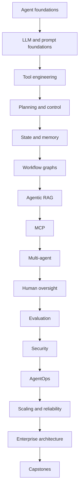
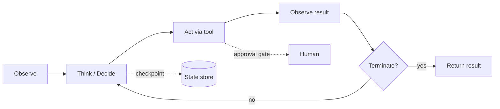
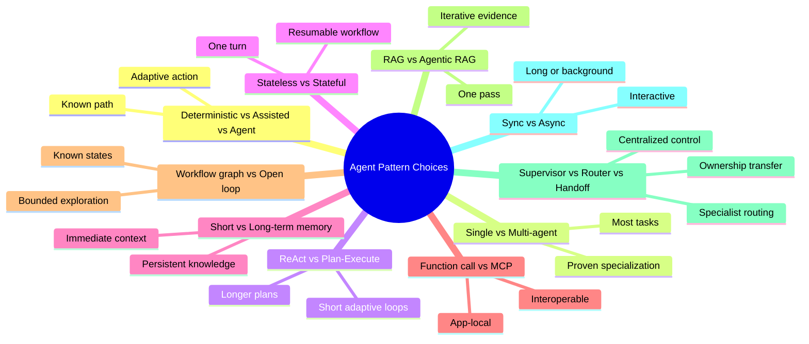
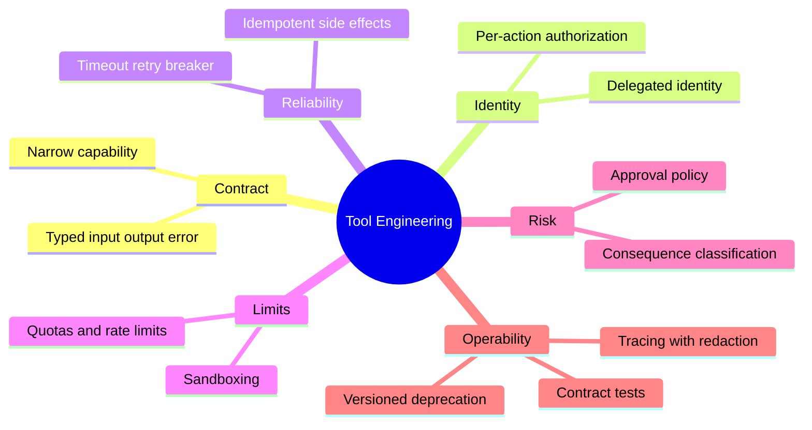
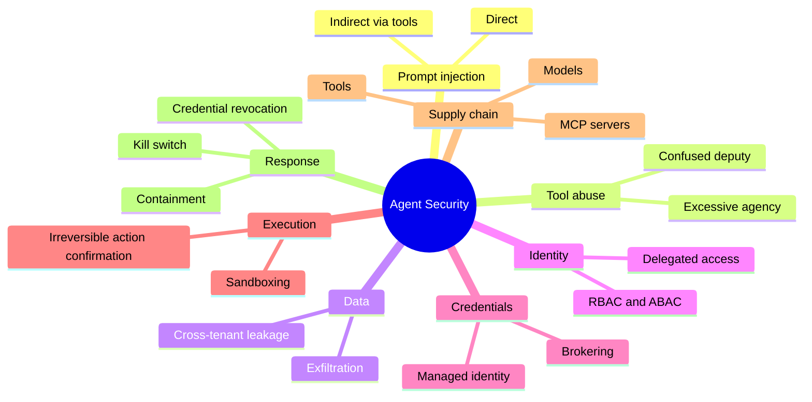
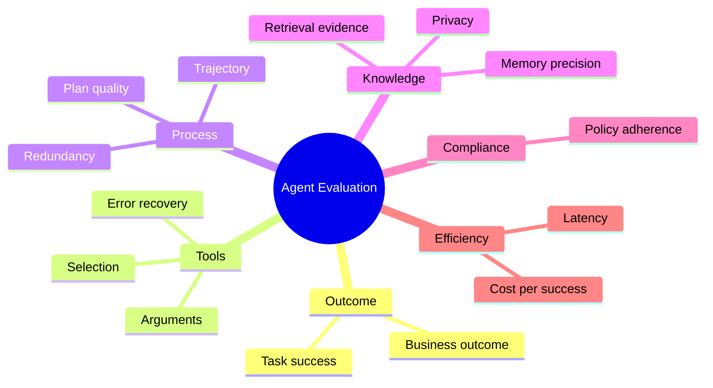

# Agentic AI — Mindmap

> Visual map of the **177 topics** in the [Agentic AI reference](../agents/agentic-ai-index.md), grouped into 16 categories.

## Mindmap

```mermaid
mindmap
  root((Agentic AI))
    1 Foundations
      Overview and Limits
      Agent vs Workflow
      Agent Anatomy
      Agent Loop
      Typed State
      Autonomy Spectrum
      Use-Case Selection
      Agent Lifecycle
      Reference Architecture
    2 LLM and Prompt Foundations
      LLM Behavior
      Instruction Hierarchy
      Structured Outputs
      Function Calling
      Context Engineering
      Agent Prompt Design
      Reasoning and Verification
      Model Routing
      Token and Cost Budgets
    3 Tool Engineering
      Tool Design
      Input Validation
      Result Validation
      Tool Choice
      Idempotency
      Timeouts and Retries
      API Tools
      Code Execution
      Browser and Computer Use
      Consequential Tools
      Tool Gateway
    4 Planning and Control
      Task Decomposition
      ReAct
      Plan-and-Execute
      Planner Executor Verifier
      Reflection and Critique
      Dynamic Replanning
      Search Planning
      Routing
      Loop Termination
      Fallback
      Control Policy Evaluation
    5 State Memory Persistence
      Working Memory
      Conversation State
      Checkpointing
      Long-Term Memory
      Semantic Memory
      Episodic Memory
      Summarization
      Memory Write Policy
      Memory Retrieval
      Memory Privacy
      State Store Architecture
    6 Workflow and Graph Orchestration
      State Machines
      DAG Workflows
      LangGraph Foundations
      LangGraph Checkpoints
      Human Interrupts
      Durable Execution
      Event-Driven Agents
      Scheduling
      Parallel Tool Execution
      Compensation and Sagas
      Workflow Testing
    7 Agentic RAG and Knowledge
      RAG for Agents
      Query Planning
      Source Routing
      Hybrid RAG
      Adaptive Retrieval
      Corrective RAG
      Multi-Hop Research
      GraphRAG Agents
      SQL Agents
      Citation Grounding
      Research Agent
      RAG Agent Evaluation
    8 MCP and Interoperability
      MCP Foundations
      MCP Tools
      MCP Resources
      MCP Security
      Server Design
      Client Design
      Enterprise Integration
      MCP Observability
      MCP vs Function Calling
    9 Multi-Agent Systems
      Multi-Agent Foundations
      Supervisor Worker
      Router Specialists
      Handoffs
      Debate and Critique
      Blackboard
      Agent Communication
      Collaborative Planning
      Conflict Resolution
      Multi-Agent Memory
      Multi-Agent Evaluation
      Production Risks
    10 Human-in-the-Loop
      Oversight Foundations
      Approval Gates
      Review Edit Confirm
      Escalation
      Progressive Autonomy
      Feedback Learning
      Explainability and Audit
      Agent UX
      Responsible Autonomy
    11 Agent Evaluation
      Evaluation Strategy
      Golden Tasks
      Task Success
      Tool Evaluation
      Trajectory Evaluation
      Planning Evaluation
      Memory Evaluation
      LLM-as-Judge
      Human Evaluation
      Simulations
      Regression Testing
      Online Evaluation
      Evaluation Tools
      Evaluation Statistics
    12 Security and Safety
      Threat Modeling
      Prompt Injection
      Tool Abuse
      Data Exfiltration
      Identity Delegation
      Secrets and Credentials
      Sandboxing
      Unsafe Actions
      Agent Supply Chain
      Red Teaming
      Audit and Compliance
      Incident Response
    13 Observability and AgentOps
      Observability
      OpenTelemetry
      Trace Model
      Agent Debugging
      Cost Observability
      Agent SLOs
      Agent Versioning
      Agent CI/CD
      Deployment Strategies
      Behavior Drift
      Incident Operations
    14 Scaling and Reliability
      Concurrency
      Queues and Back Pressure
      Distributed Agents
      State Consistency
      Caching
      Cost-Aware Routing
      Capacity Planning
      Cost Optimization
      Resilience
      Disaster Recovery
      Long-Running Agents
    15 Enterprise Architecture
      Enterprise Use Cases
      Reference Architecture
      Agent Gateway
      Enterprise Tool Integration
      Enterprise Identity
      Multi-Tenant Agents
      Cloud Hybrid On-Prem
      Agent Platform
      Operating Model
      Vendor Selection
      Agent FinOps
      System Design
    16 Patterns and Capstones
      Research Agent
      Service Desk Agent
      Software Engineering Agent
      Procurement Agent
      Incident Response Agent
      Document Workflow Agent
      Agentic RAG Capstone
      Multi-Agent Capstone
      MCP Capstone
      Human-Approved Automation Capstone
      Secure Agent Capstone
      Interview Framework and Bank
```

## Category Breakdown

| # | Category | Topics |
|---|---|---|
| 1 | Agentic AI Foundations | 01–09 |
| 2 | LLM and Prompt Foundations for Agents | 10–18 |
| 3 | Tool Engineering | 19–29 |
| 4 | Planning, Reasoning and Control | 30–40 |
| 5 | State, Memory and Persistence | 41–51 |
| 6 | Workflow and Graph Orchestration | 52–62 |
| 7 | Agentic RAG and Knowledge | 63–74 |
| 8 | Model Context Protocol and Interoperability | 75–83 |
| 9 | Multi-Agent Systems | 84–95 |
| 10 | Human-in-the-Loop and Responsible Autonomy | 96–104 |
| 11 | Agent Evaluation and Testing | 105–118 |
| 12 | Agent Security and Safety | 119–130 |
| 13 | Observability and AgentOps | 131–141 |
| 14 | Production Scaling and Reliability | 142–152 |
| 15 | Enterprise Agentic AI Architecture | 153–164 |
| 16 | Enterprise Patterns and Capstones | 165–177 |

> Each topic lives at `../agents/NNN-<slug>.md`; the full per-topic list with links is in the [Agentic AI index](../agents/agentic-ai-index.md#repository-file-map).

## Learning Path

## The Agent Loop

## Pattern Selection Map

## Tool Engineering Playbook

## Security and Autonomy Map

## Evaluation Dimensions

