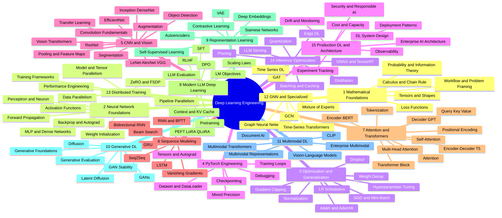
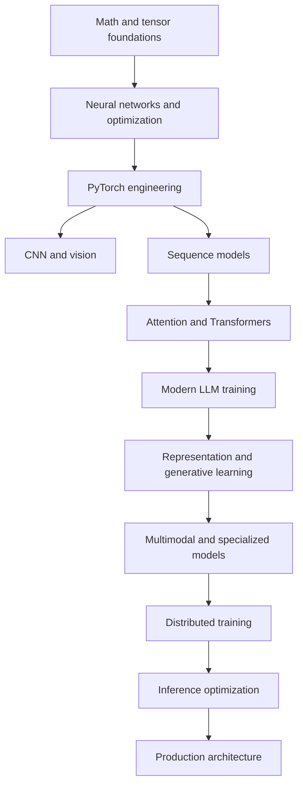
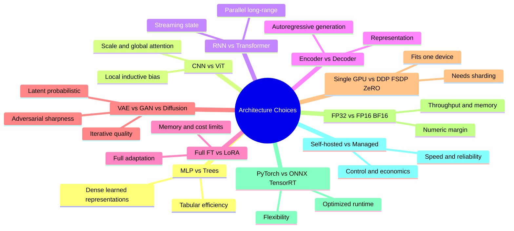
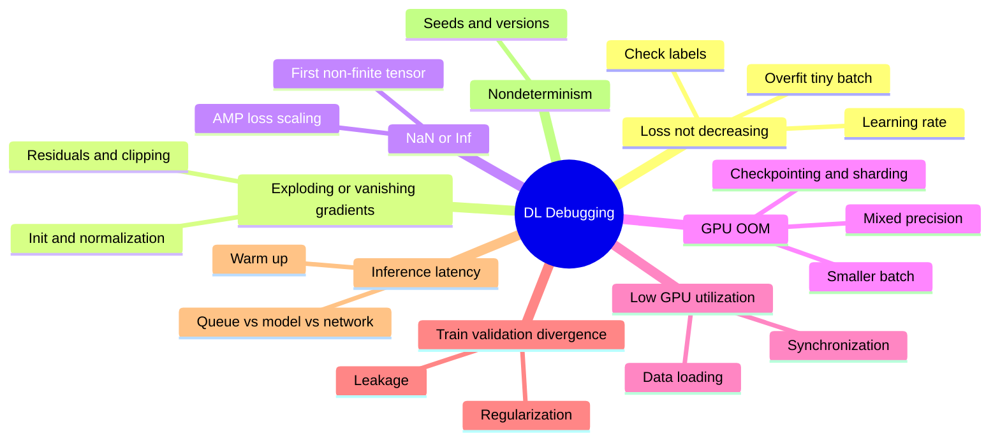

# Deep Learning Engineering — Mindmap

> Visual map of the **107 topics** in the [Deep Learning reference](../dl/dl-index.md), grouped into 15 categories.

## Mindmap

## Category Breakdown

| # | Category | Topics | Level | Est. Time |
|---|---|---|---|---|
| 1 | Deep Learning Mathematical Foundations | 01–05 | Foundational | 30–50 h |
| 2 | Neural Network Foundations | 06–11 | Foundational | 36–60 h |
| 3 | Optimization and Generalization | 12–19 | Foundational | 48–80 h |
| 4 | PyTorch Engineering Fundamentals | 20–25 | Intermediate | 36–60 h |
| 5 | Convolutional Neural Networks and Vision | 26–36 | Intermediate | 66–110 h |
| 6 | Sequence Modeling | 37–43 | Intermediate | 42–70 h |
| 7 | Attention and Transformer Foundations | 44–53 | Intermediate | 60–100 h |
| 8 | Modern LLM Deep Learning | 54–62 | Advanced | 54–90 h |
| 9 | Representation and Self-Supervised Learning | 63–68 | Advanced | 36–60 h |
| 10 | Generative Deep Learning | 69–74 | Advanced | 36–60 h |
| 11 | Multimodal Deep Learning | 75–80 | Advanced | 36–60 h |
| 12 | Graph Neural Networks and Specialized Architectures | 81–86 | Advanced | 36–60 h |
| 13 | Distributed and Large-Scale Training | 87–92 | Advanced | 36–60 h |
| 14 | Inference and Model Optimization | 93–99 | Architecture/Production | 42–70 h |
| 15 | Production Deep Learning and Architecture | 100–107 | Architecture/Production | 48–80 h |

## Learning Path

## Topic Links by Category

| Category | Topics |
|---|---|
| 1 Math Foundations | [01 Workflow](../dl/01-deep-learning-workflow.md) · [02 Tensors](../dl/02-tensors-linear-algebra-and-shapes.md) · [03 Calculus](../dl/03-calculus-gradients-and-chain-rule.md) · [04 Probability](../dl/04-probability-information-theory.md) · [05 Loss Functions](../dl/05-loss-functions.md) |
| 2 NN Foundations | [06 Perceptron](../dl/06-perceptron-and-neuron.md) · [07 MLP](../dl/07-mlp-and-dense-networks.md) · [08 Activations](../dl/08-activation-functions.md) · [09 Forward Prop](../dl/09-forward-propagation.md) · [10 Backprop](../dl/10-backpropagation-and-autograd.md) · [11 Initialization](../dl/11-weight-initialization.md) |
| 3 Optimization | [12 SGD](../dl/12-gradient-descent-sgd-minibatch.md) · [13 Adam](../dl/13-momentum-rmsprop-adam-adamw.md) · [14 Schedulers](../dl/14-learning-rate-and-schedulers.md) · [15 Weight Decay](../dl/15-regularization-weight-decay.md) · [16 Dropout](../dl/16-dropout.md) · [17 Normalization](../dl/17-normalization.md) · [18 Clipping](../dl/18-gradient-clipping-accumulation.md) · [19 HPO](../dl/19-hyperparameter-tuning.md) |
| 4 PyTorch | [20 Autograd](../dl/20-pytorch-tensors-autograd.md) · [21 DataLoader](../dl/21-dataset-dataloader.md) · [22 Training Loops](../dl/22-training-validation-loops.md) · [23 Checkpointing](../dl/23-checkpointing-reproducibility.md) · [24 Mixed Precision](../dl/24-mixed-precision-training.md) · [25 Debugging](../dl/25-debugging-deep-neural-networks.md) |
| 5 CNN and Vision | [26 Convolution](../dl/26-convolution-fundamentals.md) · [27 Pooling](../dl/27-cnn-pooling-feature-maps.md) · [28 LeNet AlexNet VGG](../dl/28-lenet-alexnet-vgg.md) · [29 ResNet](../dl/29-resnet.md) · [30 Inception DenseNet](../dl/30-inception-densenet.md) · [31 EfficientNet](../dl/31-efficientnet.md) · [32 Transfer Learning](../dl/32-transfer-learning-vision.md) · [33 Augmentation](../dl/33-data-augmentation-vision.md) · [34 Detection](../dl/34-object-detection.md) · [35 Segmentation](../dl/35-image-segmentation.md) · [36 ViT](../dl/36-vision-transformers.md) |
| 6 Sequence Modeling | [37 RNN](../dl/37-rnn.md) · [38 Vanishing Gradients](../dl/38-vanishing-exploding-gradients.md) · [39 LSTM](../dl/39-lstm.md) · [40 GRU](../dl/40-gru.md) · [41 Bidirectional](../dl/41-bidirectional-rnn.md) · [42 Seq2Seq](../dl/42-seq2seq-encoder-decoder.md) · [43 Beam Search](../dl/43-teacher-forcing-beam-search.md) |
| 7 Attention and Transformers | [44 Attention](../dl/44-attention.md) · [45 QKV](../dl/45-query-key-value.md) · [46 Self-Attention](../dl/46-self-attention.md) · [47 Multi-Head](../dl/47-multi-head-attention.md) · [48 Positional Encoding](../dl/48-positional-encoding.md) · [49 Transformer Block](../dl/49-transformer-block.md) · [50 Encoder](../dl/50-transformer-encoder.md) · [51 Decoder](../dl/51-transformer-decoder.md) · [52 Encoder-Decoder](../dl/52-encoder-decoder-transformers.md) · [53 Tokenization](../dl/53-tokenization.md) |
| 8 Modern LLM DL | [54 LM Objectives](../dl/54-language-modeling-objectives.md) · [55 Pretraining](../dl/55-pretraining.md) · [56 Scaling Laws](../dl/56-scaling-laws-and-compute.md) · [57 SFT](../dl/57-supervised-fine-tuning.md) · [58 PEFT](../dl/58-peft-lora-qlora.md) · [59 RLHF](../dl/59-rlhf.md) · [60 DPO](../dl/60-dpo-preference-optimization.md) · [61 KV Cache](../dl/61-context-windows-and-kv-cache.md) · [62 LLM Eval](../dl/62-llm-evaluation.md) |
| 9 Representation Learning | [63 Autoencoders](../dl/63-autoencoders.md) · [64 VAE](../dl/64-variational-autoencoders.md) · [65 Contrastive](../dl/65-contrastive-learning.md) · [66 Siamese](../dl/66-siamese-networks.md) · [67 Self-Supervised](../dl/67-self-supervised-learning.md) · [68 Deep Embeddings](../dl/68-deep-embeddings.md) |
| 10 Generative DL | [69 Foundations](../dl/69-generative-modeling-foundations.md) · [70 GANs](../dl/70-gans.md) · [71 GAN Stability](../dl/71-gan-training-stability.md) · [72 Diffusion](../dl/72-diffusion-models.md) · [73 Latent Diffusion](../dl/73-latent-diffusion.md) · [74 Evaluation](../dl/74-generative-model-evaluation.md) |
| 11 Multimodal DL | [75 Representations](../dl/75-multimodal-representations.md) · [76 CLIP](../dl/76-clip.md) · [77 VLMs](../dl/77-vision-language-models.md) · [78 Multimodal Transformers](../dl/78-multimodal-transformers.md) · [79 Document AI](../dl/79-document-ai.md) · [80 Enterprise Multimodal](../dl/80-multimodal-enterprise-systems.md) |
| 12 GNN and Specialized | [81 GNN](../dl/81-graph-neural-networks.md) · [82 GCN](../dl/82-graph-convolutional-networks.md) · [83 GAT](../dl/83-graph-attention-networks.md) · [84 Time Series](../dl/84-temporal-and-time-series-dl.md) · [85 TS Transformers](../dl/85-transformers-for-time-series.md) · [86 MoE](../dl/86-mixture-of-experts.md) |
| 13 Distributed Training | [87 Data Parallel](../dl/87-data-parallelism.md) · [88 Tensor Parallel](../dl/88-model-tensor-parallelism.md) · [89 Pipeline Parallel](../dl/89-pipeline-parallelism.md) · [90 ZeRO FSDP](../dl/90-zero-and-sharded-training.md) · [91 Frameworks](../dl/91-distributed-training-frameworks.md) · [92 Performance](../dl/92-training-performance-engineering.md) |
| 14 Inference Optimization | [93 Quantization](../dl/93-model-quantization.md) · [94 Pruning](../dl/94-pruning.md) · [95 Distillation](../dl/95-knowledge-distillation.md) · [96 ONNX TensorRT](../dl/96-onnx-tensorrt-compilation.md) · [97 Batching Caching](../dl/97-inference-batching-caching.md) · [98 LLM Serving](../dl/98-llm-serving.md) · [99 Edge DL](../dl/99-edge-deep-learning.md) |
| 15 Production DL | [100 Tracking](../dl/100-experiment-tracking-model-registry.md) · [101 Drift](../dl/101-data-model-drift.md) · [102 Observability](../dl/102-deep-learning-observability.md) · [103 Deployment](../dl/103-deployment-patterns.md) · [104 Security](../dl/104-security-privacy-responsible-ai.md) · [105 Cost](../dl/105-cost-capacity-planning.md) · [106 System Design](../dl/106-deep-learning-system-design.md) · [107 Enterprise Architecture](../dl/107-enterprise-ai-architecture.md) |

## Architecture Selection Map

## Debugging Playbook Map

