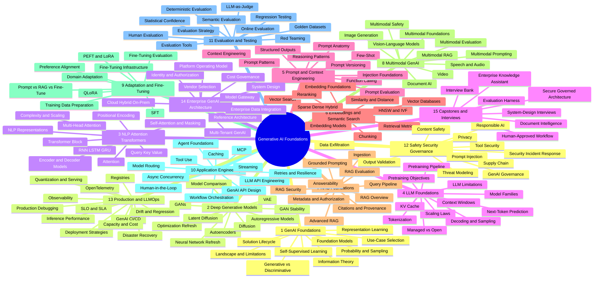
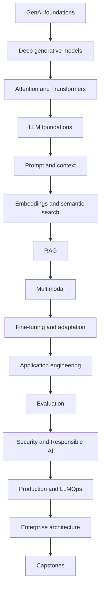
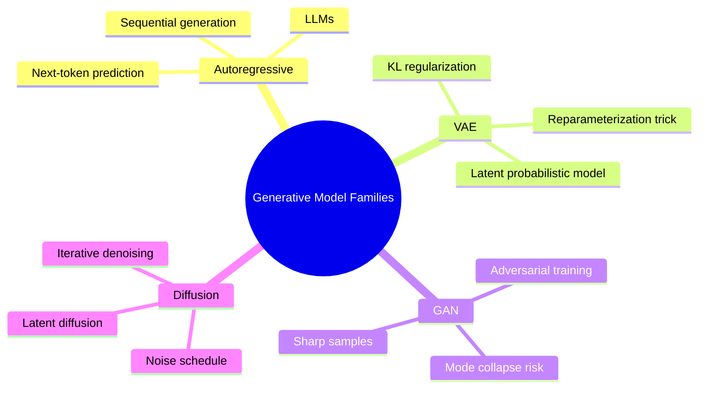
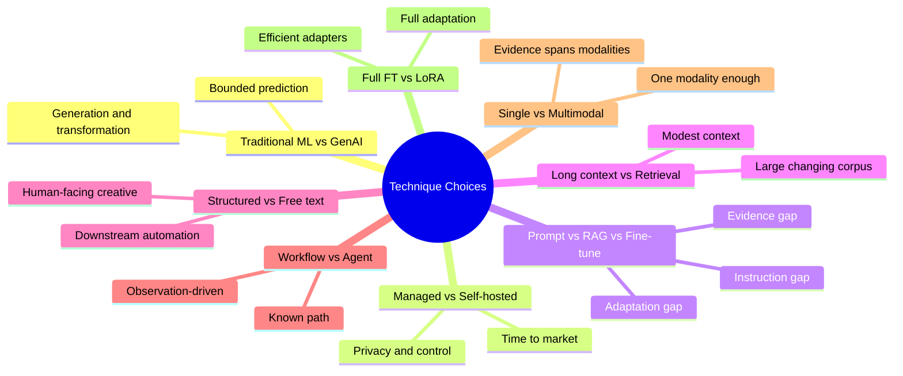
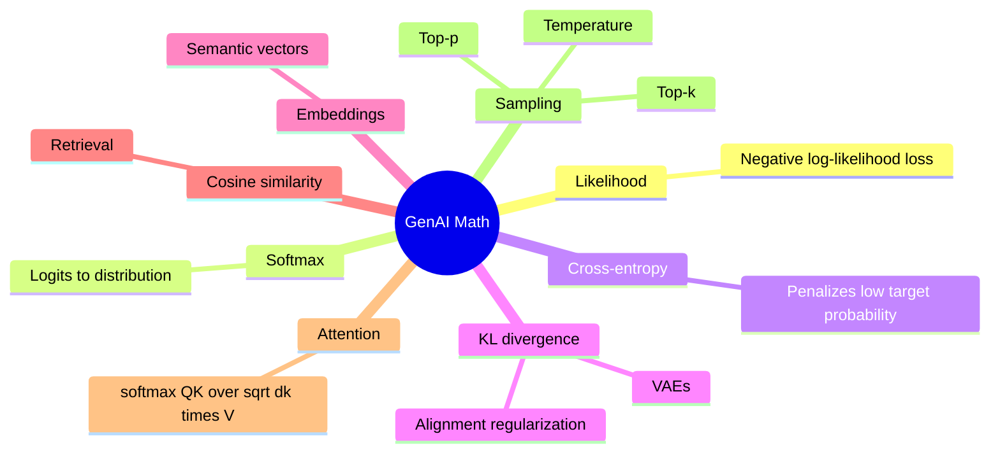
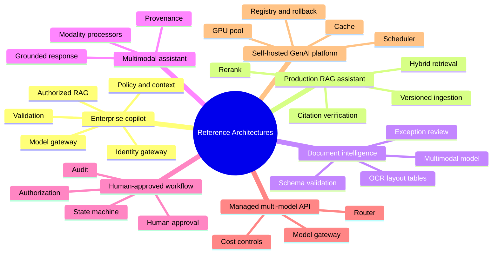
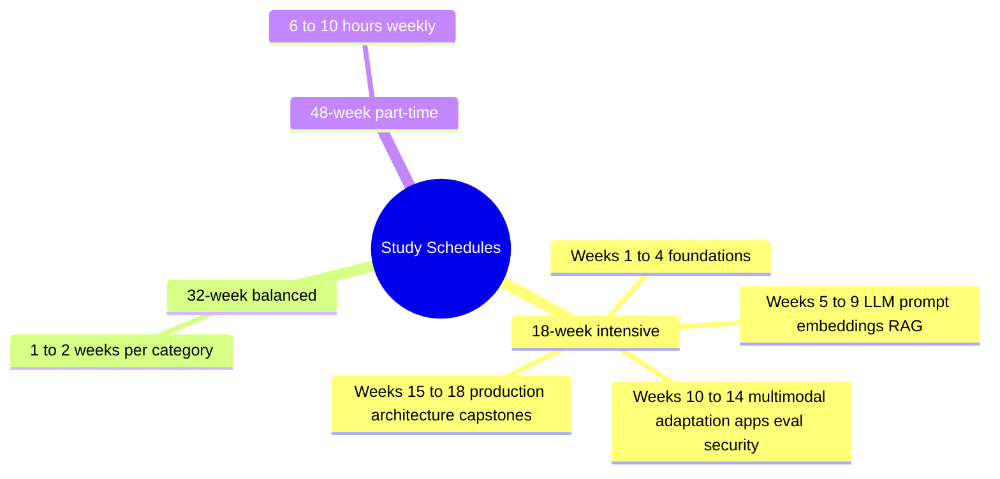

# Generative AI Foundations — Mindmap

> Visual map of the **154 topics** in the [GenAI reference](../genai/genai-index.md), grouped into 15 categories.

## Mindmap

## Category Breakdown

| # | Category | Topics | Level | Est. Time |
|---|---|---|---|---|
| 1 | Generative AI Foundations | 01–09 | Foundational | 54–90 h |
| 2 | Neural and Deep Generative Foundations | 10–19 | Foundational | 60–100 h |
| 3 | NLP, Attention and Transformer Foundations | 20–31 | Foundational | 72–120 h |
| 4 | LLM Foundations | 32–42 | Foundational | 66–110 h |
| 5 | Prompt and Context Engineering Foundations | 43–52 | Intermediate | 60–100 h |
| 6 | Embeddings and Semantic Search Foundations | 53–62 | Intermediate | 60–100 h |
| 7 | RAG Foundations | 63–72 | Intermediate | 60–100 h |
| 8 | Multimodal Generative AI | 73–82 | Intermediate | 60–100 h |
| 9 | Model Adaptation and Fine-Tuning Foundations | 83–91 | Intermediate | 54–90 h |
| 10 | GenAI Application Engineering | 92–103 | Intermediate | 72–120 h |
| 11 | Evaluation and Testing | 104–114 | Advanced | 66–110 h |
| 12 | Safety, Security, Responsible AI and Governance | 115–125 | Advanced | 66–110 h |
| 13 | Production GenAI and LLMOps Foundations | 126–137 | Advanced | 72–120 h |
| 14 | Enterprise GenAI Architecture | 138–147 | Architecture | 60–100 h |
| 15 | Capstones and Interview Preparation | 148–154 | Architecture | 42–70 h |

> Each topic lives at `../genai/NNN-<slug>.md`; the full per-topic list with links is in the [GenAI index](../genai/genai-index.md#repository-file-map).

## Learning Path

## Generative Model Families

## Technique Selection Map

## GenAI Math Cheat Sheet

## Reference Architectures

## Study Schedules

